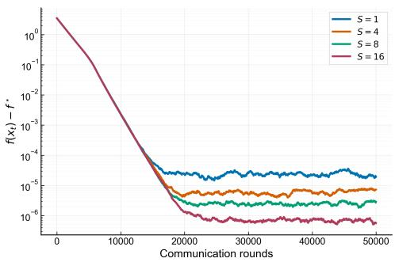
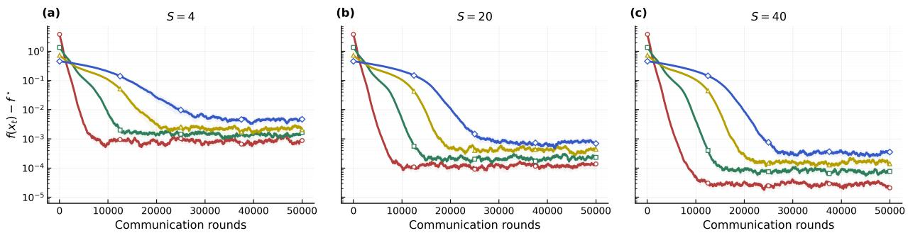
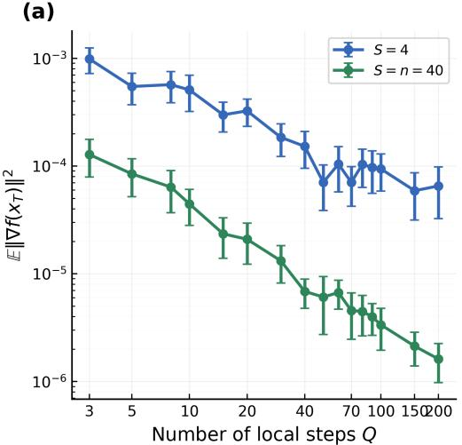
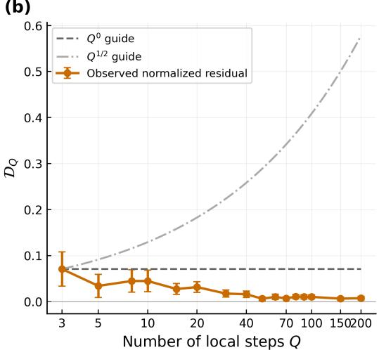

# On Federated Averaging with Partial Participation under a General Variance Condition

Ziming Wang, Kun Huang, Karl Henrik Johansson, and Shi Pu

## Abstract

In this paper, we study the convergence of Federated Averaging (FedAvg) with partial participation under a general variance condition. In each communication round, the server samples $S$ of the n clients uniformly at random without replacement. The stochastic gradients are assumed to satisfy the so-called ABC condition, which allows their variance to grow with the local objective gaps. For smooth nonconvex objectives, we establish a finite-time stationarity bound in terms of the heterogeneity measure $\begin{array} { r } { \sigma _ { f } ^ { \star } : = f ^ { \star } - \frac { 1 } { n } \sum _ { i = 1 } ^ { n } f _ { i } ^ { \star } } \end{array}$ and the client sampling factor $I _ { S } : = ( n - S ) / ( n - 1 )$ . Here, $f ^ { \star }$ and $f _ { i } ^ { \star }$ denote the infima of the global average objective and client $i \mathrm { { } s }$ local objective, respectively. The bound exhibits a linear speedup in the number of sampled clients S and recovers the full-participation result when $S = n .$ Under diminishing stepsizes, we further prove that the gradient norm converges to zero both in expectation and almost surely. Notably, compared with existing analyses of FedAvg with partial participation, our results require no additional data heterogeneity assumption such as bounded gradient dissimilarity (BGD), and the sampling-induced term in our bound is not amplified by the number of local updates at the leading order. The importance of removing the BGD assumption is illustrated by an example that is smooth and lower bounded but violates BGD, yet is covered by our analysis.

## Index Terms

Distributed optimization, federated learning, general variance condition, partial client participation.

## I. INTRODUCTION

Federated learning (FL) trains a shared model across clients while keeping each client’s raw data local. It has been applied to autonomous driving [1], [2], large-scale training [3], and natural language processing [4], [5]. In FL, the clients collaboratively solve

$$
\operatorname* { m i n } _ { x \in \mathbb { R } ^ { d } } f ( x ) : = \frac { 1 } { n } \sum _ { i = 1 } ^ { n } f _ { i } ( x ) ,\tag{1}
$$

where n is the number of clients and $f _ { i } : \mathbb { R } ^ { d } $ R is the local objective available only to client $i \in [ n ] : = \{ 1 , . . . , n \}$ . Typical examples of $f _ { i }$ include the expected risk $f _ { i } ( x ) = \mathbb { E } _ { \xi \sim \mathcal { D } _ { i } } [ F _ { i } ( x ; \xi ) ]$ and the empirical risk $\begin{array} { r } { f _ { i } ( x ) = \frac { 1 } { m _ { i } } \sum _ { j = 1 } ^ { m _ { i } } f _ { i j } ( x ) } \end{array}$ , where $\mathcal { D } _ { i }$ is the local data distribution, $F _ { i } ( x ; \xi )$ is the loss of model x on sample $\xi ,$ and $f _ { i j } ( x ) : = F _ { i } ( x ; \xi _ { i j } )$ is the loss on the j-th local sample $\xi _ { i j }$ . Since client data typically follow different distributions, the local objectives $f _ { i }$ generally differ across clients. This data heterogeneity is a central concern in FL.

A classical algorithm for solving (1) is Federated Averaging (FedAvg) [6]. We consider FedAvg with partial client partici pation: in each communication round, the server samples S of the n clients uniformly at random without replacement. Each sampled client performs Q local stochastic gradient updates starting from the current global model, and the server averages the resulting local models. Partial participation is motivated by limited server bandwidth and intermittent client availability [7], [8].

Convergence analyses for FedAvg typically impose conditions on both the stochastic gradient noise and the data heterogeneity. Let $g _ { i } ( x ; \xi _ { i } )$ be an unbiased stochastic gradient of $f _ { i } ( x )$ . A commonly used noise condition is the relaxed growth condition [9],

$$
\begin{array} { r } { \mathbb { E } _ { \xi _ { i } } \left[ \left\| g _ { i } ( x ; \xi _ { i } ) - \nabla f _ { i } ( x ) \right\| ^ { 2 } \right] \leq \sigma ^ { 2 } + \eta ^ { 2 } \left\| \nabla f _ { i } ( x ) \right\| ^ { 2 } , \forall x \in \mathbb { R } ^ { d } , } \end{array}\tag{2}
$$

for some constants $\sigma , \eta \geq 0$ . In particular, its special case $\eta = 0$ (bounded variance) has been widely adopted [10], [11]. To model and control data heterogeneity, one typically imposes the bounded gradient dissimilarity (BGD) condition (see, e.g., [12], [13]):

$$
\frac { 1 } { n } \sum _ { i = 1 } ^ { n } \| \nabla f _ { i } ( x ) - \nabla f ( x ) \| ^ { 2 } \leq \zeta ^ { 2 } + \psi ^ { 2 } \| \nabla f ( x ) \| ^ { 2 } , \quad \forall x \in \mathbb { R } ^ { d } ,\tag{3}
$$

where $\zeta , \psi \geq 0$ are constants. The left-hand side of (3) vanishes for all x if and only if all $f _ { i }$ have identical gradients. The constants ζ and ψ quantify the level of data heterogeneity.

Both conditions can be restrictive. The relaxed growth condition (2) can fail for simple finite-sum problems [14], [15]. Moreover, BGD can fail even when all $f _ { i }$ are smooth and lower bounded: Theorem 1 constructs such local objectives for which no finite pair $( \zeta , \psi )$ satisfies (3). To our knowledge, however, existing analyses of FedAvg with partial participation still rely on BGD (or a stronger condition) together with bounded variance. Specifically, client sampling introduces an additional error that scales with the gradient dissimilarity, and these analyses (e.g., [10]) control this error through BGD. Beyond FedAvg, the methods in [16], [17] avoid BGD under partial participation, but they still assume bounded variance. More importantly, they require clients to retain auxiliary variables across rounds. In contrast, FedAvg is stateless and well suited to cross-device FL, where clients participate infrequently and stored optimization variables can become stale [8].

The above observations motivate us to establish convergence guarantees for FedAvg with partial participation under a more general noise model and without BGD-type assumptions. The ABC condition [14], [15], [18] provides such a noise model:

$$
\mathbb { E } _ { \xi _ { i } } \left[ \left\| g _ { i } ( x ; \xi _ { i } ) - \nabla f _ { i } ( x ) \right\| ^ { 2 } \right] \leq C \left[ f _ { i } ( x ) - f _ { i } ^ { \star } \right] + D ,\tag{4}
$$

where $C , D \ge 0$ are constants and $f _ { i } ^ { \star } : = \operatorname* { i n f } _ { x } f _ { i } ( x )$ ; see Assumption 2. For smooth and lower bounded $f _ { i } ,$ the squared gradient norm is controlled by the local objective gap, so (2) implies (4). The converse need not hold [14], [15]. Thus, the ABC condition covers a strictly broader class of stochastic gradient oracles

Regarding data heterogeneity, BGD can be avoided. Let $f ^ { \star } : = \operatorname* { i n f } _ { x } f ( x )$ and $\begin{array} { r } { \sigma _ { f } ^ { \star } : = f ^ { \star } - \frac { 1 } { n } \sum _ { i = 1 } ^ { n } f _ { i } ^ { \star } } \end{array}$ . If each $f _ { i }$ is L-smooth and lower bounded, the left-hand side of (3) is at most $2 L [ f ( x ) - f ^ { \star } + \sigma _ { f } ^ { \star } ]$ ; see Lemma 1. Since $\sigma _ { f } ^ { \star }$ is finite whenever each $f _ { i }$ is lower bounded, this bound remains valid even when BGD fails [14].

In this paper, we prove that FedAvg with partial participation converges to stationarity under the ABC condition (4), without BGD-type assumptions. The main difficulty is that the aggregated update is affected by two sources of randomness. The first is the stochastic gradient noise along the local trajectories, which scales with the local objective gaps. The second is client sampling, whose error scales with the gradient dissimilarity. Without BGD, this dissimilarity is bounded in terms of $2 L [ f ( x ) - f ^ { \star } + \sigma _ { f } ^ { \star } ]$ , which may grow even when $\| \nabla f ( x ) \| ^ { 2 }$ stays bounded. We separate the two sources by assigning a virtual local trajectory to every client, and bound the gradient dissimilarity by $f ( x ) - f ^ { \star }$ and $\boldsymbol { \sigma } _ { f } ^ { \star }$ . The resulting bound quantifies the effect of partial participation through the sampling factor $I _ { S } : = ( n - S ) / ( n - 1 )$ , which vanishes under full participation. Moreover, the client-sampling error in our bound is not amplified by the number of local updates.

TABLE I  
COMPARISON OF CONVERGENCE RESULTS OF FEDAVG FOR SMOOTH NONCONVEX OBJECTIVES.
<table><tr><td rowspan="2">Paper</td><td rowspan="2">Noise</td><td colspan="2">Heterogeneity</td><td rowspan="2">Rate</td><td rowspan="2"></td><td rowspan="2">a.s.</td></tr><tr><td>Assumption</td><td>Measure</td></tr><tr><td colspan="8">Full Participation  $( S = n )$ </td></tr><tr><td>[19]</td><td> $( \sigma ^ { 2 } , 0 )$ </td><td> $( \zeta ^ { 2 } , 0 ) { \cdot } \mathrm { B G D }$ </td><td> $\zeta ^ { 2 }$ </td><td> $\textstyle { \mathcal { O } } \left( { \frac { 1 + \sigma ^ { 2 } } { \sqrt { n Q T } } } \right)$ </td><td></td><td>N</td></tr><tr><td>[10]</td><td> $( \sigma ^ { 2 } , 0 )$ </td><td> $( \zeta ^ { 2 } , 0 ) { \cdot } \mathrm { B G D }$ </td><td> $\zeta ^ { 2 }$ </td><td> $\begin{array} { r } { \mathcal { O } \left( \frac { 1 + \sigma ^ { 2 } } { \sqrt { n Q T } } \right) } \end{array}$ </td><td></td><td>N</td></tr><tr><td>[20]</td><td> $( \sigma ^ { 2 } , 0 )$ </td><td> $( \zeta ^ { 2 } , \psi ^ { 2 } ) { \mathrm { - B G D } }$ </td><td> $\zeta ^ { 2 } , \psi ^ { 2 }$   $\zeta ^ { 2 } , \psi ^ { 2 }$ </td><td> $\textstyle { \mathcal { O } } \left( { \frac { 1 + \sigma ^ { 2 } } { \sqrt { n Q T } } } \right)$   $\begin{array} { r } { \mathcal { O } \left( \frac { 1 + \dot { \sigma } ^ { 2 } } { \sqrt { n Q T } } \right) } \end{array}$ </td><td></td><td>N</td></tr><tr><td>[21]</td><td> $( \sigma ^ { 2 } , \eta ^ { 2 } )$ </td><td> $( \zeta ^ { 2 } , \psi ^ { 2 } ) { \mathrm { - B G D } }$ </td><td></td><td></td><td></td><td>N</td></tr><tr><td>[14]</td><td>ABC</td><td>None</td><td> $\sigma _ { f } ^ { \star ( a ) }$ </td><td> $\begin{array} { r } { \mathcal { O } \left( \sqrt { \frac { D + C \sigma _ { f } ^ { \star } + C } { n Q T } } \right) } \end{array}$ </td><td></td><td>Y</td></tr><tr><td colspan="7">Partial Participation  $( S < n )$ </td></tr><tr><td>[10]</td><td> $( \sigma ^ { 2 } , 0 )$ </td><td> $( \zeta ^ { 2 } , 0 ) { \cdot } \mathrm { B G D }$ </td><td> $\zeta ^ { 2 }$ </td><td> $\begin{array} { r } { \mathcal { O } \left( \frac { 1 + \sigma ^ { 2 } } { \sqrt { S Q T } } + \frac { I _ { S } \zeta ^ { 2 } \sqrt { Q } } { \sqrt { S T } } \right) ^ { ( b ) } } \end{array}$ </td><td></td><td>N</td></tr><tr><td>This Work</td><td>ABC</td><td>None</td><td> $\boldsymbol { \sigma } _ { f } ^ { \star }$ </td><td> $\begin{array} { r } { \mathcal { O } \left( \sqrt { \frac { D + C \sigma _ { f } ^ { \star } + C } { S Q T } } + \sqrt { \frac { ( 1 + \sigma _ { f } ^ { \star } ) I _ { S } } { S T } } \right) } \end{array}$ </td><td></td><td>Y</td></tr></table>

Noise: $( \sigma ^ { 2 } , \eta ^ { 2 } )$ means $\begin{array} { r } { \mathbb { E } \| g _ { i } ( x ; \xi ) - \nabla f _ { i } ( x ) \| ^ { 2 } \leq \sigma ^ { 2 } + \eta ^ { 2 } \| \nabla f _ { i } ( x ) \| ^ { 2 } ; } \end{array}$ ABC refers to (4). Heterogeneity: $( \zeta ^ { 2 } , \psi ^ { 2 } ) { \cdot } \mathrm { B G D }$ refers to (3). Rate: only leading-order terms in T are reported. Problem-dependent constants and numerical constants are omitted. a.s.: almost sure convergence under $\textstyle \sum _ { t } \alpha _ { t } = \infty$ and $\textstyle \sum _ { t } \alpha _ { t } ^ { 2 } < \infty .$  
(a) $\begin{array} { r } { \sigma _ { f } ^ { \star } = f ^ { \star } - \frac { 1 } { n } \sum f _ { i } ^ { \star } } \end{array}$ with $f ^ { \star } = \operatorname* { i n f } _ { x } f ( x )$ and $f _ { i } ^ { \star } = \operatorname* { i n f } _ { x } f _ { i } ( x )$  
(b) $\bar { I _ { S } } = ( n - S ) / ( n - 1 )$ is the sampling factor.

## A. Related Works

Most convergence analyses of FedAvg control data heterogeneity through the BGD condition (3); see, e.g., [10], [12], [19]– [21]. Other works avoid BGD by adopting alternative heterogeneity measures, such as the average drift at the optimum [22] and $\sigma _ { f } ^ { \star }$ [14], [23]. The measure $\sigma _ { f } ^ { \star }$ is used in [23] under strong convexity and bounded second moments of the stochastic gradients. It is shown in [14] that $\boldsymbol { \sigma } _ { f } ^ { \star }$ suffices to analyze nonconvex FedAvg under the ABC condition, but only for full participation. A different line of work modifies FedAvg to mitigate heterogeneity: SCAFFOLD [11] corrects client drift with control variates, FedProx [24] adds a proximal term to the local objectives, and FedPD [13] adopts a primal-dual formulation.

The effect of client sampling on convergence has been widely studied. For strongly convex objectives, FedAvg has been analyzed under client sampling both with and without replacement [23]. For smooth nonconvex objectives, a rate of $\mathcal { O } ( \sqrt { Q / ( S T ) } )$

has been established for FedAvg with partial participation [10]. Other works design optimal client sampling rules that better approximate the full-client update [25] and handle arbitrary participation patterns [17]. These results are mainly developed under bounded variance or BGD-type assumptions, whereas our analysis requires neither.

FL is closely related to decentralized optimization, where clients exchange information with their neighbors over a connected network instead of through a central server. Classical decentralized methods include DSGD [26], [27], gradient tracking [28]– [31], and exact diffusion $\prime D ^ { 2 }$ [32]–[34]. Their local-update variants are studied in [35]–[38], and local momentum tracking further attains the optimal communication complexity [39]. The stochastic versions of these methods are typically analyzed under bounded variance or the relaxed growth condition (2). Decentralized methods under the ABC condition (4) have been studied in [40], [41], but without local updates.

## B. Main Contribution

The main contribution of this work is three-fold.

First, we establish a finite-time stationarity guarantee for FedAvg with partial participation under the ABC condition (4) without BGD-type assumptions. In particular, with S sampled clients per round, $\dot { Q }$ local updates, and $T$ total communication rounds, the leading terms of the bound on $\begin{array} { r } { \operatorname* { m i n } _ { 0 \leq t < T } \mathbb { E } \| \dot { \nabla } f ( x _ { t } ) \| ^ { 2 } } \end{array}$ are

$$
\mathcal { O } \left( \sqrt { \frac { L \Delta _ { f } ( D + C \sigma _ { f } ^ { \star } + C \Delta _ { f } ) } { S Q T } } + L \left( \Delta _ { f } + \sqrt { \Delta _ { f } \sigma _ { f } ^ { \star } } \right) \sqrt { \frac { I _ { S } } { S T } } \right) ,
$$

where $\Delta _ { f } : = f ( x _ { 0 } ) - f ^ { \star }$ . The first term stems from the stochastic gradient noise and exhibits a linear speedup in $S$ and $Q$ . The second term captures the effect of client sampling and is independent of $Q .$ . By comparison, the corresponding sampling term in [10] grows as $\sqrt { Q }$ under their stepsize choice. Under full participation, $I _ { S } = 0$ and the bound recovers the $\mathcal { O } ( 1 / \sqrt { n Q T } )$ rate of [14]. To the best of our knowledge, this is the first guarantee for FedAvg with partial participation that requires neither bounded variance nor BGD-type assumptions; see Table I.

Second, under diminishing stepsizes, we show that $\| \nabla f ( x _ { t } ) \|$ converges to 0 both in expectation and almost surely. To the best of our knowledge, this is the first almost sure convergence result for FedAvg with partial participation in the nonconvex setting. It establishes an asymptotic stationarity guarantee for the last iterate and complements the finite-time bound above.

Third, we show that the BGD condition (3) is indeed restrictive: it excludes certain problems that satisfy the smoothness and lower boundedness assumptions. Specifically, Theorem 1 constructs a one-dimensional example with two clients whose local objectives are smooth and lower bounded. However, no finite pair $( \zeta , \psi )$ satisfies (3) in this example, even though the data heterogeneity measured by $\boldsymbol { \sigma } _ { f } ^ { \star }$ is at most $1 / 2$ . Hence, within this setting, our analysis covers a strictly larger class of problems compared to BGD-based convergence guarantees.

## II. FEDAVG WITH PARTIAL PARTICIPATION: ALGORITHM AND PRELIMINARY ANALYSIS

In this section, we describe FedAvg with partial participation, state the standing assumptions, introduce the heterogeneity measure, and develop the auxiliary estimates used in its convergence analysis.

## A. Algorithm and Virtual Trajectories

Algorithm 1 summarizes FedAvg with partial participation. In each communication round t, the server samples a subset $S _ { t }$ of $S$ clients uniformly at random without replacement and sends the current global model $x _ { t }$ to them. Each sampled client starts from $x _ { t }$ , performs $Q$ local stochastic gradient steps with the common stepsize $\alpha _ { t }$ , and returns its final local model. The server then averages these models to obtain $x _ { t + 1 }$ . The unselected clients remain idle: they neither perform local computation nor keep any local state across rounds, since a client selected in a later round $k > t$ simply restarts from $x _ { k }$ . This participation model reflects practical constraints such as intermittent connectivity and limited client-side resources [6], [42].

For each selected client $i \in S _ { t } ,$ its local recursion can be written as

$$
\boldsymbol { x } _ { i , t } ^ { \ell { + } 1 } = \boldsymbol { x } _ { i , t } ^ { \ell } - \alpha _ { t } g _ { i } ( \boldsymbol { x } _ { i , t } ^ { \ell } ; \boldsymbol { \xi } _ { i , t } ^ { \ell } ) = \boldsymbol { x } _ { t } - \alpha _ { t } \sum _ { j = 0 } ^ { \ell } g _ { i } ( \boldsymbol { x } _ { i , t } ^ { j } ; \boldsymbol { \xi } _ { i , t } ^ { j } ) ,\tag{5}
$$

where $\ell \in \{ 0 , 1 , \dots , Q - 1 \} , t \geq 0$ and $\xi _ { i , t } ^ { \ell }$ denotes the random sample<sup>1</sup> used by the stochastic gradient oracle of client i at local step ℓ of round t. Consequently, the server update can be expressed as

$$
x _ { t + 1 } = x _ { t } - \alpha _ { t } G _ { t } , \quad G _ { t } : = \frac { 1 } { S } \sum _ { i \in S _ { t } } \sum _ { \ell = 0 } ^ { Q - 1 } g _ { i } ( x _ { i , t } ^ { \ell } ; \xi _ { i , t } ^ { \ell } ) .\tag{6}
$$

For the analysis, we associate each client with a virtual local trajectory at every communication round, regardless of whether the client is selected. Similar ideas also appear in [10], [23]. To this end, we regard the samples $\xi _ { i , t } ^ { \ell }$ as defined for all clients

```latex
Algorithm 1 FedAvg with Partial Participation
1: Server input: initial $x _ { 0 } ,$ , number of communication rounds $\overline { { T } }$ and number of participating clients S.
2: Client input: number of local updates $Q$ and stepsize sequence $\{ \alpha _ { t } \} _ { t \ge 0 } .$
3: for $t = 0 , 1 , \ldots , T - 1$ do
4: Server samples $S _ { t }$ uniformly without replacement, $| S _ { t } | = S$
5: Send $x _ { t }$ to all clients $i \in S _ { t }$
6: for Client $i \in S _ { t }$ in parallel do
7: Receive $x _ { t }$ from server and set $x _ { i , t } ^ { 0 } = x _ { t }$
8: for $\ell = 0 , 1 , \dots , Q - 1$ do
9: Query a stochastic gradient $g _ { i } ( x _ { i , t } ^ { \ell } ; \xi _ { i , t } ^ { \ell } )$
10: Update $\begin{array} { r } { x _ { i , t } ^ { \ell + 1 } = x _ { i , t } ^ { \ell } - \alpha _ { t } g _ { i } \big ( x _ { i , t } ^ { \ell } ; \dddot { \xi _ { i , t } ^ { \ell } } \big ) . } \end{array}$
11: end for
12: end for
13: Server aggregates $\begin{array} { r } { x _ { t + 1 } = \frac { 1 } { S } \sum _ { i \in S _ { t } } x _ { i , t } ^ { Q } . } \end{array}$
14: end for
15: Output $x _ { T } .$
```

$i \in [ n ]$ , including those not selected at round t. However, only the samples of the selected clients enter the algorithm. For each client $i \in [ n ]$ , define the virtual local trajectory

$$
\widetilde { x } _ { i , t } ^ { 0 } = x _ { t } , \quad \widetilde { x } _ { i , t } ^ { \ell + 1 } = \widetilde { x } _ { i , t } ^ { \ell } - \alpha _ { t } g _ { i } ( \widetilde { x } _ { i , t } ^ { \ell } ; \xi _ { i , t } ^ { \ell } ) , \quad \ell = 0 , \ldots , Q - 1 .
$$

By construction, the virtual trajectories extend the actual local iterates to all clients:

$$
\widetilde { x } _ { i , t } ^ { \ell + 1 } = \left\{ \begin{array} { l l } { x _ { i , t } ^ { \ell + 1 } , } & { i \in S _ { t } , } \\ { \widetilde { x } _ { i , t } ^ { \ell } - \alpha _ { t } g _ { i } ( \widetilde { x } _ { i , t } ^ { \ell } ; \xi _ { i , t } ^ { \ell } ) , } & { i \notin S _ { t } . } \end{array} \right.
$$

Consequently, the aggregated direction can be written as

$$
G _ { t } = \frac { 1 } { S } \sum _ { i \in S _ { t } } \sum _ { \ell = 0 } ^ { Q - 1 } g _ { i } ( \widetilde { x } _ { i , t } ^ { \ell } ; \xi _ { i , t } ^ { \ell } ) ,
$$

that is, $G _ { t }$ is the average of S directions sampled without replacement from the finite population $\begin{array} { r } { \{ \sum _ { \ell = 0 } ^ { Q - 1 } g _ { i } ( \widetilde { x } _ { i , t } ^ { \ell } ; \xi _ { i , t } ^ { \ell } ) \} _ { i = 1 } ^ { n } } \end{array}$ of potential client directions. This representation is the basis of the sampling analysis in Section II-D

## B. Assumptions

We impose three standing assumptions: smoothness and lower boundedness of the local objectives (Assumption 1), unbiased stochastic gradients satisfying the ABC condition (Assumption 2), and uniform client sampling without replacement (Assumption 3). The ABC condition [15], [18] covers a strictly larger class of stochastic gradients than the bounded variance and relaxed growth conditions [14]. Unlike existing analyses of FedAvg with partial participation, we impose no additional data heterogeneity assumption such as the BGD condition (3), which may fail under Assumption 1 (Theorem 1).

Assumption 1. Each $f _ { i }$ is L-smooth and lower bounded, $i . e .$

$$
\begin{array} { r l } & { \| \nabla f _ { i } ( x ) - \nabla f _ { i } ( y ) \| \leq L \| x - y \| , } \\ & { f _ { i } ( x ) \geq f _ { i } ^ { \star } : = \displaystyle \operatorname* { i n f } _ { z \in \mathbb { R } ^ { d } } f _ { i } ( z ) > - \infty , \quad \forall x , y \in \mathbb { R } ^ { d } . } \end{array}\tag{7}
$$

Assumptions 2 and 3 are stated with respect to the following filtrations.

Definition 1. Let $\mathcal { F } _ { t } : = \sigma ( x _ { 0 } , \{ S _ { s } \} _ { 0 \leq s < t } , \{ \xi _ { i , s } ^ { \ell } : i \in [ n ] , 0 \leq \ell < Q , 0 \leq s < t \} )$ be the information available at the beginning of round t. In particular, $x _ { t }$ is $\mathcal { F } _ { t }$ -measurable. Within round $t ,$ define $\mathcal { F } _ { t } ^ { 0 } : = \mathcal { F } _ { t }$ and $\mathcal { F } _ { t } ^ { \ell + 1 } : = \sigma ( \mathcal { F } _ { t } ^ { \ell } , \{ \xi _ { i , t } ^ { \ell } \} _ { i = 1 } ^ { n } )$ for $\ell = 0 , \ldots , Q - 1$ . The sampling set is revealed only after all round-t oracle variables, i.e., $\mathcal { F } _ { t + 1 } = \sigma ( \mathcal { F } _ { t } ^ { Q } , S _ { t } )$ . Thus,

$$
\mathcal { F } _ { t } = \mathcal { F } _ { t } ^ { 0 } \subseteq \mathcal { F } _ { t } ^ { 1 } \subseteq \cdots \subseteq \mathcal { F } _ { t } ^ { Q } \subseteq \mathcal { F } _ { t + 1 } .
$$

Moreover, we use $\mathbb { E } _ { t } [ \cdot ] : = \mathbb { E } [ \cdot \mid \mathcal { F } _ { t } ] .$

Since $\widetilde { x } _ { i , t } ^ { 0 } = x _ { t }$ and the oracle $g _ { i }$ is a measurable function of its arguments, every virtual iterate $\widetilde { x } _ { i , t } ^ { \ell }$ is $\mathcal { F } _ { t } ^ { \ell }$ -measurable, and every $g _ { i } ( \widetilde { x } _ { i , t } ^ { \ell } ; \xi _ { i , t } ^ { \ell } )$ is $\mathbf { \mathcal { F } } _ { t } ^ { \ell + 1 }$ -measurable. In particular, the round-t virtual trajectories $\{ \widetilde { x } _ { i , t } ^ { \ell } : i \in [ n ] , 0 \leq \ell \leq Q \}$ are $\mathcal { F } _ { t } ^ { Q }$ -measurable: they are determined by $x _ { t }$ and the round-t samples, and do not involve the round-t sampling set $S _ { t }$ . This is the purpose of the ordering in Definition $1 \colon \mathcal { F } _ { t } ^ { Q }$ contains all round-t samples but not $S _ { t }$ . The ordering is used only for the analysis and does not contradict Algorithm 1, where $S _ { t }$ is drawn before the local updates. This is because the virtual trajectories do not involve $S _ { t }$ and $S _ { t }$ is independent of the samples (Assumption 3), revealing $S _ { t }$ after the samples does not change the joint distribution of $S _ { t }$ and the samples.

Assumption 2. Each client i has access to an unbiased stochastic gradient of $f _ { i }$ whose variance satisfies the ABC condition along the virtual trajectories. Formally, there exist constants $C , D \geq 0$ such that,for every $t \ge 0 , i \in [ n ]$ , and $\ell \in \{ 0 , \ldots , Q { - } 1 \}$ , the stochastic gradient $g _ { i } ( \widetilde { x } _ { i , t } ^ { \ell } ; \xi _ { i , t } ^ { \ell } )$ satisfies $\mathbb { E } [ g _ { i } ( \widetilde { x } _ { i , t } ^ { \ell } ; \xi _ { i , t } ^ { \ell } ) | \mathcal { F } _ { t } ^ { \ell } ] = \nabla f _ { i } ( \widetilde { x } _ { i , t } ^ { \ell } )$ and

$$
\begin{array} { r } { \mathbb { E } \left[ \left\| g _ { i } ( \widetilde { x } _ { i , t } ^ { \ell } ; \xi _ { i , t } ^ { \ell } ) - \nabla f _ { i } ( \widetilde { x } _ { i , t } ^ { \ell } ) \right\| ^ { 2 } \middle | \mathcal { F } _ { t } ^ { \ell } \right] \leq C \left[ f _ { i } ( \widetilde { x } _ { i , t } ^ { \ell } ) - f _ { i } ^ { \star } \right] + D } \end{array}\tag{8}
$$

almost surely (a.s.). Moreover, conditionally on $\mathcal { F } _ { t } ^ { \ell } ,$ , the noises $\{ \xi _ { i , t } ^ { \ell } \} _ { i = 1 } ^ { n }$ are independent across clients.

Remark 1. At the beginning of each round, all virtual local trajectories start from the same point, $\widetilde { x } _ { i , t } ^ { 0 } = x _ { t } .$ . Averaging (8) over clients therefore gives,

$$
\begin{array} { r l } {  { \frac { 1 } { n } \sum _ { i = 1 } ^ { n } \mathbb { E } _ { t } [ \| g _ { i } ( x _ { t } ; \xi _ { i , t } ^ { 0 } ) - \nabla f _ { i } ( x _ { t } ) \| ^ { 2 } ] } } \\ & { \leq C [ f ( x _ { t } ) - f ^ { \star } ] + C \sigma _ { f } ^ { \star } + D . } \end{array}
$$

This upper bound depends on the global objective gap through $C [ f ( x _ { t } ) - f ^ { \star } ]$ and on data heterogeneity through $C \sigma _ { f } ^ { \star }$ . The bounded-variance assumption is the special case $C = 0$ and $D = \sigma ^ { 2 } ;$ , for which the bound contains no explicit heterogeneity term.

Assumption 3. Conditionally on $\mathcal { F } _ { t } ^ { Q }$ , the server samples $S _ { t } \subseteq [ n ]$ uniformly at random without replacement, $i . e . ,$

$$
\mathbb { P } ( S _ { t } = \mathcal { A } \mid \mathcal { F } _ { t } ^ { Q } ) = \frac { 1 } { { \binom { n } { S } } } , \quad \forall \mathcal { A } \subseteq [ n ] , \quad | \mathcal { A } | = S .
$$

Let $\mathbb { I } _ { i , t } : = \mathbf { 1 } _ { \{ i \in S _ { t } \} }$ . By Assumption 3,

$$
\mathbb { E } \left[ \mathbb { I } _ { i , t } \Big \vert \mathcal { F } _ { t } ^ { Q } \right] = \frac { S } { n } , \quad \mathbb { E } \left[ \mathbb { I } _ { i , t } \cdot \mathbb { I } _ { j , t } \Big \vert \mathcal { F } _ { t } ^ { Q } \right] = \frac { S ( S - 1 ) } { n ( n - 1 ) } \quad i \neq j .
$$

Consequently, by the tower property, for any integrable $\mathcal { F } _ { t } ^ { Q }$ -measurable random variables $Z$ and $\{ a _ { i } \} _ { i = 1 } ^ { n }$

$$
\begin{array} { c } { \displaystyle \mathbb { E } _ { t } \left[ \mathbb { I } _ { i , t } Z \right] = \frac { S } { n } \mathbb { E } _ { t } [ Z ] , } \\ { \displaystyle \mathbb { E } _ { t } \left[ \mathbb { I } _ { i , t } \cdot \mathbb { I } _ { j , t } Z \right] = \frac { S ( S - 1 ) } { n ( n - 1 ) } \mathbb { E } _ { t } \left[ Z \right] , \quad i \neq j , } \\ { \displaystyle \mathbb { E } \left[ \frac { 1 } { S } \sum _ { i \in { \mathcal { S } _ { t } } } a _ { i } \Bigg \rvert \mathcal { F } _ { t } ^ { Q } \right] = \frac { 1 } { n } \sum _ { i = 1 } ^ { n } a _ { i } . } \end{array}\tag{9}
$$

Since the round-t virtual trajectories are $\mathcal { F } _ { t } ^ { Q }$ -measurable, the randomness of round-t client sampling can be separated from that of the oracles through (9), while the oracle noise is handled through the filtration $\{ \mathcal { F } _ { t } ^ { \ell } \} _ { \ell = 0 } ^ { Q }$ . We also define the sampling factor

$$
I _ { S } : = \frac { n - S } { n - 1 } , \quad S \in \{ 1 , \dots , n \} , \quad n \geq 2 .\tag{10}
$$

## C. Heterogeneity Measure and a Counterexample to the BGD Condition

Under Assumption 1, the global objective $\textstyle f = { \frac { 1 } { n } } \sum _ { i = 1 } ^ { n } f _ { i }$ is also L-smooth and lower bounded, since $\begin{array} { r } { f ( x ) \geq \frac { 1 } { n } \sum _ { i = 1 } ^ { n } f _ { i } ^ { \star } } \end{array}$ for all $x \in \mathbb { R } ^ { d }$ . Let $f ^ { \star } : = \operatorname* { i n f } _ { x \in \mathbb { R } ^ { d } } f ( x )$ , and define the heterogeneity measure

$$
\sigma _ { f } ^ { \star } : = f ^ { \star } - \frac { 1 } { n } \sum _ { i = 1 } ^ { n } f _ { i } ^ { \star } .\tag{11}
$$

Equivalently, $\begin{array} { r } { \sigma _ { f } ^ { \star } = \operatorname* { i n f } _ { x \in \mathbb { R } ^ { d } } \frac { 1 } { n } \sum _ { i = 1 } ^ { n } [ f _ { i } ( x ) - f _ { i } ^ { \star } ] } \end{array}$ is the infimum of the average local objective gap. Hence it is nonnegative and vanishes when the local objectives share a common minimizer. The following lemma, taken from [14, Lemma 1], shows that $\boldsymbol { \sigma } _ { f } ^ { \star }$ , together with the functional gap $f ( x ) - f ^ { \star }$ , controls the gradient dissimilarity and avoids the need for additional data heterogeneity assumptions.

Lemma 1. Let Assumption 1 hold. Then, for every $\boldsymbol { x } \in \mathbb { R } ^ { d }$

$$
\frac { 1 } { n } \sum _ { i = 1 } ^ { n } \left\| \nabla f _ { i } ( x ) - \nabla f ( x ) \right\| ^ { 2 } \leq 2 L \left[ f ( x ) - f ^ { \star } \right] + 2 L \sigma _ { f } ^ { \star } .\tag{12}
$$

Compared with the BGD condition $( 3 ) , 2 L \sigma _ { f } ^ { \star }$ plays the role of $\zeta ^ { 2 }$ , and the term $2 L [ f ( x ) - f ^ { \star } ]$ replaces $\psi ^ { 2 } \| \nabla f ( x ) \| ^ { 2 }$ . Unlike the constants $\zeta$ and $\psi ,$ , whose existence must be assumed, $\boldsymbol { \sigma } _ { f } ^ { \star }$ is always finite under Assumption 1. The following theorem constructs a problem that satisfies Assumption 1 but violates (3) for every pair $( \zeta , \psi )$ . Hence, Lemma 1 remains applicable where the BGD condition fails.

Theorem 1. Let $n = 2 , d = 1 , r ( x ) : = \sqrt { 1 + x ^ { 2 } } ,$ , and

$$
\begin{array} { l } { { f _ { 1 } ( x ) = r ( x ) + \displaystyle \frac { 1 } { 2 } r ( x ) \sin \sqrt { r ( x ) } , \hfill } } \\ { { f _ { 2 } ( x ) = r ( x ) - \displaystyle \frac { 1 } { 2 } r ( x ) \sin \sqrt { r ( x ) } . \hfill } } \end{array}
$$

Then $f _ { 1 }$ and $f _ { 2 }$ satisfy Assumption 1 with $L = 9 / 4 ,$ , and $\sigma _ { f } ^ { \star } \le 1 / 2$ . However, for any constants $\zeta , \psi \geq 0 ,$ there exists $x \in \mathbb { R }$ at which the BGD condition (3) is violated.

Proof. Let $u ( x ) : = { \textstyle { \frac { 1 } { 2 } } } r ( x ) \sin { \sqrt { r ( x ) } }$ , so that $f _ { 1 } = r + u , f _ { 2 } = r - u ,$ and $\begin{array} { r } { f = \frac { 1 } { 2 } ( f _ { 1 } + f _ { 2 } ) = r } \end{array}$ . Note that $r ( x ) \geq 1$ for all $x \in \mathbb { R }$ . We have

$$
r ^ { \prime } ( x ) = \frac { x } { r ( x ) } \in ( - 1 , 1 ) , \quad r ^ { \prime \prime } ( x ) = \frac { 1 } { r ( x ) ^ { 3 } } \in ( 0 , 1 ] .
$$

Lower boundedness. Since $| u | \le r / 2$ , we have $f _ { i } \ge r / 2 \ge 1 / 2$ for $i = 1 , 2 .$ , and hence $f _ { i } ^ { \star } \geq 1 / 2$ . Moreover, $f ^ { \star } =$ $\operatorname* { i n f } _ { x \in \mathbb { R } } r ( x ) = 1$ , so

$$
\sigma _ { f } ^ { \star } = f ^ { \star } - \frac { 1 } { 2 } ( f _ { 1 } ^ { \star } + f _ { 2 } ^ { \star } ) \leq \frac { 1 } { 2 } .
$$

Smoothness. Let $\begin{array} { r } { U ( R ) : = \frac { R } { 2 } \sin \sqrt { R } } \end{array}$ for $R \geq 1$ , so that $u = U \circ r$ . Direct computation gives

$$
\begin{array} { l } { { U ^ { \prime } ( R ) = \displaystyle \frac { 1 } { 2 } \sin \sqrt { R } + \frac { \sqrt { R } } { 4 } \cos \sqrt { R } \mathrm { , } } } \\ { { U ^ { \prime \prime } ( R ) = \displaystyle \frac { 3 } { 8 \sqrt { R } } \cos \sqrt { R } - \frac { 1 } { 8 } \sin \sqrt { R } \mathrm { . } } } \end{array}
$$

Hence $| U ^ { \prime } ( R ) | \leq 1 / 2 + \sqrt { R } / 4$ and $| U ^ { \prime \prime } ( R ) | \le 1 / 2$ for $R \geq 1$ . Since $u ^ { \prime } = U ^ { \prime } ( r ) r ^ { \prime } , u ^ { \prime \prime } = U ^ { \prime \prime } ( r ) ( r ^ { \prime } ) ^ { 2 } + U ^ { \prime } ( r ) r ^ { \prime \prime } , | r ^ { \prime } | < 1$ $r ^ { \prime \prime } = r ^ { - 3 }$ . We obtain

$$
| u ^ { \prime \prime } ( x ) | \leq { \frac { 1 } { 2 } } + { \frac { 1 } { r ^ { 3 } } } \left( { \frac { 1 } { 2 } } + { \frac { \sqrt { r } } { 4 } } \right) \leq { \frac { 1 } { 2 } } + { \frac { 1 } { 2 } } + { \frac { 1 } { 4 } } = { \frac { 5 } { 4 } } , \quad \quad r \geq 1 .
$$

Therefore

$$
\vert f _ { i } ^ { \prime \prime } ( x ) \vert \leq \vert r ^ { \prime \prime } ( x ) \vert + \vert u ^ { \prime \prime } ( x ) \vert \leq { \frac { 1 } { r ^ { 3 } } } + { \frac { 5 } { 4 } } \leq { \frac { 9 } { 4 } } , \qquad i = 1 , 2 .
$$

Hence, $f _ { 1 }$ and $f _ { 2 }$ are L-smooth with $L = 9 / 4$ . Together with the lower boundedness, Assumption 1 holds.

Failure of BGD. Since $\nabla f _ { 1 } ( x ) - \nabla f ( x ) = u ^ { \prime } ( x ) , \nabla f _ { 2 } ( x ) - \nabla f ( x ) = - u ^ { \prime } ( x ) , \nabla f ( x ) = r ^ { \prime } ( x )$ , we have

$$
\frac { 1 } { 2 } \sum _ { i = 1 } ^ { 2 } \| \nabla f _ { i } ( x ) - \nabla f ( x ) \| ^ { 2 } = \left| u ^ { \prime } ( x ) \right| ^ { 2 } ,
$$

$$
\zeta ^ { 2 } + \psi ^ { 2 } \left| r ^ { \prime } ( x ) \right| ^ { 2 } \le \zeta ^ { 2 } + \psi ^ { 2 } .
$$

We now construct a sequence of points $\{ x _ { k } \} _ { k \ge 1 }$ along which the left-hand side of (3) diverges. We define

$$
x _ { k } : = { \sqrt { ( 2 k \pi ) ^ { 4 } - 1 } } , \qquad k \geq 1 .
$$

Hence,

$$
r ( x _ { k } ) = ( 2 k \pi ) ^ { 2 } , \quad r ^ { \prime } ( x _ { k } ) = \frac { \sqrt { ( 2 k \pi ) ^ { 4 } - 1 } } { ( 2 k \pi ) ^ { 2 } } \geq \frac { 1 } { \sqrt { 2 } } ,
$$

$$
{ \cal U } ^ { \prime } ( r ( x _ { k } ) ) = \frac { 1 } { 2 } \sin ( 2 k \pi ) + \frac { k \pi } { 2 } \cos ( 2 k \pi ) = \frac { k \pi } { 2 } .
$$

Consequently,

$$
\left| u ^ { \prime } ( x _ { k } ) \right| ^ { 2 } = \left[ U ^ { \prime } ( r ( x _ { k } ) ) r ^ { \prime } ( x _ { k } ) \right] ^ { 2 } \ge \frac { ( k \pi ) ^ { 2 } } { 8 } .
$$

Thus, for any $\zeta , \psi \geq 0 , ( 3 )$ is violated at $x _ { k }$ whenever $k ^ { 2 } \pi ^ { 2 } > 8 ( \zeta ^ { 2 } + \psi ^ { 2 } )$

## D. Preliminary Analysis

This subsection aims to derive an approximate descent property for $\mathbb { E } _ { t } [ f ( x _ { t } ) - f ^ { \star } ] ,$ , from which all convergence results in Section III follow. The main difficulty in deriving such a property is that, within round t, the aggregated direction $G _ { t }$ is affected by two sources of randomness: the stochastic samples $\xi _ { i , t } ^ { \ell } , i \in S _ { t } , \ell = 0 , . . . , Q - 1$ , used in the local updates of the selected clients, which induce stochastic gradient noise, and the random client set $S _ { t }$ , which induces client-sampling error. These two sources are coupled, since $S _ { t }$ determines which samples enter $G _ { t }$ . Moreover, neither the noise nor the client-sampling error admits a uniform bound in our setting. Under the ABC condition, the noise variance grows with the local objective gaps $f _ { i } ( x _ { i , t } ^ { \ell } ) - f _ { i } ^ { \star }$ . The client-sampling error grows with the dissimilarity of the client gradients at the local iterates, which must be controlled without a BGD-type assumption.

We address these difficulties with two key ingredients. First, the virtual trajectories in Section II-A separate these two sources: conditionally on $\mathcal { F } _ { t } ^ { Q } , G _ { t }$ is a sample average without replacement from n potential client directions, while the oracle noise is handled through $\{ \mathcal { F } _ { t } ^ { \ell } \} _ { \ell = 0 } ^ { Q }$ . Second, Lemma 1 controls the gradient dissimilarity through $\sigma _ { f } ^ { \star }$ , which removes the need for a BGD-type assumption.

The analysis proceeds as follows. Lemma 2 identifies the conditional mean of $G _ { t } ,$ and Lemma 3 quantifies the client-sampling error, namely the mean-squared deviation of the sampled average of the accumulated local gradients $\begin{array} { r } { \sum _ { \ell = 0 } ^ { Q - 1 } \nabla f _ { i } ( \widetilde { x } _ { i , t } ^ { \ell } ) } \end{array}$ from their average over all n clients. Combining them with smoothness, Lemma 4 derives a one-step descent inequality. Its error terms involve three quantities: the local objective gaps, the local drift, and the trajectory gradient dissimilarity. Lemmas $5 - 7$ bound these three quantities, respectively. Lemma 8 then combines these bounds into an approximate descent property for $\mathbb { E } _ { t } [ f ( x _ { t + 1 } ) - f ^ { \star } ]$ , which yields the finite-time and almost sure convergence results in Section III.

Lemma 2. Under Assumptions 1, 2 and 3, the conditional mean of $G _ { t }$ satisfies

$$
\mathbb { E } _ { t } [ G _ { t } ] = \frac { 1 } { n } \sum _ { i = 1 } ^ { n } \sum _ { \ell = 0 } ^ { Q - 1 } \mathbb { E } _ { t } \left[ \nabla f _ { i } ( \widetilde { x } _ { i , t } ^ { \ell } ) \right] = Q \mathbb { E } _ { t } \left[ \nabla \bar { f } _ { t } \right] ,\tag{13}
$$

where $\begin{array} { r } { \nabla \bar { f } _ { t } : = \frac { 1 } { n Q } \sum _ { i = 1 } ^ { n } \sum _ { \ell = 0 } ^ { Q - 1 } \nabla f _ { i } ( \widetilde { x } _ { i , t } ^ { \ell } ) } \end{array}$ is the virtual average gradient, $i . e . ,$ , the average of the local gradients along the virtual trajectories over all clients and local steps.

Proof. See Appendix A.

Thus, client sampling preserves the conditional mean of the full-participation direction. However, $\mathbb { E } _ { t } [ G _ { t } ]$ generally differs from $Q \nabla f ( x _ { t } )$ , because the local stochastic gradients are evaluated along the virtual trajectories rather than at $x _ { t } .$ . This bias stems from local updates rather than client sampling, and it is controlled by the local drift (Lemma 6). Lemma 3 quantifies the sampling error of the accumulated local gradients.

Lemma 3. Suppose Assumptions 1, 2 and 3 hold. Define the trajectory gradient dissimilarity, i.e., the gradient dissimilarity accumulated along the virtual trajectories, as

$$
\Psi _ { t } : = \frac { 1 } { n } \sum _ { i = 1 } ^ { n } \mathbb { E } _ { t } \left[ \left. \sum _ { \ell = 0 } ^ { Q - 1 } \nabla f _ { i } ( \widetilde { x } _ { i , t } ^ { \ell } ) - Q \nabla \bar { f } _ { t } \right. ^ { 2 } \right] .
$$

Then

$$
\mathbb { E } _ { t } \left[ \left. \frac { 1 } { S } \sum _ { i \in S _ { t } } \sum _ { \ell = 0 } ^ { Q - 1 } \nabla f _ { i } ( \widetilde { x } _ { i , t } ^ { \ell } ) - Q \nabla \bar { f } _ { t } \right. ^ { 2 } \right] = \frac { I _ { S } } { S } \Psi _ { t } .\tag{14}
$$

Proof. See Appendix B.

Thus, the client-sampling error is proportional to $I _ { S } / S$ and vanishes under full participation $( S = n )$

Combining Lemmas 2 and 3 with smoothness and the ABC condition (8) yields the following one-step descent inequality.

Lemma 4. Let Assumptions 1, 2 and 3 hold. Set the stepsize to satisfy $\alpha _ { t } \leq 1 / ( 2 L Q )$ for any $t \geq 0$ . Then, the iterates $\{ x _ { t } \}$ generated by Algorithm 1 satisfy:

$$
\begin{array} { r l } & { \mathbb { E } _ { t } [ f ( x _ { t + 1 } ) - f ^ { \star } ] \le f ( x _ { t } ) - f ^ { \star } - \displaystyle \frac { \alpha _ { t } Q } { 2 } \| \nabla f ( x _ { t } ) \| ^ { 2 } } \\ & { \quad + \displaystyle \frac { \alpha _ { t } ^ { 2 } C L } { S n } \displaystyle \sum _ { \ell = 0 } ^ { Q - 1 } \displaystyle \sum _ { i = 1 } ^ { n } \mathbb { E } _ { t } \left[ f _ { i } ( \widetilde { x } _ { i , t } ^ { \ell } ) - f _ { i } ^ { \star } \right] + \displaystyle \frac { \alpha _ { t } ^ { 2 } L I _ { S } } { S } \Psi _ { t } } \\ & { \quad + \displaystyle \frac { \alpha _ { t } L ^ { 2 } } { 2 n } \displaystyle \sum _ { i = 1 } ^ { n } \displaystyle \sum _ { \ell = 0 } ^ { Q - 1 } \mathbb { E } _ { t } \left[ \left\| x _ { t } - \widetilde { x } _ { i , t } ^ { \ell } \right\| ^ { 2 } \right] + \displaystyle \frac { \alpha _ { t } ^ { 2 } L Q D } { S } . } \end{array}\tag{15}
$$

Proof. See Appendix C.

Lemma 4 reduces the convergence analysis to controlling three error terms: the sum of local objective gaps, the accumulated local drift, and the trajectory gradient dissimilarity $\Psi _ { t }$ . We bound these quantities in Lemmas 5–7, respectively.

Lemma 5. Let Assumptions 1 and 2 hold. We have

$$
\sum _ { i = 1 } ^ { n } \sum _ { \ell = 0 } ^ { Q - 1 } \left[ f _ { i } ( \widetilde { x } _ { i , t } ^ { \ell } ) - f _ { i } ^ { \star } \right] \leq 2 n Q \left[ f ( x _ { t } ) - f ^ { \star } \right] + 2 n Q \sigma _ { f } ^ { \star } + L \sum _ { i = 1 } ^ { n } \sum _ { \ell = 0 } ^ { Q - 1 } \left. \widetilde { x } _ { i , t } ^ { \ell } - x _ { t } \right. ^ { 2 } .\tag{16}
$$

Proof. See [14, Lemma 5].

Lemma 6. Let Assumptions 1 and 2 hold. Set the stepsize

$$
\alpha _ { t } \leq \operatorname* { m i n } \left\{ \frac { 1 } { 2 \sqrt { 3 } Q L } , \frac { 1 } { 2 \sqrt { 2 Q C L } } \right\} , \quad t \geq 0 .
$$

We have

$$
\begin{array} { l } { { \displaystyle \sum _ { \ell = 0 } ^ { Q - 1 } \sum _ { i = 1 } ^ { n } \mathbb { E } _ { t } \left[ \left\| x _ { t } - \widetilde { x } _ { i , t } ^ { \ell } \right\| ^ { 2 } \right] \leq 6 \alpha _ { t } ^ { 2 } Q ^ { 3 } n \left\| \nabla f ( x _ { t } ) \right\| ^ { 2 } + 4 \alpha _ { t } ^ { 2 } Q ^ { 3 } n ( 3 L + 2 C ) \sigma _ { f } ^ { \star } + 2 \alpha _ { t } ^ { 2 } Q ^ { 2 } n D } } \\ { { \displaystyle \qquad + 4 \alpha _ { t } ^ { 2 } Q ^ { 3 } n ( 2 C + 3 L ) \left[ f ( x _ { t } ) - f ^ { \star } \right] . } } \end{array}\tag{17}
$$

Proof. See Appendix D.

Lemma 7. Let $\Psi _ { t }$ be the trajectory gradient dissimilarity defined in Lemma 3. Under Assumptions 1, 2 and 3, $\Psi _ { t }$ satisfies

$$
\Psi _ { t } \leq \frac { 2 Q L ^ { 2 } } { n } \sum _ { i = 1 } ^ { n } \sum _ { \ell = 0 } ^ { Q - 1 } \mathbb { E } _ { t } \left[ \left. \widetilde { x } _ { i , t } ^ { \ell } - x _ { t } \right. ^ { 2 } \right] + 4 Q ^ { 2 } L \sigma _ { f } ^ { * } + 4 Q ^ { 2 } L \left[ f ( x _ { t } ) - f ^ { \star } \right] .\tag{18}
$$

Proof. See Appendix E.

Substituting the estimates from Lemmas 5–7 into the recursion of Lemma 4 yields the following approximate descent property of $\mathbb { E } _ { t } [ f ( x _ { t + 1 } ) - f ^ { \star } ]$

Lemma 8. Let Assumptions 1, 2 and 3 hold. Set

$$
\alpha _ { t } \le \frac { 1 } { 8 Q ( L + C ) } , \qquad t \ge 0 .
$$

Then the iterates generated by Algorithm 1 satisfy

$$
\begin{array} { r l } & { \mathbb { E } _ { t } \left[ f ( x _ { t + 1 } ) - f ^ { \star } \right] \leq \left[ 1 + \frac { 2 \alpha _ { t } ^ { 2 } Q C L } { S } + \frac { 4 \alpha _ { t } ^ { 2 } Q ^ { 2 } L ^ { 2 } I _ { S } } { S } + 1 2 \alpha _ { t } ^ { 3 } Q ^ { 3 } L ^ { 2 } ( L + C ) \right] \left[ f ( x _ { t } ) - f ^ { \star } \right] - \frac { \alpha _ { t } Q } { 4 } \left\| \nabla f ( x _ { t } ) \right\| ^ { 2 } } \\ & { + \frac { \alpha _ { t } ^ { 2 } L Q D ( 1 + 2 \alpha _ { t } Q L S ) } { S } + \frac { 2 \alpha _ { t } ^ { 2 } Q ^ { 2 } L \sigma _ { f } ^ { \star } } { S } \left( 2 L I _ { S } + \frac { C } { Q } \right) + 1 2 \alpha _ { t } ^ { 3 } Q ^ { 3 } L ^ { 2 } ( L + C ) \sigma _ { f } ^ { \star } . } \end{array}\tag{19}
$$

Proof. See Appendix F.

## III. MAIN RESULTS

In this section, we establish two complementary stationarity guarantees for FedAvg under partial participation. Theorem 2 provides a finite-time bound on the smallest expected squared gradient norm over a prescribed horizon when a constant stepsize is used, whereas Theorem 3 establishes convergence of the gradient norm along the full sequence, both in expectation and almost surely, under a diminishing stepsize sequence.

Theorem 2. Let Assumptions 1, 2 and 3 hold. Set $\alpha _ { t } = \alpha$ to satisfy

$$
\alpha \leq \operatorname* { m i n } \left\{ \frac { 1 } { 8 Q ( L + C ) } , \sqrt { \frac { S } { 4 T Q ^ { 2 } L ( 2 L I _ { S } + C / Q ) } } , \left( \frac { 1 } { 2 4 Q ^ { 3 } L ^ { 2 } ( L + C ) T } \right) ^ { 1 / 3 } \right\} .\tag{20}
$$

Define $\Delta _ { f } : = f ( x _ { 0 } ) - f ^ { \star }$ . Then the iterates generated by Algorithm 1 satisfy

$$
\begin{array} { r l } & { \displaystyle \operatorname* { m i n } _ { t = 0 , 1 , \dots , T - 1 } \mathbb { E } \left[ \| \nabla f ( x _ { t } ) \| ^ { 2 } \right] \leq \frac { 1 2 \Delta _ { f } } { \alpha Q T } + \frac { 4 \alpha L ( D + 2 C \sigma _ { f } ^ { \star } ) } { S } } \\ & { \quad \quad \quad + \frac { 1 6 \alpha Q L ^ { 2 } I _ { S } \sigma _ { f } ^ { \star } } { S } + 8 \alpha ^ { 2 } Q ^ { 2 } L ^ { 2 } \left[ 6 ( L + C ) \sigma _ { f } ^ { \star } + \frac { D } { Q } \right] . } \end{array}\tag{21}
$$

In particular, if we set $\Delta _ { f } > 0$ and

$$
\alpha = \left( \sqrt { \frac { L Q T ( D + 2 C \sigma _ { f } ^ { \star } + 4 L Q I _ { S } \sigma _ { f } ^ { \star } ) } { 3 S \Delta _ { f } } } + \left( \frac { Q ^ { 3 } L ^ { 2 } T [ 6 ( L + C ) \sigma _ { f } ^ { \star } + D / Q ] } { 3 \Delta _ { f } } \right) ^ { 1 / 3 } + \beta \right) ^ { - 1 }\tag{22}
$$

where

$$
\beta = 8 Q ( L + C ) + \sqrt { \frac { 4 T Q ^ { 2 } L ( 2 L I _ { S } + C / Q ) } { S } } + [ 2 4 Q ^ { 3 } L ^ { 2 } ( L + C ) T ] ^ { 1 / 3 } .\tag{23}
$$

Then,

$$
\begin{array} { r l } & { \underset { t = 0 , 1 , \ldots , T - 1 } { \operatorname* { m i n } } \mathbb { E } \left[ \| \nabla f ( x _ { t } ) \| ^ { 2 } \right] = \mathcal { O } \left( \sqrt { \frac { L \Delta _ { f } ( D + C \sigma _ { f } ^ { \star } + C \Delta _ { f } ) } { S Q T } } + \frac { ( L + C ) \Delta _ { f } } { T } + L \left( \Delta _ { f } + \sqrt { \Delta _ { f } \sigma _ { f } ^ { \star } } \right) \sqrt { \frac { I _ { S } } { S T } } \right. } \\ & { + \left. \left( \frac { ( L \Delta _ { f } ) ^ { 2 } \Delta _ { f } ( L + C ) } { T ^ { 2 } } \right) ^ { 1 / 3 } + \left( \frac { ( L \Delta _ { f } ) ^ { 2 } [ ( L + C ) \sigma _ { f } ^ { \star } + D / Q ] } { T ^ { 2 } } \right) ^ { 1 / 3 } \right) , } \end{array}\tag{24}
$$

where O(·) hides numerical constants.

Proof of Theorem 2. See Appendix G.

Remark 2. When $S = n ,$ , we have $I _ { S } = 0 ,$ , and all sampling-induced terms in (24) vanish. The leading term then becomes $\mathcal { O } ( \sqrt { L \Delta _ { f } ( D + C \sigma _ { f } ^ { \star } + C \Delta _ { f } ) / ( n Q T ) } )$ , which exhibits a linear speedup in both the number of clients n and the number of local updates $Q ,$ and has the same $\mathcal { O } ( 1 / \sqrt { n Q T } )$ dependence as the full-participation FedAvg result under the ABC condition in [14].

Remark 3. For $S < n ,$ both leading terms in (24) scale as $1 / { \sqrt { S T } } ,$ , so the bound retains a linear speedup in S. The speedup in Q, however, persists only when the noise-induced term dominates. Specifically, the sampling-induced term ${ \mathcal { O } } ( L ( \Delta _ { f } +$ $\sqrt { \Delta _ { f } \sigma _ { f } ^ { \star } } ) \sqrt { I _ { S } / ( S T ) } )$ in (24) dominates the noise-induced term $\mathcal { O } ( \sqrt { L \Delta _ { f } ( D + C \sigma _ { f } ^ { \star } + C \Delta _ { f } ) / ( S Q T ) ) }$ when $I _ { S } \ge \nu / Q$ where

$$
\nu : = \frac { D + C \left( \sigma _ { f } ^ { \star } + \Delta _ { f } \right) } { L \left( \sqrt { \Delta _ { f } } + \sqrt { \sigma _ { f } ^ { \star } } \right) ^ { 2 } } ,
$$

or equivalently,

$$
1 \leq S \leq n - \frac { \nu ( n - 1 ) } { Q } .
$$

Here, ν can be viewed as a noise-to-dissimilarity ratio: with $f ( x ) - f ^ { \star }$ replaced by $\Delta _ { f }$ , its numerator is the average variance bound $C [ f ( x ) - f ^ { \star } + \sigma _ { f } ^ { \star } ] + D$ implied by the ABC condition, and its denominator is the dissimilarity bound $2 L [ f ( x ) - f ^ { \star } + \sigma _ { f } ^ { \star } ]$ in Lemma 1, up to a factor of two. This regime is empty when $\nu > Q$

Remark 4. Existing analyses of FedAvg with partial participation for smooth nonconvex objectives [10] assume bounded variance and the BGD condition (3). Besides the stochastic gradient term $\mathcal { O } ( 1 / \sqrt { S Q T } )$ , their leading-order terms contain a sampling-induced term $\mathcal { O } ( I _ { S } \zeta ^ { 2 } \sqrt { Q / ( S T ) } )$ (Table I). In contrast, (24) holds under the ABC condition without BGD-type assumptions, and its sampling-induced terms $\mathcal { O } ( L ( \Delta _ { f } + \sqrt { \Delta _ { f } \sigma _ { f } ^ { \star } } ) \sqrt { I _ { S } / ( S T ) } )$ carry no $\sqrt { Q }$ factor. Hence, in our bound, more local updates do not amplify the cost of client sampling. Section IV-C examines this numerically.

We now turn from finite-horizon guarantees to the asymptotic behavior of FedAvg under diminishing stepsizes. This complements Theorem 2, which controls only the best iterate over a finite horizon.

Theorem 3. Let Assumptions 1, 2 and 3 hold, and $\forall t \geq 0 ,$ , let the stepsizes satisfy

$$
0 < \alpha _ { t } \leq \frac { 1 } { 8 Q ( L + C ) } , \quad \sum _ { t = 0 } ^ { \infty } \alpha _ { t } = \infty , \quad \sum _ { t = 0 } ^ { \infty } \alpha _ { t } ^ { 2 } < \infty .
$$

Then the iterates generated by Algorithm 1 satisfy

$$
\operatorname* { l i m } _ { t \to \infty } \mathbb { E } \left[ \| \nabla f ( x _ { t } ) \| \right] = 0 \quad a n d \quad \operatorname* { l i m } _ { t \to \infty } \| \nabla f ( x _ { t } ) \| = 0 \quad a . s .
$$

Proof of Theorem 3. See the supplementary material.

## IV. NUMERICAL EXPERIMENTS

This section illustrates three implications of our analysis. Section IV-A studies how the number of sampled clients $S$ affects convergence under the ABC condition. Section IV-B constructs instances with nearly identical BGD parameters but different values of $\sigma _ { f } ^ { \star } .$ , and examines how this heterogeneity interacts with partial participation. Section IV-C tests whether the sampling-induced error grows with the number of local updates $Q$ when $\alpha Q$ is fixed.

## A. Effect of the Participation Level

We first examine how the participation level S affects the convergence of FedAvg under the ABC condition. Following [14], we consider $n = 1 6$ clients with heterogeneous local objectives

$$
\begin{array} { r l } & { f _ { 1 } ( x ) = \left\{ \frac { x ^ { 2 } } { 2 } , \qquad | x | < 1 , \right. } \\ & { \left. \qquad \right. } \\ & { f _ { i } ( x ) = \ln \left( 1 + e ^ { x - i + 1 } \right) , \quad i = 2 , 3 , \ldots , 1 6 , } \end{array}\tag{25}
$$

where $f _ { 1 }$ is the Huber function and $\ln ( 1 + e ^ { x } )$ is the softplus function [43]. The stochastic gradient oracles are

$$
\begin{array} { l l } { \displaystyle g _ { 1 } ( \boldsymbol { x } ; \boldsymbol { \xi } ) = \bigg \{ \nabla f _ { 1 } ( \boldsymbol { x } ) + \sqrt { | \boldsymbol { x } | } , } & { \boldsymbol { \xi } = 0 , } \\ { \displaystyle \nabla f _ { 1 } ( \boldsymbol { x } ) - \sqrt { | \boldsymbol { x } | } , } & { \boldsymbol { \xi } = 1 , } \\ { \displaystyle g _ { i } ( \boldsymbol { x } ; \boldsymbol { \xi } ) = \bigg \{ \nabla f _ { i } ( \boldsymbol { x } ) + \sqrt { f _ { i } ( \boldsymbol { x } ) } , \quad \boldsymbol { \xi } = 0 , } & { i = 2 , 3 , \ldots , 1 6 , } \\ { \displaystyle \nabla f _ { i } ( \boldsymbol { x } ) - \sqrt { f _ { i } ( \boldsymbol { x } ) } , } & { \boldsymbol { \xi } = 1 , } \end{array}\tag{26}
$$

where $\xi \in \{ 0 , 1 \}$ is a Bernoulli random variable with $\mathbb { P } ( \xi = 0 ) = \mathbb { P } ( \xi = 1 ) = 1 / 2$ drawn independently across clients, loca steps, and communication rounds. Since $| x | \le f _ { 1 } ( x ) + 1 / 2$ and $f _ { i } ^ { \star } = 0$ for all i, Assumptions 1 and 2 hold with $L = 1$ $C = 1$ , and $D = 1 / 2$ . In contrast, the relaxed growth condition fails [14].

We run FedAvg with $T = 5 0 0 0 0 , Q = 5 , \alpha = 0 . 0 0 1$ and $x _ { 0 } = 1 0$ , sampling $S \in \{ 1 , 4 , 8 , 1 6 \}$ clients uniformly without replacement, where $S \ : = \ : 1 6$ corresponds to full participation. Results are averaged over $R = 1 0 0$ independent trials, and $f ^ { \star }$ is estimated by a fine one-dimensional grid search.Figure 1 shows convergence in terms of $f ( x _ { t } ) - f ^ { \star }$ under different participation levels. The full-participation case $S = 1 6$ gives the smallest function value gap, while smaller values of S lead to larger objective gaps. This confirms the theoretical prediction of Theorem 2.

  
Fig. 1. Performance of FedAvg on problem (25) with $Q = 5 , \alpha = 0 . 0 0 1$ , and different participation levels $S \in \{ 1 , 4 , 8 , 1 6 \}$ . The curves are averages over 100 independent trials.

## B. Heterogeneity Measure versus BGD Parameters

In this part, we examine whether $\boldsymbol { \sigma } _ { f } ^ { \star }$ captures changes in optimization behavior that the BGD parameters do not reflect. To this end, we construct a family of problems for which the optimized BGD sum, i.e., the smallest value of $\zeta ^ { 2 } + \psi ^ { 2 }$ such that (3) holds, remains nearly constant, whereas $\sigma _ { f } ^ { \star }$ varies substantially. We then study how this variation interacts with the participation level in FedAvg.

We consider $n = 4 0$ clients with Huber objectives centered at random offsets $d _ { i } \colon$

$$
f _ { i } ( x ) = { \left\{ \begin{array} { l l } { { \frac { ( x - d _ { i } ) ^ { 2 } } { 2 } } , } & { | x - d _ { i } | < 1 , } \\ { | x - d _ { i } | - { \frac { 1 } { 2 } } , } & { { \mathrm { o t h e r w i s e } } , } \end{array} \right. } i = 1 , 2 , \ldots , n ,\tag{27}
$$

where $d _ { 1 } = d _ { 2 } = 0$ and $d _ { 3 } , \ldots , d _ { n }$ are drawn independently from $U [ 0 , D _ { \mathrm { m a x } } ]$ . The parameter $D _ { \operatorname* { m a x } } \in \{ 2 0 , 5 0 , 1 0 0 , 2 0 0 \}$ controls the minimizers $d _ { i }$ of the local objectives. Since $f _ { i } ^ { \star } = 0$ for all i, we have $\sigma _ { f } ^ { \star } = f ^ { \star }$ . For each $D _ { \mathrm { m a x } } .$ we compute $\boldsymbol { \sigma } _ { f } ^ { \star }$ and the optimized BGD sum on the same sampled offsets.

All instances share the stochastic gradient oracle

$$
g _ { i } ( x ; \xi ) = \nabla f _ { i } ( x ) + \varepsilon _ { \xi } { \sqrt { f _ { i } ( x ) - f _ { i } ^ { \star } } } ,
$$

where $\varepsilon _ { \xi }$ is a random variable that satisfies $\mathbb { P } ( \varepsilon _ { \xi } = 1 ) = \mathbb { P } ( \varepsilon _ { \xi } = - 1 ) = 1 / 2$ . It is drawn independently across clients, local steps, communication rounds, and runs. This oracle is unbiased with variance $f _ { i } ( x ) - f _ { i } ^ { \star }$ , so Assumptions 1 and 2 hold with $L = 1 , C = 1 { \mathrm { . } }$ , and $D = 0$

We run FedAvg with $S \in \{ 4 , 2 0 , 4 0 \} , Q = 1 0$ , the fixed stepsize $\alpha = 0 . 0 0 0 1$ , and $T = 5 0 0 0 0$ communication rounds, where $S = 4 0$ corresponds to full participation. All runs start from $x _ { 0 } = x ^ { \star } + 1 0$ , where $x ^ { \star }$ is a minimizer of $f ,$ so that the initial distance to $x ^ { \star }$ is the same for all $D _ { \mathrm { m a x } }$ . Each configuration is repeated over 100 independent runs.

Table II reports the two heterogeneity measures together with the last-iterate gap $f ( x _ { T } ) - f ^ { \star } . { \mathrm { ~ A s ~ } } D _ { \operatorname* { m a x } }$ increases from 20 to 200, $\boldsymbol { \sigma } _ { f } ^ { \star }$ grows from 4.8 to 52.7, whereas the optimized BGD sum stays almost unchanged between 0.956 and 0.998. Meanwhile, the last-iterate gap increases with $D _ { \mathrm { m a x } }$ for every S. Hence the change in optimization behavior is reflected by $\sigma _ { f } ^ { \star }$ but not by the BGD parameters. Figure 2 plots the corresponding trajectories in Table II. In each subplot, a larger $D _ { \mathrm { m a x } }$

TABLE II  
OPTIMIZED BGD PARAMETERS $\zeta ^ { 2 } + \psi ^ { 2 } ,$ , HETEROGENEITY MEASURE $\sigma _ { f } ^ { \star } .$ , AND LAST-ITERATE GAP $f ( x _ { T } )$ − f<sup>⋆</sup> ON PROBLEM $( 2 7 ) ( n = 4 0 , Q = 1 0 )$
<table><tr><td> $D _ { \mathrm { m a x } }$ </td><td> $\zeta ^ { 2 } + \psi ^ { 2 }$ </td><td> $\sigma _ { f } ^ { \star }$ </td><td colspan="3"> $f ( x _ { T } ) - f ^ { \star }$ </td></tr><tr><td></td><td></td><td></td><td> $S = 4$ </td><td> $S = 2 0$ </td><td> $S = 4 0$ </td></tr><tr><td>20</td><td>0.956</td><td>4.838</td><td> $9 . 3 1 \times 1 0 ^ { - 4 }$ </td><td> $1 . 2 8 \times 1 0 ^ { - 4 }$ </td><td> $2 . 7 6 \times 1 0 ^ { - 5 }$ </td></tr><tr><td>50</td><td>0.998</td><td>12.809</td><td> $1 . 3 4 \times 1 0 ^ { - 3 }$ </td><td> $2 . 3 4 \times 1 0 ^ { - 4 }$ </td><td> $7 . 2 3 \times 1 0 ^ { - 5 }$ </td></tr><tr><td>100</td><td>0.998</td><td>26.096</td><td> $2 . 3 8 \times 1 0 ^ { - 3 }$ </td><td> $3 . 7 5 \times 1 0 ^ { - 4 }$ </td><td> $1 . 6 5 \times 1 0 ^ { - 4 }$ </td></tr><tr><td>200</td><td>0.998</td><td>52.675</td><td> $4 . 5 1 \times 1 0 ^ { - 3 }$ </td><td> $7 . 9 6 \times 1 0 ^ { - 4 }$ </td><td> $3 . 1 2 \times 1 0 ^ { - 4 }$ </td></tr></table>

slows the decrease of the objective gap and leads to a higher residual. Increasing $S$ from 4 to 40 lowers the residual for every $D _ { \mathrm { m a x } }$ . Both observations are consistent with Theorem $2 \colon \sigma _ { f } ^ { \star }$ enters the error terms, and the sampling-induced terms decrease as S increases.

$$
\begin{array} { r } { \underbrace { \phantom { - } D _ { \mathsf { m a x } } = 2 0 \phantom { - } } _ { \qquad \mathrm { ~ - ~ } D _ { \mathsf { m a x } } = 5 0 \phantom { - } } \underbrace { D _ { \mathsf { m a x } } = 1 0 0 \phantom { - } } _ { \qquad \mathrm { ~ - ~ } D _ { \mathsf { m a x } } = 1 0 0 } \quad \underbrace { \phantom { - } \phantom { - } D _ { \mathsf { m a x } } = 2 0 0 } _ { \qquad \mathrm { ~ - ~ } D _ { \mathsf { m a x } } = 2 0 0 } } \end{array}
$$

  
Fig. 2. Objective gap $f ( x _ { t } ) - f ^ { \star }$ on problem (27) for (a) S = 4, (b) $S = 2 0 .$ , and (c) $S = 4 0$ , with $D _ { \mathrm { m a x } } \in$ {20, 50, 100, 200}.

## C. Effect of the Number of Local Updates

This part examines whether the local updates amplify the sampling-related error in the leading term. Motivated by the $Q -$ dependence discussed after Theorem 2, we consider Problem (27) with $D _ { \mathrm { m a x } } = 2 0 0$ and compare partial participation $( S = 4 )$ with full participation $( S = 4 0 )$ . For both participation levels, we set $Q \in \{ 3 , 5 , 8 , 1 0 , 1 5 , 2 0 , 3 0 , 4 0 , 5 0 , 6 0 , 7 0 , 8 0 , 9 0 , 1 0 0 , 1 5 0 , 2 0 0 \}$ For a fair comparison, the stepsize is set as $\alpha = \gamma / Q$ with a fixed constant $\gamma = 1 0 ^ { - 2 }$ . Each configuration runs for $T = 1 0 0 0 0 0$ communication rounds and repeated over 100 independent trials.

Figure 3(a) reports the terminal stationarity residual $R _ { S } ( Q ) : = \mathbb { E } [ \| \nabla f ( x _ { T } ^ { ( S , Q ) } ) \| ^ { 2 } ]$ for $S \in \{ 4 , 4 0 \}$ , where the expectation is estimated by averaging over the 100 independent trials. It is observed that the residual $R _ { S } ( Q )$ decreases with increasing $Q$ for both participation levels. Moreover, partial participation $( S = 4 )$ consistently yields a larger terminal residual than full participation $( S = n = 4 0 )$ , which is consistent with Theorem 2.

To further test whether the sampling-induced leading term grows as $\sqrt { Q }$ or is independent of $Q ,$ , we plot the scaled residual

$$
\mathcal { D } _ { Q } : = \frac { \left( \sqrt { S } R _ { S } ( Q ) - \sqrt { n } R _ { n } ( Q ) \right) \sqrt { T } } { L ( \Delta _ { f } + \sqrt { \Delta _ { f } \sigma _ { f } ^ { \star } } ) \sqrt { I _ { S } } } ,\tag{28}
$$

against Q in Figure 3(b). The difference $\sqrt { S } R _ { S } ( Q ) - \sqrt { n } R _ { n } ( Q )$ is designed to cancel the leading term $\mathcal { O } ( 1 / \sqrt { S Q T } )$ in (24). Then, if the sampling term is $\mathcal { O } ( L ( \Delta _ { f } + \sqrt { \Delta _ { f } \sigma _ { f } ^ { \star } ) \sqrt { I _ { S } / ( S T ) } } )$ as in Theorem $2 , \mathcal { D } _ { Q }$ should be approximately constant in Q. As shown in Figure 3(b), the scaled residual $\mathcal { D } _ { Q }$ does not follow the $\sqrt { Q }$ trend. This indicates that partial participation FedAvg does not exhibit an additional $\sqrt { Q }$ amplification in the leading-order sampling term, which is consistent with the theoretica prediction of Theorem 2.



(b)  
  
Fig. 3. Dependence on the number of local updates $Q$ under $\alpha Q = \gamma$ on problem (27) with $D _ { \mathrm { m a x } } = 2 0 0$ . (a) Terminal residual $R _ { S } ( Q ) = \mathbb { E } [ \| \nabla f ( x _ { T } ) \| ^ { 2 } ]$ for $S = 4$ and $S = n = 4 0$ . (b) Normalized residual $\mathcal { D } _ { Q }$ with the $\mathrm { i } Q ^ { 0 }$ and $Q ^ { 1 / 2 }$ reference trends. Error bars denote 95% confidence intervals over 100 independent runs.

## V. CONCLUSION

In this work, we study FedAvg with partial participation for smooth nonconvex objective functions under the ABC variance condition. Our analysis accommodates multiple local updates and uniform client sampling without replacement, withou imposing additional data heterogeneity conditions, such as the bounded gradient dissimilarity assumption. An example further demonstrates that this assumption is not implied by smoothness and lower boundedness. For a constant stepsize, we establish a finite-time bound on the smallest expected squared gradient norm over a prescribed horizon. This bound shows that partia participation introduces an additional sampling-induced error, which vanishes under full participation and, unlike existing BGDbased bounds, does not grow with the number of local updates. Under a diminishing stepsize sequence, we further establish that the gradient norm converges to zero along the full sequence, both in expectation and almost surely. Numerical simulation illustrate our theoretical findings.

## ACKNOWLEDGMENTS

## APPENDIX

Throughout the appendix, we write $g _ { i , t } ^ { \ell } : = g _ { i } ( \widetilde { x } _ { i , t } ^ { \ell } ; \xi _ { i , t } ^ { \ell } )$ for the stochastic gradient along the virtual trajectory of client i at local step ℓ of round t, where $i \in [ n ] , t \geq 0 .$ and $\ell \in \{ 0 , \ldots , Q - 1 \}$ . We also define the stochastic gradient noise $\delta _ { i , t } ^ { \ell } : = g _ { i , t } ^ { \ell } - \mathrm { \nabla } \nabla f _ { i } ( \widetilde { x } _ { i , t } ^ { \ell } )$ . By Assumption 2, $\mathbf { \bar { E } } [ \delta _ { i , t } ^ { \ell } | \mathcal { F } _ { t } ^ { \ell } ] = 0$ and $\mathbb { E } [ \| \delta _ { i , t } ^ { \ell } \| ^ { 2 } | \mathcal { F } _ { t } ^ { \ell } ] \leq C [ f _ { i } ( \widetilde { x } _ { i , t } ^ { \ell } ) - f _ { i } ^ { \star } ] + D$ almost surely. In this notation, $\begin{array} { r } { G _ { t } = \frac { 1 } { S } \sum _ { i \in \mathcal { S } _ { t } } \sum _ { \ell = 0 } ^ { Q - 1 } g _ { i , t } ^ { \ell } } \end{array}$

## A. Proof of Lemma 2

Proof. By the definition of the update rule, $G _ { t }$ can be expressed using the indicator variable $\mathbb { I } _ { i , t }$ as $\begin{array} { r } { G _ { t } = \frac { 1 } { S } \sum _ { i = 1 } ^ { n } \mathbb { I } _ { i , t } \sum _ { \ell = 0 } ^ { Q - 1 } g _ { i , t } ^ { \ell } } \end{array}$ Since $S _ { t }$ is drawn uniformly from all subsets of [n] with cardinality S, we have $\mathbb { E } _ { t } [ \mathbb { I } _ { i , t } ] = S / n$ for each client i; see (9). Taking the expectation $\mathbb { E } _ { t }$ , we obtain:

$$
\mathbb { E } _ { t } [ G _ { t } ] = \mathbb { E } _ { t } \left[ \frac { 1 } { S } \sum _ { i = 1 } ^ { n } \mathbb { I } _ { i , t } \sum _ { \ell = 0 } ^ { Q - 1 } \delta _ { i , t } ^ { \ell } \right] + \mathbb { E } _ { t } \left[ \frac { 1 } { S } \sum _ { i = 1 } ^ { n } \mathbb { I } _ { i , t } \sum _ { \ell = 0 } ^ { Q - 1 } \nabla f _ { i } ( \widetilde { x } _ { i , t } ^ { \ell } ) \right] .\tag{29}
$$

The first term vanishes. Indeed, the noise $\delta _ { i , t } ^ { \ell }$ is $\mathcal F _ { t } ^ { \ell + 1 } \subseteq \mathcal F _ { t } ^ { Q }$ -measurable, so the first identity in (9) removes the sampling indicator. The unbiasedness in Assumption 2 then gives

$$
\begin{array} { r l } & { \mathbb { E } _ { t } \left[ \displaystyle \frac { 1 } { S } \sum _ { i = 1 } ^ { n } \mathbb { I } _ { i , t } \sum _ { \ell = 0 } ^ { Q - 1 } \delta _ { i , t } ^ { \ell } \right] = \displaystyle \frac { 1 } { S } \cdot \frac { S } { n } \sum _ { i = 1 } ^ { n } \sum _ { \ell = 0 } ^ { Q - 1 } \mathbb { E } _ { t } \left[ \delta _ { i , t } ^ { \ell } \right] } \\ & { \quad = \displaystyle \frac { 1 } { n } \sum _ { i = 1 } ^ { n } \sum _ { \ell = 0 } ^ { Q - 1 } \mathbb { E } _ { t } \left[ \mathbb { E } \left[ \delta _ { i , t } ^ { \ell } | \mathcal { F } _ { t } ^ { \ell } \right] \right] = 0 . } \end{array}
$$

Regarding the second term in (29), each $\nabla f _ { i } ( \widetilde { x } _ { i , t } ^ { \ell } )$ is $\mathcal { F } _ { t } ^ { Q }$ -measurable. Applying the first identity in (9), we obtain

$$
\mathbb { E } _ { t } \left[ \frac { 1 } { S } \sum _ { i = 1 } ^ { n } \mathbb { I } _ { i , t } \sum _ { \ell = 0 } ^ { Q - 1 } \nabla f _ { i } ( \widetilde { x } _ { i , t } ^ { \ell } ) \right] = \frac { 1 } { S } \cdot \frac { S } { n } \sum _ { i = 1 } ^ { n } \sum _ { \ell = 0 } ^ { Q - 1 } \mathbb { E } _ { t } [ \nabla f _ { i } ( \widetilde { x } _ { i , t } ^ { \ell } ) ] = Q \mathbb { E } _ { t } \left[ \nabla \bar { f } _ { t } \right] .
$$

Combining the identities for the two terms in (29), we obtain the desired result.

## B. Proof of Lemma 3

Proof. For $i \in [ n ]$ , define

$$
b _ { i , t } : = \sum _ { \ell = 0 } ^ { Q - 1 } \nabla f _ { i } ( \widetilde { x } _ { i , t } ^ { \ell } ) - \frac { 1 } { n } \sum _ { j = 1 } ^ { n } \sum _ { \ell = 0 } ^ { Q - 1 } \nabla f _ { j } ( \widetilde { x } _ { j , t } ^ { \ell } ) = \sum _ { \ell = 0 } ^ { Q - 1 } \nabla f _ { i } ( \widetilde { x } _ { i , t } ^ { \ell } ) - Q \nabla \bar { f } _ { t } ,
$$

so that $\begin{array} { r } { \Psi _ { t } = \frac { 1 } { n } \sum _ { i = 1 } ^ { n } \mathbb { E } _ { t } \left[ \left. b _ { i , t } \right. ^ { 2 } \right] } \end{array}$ . Since $\textstyle \sum _ { i = 1 } ^ { n } \mathbb { I } _ { i , t } = \sum _ { i \in { \cal S } _ { t } } 1$ , we have

$$
\frac { 1 } { S } \sum _ { i \in S _ { t } } \sum _ { \ell = 0 } ^ { Q - 1 } \nabla f _ { i } ( \widetilde { x } _ { i , t } ^ { \ell } ) - \frac { 1 } { n } \sum _ { i = 1 } ^ { n } \sum _ { \ell = 0 } ^ { Q - 1 } \nabla f _ { i } ( \widetilde { x } _ { i , t } ^ { \ell } ) = \frac { 1 } { S } \sum _ { i = 1 } ^ { n } \mathbb { I } _ { i , t } b _ { i , t } .
$$

Hence, expanding the squared norm gives

$$
\begin{array} { r l } & { \quad \mathbb { E } _ { t } \left[ \left\| \frac { 1 } { S } \underset { i \in S _ { t } } { \sum } \underset { \ell = 0 } { \overset { g - 1 } { \sum } } \nabla f _ { i } ( \widetilde { x } _ { i , t } ^ { \ell } ) - \frac { 1 } { n } \underset { i = 1 } { \overset { n } { \sum } } \underset { \ell = 0 } { \overset { g - 1 } { \sum } } \nabla f _ { i } ( \widetilde { x } _ { i , t } ^ { \ell } ) \right\| ^ { 2 } \right] } \\ & { = \frac { 1 } { S ^ { 2 } } \mathbb { E } _ { t } \left[ \underset { i = 1 } { \overset { n } { \sum } } \mathbb { I } _ { i , t } \left\| b _ { i , t } \right\| ^ { 2 } \right] + \frac { 1 } { S ^ { 2 } } \mathbb { E } _ { t } \left[ \underset { i \neq j } { \sum } \mathbb { I } _ { i , t } \mathbb { I } _ { j , t } \left. b _ { i , t } , b _ { j , t } \right. \right] } \\ & { = \frac { 1 } { S ^ { 2 } } \frac { S } { n } \mathbb { E } _ { t } \left[ \underset { i = 1 } { \overset { n } { \sum } } \left\| b _ { i , t } \right\| ^ { 2 } \right] + \frac { 1 } { S ^ { 2 } } \frac { S \left( S - 1 \right) } { n \left( n - 1 \right) } \mathbb { E } _ { t } \left[ \underset { i \neq j } { \sum } \left. b _ { i , t } , b _ { j , t } \right. \right] . } \end{array}
$$

Here, the second equality uses $\mathbb { I } _ { i , t } ^ { 2 } = \mathbb { I } _ { i , t }$ and the first two identities in (9), which apply because every $b _ { i , t }$ is $\mathcal { F } _ { t } ^ { Q }$ -measurable. For the cross summation, observe that $\begin{array} { r } { \sum _ { i = 1 } ^ { n } b _ { i , t } = 0 } \end{array}$ . Therefore,

$$
0 = \left\| \sum _ { i = 1 } ^ { n } b _ { i , t } \right\| ^ { 2 } = \sum _ { i = 1 } ^ { n } \left\| b _ { i , t } \right\| ^ { 2 } + \sum _ { i \neq j } \left. b _ { i , t } , b _ { j , t } \right. .
$$

Thus,

$$
\begin{array} { l } { \displaystyle \mathbb { E } _ { t } \left[ \left\| \frac { 1 } { S } \sum _ { i \in S _ { t } } \sum _ { \ell = 0 } ^ { Q - 1 } \nabla f _ { i } ( \widetilde { x } _ { i , t } ^ { \ell } ) - \frac { 1 } { n } \sum _ { i = 1 } ^ { n } \sum _ { \ell = 0 } ^ { Q - 1 } \nabla f _ { i } ( \widetilde { x } _ { i , t } ^ { \ell } ) \right\| ^ { 2 } \right] } \\ { \displaystyle = \frac { 1 } { S ^ { 2 } } \left( \frac { S } { n } - \frac { S ( S - 1 ) } { n ( n - 1 ) } \right) \mathbb { E } _ { t } \left[ \sum _ { i = 1 } ^ { n } \| b _ { i , t } \| ^ { 2 } \right] } \\ { \displaystyle = \frac { n - S } { S ( n - 1 ) } \mathbb { E } _ { t } \left[ \frac { 1 } { n } \sum _ { i = 1 } ^ { n } \| b _ { i , t } \| ^ { 2 } \right] = \frac { I _ { S } } { S } \Psi _ { t } , } \end{array}
$$

which completes the proof.

## C. Proof of Lemma 4

Proof. By the L-smoothness of f and the update rule $x _ { t + 1 } = x _ { t } - \alpha _ { t } G _ { t }$ , we have:

$$
\mathbb { E } _ { t } [ f ( x _ { t + 1 } ) ] \le f ( x _ { t } ) - \alpha _ { t } \mathbb { E } _ { t } \left[ \langle \nabla f ( x _ { t } ) , G _ { t } \rangle \right] + \frac { L \alpha _ { t } ^ { 2 } } { 2 } \mathbb { E } _ { t } \left[ \left. G _ { t } \right. ^ { 2 } \right] .\tag{30}
$$

Applying Lemma 2 to the inner product leads to

$$
\begin{array} { r l } & { - \alpha _ { t } \mathbb { E } _ { t } \left[ \left. \nabla f ( { \boldsymbol x } _ { t } ) , G _ { t } \right. \right] = - \alpha _ { t } Q \mathbb { E } _ { t } \left[ \left. \nabla f ( { \boldsymbol x } _ { t } ) , \nabla \bar { f } _ { t } \right. \right] } \\ & { = \frac { \alpha _ { t } Q } { 2 } \mathbb { E } _ { t } \left[ \left. \nabla f ( { \boldsymbol x } _ { t } ) - \nabla \bar { f } _ { t } \right. ^ { 2 } \right] - \frac { \alpha _ { t } Q } { 2 } \left. \nabla f ( { \boldsymbol x } _ { t } ) \right. ^ { 2 } - \frac { \alpha _ { t } Q } { 2 } \mathbb { E } _ { t } \left[ \left. \nabla \bar { f } _ { t } \right. ^ { 2 } \right] } \\ & { \leq \frac { \alpha _ { t } L ^ { 2 } } { 2 n } \displaystyle \sum _ { i = 1 } ^ { n } \sum _ { \ell = 0 } ^ { Q - 1 } \mathbb { E } _ { t } \left[ \left. { \boldsymbol x } _ { t } - \widetilde { { \boldsymbol x } } _ { i , t } ^ { \ell } \right. ^ { 2 } \right] - \frac { \alpha _ { t } Q } { 2 } \left. \nabla f ( { \boldsymbol x } _ { t } ) \right. ^ { 2 } - \frac { \alpha _ { t } Q } { 2 } \mathbb { E } _ { t } \left[ \left. \nabla \bar { f } _ { t } \right. ^ { 2 } \right] , } \end{array}\tag{31}
$$

where we invoked the L-smoothness of each $f _ { i }$

Regarding the last term in (30), it follows from the same decomposition as in (29) that

$$
\mathbb { E } _ { t } \left[ \left. G _ { t } \right. ^ { 2 } \right] \leq 2 \mathbb { E } _ { t } \left[ \left. \frac { 1 } { S } \sum _ { i \in S _ { t } } \sum _ { \ell = 0 } ^ { Q - 1 } \nabla f _ { i } ( \widetilde { x } _ { i , t } ^ { \ell } ) \right. ^ { 2 } \right] + 2 \mathbb { E } _ { t } \left[ \left. \frac { 1 } { S } \sum _ { i = 1 } ^ { n } \mathbb { I } _ { i , t } \sum _ { \ell = 0 } ^ { Q - 1 } \delta _ { i , t } ^ { \ell } \right. ^ { 2 } \right] .\tag{32}
$$

Note that $Q \nabla \bar { f } _ { t }$ is $\mathcal { F } _ { t } ^ { Q }$ -measurable. By the last identity in (9),

$$
\mathbb { E } \left[ \frac { 1 } { S } \sum _ { i \in S _ { t } } \sum _ { \ell = 0 } ^ { Q - 1 } \nabla f _ { i } ( \widetilde { x } _ { i , t } ^ { \ell } ) \Bigg | \mathcal { F } _ { t } ^ { Q } \right] = Q \nabla \bar { f } _ { t } .
$$

Therefore,

$$
\mathbb { E } _ { t } \left[ \left. Q \nabla \bar { f } _ { t } , \frac { 1 } { S } \sum _ { i \in S _ { t } } \sum _ { \ell = 0 } ^ { Q - 1 } \nabla f _ { i } ( \widetilde { x } _ { i , t } ^ { \ell } ) - Q \nabla \bar { f } _ { t } \right. \right] = 0 .
$$

Then, the first term in (32) can be bounded as follows.

$$
\begin{array} { r l } & { 2 \mathbb { E } _ { t } \left[ \left\| \frac { 1 } { S } \sum _ { i \in { \mathcal { S } _ { t } } } ^ { Q - 1 } \sum _ { \ell = 0 } ^ { Q - 1 } \nabla f _ { i } ( \widetilde { x } _ { i , t } ^ { \ell } ) \right\| ^ { 2 } \right] = 2 Q ^ { 2 } \mathbb { E } _ { t } \left[ \left\| \nabla \bar { f } _ { t } \right\| ^ { 2 } \right] + 2 \mathbb { E } _ { t } \left[ \left\| \frac { 1 } { S } \sum _ { i \in S _ { t } } ^ { Q - 1 } \sum _ { \ell = 0 } ^ { Q - 1 } \nabla f _ { i } ( \widetilde { x } _ { i , t } ^ { \ell } ) - Q \nabla \bar { f } _ { t } \right\| ^ { 2 } \right] } \\ & { \qquad = 2 Q ^ { 2 } \mathbb { E } _ { t } \left[ \left\| \nabla \bar { f } _ { t } \right\| ^ { 2 } \right] + \frac { 2 I _ { S } } { S } \Psi _ { t } , } \end{array}\tag{33}
$$

where the second equality follows from Lemma 3.

As for the second term in (32), each $\delta _ { i , t } ^ { \ell }$ is $\mathcal { F } _ { t } ^ { \ell + 1 } \subseteq \mathcal { F } _ { t } ^ { Q }$ -measurable. We first remove the sampling indicators and then show that all cross terms vanish. By the first two identities in (9), for all $i , j \in [ n ]$ and $\ell , r \in \{ 0 , \ldots , Q - 1 \}$ ,

$$
\begin{array} { r l } { \mathbb { E } _ { t } \left[ \mathbb { I } _ { i , t } \mathbb { I } _ { j , t } \left. \delta _ { i , t } ^ { \ell } , \delta _ { j , t } ^ { r } \right. \right] = c _ { i j } \mathbb { E } _ { t } \left[ \left. \delta _ { i , t } ^ { \ell } , \delta _ { j , t } ^ { r } \right. \right] , } & { } \\ { c _ { i j } : = \left\{ \begin{array} { l l } { \frac { S } { n } , } & { i = j , } \\ { \frac { S ( S - 1 ) } { n ( n - 1 ) } , } & { i \neq j . } \end{array} \right. } \end{array}
$$

If $r > \ell ,$ then $\delta _ { i , t } ^ { \ell }$ is $\mathcal { F } _ { t } ^ { r }$ -measurable, and Assumption 2 gives

$$
\mathbb { E } _ { t } \left[ \left. \delta _ { i , t } ^ { \ell } , \delta _ { j , t } ^ { r } \right. \right] = \mathbb { E } _ { t } \left[ \left. \delta _ { i , t } ^ { \ell } , \mathbb { E } \left[ \delta _ { j , t } ^ { r } \big | \mathcal { F } _ { t } ^ { r } \right] \right. \right] = 0 .
$$

If $r = \ell$ and $i \neq j$ , then $\delta _ { i , t } ^ { \ell }$ and $\delta _ { j , t } ^ { \ell }$ are conditionally independent given $\mathcal { F } _ { t } ^ { \ell }$ due to Assumption 2. Then,

$$
\mathbb { E } _ { t } \left[ \left. \delta _ { i , t } ^ { \ell } , \delta _ { j , t } ^ { \ell } \right. \right] = \mathbb { E } _ { t } \left[ \left. \mathbb { E } \left[ \delta _ { i , t } ^ { \ell } \middle | \mathcal { F } _ { t } ^ { \ell } \right] , \mathbb { E } \left[ \delta _ { j , t } ^ { \ell } \middle | \mathcal { F } _ { t } ^ { \ell } \right] \right. \right] = 0 .
$$

Therefore, only the diagonal terms $i = j , r = \ell$ remain, and the ABC condition (8) yields

$$
\begin{array} { r l } & { 2 \mathbb { E } _ { t } \left[ \left\| \frac { 1 } { S } \displaystyle \sum _ { i \in S _ { t } } \sum _ { \ell = 0 } ^ { Q - 1 } \delta _ { i , t } ^ { \ell } \right\| ^ { 2 } \right] = \frac { 2 } { S ^ { 2 } } \cdot \frac { S } { n } \displaystyle \sum _ { i = 1 } ^ { n } \sum _ { \ell = 0 } ^ { Q - 1 } \mathbb { E } _ { t } \left[ \left\| \delta _ { i , t } ^ { \ell } \right\| ^ { 2 } \right] } \\ & { \quad = \frac { 2 } { n S } \displaystyle \sum _ { i = 1 } ^ { n } \sum _ { \ell = 0 } ^ { Q - 1 } \mathbb { E } _ { t } \left[ \mathbb { E } \left[ \left\| \delta _ { i , t } ^ { \ell } \right\| ^ { 2 } \middle | \mathcal { F } _ { t } ^ { \ell } \right] \right] } \\ & { \quad \leq \frac { 2 } { n S } \displaystyle \sum _ { i = 1 } ^ { n } \sum _ { \ell = 0 } ^ { Q - 1 } \left[ C \mathbb { E } _ { t } \left[ f _ { i } ( \widetilde { x } _ { i , t } ^ { \ell } ) - f _ { i } ^ { * } \right] + D \right] . } \end{array}\tag{34}
$$

Substituting (31)–(34) into (30) yields

$$
\begin{array} { r l } & { \mathbb { E } _ { t } [ f ( { \boldsymbol x } _ { t + 1 } ) ] \le \ f ( { \boldsymbol x } _ { t } ) - \displaystyle \frac { \alpha _ { t } Q } { 2 } \left\| \nabla f ( { \boldsymbol x } _ { t } ) \right\| ^ { 2 } - \displaystyle \frac { \alpha _ { t } Q } { 2 } \mathbb { E } _ { t } \left[ \left\| \nabla \bar { f } _ { t } \right\| ^ { 2 } \right] } \\ & { \displaystyle + \frac { \alpha _ { t } L ^ { 2 } } { 2 n } \sum _ { i = 1 } ^ { n } \sum _ { \ell = 0 } ^ { Q - 1 } \mathbb { E } _ { t } \left[ \left\| \tilde { \mathcal { x } } _ { i , t } ^ { \ell } - { \boldsymbol x } _ { t } \right\| ^ { 2 } \right] + L Q ^ { 2 } \alpha _ { t } ^ { 2 } \mathbb { E } _ { t } \left[ \left\| \nabla \bar { f } _ { t } \right\| ^ { 2 } \right] } \\ & { \displaystyle + \frac { \alpha _ { t } ^ { 2 } L I _ { S } } { S } \Psi _ { t } + \frac { \alpha _ { t } ^ { 2 } L C } { S n } \sum _ { i = 1 } ^ { n } \sum _ { \ell = 0 } ^ { Q - 1 } \mathbb { E } _ { t } \left[ f _ { i } ( \tilde { \mathcal { x } } _ { i , t } ^ { \ell } ) - f _ { i } ^ { \star } \right] + \frac { \alpha _ { t } ^ { 2 } L Q D } { S } . } \end{array}
$$

Letting $\alpha _ { t } \leq 1 / ( 2 L Q )$ yields the desired result.

## D. Proof of Lemma 6

Proof. Recall that the virtual local trajectory is initialized at $\widetilde { x } _ { i , t } ^ { 0 } = x _ { t }$ and satisfies

$$
\widetilde { x } _ { i , t } ^ { \ell + 1 } = \widetilde { x } _ { i , t } ^ { \ell } - \alpha _ { t } g _ { i , t } ^ { \ell } , \qquad \ell = 0 , \ldots , Q - 1 .
$$

Unrolling the recursion gives

$$
\widetilde { x } _ { i , t } ^ { \ell } - x _ { t } = - \alpha _ { t } \sum _ { j = 0 } ^ { \ell - 1 } \left[ \delta _ { i , t } ^ { j } + \nabla f _ { i } ( \widetilde { x } _ { i , t } ^ { j } ) \right] .\tag{35}
$$

Hence,

$$
\begin{array} { r l r } {  { \frac { 1 } { 2 \alpha _ { t } ^ { 2 } } \mathbb { E } _ { t } [ \| \widetilde { x } _ { i , t } ^ { \ell } - x _ { t } \| ^ { 2 } ] \leq \mathbb { E } _ { t } [ \| \sum _ { j = 0 } ^ { \ell - 1 } \delta _ { i , t } ^ { j } \| ^ { 2 } ] + \mathbb { E } _ { t } [ \| \sum _ { j = 0 } ^ { \ell - 1 } \nabla f _ { i } ( \widetilde { x } _ { i , t } ^ { j } ) \| ^ { 2 } ] } } \\ & { } & { \leq \mathbb { E } _ { t } [ \| \sum _ { j = 0 } ^ { \ell - 1 } \delta _ { i , t } ^ { j } \| ^ { 2 } ] + \ell \sum _ { j = 0 } ^ { \ell - 1 } \mathbb { E } _ { t } [ \| \nabla f _ { i } ( \widetilde { x } _ { i , t } ^ { j } ) \| ^ { 2 } ] . } \end{array}\tag{36}
$$

Following similar derivations as in (34), the first term in (36) can be bounded as follows:

$$
\mathbb { E } _ { t } \left[ \left. \sum _ { j = 0 } ^ { \ell - 1 } \delta _ { i , t } ^ { j } \right. ^ { 2 } \right] = \sum _ { j = 0 } ^ { \ell - 1 } \mathbb { E } _ { t } \left[ \left. \delta _ { i , t } ^ { j } \right. ^ { 2 } \right] \leq C \sum _ { j = 0 } ^ { \ell - 1 } \mathbb { E } _ { t } \left[ f _ { i } ( \widetilde { x } _ { i , t } ^ { j } ) - f _ { i } ^ { \star } \right] + \ell D .\tag{37}
$$

Hence,

$$
\frac { 1 } { 2 \alpha _ { t } ^ { 2 } } \mathbb { E } _ { t } \left[ \left. \widetilde { x } _ { i , t } ^ { \ell } - x _ { t } \right. ^ { 2 } \right] \leq C \sum _ { j = 0 } ^ { \ell - 1 } \mathbb { E } _ { t } \left[ f _ { i } ( \widetilde { x } _ { i , t } ^ { j } ) - f _ { i } ^ { \star } \right] + \ell D + \ell \sum _ { j = 0 } ^ { \ell - 1 } \mathbb { E } _ { t } \left[ \left. \nabla f _ { i } ( \widetilde { x } _ { i , t } ^ { j } ) \right. ^ { 2 } \right] .\tag{38}
$$

Summing (38) over $i = 1 , \ldots , n$ and $\ell = 0 , \ldots , Q - 1$ yields

$$
\sum _ { \ell = 0 } ^ { Q - 1 } \sum _ { i = 1 } ^ { n } \mathbb { E } _ { t } \left[ \left. \tilde { x } _ { i , t } ^ { \ell } - x _ { t } \right. ^ { 2 } \right] \leq \alpha _ { t } ^ { 2 } Q ^ { 2 } \sum _ { \ell = 0 } ^ { Q - 1 } \sum _ { i = 1 } ^ { n } \mathbb { E } _ { t } \left[ \left. \nabla f _ { i } ( \tilde { x } _ { i , t } ^ { \ell } ) \right. ^ { 2 } \right] + \alpha _ { t } ^ { 2 } Q ^ { 2 } n D + 2 \alpha _ { t } ^ { 2 } Q C \sum _ { \ell = 0 } ^ { Q - 1 } \sum _ { i = 1 } ^ { n } \mathbb { E } _ { t } \left[ f _ { i } ( \tilde { x } _ { i , t } ^ { \ell } ) - f _ { i } ^ { * } \right]
$$

$$
\leq \alpha _ { t } ^ { 2 } Q ^ { 2 } n D + 4 \alpha _ { t } ^ { 2 } Q ^ { 2 } n C \sigma _ { f } ^ { \star } + 4 \alpha _ { t } ^ { 2 } Q ^ { 2 } n C \left[ f ( x _ { t } ) - f ^ { \star } \right] + 2 \alpha _ { t } ^ { 2 } Q C L \sum _ { i = 1 } ^ { n } \sum _ { \ell = 0 } ^ { Q - 1 } \mathbb { E } _ { t } \left[ \left. \widetilde { x } _ { i , t } ^ { \ell } - x _ { t } \right. ^ { 2 } \right]\tag{39}
$$

$$
+ \alpha _ { t } ^ { 2 } Q ^ { 2 } \sum _ { \ell = 0 } ^ { Q - 1 } \sum _ { i = 1 } ^ { n } \mathbb { E } _ { t } \left[ \left. \nabla f _ { i } ( \widetilde { x } _ { i , t } ^ { \ell } ) \right. ^ { 2 } \right] ,
$$

where we invoked Lemma 5.

We now bound the last term in (39). Noting

$$
\nabla f _ { i } ( \widetilde { x } _ { i , t } ^ { \ell } ) = \left[ \nabla f _ { i } ( \widetilde { x } _ { i , t } ^ { \ell } ) - \nabla f _ { i } ( x _ { t } ) \right] + \left[ \nabla f _ { i } ( x _ { t } ) - \nabla f ( x _ { t } ) \right] + \nabla f ( x _ { t } ) ,\tag{40}
$$

it follows from the L-smoothness of $f _ { i }$ that

$$
\begin{array} { r l } & { \displaystyle \sum _ { \ell = 0 } ^ { Q - 1 } \sum _ { i = 1 } ^ { n } \mathbb { E } _ { t } \left[ \left\| \nabla f _ { i } ( \widetilde x _ { i , t } ^ { \ell } ) \right\| ^ { 2 } \right] \leq 3 L ^ { 2 } \sum _ { \ell = 0 } ^ { Q - 1 } \sum _ { i = 1 } ^ { n } \mathbb { E } _ { t } \left[ \left\| \widetilde x _ { i , t } ^ { \ell } - x _ { t } \right\| ^ { 2 } \right] + 3 Q n \| \nabla f ( x _ { t } ) \| ^ { 2 } + 3 Q \sum _ { i = 1 } ^ { n } \| \nabla f _ { i } ( x _ { t } ) - \nabla f ( x _ { t } ) \| ^ { 2 } \right. } \\ & { \displaystyle \left. \quad \leq 3 L ^ { 2 } \sum _ { \ell = 0 } ^ { Q - 1 } \sum _ { i = 1 } ^ { n } \mathbb { E } _ { t } \left[ \left\| \widetilde x _ { i , t } ^ { \ell } - x _ { t } \right\| ^ { 2 } \right] + 3 Q n \| \nabla f ( x _ { t } ) \| ^ { 2 } + 6 Q n L \left[ f ( x _ { t } ) - f ^ { \star } \right] + 6 Q n L \sigma _ { f } ^ { \star } , } \end{array}\tag{41}
$$

where we invoked Lemma 1.

Substituting (41) into (39) and rearranging the terms, we obtain

$$
\begin{array} { r l } & { \Big ( 1 - 3 \alpha _ { t } ^ { 2 } Q ^ { 2 } L ^ { 2 } - 2 \alpha _ { t } ^ { 2 } Q C L \Big ) \displaystyle \sum _ { \ell = 0 } ^ { Q - 1 } \sum _ { i = 1 } ^ { n } \mathbb { E } _ { t } \left[ \left\| \tilde { x } _ { i , t } ^ { \ell } - x _ { t } \right\| ^ { 2 } \right] } \\ & { \leq 3 \alpha _ { t } ^ { 2 } Q ^ { 3 } n \| \nabla f ( x _ { t } ) \| ^ { 2 } + 2 \alpha _ { t } ^ { 2 } Q ^ { 3 } n ( 2 C + 3 L ) \left[ f ( x _ { t } ) - f ^ { \star } \right] + 2 \alpha _ { t } ^ { 2 } Q ^ { 3 } n ( 3 L + 2 C ) \sigma _ { f } ^ { \star } + \alpha _ { t } ^ { 2 } Q ^ { 2 } n D . } \end{array}\tag{42}
$$

Invoking the stepsize condition yields the desired result.

## E. Proof of Lemma 7

Proof. For any vectors $\{ a _ { i } \} _ { i = 1 } ^ { n }$ with mean $\textstyle { \bar { a } } = { \frac { 1 } { n } } \sum _ { i = 1 } ^ { n } a _ { i }$ and any $c \in \mathbb { R } ^ { d }$ , we have $\begin{array} { r } { \frac { 1 } { n } \sum _ { i = 1 } ^ { n } \| a _ { i } - \bar { a } \| ^ { 2 } \leq \frac { 1 } { n } \sum _ { i = 1 } ^ { n } \| a _ { i } - c \| ^ { 2 } } \end{array}$ Applying this with $\begin{array} { r } { a _ { i } = \sum _ { \ell = 0 } ^ { Q - 1 } \nabla f _ { i } ( \widetilde { x } _ { i , t } ^ { \ell } ) } \end{array}$ , for which $\bar { a } = Q \nabla \bar { f } _ { t }$ , and $c = Q \nabla f ( x _ { t } )$ , and then taking $\mathbb { E } _ { t }$ , gives

$$
\Psi _ { t } = \frac { 1 } { n } \sum _ { i = 1 } ^ { n } \mathbb { E } _ { t } \left[ \left. \sum _ { \ell = 0 } ^ { Q - 1 } \nabla f _ { i } ( \widetilde { x } _ { i , t } ^ { \ell } ) - Q \nabla \bar { f } _ { t } \right. ^ { 2 } \right] \leq \frac { 1 } { n } \sum _ { i = 1 } ^ { n } \mathbb { E } _ { t } \left[ \left. \sum _ { \ell = 0 } ^ { Q - 1 } \nabla f _ { i } ( \widetilde { x } _ { i , t } ^ { \ell } ) - Q \nabla f ( x _ { t } ) \right. ^ { 2 } \right] .\tag{43}
$$

Noting

$$
\sum _ { \ell = 0 } ^ { Q - 1 } \nabla f _ { i } ( \widetilde { x } _ { i , t } ^ { \ell } ) - Q \nabla f ( x _ { t } ) = \sum _ { \ell = 0 } ^ { Q - 1 } \left[ \nabla f _ { i } ( \widetilde { x } _ { i , t } ^ { \ell } ) - \nabla f _ { i } ( x _ { t } ) \right] + Q \left[ \nabla f _ { i } ( x _ { t } ) - \nabla f ( x _ { t } ) \right] ,
$$

we obtain

$$
\begin{array} { r l } & { \Psi _ { t } \leq \displaystyle \frac { 2 } { n } \sum _ { i = 1 } ^ { n } \mathbb { E } _ { t } \left[ \left\| \sum _ { \ell = 0 } ^ { Q - 1 } \left[ \nabla f _ { i } ( \widetilde { x } _ { i , t } ^ { \ell } ) - \nabla f _ { i } ( x _ { t } ) \right] \right\| ^ { 2 } \right] + \displaystyle \frac { 2 Q ^ { 2 } } { n } \sum _ { i = 1 } ^ { n } \| \nabla f _ { i } ( x _ { t } ) - \nabla f ( x _ { t } ) \| ^ { 2 } } \\ & { \quad \leq \displaystyle \frac { 2 Q L ^ { 2 } } { n } \sum _ { i = 1 } ^ { n } \sum _ { \ell = 0 } ^ { Q - 1 } \mathbb { E } _ { t } \left[ \left\| \widetilde { x } _ { i , t } ^ { \ell } - x _ { t } \right\| ^ { 2 } \right] + 4 Q ^ { 2 } L \left[ f ( x _ { t } ) - f ^ { \star } \right] + 4 Q ^ { 2 } L \sigma _ { f } ^ { \star } , } \end{array}
$$

where we invoked the Cauchy–Schwarz inequality and the L-smoothness of $f _ { i }$ for the first term, and Lemma 1 for the second term. This completes the proof. □

## F. Proof of Lemma 8

Proof. Substituting the estimates from Lemmas 5 and 7 into (15) yields

$$
\begin{array} { r l } & { \mathbb { E } _ { t } \left[ f ( x _ { t + 1 } ) - f ^ { \star } \right] \leq \left[ 1 + \displaystyle \frac { 2 \alpha _ { t } ^ { 2 } Q C L } { S } + \displaystyle \frac { 4 \alpha _ { t } ^ { 2 } Q ^ { 2 } L ^ { 2 } I _ { S } } { S } \right] \left[ f ( x _ { t } ) - f ^ { \star } \right] } \\ & { \qquad + \displaystyle \frac { \alpha _ { t } L ^ { 2 } } { 2 n } \left( 1 + \displaystyle \frac { 2 \alpha _ { t } C } { S } + \displaystyle \frac { 4 \alpha _ { t } L Q I _ { S } } { S } \right) \sum _ { i = 1 } ^ { n } \sum _ { \ell = 0 } ^ { Q - 1 } \mathbb { E } _ { t } \left[ \left\| \widetilde { x } _ { i , t } ^ { \ell } - x _ { t } \right\| ^ { 2 } \right] } \\ & { \qquad + \displaystyle \frac { \alpha _ { t } ^ { 2 } L Q D } { S } + \displaystyle \frac { 2 \alpha _ { t } ^ { 2 } Q ^ { 2 } L \sigma _ { f } ^ { \star } } { S } \left( 2 L I _ { S } + \displaystyle \frac { C } { Q } \right) - \displaystyle \frac { \alpha _ { t } Q } { 2 } \left\| \nabla f ( x _ { t } ) \right\| ^ { 2 } . } \end{array}\tag{44}
$$

Noting that $\alpha _ { t } \leq 1 / [ 8 Q ( L + C ) ]$ and $I _ { S } \leq 1 $ , it follows that

$$
1 + \frac { 2 \alpha _ { t } C } { S } + \frac { 4 \alpha _ { t } Q L I _ { S } } { S } \leq 2 , \qquad t \geq 0 .
$$

Invoking (17) leads to

$$
\begin{array} { r l } & { \mathbb { E } _ { t } \left[ f ( x _ { t + 1 } ) - f ^ { * } \right] \leq \left[ 1 + \frac { 2 \alpha _ { t } ^ { 2 } Q C L } { S } + 1 2 \alpha _ { t } ^ { 3 } Q ^ { 3 } L ^ { 2 } ( L + C ) + \frac { 4 \alpha _ { t } ^ { 2 } Q ^ { 2 } L ^ { 2 } I _ { S } } { S } \right] \left[ f ( x _ { t } ) - f ^ { * } \right] + \frac { \alpha _ { t } ^ { 2 } L Q D \left( 1 + 2 \alpha _ { t } Q L S \right) } { S } } \\ & { + \frac { 2 \alpha _ { t } ^ { 2 } Q ^ { 2 } L \sigma _ { f } ^ { * } } { S } \left( 2 L I _ { S } + \frac { C } { Q } \right) + 1 2 \alpha _ { t } ^ { 3 } Q ^ { 3 } L ^ { 2 } ( L + C ) \sigma _ { f } ^ { * } - \frac { \alpha _ { t } Q } { 2 } \left( 1 - 1 2 \alpha _ { t } ^ { 2 } Q ^ { 2 } L ^ { 2 } \right) \left. \nabla f ( x _ { t } ) \right. ^ { 2 } . } \end{array}\tag{45}
$$

Letting $\alpha _ { t } \leq 1 / ( 2 \sqrt { 6 } Q L )$ yields the desired result.

## G. Proof of Theorem 2

Proof. The proof of Theorem 2 relies on Lemma 8 and the following result from [44].

Lemma 9 (Lemma 6, [44]). Suppose that there exist constants $a , b , c \geq 0$ and nonnegative sequences $\{ s _ { t } \} _ { t = 0 } ^ { T } , \{ q _ { t } \} _ { t = 0 } ^ { T }$ such that for any t satisfying $0 \leq t \leq T _ { \cdot }$ , we have the recursion

$$
s _ { t + 1 } \leq ( 1 + a ) s _ { t } - b q _ { t } + c .
$$

Then, the following holds:

$$
\operatorname* { m i n } _ { t = 0 , 1 , \ldots , T - 1 } q _ { t } \leq \frac { ( 1 + a ) ^ { T } } { b T } s _ { 0 } + \frac { c } { b } .
$$

To apply Lemma 9, we set

$$
\begin{array} { l } { { \displaystyle s _ { t } = \mathbb { E } [ f ( x _ { t } ) - f ^ { \star } ] , \quad { \boldsymbol { q } } _ { t } = \mathbb { E } \left[ \| \nabla f ( x _ { t } ) \| ^ { 2 } \right] , \quad { \boldsymbol { b } } = \frac { \alpha Q } { 4 } } } \\ { { \displaystyle c = \frac { \alpha ^ { 2 } L Q D ( 1 + 2 \alpha Q L S ) } { S } + \frac { 2 \alpha ^ { 2 } Q ^ { 2 } L \sigma _ { f } ^ { \star } } { S } \left( 2 L I _ { S } + \frac { C } { Q } \right) + 1 2 \alpha ^ { 3 } Q ^ { 3 } L ^ { 2 } ( L + C ) \sigma _ { f } ^ { \star } } } \\ { { \displaystyle a = \frac { 2 \alpha ^ { 2 } Q C L } { S } + \frac { 4 \alpha ^ { 2 } Q ^ { 2 } L ^ { 2 } I _ { S } } { S } + 1 2 \alpha ^ { 3 } Q ^ { 3 } L ^ { 2 } ( L + C ) . } } \end{array}
$$

Letting

$$
\alpha \leq \operatorname* { m i n } \left\{ \sqrt { \frac { S } { 4 T Q ^ { 2 } L ( 2 L I _ { S } + C / Q ) } } , \left( \frac { 1 } { 2 4 Q ^ { 3 } L ^ { 2 } ( L + C ) T } \right) ^ { 1 / 3 } \right\}
$$

leads to

$$
\begin{array} { r } { \left( 1 + a \right) ^ { T } \leq \exp ( a T ) \leq \exp ( 1 ) \leq 3 . } \end{array}
$$

Therefore, from Lemma 9, we have

$$
\begin{array} { r l } & { \underset { t = 0 , 1 , \dots , T - 1 } { \operatorname* { m i n } } \mathbb { E } \left[ \left\| \nabla f ( x _ { t } ) \right\| ^ { 2 } \right] \leq \frac { 1 2 \Delta _ { f } } { \alpha Q T } + \frac { 4 \alpha L D } { S } } \\ & { + \frac { 8 \alpha Q L \sigma _ { f } ^ { \star } } { S } \left( 2 L I _ { S } + \frac { C } { Q } \right) + 8 \alpha ^ { 2 } Q ^ { 2 } L ^ { 2 } \left[ 6 ( L + C ) \sigma _ { f } ^ { \star } + \frac { D } { Q } \right] , } \end{array}\tag{46}
$$

which proves (21).

For the choice of α in (22), we have

$$
\begin{array} { r } { \frac { \Delta _ { f } } { \alpha Q T } = \sqrt { \frac { L \Delta _ { f } ( D + 2 C \sigma _ { f } ^ { \star } + 4 L Q I _ { S } \sigma _ { f } ^ { \star } ) } { 3 S Q T } + \sqrt { \frac { 4 L \Delta _ { f } ( 2 L \Delta _ { f } I _ { S } + C \Delta _ { f } / Q ) } { S T } } } } \\ { + \left( \frac { 2 4 ( L \Delta _ { f } ) ^ { 2 } \Delta _ { f } ( L + C ) } { T ^ { 2 } } \right) ^ { 1 / 3 } + \frac { 8 ( L + C ) \Delta _ { f } } { T } + \left( \frac { ( L \Delta _ { f } ) ^ { 2 } [ 6 ( L + C ) \sigma _ { f } ^ { \star } + D / Q ] } { 3 T ^ { 2 } } \right) ^ { 1 / 3 } , } \end{array}\tag{47}
$$

$$
\alpha ^ { 2 } Q ^ { 2 } L ^ { 2 } \le \left( \frac { 3 L \Delta _ { f } } { T [ 6 ( L + C ) \sigma _ { f } ^ { \star } + D / Q ] } \right) ^ { 2 / 3 } .
$$

Substituting (47) into (46) yields (24).

## H. Proof of Theorem 3

Proof. The proof relies on Lemma 8 and the following result, which we apply with $\Phi : = \nabla f , x ^ { k } : = x _ { t } , \mu _ { k } : = \alpha _ { t }$ , and the filtration $\{ \mathcal { F } _ { t } \} _ { t \ge 0 }$

Lemma 10 ( [45, Theorem 2.1]). Let the mapping $\Phi : \mathbb { R } ^ { d }  \mathbb { R } ^ { m }$ and the sequences $\{ x ^ { k } \} _ { k \geq 0 } \subseteq \mathbb { R } ^ { d }$ and $\{ \mu _ { k } \} _ { k \geq 0 } \subseteq \mathbb { R } _ { + + }$ be given. Consider the following conditions.

(P.1) The function Φ is L<sub>Φ</sub>-Lipschitz continuous for some $L _ { \Phi } > 0 ,$ i.e., $\| \Phi ( x ) - \Phi ( y ) \| \leq L _ { \Phi } \| x - y \|$ for all $x , y \in \mathbb { R } ^ { d }$

(P.2) There exists a constant $a > 0$ such that $\begin{array} { r } { \sum _ { k = 0 } ^ { \infty } \mu _ { k } \mathbb { E } [ \| \Phi ( x ^ { k } ) \| ^ { a } ] < \infty . } \end{array}$

The following statements are valid.

i) Let (P.1)–(P.2) hold and suppose further that

(P.3) there exist constants $A , B , b \geq 0$ and $p _ { 1 } , p _ { 2 } , q > 0$ such that $\begin{array} { r } { \mathbb { E } [ \| x ^ { k + 1 } - x ^ { k } \| ^ { q } ] \leq A \mu _ { k } ^ { p _ { 1 } } + B \mu _ { k } ^ { p _ { 2 } } \mathbb { E } [ \| \Phi ( x ^ { k } ) \| ^ { b } ] , } \end{array}$

(P.4) $\{ \mu _ { k } \} _ { k \ge 0 }$ is bounded, $\begin{array} { r } { \sum _ { k = 0 } ^ { \infty } \mu _ { k } = \infty , a , q \ge 1 , a \ge b , } \end{array}$ and $p _ { 1 } , p _ { 2 } \geq q .$

Then lim $\begin{array} { r } { \mathtt { \mathtt { k } } \mathtt { \to } \infty \mathbb { E } [ \| \Phi ( x ^ { k } ) \| ] = 0 . } \end{array}$

ii) Let $( P . I ) \ – ( P . 2 )$ hold and assume further that

(P.3’) there exist constants $A , b \geq 0 , \ p _ { 1 } , p _ { 2 } , q > 0$ and random vectors $\mathbf { A } _ { k } , B _ { k }$ such that $x ^ { k + 1 } = x ^ { k } + \mu _ { k } ^ { p _ { 1 } } A _ { k } +$ $\mu _ { k } ^ { p _ { 2 } } B _ { k } ,$ where, for all $k , \ \pmb { A } _ { k }$ and $\scriptstyle B _ { k }$ are $\mathcal { F } _ { k + 1 }$ -measurable, $\mathbb { E } \left[ A _ { k } | \mathcal { F } _ { k } \right] = 0$ almost surely, $\mathbb { E } [ \| A _ { k } \| ^ { q } ] \leq A _ { \mathrm { \Delta } }$ , and lim s $\begin{array} { r } { \operatorname * { l p } _ { k \to \infty } \| B _ { k } \| ^ { q } / ( 1 + \| \Phi ( x ^ { k } ) \| ^ { b } ) < } \end{array}$ ∞ almost surely;

(P.4’) $\begin{array} { r } { \mu _ { k } \to 0 , \sum _ { k = 0 } ^ { \infty } \mu _ { k } = \infty , \sum _ { k = 0 } ^ { \infty } \mu _ { k } ^ { 2 p _ { 1 } } < \infty , q \geq 2 , q a \geq b , p _ { 1 } > \frac { 1 } { 2 } } \end{array}$ , and $p _ { 2 } \geq 1$

Then lim $1 _ { k \to \infty } \| \Phi ( x ^ { k } ) \| = 0$ almost surely.

a) Verification of $( P . I ) { \mathrm { : } }$ Since each $f _ { i }$ is L-smooth, so is $f .$ Hence, $\Phi = \nabla f$ is L-Lipschitz continuous.

b) Verification of (P.2): Since $\alpha _ { t } \leq 1 / [ 8 Q ( L + C ) ]$ , we have $1 2 \alpha _ { t } ^ { 3 } Q ^ { 3 } L ^ { 2 } ( L + C ) \le { \textstyle \frac { 3 } { 2 } } \alpha _ { t } ^ { 2 } Q ^ { 2 } L ^ { 2 }$ and $2 \alpha _ { t } Q L S \le S / 4$ Hence, (19) in Lemma 8 gives

$$
\mathbb { E } _ { t } \left[ f ( x _ { t + 1 } ) - f ^ { \star } \right] \leq \left( 1 + K _ { 1 } \alpha _ { t } ^ { 2 } \right) \left[ f ( x _ { t } ) - f ^ { \star } \right] - \frac { \alpha _ { t } Q } { 4 } \left\| \nabla f ( x _ { t } ) \right\| ^ { 2 } + K _ { 2 } \alpha _ { t } ^ { 2 } ,\tag{48}
$$

where

$$
\begin{array} { l } { { \displaystyle K _ { 1 } : = \frac { 2 Q L } { S } \left( C + 2 Q L I _ { S } \right) + \frac { 3 } { 2 } Q ^ { 2 } L ^ { 2 } , } } \\ { { \displaystyle K _ { 2 } : = L Q D \left( \frac { 1 } { S } + \frac { 1 } { 4 } \right) + K _ { 1 } \sigma _ { f } ^ { \star } } } \end{array}
$$

are independent of t. Since $\textstyle \sum _ { t = 0 } ^ { \infty } \alpha _ { t } ^ { 2 } < \infty$ , the Robbins–Siegmund theorem [46] implies that $f ( x _ { t } )$ converges almost surely to a finite random variable. Taking total expectations in (48) and discarding the gradient term gives $\mathbb { E } [ f ( x _ { t + 1 } ) - f ^ { \star } ] \ \leq$ $( 1 + K _ { 1 } \alpha _ { t } ^ { 2 } ) \mathbb { E } [ f ( x _ { t } ) - f ^ { \star } ] + K _ { 2 } \alpha _ { t } ^ { 2 }$ . Iterating this inequality and using $1 + u \le \exp ( u )$ yields

$$
\operatorname* { s u p } _ { t \geq 0 } \mathbb { E } \left[ f ( x _ { t } ) - f ^ { \star } \right] \leq M : = \exp \left( K _ { 1 } \sum _ { t = 0 } ^ { \infty } \alpha _ { t } ^ { 2 } \right) \left( \Delta _ { f } + K _ { 2 } \sum _ { t = 0 } ^ { \infty } \alpha _ { t } ^ { 2 } \right) < \infty .
$$

Taking total expectations in (48) again, summing over $t = 0 , \ldots , T$ , and using $\mathbb { E } [ f ( x _ { T + 1 } ) - f ^ { \star } ] \ge 0$ , we obtain

$$
\frac { Q } { 4 } \sum _ { t = 0 } ^ { T } \alpha _ { t } \mathbb { E } \left[ \left\| \nabla f ( x _ { t } ) \right\| ^ { 2 } \right] \leq \Delta _ { f } + ( K _ { 1 } M + K _ { 2 } ) \sum _ { t = 0 } ^ { \infty } \alpha _ { t } ^ { 2 } .
$$

Letting $T \to \infty$ shows that (P.2) holds with $a = 2$

By (32), (33) and (34),

$$
\mathbb { E } _ { t } \left[ \left. G _ { t } \right. ^ { 2 } \right] \leq 2 Q ^ { 2 } \mathbb { E } _ { t } \left[ \left. \nabla \bar { f } _ { t } \right. ^ { 2 } \right] + \frac { 2 I _ { S } } { S } \Psi _ { t } + \frac { 2 } { n S } \sum _ { i = 1 } ^ { n } \sum _ { \ell = 0 } ^ { Q - 1 } \left( C \mathbb { E } _ { t } \left[ f _ { i } ( \widetilde { x } _ { i , t } ^ { \ell } ) - f _ { i } ^ { \star } \right] + D \right) .
$$

Adding and subtracting $\nabla f _ { i } ( x _ { t } )$ inside $\nabla \bar { f } _ { t }$ , and using Jensen’s inequality and the L-smoothness of $f _ { i } ,$ we have

$$
2 Q ^ { 2 } \mathbb { E } _ { t } \left[ \left. \nabla \bar { f } _ { t } \right. ^ { 2 } \right] \leq 4 Q ^ { 2 } \left. \nabla f ( x _ { t } ) \right. ^ { 2 } + \frac { 4 Q L ^ { 2 } } { n } \sum _ { i = 1 } ^ { n } \sum _ { \ell = 0 } ^ { Q - 1 } \mathbb { E } _ { t } \left[ \left. \widetilde { x } _ { i , t } ^ { \ell } - x _ { t } \right. ^ { 2 } \right] .
$$

Substituting these estimates, together with Lemma 7 for $\Psi _ { t }$ and Lemma $5 ,$ we obtain

$$
\begin{array} { l } { \displaystyle \mathbb { E } _ { t } \left[ \left\| G _ { t } \right\| ^ { 2 } \right] \leq 4 Q ^ { 2 } \left\| \nabla f ( x _ { t } ) \right\| ^ { 2 } + \frac { 2 L } { n } \left( 2 Q L + \frac { 2 Q L I _ { S } + C } { S } \right) \displaystyle \sum _ { i = 1 } ^ { n } \sum _ { \ell = 0 } ^ { Q - 1 } \mathbb { E } _ { t } \left[ \left\| \tilde { x } _ { i , t } ^ { \ell } - x _ { t } \right\| ^ { 2 } \right] } \\ { \displaystyle \quad + \frac { 4 Q } { S } \left( 2 Q L I _ { S } + C \right) \left[ f ( x _ { t } ) - f ^ { \star } + \sigma _ { f } ^ { \star } \right] + \frac { 2 Q D } { S } . } \end{array}
$$

Since $I _ { S } \leq 1 $ and $S \geq 1$ , the coefficient of the drift term is at most $2 L ( 4 Q L + C ) / n$ . Moreover, $\alpha _ { t } \leq 1 / ( 8 Q ( L + C ) )$ implies $2 L ( 4 Q L + C ) \alpha _ { t } ^ { 2 } Q ^ { 2 } \le Q / 8$ . Hence, by Lemma 6,

$$
\begin{array} { r l } & { \frac { 2 L \left( 4 Q L + C \right) } { n } \displaystyle \sum _ { i = 1 } ^ { n } \sum _ { \ell = 0 } ^ { Q - 1 } \mathbb { E } _ { t } \left[ \left\| \widetilde { x } _ { i , t } ^ { \ell } - x _ { t } \right\| ^ { 2 } \right] \leq \frac { 3 Q ^ { 2 } } { 4 } \left\| \nabla f ( x _ { t } ) \right\| ^ { 2 } } \\ & { + \frac { Q ^ { 2 } ( 2 C + 3 L ) } { 2 } \left[ f ( x _ { t } ) - f ^ { \star } + \sigma _ { f } ^ { \star } \right] + \frac { Q D } { 4 } . } \end{array}
$$

Combining the two displays with $\| \nabla f ( x _ { t } ) \| ^ { 2 } \leq 2 L [ f ( x _ { t } ) - f ^ { \star } ]$ yields

$$
\mathbb { E } _ { t } \left[ \left. G _ { t } \right. ^ { 2 } \right] \leq K _ { 3 } + K _ { 4 } \left[ f ( x _ { t } ) - f ^ { \star } \right] ,\tag{49}
$$

where

$$
{ \cal K } _ { 3 } : = \left[ \frac { 4 Q } { S } \left( 2 Q L I _ { S } + C \right) + \frac { Q ^ { 2 } } { 2 } ( 2 C + 3 L ) \right] \sigma _ { f } ^ { \star } + Q D \left( \frac { 2 } { S } + \frac { 1 } { 4 } \right) ,
$$

$$
K _ { 4 } : = { \frac { 1 9 } { 2 } } Q ^ { 2 } L + { \frac { 4 Q } { S } } \left( 2 Q L I _ { S } + C \right) + { \frac { Q ^ { 2 } } { 2 } } ( 2 C + 3 L )
$$

are independent of t. Consequently, $\begin{array} { r } { \operatorname* { s u p } _ { t > 0 } \mathbb { E } [ \| G _ { t } \| ^ { 2 } ] \leq K _ { 3 } + K _ { 4 } M < \infty . } \end{array}$

c) Verification of (P.3) and (P.4): Since $x _ { t + 1 } - x _ { t } = - \alpha _ { t } G _ { t }$ , we have

$$
\begin{array} { r } { \mathbb { E } \left[ \left. x _ { t + 1 } - x _ { t } \right. ^ { 2 } \right] = \alpha _ { t } ^ { 2 } \mathbb { E } \left[ \left. G _ { t } \right. ^ { 2 } \right] \leq \left( K _ { 3 } + K _ { 4 } M \right) \alpha _ { t } ^ { 2 } . } \end{array}
$$

Thus, (P.3) holds with $q = b = p _ { 1 } = p _ { 2 } = 2 , A = K _ { 3 } + K _ { 4 } M$ , and $B = 0$ . Condition (P.4) holds because $\left\{ \alpha _ { t } \right\}$ is bounded, $\textstyle \sum _ { t = 0 } ^ { \infty } \alpha _ { t } = \infty , a = q = 2 , a \geq b ,$ and $p _ { 1 } , p _ { 2 } \geq q .$ Therefore, Lemma 10 i) gives $\begin{array} { r } { \operatorname* { l i m } _ { t  \infty } \mathbb { E } [ \| \nabla f ( x _ { t } ) \| ] = 0 . } \end{array}$ d) Verification of $( P . 3 ^ { \prime } )$ and $( P . 4 ^ { \prime } ) { \mathrm { : } }$ Write $x _ { t + 1 } = x _ { t } + \alpha _ { t } A _ { t } + \alpha _ { t } B _ { t }$ with $A _ { t } : = \mathbb { E } _ { t } [ G _ { t } ] - G _ { t }$ and $B _ { t } : = - \mathbb { E } _ { t } [ G _ { t } ]$ , so that $p _ { 1 } = p _ { 2 } = 1$ . Both $A _ { t }$ and $B _ { t }$ are $\mathcal { F } _ { t + 1 }$ -measurable, $\mathbb { E } _ { t } [ A _ { t } ] = 0 .$ , and $\mathbb { E } [ \| A _ { t } \| ^ { 2 } ] \le \mathbb { E } [ \| G _ { t } \| ^ { 2 } ] \le K _ { 3 } + K _ { 4 } M$ . Moreover, it follows from Jensen’s inequality and (49) that

$$
\begin{array} { r } { \left\| \boldsymbol B _ { t } \right\| ^ { 2 } \leq \mathbb E _ { t } \left[ \left\| \boldsymbol G _ { t } \right\| ^ { 2 } \right] \leq K _ { 3 } + K _ { 4 } \left[ f ( \boldsymbol x _ { t } ) - f ^ { \star } \right] . } \end{array}
$$

Since $f ( x _ { t } )$ converges almost surely to a finite limit, $\mathrm { s u p } _ { t > 0 } \| B _ { t } \| ^ { 2 } < \infty$ almost surely, and hence lim $\begin{array} { r } { \operatorname* { s u p } _ { t \to \infty } \| B _ { t } \| ^ { 2 } / ( 1 + } \end{array}$ $\| \nabla f ( x _ { t } ) \| ^ { 2 } ) < \infty$ almost surely. Thus, (P.3’) holds with $q = b = 2 .$ . Finally, (P.4’) holds because $\begin{array} { r } { \alpha _ { t }  0 , \sum _ { t = 0 } ^ { \infty } \alpha _ { t } = \infty } \end{array}$ $\begin{array} { r } { \sum _ { t = 0 } ^ { \infty } \alpha _ { t } ^ { 2 } < \infty , q = 2 , q a = 4 \ge b , p _ { 1 } = 1 > \frac { 1 } { 2 } } \end{array}$ , and $p _ { 2 } = 1$ . Therefore, Lemma 10 ii) yields li $\mathrm { n } _ { t  \infty } \| \nabla f ( x _ { t } ) \| = 0$ almost surely. □

## REFERENCES

[1] J.-H. Chen, M.-R. Chen, G.-Q. Zeng, and J.-S. Weng, “Bdfl: A byzantine-fault-tolerance decentralized federated learning method for autonomous vehicle,” IEEE Transactions on Vehicular Technology, vol. 70, no. 9, pp. 8639–8652, 2021.

[2] T. Zeng, O. Semiari, M. Chen, W. Saad, and M. Bennis, “Federated learning on the road autonomous controller design for connected and autonomous vehicles,” IEEE Transactions on Wireless Communications, vol. 21, no. 12, pp. 10 407–10 423, 2022.

[3] L. Sani, A. Iacob, Z. Cao, R. Lee, B. Marino, Y. Gao, W. Zhao, D. Cai, Z. Li, X. Qiu et al., “Photon: Federated llm pre-training,” Proceedings of Machine Learning and Systems, vol. 7, 2025.

[4] T. Yang, G. Andrew, H. Eichner, H. Sun, W. Li, N. Kong, D. Ramage, and F. Beaufays, “Applied federated learning: Improving google keyboard query suggestions,” arXiv preprint arXiv:1812.02903, 2018.

[5] Z. Xu, Y. Zhang, G. Andrew, C. Choquette, P. Kairouz, B. Mcmahan, J. Rosenstock, and Y. Zhang, “Federated learning of gboard language models with differential privacy,” in Proceedings of the 61st Annual Meeting of the Association for Computational Linguistics (Volume 5: Industry Track), 2023, pp. 629–639.

[6] B. McMahan, E. Moore, D. Ramage, S. Hampson, and B. A. y Arcas, “Communication-efficient learning of deep networks from decentralized data,” in Artificial intelligence and statistics. PMLR, 2017, pp. 1273–1282.

[7] K. Bonawitz, H. Eichner, W. Grieskamp, D. Huba, A. Ingerman, V. Ivanov, C. Kiddon, J. Konecnˇ y, S. Mazzocchi, B. McMahan\` et al., “Towards federated learning at scale: System design,” Proceedings of machine learning and systems, vol. 1, pp. 374–388, 2019.

[8] P. Kairouz, H. B. McMahan, B. Avent, A. Bellet, M. Bennis, A. N. Bhagoji, K. Bonawitz, Z. Charles, G. Cormode, R. Cummings et al., “Advances and open problems in federated learning,” Foundations and trends® in machine learning, vol. 14, no. 1–2, pp. 1–210, 2021.

[9] L. Bottou, F. E. Curtis, and J. Nocedal, “Optimization methods for large-scale machine learning,” SIAM review, vol. 60, no. 2, pp. 223–311, 2018.

[10] H. Yang, M. Fang, and J. Liu, “Achieving linear speedup with partial worker participation in non-iid federated learning,” in International Conference on Learning Representations (ICLR), 2021. [Online]. Available: https://openreview.net/forum?id=jDdzh5ul-d

[11] S. P. Karimireddy, S. Kale, M. Mohri, S. Reddi, S. Stich, and A. T. Suresh, “Scaffold: Stochastic controlled averaging for federated learning,” in International conference on machine learning. PMLR, 2020, pp. 5132–5143.

[12] B. E. Woodworth, K. K. Patel, and N. Srebro, “Minibatch vs local sgd for heterogeneous distributed learning,” Advances in Neural Information Processing Systems, vol. 33, pp. 6281–6292, 2020.

[13] X. Zhang, M. Hong, S. Dhople, W. Yin, and Y. Liu, “FedPD: A federated learning framework with adaptivity to non-IID data,” IEEE Transactions on Signal Processing, vol. 69, pp. 6055–6070, 2021.

[14] K. Huang, X. Li, and S. Pu, “Distributed stochastic optimization under a general variance condition,” IEEE Transactions on Automatic Control, vol. 69, no. 9, pp. 6105–6120, 2024.

[15] A. Khaled and P. Richtarik, “Better theory for SGD in the nonconvex world,” ´ Transactions on Machine Learning Research, 2023, survey Certification. [Online]. Available: https://openreview.net/forum?id=AU4qHN2VkS

[16] X. Huang, P. Li, and X. Li, “Stochastic controlled averaging for federated learning with communication compression,” in International Conference on Learning Representations, vol. 2024, 2024, pp. 27 956–27 994.

[17] R. You and S. Pu, “Fedsum family: Efficient federated learning methods under arbitrary client participation,” arXiv preprint arXiv:2512.18275, 2025.

[18] Y. Lei, T. Hu, G. Li, and K. Tang, “Stochastic gradient descent for nonconvex learning without bounded gradient assumptions,” IEEE Transactions on Neural Networks and Learning Systems, vol. 31, no. 10, pp. 4394–4400, 2019.

[19] H. Yu, R. Jin, and S. Yang, “On the linear speedup analysis of communication efficient momentum SGD for distributed non-convex optimization,” in Proceedings of the 36th International Conference on Machine Learning, ser. Proceedings of Machine Learning Research, K. Chaudhuri and R. Salakhutdinov, Eds., vol. 97. PMLR, 09–15 Jun 2019, pp. 7184–7193. [Online]. Available: https://proceedings.mlr.press/v97/yu19d.html

[20] J. Wang, Q. Liu, H. Liang, G. Joshi, and H. V. Poor, “Tackling the objective inconsistency problem in heterogeneous federated optimization,” Advances in neural information processing systems, vol. 33, pp. 7611–7623, 2020.

[21] T. Qin, S. R. Etesami, and C. A. Uribe, “The role of local steps in local sgd,” Optimization Methods and Software, vol. 40, no. 5, pp. 1017–1043, 2025. [Online]. Available: https://doi.org/10.1080/10556788.2023.2241151

[22] J. Wang, R. Das, G. Joshi, S. Kale, Z. Xu, and T. Zhang, “On the unreasonable effectiveness of federated averaging with heterogeneous data,” arXiv preprint arXiv:2206.04723, 2022.

[23] X. Li, K. Huang, W. Yang, S. Wang, and Z. Zhang, “On the convergence of fedavg on non-iid data,” in International Conference on Learning Representations (ICLR), 2020. [Online]. Available: https://openreview.net/forum?id=HJxNAnVtDS

[24] T. Li, A. K. Sahu, M. Zaheer, M. Sanjabi, A. Talwalkar, and V. Smith, “Federated optimization in heterogeneous networks,” Proceedings of Machine Learning and Systems, vol. 2, pp. 429–450, 2020.

[25] W. Chen, S. Horvath, and P. Richt´ arik, “Optimal client sampling for federated learning,”´ Transactions on Machine Learning Research (TMLR), 2022 [Online]. Available: https://openreview.net/forum?id=8GvRCWKHIL

[26] X. Lian, C. Zhang, H. Zhang, C.-J. Hsieh, W. Zhang, and J. Liu, “Can decentralized algorithms outperform centralized algorithms? a case study for decentralized parallel stochastic gradient descent,” Advances in neural information processing systems, vol. 30, 2017.

[27] S. Pu, A. Olshevsky, and I. C. Paschalidis, “A sharp estimate on the transient time of distributed stochastic gradient descent,” IEEE Transactions on Automatic Control, vol. 67, no. 11, pp. 5900–5915, 2021.

[28] J. Xu, S. Zhu, Y. C. Soh, and L. Xie, “Augmented distributed gradient methods for multi-agent optimization under uncoordinated constant stepsizes,” in 2015 54th IEEE Conference on Decision and Control (CDC). IEEE, 2015, pp. 2055–2060.

[29] P. Di Lorenzo and G. Scutari, “Next: In-network nonconvex optimization,” IEEE Transactions on Signal and Information Processing over Networks, vol. 2, no. 2, pp. 120–136, 2016.

[30] A. Nedic, A. Olshevsky, and W. Shi, “Achieving geometric convergence for distributed optimization over time-varying graphs,”´ SIAM Journal on Optimization, vol. 27, no. 4, pp. 2597–2633, 2017.

[31] S. Pu and A. Nedic, “Distributed stochastic gradient tracking methods,”´ Mathematical Programming, vol. 187, no. 1, pp. 409–457, 2021.

[32] K. Yuan, B. Ying, X. Zhao, and A. H. Sayed, “Exact diffusion for distributed optimization and learning—part i: Algorithm development,” IEEE Transactions on Signal Processing, vol. 67, no. 3, pp. 708–723, 2018.

[33] H. Tang, X. Lian, M. Yan, C. Zhang, and J. Liu, “d<sup>2</sup>: Decentralized training over decentralized data,” in International Conference on Machine Learning PMLR, 2018, pp. 4848–4856.

[34] K. Huang and S. Pu, “Improving the transient times for distributed stochastic gradient methods,” IEEE Transactions on Automatic Control, vol. 68, no. 7, pp. 4127–4142, 2022.

[35] A. Koloskova, N. Loizou, S. Boreiri, M. Jaggi, and S. Stich, “A unified theory of decentralized sgd with changing topology and local updates,” International conference on machine learning, pp. 5381–5393, 2020.

[36] Y. Huang and J. Xu, “On the computation-communication trade-off with a flexible gradient tracking approach,” in 2023 62nd IEEE Conference on Decision and Control (CDC). IEEE, 2023, pp. 284–289.

[37] Y. Liu, T. Lin, A. Koloskova, and S. U. Stich, “Decentralized gradient tracking with local steps,” Optimization Methods and Software, pp. 1–28, 2024.

[38] S. A. Alghunaim, “Local exact-diffusion for decentralized optimization and learning,” IEEE Transactions on Automatic Control, vol. 69, no. 11, pp. 7371–7386, 2024.

[39] K. Huang and S. Pu, “Distributed stochastic momentum tracking with local updates: Achieving optimal communication complexities,” arXiv preprint arXiv:2510.24155, 2025.

[40] K. Huang, S. Pu, and A. Nedic, “Distributed normal map-based stochastic proximal gradient methods over networks,”´ arXiv preprint arXiv:2412.13054, 2024.

[41] ——, “An accelerated distributed stochastic gradient method with momentum,” Mathematical Programming, vol. 215, pp. 193–236, 2026.

[42] B. Luo, W. Xiao, S. Wang, J. Huang, and L. Tassiulas, “Adaptive heterogeneous client sampling for federated learning over wireless networks,” IEEE Transactions on Mobile Computing, vol. 23, no. 10, pp. 9663–9677, 2024.

[43] X. Glorot, A. Bordes, and Y. Bengio, “Deep sparse rectifier neural networks,” in Proceedings of the fourteenth international conference on artificial intelligence and statistics. JMLR Workshop and Conference Proceedings, 2011, pp. 315–323.

[44] K. Mishchenko, A. Khaled, and P. Richtarik, “Random reshuffling: Simple analysis with vast improvements,” ´ Advances in Neural Information Processing Systems, vol. 33, pp. 17 309–17 320, 2020.

[45] X. Li and A. Milzarek, “A unified convergence theorem for stochastic optimization methods,” Advances in Neural Information Processing Systems, vol. 35, pp. 33 107–33 119, 2022.

[46] H. Robbins and D. Siegmund, “A convergence theorem for non negative almost supermartingales and some applications,” in Optimizing methods in statistics. Elsevier, 1971, pp. 233–257.