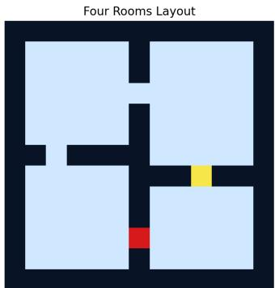
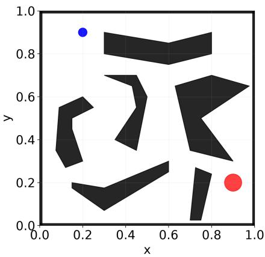
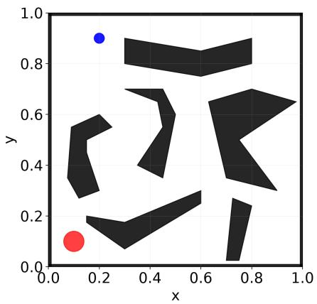
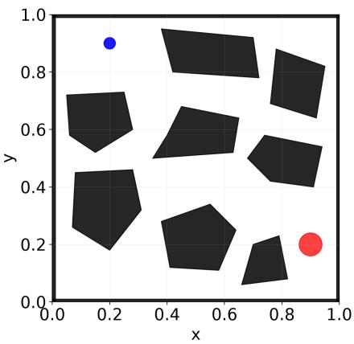
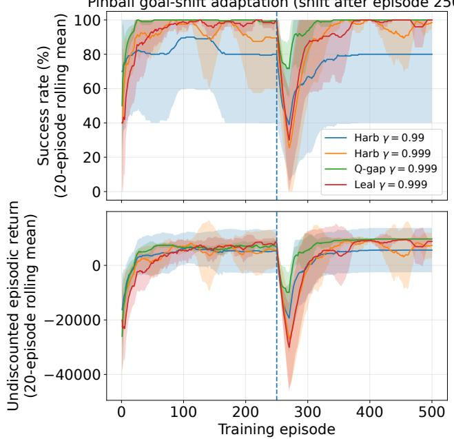
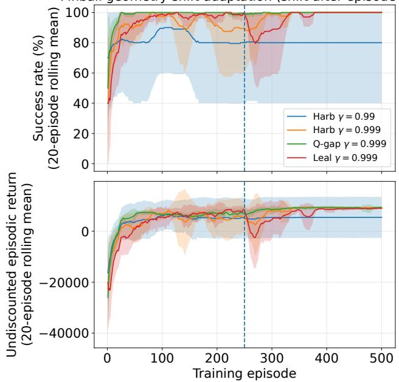

# Opportunity-Cost Option-Critic: Adaptive Switching Costs for Robust Hierarchical Reinforcement Learning

Khaled Ammoura

Aya Kayal

Department of Electrical and

Naseem Daher

Department of Computer Science

Computer Engineering

American University of Beirut

American University of Beirut

Department of Electrical and

Beirut, Lebanon

Beirut, Lebanon

ak29@aub.edu.lb

Computer Engineering

kaa74@mail.aub.edu

Department of Mechanical

Engineering

American University of Beirut

Beirut, Lebanon

Abstract—Deliberation costs are commonly used in hierarchical reinforcement learning (HRL) to prevent options from collapsing to primitive actions. Existing approaches rely on fixed penalties or duration-based adaptations, both of which are indirect proxies for an option’s utility. This paper argues that option persistence should instead depend on the opportunity cost of abandoning the current behavior. We propose the Opportunity-Cost Option-Critic (OC2) framework, which defines a statedependent deliberation cost using the positive value gap between the active option and its best alternative. This encourages persistence when the current option is clearly preferable and allows rapid switching when a better option emerges. We show that directly learning such costs leads to a degenerate zero-cost solution and introduces an auxiliary objective that aligns the learned cost with the value-gap target. The approach is evaluated in Four Rooms and Pinball domains under stationary, goal-shift, and geometry-shift conditions. In the Pinball goal-shift task, the $O C ^ { 2 ^ { \circ } }$ framework achieves a 52% first-ten-episode success rate compared with 18% for a fixed-cost baseline. The results suggest that opportunity-cost-based persistence improves adaptation in non-stationary environments.

Index Terms—Hierarchical Reinforcement Learning, Option-Critic, Deliberation Cost, Navigation

## I. INTRODUCTION

Many autonomous systems operate in environments that evolve over time, requiring controllers to preserve effective behaviors while abandoning those that are no longer beneficial. Examples include navigation, robotic manipulation, and multistage control tasks, where changes in objectives or operating conditions may render a previously effective behavior suboptimal. Such situations create a temporal decision problem: how long should a behavior persist, and when should a higher-level decision maker switch to an alternative strategy?

Hierarchical reinforcement learning (HRL) addresses these inquiries by adopting the temporal abstraction concept by extending multiple primitive steps [2]. The options framework, proposed by [1], represents such behaviors using an initiation set, internal policy, and a termination function. In [3], the Policy Gradient Theorem was generalized in order to learn

nd38@aub.edu.lb

the internal policies and termination functions of the options from the task reward. However, learning to terminate does not guarantee temporal abstraction, since the options could learn to collapse to primitivity, which motivates the introduction of a stabilizing parameter that penalizes overly frequent option terminations and switches.

Deliberation costs penalize option termination and thereby regulate the trade-off between maintaining the current option and selecting an alternative. The fixed deliberation cost proposed in [4] guarantees that behavior, but its effect depends on the value functions that the environment learns, and the influence on termination depends on the magnitude of the option advantage relative to the chosen fixed cost. A penalty that puts pressure on termination in one setting could be neglected with respect to another. The flexible deliberation cost proposed in [5] is a duration-dependent cost that proposes an adaptive alternative to that of [4], however, the option’s duration does not by itself guarantee its optimality at the current state. Moreover, the policy updates could favor a prolonged option that would eventually dominate, causing overcommitment.

In this work, we argue that option persistence should be governed by the opportunity cost of abandoning the current behavior. To this end, we define a value-dependent deliberation cost derived from the positive gap between the active option and its best distinct alternative. Thus, the main contributions of this work are as follows:

1) We introduce an opportunity-cost view of option persistence in hierarchical reinforcement learning, arguing that persistence should be governed by the relative value of continuing the current behavior versus switching to an alternative.

2) We instantiate this principle through the $O C ^ { 2 }$ framework, a value-gap-based extension of the Option-Critic architecture that replaces fixed and duration-dependent deliberation costs with a state- and option-dependent opportunity-cost formulation.

3) We demonstrate that opportunity-cost-based persistence improves adaptation to task changes while preserving the benefits of temporal abstraction.

The remainder of this paper is organized as follows. Section II reviews the background and related work. Section III presents the proposed $O C ^ { 2 }$ framework. Section IV describes the experimental setup and results. Section V discusses the persistence signal in our proposed framework in addition to the limitations that this framework has.Finally, Section VI concludes the paper and outlines the directions for future work

## II. BACKGROUND AND RELATED WORK

## A. Preliminaries

Consider a Markov Decision Process, which is a 5-tuple space containing each of: state space represented as $S ;$ action space represented as $A ;$ transition kernel $P ( s ^ { \prime } | s , a )$ , where $P$ $S \times A \times S  [ 0 , 1 ] ;$ ; expected reward $r ( s , a )$ , where $r : S { \times } A $ $\mathbb { R } ;$ and a discount factor $\gamma \in ( 0 , 1 )$ . An option, defined as a temporally-extended action, is denoted as $\omega \in \Omega$ , where Ω is the option space comprising $( I _ { \omega } , \pi _ { \omega , \theta } , \beta _ { \omega , \vartheta } )$ , where $I _ { \omega } \subseteq S$ is the initiation set of the option $\omega , \pi _ { \omega , \theta } : S \times A  [ 0 , 1 ]$ is the option’s internal policy, and $\beta _ { \omega , \vartheta } : S  [ 0 , 1 ]$ is its termination function [1]. We make the same assumption as in [3], [4] such that the initiation set of every option is the entire state space $( I = S )$ ; that is, any option can be initiated from any state. Upon termination, decision-making returns to the policy-overoptions, denoted as $\pi _ { \Omega } ( \omega | s )$ , where $\pi _ { \Omega } : S \times \Omega \to [ 0 , 1 ]$ which selects the next option.

The Option-Critic architecture in [3] generalizes the Policy Gradient framework of [6], in which it derives policy-gradient updates for internal policies and termination functions. Its termination signal compares the current option value with the value of reselection. Although, the Option-Critic architecture adopts options to achieve temporal abstraction, it does not guarantee that the learned behaviors remain temporally extended. In practice, training may converge to a degenerate solution in which options terminate at nearly every time step, effectively collapsing to primitive actions.

## B. Related Work

To encourage option persistence, a deliberation cost was introduced into the Option-Critic architecture to penalize option termination and discourage unnecessary switching between options [4]. This approach was later extended in [7] by integrating it with proximal policy optimization (PPO) for continuous-action tasks. However, the deliberation cost proposed in [4] requires careful tuning to exert the intended influence on the value estimates. If set too low, it may fail to discourage excessive switching; if set too high, it may prevent the agent from adapting when alternative behaviors become preferable. More recently, [5] extended the fixeddeliberation cost of [4] to a flexible duration-dependent one. In this formulation, the deliberation penalty decreases with option duration, gradually approaching zero for long-lived options while exerting stronger pressure on value estimates for short-lived ones. However, [5] assumes that option duration is an appropriate measure of persistence. In contrast, our proposed approach defines deliberation costs using the value gap between the active option and its best alternative, directly capturing the opportunity cost of switching. As a result, duration-based costs may lead to option overcommitment, potentially favoring persistence even when switching would be optimal.

In this work, we focus specifically on the mechanism governing option persistence while retaining the structure of the Option-Critic architecture. In particular, we aim to address the hyperparameter-tuning requirement of [4] and the reliance on option duration as a proxy for persistence in [5]. To this end, we leverage the value estimates induced by the environment dynamics to adapt the deliberation cost, allowing persistence pressure to emerge from the relative value of competing options rather than from a fixed parameter or elapsed duration. While this work focuses on deliberation costs, other studies have addressed different aspects of temporal abstraction. For example, the Termination Critic in [8] learns option termination functions using an information-theoretic objective. Similarly, [9] extends the notion of initiation sets by learning when options should be available, rather than assuming predefined option availability. Note that our work, like the original Option-Critic framework, assumes that every option is available in every state $\mathbf { \Omega } ( I \ = \ S )$ . While temporal abstraction involves multiple mechanisms, this work focuses specifically on option persistence.

## III. OPPORTUNITY-COST OPTION-CRITIC (OC2)

The proposed framework builds upon the call-and-return execution model, value functions, and actor updates of the Option-Critic architecture [3], while adopting the deliberation cost extension of [4]. The key difference lies in how the deliberation cost is defined and adapted. In [4], a scalar coefficient η is used as a fixed-cost coefficient. In contrast, [5] introduces an adaptive duration-dependent deliberation cost. Our approach adopts the deliberation-cost framework of [4] and the adaptive-cost extension of [5], in which, it learns state-and-option-dependent cost $C _ { \phi } ( s , \omega )$ that eliminates the need for a fixed penalty and avoids assuming that optimal persistence is determined solely by option duration.

## A. Cost-augmented evaluation and timing

At the primitive step t, let $s _ { t }$ be the state and $\omega _ { t }$ be the current option. Let $f _ { \phi } ( s , \omega )$ denote the raw cost prediction. We enforce nonnegativity by defining

$$
C _ { \phi } ( s , \omega ) = \operatorname* { m a x } \{ 0 , f _ { \phi } ( s , \omega ) \} .
$$

On a nonterminal arrival, let $\begin{array} { r c l } { \beta _ { t + 1 } } & { = } & { \beta _ { \omega _ { t } , \vartheta } ( s _ { t + 1 } ) } \end{array}$ be the probability that the active option terminates. For the deliberation-cost calculation, set $\beta _ { t + 1 } = 0$ on terminal transitions. With discount factor $\gamma ,$ the expected cost-augmented return is

$$
J ^ { C } = \mathbb { E } \left[ \sum _ { t \geq 0 } \gamma ^ { t } \big ( r _ { t + 1 } - \beta _ { t + 1 } C _ { \phi } ( s _ { t + 1 } , \omega _ { t } ) \big ) \right] ,\tag{1}
$$

where the superscript C denotes values computed with the deliberation cost included.

The option value $Q _ { \Omega } ^ { C } ( s , \omega )$ averages the action value $Q _ { U } ^ { C } ( s , \omega , a )$ over the intra-option policy $\pi _ { \omega , \theta } ( \boldsymbol { a } \ | \ \boldsymbol { s } )$ . Here, θ parameterizes the policy, and $Q _ { U } ^ { C } ( s , \omega , a )$ is the expected cost-augmented return from taking primitive action a in state s with option ω active and then following the agent’s policies:

$$
Q _ { \Omega } ^ { C } ( s , \omega ) = \sum _ { a } \pi _ { \omega , \theta } ( a \mid s ) Q _ { U } ^ { C } ( s , \omega , a ) .\tag{2}
$$

The policy over options, $\pi _ { \Omega } ( \omega \mid s )$ , gives the probability of selecting ω when an option is chosen in $s .$ The corresponding reselection value is

$$
V _ { \Omega } ^ { C } ( s ) = \sum _ { \omega \in \Omega } \pi _ { \Omega } ( \omega \mid s ) Q _ { \Omega } ^ { C } ( s , \omega ) .\tag{3}
$$

At a nonterminal next state $s ^ { \prime } , \ \beta _ { \omega , \vartheta } ( s ^ { \prime } )$ is the probability of terminating the active option $\omega ,$ , with ϑ denoting the termination parameters. The arrival value ${ U ^ { C } } ( \omega , s ^ { \prime } )$ averages the future return under continuation and reselection. The immediate deliberation cost is accounted for separately in the Bellman recursion as follows:

$$
\begin{array} { r l } & { \boldsymbol { U } ^ { C } ( \omega , s ^ { \prime } ) = ( 1 - \beta _ { \omega , \vartheta } ( s ^ { \prime } ) ) Q _ { \Omega } ^ { C } ( s ^ { \prime } , \omega ) } \\ & { \qquad + \beta _ { \omega , \vartheta } ( s ^ { \prime } ) V _ { \Omega } ^ { C } ( s ^ { \prime } ) . } \end{array}\tag{4}
$$

The option advantage measures how much more valuable it is to continue $\omega$ in s than to draw an option from $\pi _ { \Omega } \mathbf { : }$

$$
A _ { \Omega } ^ { C } ( s , \omega ) = Q _ { \Omega } ^ { C } ( s , \omega ) - V _ { \Omega } ^ { C } ( s ) .\tag{5}
$$

To simplify notation, parameter subscripts are omitted where unambiguous.

Let $r ( s , a )$ be the expected immediate reward, and let $\mathbb { E } _ { s ^ { \prime } \mid s , a }$ average over the next-state distribution. Writing $\beta _ { \omega }$ for $\beta _ { \omega , \vartheta }$ the Bellman recursion consistent with (1) is given by:

$$
\begin{array} { r l } & { Q _ { U } ^ { C } ( s , \omega , a ) = r ( s , a ) + \mathbb { E } _ { s ^ { \prime } \mid s , a } [ - \beta _ { \omega } ( s ^ { \prime } ) C _ { \phi } ( s ^ { \prime } , \omega ) } \\ & { ~ + \gamma U ^ { C } ( \omega , s ^ { \prime } ) ] . } \end{array}\tag{6}
$$

The first term inside the expectation is the expected immediate cost, while the second is the discounted arrival value. For terminal transitions, both terms are zero.

Under this timing convention, setting $C _ { \phi } ( s ^ { \prime } , \omega ) ~ = ~ \gamma \eta$ recovers the immediate cost term $- \gamma \eta \beta _ { \omega } ( s ^ { \prime } )$ in the fixedcost Bellman recursion of [4], showing that the proposed formulation reduces to the fixed-cost case when the learned cost is constant.

## B. A value-gap target for persistence

The opportunity-cost target is the positive part of the value gap between the current option ω and its best distinct alternative:

$$
y _ { C } ( s , \omega ) = \operatorname* { m a x } \biggl \{ 0 , Q _ { \Omega } ^ { C } ( s , \omega ) - \operatorname* { m a x } _ { \bar { \omega } \neq \omega } Q _ { \Omega } ^ { C } ( s , \bar { \omega } ) \biggr \} .\tag{7}
$$

When the expected value of the chosen alternative exceeds that of all other possible choices, $y _ { C } ~ > ~ 0$ . When another possible choice has an equal or better expected value than the chosen alternative, $y _ { C } = 0$ . Upon termination, the policy over options $\pi _ { \Omega } ( \cdot \mid s )$ ) may reselect ω or a non-maximizing alternative. The expected value after reselection is therefore $V _ { \Omega } ^ { C } ( s )$ , and the corresponding value difference is $A _ { \Omega } ^ { C } ( s , \omega )$

The proposed formulation provides additional insights into termination behavior by linking persistence to the opportunity cost of switching. Under a greedy policy-over-options and an exact cost function, two observations follow: First, the cost encourages persistence when the active option uniquely maximizes the objective; i.e., $A _ { \Omega } ^ { C } ~ = ~ 0$ and $y _ { C } ( s , \omega ) > 0$ Second, the formulation favors termination when the active option becomes less advantageous to an available alternative; i.e., $A _ { \Omega } ^ { C } ~ < ~ 0$ and $y _ { C } ( s , \omega ) = 0$ . Under an ϵ-soft policy, the advantage is evaluated relative to the expected value of the option distribution, whereas the target cost remains based on the single alternative option offering the largest value improvement. The above observations assume a fixed critic and an exact target cost. In practice, approximation errors and imperfect target tracking may cause deviations from the actual behavior of the system.

## C. Why the cost uses an auxiliary objective

Direct maximization of (1) with respect to the cost fails to identify a meaningful deliberation penalty. We hold the intra-option policies, the termination functions, and the policy over options fixed when differentiating with respect to ϕ. The trajectory distribution is therefore independent of $\phi .$ Let $J ^ { 0 }$ denote the reward-only return. Then,

$$
J ^ { C } = J ^ { 0 } - \mathbb { E } [ \sum _ { t \ge 0 } \gamma ^ { t } \beta _ { t + 1 } C _ { \phi } ( s _ { t + 1 } , \omega _ { t } ) ] \le J ^ { 0 } ,\tag{8}
$$

indicating $J ^ { 0 }$ as an upper bound. More explicitly, under differentiable costs and policies,

$$
\nabla _ { \phi } J ^ { C } = - \mathbb { E } [ \sum _ { t \ge 0 } \gamma ^ { t } \beta _ { t + 1 } \nabla _ { \phi } C _ { \phi } ( s _ { t + 1 } , \omega _ { t } ) ] ,\tag{9}
$$

which motivates the introduction of a separate objective. Therefore, we fit $C _ { \phi }$ to the detached target in (7). Let ν denote the distribution of state-option pairs used for this regression. The stop-gradient operator $\mathrm { s g }$ treats yC as constant when differentiating the loss with respect to $\phi \colon$

$$
\begin{array} { r } { \mathcal { L } _ { C } ( \phi ) = \frac { 1 } { 2 } \mathbb { E } _ { ( s , \omega ) \sim \nu } \Big [ \big ( C _ { \phi } ( s , \omega ) - \mathrm { s g } [ y _ { C } ( s , \omega ) ] \big ) ^ { 2 } \Big ] . } \end{array}\tag{10}
$$

The critic and the learned cost are coupled across updates. The Bellman target in (6) uses the current cost $C _ { \phi }$ , while the cost target in (7) is computed from the current costaugmented option values. The stop-gradient operator sg holds the target fixed when differentiating $\mathcal { L } _ { C }$ with respect to ϕ. As the critic is updated, its option values can change, causing the cost regression to track a moving target. The convergence properties of these coupled updates remain an open question for this formulation.

## D. Actor updates and the termination signal

For fixed cost parameters $\phi ,$ termination parameters $\vartheta ,$ and policy over options $\pi \Omega$ , the intra-option policy gradient keeps the Option-Critic form with cost-augmented action values [3]:

$$
\nabla _ { \theta } J ^ { C } = \sum _ { s , \omega } d _ { \gamma } ( s , \omega ) \sum _ { a } \nabla _ { \theta } \pi _ { \omega , \theta } ( a \mid s ) Q _ { U } ^ { C } ( s , \omega , a ) ,\tag{11}
$$

where $\begin{array} { r } { d _ { \gamma } ( s , \omega ) = \sum _ { t > 0 } \gamma ^ { t } \operatorname* { P r } ( s _ { t } = s , \omega _ { t } = \omega ) . } \end{array}$

For the termination gradient, we hold $\theta , \phi ,$ and $\pi _ { \Omega }$ fixed and evaluate the branch at the nonterminal arrival state $s ^ { \prime } = s _ { t + 1 } .$ before deciding whether to terminate $\omega _ { t }$ . For termination, the local branch value in (6) is:

$$
\begin{array} { r l } & { - \beta _ { \omega } ( s ^ { \prime } ) C _ { \phi } ( s ^ { \prime } , \omega ) } \\ & { + \gamma \big [ ( 1 - \beta _ { \omega } ( s ^ { \prime } ) ) Q _ { \Omega } ^ { C } ( s ^ { \prime } , \omega ) + \beta _ { \omega } ( s ^ { \prime } ) V _ { \Omega } ^ { C } ( s ^ { \prime } ) \big ] . } \end{array}\tag{12}
$$

Holding $C _ { \phi } ( s ^ { \prime } , \omega ) , Q _ { \Omega } ^ { C } ( s ^ { \prime } , \omega )$ , and $V _ { \Omega } ^ { C } ( s ^ { \prime } )$ fixed locally, the derivative with respect to $\beta _ { \omega } ( s ^ { \prime } )$ is

$$
\begin{array} { r l } & { - C _ { \phi } ( s ^ { \prime } , \omega ) + \gamma \big [ V _ { \Omega } ^ { C } ( s ^ { \prime } ) - Q _ { \Omega } ^ { C } ( s ^ { \prime } , \omega ) \big ] } \\ & { \quad = - \big [ C _ { \phi } ( s ^ { \prime } , \omega ) + \gamma A _ { \Omega } ^ { C } ( s ^ { \prime } , \omega ) \big ] . } \end{array}\tag{13}
$$

Unrolling the derivative through the augmented state-option process yields

$$
\nabla _ { \vartheta } J ^ { C } = - \mathbb { E } \left[ \sum _ { t \geq 0 } \gamma ^ { t } \nabla _ { \vartheta } \beta _ { \omega _ { t } , \vartheta } ( s _ { t + 1 } ) H _ { C } ( s _ { t + 1 } , \omega _ { t } ) \right] ,\tag{14}
$$

with $\begin{array} { r } { { \cal H } _ { C } ( s , \omega ) = { \cal C } _ { \phi } ( s , \omega ) + \gamma { \cal A } _ { \Omega } ^ { C } ( s , \omega ) . } \end{array}$

Under our timing convention, setting $C _ { \phi } = \gamma \eta$ yields $H _ { C } =$ $\gamma ( A _ { \Omega } ^ { C } + \eta )$ , thereby recovering the fixed termination margin that was derived in [4]. In our formulation, the cost within this margin depends on both the arrival state and active option and is learned from the value-gap target in (7).

## E. Algorithm and control implementation

Algorithm 1 summarizes the proposed update procedure. The first sampled transition provides the critic target. The policy is then updated using the cost-augmented value estimate, followed by an update of the termination function through $H _ { C }$ Finally, the cost is fitted to the detached value-gap target. Let ψ denote the parameters of the critic $Q _ { U , \psi } ^ { C } ( s , \omega , a )$ , which approximates the cost-augmented action value $Q _ { U } ^ { C } ( s , \omega , a )$

## IV. EXPERIMENTAL EVALUATION

## A. Questions, protocol, and reporting

This work addresses three limitations of existing deliberation-cost mechanisms through the following questions: (i) Does opportunity-cost-based persistence improve navigation performance beyond merely increasing option duration? (ii) Can the proposed approach successfully and rapidly adapt to changes in goal location? (iii) Does the proposed approach maintain its performance under changes in environment geometry? Results are reported across ten random seeds for each method under comparison.

Algorithm 1: Opportunity-Cost Option-Critic   
Initialize the critic parameters ψ, intra-option policy   
parameters θ, termination parameters $\vartheta ,$ and cost   
parameters ϕ;   
Set the corresponding learning rates $\alpha _ { \psi } , \alpha _ { \theta } , \alpha _ { \vartheta } , \alpha _ { \phi } ;$   
foreach episode do   
s ← s0, ω ∼ πΩ(· | s)   
repeat   
Choose a according to $\pi _ { \omega , \theta } ( a | s ) ;$   
Take action a in s and observe the next state $s ^ { \prime } ,$   
reward $r ,$ and terminal flag $d ,$ where $d = 1$ if the   
transition ends the episode and $d = 0$ otherwise;   
1. Option evaluation   
$z  r$   
if d = 0 then   
$c  C _ { \phi } ( s ^ { \prime } , \omega )$   
$z \gets r - \beta _ { \omega , \vartheta } ( s ^ { \prime } ) c + \gamma U ^ { C } ( \omega , s ^ { \prime } )$ (6)   
$y \gets \operatorname* { m a x } \{ 0 , Q _ { \Omega } ^ { C } ( s ^ { \prime } , \omega )$ (7)   
− max $Q _ { \Omega } ^ { C } ( s ^ { \prime } , j ) \}$   
j̸=ω   
$h  c + \gamma A _ { \Omega } ^ { C } ( s ^ { \prime } , \stackrel { . } { \omega } )$   
$\delta \gets z - Q _ { U , \psi } ^ { C } ( s , \omega , a )$   
ψ $ \psi + \alpha _ { \psi } \delta \nabla _ { \psi } Q _ { U , \psi } ^ { C } ( s , \omega , a )$   
2. Option improvement and cost learning   
$\begin{array} { r } { \theta  \theta + \alpha _ { \theta } Q _ { U , \psi } ^ { C } ( s , \omega , a ) \nabla _ { \theta } \log \pi _ { \omega , \theta } ( a \mid s ) } \end{array}$   
if $d = 0$ then   
$\vartheta \gets \vartheta - \alpha _ { \vartheta } h \nabla _ { \vartheta } \beta _ { \omega , \vartheta } \big ( s ^ { \prime } \big )$ (14)   
$\phi  \phi + \alpha _ { \phi } ( y - c ) \nabla _ { \phi } c$ (10)   
if ω terminates at $s ^ { \prime }$ under the pre-update $\beta _ { \omega , \vartheta }$   
then   
$\_ \textit { \textbf { \omega } } \omega \sim \pi \it { \Omega } ( \cdot \mid s ^ { \prime } )$   
s ← s′   
until $d = 1$

Two environments are used in this study for different purposes. The Four Rooms environment (Fig. 1) is used to evaluate the learned policies after the training period. In contrast, the Pinball environment is considered to assess the online training performance. In fact, the Pinball statistics’ success rates reflect both the learning process and adaptation during a specified time frame, as opposed to a separate assessment of the trained policy itself. For each of the seeds, the average value and standard deviation of those seeds’ summary data were calculated. The standard deviation reflects how much variability existed among the different seeds (i.e., runs) but does not represent a confidence interval. The conclusions drawn from this study are descriptive and should be interpreted in light of the uncertainty and replication challenges associated with reinforcement learning evaluation [12], [13].

The stationary learning period of the Pinball task takes place from episodes 1-250. From episode 251 to 500, two additional learning tasks occur: one in which the target is relocated while the environment geometry remains unchanged, and another in which the obstacle geometry is modified while maintaining the original target location. The recovery rate is defined as the number of post-shift episodes until the first 20-episode window achieves $\ge ~ 9 0 \%$ success rate. The recovery rate can vary

TABLE I: Four Rooms evaluation after 5,000 training episodes. All methods complete in 100% of evaluation episodes. Values are mean ± sample standard deviation across ten seed-level averages (each seed level averaged across ten evaluation episodes), with 100 evaluation episodes per seed. Steps number primitive transitions per episode. Discounted return is the discounted sum of rewards per episode $( \gamma = 0 . 9 9 )$ . Terminations number option-ending decisions per episode (including option terminations followed by re-selection of the same option). Switches number transitions to a different option per episode. Duration is the mean number of primitive steps per execution of an option.
<table><tr><td>Method</td><td>Steps</td><td>Discounted return</td><td>Terminations</td><td>Switches</td><td>Duration</td></tr><tr><td>Vanilla OC</td><td> $2 6 . 5 6 \pm 9 . 0 6$ </td><td> $0 . 7 9 4 \pm 0 . 0 5 3$ </td><td> $1 7 . 1 1 \pm 7 . 3 1$ </td><td> $7 . 4 1 \pm 4 . 5 1$ </td><td> $1 . 4 6 \pm 0 . 0 6$ </td></tr><tr><td>Fixed,  $\eta = 0 . 0 0 5$ </td><td> $3 2 . 9 9 \pm 2 0 . 5 5$ </td><td> $0 . 7 7 7 \pm 0 . 0 8 7$ </td><td> $1 8 . 4 5 \pm 1 3 . 2 6$ </td><td> $1 0 . 3 0 \pm 9 . 3 9$ </td><td> $1 . 7 3 \pm 0 . 1 8$ </td></tr><tr><td>Fixed,  $\eta = 0 . 0 1$ </td><td> $3 0 . 2 3 \pm 8 . 5 5$ </td><td> $0 . 7 7 7 \pm 0 . 0 5 0$ </td><td> $1 1 . 4 7 \pm 3 . 5 7$ </td><td> $5 . 1 5 \pm 2 . 4 9$ </td><td> $2 . 3 3 \pm 0 . 5 0$ </td></tr><tr><td>Flexible cost</td><td> $6 8 . 6 7 \pm 3 6 . 0 3$ </td><td> $0 . 6 2 3 \pm 0 . 1 0 2$ </td><td> $1 . 5 5 \pm 0 . 5 8$ </td><td> $1 . 0 2 \pm 0 . 4 7$ </td><td> $2 7 . 2 8 \pm 1 6 . 6 5$ </td></tr><tr><td> $O C ^ { 2 }$ </td><td> ${ \bf 1 9 . 1 1 \pm 4 . 8 9 }$ </td><td> $\mathbf { 0 . 8 4 3 \pm 0 . 0 3 2 }$ </td><td> $6 . 7 2 \pm 1 . 7 6$ </td><td> $4 . 9 5 \pm 1 . 6 4$ </td><td> $2 . 9 9 \pm 1 . 4 5$ </td></tr></table>

  
Fig. 1: Four Rooms environment where the starting point is colored red and the goal is colored yellow. The choice of the starting point and goal is random.

The Four Rooms environment is a discrete-state, discreteaction navigation task that has four rooms with doors leading into each other. An agent can move around in these rooms using the available doors to try finding a way to get to a specific target point. The reward is +1 at the goal and 0 otherwise. We evaluated five variants of the Option-Critic framework: standard Option-Critic [3]; fixed cost Option-Critic [4] with costs of $\eta \in \{ 0 . 0 0 5 , 0 . 0 1 \}$ ; the flexible-cost method [5]; and $O C ^ { 2 }$ . All five methods were trained for 5,000 episodes and then tested on 100 random episodes from each seed. For all of the methods, the same general settings were used: four options; $\gamma = 0 . 9 9 ;$ learning rate of 0.5 for the critic; learning rate of 0.25 for the policy and termination functions; softmax temperature of 0.01; and exploration rate of $\epsilon _ { \Omega } = 0 . 0 1$ during training.

depending on the definition of the recovery window, therefore, the number of seeds that reach the recovery threshold must be taken into account when interpreting these results.

In both environments and during all of the considered scenarios, for fairness purposes, we report results for the fixedcost baseline using the η values that yielded the strongest overall performance across the evaluated environments.

Table I demonstrates that $O C ^ { 2 }$ had the smallest average length of trajectory and greatest average discounted returns

## B. Four Rooms: persistence and navigation

when compared to the other approaches evaluated. The average trajectory for $O C ^ { 2 }$ was approximately 28% shorter than that of vanilla OC. While the flexible-cost baseline resulted in significantly longer option durations, it also resulted in substantially longer trajectories, indicating that persistence is not an adequate metric for evaluating option performance. $O C ^ { 2 }$ demonstrated moderate option duration, while at the same time having fewer option terminations and identity switches than vanilla OC. These findings support the concept of beneficial persistence in this domain; however, they do not provide evidence that the learned options are semantically specialized.

## C. Pinball: stationary performance

The Pinball Environment is a continuous-state, continuouscontrol navigation task in which a ball traverses an environment containing polygon-shaped obstacles. The state consists of the ball’s position and velocity [10]. Compared with gridbased navigation tasks (e.g., Four Room), the pinball exhibits more complex dynamics due to inertia and collisions. Every thrust action results in a penalty of 5 and every non-action results in a 1 penalty. If the agent gets to the goal, +10000 reward is given. Three environment layouts are considered, as shown in Fig. 2. All Pinball algorithms tested in this paper utilize four options, a third-order Fourier basis [11], and a maximum number of steps allowed per episode of 10,000 steps. For fairness and best individual performances, the fixedcost baseline utilizes $\eta \ = \ 0 . 0 2$ with $\gamma ~ \in ~ \{ 0 . 9 9 , 0 . 9 9 9 \}$ whereas the flexible-cost baseline and $O C ^ { 2 }$ both utilize $\gamma =$ 0.999. Therefore, the primary matched-discount comparison for the fixed-cost baseline is the $\gamma = 0 . 9 9 9$ fixed-cost configuration. Moreover, the learning rate of the critic is 0.01, and 0.001 for the policy and termination functions. Note that we have emitted benchmarking against [3] since the purpose of these experiments is to compare the effect of the proposed deliberation cost against the other deliberation cost models.

Within the first 250 training episodes, as shown in Table II, $O C ^ { 2 }$ had a mean success of 99.20%, compared to 95.28% for the flexible-cost baseline and 92.56% for the fixed-cost baseline at $\gamma = 0 . 9 9 9 . \mathrm { A l s o } , O C ^ { 2 }$ took fewer steps to complete each episode on average (865.9 vs 1187.6 and 1457.7), which supports consistent learning on the original layout.

  
(a) Original Environment

  
(b) Relocated-Goal Environment

  
(c) Altered-Geometry Environment  
Fig. 2: Pinball environment layouts: a) original environment; b) relocated-goal environment preserves the obstacles shape; altered-geometry environment preserves the start and goal.

TABLE II: Pinball play on original layout in training episodes 1–250. Success is the percentage of episodes that reach the goal. Undiscounted return is the sum of per-episode rewards, steps per episode is the number of primitive transitions. Mean ± sample standard deviation over ten seed-level summaries.
<table><tr><td>Metric</td><td> $\mathrm { F i x e d } \ \gamma = . 9 9$ </td><td>Fixed  $\gamma = . 9 9 9$ </td><td>Flexible  $\gamma = . 9 9 9$ </td><td> $O C ^ { 2 } \ \gamma = . 9 9 9$ </td></tr><tr><td>Success (%)</td><td> $8 2 . 6 0 \pm 3 6 . 4 6$ </td><td> $9 2 . 5 6 \pm 1 0 . 1 8$ </td><td> $9 5 . 2 8 \pm 3 . 6 4$ </td><td> $9 9 . 2 0 \pm 0 . 3 8 $ </td></tr><tr><td>Undiscounted return</td><td> $4 6 1 5 . 6 \pm 7 2 8 9 . 8$ </td><td> $4 4 9 1 . 9 \pm 3 4 2 5 . 8$ </td><td> $4 5 2 1 . 0 \pm 2 3 8 4 . 3$ </td><td> $6 0 4 9 . 6 \pm 9 6 3 . 8$ </td></tr><tr><td>Steps per episode</td><td> $2 1 1 1 . 2 \pm 3 5 7 0 . 1$ </td><td> $1 4 5 7 . 7 \pm 1 1 4 4 . 1$ </td><td> $1 1 8 7 . 6 \pm 5 4 4 . 2$ </td><td> $8 6 5 . 9 \pm 2 1 7 . 3$ </td></tr></table>

## D. Pinball: response to goal relocation

Adaptation becomes critical when previously-successful behaviors are no longer optimal. To create such a scenario, the goal (red circle in Fig. 2) is relocated after episode 250, while the start (blue circle in Fig. 2) and the environment geometry (corridors’ layout) remain unchanged. Table III and Fig. 3 summarize the response. For $\gamma = 0 . 9 9 9 , O C ^ { 2 }$ achieved $5 2 . 0 \pm 2 7 . 4 \%$ mean success over the first ten post-shift episodes; compared with the other baselines, the fixed cost got $1 8 . 0 { \pm } 3 8 . 2 \%$ whereas the flexible cost got $1 5 . 0 { \pm } 2 6 . 8 \%$ . Mean success over all 250 post-shift episodes was $9 6 . 7 6 \pm 3 . 6 6 \%$ for $O C ^ { 2 } , 8 7 . 8 0 \pm 6 . 3 2 \%$ for fixed cost and $8 9 . 2 8 \pm 1 0 . 9 9 \%$ for flexible cost. Each of ten seeds recovered successfully under each of those three conditions. After the goal relocation, the value of previously-successful options decreases, naturally reducing the opportunity cost of abandoning them. This weakens the persistence pressure and enables the agent to transition more rapidly toward alternative behaviors suited to the new objective. Therefore, the same mechanism that promotes persistence in stationary environments automatically reduces persistence after an environmental shift, eliminating the need for manually-tuned adaptation rules.

## E. Pinball: changed obstacle geometry

Unlike the goal-relocation scenario, this experiment changes the environment dynamics rather than the task objective. The obstacle geometry is modified so that the trajectory learned before the shift becomes inaccessible, forcing the agent to adapt its behavior.

$O C ^ { 2 }$ maintains $1 0 0 . 0 \pm 0 . 0 \%$ success over the first ten post-shift episodes and $9 9 . 9 2 \pm 0 . 1 7 \%$ over the entire run. In contrast, the flexible-cost baseline achieved $7 4 . 0 \pm 3 1 . 7 \%$ and $9 6 . 1 2 \pm 7 . 2 9 \%$ , respectively, while, the fixed-cost baseline achieved $8 7 . 0 \pm 3 0 . 9 \%$ and $9 8 . 8 0 \pm 2 . 3 2 \%$ , respectively. $O C ^ { 2 }$ also has a shorter mean post-change episodes: 198.3 compared to 759.7, 373.8 primitive steps, respectively.

Unlike a fixed deliberation cost, the proposed mechanism does not enforce persistence uniformly. As the estimated utility of the active option changes following the geometry modification, the deliberation cost adapts accordingly, allowing persistence to remain aligned with expected future return.

Taken together, these three configurations support the hypothesis that option persistence should be governed by the opportunity cost of abandoning the current behavior. The resulting $O C ^ { 2 }$ mechanism learned shorter paths while exhibiting greater persistence and adaptability.

## V. DISCUSSION AND LIMITATIONS

$O C ^ { 2 }$ ties the persistence signal for an option to its relative state-option value function $Q _ { \Omega } ^ { C } ( s , \omega )$ with respect to competing alternatives. The same option may incur a high termination penalty in states where it remains valuable and a low penalty where superior alternatives exist. As the estimated advantage $A _ { \Omega } ^ { C } ( s , \omega )$ diminishes, the target penalty diminishes accordingly. Persistence therefore adapts across states according to the relative value of competing options, and evolves naturally in response to the agent’s changing value estimates. This perspective also helps explain the improved adaptation observed after environmental changes. Because persistence pressure is tied to option values rather than fixed heuristics, the same mechanism that promotes commitment in stationary settings automatically encourages switching when the value landscape changes.

TABLE III: Pinball performance in the 250 post-change training episodes following a goal or obstacle change. First-10 success is the percentage of the first ten post-change episodes that attained the goal. Success is the percentage across 250 post-change episodes. Undiscounted return is the sum of per-episode rewards; episode length is the number of primitive transitions in an episode, both averaged across the 250 post-change episodes. Values are mean ± sample standard deviation across ten seed-level summaries. Recovered seeds is the number of ten seeds in which the agent achieved at least 90% success for any window of 20 consecutive post-change episodes.
<table><tr><td>Change</td><td>Metric</td><td> $\mathrm { F i x e d } \ \gamma = . 9 9$ </td><td> $\mathrm { F i x e d } \ \gamma = . 9 9 9$ </td><td> $\mathrm { F l e x i b l e } \ \gamma = . 9 9 9$ </td><td> $O C ^ { 2 } \ \gamma = . 9 9 9$ </td></tr><tr><td>Goal</td><td>First-10 success (%)</td><td> $1 8 . 0 \pm 2 4 . 4$ </td><td> $1 8 . 0 \pm 3 8 . 2$ </td><td> $1 5 . 0 \pm 2 6 . 8$ </td><td> $5 2 . 0 \pm 2 7 . 4$ </td></tr><tr><td></td><td>Success (%)</td><td> $7 3 . 9 2 \pm 3 9 . 6 5$ </td><td> $8 7 . 8 0 \pm 6 . 3 2$ </td><td> $8 9 . 2 8 \pm 1 0 . 9 9$ </td><td> $9 6 . 7 6 \pm 3 . 6 6$ </td></tr><tr><td></td><td>Undiscounted Return</td><td> $2 4 2 9 . 9 \pm 7 4 3 8 . 5$ </td><td> $2 6 3 5 . 8 \pm 3 1 6 7 . 0$ </td><td> $3 0 9 3 . 2 \pm 4 1 6 0 . 8$ </td><td> $7 3 2 4 . 7 \pm 1 2 2 6 . 4$ </td></tr><tr><td></td><td>Episode length</td><td> $2 7 5 7 . 4 \pm 3 8 9 0 . 7$ </td><td> $1 5 0 1 . 3 \pm 6 8 1 . 4$ </td><td> $1 4 0 3 . 1 \pm 1 0 6 9 . 7$ </td><td> $5 6 1 . 2 \pm 3 5 2 . 0$ </td></tr><tr><td></td><td>Recovered seeds</td><td>8/10</td><td> $1 0 / 1 0$ </td><td> $1 0 / 1 0$ </td><td> $1 0 / 1 0$ </td></tr><tr><td>Geometry</td><td>First-10 success (%)</td><td> $8 1 . 0 \pm 4 0 . 1$ </td><td> $8 7 . 0 \pm 3 0 . 9$ </td><td> $7 4 . 0 \pm 3 1 . 7$ </td><td> $1 0 0 . 0 \pm 0 . 0$ </td></tr><tr><td></td><td>Success (%)</td><td> $8 0 . 0 4 \pm 4 2 . 0 8$ </td><td> $9 8 . 8 0 \pm 2 . 3 2 $ </td><td> $9 6 . 1 2 \pm 7 . 2 9$ </td><td> $9 9 . 9 2 \pm 0 . 1 7$ </td></tr><tr><td></td><td>Undiscounted Return</td><td> $5 3 7 2 . 3 \pm 8 4 5 9 . 5$ </td><td> $8 3 8 6 . 7 \pm 1 2 9 2 . 7$ </td><td> $6 8 0 6 . 8 \pm 2 2 6 1 . 7$ </td><td> $9 0 1 8 . 4 \pm 5 2 6 . 8$ </td></tr><tr><td></td><td>Episode Length</td><td> $2 0 9 6 . 8 \pm 4 1 5 7 . 1$ </td><td> $3 7 3 . 8 \pm 2 7 2 . 0$ </td><td> $7 5 9 . 7 \pm 7 5 8 . 6$ </td><td> $1 9 8 . 3 \pm 1 0 2 . 8 $ </td></tr><tr><td></td><td>Recovered seeds</td><td> $8 / 1 0$ </td><td> $1 0 / 1 0$ </td><td> $1 0 / 1 0$ </td><td> $1 0 / 1 0$ </td></tr></table>

Pinball geometry-shift adaptation (shift after episode 250)

Pinball goal-shift adaptation (shift after episode 250)  

  
(a) Relocated Goal  
(b) Altered Geometry  
Fig. 3: Pinball learning curves during training. The upper plots in each subplot show success rate over a 20-episode rolling window, while the lower plots show undiscounted episodic return. Curves represent means over ten seeds and shaded bands indicate ± one standard deviation. The environment changes after episode 250, so windows near the transition may contain episodes from both layouts.

That said, this study still has the following limitations.

First, the effectiveness of the proposed mechanism depends on the critic’s ability to accurately rank competing options, since errors in option value estimation directly affect the learned persistence behavior. A second limitation concerns the adaptation speed of the cost predictor. Following environmental changes, outdated value-gap estimates may temporarily persist and induce persistence patterns that no longer reflect the current value ordering of the options. The learned cost also enters the critic target, and the convergence properties of these coupled updates remain an open question. Finally, our approach inherits the assumption that all options are available in every state. In practical settings with restricted initiation sets, the framework would need to be extended to predict option applicability and handle states in which no alternative options are available.

## VI. CONCLUSION

We presented the Opportunity-Cost Option-Critic $( O C ^ { 2 } )$ framework, which utilizes the positive gap between the current state-option value estimate versus its best distinct alternative to define an adaptive value-dependent deliberation cost target. The mechanism encourages persistence when the current option remains preferable and removes that pressure when a better alternative emerges. A cost-augmented formulation clarifies the actor updates and explains the need for the auxiliary cost-fitting objective. Tested in two environments and across ten random seeds, the $O C ^ { 2 }$ approach produced shorter Four Rooms trajectories, improved recovery following a Pinball goal relocation, and maintained high success rates under geometry alterations. Collectively, these results support the view that option persistence should be governed by the opportunity cost of abandoning the current behavior rather than by fixed heuristics or duration-dependent penalties, motivating further study of value-adaptive persistence in hierarchical reinforcement learning.

## REFERENCES

[1] R. S. Sutton, D. Precup, and S. Singh, “Between MDPs and semi-MDPs: A framework for temporal abstraction in reinforcement learning,” Artif. Intell., vol. 112, nos. 1–2, pp. 181–211, 1999.

[2] A. G. Barto and S. Mahadevan, “Recent advances in hierarchical reinforcement learning,” Discrete Event Dyn. Syst., vol. 13, pp. 41–77, 2003.

[3] P.-L. Bacon, J. Harb, and D. Precup, “The option-critic architecture,” in Proc. AAAI Conf. Artif. Intell., 2017, pp. 1726–1734.

[4] J. Harb, P.-L. Bacon, M. Klissarov, and D. Precup, “When waiting is not an option: Learning options with a deliberation cost,” in Proc. AAAI Conf. Artif. Intell., 2018, pp. 3165–3172.

[5] A. Leal, M. B. Melchiades, and G. de Oliveira Ramos, “A flexible approach to deliberation cost in the option-critic architecture,” in Proc. Adaptive and Learning Agents Workshop (ALA), Detroit, MI, USA, 2025. [Online]. Available: https://ala-workshop.github.io/papers/ ALA2025 paper 28.pdf

[6] R. S. Sutton, D. A. McAllester, S. Singh, and Y. Mansour, “Policy gradient methods for reinforcement learning with function approximation,” in Adv. Neural Inf. Process. Syst., vol. 12, 2000, pp. 1057–1063.

[7] M. Klissarov, P.-L. Bacon, J. Harb, and D. Precup, “Learnings options end-to-end for continuous action tasks,” 2017, arXiv:1712.00004.

[8] A. Harutyunyan, W. Dabney, D. Borsa, N. Heess, R. Munos, and D. Precup, “The termination critic,” in Proc. Int. Conf. Artif. Intell. Statist., ser. Proceedings of Machine Learning Research, vol. 89, 2019, pp. 2231– 2240.

[9] K. Khetarpal, M. Klissarov, M. Chevalier-Boisvert, P.-L. Bacon, and D. Precup, “Options of interest: Temporal abstraction with interest functions,” in Proc. AAAI Conf. Artif. Intell., 2020, pp. 4444–4451.

[10] G. Konidaris and A. G. Barto, “Skill discovery in continuous reinforcement learning domains using skill chaining,” in Adv. Neural Inf. Process Syst., vol. 22, 2009, pp. 1015–1023.

[11] G. Konidaris, S. Osentoski, and P. Thomas, “Value function approximation in reinforcement learning using the Fourier basis,” in Proc. AAAI Conf. Artif. Intell., 2011, pp. 380–385.

[12] P. Henderson, R. Islam, P. Bachman, J. Pineau, D. Precup, and D. Meger, “Deep reinforcement learning that matters,” in Proc. AAAI Conf. Artif. Intell., 2018, pp. 3207–3214.

[13] R. Agarwal, M. Schwarzer, P. S. Castro, A. Courville, and M. G. Bellemare, “Deep reinforcement learning at the edge of the statistical precipice,” in Adv. Neural Inf. Process. Syst., vol. 34, 2021, pp. 29304– 29320.