# PARDIG: Global Precipitation Estimates Learned from Sparse Satellite Observations

Guy Shalev1\*, Stephan Rasp1\*, Boris Babenko2\*, Andrew El-Kadi1, Mohammed Alewi Hassen1, Samier Merchant1, Fred Zyda2, Dominic Masters1, Ferran Alet1, Salva Rühling Cachay2, Ilan Price1, Akib Uddin2, Nofar Peled Levi1, Ben Gaiarin1, Aaron Bell2, Peter Battaglia1 and Alvaro Sanchez-Gonzalez1\* \*Equal contribution, 1Google DeepMind, 2Google Research

Estimating precipitation at the global scale is vital for Earth system science and disaster response, yet observational coverage and measurement precision remain constrained. Existing solutions provide options that trade of desirable traits such as skill, latency, geographical coverage, temporal coverage, and spatial and temporal resolution. We present PARDIG, an artificial intelligence framework based on a spherical graph-mesh transformer architecture that produces near-real-time global precipitation estimates. PARDIG is trained on dense multi-modal inputs, including atmospheric state analyses and multi-spectral geostationary satellite imagery, to predict sparse, high-precision precipitation measurements from spaceborne radar. At inference, the trained model is applied densely across the globe at 0.1◦ spatial and 15-minute temporal resolution, producing complete near-real-time precipitation fields from 2016 to the present, alongside a historical variant extending the record back to 1999. Evaluation against three independent radar networks (over the US, Europe, and Japan) and against over 36,000 surface stations worldwide shows that PARDIG consistently outperforms IMERG V07 (Final and Early), MSWEP V3, ERA5, and HRES across precipitation thresholds and regions, with the largest improvements at extreme intensities. Case studies of extreme precipitation events demonstrate that PARDIG successfully captures their spatial structure and timing. The improvements also extend to forecasting: WeatherNext 3, a global weather model, produces more skillful precipitation forecasts when trained to predict PARDIG. Both the historical and near-real-time PARDIG datasets are openly available under a CC BY 4.0 license.

## 1. Introduction

Precipitation plays a central role in the Earth system, with far-reaching ecological and societal impacts. It serves as a primary driver for hydrological modeling, agricultural planning, and hazard management. Reliable observation records are therefore essential, yet the episodic and spatially heterogeneous nature of precipitation makes continuous monitoring across the globe exceptionally challenging. Rain gauges provide high-quality observations but are sparse and unequally distributed. A recent study found that only 13.4% of the global land surface meets the World Meteorological Organization’s requirements for annual precipitation monitoring, with severe gaps across oceans, developing regions, and high latitudes (Su et al., 2026). Further, many rain gauges measure only daily accumulations, omitting important information about the diurnal cycle and sub-daily extremes. Ground-based weather radars provide yet another popular source of precipitation data: their active sensing delivers high-resolution, low-latency observations for a wide range of applications. However, radars are expensive to set up and maintain, leaving dense, continuous network coverage largely confined to a handful of developed regions and absent over oceans (Saltikof et al., 2019). These gaps and uncertainties in precipitation observations are widely recognized as a major bottleneck limiting streamflow simulation and flood prediction accuracy (Kavetski et al., 2006; Beck et al., 2017; Kratzert et al., 2021). More broadly, closing these coverage gaps is essential for disaster risk reduction, climate adaptation, and the improvement of weather forecast generation and validation.

The community has developed a rich landscape of global precipitation products to address these gaps, broadly falling into four categories.

Gauge-only products such as GPCC (Schneider et al., 2014) and CPC Unified (Chen et al., 2008) interpolate station records onto global land grids, ofering high accuracy where gauges are dense but inheriting the spatial gaps, ocean absence, and daily resolution of the underlying networks.

Satellite-based products use passive spaceborne observations from geostationary satellites or low-Earth orbiting microwave radiometers to build global, or near-global, precipitation estimates. The most prominent among those is IMERG (Hufman et al., 2020, 2023) but many others exist (Hsu et al., 1997; Joyce et al., 2004; Aonashi et al., 2009; Nguyen et al., 2020). While widely used, traditional operational products often struggle to match ground-based observations: methods that primarily rely on passive microwave retrievals like IMERG, for example, require morphing and interpolation algorithms to fill gaps between satellite overpasses, which can smooth fine-scale structure and degrade sub-daily performance (Li et al., 2023; Wang and Tian, 2025). More recently, deep learning approaches have shown promising improvements by training models to map satellite observations directly to regional ground radar (Cannon et al., 2026) or, as in Oya (Brempong et al., 2025), to spaceborne GPM retrievals; however, these models operate on local spatial patches and rely solely on satellite observations, without incorporating the three-dimensional atmospheric state.

Reanalysis products such as ERA5 (Hersbach et al., 2020) and JRA-55 (Kobayashi et al., 2015) provide globally complete fields by assimilating observations into physical atmospheric models, but their precipitation remains a diagnostic byproduct of convective and microphysical parameterization schemes. As a result, model-based precipitation sufers from persistent, well-documented biases, including systematic overestimation of light rain frequency, underestimation of heavy precipitation intensity, and premature triggering of the diurnal convective cycle (Stephens et al., 2010; Lavers et al., 2022; Wang and Tian, 2025; Bechtold et al., 2014).

Merged multi-source products such as MSWEP (Beck et al., 2019b; Wang et al., 2026) and GMCP (Ma et al., 2025) push skill further by combining satellite, reanalysis, and gauge data. However, existing merged products post-process intermediate precipitation estimates rather than learning directly from the underlying multi-spectral imagery and three-dimensional atmospheric state, thereby inheriting limitations of their inputs. Furthermore, while gauge correction improves accuracy where station networks are dense, it introduces reporting latency, ofers limited benefit over oceans and sparsely gauged regions, and complicates independent verification where radar composites cover the same densely gauged regions.

Meanwhile, advances in graph neural networks and transformer architectures have revolutionized weather forecasting (Bi et al., 2023; Lam et al., 2023; Lang et al., 2024; Price et al., 2025; Alet et al., 2025). Building on this foundation, WeatherNext 3 (Rasp et al., 2026) showed that a spherical graphmesh transformer can take both atmospheric state analyses and direct, non-analysis observational streams as inputs, and also learn directly from observational targets. However, these advances have been directed toward forward weather forecasting, and have not yet been applied to global precipitation estimation.

In this paper, we introduce PARDIG (Precipitation AI Reanalysis: Densely Inferred GPM), a novel approach to global precipitation estimation. PARDIG trains a graph-mesh transformer neural network to predict sparse measurements from the active spaceborne radar onboard the Global Precipitation Measurement (GPM) core observatory, given multi-modal input observations. Our approach leverages two complementary properties: first, GPM provides sparse but high-quality precipitation measurements along its orbital swaths that can serve directly as supervision; second, multi-spectral geostationary satellite imagery and 3D atmospheric state analyses provide globally dense, complementary signatures of precipitation. By training a neural network to map these dense multi-modal inputs to the sparse radar targets, PARDIG learns this relationship and applies it densely across the globe at every timestep to produce a complete precipitation field. Crucially, by relying exclusively on spaceborne GPM retrievals for supervision and calibration, PARDIG never uses groundbased radar or rain gauge observations at any stage, decoupling global skill from local gauge density and keeping all ground-based networks strictly independent for evaluation.

We produce two complementary datasets: our primary product, PARDIG-NRT (Near-Real-Time), combines ECMWF HRES atmospheric state and surface fields with a 30-minute, 11-channel geostationary satellite mosaic to produce global precipitation estimates at 0.1◦ spatial and 15-minute temporal resolution (2016–present), delivered operationally with an end-to-end latency of 2–8 hours from observation time; and a historical variant, PARDIG-LR (Long Record), which uses ERA5, GridSat-B1 (Knapp et al., 2011), and passive microwave sounders to extend coverage back to 1999, demonstrating that learning from sparse radar targets is a general paradigm that readily transfers across input streams.

Through comprehensive evaluation against three independent radar networks spanning three continents (MRMS over the US, EURADCLIM over Europe, and JMA Radar-AMeDAS over Japan), over 36,000 surface stations worldwide, and multiple extreme precipitation events, we demonstrate that PARDIG consistently outperforms IMERG V07 (Final and Early), MSWEP V3, ERA5, and HRES across precipitation thresholds and regions. The largest improvements occur at extreme intensities where existing products struggle most. Furthermore, the benefits extend downstream: using PARDIG as a training target in WeatherNext 3 leads to measurably improved precipitation forecasts compared to training on IMERG Final or analysis precipitation.

## 2. Model and Training Data

## 2.1. Input Data

PARDIG ingests multi-modal observations through two primary data streams, atmospheric analysis and geostationary satellite imagery (Figure 1). For each reference time �0, the temporal input window spans the 4-hour half-open interval [�0 − 2 h, �0 + 2 h), comprising four hourly atmospheric state snapshots $( t _ { 0 } - 2 \mathrm { h } , t _ { 0 } - 1 \mathrm { h } , t _ { 0 }$ , and � + 1 h) and eight 30-minute geostationary frames $( t _ { 0 } - 1 2 0$ min to $t _ { 0 } + 9 0 \mathrm { m i n } )$

Atmospheric state fields. ECMWF’s operational High-Resolution Forecast (HRES) short-range forecasts (lead times 0–5 h from each 6-hourly cycle, forming a continuous hourly stream from 2016) provide upper-air variables (temperature, geopotential, winds, humidity, vertical velocity) at 13 pressure levels, plus surface fields (Table A.2.1). We use the pressure level variables at 0.25◦ resolution and the surface variables at both 0.1◦ and 0.25◦.

Geostationary satellite imagery (SatWeave). PARDIG-NRT ingests SatWeave,1 a global composite mosaic of operational geostationary satellites (GOES, Meteosat, and Himawari) released concurrently with the PARDIG datasets and previously used in Agrawal et al. (2025) and WeatherNext 3 (Rasp et al., 2026). Out of the 17 spectral channels in the publicly released SatWeave dataset, PARDIG-NRT ingests 11 channels (spanning visible, near-infrared, shortwave infrared, water vapor, and thermal infrared bands; Table A.2.1) at a 30-minute cadence from 2016 onward, regridded to both $0 . 1 ^ { \circ }$ and 0.25◦ resolution.

The input streams detailed above correspond to our primary near-real-time product (PARDIG-NRT). For the historical variant (PARDIG-LR, extending back to 1999 prior to SatWeave availability), HRES is replaced with ERA5, SatWeave with standalone NOAA GridSat-B1, and polar-orbiting passive microwave sounder radiances are incorporated, with all inputs introduced at 0.25◦ resolution. More details can be found in Appendices A.1 and A.2.

## 2.2. Training Target: Sparse GPM Data

PARDIG is trained to predict observations from the GPM (Global Precipitation Measurement) Core Observatory satellite (Hou et al., 2014) over 2016–2023 (for PARDIG-NRT). The target variable is the near-surface precipitation rate from GPM’s Combined Radar-Radiometer Algorithm (CORRA), which merges the Dual-frequency Precipitation Radar (DPR) and the GPM Microwave Imager (GMI) to produce calibrated precipitation profiles (Grecu et al., 2016). The temporal output (or target) window spans ±1 hours centered on the target time $t _ { 0 } ,$ totalling 2 consecutive hours of sparse GPM data (∼500,000 footprints per window, or ∼250,000 per hour).

GPM observations are sparse in both space and time. The raw CORRA product is not a map but a set of individual radar footprints, each resolving a ground patch of ∼5 km across and carrying a latitude, a longitude, an observation time, and a single near-surface precipitation rate; successive scans sweep out a swath ∼245 km wide along the satellite’s $6 5 ^ { \circ }$ -inclination orbit, providing coverage out to ∼67◦N/S (Iguchi et al., 2024). These footprints supervise the model at their native positions and times, and are never gridded or interpolated onto a regular map. Because the Core Observatory revisits a given location only once every few days, any individual location is unobserved the overwhelming majority of the time.

## 2.3. Architecture

PARDIG adopts the core graph-mesh transformer and continuous coordinate-query architecture of WeatherNext 3 (Rasp et al., 2026), adapting a single step of the model from autoregressive ensemble forecasting to single-pass probabilistic precipitation retrieval (Figure 1). Whereas WeatherNext 3 generates ensemble trajectories by rolling the atmospheric state forward in time with injected noise to forecast full atmospheric fields alongside multiple gridded and sparse observational targets, PARDIG runs a single noise-free forward pass over $[ t _ { 0 } - 2 \mathrm { h } , t _ { 0 } + 2 \mathrm { h } )$ and retains only the continuous coordinatequery output head (used for surface weather stations in WeatherNext 3), supervised here on sparse GPM CORRA footprints to predict discretized marginal precipitation distributions directly. As in WeatherNext 3, the dense multi-modal input grids are encoded onto a global icosahedral mesh $( 4 0 , 9 6 2$ nodes, 6 refinement levels), processed through sparse transformer attention, using a smaller capacity of 16 layers and latent dimension 512 (versus 32 layers and dimension 1024 in WeatherNext 3) with no dropout, and decoded back onto a dense latitude-longitude latent grid where features are refined by a shallow convolutional network. Processing the full sphere on the mesh provides a large spatial receptive field that captures synoptic-scale context while producing seamless global fields without the patch-boundary artifacts of regional or tiled models. For PARDIG-NRT, a dedicated 0.1◦ grid encoder-decoder stream processes the higher-resolution surface and geostationary inputs alongside the 0.25◦ stream to preserve fine-scale convective structure on the latent grid.

The key mechanism enabling PARDIG to learn from sparse orbital swaths and generalize to dense global maps is a coordinate-query output head that operates on top of this dense latent grid. Given any spatio-temporal query coordinate (lat, lon, Δ�), where $\Delta t = t - t _ { 0 }$ is the time ofset relative to the window center, the output head bilinearly interpolates the latent grid to (lat, lon), combines the interpolated features with an embedding of $\Delta t ,$ and passes the result through a shared multilayer perceptron (MLP) to predict a binned precipitation probability distribution. Because the encoder and processor always construct a complete global latent grid from the dense inputs, the output head can be queried at arbitrary locations and times within the target window. During training, we query the head only at the known positions and timestamps of the sparse GPM CORRA footprints. At inference, we run one pass per hour $t _ { 0 }$ and query the same head at every point on a global $0 . 1 ^ { \circ }$ grid across four sub-hourly ofsets $( \Delta t \in \{ - 1 5 , 0 , + 1 5 , + 3 0 \}$ minutes), producing a complete global precipitation field every 15 minutes. Because the output head is queried at continuous coordinates, this $0 . 1 ^ { \circ }$ 15-minute output grid is a design choice rather than an architectural limitation, and the model can be queried at finer spatial or temporal resolution if desired. Aside from these adaptations, the underlying encoder, mesh processor, and decoder blocks follow the design of WeatherNext 3; full architectural specifications and training details are provided in Appendix A.4.

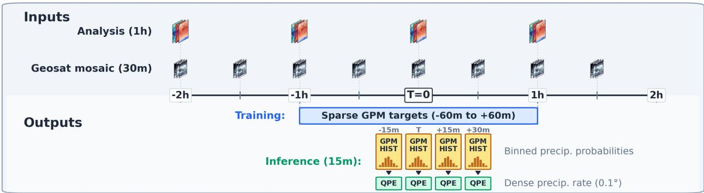

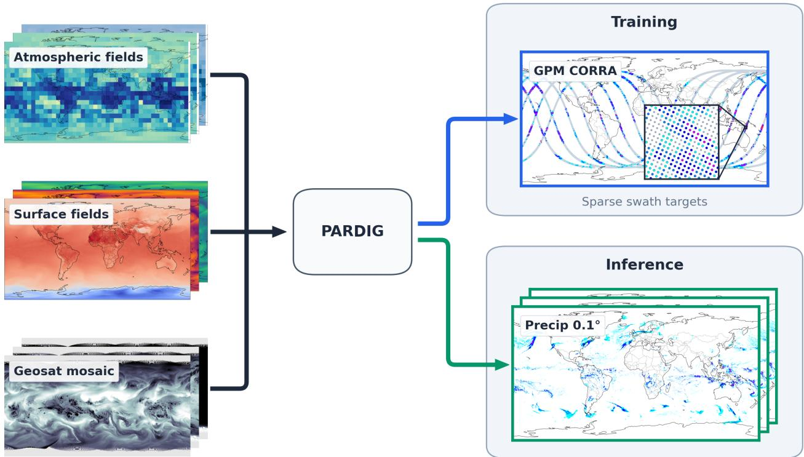  
Figure 1 | Model overview. Schematic showing the diferent input and output modalities, temporal ofsets, and training and inference pathways of PARDIG. For each reference time $t _ { 0 }$ (marked $T = 0$ on the timeline), PARDIG takes two sources of input spanning a 4-hour half-open window $( [ - 2 \mathrm { h } , + 2 \mathrm { h } ) )$ four hourly atmospheric analysis frames (−2 h to +1 h), and eight geostationary satellite mosaic frames at 30-minute cadence (−120 min to +90 min). Upper-air atmospheric fields are ingested at $0 . 2 5 ^ { \circ }$ resolution, while surface fields and the geostationary mosaic are provided at both $0 . 1 ^ { \circ }$ and $0 . 2 5 ^ { \circ }$ resolution. PARDIG’s output head predicts binned precipitation probabilities at arbitrary spatial and temporal resolution $( \mathrm { i . e . , }$ is continuously queryable in space and time). During training (blue), the model is queried at of-grid, sparse GPM CORRA radar swath data within a $\pm 6 0 \cdot$ -minute window around $t _ { 0 }$ . At inference (green), the model is queried on a global $0 . 1 ^ { \circ }$ grid at four 15-minute timesteps (−15, 0, +15, and +30 minutes), and the predicted probability histograms are converted via Quantitative Precipitation Estimation (QPE) into deterministic precipitation rate fields.

## 2.4. Probabilistic Output and Quantitative Precipitation Estimation

Rather than predicting a single deterministic precipitation rate, PARDIG outputs a probability distribution over precipitation intensity through a binned classification approach, following the methodology introduced by MetNet (Sønderby et al., 2020). For each query coordinate, the model predicts logits over 14 precipitation rate bins defined by 15 boundaries (in mm/h). Bin probabilities are computed via softmax, and the training loss is cross-entropy against the discretized GPM observation. This classification formulation avoids a well-known limitation of regression losses (MSE, MAE): for skewed distributions like precipitation, regression produces conditional-mean predictions that systematically overestimate light rain frequency and underestimate heavy precipitation intensity (Ravuri et al., 2021; Andrychowicz et al., 2023).

While the resulting per-bin probabilities provide a marginal probability distribution at each query point that can directly support probabilistic applications in future work, in this paper we focus on deriving deterministic precipitation rates from the predicted distribution. To do so, we first compute the exceedance probability $E _ { k } = P ( { \mathrm { p r e c i p } } \geq b _ { k } )$ for each bin boundary $b _ { k }$ by summing the probabilities of all bins at or above $b _ { k }$ . Using a fixed threshold of $E _ { k } \ge 0 . 5$ across all bins would correspond to extracting the median of the predicted distribution; however, because precipitation distributions are skewed toward dry and light-rain bins, the median systematically underestimates rain occurrence and heavy intensities. Similar to Andrychowicz et al. (2023), we instead apply rate-dependent probability thresholds $\left\{ \tau _ { k } \right\}$ (Table A.3.1), chosen so that the resulting precipitation rate frequencies approximately match the empirical GPM CORRA distribution. Given the highest bin boundary $b _ { k ^ { * } }$ for which $E _ { k ^ { * } } \geq \tau _ { k ^ { * } }$ we obtain the final deterministic estimate by linearly interpolating between $b _ { k ^ { * } }$ ∗ and $b _ { k ^ { * } + 1 }$ according to how far $E _ { k }$ ∗ exceeds $\tau _ { k ^ { * } }$ ∗ relative to the remaining gap $\tau _ { k ^ { * } + 1 } - E _ { k ^ { * } + 1 }$ (or assigning 0 mm/h if no threshold is exceeded), producing smooth rate estimates rather than discrete bin assignments. Full mathematical details and the chosen probability thresholds are provided in Appendix A.3.

## 3. Evaluation Setup

## 3.1. Evaluation Ground Truths

We evaluate PARDIG against four independent ground truth sources spanning diferent continents and observation types, none of which are used to train or calibrate PARDIG. We focus the main text on hourly accumulations, the finest temporal resolution common to all ground-truth datasets and baseline products, while evaluations of native 15-minute instantaneous rates and longer accumulations are presented in Appendices A.12 and A.13. For all evaluations, we bilinearly interpolate the precipitation estimates in space (with no temporal interpolation) to the ground-truth data.

Radar networks. Three regional radar composites serve as gridded ground truth in Figures 2 and 4. Over the contiguous United States we use the MRMS (Multi-Radar Multi-Sensor) Quantitative Precipitation Estimate Pass-2 product, which merges ∼180 radars with gauge data (Zhang et al., 2016). Over Europe we use EURADCLIM (European Radar Climatology), a gauge-adjusted, retrospectively reprocessed dataset built by KNMI from OPERA composites (Overeem et al., 2023). At the time of evaluation, EURADCLIM was only available until the end of 2023. Over Japan we use JMA Radar-AMeDAS, which merges C-band radar with the AMeDAS gauge network (Makihara, 1996). Evaluations against all three radar composites span 2016–2023 in the main text, with MRMS and JMA Radar-AMeDAS extended through 2025 in the year-by-year evaluation (Appendix A.14.1).

Surface weather stations (rain gauges). We use 36,678 quality-controlled surface stations reporting hourly rain-gauge measurements from Synoptic’s2 derived precipitation service over 2018–2023. To ensure reliable per-station skill estimates and exclude short-lived stations or event-only gauges (which transmit only when precipitation occurs and omit dry hours), we require stations to have at least 750 valid hourly measurements (> 1 month) with at least 50 positive (≥ 1 mm/h) and at least 50 negative (< 1 mm/h) observations and at most 50% positive hours, alongside basic coordinate and duplicate-feed quality control detailed in Appendix A.6.

The two observation types have complementary strengths and limitations. Radar composites provide spatially continuous pixel averages, but they infer precipitation indirectly from reflectivity and are only available for small parts of the globe. Station gauges measure accumulation directly and cover many regions, albeit unevenly, but provide only point measurements, introducing a spatial representativeness mismatch against kilometer-scale satellite and model estimates.

In addition to these independent radar and station benchmarks, in the appendix we evaluate PARDIG against GPM CORRA observations stratified by year (Appendix A.14) and by region (Appendix A.15), to assess temporal generalization across training and held-out periods and spatial consistency beyond the radar- and station-covered areas.

## 3.2. Baseline Products

We benchmark PARDIG against five reanalysis and operational products. Comprehensive multi-product evaluations generally rank NASA’s IMERG among the best satellite-based products, compared with alternatives such as GSMaP, CMORPH, PERSIANN, and PDIR-Now (Beck et al., 2019a; Xu et al., 2022; Wang and Tian, 2025). IMERG Final V07, MSWEP V3, and ERA5 represent leading retrospective satellite, multi-source merged, and reanalysis benchmarks, respectively, while IMERG Early V07 and HRES serve as operational near-real-time counterparts.

IMERG. NASA’s IMERG provides global precipitation estimates based on data from the GPM satellite constellation, in particular combining low-Earth orbit passive microwave radiometer data and geostationary infrared imagery. IMERG is available at 30 minute temporal and 0.1◦ spatial resolution going back to 1998. IMERG is available in an Early, Late and Final version. Here we evaluate the low-latency Early version, available with a ∼4-hour latency, and the highest-quality Final version, which is released with a delay of ∼3.5 months and applies a monthly bias adjustment over land using the gridded GPCC rain-gauge analysis (Schneider et al., 2014). We omit the intermediate Late version for simplicity, as its performance is bounded by the Early and Final versions. At the time of writing the most current IMERG version was V07. An update to V08 is currently in development3.

ERA5. ECMWF’s ERA5 (Hersbach et al., 2020) is the most commonly used global atmospheric reanalysis, providing hourly three-dimensional state estimates of the atmosphere going back to 1940

at 0.25◦. ERA5 is produced by assimilating a wide range of observations into a numerical weather prediction model. Crucially, precipitation is largely not directly assimilated but rather is indirectly predicted by the model physics. Final quality-checked ERA5 fields are released after 2–3 months, while a preliminary low-latency stream (ERA5T) is available with a delay of roughly 5 days.

HRES. As a low-latency analysis-based precipitation estimate we evaluate short-range forecasts from ECMWF’s operational high-resolution forecast model at 0.1◦. Specifically we evaluate the first 6 hours of every 6-hourly forecast cycle. When compared to ERA5, HRES has the advantage of higher spatial resolution, and benefits from advancements in model physics achieved in the past decade, but the disadvantage of an earlier observation cutof.

MSWEP. GloH2O’s Multi-Source Weighted-Ensemble Precipitation V3 (Wang et al., 2026) provides global hourly precipitation estimates at 0.1◦ resolution from 1979 onward by blending satellite retrievals, ERA5 reanalysis, and rain-gauge observations using machine learning. MSWEP V3 ofers both a retrospective gauge-corrected archive (MSWEP-GC) and a near-real-time stream (MSWEP-NRT). Here we evaluate MSWEP-GC, as it represents MSWEP’s highest-accuracy version and archived MSWEP-NRT retains only finalized (∼5-day) fields rather than initial real-time estimates. Unlike satellite-only or NWP products, MSWEP-GC directly incorporates daily rain-gauge observations and trains its blending model on regional gauge and radar references (including Stage-IV and EURADCLIM).

## 3.3. Evaluation Protocol and Metrics

Evaluating precipitation datasets over multi-year records against independent observation networks is standard practice to adequately sample interannual variability and extreme events (Beck et al., 2019a; Xu et al., 2022). Our multi-year radar evaluations span 2016–2023 (and the global station evaluations span 2018–2023), which represent the common overlap periods over which all evaluated products (including PARDIG-LR, which ends in 2023) and the respective ground-truth records (in particular, EURADCLIM, which ends in December 2023) are simultaneously available.

Although these multi-year windows overlap with the PARDIG-NRT training period (2016–2023), the ground-based benchmarks remain out-of-sample in two respects. First, all ground-based evaluations are strictly cross-modal: PARDIG is supervised exclusively by spaceborne GPM CORRA retrievals and never uses ground radar or rain gauge observations at any stage. Second, while evaluating directly against GPM footprints during 2016–2023 is in-sample, ground-based networks are not: GPM’s narrow orbital swath (∼245 km width with revisit times of several days) samples only a few percent of hourly grid-cell observations, so the vast majority of the space-time points evaluated in the radar and station records had no GPM overpass. In addition, to verify temporal generalization directly, we evaluate PARDIG-NRT across the strictly held-out post-training years 2024–2025 (Appendix A.14), both against GPM CORRA swaths (Figure A.14.2) and against the radar networks that extend beyond 2023 (MRMS over CONUS and JMA Radar-AMeDAS over Japan; Figure A.14.1). Whereas GPM evaluations show the expected modest diference between in-training (2016–2023) and unseen (2024–2025) satellite swaths, the independent radar evaluations exhibit no degradation between 2016–2023 and 2024–2025 across any region or threshold, confirming consistent generalization to future years and an operational near-real-time setting.

We evaluate all products using the Critical Success Index (CSI = hits / (hits + misses + false alarms)), which penalizes both missed precipitation and false alarms without rewarding correct negatives, an essential property given that most grid cells are dry at any given time. A suite of additional categorical metrics $( \mathrm { F } _ { 1 }$ score, precision, recall, SEDI, frequency bias, and FSS) is provided

in Appendix A.10.

## 4. Results

## 4.1. Multi-Regional Radar Evaluation

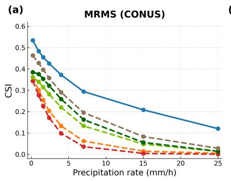

(b)  
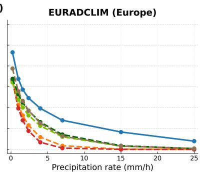

(c)  
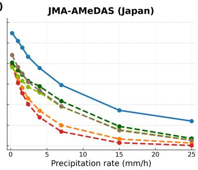

Figure 2 | Precipitation detection skill across rain rate thresholds. CSI as a function of hourly precipitation rate threshold evaluated against three independent, gauge-adjusted ground radar networks (multi-year means): (a) MRMS over the contiguous United States (CONUS, 2016–2023), (b) EURADCLIM over Europe (2016–2023), and (c) JMA Radar-AMeDAS over Japan (2016–2023). PARDIG-NRT (solid blue) consistently achieves the highest CSI across all rain rate thresholds in all three regions, with the largest relative improvements over the baselines occurring at higher rain rates. Numerical CSI values are provided in Table A.10.1; see Figure A.14.1 for year-by-year stability and Appendix A.10 for additional categorical metrics.

PARDIG achieves the highest CSI at every threshold in all three evaluation regions, with consistent improvements across all precipitation rates (Figure 2). At the 1 mm/h threshold, PARDIG-NRT achieves a multi-year mean CSI of 0.48 over CONUS, compared with 0.43 for MSWEP-GC, 0.38 for IMERG Final, and 0.28 for ERA5. At 4 mm/h, the gap widens: PARDIG-NRT scores 0.37, while MSWEP-GC falls to 0.29, IMERG Final to 0.26, and ERA5 to 0.10. At 25 mm/h, baseline products retain very limited skill (CSI ≤ 0.03), while PARDIG-NRT achieves 0.12, a considerable step change. The pattern holds across the other two radar networks over Europe and Japan.

Year-by-year evaluations (Figure A.14.1) show strong interannual stability across all products and confirm that PARDIG-NRT’s skill carries over without degradation to the held-out post-training years (2024–2025). Over CONUS, held-out CSI reaches 0.48–0.49 at 1 mm/h and 0.24–0.25 at 15 mm/h (versus 2016–2023 means of 0.48 and 0.21), with similarly steady generalization over Japan across all thresholds (Appendix A.14).

The frequency bias (ratio of predicted to observed precipitation frequency, Figure A.10.1(d1–d3)) confirms that PARDIG is reasonably calibrated across thresholds. MSWEP-GC, IMERG Final, and IMERG Early are less biased at light-to-moderate rain rates but increasingly underforecast heavy events (≥ 15 mm/h), whereas ERA5 and HRES systematically overestimate light rain frequency and drop sharply toward zero at higher rates, a well-known limitation of model-based precipitation; the global precipitation distributions (Appendix A.7) further illustrate this contrast, with ERA5 and HRES predicting precipitation over a substantially larger fraction of global area than satellite and merged products. PARDIG achieves both higher precision and higher recall at nearly all thresholds, highlighting that the CSI improvements come from more accurately estimating the timing and location of precipitation rather than simply predicting more rain or being better calibrated (Figure A.10.1(b1– b3) and Table A.10.2).

Additional radar evaluations at 6-hour and 24-hour accumulation timescales are provided in Appendix A.13, confirming that strong skill extends beyond the hourly resolution to sub-daily and daily precipitation, timescales that are also commonly used in hydrological and weather applications.

## 4.2. Global Station Evaluation

Figure 3 presents a global map of per-station ΔCSI (PARDIG-NRT minus IMERG Final) across $^ { 3 6 , 6 7 8 }$ quality-controlled surface gauge stations worldwide (Section 3.1), evaluated at the 1 mm/h hourly threshold.

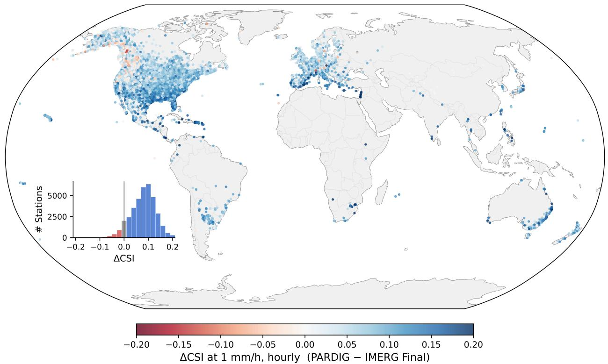  
Figure 3 | Global station-level skill improvement. Per-station CSI diference (ΔCSI: PARDIG-NRT minus IMERG Final) across 36,678 independent quality-controlled Synoptic surface rain-gauge stations worldwide (2018–2023), evaluated at the 1 mm/h hourly accumulation threshold. Blue circles indicate stations where PARDIG-NRT achieves higher CSI; red circles indicate stations where IMERG Final achieves higher CSI (color scale clipped to [−0.20, +0.20]). The inset histogram shows the distribution of per-station ΔCSI values across all 36,678 stations (with the neutral center bin $| \Delta \mathrm { C S I } | < 0 . 0 1$ shaded grey).

Defining stations within the neutral center bin $( | \Delta \mathrm { C S I } | < 0 . 0 1 )$ as tied, PARDIG-NRT outperforms IMERG Final at 89.9% of stations worldwide, whereas IMERG Final is better at 4.6% and 5.5% are tied. Across all 36,678 stations, PARDIG-NRT achieves a mean CSI of 0.36 compared with 0.28 for IMERG Final, a mean improvement of +0.08 CSI points (+28.5% relative). The inset histogram is heavily right-skewed, peaking at $\Delta \mathrm { C S I } = 0 . 1 0 .$ , with over one-third of all stations (35.9%) exhibiting a gain of $\Delta \mathrm { C S I } \geq + 0 . 1 0$

The improvement spans all continents with observing stations. Although gauge coverage in the tropical and subtropical belt (30◦S–30◦N) is sparser than in the Northern Hemisphere mid-latitudes, across the 2,841 stations in this band PARDIG-NRT outperforms IMERG Final at 96.8% of stations (vs. 0.8% for IMERG Final and 2.5% tied), with a mean gain of +0.12 CSI points (0.36 vs. 0.24, +52% relative), compared with 89.3% of stations and a mean gain of +0.08 CSI points (0.36 vs. 0.28, +27% relative) poleward of 30◦. Conversely, the small fraction of stations where IMERG Final scores higher (4.6% globally) occurs primarily in high-elevation mountainous terrain at mid-latitudes, such as parts of the North American Rockies and the European Alps.

A similar per-station comparison between PARDIG-NRT and MSWEP-GC, along with stationaveraged CSI across all hourly thresholds (0.2–25 mm/h) for all seven products (including PARDIG-LR), is provided in Appendix A.10.7. Finally, to complement these station evaluations in regions where ground-based networks are sparse or absent, we also evaluate PARDIG-NRT against held-out GPM CORRA swaths across 16 regional domains (Appendix A.15), confirming strong skill over tropical and southern-hemisphere landmasses.

## 4.3. Extreme Precipitation Case Studies

To illustrate how these multi-year statistical results manifest at the storm scale, Figure 4 examines one recent high-impact precipitation event from each of our three radar benchmark regions, chosen to span three distinct dynamical regimes and accumulation windows: convective flash floods in central Texas (Kerr County, July 2025, 1h), frontal and orographic floods in Slovenia (August 2023, 3h), and tropical cyclone landfall in Japan (Typhoon Shanshan, August 2024, 6h). The Texas and Japan events occurred after the 2016–2023 training period, and the Slovenia event occurred in the final year of EURADCLIM availability. For each event, we show 8 sequential time steps comparing gauge-adjusted radar ground truth, PARDIG-NRT, and IMERG Final.

Kerr County flash floods, Texas (Figure 4(a), July 2025, 1h accumulation). An intense mesoscale convective system produced localized extreme precipitation over central Texas. At the 1-hour accumulation window, PARDIG resolves individual convective cells rather than smoothing them into a broad, difuse precipitation field, capturing the rapid onset and movement of the system with high fidelity against MRMS radar. The advantage over IMERG is most pronounced at extreme thresholds: at 15 mm/h and 25 mm/h, PARDIG achieves event-level CSIs of 0.29 and 0.10, compared to 0.08 and 0.02 for IMERG Final.

Slovenia floods (Figure 4(b), August 2023, 3h accumulation). A slow-moving frontal system produced sustained heavy precipitation over the Julian Alps and surrounding valleys, triggering the most extreme flood event in Slovenia in recent decades (Bezak et al., 2023). PARDIG accurately captures the spatial structure, location, and progression of the precipitation bands observed in the EURADCLIM radar composite, though it overestimates precipitation intensity during the final three frames as the system shifts southward. Despite this late-stage intensity bias, PARDIG outperforms IMERG Final across all thresholds over the event, achieving a CSI of 0.38 versus 0.32 at a 4 mm/h mean rate (12 mm/3h) and 0.22 versus 0.16 at 7 mm/h (21 mm/3h).

Typhoon Shanshan (Figure 4(c), August 2024, 6h accumulation). Typhoon Shanshan made landfall in southwestern Japan with extreme rainfall. PARDIG reproduces the asymmetric precipitation distribution characteristic of tropical cyclones (heavy rainfall concentrated in the northeast quadrant relative to the storm center) as well as the feeder bands extending hundreds of kilometers from the core. Over the 48-hour cyclone passage, PARDIG achieves slightly higher skill than IMERG Final across all thresholds, with an event CSI of 0.46 versus 0.43 at 24 mm/6h (4 mm/h mean rate) and 0.38 versus 0.36 at 42 mm/6h (7 mm/h mean rate).

(a) Kerr County Flash Floods — Texas, July 2025 (1h mean rate)  
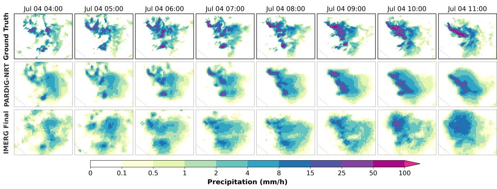

(b) Slovenia Floods — August 2023 (3h mean rate)  
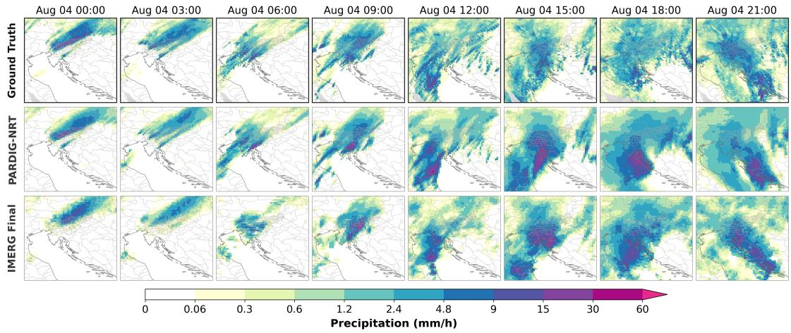

(c) Typhoon Shanshan — Japan, August 2024 (6h mean rate)  
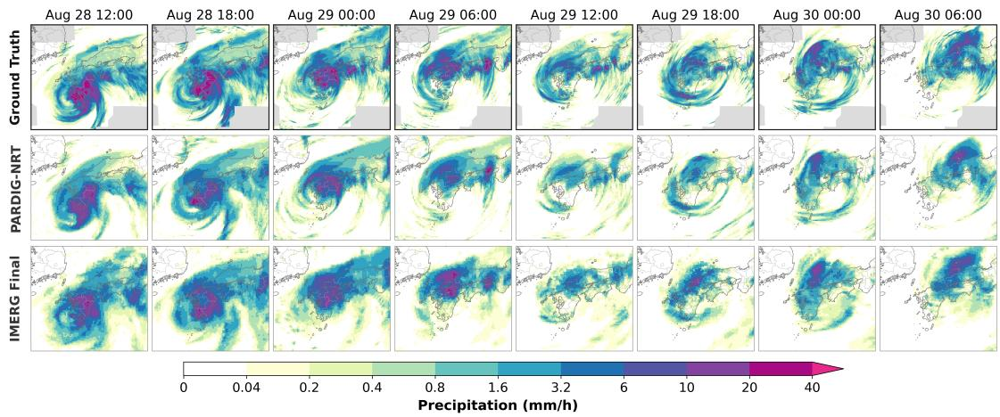  
Figure 4 | High-resolution case studies of extreme precipitation events. Sequential 8-step progressions for (a) Kerr County convective flash floods, Texas (July 2025, 1h mean rate, MRMS), (b) Orographic floods, Slovenia (August 2023, 3h mean rate, EURADCLIM), and (c) Typhoon Shanshan landfall, Japan (August 2024, 6h mean rate, JMA Radar-AMeDAS). Rows display gauge-adjusted radar ground truth (top, bold frame), PARDIG-NRT (middle), and IMERG Final V07 (bottom) in mm/h, each shown at its native spatial resolution (0.01◦ for MRMS and JMA Radar-AMeDAS, 0.02◦ for EURADCLIM, and 0.1◦ for PARDIG-NRT and IMERG Final). Column headers denote accumulation interval start times in UTC ([�, � + Δ�)); light grey shading in the ground-truth panels indicates regions outside radar coverage. Numerical CSI verification across thresholds is detailed in Table A.10.3.

Two additional case studies from 2017 and 2023 that also include PARDIG-LR and MSWEP-GC are shown in Figure A.10.2. Although a handful of storms cannot by themselves establish general performance, the sharper rainband structure and heavy-rain skill seen across these examples align with the multi-year radar and gauge evaluations in Sections 4.1 and 4.2 and Appendix A.13.

## 4.4. Spatiotemporal Structure and Physical Consistency

Beyond grid-point categorical skill, PARDIG preserves fine-scale spatial structure and sub-hourly temporal evolution without over-smoothing precipitation fields in space or time. Globally, PARDIG retains higher spherical harmonic variance across 50–200 km wavelengths than MSWEP-GC, IMERG Final, or HRES (Appendix A.11.1), and CONUS spatial semivariograms against MRMS radar confirm that this variance reflects a more realistic spatial correlation decay (240–250 km decorrelation length vs. 150–170 km for MRMS, 290–300 km for HRES and IMERG Final, and 330 km for MSWEP-GC; Appendix A.11.2). At its native 15-minute cadence, PARDIG-NRT maintains uniform skill across all intra-hour ofsets and exhibits rapid frame-to-frame decorrelation approaching MRMS instantaneous radar, avoiding the slower decorrelation of morphed satellite retrievals (Appendix A.12).

Across regional and latitudinal climatologies, PARDIG reproduces observed diurnal and seasonal regimes (Appendix A.8), capturing the nocturnal convective peak over the US Great Plains and matching JMA radar over Kyushu, while overestimating seasonal cycle amplitude over the European Alps (underestimating wintertime relative to summertime precipitation). Across tropical regions without ground radar (South America, Central Africa, and South Asia), PARDIG agrees closely with IMERG Final in seasonal cycle and peaks between ERA5 (which triggers convection too early) and IMERG Final in diurnal phase. Globally, its zonal-mean profile closely tracks IMERG Final across the Intertropical Convergence Zone, subtropical dry zones, and mid-latitude storm tracks, while estimating lower mean rates toward the poles (Appendix A.9).

Finally, PARDIG-NRT and the historical PARDIG-LR variant remain closely aligned across their 2016–2023 overlap, exhibiting near-identical global precipitation distributions with area-weighted global means within 2% and aligned upper tails through �99.999 (Appendix A.7.1). Extending further back in time, PARDIG-LR maintains stable annual means from 2008 through 2023, whereas sparser early-2000s satellite observations induce a distributional shift prior to 2008, evidenced by lower annual mean rates (Appendix A.7.2). Across the independent radar and station benchmarks, PARDIG-LR closely tracks PARDIG-NRT, outperforming all external baselines at 1-hour and 6-hour accumulations, while MSWEP-GC is comparable or slightly better in some of the 24-hour evaluations (Appendices A.10, A.10.7 and A.13).

## 4.5. Improving Precipitation Forecasts

PARDIG has already been used to improve precipitation forecasts in the recently released WeatherNext 3 (WN3) model (Rasp et al., 2026). WN3 is a state-of-the-art global, probabilistic, medium-range forecast model with two precipitation specific output heads, one trained against IMERG Final data and one against PARDIG. The PARDIG head consistently achieves better skill when evaluated against independent radar observations. This holds across precipitation intensities and temporal accumulations. As an example, at early lead times (6h), CRPS when evaluated against 6h MRMS accumulations is approximately 15% lower compared to the IMERG head and 30% lower compared to the analysis-based

precipitation head.4

## 5. Discussion

We have presented PARDIG, a near-real-time global precipitation estimation system that maps multimodal atmospheric and satellite inputs to dense global precipitation fields by learning from sparse, high-quality spaceborne radar observations.

Comprehensive evaluation across three independent radar networks on three continents demonstrates that PARDIG consistently outperforms IMERG V07 (Final and Early), MSWEP-GC, ERA5, and HRES across all precipitation thresholds, with the largest improvements at extreme intensities (Figure 2). This advantage is confirmed across over 36,000 independent surface stations worldwide (Figure 3) and through high-resolution case studies of extreme convective, frontal, and cyclonic events (Figure 4). Furthermore, these improvements translate into measurably more skillful precipitation forecasts when used to train the WeatherNext 3 global weather model (Section 4.5).

Notably, PARDIG achieves these gains over monthly gauge-adjusted IMERG Final and gaugecorrected MSWEP without relying on rain gauge inputs or gauge-based bias correction. Because the satellite and reanalysis inputs are globally continuous and GPM samples precipitation along its orbital swaths without preferential geographic coverage over land or ocean, model skill is not tied to local ground infrastructure. While our evaluations are necessarily limited to regions with independent radar and station observations, this spatial uniformity gives reason to expect more reliable generalization to sparsely gauged land regions and oceans than for gauge-adjusted products or models trained on gauge-dependent targets.

The companion PARDIG-LR dataset extends global coverage back to 1999, demonstrating that the sparse-to-dense architecture functions as a general framework adaptable to coarser historical reanalysis, geostationary, and passive microwave streams. Because PARDIG-LR maintains high skill, stable annual means from 2008 onward, and closely aligned global distributions with PARDIG-NRT across their overlap period, the two records can be concatenated into a consistent series from 2008 to the present; prior to 2008, however, sparser early-2000s satellite observations induce a distributional shift in PARDIG-LR, warranting caution when using these earlier years (Appendix A.7.2).

Several limitations of the current system warrant consideration. First, although PARDIG outperforms baseline products overall across Europe and North America, it shows smaller margins or occasional station-level deficits relative to IMERG Final at some high-elevation mountainous sites (Figure 3) and underestimates wintertime relative to summertime precipitation over the European Alps (Appendix A.8). While the causes of these localized diferences are not fully understood (and likely reflect in part the general dificulty of resolving complex orographic precipitation in atmospheric analyses and satellite retrievals), one plausible contributing factor to explore in future work is the GPM training target itself, as GPM’s DPR has documented sensitivity limitations for light snowfall and drizzle (Hamada and Takayabu, 2016; Chase et al., 2022). Second, because GPM’s orbital coverage ends at ∼67◦N/S, estimates at polar latitudes rely on unconstrained extrapolation from the dense inputs and should be treated with caution (Appendix A.9).

Looking ahead, this framework can naturally incorporate additional or higher-resolution observational streams and richer training targets to further improve retrieval skill, particularly in challenging regimes such as cold-season precipitation. More broadly, the same sparse-to-dense learning paradigm, using continuous multi-modal context to densely infer sparse, high-precision measurements, ofers a general approach for other sparsely observed Earth system variables.

Both the PARDIG-NRT and PARDIG-LR datasets are openly released, with the PARDIG-NRT archive continuously updated to support near-real-time operational workflows and research applications.

## Data Availability

PARDIG precipitation estimates at 0.1◦ spatial resolution are openly available under a CC BY 4.0 license on Google Cloud Storage as Zarr datasets at gs://pardig\_1/NRT/ (PARDIG-NRT historical archive and continuously updated near-real-time stream) and gs://pardig\_1/LR/ (PARDIG-LR historical archive, 1999–2023), with dual chunking optimized for global maps and time series analysis. The historical archives are additionally available in the Google Earth Engine Data Catalog at https://developers.google.com/earth-engine/datasets/catalog/projects\_gc p-public-data-weathernext\_assets\_PARDIG\_1\_NRT (PARDIG-NRT) and https://develo pers.google.com/earth-engine/datasets/catalog/projects\_gcp-public-data-wea thernext\_assets\_PARDIG\_1\_LR (PARDIG-LR). Full documentation and access instructions are available at https://developers.google.com/weathernext/guides/pardig.

Operational availability of the PARDIG-NRT stream is governed by the 6-hourly ECMWF HRES forecast initialization cycles and near-real-time SatWeave composite latency, producing 15-minute global precipitation fields at 0.1◦ resolution with end-to-end latencies of approximately 2–8 hours from observation time to estimate availability, depending on where the observation falls within the 6-hourly HRES cycle; full pipeline details are provided in Appendix A.5.

The evaluation ground truth and baseline datasets used in this study are available from their respective providers: MRMS from NOAA NSSL, EURADCLIM from KNMI, JMA Radar-AMeDAS from JMA, IMERG from NASA GES DISC, MSWEP from GloH2O (gloh2o.org/mswep), and surface weather station observations from Synoptic Data PBC (synopticdata.com). ERA5 data are available from the Copernicus Climate Data Store and HRES data from ECMWF.

## Acknowledgments

In alphabetical order, we thank Adriana Fernandez Lara, Assaf Shmuel, Avinatan Hassidim, Chris Kwaku-Abdullahi, Darshan Prajapati, Devaja Shah, Drew Purves, Elinor Kruse, Frederik Kratzert, Grey Nearing, Jash Rana, Kasia Mohammed, Keita Saito, Kunal Shah, Marc Deisenroth, Martin Gauch, Matthew Willson, Mavish Mahomed-Silva, Oren Gilon, Patrick Ebel, Piyush Ingale, Rachel Stigler, Rahul Mahrsee, Raia Hadsell, Remi Lam, Reuven Sayag, Shail Parekh, Shreya Agrawal, Shubham Joshi, Shubham Kumar, Stephanie Rees, Stephanie Sanchez, Sunny Mak, Tom Andersson, Yuval Yevnin, and Zoubin Ghahramani.

We also thank ECMWF, EUMETSAT, GloH2O, JAXA, JMA, KNMI, NASA, and NOAA for providing invaluable datasets to the research community.

## Disclaimers

Experimental Estimates: PARDIG is an automated, experimental AI system under active research. Estimates are provided “as-is” for informational purposes and are not oficial severe weather warnings. For protection of life and property, always defer to oficial alerts from your local emergency authorities and national meteorological services. Use of the PARDIG datasets is subject to a Creative Commons Attribution 4.0 International (CC BY 4.0) license (https://creativecommons.org/licenses/b

y/4.0/).

This document is based on ERA5 and HRES data and products of the European Centre for Medium-Range Weather Forecasts (ECMWF). Copyright © 2026 European Centre for Medium-Range Weather Forecasts (ECMWF). Source: https://www.ecmwf.int. This data is published under a Creative Commons Attribution 4.0 International (CC BY 4.0) license (https://creativecommons.org/li censes/by/4.0/). The original ECMWF data was modified by regridding and subsetting it for use as inputs in an AI precipitation model. ECMWF does not accept any liability whatsoever for any error or omission in the data, their availability, or for any loss or damage arising from their use.

Based on MSWEP precipitation data, © GloH2O.

## References

S. Agrawal, M. A. Hassen, E. A. Brempong, B. Babenko, F. Zyda, O. Graham, D. Li, S. Merchant, S. H. Potes, T. Russell, D. Cheresnick, A. P. Kakkirala, S. Rasp, A. Hassidim, Y. Matias, N. Kalchbrenner, P. Gupta, J. Hickey, and A. Bell. An operational deep learning system for satellite-based high-resolution global nowcasting. arXiv preprint arXiv:2510.13050, 2025. doi: 10.48550/arXiv.2510.13050

F. Alet, I. Price, A. El-Kadi, D. Masters, S. Markou, T. R. Andersson, J. Stott, R. Lam, M. Willson, A. Sanchez-Gonzalez, and P. Battaglia. Skillful joint probabilistic weather forecasting from marginals. arXiv preprint arXiv:2506.10772, 2025. doi: 10.48550/arXiv.2506.10772

M. Andrychowicz, L. Espeholt, D. Li, S. Merchant, A. Merose, F. Zyda, S. Agrawal, and N. Kalchbrenner. Deep learning for day forecasts from sparse observations. arXiv preprint arXiv:2306.06079, 2023. doi: 10.48550/arXiv.2306.06079

K. Aonashi, J. Awaka, M. Hirose, T. Kozu, T. Kubota, G. Liu, S. Shige, S. Kida, S. Seto, N. Takahashi, and Y. N. Takayabu. GSMaP passive microwave precipitation retrieval algorithm: Algorithm description and validation. J. Meteor. Soc. Japan, 87A:119–136, 2009. doi: 10.2151/jmsj.87A.119

P. Bechtold, N. Semane, P. Lopez, J.-P. Chaboureau, A. Beljaars, and N. Bormann. Representing equilibrium and nonequilibrium convection in large-scale models. J. Atmos. Sci., 71(2):734–753, 2014. doi: 10.1175/JAS-D-13-0163.1

H. E. Beck, N. Vergopolan, M. Pan, V. Levizzani, A. I. J. M. van Dijk, G. P. Weedon, L. Brocca, F. Pappenberger, G. J. Hufman, and E. F. Wood. Global-scale evaluation of 22 precipitation datasets using gauge observations and hydrological modeling. Hydrol. Earth Syst. Sci., 21(12):6201–6217, 2017. doi: 10.5194/hess-21-6201-2017

H. E. Beck, M. Pan, T. Roy, G. P. Weedon, F. Pappenberger, A. I. J. M. van Dijk, G. J. Hufman, R. F. Adler, and E. F. Wood. Daily evaluation of 26 precipitation datasets using Stage-IV gauge-radar data for the CONUS. Hydrol. Earth Syst. Sci., 23(1):207–224, 2019a. doi: 10.5194/hess-23-207-2019

H. E. Beck, E. F. Wood, M. Pan, C. K. Fisher, D. G. Miralles, A. I. J. M. van Dijk, T. R. McVicar, and R. F. Adler. MSWEP V2 global 3-hourly 0.1◦ precipitation: Methodology and quantitative assessment. Bull. Amer. Meteor. Soc., 100(3):473–500, 2019b. doi: 10.1175/BAMS-D-17-0138.1

N. Bezak, P. Panagos, L. Liakos, and M. Mikoš. Brief communication: A first hydrological investigation of extreme August 2023 floods in Slovenia, Europe. Nat. Hazards Earth Syst. Sci., 23(12):3885–3893, 2023. doi: 10.5194/nhess-23-3885-2023

K. Bi, L. Xie, H. Zhang, X. Chen, X. Gu, and Q. Tian. Accurate medium-range global weather forecasting with 3D neural networks. Nature, 619(7970):533–538, 2023. doi: 10.1038/s41586-023-06185-3

R. Bonsignori. The Microwave Humidity Sounder (MHS): In-orbit performance assessment. In Sensors, Systems, and Next-Generation Satellites XI, volume 6744 of Proc. SPIE, page 67440A, 2007. doi: 10.1117/12.737986

E. A. Brempong, M. A. Hassen, M. MohamedKhair, V. Dube, S. H. Potes, O. Graham, A. Brik, A. McGovern, G. J. Hufman, and J. Hickey. Oya: Deep learning for accurate global precipitation estimation. arXiv preprint arXiv:2511.10562, 2025. doi: 10.48550/arXiv.2511.10562

F. Cannon, S. Pfreundschuh, B. Taylor, S. J. Munchak, R. Chase, E. Nelson, J. L’Heureux, C. Owens, L. Conibear, S. Flampouris, and A. Chawla. Deep learning for multisatellite precipitation retrievals: Impact of Tomorrow.io’s microwave sounders. J. Hydrometeor., 27(3):453–471, 2026. doi: 10.1175/JHM-D-25-0007.1

R. E. Carbone and J. D. Tuttle. Rainfall occurrence in the U.S. warm season: The diurnal cycle. J. Climate, 21(16):4132–4146, 2008. doi: 10.1175/2008JCLI2275.1

R. J. Chase, S. W. Nesbitt, G. M. McFarquhar, N. B. Wood, and G. M. Heymsfield. Direct comparisons between GPM-DPR and CloudSat snowfall retrievals. J. Appl. Meteor. Climatol., 61(9):1257–1271, 2022. doi: 10.1175/JAMC-D-21-0081.1

M. Chen, W. Shi, P. Xie, V. B. S. Silva, V. E. Kousky, R. W. Higgins, and J. E. Janowiak. Assessing objective techniques for gauge-based analyses of global daily precipitation. J. Geophys. Res. Atmos., 113(D4):D04110. 2008, doi: 10.1029/2007JD009132

C. Covey, P. J. Gleckler, C. Doutriaux, D. N. Williams, A. Dai, J. Fasullo, K. Trenberth, and A. Berg. Metrics for the diurnal cycle of precipitation: Toward routine benchmarks for climate models. J. Climate, 29(12):4461–4471, 2016. doi: 10.1175/JCLI-D-15-0664.1

E. Cristiano, M.-C. ten Veldhuis, and N. van de Giesen. Spatial and temporal variability of rainfall and their efects on hydrological response in urban areas – a review. Hydrol. Earth Syst. Sci., 21(7): 3859–3878, 2017. doi: 10.5194/hess-21-3859-2017

C. A. T. Ferro and D. B. Stephenson. Extremal dependence indices: Improved verification measures for deterministic forecasts of rare binary events. Wea. Forecasting, 26(5):699–713, 2011. doi: 10.1175/WAF-D-10-05030.1

GloH2O. MSWEP: Multi-source weighted-ensemble precipitation documentation and version history (V3.16). https://www.gloh2o.org/mswep/, 2026. Release notes.

M. Grecu, W. S. Olson, S. J. Munchak, S. Ringerud, L. Liao, Z. Haddad, B. L. Kelley, and S. F. McLaughlin. The GPM combined algorithm. J. Atmos. Oceanic Technol., 33(10):2225–2245, 2016. doi: 10.1175/JTECH-D-16-0019.1

A. Hamada and Y. N. Takayabu. Improvements in detection of light precipitation with the Global Precipitation Measurement Dual-Frequency Precipitation Radar (GPM DPR). J. Atmos. Oceanic Technol., 33(4):653–667, 2016. doi: 10.1175/JTECH-D-15-0097.1

H. Hersbach, B. Bell, P. Berrisford, S. Hirahara, A. Horányi, J. Muñoz-Sabater, J. Nicolas, C. Peubey, R. Radu, D. Schepers, A. Simmons, C. Soci, S. Abdalla, X. Abellan, G. Balsamo, P. Bechtold, G. Biavati, J. Bidlot, M. Bonavita, G. De Chiara, P. Dahlgren, D. Dee, M. Diamantakis, R. Dragani, J. Flemming, R. Forbes, M. Fuentes, A. Geer, L. Haimberger, S. Healy, R. J. Hogan, E. Hólm, M. Janisková, S. Keeley,

P. Laloyaux, P. Lopez, C. Lupu, G. Radnoti, P. de Rosnay, I. Rozum, F. Vamborg, S. Villaume, and J.-N. Thépaut. The ERA5 global reanalysis. Q. J. R. Meteorol. Soc., 146(730):1999–2049, 2020. doi: 10.1002/qj.3803

R. W. Higgins, Y. Yao, E. S. Yarosh, J. E. Janowiak, and K. C. Mo. Influence of the Great Plains low-level jet on summertime precipitation and moisture transport over the central United States. J. Climate, 10(3):481–507, 1997. doi: 10.1175/1520-0442(1997)010<0481:IOTGPL>2.0.CO;2

A. Y. Hou, R. K. Kakar, S. Neeck, A. A. Azarbarzin, C. D. Kummerow, M. Kojima, R. Oki, K. Nakamura, and T. Iguchi. The Global Precipitation Measurement mission. Bull. Amer. Meteor. Soc., 95(5): 701–722, 2014. doi: 10.1175/BAMS-D-13-00164.1

K.-l. Hsu, X. Gao, S. Sorooshian, and H. V. Gupta. Precipitation estimation from remotely sensed information using artificial neural networks. J. Appl. Meteor., 36(9):1176–1190, 1997. doi: 10.1175/1520-0450(1997)036<1176:PEFRSI>2.0.CO;2

G. J. Hufman, D. T. Bolvin, D. Braithwaite, K. Hsu, R. Joyce, C. Kidd, E. J. Nelkin, S. Sorooshian, E. F. Stocker, J. Tan, D. B. Wolf, and P. Xie. Integrated Multi-satellitE Retrievals for the Global Precipitation Measurement (GPM) mission (IMERG). In V. Levizzani, C. Kidd, D. B. Kirschbaum, C. D. Kummerow, K. Nakamura, and F. J. Turk, editors, Satellite Precipitation Measurement, volume 1, pages 343–353. Springer, 2020. doi: 10.1007/978-3-030-24568-9\_19

G. J. Hufman, D. T. Bolvin, R. Joyce, O. A. Kelley, E. J. Nelkin, J. Tan, D. C. Watters, and B. J. West. Integrated Multi-satellitE Retrievals for GPM (IMERG) technical documentation. Technical report, NASA GSFC, 2023. URL https://gpm.nasa.gov/resources/documents/imerg-v07-tec hnical-documentation. Version 07.

G. J. Hufman, D. T. Bolvin, R. Joyce, O. A. Kelley, E. J. Nelkin, A. Portier, E. F. Stocker, J. Tan, D. C. Watters, and B. J. West. IMERG V07 release notes. Technical report, NASA GSFC, 2024. URL https://gpm.nasa.gov/resources/documents/imerg-v07-release-notes.

T. Iguchi, S. Seto, R. Meneghini, N. Yoshida, J. Awaka, M. Le, V. Chandrasekar, S. Brodzik, S. Tanelli, K. Kanemaru, T. Masaki, T. Kubota, and N. Takahashi. GPM/DPR level-2 algorithm theoretical basis document. Technical report, JAXA and NASA GSFC, 2024. URL https://gpm.nasa.gov/resou rces/documents/gpm-dpr-level-2-algorithm-theoretical-basis-document-atbd. Revised July 2024.

M. Iturbide, J. M. Gutiérrez, L. M. Alves, J. Bedia, R. Cerezo-Mota, E. Cimadevilla, A. S. Cofiño, A. Di Luca, S. H. Faria, I. V. Gorodetskaya, M. Hauser, S. Herrera, K. Hennessy, H. T. Hewitt, R. G. Jones, S. Krakovska, R. Manzanas, D. Martínez-Castro, G. T. Narisma, I. S. Nurhati, I. Pinto, S. I. Seneviratne, B. van den Hurk, and C. S. Vera. An update of IPCC climate reference regions for subcontinental analysis of climate model data: Definition and aggregated datasets. Earth Syst. Sci. Data, 12(4):2959–2970, 2020. doi: 10.5194/essd-12-2959-2020

K. Jordan, Y. Jin, V. Boza, J. You, F. Cesista, L. Newhouse, and J. Bernstein. Muon: An optimizer for hidden layers in neural networks. https://kellerjordan.github.io/posts/muon/, 2024. Blog post.

R. J. Joyce, J. E. Janowiak, P. A. Arkin, and P. Xie. CMORPH: A method that produces global precipitation estimates from passive microwave and infrared data at high spatial and temporal resolution. J. Hydrometeor., 5(3):487–503, 2004. doi: 10.1175/1525-7541(2004)005<0487:CAMTPG>2.0.CO;2

D. Kavetski, G. Kuczera, and S. W. Franks. Bayesian analysis of input uncertainty in hydrological modeling: 1. Theory. Water Resour. Res., 42(3):W03407, 2006. doi: 10.1029/2005WR004368

K. R. Knapp, S. Ansari, C. L. Bain, M. A. Bourassa, M. J. Dickinson, C. Funk, C. N. Helms, C. C. Hennon, C. D. Holmes, G. J. Hufman, J. P. Kossin, H.-T. Lee, A. Loew, and G. Magnusdottir. Globally gridded satellite observations for climate studies. Bull. Amer. Meteor. Soc., 92(7):893–907, 2011. doi: 10.1175/2011BAMS3039.1

S. Kobayashi, Y. Ota, Y. Harada, A. Ebita, M. Moriya, H. Onoda, K. Onogi, H. Kamahori, C. Kobayashi, H. Endo, K. Miyaoka, and K. Takahashi. The JRA-55 reanalysis: General specifications and basic characteristics. J. Meteor. Soc. Japan, 93(1):5–48, 2015. doi: 10.2151/jmsj.2015-001

D. Kochkov, J. Yuval, I. Langmore, P. Norgaard, J. Smith, G. Mooers, M. Klöwer, J. Lottes, S. Rasp, P. Düben, S. Hatfield, P. Battaglia, A. Sanchez-Gonzalez, M. Willson, M. P. Brenner, and S. Hoyer. Neural general circulation models for weather and climate. Nature, 632(8027):1060–1066, 2024. doi: 10.1038/s41586-024-07744-y

F. Kratzert, D. Klotz, S. Hochreiter, and G. S. Nearing. A note on leveraging synergy in multiple meteorological data sets with deep learning for rainfall–runof modeling. Hydrol. Earth Syst. Sci., 25(5):2685–2703, 2021. doi: 10.5194/hess-25-2685-2021

R. Lam, A. Sanchez-Gonzalez, M. Willson, P. Wirnsberger, M. Fortunato, F. Alet, S. Ravuri, T. Ewalds, Z. Eaton-Rosen, W. Hu, A. Merose, S. Hoyer, G. Holland, O. Vinyals, J. Stott, A. Pritzel, S. Mohamed, and P. Battaglia. Learning skillful medium-range global weather forecasting. Science, 382(6677): 1416–1421, 2023. doi: 10.1126/science.adi2336

S. Lang, M. Alexe, M. Chantry, J. Dramsch, F. Pinault, B. Raoult, M. C. A. Clare, C. Lessig, M. Maier-Gerber, L. Magnusson, Z. Ben Bouallègue, A. Prieto Nemesio, P. D. Dueben, A. Brown, F. Pappenberger, and F. Rabier. AIFS – ECMWF’s data-driven forecasting system. arXiv preprint arXiv:2406.01465, 2024. doi: 10.48550/arXiv.2406.01465

D. A. Lavers, A. Simmons, F. Vamborg, and M. J. Rodwell. An evaluation of ERA5 precipitation for climate monitoring. Q. J. R. Meteorol. Soc., 148(748):3152–3165, 2022. doi: 10.1002/qj.4351

R. Li, C. Guilloteau, P.-E. Kirstetter, and E. Foufoula-Georgiou. How well does the IMERG satellite precipitation product capture the timing of precipitation events? J. Hydrol., 620:129563, 2023. doi: 10.1016/j.jhydrol.2023.129563

Z. Ma, J. Xu, B. Dong, X. Hu, H. Hu, S. Yan, S. Zhu, K. He, Z. Shi, Y. Chen, X. Fang, Q. Zhang, S. Gu, and F. Weng. GMCP: A fully global multisource merging-and-calibration precipitation dataset (1-hourly, 0.1◦, global, 2000–the present). Bull. Amer. Meteor. Soc., 106(4):E596–E624, 2025. doi: 10.1175/BAMS-D-24-0051.1

Y. Makihara. A method for improving radar estimates of precipitation by comparing data from radars and raingauges. J. Meteor. Soc. Japan, 74(4):459–480, 1996. doi: 10.2151/jmsj1965.74.4\_459

T. Mo. Prelaunch calibration of the Advanced Microwave Sounding Unit-A for NOAA-K. IEEE Trans. Microwave Theory Tech., 44(8):1460–1469, 1996. doi: 10.1109/22.536029

P. Nguyen, M. Ombadi, V. A. Gorooh, E. J. Shearer, M. Sadeghi, S. Sorooshian, K. Hsu, D. Bolvin, and M. F. Ralph. PERSIANN Dynamic Infrared–Rain Rate (PDIR-Now): A near-real-time, quasi-global satellite precipitation dataset. J. Hydrometeor., 21(12):2893–2906, 2020. doi: 10.1175/JHM-D-20- 0177.1

S. E. Nicholson. The ITCZ and the seasonal cycle over equatorial Africa. Bull. Amer. Meteor. Soc., 99 (2):337–348, 2018. doi: 10.1175/BAMS-D-16-0287.1

A. Overeem, E. van den Besselaar, G. van der Schrier, J. F. Meirink, E. van der Plas, and H. Leijnse. EURADCLIM: The European climatological high-resolution gauge-adjusted radar precipitation dataset. Earth Syst. Sci. Data, 15(3):1441–1464, 2023. doi: 10.5194/essd-15-1441-2023

A. Portier, J. Reed, J. Tan, and G. J. Hufman. FAQ for IMERG V07 applications users. Technical report, NASA GSFC, 2025. URL https://gpm.nasa.gov/resources/documents/imerg-v07-faq -applications-users.

I. Price, A. Sanchez-Gonzalez, F. Alet, T. R. Andersson, A. El-Kadi, D. Masters, T. Ewalds, J. Stott, S. Mohamed, P. Battaglia, R. Lam, and M. Willson. Probabilistic weather forecasting with machine learning. Nature, 637(8044):84–90, 2025. doi: 10.1038/s41586-024-08252-9

S. Rasp, B. Babenko, D. Masters, A. El-Kadi, S. Merchant, G. Shalev, I. Price, F. Zyda, R. Lam, S. Shysheya, M. Willson, S. Markou, S. Agrawal, S. Vora, M. A. Hassen, S. Mak, T. R. Andersson, M. Bela, A. Uddin, N. Peled Levi, B. Gaiarin, F. Alet, A. Bell, P. Battaglia, and A. Sanchez-Gonzalez. WeatherNext 3: Increasing resolution and performance of global weather models with raw observations. arXiv preprint arXiv:2609.03582, 2026. doi: 10.48550/arXiv.2609.03582

S. Ravuri, K. Lenc, M. Willson, D. Kangin, R. Lam, P. Mirowski, M. Fitzsimons, M. Athanassiadou, S. Kashem, S. Madge, R. Prudden, A. Mandhane, A. Clark, A. Brock, K. Simonyan, R. Hadsell, N. Robinson, E. Clancy, A. Arribas, and S. Mohamed. Skilful precipitation nowcasting using deep generative models of radar. Nature, 597(7878):672–677, 2021. doi: 10.1038/s41586-021-03854-z

N. M. Roberts and H. W. Lean. Scale-selective verification of rainfall accumulations from high-resolution forecasts of convective events. Mon. Wea. Rev., 136(1):78–97, 2008. doi: 10.1175/2007MWR2123.1

E. Saltikof, K. Friedrich, J. Soderholm, K. Lengfeld, B. Nelson, A. Becker, R. Hollmann, B. Urban, M. Heistermann, and C. Tassone. An overview of using weather radar for climatological studies: Successes, challenges, and potential. Bull. Amer. Meteor. Soc., 100(9):1739–1752, 2019. doi: 10.1175/BAMS-D-18-0166.1

U. Schneider, A. Becker, P. Finger, A. Meyer-Christofer, M. Ziese, and B. Rudolf. GPCC’s new land surface precipitation climatology based on quality-controlled in situ data and its role in quantifying the global water cycle. Theor. Appl. Climatol., 115(1–2):15–40, 2014. doi: 10.1007/s00704-013- 0860-x

C. K. Sønderby, L. Espeholt, J. Heek, M. Dehghani, A. Oliver, T. Salimans, S. Agrawal, J. Hickey, and N. Kalchbrenner. MetNet: A neural weather model for precipitation forecasting. arXiv preprint arXiv:2003.12140, 2020. doi: 10.48550/arXiv.2003.12140

G. L. Stephens, T. L’Ecuyer, R. Forbes, A. Gettelman, J.-C. Golaz, A. Bodas-Salcedo, K. Suzuki, P. Gabriel, and J. Haynes. Dreary state of precipitation in global models. J. Geophys. Res. Atmos., 115(D24): D24211, 2010. doi: 10.1029/2010JD014532

J. Su, C. Miao, F. W. Zwiers, H. E. Beck, P. Jones, Q. Sun, L. J. Slater, W. R. Berghuijs, Y. Wada, D. Rosenfeld, J. Gou, Y. Wu, P. Tarolli, P. Borrelli, P. Panagos, L. V. Alexander, Q. Zhang, J. Hu, S.-K. Min, L. Samaniego, Q. Duan, G. Destouni, J. A. Marengo, R. Modarres, and S. Sorooshian. Precipitation observing network gaps limit climate change impact assessment. Nature, 652(8108): 119–125, 2026. doi: 10.1038/s41586-026-10300-5

Q. Sun, C. Miao, Q. Duan, H. Ashouri, S. Sorooshian, and K.-L. Hsu. A review of global precipitation data sets: Data sources, estimation, and intercomparisons. Rev. Geophys., 56(1):79–107, 2018. doi: 10.1002/2017RG000574

J. Tan, G. J. Hufman, D. T. Bolvin, E. J. Nelkin, and M. Rajagopal. SHARPEN: A scheme to restore the distribution of averaged precipitation fields. J. Hydrometeor., 22(8):2105–2116, 2021. doi: 10.1175/JHM-D-20-0225.1

F. Wang and D. Tian. Hourly evaluation of eight gridded precipitation datasets over the contiguous United States: Intercomparison of satellite, radar, reanalysis, and merged products. J. Hydrometeor., 26(11):1717–1733, 2025. doi: 10.1175/JHM-D-25-0063.1

X. Wang, R. S. Alharbi, O. M. Baez-Villanueva, D. G. Miralles, J. Ma, S. Xu, M. F. McCabe, F. Pappenberger, A. I. J. M. van Dijk, T. R. McVicar, L. Karthikeyan, H. J. Fowler, M. Pan, S. H. Gebrechorkos, and H. E. Beck. MSWEP V3: Machine learning-powered global precipitation estimates at 0.1◦ hourly resolution (1979–present). arXiv preprint arXiv:2602.01436, 2026. doi: 10.48550/arXiv.2602.01436

F. Weng, X. Zou, X. Wang, S. Yang, and M. D. Goldberg. Introduction to Suomi National Polarorbiting Partnership Advanced Technology Microwave Sounder for numerical weather prediction and tropical cyclone applications. J. Geophys. Res. Atmos., 117(D19):D19112, 2012. doi: 10.1029/2012JD018144

J. Xu, Z. Ma, S. Yan, and J. Peng. Do ERA5 and ERA5-Land precipitation estimates outperform satellitebased precipitation products? A comprehensive comparison between state-of-the-art model-based and satellite-based precipitation products over mainland China. J. Hydrol., 605:127353, 2022. doi: 10.1016/j.jhydrol.2021.127353

J. Zhang, K. Howard, C. Langston, B. Kaney, Y. Qi, L. Tang, H. Grams, Y. Wang, S. Cocks, S. Martinaitis, A. Arthur, K. Cooper, J. Brogden, and D. Kitzmiller. Multi-Radar Multi-Sensor (MRMS) quantitative precipitation estimation: Initial operating capabilities. Bull. Amer. Meteor. Soc., 97(4):621–638, 2016. doi: 10.1175/BAMS-D-14-00174.1

## Appendix

## A.1. Model Variants and Observational Strategy

The primary PARDIG product presented in the main text (denoted NRT, Near-Real-Time) is designed for maximal precipitation retrieval quality in the modern satellite era and operates with low latency for near-real-time global monitoring. However, a central strength of the PARDIG framework is its modularity: the same underlying architecture can be paired with alternative observational streams to address diferent operational and scientific needs, such as providing long historical records for training and calibrating downstream models (denoted LR, Long Record).

## Design Principles and the Dual-Variant Strategy

The choice of input variables in PARDIG is guided by their direct physical relevance to precipitation processes, balanced against three practical considerations:

(1) Data quality and detail: Providing suficient spatial and spectral resolution to capture cloud structure, atmospheric moisture, and localized storm development.

(2) Historical record length: Extending the precipitation record across multiple decades.

(3) Real-time operational availability: Ensuring inputs are available with minimal latency for near-real-time global monitoring and forecasting.

Because no single observational suite simultaneously satisfies all three requirements, we develop two complementary model configurations (Table A.1.1):

• PARDIG-NRT (HRES + SatWeave) is optimized for maximum real-time skill and fine spatial detail. It ingests high-resolution operational ECMWF HRES short-range forecast fields (0.1◦ and 0.25◦ surface grids, 0.25◦ upper-air) alongside modern 11-channel SatWeave geostationary satellite composites at 30-minute cadence (covering visible, water vapor, and thermal infrared channels), available from 2016 to the present.

• PARDIG-LR (ERA5 + GridSat-B1 + Passive Microwave) extends the inferred global precipitation record back to 1999. It couples ERA5 reanalysis fields with NOAA GridSat-B1 3-channel geostationary imagery and polar-orbiting passive microwave sounder observations. While PARDIG-LR is trained in the GPM era (2014–2023, when GPM CORRA target observations are available), all of its input streams are available during 1999–2023 (constrained by the coverage of our microwave sounder record), allowing the trained model to be applied retrospectively at inference across the 25-year period. PARDIG-LR supports historical reanalysis, hydrological, and model-training applications requiring extended records, though multi-decadal shifts in early satellite constellation coverage induce a distributional shift prior to 2008 that should be accounted for when using these earlier years (Appendix A.7.2).

Table A.1.1 | Overview of PARDIG model variants.
<table><tr><td>Variant</td><td>Analysis</td><td>Geostationary</td><td>Microwave Sounders</td><td>Period</td></tr><tr><td>PARDIG-NRT</td><td>HRES (0.25° upper-air, 0.1° +0.25° surface)</td><td>SatWeave (11 ch, 0.1° +0.25°, 30-min)</td><td></td><td>2016-present</td></tr><tr><td>PARDIG-LR</td><td>ERA5 (0.25°)</td><td>GridSat-B1 (3 ch, 0.25°, 3-hourly)</td><td>Hourly mosaic (0.25°)</td><td>1999-2023</td></tr></table>

## Shared Architecture and Modeling Foundations

Despite their distinct input configurations, PARDIG-NRT and PARDIG-LR share an identical core learning pipeline:

• Both models use the identical Graph-Mesh Transformer architecture and are trained independently on the same GPM CORRA target observations (with PARDIG-LR trained on scenes from March 2014 onwards).

• Both variants utilize the same categorical cross-entropy loss and Quantitative Precipitation Estimation (QPE) formulation, converting predicted probability distributions over 14 intensity bins into deterministic rain rates (with variant-specific calibrated exceedance thresholds detailed in Appendix A.3).

• For PARDIG-LR, all inputs are ingested at 0.25◦ resolution without a separate 0.1◦ input stream; dense inference is still performed on a 0.1◦ grid to ensure spatial consistency with the primary PARDIG-NRT dataset.

## Exclusion of Existing Precipitation Products and Ground Networks

A natural design question is why existing satellite precipitation products are not used as input. Because PARDIG is trained exclusively on GPM CORRA data (each co-located with a GMI overpass), IMERG achieves its highest accuracy precisely where PARDIG’s training targets are available but not at the arbitrary inference query points, when GMI is typically absent. Ingesting raw radiances instead (e.g., ATMS and AMSU-A/MHS in PARDIG-LR) lets the model learn an end-to-end mapping from primary observations to precipitation, avoiding this co-location bias. In preliminary experiments, including IMERG as an input indeed led the model to over-rely on it during training, thereby improving performance against the GPM target while degrading skill against independent benchmarks.

A distinct design decision is the exclusion of ground-based radars and gauges from both model inputs and training targets. Because ground networks cover only a small fraction of the globe and virtually no ocean regions, supervising a model on ground radar or gauge targets either restricts the domain regionally, inherits cross-network calibration diferences, or requires the model to extrapolate spatially to oceans and climate regimes where such targets are never observed (Cannon et al., 2026). Excluding ground observations from inputs and post-hoc adjustments as well, and relying instead on spaceborne radar alongside globally continuous satellite and reanalysis inputs, provides a uniform formulation across land and sea while preserving all ground-based networks as independent evaluation benchmarks.

## A.2. Observational Data Streams and Input Channel Specifications

This section details the primary data streams ingested by the PARDIG-NRT and PARDIG-LR model variants, summarized in Table A.2.1.

## Input Dataset Descriptions and Processing

Atmospheric state fields. For PARDIG-NRT, we use upper-air fields across 13 pressure levels at 0.25◦ resolution (1-hour cadence) from ECMWF operational HRES short-range forecasts, alongside dynamic surface variables at both 0.25◦ and 0.1◦. For PARDIG-LR, ERA5 reanalysis (Hersbach et al., 2020) provides the same upper-air state and surface fields at 0.25◦, supplemented by five additional singlelevel fields (TCWV, CAPE, surface pressure, SST, and total precipitation). While these additional five variables are readily available in the retrospective ERA5 archive (and help compensate for PARDIG-LR’s coarser satellite inputs), they are omitted in PARDIG-NRT so that the model relies only on instantaneous, globally continuous state fields that are consistently available across our existing operational HRES stream. Both variants also ingest four static surface fields from the respective source datasets (Table A.2.1).

Geostationary satellite imagery. PARDIG-NRT ingests 11 spectral channels from SatWeave (https://developers.google.com/weathernext/guides/satweave) at 30-minute cadence, spanning visible through thermal infrared wavelengths (Table A.2.1) and regridded to both $0 . 2 5 ^ { \circ }$ and $0 . 1 ^ { \circ }$ from 2016 to the present. SatWeave merges the calibrated imagery available from operational geostationary satellites (GOES, Meteosat, and Himawari) into a single global mosaic. Note that the SatWeave configuration ingested by PARDIG-NRT difers from the concurrently released public SatWeave dataset (0.1◦, 17 channels; 30-minute cadence for 2016–2025 and 1-hour cadence from 2026 onward): PARDIG-NRT uses 30-minute imagery on dual grids $( 0 . 1 ^ { \circ }$ and 0.25◦) and an 11- channel subset. Because SatWeave is available from 2016 onward, PARDIG-LR instead uses standalone NOAA GridSat-B1 (Knapp et al., 2011), which provides 3-channel geostationary imagery (visible, water vapor, and thermal infrared; native $0 . 0 7 ^ { \circ }$ resolution, regridded to 0.25◦) at 3-hourly intervals extending back to the early satellite era.

Polar-orbiting passive microwave sounder mosaic. PARDIG-LR ingests hourly global composite mosaics of brightness temperatures from polar-orbiting microwave sounders (ATMS on Suomi-NPP and NOAA-20/21 (Weng et al., 2012), and AMSU-A (Mo, 1996) and MHS (Bonsignori, 2007) on MetOp and NOAA POES), providing direct hydrometeor and temperature/moisture profile information via 17 combined sounding and window channels (Table A.2.1). Microwave mosaics are not included in PARDIG-NRT; their real-time integration will require additional infrastructure work.

## A.3. Quantitative Precipitation Estimation (QPE) Details

The PARDIG model outputs a categorical probability distribution over � = 14 precipitation intensity bins rather than directly regressing scalar rain rates. The Quantitative Precipitation Estimation (QPE) procedure converts these predicted discrete probability distributions into deterministic precipitation rate estimates (in mm/h).

## A.3.1. Bin Discretization and Classification Formulation

During training, GPM precipitation intensity is discretized into � = 14 bins using 15 bin boundaries $\mathbf { b } = [ b _ { 0 } , \ldots , b _ { 1 4 } ]$ , defined as:

$$
{ \mathbf { b } } = [ 0 , \ 0 . 0 1 , \ 0 . 1 , \ 0 . 2 , \ 1 . 0 , \ 1 . 6 , \ 2 . 4 , \ 4 . 0 , \ 7 . 0 , \ 1 5 . 0 , \ 2 5 . 0 , \ 3 5 . 0 , \ 5 0 . 0 , \ 7 5 . 0 , \ 1 0 0 . 0 ] \quad ( \mathrm { i n \ m m } / \mathrm { h } ) .\tag{A.3.1}
$$

Bin $i \in \{ 0 , \ldots , 1 3 \}$ corresponds to the precipitation rate interval $[ b _ { i } , b _ { i + 1 } )$ , where $i = 0 \left( [ 0 , 0 . 0 1 \right)$ mm/h) represents the dry regime and observations exceeding 100.0 mm/h are assigned to the uppermost bin (� = 13).

For any query location � and timestep �, the decoder produces unnormalized logits ${ \bf z } ( x , t ) =$ $[ z _ { 0 } , \dots , z _ { 1 3 } ] \ \in \ \mathbb { R } ^ { 1 4 }$ . Categorical class probabilities $\mathbf { p } ( x , t ) \ = \ \left[ p _ { 0 } , \ldots , p _ { 1 3 } \right]$ are computed via the softmax function:

$$
p _ { i } ( x , t ) = \frac { \exp ( z _ { i } ( x , t ) ) } { \sum _ { j = 0 } ^ { 1 3 } \exp ( z _ { j } ( x , t ) ) } .\tag{A.3.2}
$$

During training, the objective is standard multi-class cross-entropy loss against the one-hot encoded ground truth bin index corresponding to the observed GPM CORRA surface rate.

## A.3.2. Exceedance Probabilities and Calibrated Decision Thresholds

To convert the predicted bin probabilities into deterministic rates without underestimating heavy precipitation, PARDIG uses an exceedance probability formulation. Exceedance probabilities are

Table A.2.1 | Input channel specifications for PARDIG model variants. Summary of atmospheric state analyses, static surface fields, and satellite observations ingested by PARDIG-NRT and PARDIG-LR. Upper-air fields span 13 standard pressure levels (50–1000 hPa).
<table><tr><td>Variable Group</td><td>Variables / Channels</td><td>Source Dataset</td><td>Input Resolution</td><td>NRT</td><td>LR</td></tr><tr><td colspan="6">Atmospheric State Analyses</td></tr><tr><td>Upper-Air State (13 levels)</td><td>z, t, q, u, ν, w Levels: 50, 100, 150, 200, 250, 300, 400,</td><td>HRES /ERA5</td><td>0.25°, 1-hour</td><td></td><td></td></tr><tr><td>Surface State &amp; Forcing</td><td>500, 600, 700, 850, 925, 1000 hPa 2t, 2d, 10u, 10v, 100u, 100v, msl, tcc, hcc, HRES / ERA5 mcc, lcc, tisr, diurnal &amp; seasonal progress</td><td></td><td>0.1°+0.25°/ 0.25°, 1-hour</td><td></td><td></td></tr><tr><td>Additional ERA5 Surface Fields</td><td>(sin/cos) tcwv, cape, sp, sst, tp</td><td>ERA5</td><td>0.25°, 1-hour</td><td></td><td></td></tr><tr><td colspan="6">Static Surface Fields</td></tr><tr><td>Topography &amp; Land Cover Sub-grid</td><td>Surface Geopotential / Elevation, Land-Sea Mask Orography Std Dev (σorog), Lake Cover</td><td>HRES / ERA5 HRES/ERA5</td><td>0.1°+0.25°/ 0.25°, static</td><td></td><td></td></tr><tr><td>Orography &amp; Lakes</td><td>fraction</td><td></td><td>0.25°, static</td><td></td><td></td></tr><tr><td colspan="6">Satellite Observations 11 channels (0.64, 0.86, 1.61, 3.83, 6.20, SatWeave</td></tr><tr><td>SatWeave Geostationary Mosaic</td><td>7.33, 8.59, 9.62, 11.20, 12.40, 13.30 μm)</td><td></td><td>0.1°+0.25°, 30m</td><td></td><td></td></tr><tr><td>GridSat-B1 Imagery</td><td>3 channels (0.6 μm VIS, 6.7 μm WV, 11.0 µm IR) 17 combined sounding and window</td><td>GridSat-B1</td><td>0.25°, 3-hourly</td><td></td><td></td></tr><tr><td>Microwave Sounder Mosaic</td><td>channels (23.8, 31.4 GHz; 12 channels at AMSU-A, MHS 50.3–57.3 GHz O2; 88.2/89.0 GHz; 183.31 ± 1.0, 183.31 ± 3.0 GHz H2O)</td><td>ATMS,</td><td>0.25°, 1-hour</td><td></td><td>√</td></tr></table>

defined for the 13 interior bin boundaries $b _ { k } \ ( k \in \{ 1 , \ldots , 1 3 \}$ , spanning 0.01 to 75.0 mm/h), where $E _ { k } ( x , t ) = P ( { \mathrm { p r e c i p } } \geq b _ { k } )$ is computed as the tail sum:

$$
E _ { k } ( x , t ) = \sum _ { j = k } ^ { 1 3 } p _ { j } ( x , t ) .\tag{A.3.3}
$$

By definition, $1 \geq E _ { 1 } \geq E _ { 2 } \geq \cdot \cdot \cdot \geq E _ { 1 3 } \geq 0 ;$ if none of these thresholds is crossed, the pixel is assigned a precipitation rate of 0 mm/h.

Applying a fixed probability threshold of 0.5 across all bins corresponds to extracting the (interpolated) median of the predicted distribution. However, because the predicted distributions are heavily skewed toward dry and light-rain bins, exceedance probabilities rarely reach 0.5 (especially at higher rain rates), so the median systematically underestimates both rain occurrence and intensity. Instead, a set of calibrated probability decision thresholds $\pmb { \tau } = \left[ \tau _ { 1 } , \tau _ { 2 } , \dots , \tau _ { 1 3 } \right]$ with $\tau _ { k } \in ( 0 , 1 )$ is defined for each model variant (Table A.3.1). Within the 1–25 mm/h range, these thresholds are chosen so that the reconstructed precipitation rate distribution approximately matches the GPM CORRA groundtruth distribution while maintaining distributional consistency between PARDIG-NRT and PARDIG-LR (Appendix A.7). Outside this range, we keep the boundary threshold values constant $( \tau _ { k } = \tau _ { 1 }$ mm/h for $b _ { k } <$ 1 mm/h, and $\tau _ { k } = \tau _ { 2 5 \mathrm { m m / h } }$ for $b _ { k } > 2 5 \mathrm { m m / h } )$ as a reasonable first approximation: below 1 mm/h, GPM is known to underestimate light drizzle (Hamada and Takayabu, 2016; Iguchi et al., 2024), whereas instantaneous rates above 25 mm/h are suficiently rare that direct distributional matching becomes noisy.

Many other options for translating the categorical probability distribution to a deterministic rate exist (e.g., taking the distribution mean, or a fixed percentile). We leave the investigation of such approaches, along with their potential benefits and drawbacks, as future work.

Table A.3.1 | Calibrated exceedance probability decision thresholds $( \tau _ { k } )$ for PARDIG model variants. Thresholds are chosen to align the reconstructed precipitation rate distribution with GPM CORRA observations across 1–25 mm/h rain rates while maintaining distributional consistency between PARDIG-NRT and PARDIG-LR.
<table><tr><td rowspan="2">Variant</td><td colspan="10">Precipitation Rate Threshold  $b _ { k }$  (mm/h)</td><td colspan="3"></td></tr><tr><td>0.01</td><td>0.1</td><td>0.2</td><td>1.0</td><td>1.6</td><td>2.4</td><td>4.0</td><td>7.0</td><td>15.0</td><td>25.0</td><td>35.0</td><td>50.0</td><td>75.0</td></tr><tr><td>PARDIG-NRT</td><td>0.32</td><td>0.32</td><td>0.32</td><td>0.32</td><td>0.32</td><td>0.34</td><td>0.34</td><td>0.30</td><td>0.22</td><td>0.16</td><td>0.16</td><td>0.16</td><td>0.16</td></tr><tr><td>PARDIG-LR</td><td>0.28</td><td>0.28</td><td>0.28</td><td>0.28</td><td>0.28</td><td>0.28</td><td>0.30</td><td>0.26</td><td>0.16</td><td>0.14</td><td>0.14</td><td>0.14</td><td>0.14</td></tr></table>

## A.3.3. Deterministic Rate Reconstruction

Given the computed exceedance probabilities $\{ E _ { k } \} _ { k = 1 } ^ { 1 3 }$ and calibration thresholds $\{ \tau _ { k } \} _ { k = 1 } ^ { 1 3 }$ (Table A.3.1), the deterministic precipitation rate $r ( x , t )$ is reconstructed as follows:

1. Highest exceeded threshold determination: Identify the highest threshold index $k ^ { * }$ for which the exceedance probability equals or exceeds its calibrated decision threshold:

$$
k ^ { * } = \operatorname* { m a x } \left\{ k \in \left\{ 1 , \dots , 1 3 \right\} \mid E _ { k } ( x , t ) \geq \tau _ { k } \right\} .\tag{A.3.4}
$$

Because $\tau _ { k }$ is not fixed, a higher bin can occasionally exceed its threshold even if a lower bin does not. Taking the maximum index $k ^ { * }$ resolves this non-monotonicity. If no threshold is exceeded $( E _ { k } < \tau _ { k }$ for all $k \geq 1 )$ , the pixel is classified as dry, and $r ( x , t ) = 0 \mathrm { m m / h }$

2. Continuous interval interpolation: When $1 \leq k ^ { * } \leq 1 2$ , the continuous rate is computed by interpolating between bin boundary $b _ { k ^ { * } }$ and the next boundary $b _ { k ^ { * } + 1 }$ . The interpolation weight $\alpha _ { k ^ { * } }$ balances the surplus probability of bin $k ^ { * } \left( \Delta _ { \mathrm { o v e r } } = E _ { k ^ { * } } - \tau _ { k ^ { * } } \right)$ against the probability deficit of the subsequent bin $k ^ { * } + 1 \left( \Delta _ { \mathrm { u n d e r } } = \tau _ { k ^ { * } + 1 } - E _ { k ^ { * } + 1 } \right)$

$$
\alpha _ { k ^ { * } } = \frac { \Delta _ { \mathrm { o v e r } } } { \Delta _ { \mathrm { o v e r } } + \Delta _ { \mathrm { u n d e r } } } = \frac { E _ { k ^ { * } } - \tau _ { k ^ { * } } } { \left( E _ { k ^ { * } } - \tau _ { k ^ { * } } \right) + \left( \tau _ { k ^ { * } + 1 } - E _ { k ^ { * } + 1 } \right) } ,\tag{A.3.5}
$$

yielding the reconstructed precipitation rate:

$$
r ( x , t ) = b _ { k ^ { * } } + \alpha _ { k ^ { * } } \cdot ( b _ { k ^ { * } + 1 } - b _ { k ^ { * } } ) .\tag{A.3.6}
$$

Intuitively, if the exceedance probability barely clears the threshold $( \Delta _ { \mathrm { o v e r } } \approx 0 ) , \alpha _ { k ^ { * } } \approx 0$ and the rate sits near the lower boundary $b _ { k ^ { * } } ;$ ; conversely, if the probability is close to triggering the next threshold $( \Delta _ { \mathrm { u n d e r } } \approx 0 ) , \alpha _ { k ^ { * } } \approx 1$ and the estimate approaches $b _ { k ^ { * } + 1 }$ . If the uppermost threshold $( k ^ { * } = 1 3 , b _ { 1 3 } = 7 5 . 0 \mathrm { m m / h } )$ is exceeded, we do not interpolate further and simply cap the reconstructed instantaneous rate at $r ( x , t ) = 7 5 . 0 \mathrm { m m / h }$ (note that point-level quantitative skill at such extreme instantaneous rates is limited in any case).

## A.3.4. Sub-Hourly Inference and Temporal Accumulation

Although the coordinate-query decoder is trained on GPM observations across $[ t _ { 0 } \mathrm { - } 6 0$ min, $t _ { 0 } + 6 0$ min] and can be sampled at arbitrary relative times within that window, at each hourly inference cycle initialized at $t _ { 0 }$ we generate dense instantaneous precipitation fields at the four 15-minute ofsets closest to $t _ { 0 } { : }$

$$
t \in \{ t _ { 0 } - 1 5 \operatorname* { m i n } , \ t _ { 0 } , \ t _ { 0 } + 1 5 \operatorname* { m i n } , \ t _ { 0 } + 3 0 \operatorname* { m i n } \} .\tag{A.3.7}
$$

Querying this central 1-hour sub-window tiles successive hourly cycles continuously at 15-minute cadence while avoiding minor skill degradation toward the $\pm 6 0$ min edges of the training window. Between the two boundary candidates (−30 min and +30 min), both yield nearly identical skill, so we select +30 min to extend each cycle’s outputs 15 minutes further forward in real time and reduce operational latency; retrieval skill remains uniform across all four selected ofsets (Appendix A.12.2).

To compute hourly precipitation accumulations $( R _ { \mathrm { 1 h } }$ in mm) for the 1-hourly evaluation, PARDIG averages four consecutive 15-minute instantaneous rates using a right-labeled convention:

$$
R _ { \mathrm { 1 h } } ( x , t _ { 0 } ) = \frac { 1 } { 4 } \big ( r ( x , t _ { 0 } - 4 5 \operatorname* { m i n } ) + r ( x , t _ { 0 } - 3 0 \operatorname* { m i n } ) + r ( x , t _ { 0 } - 1 5 \operatorname* { m i n } ) + r ( x , t _ { 0 } ) \big ) ,\tag{A.3.8}
$$

representing accumulated precipitation over the preceding interval $( t _ { 0 } - 1 \mathrm { h } , t _ { 0 } ] . ^ { 5 }$ Because of this right-labeled definition, each hourly accumulation integrates data across two successive inference cycles: the earlier two timestamps $\left( t _ { 0 } - 4 5 \right.$ min and $t _ { 0 } - 3 0 \mathrm { m i n } )$ originate from the cycle initialized at $t _ { 0 } - 1 \mathrm { h }$ , while the latter two $\left( t _ { 0 } - 1 5 \right.$ min and $t _ { 0 } )$ originate from the cycle initialized at $t _ { 0 }$

## A.4. Model Architecture and Training Details

## A.4.1. Graph-Mesh Transformer Architecture

PARDIG uses the same core encoder–processor–decoder architecture as a single step of WeatherNext 3 (Rasp et al., 2026), but predicts marginal probability distributions directly over discrete intensity bins via cross-entropy in a single noise-free forward pass (rather than generating ensemble samples via Functional Generative Network noise conditioning, epistemic dropout, and CRPS), uses a smaller model capacity (16 mesh transformer layers with latent dimension � = 512, compared to 32 layers with $d = 1 0 2 4$ in WeatherNext 3, and width 512 instead of 768 in the convolutional and query-head networks), omits gridded and cyclone output heads while repurposing the station coordinate-query output head to predict 14-bin GPM CORRA precipitation marginals (conditioned at the query point only on coordinates and relative time ofset rather than station elevation and land/sea metadata), and is trained from scratch in a single 20,000-step stage rather than through WeatherNext 3’s multi-stage resolution and autoregressive rollout curriculum. To summarize, the core network operates on a level-6 refined icosahedral mesh (40,962 nodes) and processes data through three sequential stages:

1. Encoder (Grid → Mesh): Regular latitude-longitude grid inputs at 0.25◦ (and 0.1◦ for PARDIG-NRT) are mapped onto the icosahedral mesh using a single-step message-passing graph neural network (GNN). Each grid point connects to nearby mesh nodes via ball-query search with a radius of 0.6× the longest mesh edge length, and edge features (encoded into a 32-dimensional latent vector) capture the 3D scalar and vector distances and relative latitude/longitude displacements between grid and mesh nodes. For the PARDIG-NRT variant, a separate 0.1◦ grid encoder processes the higher-resolution surface and geostationary channels, providing additional spatial detail for convective-scale features.

2. Processor (Mesh → Mesh): The mesh representation is refined through 16 layers of sparse transformer attention (4 attention heads, head dimension 128, feed-forward hidden dimension 2048, no dropout). Each layer’s attention spans a �-hop mesh neighborhood with $k = 2 ^ { 6 - 1 } = 3 2$ hops (at a mean mesh edge length of ∼110 km, corresponding to ∼3,500 km per layer), giving each layer access to a synoptic-scale neighborhood and yielding a global receptive field across the 16 layers.

3. Decoder (Mesh → Latent Grid → Points): Following WeatherNext 3, the processed mesh representation is first decoded back onto a latitude-longitude latent grid (0.1◦ resolution for PARDIG-NRT and 0.25◦ for PARDIG-LR) via a single-step GNN using in-triangle connectivity (where each grid point receives messages from the three vertices of its enclosing mesh triangle, with 32-dimensional edge encodings), combined with the corresponding grid-level skip connections from the encoder, and refined on the grid by a 4-layer convolutional neural network (3 × 3 kernels, hidden dimension 512). To predict precipitation at any continuous query coordinate (�, �), the output head bilinearly interpolates this refined latent grid to the spatial location �, combines the interpolated features with an embedding of the relative query time ofset, and maps the result through a 2-hidden-layer multilayer perceptron (MLP; hidden dimension 512, Swish activations) to produce 14 bin logits (bounded to (0, 10) via a scaled sigmoid before the softmax for training stability). During training, query coordinates are the sparse GPM footprint positions and times; at inference, the same output head is queried at every point on a regular 0.1◦ grid and 15-minute ofset, producing a dense global field.

## A.4.2. Training Setup and Optimization

PARDIG is trained on Google Cloud TPU v5p accelerators (also used for near-real-time inference) with a global batch size of 32 for 20,000 steps (∼640, 000 training examples). Models are trained with the Muon optimizer (Jordan et al., 2024) for weight matrices (≥2D parameters) and Adam for biases and layer-norm scales (1D parameters), with $\beta _ { 1 } = 0 . 9 , \beta _ { 2 } = 0 . 9 5$ , weight decay 0.1, and global gradient norm clipping at 32.0. The learning rate is warmed up linearly over 1,000 steps to a peak of 10−3 and decayed to 0 following a cosine schedule. The objective is standard categorical cross-entropy over the 14 precipitation intensity bins against one-hot encoded GPM CORRA surface rain rates.

## A.5. Operational Pipeline and Latency

A single PARDIG inference pass at reference time $t _ { 0 }$ produces four instantaneous precipitation frames at �0 − 15 min, $t _ { 0 } , t _ { 0 } + 1 5$ min, and $t _ { 0 } + 3 0$ min (Figure 1). Each pass requires two categories of input: (i) four hourly HRES fields corresponding to $t _ { 0 } - 2 \mathrm { h } , t _ { 0 } - 1 \mathrm { h } , t _ { 0 } .$ , and $t _ { 0 } + 1$ h (drawn from lead times 0–5 h of the 6-hourly HRES forecast cycles; see Section 2), and (ii) eight SatWeave geostationary satellite mosaic frames spanning $t _ { 0 } - 1 2 0$ min to $t _ { 0 } + 9 0$ min at 30-minute cadence. The model outputs are binned probability histograms over precipitation intensity; conversion to deterministic rain-rate estimates is a separate post-processing step described in Appendix A.3.

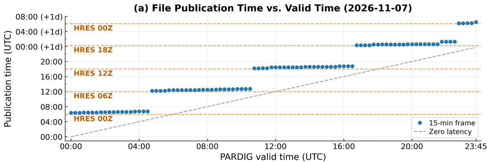

(b) Operational Latency vs. Valid Time  
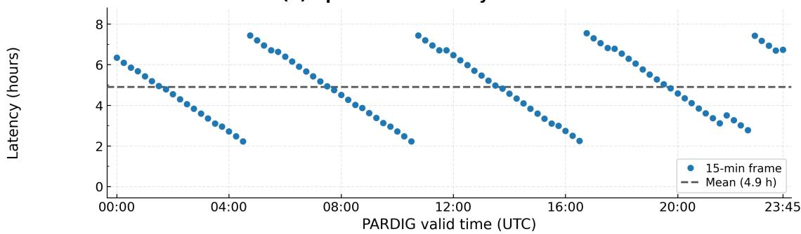  
Figure A.5.1 | Operational per-frame latency of PARDIG-NRT on 7 November 2026. (a) Publication time in the public bucket versus valid time for all 96 15-minute frames, with 6-hourly HRES cycle publication times (orange dashed). (b) Resulting latency versus valid time (mean 4.9 h); the small bump at 21:45–22:30 UTC is a single inference run $( t _ { 0 } = 2 2 { : } 0 0 \mathrm { U T C } )$ that waited on slower-than-usual SatWeave processing.

In the operational configuration, PARDIG-NRT can run for any reference time $t _ { 0 }$ the moment both required input streams become available, so operational availability is governed by the four daily HRES forecast initialization cycles (00, 06, 12, and 18 UTC) and the latency of the SatWeave composites. Once the inputs are present, the computation itself is fast: on a single Google Cloud TPU v5p chip, the forward pass for all four 15-minute global $0 . 1 ^ { \circ }$ fields takes ∼3 seconds of accelerator compute (∼2–2.5 minutes including loading model weights, reading the global HRES and SatWeave inputs, and writing the raw outputs), and with on-demand job scheduling, QPE post-processing, and Cloud Storage export, each run completes in roughly 10 minutes end-to-end. As an illustrative example, when the 06 UTC HRES forecast becomes available around 12:00 UTC, SatWeave composites are typically available up to approximately 11:30 UTC. This, in combination with data from the previous HRES cycle, provides all required inputs for the six consecutive reference times from $t _ { 0 } = 0 5 { : } 0 0$ through $t _ { 0 } = 1 0 { : } 0 0 \mathrm { U T C }$ , allowing six parallel inference passes to produce $6 \times 4 = 2 4$ frames of 15-minute precipitation estimates covering 04:45 to 10:30 UTC. Taking all of the above into account, the end-to-end latency of PARDIG-NRT (from observation time to estimate availability) ranges from roughly 2 to 8 hours, depending on where a given output falls within the HRES window. In principle, lower latency could be achieved by using longer HRES forecast lead times (up to 12 hours from the preceding initialization cycle) alongside real-time SatWeave imagery, trading some accuracy for faster availability. Measured over a representative day (7 November 2026), per-frame latency from valid time to publication in the public bucket ranged from 2.2 to 7.6 hours (mean 4.9 hours), following a sawtooth set by the HRES publication times (Figure A.5.1).

## A.6. Ground truth data

## A.6.1. MRMS

We use the Multi-Radar Multi-Sensor (MRMS) Quantitative Precipitation Estimate Pass-2 product for independent evaluation (Zhang et al., 2016). This product provides hourly precipitation fields that have additionally been calibrated against rain gauges. We exclude areas with a low radar quality for evaluation to ensure we only evaluate against high-quality data. We subsample the native 0.01◦ data to 0.05◦ for computational reasons. For the sub-hourly evaluations in Appendix A.12, we additionally use the MRMS Instantaneous Precipitation Rate product, which provides radar-only instantaneous surface precipitation rates; throughout the paper, we refer to the hourly gauge-adjusted Pass-2 product simply as MRMS and the instantaneous product as MRMS Instantaneous Precipitation Rate (or MRMS Rate).

## A.6.2. EURADCLIM

EURADCLIM provides calibrated radar observations over Europe (Overeem et al., 2023). The native ∼2 km grid is subsampled to 0.04◦. At the time of evaluation, EURADCLIM was only available until the end of 2023.

## A.6.3. JMA Radar-AMeDAS

JMA Radar-AMeDAS provides calibrated observations over Japan (Makihara, 1996). Although JMA issues 1-hour accumulations at 30-minute intervals, we retain only the non-overlapping top-of-the-hour analyses. The native ∼1 km grid is subsampled to 0.05◦.

## A.6.4. Rain gauges

Rain gauge data over 2018–2023 was downloaded from Synoptic’s6 derived precipitation service, which aggregates multi-network surface observations (including national meteorological services and citizen weather station networks) and accumulates measurements to 1-hour intervals. Because multi-network station archives include short-lived deployments, co-located duplicate feeds, event-only reporting sensors (which transmit only when precipitation occurs and omit dry hours), and stations with misconfigured metadata coordinates, we apply five quality-control filters defined strictly on the station metadata and ground-truth observation counts (starting from 46,298 stations with valid coordinates):

1. Minimum positive and negative event counts: At least 50 positive (≥ 1 mm/h) and at least 50 negative (< 1 mm/h) hourly observations (37,718 stations retained), ensuring suficient sample size for per-station CSI and excluding dry-locked or purely event-triggered gauges.

2. Land and island mask: Located on or within 0.10◦ (∼10 km, to accommodate coastal stations and rounded coordinates) of Natural Earth7 10m land or minor-island polygons, and excluding (0, 0) placeholder coordinates (37,674 stations retained; 44 open-ocean/mislocated stations removed, such as amateur stations with sign-flipped longitudes).

3. Coordinate deduplication: For co-located station feeds sharing identical coordinates rounded to 0.001◦ (∼100 m), only the single station feed with the largest number of valid hourly observations is retained (37,485 stations retained; 189 duplicate feeds removed).

4. Minimum record length: At least 750 valid hourly measurements (> 1 month of observations; 37,009 stations retained; 476 short-lived stations removed).

5. Conservative upper bound on wet-hour fraction: At most 50% of valid hourly observations exceeding the 1 mm/h threshold $( N _ { \mathrm { p o s } } / N _ { \mathrm { v a l i d } } \leq 0 . 5 0 $ ; 36,678 stations retained; 331 gauges that report primarily during wet periods removed).

For the 4 mm/h per-station CSI cumulative distribution function (Figure A.10.5c), applying the same sample-size and wet-fraction criteria at the 4 mm/h threshold (≥ 50 positive, ≥ 50 negative, and ≤ 50% positive fraction at 4 mm/h) retains 26,957 stations.

## A.7. Global Precipitation Distributions and PARDIG-NRT–PARDIG-LR Consistency

## A.7.1. Overlap Period Consistency (2016–2023)

To compare global hourly precipitation distributions across PARDIG-NRT, PARDIG-LR, and the external baselines over their shared 2016–2023 period, we sample 400 hourly timestamps uniformly at random across 2016–2023 over 85◦S–85◦N (∼99.6% of Earth’s surface area, avoiding polar-cap missing values in IMERG). All summary statistics, percentiles (�90–�99.999), and distribution curves weight grid cells by cos(latitude) so that values represent fractions of surface area rather than raw grid-cell counts. Table A.7.1 reports the resulting summary statistics and upper-tail percentiles, and Figure A.7.1 compares the unconditional exceedance probability �(� ≥ �) alongside the rainy-cell (≥ 0.1 mm/h) PDF and CDF.

Distributional agreement between PARDIG-NRT and PARDIG-LR. The two variants show close agreement across all summary statistics (Table A.7.1): area-weighted global mean precipitation rates difer by less than 2%, area-weighted rainy percentages are within one percentage point, and upper-tail percentiles align tightly through �99 999. As shown in Figure A.7.1, the exceedance, PDF, and CDF curves overlap closely from light rain (0.1 mm/h) through extreme convective intensities (> 50 mm/h), confirming that the two variants map disparate input streams into closely aligned precipitation distributions.

Comparison with other precipitation products. Across product families (Table A.7.1 and Figure A.7.1), ERA5 and HRES predict rain (≥ 0.1 mm/h) over 17–18% of global area, more than double PARDIG (6.5–7.4%) and well above MSWEP-GC and IMERG (9.6–11.1%), and concentrate 83–84% of rainy area below 1 mm/h (Figure A.7.1c), reflecting the well-known NWP drizzle bias. In the upper tail (Figure A.7.1a,b), PARDIG retains the heaviest extremes (�99.999 ≈ 57–59 mm/h), followed by MSWEP-GC (46 mm/h), IMERG (34–37 mm/h), and the ECMWF models (23–35 mm/h).

## A.7.2. Multi-Decadal Homogeneity and Observing-System Evolution (2001–2025)

While PARDIG-LR and PARDIG-NRT match closely across their 2016–2023 overlap (Table A.7.1), extending precipitation records across multiple decades spans major changes in the global observing system, including expanding passive microwave constellations, geostationary imager replacements, and the 2014 transition from TRMM to GPM. Maintaining long-term homogeneity across these transitions is a well-documented challenge across satellite and reanalysis products (Sun et al., 2018; Portier et al., 2025). Figure A.7.2 evaluates all seven products over complete calendar years from 2001 to 2025 quasi-globally (60◦S–60◦N) and over land, sampling 400 shared seasonally and diurnally stratified hourly slots per year (cos(lat) area-weighted) relative to each product’s 2016–2023 mean.

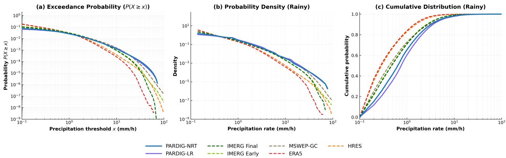  
Figure A.7.1 | Global hourly precipitation distributions (2016–2023). Area-weighted distributions across $8 5 ^ { \circ } \mathrm { S } { - } 8 5 ^ { \circ } \mathrm { N }$ for PARDIG-NRT, PARDIG-LR, and baselines: (a) unconditional exceedance probability $P ( X \geq x )$ , and (b) probability density function (PDF) and (c) cumulative distribution function (CDF) conditioned on rainy cells (≥ 0.1 mm/h). Summary statistics and percentiles are given in Table A.7.1.

Table A.7.1 | Area-weighted global precipitation distribution statistics and percentiles (2016– 2023 record, 1h accumulation). All statistics, rainy percentages $\left( \geq \ 0 . 1 \mathrm { m m / h } \right)$ , and percentiles $\left( p _ { 9 0 } - p _ { 9 9 . 9 9 9 } \right)$ are cos(lat) area-weighted across $8 5 ^ { \circ } S { - } 8 5 ^ { \circ } \mathrm { N } ;$ rates in mm/h.
<table><tr><td>Product</td><td>Mean</td><td>Std</td><td>Rainy %</td><td>P90</td><td>P95</td><td>P99</td><td>P99.9</td><td>P99.99</td><td>P99.999</td></tr><tr><td>PARDIG-NRT</td><td>0.108</td><td>0.874</td><td>7.4%</td><td>0.00</td><td>0.37</td><td>2.55</td><td>11.39</td><td>32.36</td><td>58.9</td></tr><tr><td>PARDIG-LR</td><td>0.106</td><td>0.866</td><td>6.5%</td><td>0.00</td><td>0.32</td><td>2.60</td><td>12.00</td><td>30.14</td><td>57.0</td></tr><tr><td>IMERG Final</td><td>0.114</td><td>0.714</td><td>10.2%</td><td>0.10</td><td>0.45</td><td>2.70</td><td>9.60</td><td>21.50</td><td>34.0</td></tr><tr><td>IMERG Early</td><td>0.117</td><td>0.735</td><td>11.1%</td><td>0.10</td><td>0.50</td><td>2.80</td><td>9.80</td><td>22.39</td><td>36.7</td></tr><tr><td>MSWEP-GC</td><td>0.121</td><td>0.871</td><td>9.6%</td><td>0.09</td><td>0.40</td><td>2.81</td><td>12.42</td><td>27.39</td><td>45.8</td></tr><tr><td>ERA5</td><td>0.123</td><td>0.484</td><td>18.2%</td><td>0.24</td><td>0.60</td><td>2.05</td><td>5.87</td><td>13.61</td><td>22.6</td></tr><tr><td>HRES</td><td>0.124</td><td>0.560</td><td>16.9%</td><td>0.23</td><td>0.57</td><td>2.18</td><td>6.77</td><td>16.84</td><td>34.8</td></tr></table>

ERA5, IMERG V07 (both Final and Early), PARDIG-NRT, and HRES maintain stable annual means throughout their examined records—spanning the full multi-decadal period back to 2001 for ERA5 and IMERG V07, and 2016–2025 for PARDIG-NRT and HRES. In IMERG V07, this multi-decadal stability reflects explicit inter-sensor calibration across the TRMM and GPM eras alongside distributionrestoration of morphed fields via SHARPEN (Tan et al., 2021; Hufman et al., 2023, 2024), with IMERG Final additionally applying monthly GPCC rain-gauge scaling over land.

By contrast, MSWEP-GC and PARDIG-LR exhibit clear shifts in the earlier part of the record. MSWEP-GC is 7–10% lower across 2001–2013 both quasi-globally and over land before stepping upward across 2014–2015, a GPM-era input transition shift that is explicitly documented in the MSWEP V3 release notes (Wang et al., 2026; GloH2O, 2026). PARDIG-LR remains broadly stationary from 2008 through 2023, with its 2008–2013 average within 1% of the 2016–2023 mean and no discontinuity at the 2014 start of its GPM training record. Prior to 2008, however, the PARDIG-LR mean is 13% lower quasi-globally (17% over land) during 2001–2005 before ramping to its stationary level across 2006–2008. PARDIG-LR applies no explicit cross-era homogenization, and we hypothesize that this pre-2008 underestimation primarily reflects the sparser passive microwave coverage and older geostationary sensors of the early 2000s (alongside, as an additional factor, training and calibrating the model on the post-2014 GPM era). Multi-decadal trend analyses should therefore account for these observing-system transitions, particularly prior to 2008 in PARDIG-LR and 2015 in MSWEP-GC.

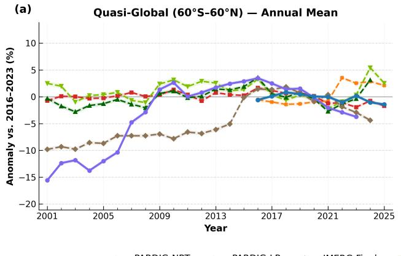

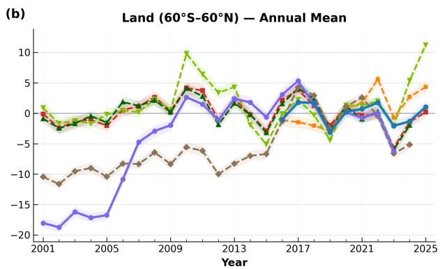  
Figure A.7.2 | Multi-decadal precipitation stability across satellite eras (2001–2025). Annual mean precipitation anomalies (±1 standard error of the mean across 400 shared seasonally and diurnally stratified hourly slots per complete year, cos(lat) area-weighted) relative to each product’s 2016–2023 overlap mean: (a) Quasi-global $( 6 0 ^ { \circ } \mathrm { S } { \mathrm { - } } 6 0 ^ { \circ } \mathrm { N } )$ and (b) Land $( 6 0 ^ { \circ } \mathrm { S } { \mathrm { - } } 6 0 ^ { \circ } \mathrm { N } )$ . While ERA5, IMERG V07, PARDIG-NRT, and HRES remain broadly stable across their records, PARDIG-LR (prior to 2008) and MSWEP-GC (prior to 2015) substantially underestimate early-period means relative to 2016–2023.

## A.8. Physical Consistency: Diurnal and Seasonal Cycles

Figure A.8.1 evaluates whether PARDIG reproduces known physical patterns of precipitation variability, namely the diurnal cycle (driven by solar heating and land-sea contrasts) and the seasonal cycle (driven by large-scale circulation and monsoon dynamics), across six climatologically distinct regions.

Regions with radar ground truth. Over the US Great Plains, PARDIG correctly reproduces the well-documented nocturnal convective peak (∼3–9 UTC, corresponding to late evening through early morning local time), driven by the nocturnal low-level jet and eastward-propagating mesoscale convective systems (Higgins et al., 1997; Carbone and Tuttle, 2008), closely tracking the MRMS radar observations. IMERG Final and MSWEP-GC show a similar phase and amplitude, whereas ERA5 misses the early-night buildup (2–6 UTC) and overpredicts daytime rates, reflecting known diurnal-cycle biases in models with parameterized convection (Bechtold et al., 2014; Covey et al., 2016). Over the European Alps, MSWEP-GC (supervised on EURADCLIM) closely tracks EURADCLIM in diurnal phase and amplitude; PARDIG and IMERG Final capture the timing of the late-afternoon peak (whereas ERA5 peaks 2–3 hours early) but overestimate its amplitude, with PARDIG underpredicting nighttime and early-morning rates. In the normalized seasonal cycle, IMERG Final, MSWEP-GC, and ERA5 closely match EURADCLIM across all months, whereas PARDIG exhibits an exaggerated seasonal amplitude, underestimating wintertime precipitation relative to summertime precipitation. While the cause of this winter-to-summer imbalance remains to be verified, one hypothesis is that GPM DPR’s reduced sensitivity to snowfall (Chase et al., 2022) in the GPM CORRA training targets may cause PARDIG to underpredict alpine winter precipitation. Over Kyushu, all products reproduce the East Asian monsoon seasonality (June–July Baiu peak, August dip, and September typhoon peak), and PARDIG and IMERG Final closely match JMA Radar-AMeDAS’s diurnal cycle (peaking near 23 UTC), whereas ERA5 and MSWEP-GC exhibit an exaggerated afternoon peak around 06 UTC.

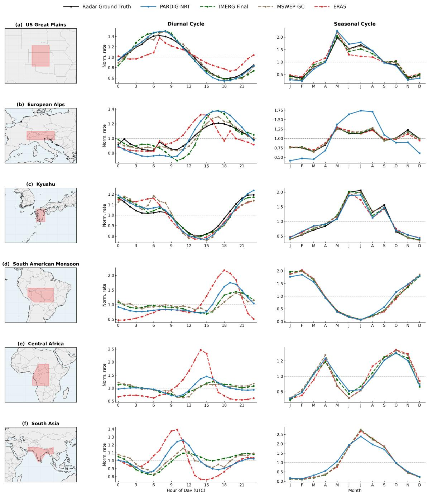  
Figure A.8.1 | Physical consistency across diurnal and seasonal precipitation cycles. Evaluation of normalized diurnal cycles (middle column, hourly mean rate divided by regional mean) and seasonal cycles (right column, monthly mean rate divided by regional mean) across six climatologically diverse regions. Left column shows the locator map for each region (red boxes for custom regional domains a–c; red polygons for IPCC AR6 reference regions d–f (Iturbide et al., 2020)): (a) US Great Plains (evaluated against MRMS radar ground truth), (b) European Alps (evaluated against EURADCLIM radar ground truth), (c) Kyushu, Japan (evaluated against JMA Radar-AMeDAS radar ground truth), and three AR6 regions without dense radar ground truth: (d) South American Monsoon (SAM), (e) Central Africa (CAF), and (f) South Asia (SAS). Curves show radar ground truth (solid black, where available), PARDIG-NRT (solid blue), IMERG Final V07 (dashed green), MSWEP-GC (dashed brown), and ERA5 (dashed red). Dashed horizontal lines mark the normalized regional mean rate (1.0).

AR6 regions without radar ground truth. We complement the radar-evaluated regions with three tropical and subtropical IPCC AR6 regions (Iturbide et al., 2020) that exhibit well-documented precipitation regimes but lack the dense radar networks needed for direct verification: the South American Monsoon (SAM), Central Africa (CAF), and South Asia (SAS). These regions are important because they are home to billions of people, represent a large fraction of the global precipitation budget and are precisely where satellite-based estimates are most relied upon.

Across all three regions, the seasonal cycle is consistently well captured by all products: the SAM wet season (October–March), the bimodal Central African seasonality (Nicholson, 2018), and the South Asian monsoon peak (June–September) are all reproduced with close agreement in both phase and amplitude.

The diurnal cycle shows a consistent ordering across all three regions. ERA5 produces an early and strongly amplified afternoon peak, consistent with its known tendency to trigger parameterized convection prematurely over land. PARDIG-NRT peaks roughly 1 hour later than ERA5 and 1–2 hours earlier than IMERG Final, with an intermediate amplitude between the sharper ERA5 signal and the broader, more muted IMERG Final and MSWEP-GC curves.

## A.9. Zonal-Mean Precipitation Climatology

To assess whether PARDIG reproduces the expected meridional structure of global precipitation, Figure A.9.1 presents zonal-mean precipitation profiles as a continuous function of latitude for PARDIG-NRT, PARDIG-LR, MSWEP-GC, IMERG Final, IMERG Early, ERA5, and HRES over 2,920 shared days (2016–2023). All products are regridded to a common 1° grid and averaged zonally across all longitudes (panel a) and across land-only grid cells (panel b, using GPCC gauge coverage to define the land mask).

All evaluated products agree closely on the latitudinal positions of the major global circulation features: the Intertropical Convergence Zone (ITCZ) maximum near 6–8°N, the secondary Southern Hemisphere tropical peak near 5°S, the subtropical dry zones near ±20–25°, and the secondary midlatitude storm-track peaks near ±40°. Across the tropics and subtropics (40°S–40°N), PARDIG-NRT tracks IMERG, ERA5, and HRES closely in both the global and land-only profiles, while MSWEP-GC estimates higher rates at both the ITCZ and Southern Hemisphere tropical peaks globally (panel a). Over equatorial land (panel b), PARDIG-NRT, IMERG, ERA5, and HRES peak closely together around 0.27–0.29 mm/h, with MSWEP-GC slightly higher and PARDIG-LR somewhat lower (∼0.25 mm/h), a diference that is much smaller in the ocean-dominated global profile.

Poleward of the mid-latitude storm tracks (∼50°), the products stratify into three distinct groups across both panels: ERA5 and HRES maintain the highest high-latitude precipitation rates, MSWEP-GC, IMERG Final, and IMERG Early occupy an intermediate range, and PARDIG-NRT and PARDIG-LR estimate the lowest mean rates toward the poles. In the land-only profile between 40°S and 60°S (panel b), the curves are noticeably noisier and show sharp spikes (particularly in ERA5 and HRES) because the vast majority of this latitude belt is ocean, leaving only a small number of land grid cells per latitude band across southern South America, Tasmania, and New Zealand.

While the exact causes of the lower PARDIG values poleward of ∼50° are uncertain, we hypothesize several plausible contributing factors across two distinct latitude bands. Within the high-latitude portion of the GPM training domain (∼50–67°), geostationary satellites observe at increasingly oblique viewing angles, reducing the information content of the infrared imagery, and, as discussed in Appendix A.8, GPM DPR’s reduced sensitivity to light rain and frozen hydrometeors may cause PARDIG to underestimate high-latitude precipitation and snowfall. Poleward of ${ \sim } 6 7 ^ { \circ }$ , the GPM DPR training target is absent, meaning PARDIG must extrapolate into polar regions without direct supervision while relying on degraded inputs, and any underestimation learned within ${ \sim } 5 0 { \mathrm { - } } 6 7 ^ { \circ }$ would carry over into this extrapolation regime. At the same time, the substantial gap between the ECMWF models (ERA5/HRES) and both IMERG and MSWEP-GC across most high latitudes underscores that existing reference and operational baselines also disagree in these regions, where rigorous evaluation is challenging.

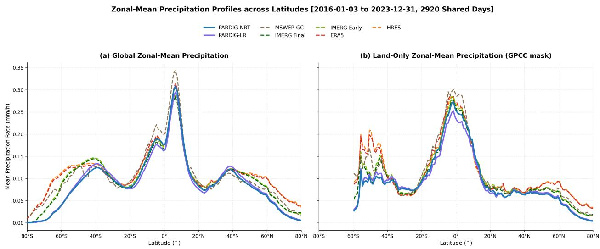  
Figure A.9.1 | Zonal-mean precipitation profiles across latitudes for PARDIG-NRT, PARDIG-LR, MSWEP-GC, IMERG Final, IMERG Early, ERA5, and HRES, computed over 2,920 shared days (2016– 2023). (a) Global zonal mean across all longitudes. (b) Land-only zonal mean, masked using GPCC gauge coverage at $1 ^ { \circ }$ resolution. All products are regridded to the common $1 ^ { \circ } \mathsf { G P C C }$ grid before zonal averaging.

## A.10. Additional Evaluation Metrics

This section extends the main-text verification (Section 3) with additional categorical and spatial metrics across the three radar networks (MRMS over CONUS, EURADCLIM over Europe, and JMA Radar-AMeDAS over Japan), extreme-event case studies, and global surface stations. For the multiyear hourly radar evaluations, Figure A.10.1 summarizes CSI, $\mathrm { F _ { 1 } }$ score, SEDI, and frequency bias across the three radar domains, with PARDIG-LR included alongside PARDIG-NRT and the external baselines.

## A.10.1. CSI with PARDIG-LR

Figure A.10.1(a1–a3) presents the Critical Success Index across precipitation thresholds for all seven products, replicating the main-text evaluation (Figure 2) with the addition of the PARDIG-LR companion dataset, and Table A.10.1 reports numerical CSI values at selected thresholds. Across all three radar domains, PARDIG-LR exhibits high skill that closely tracks PARDIG-NRT, outperforming all external baselines (MSWEP-GC, IMERG Final, IMERG Early, ERA5, and HRES) at every hourly threshold.

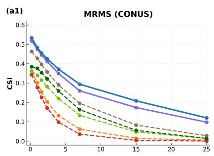

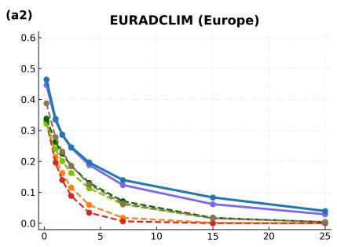

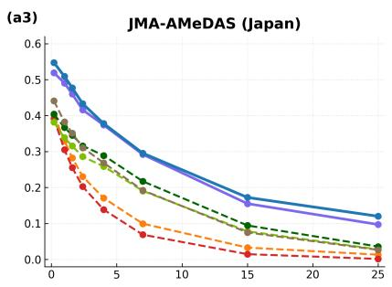

(b1)  
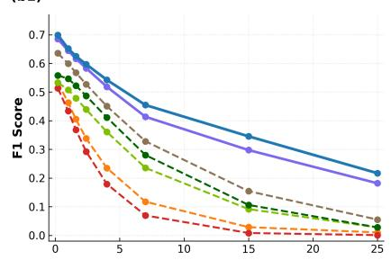

(b2)  
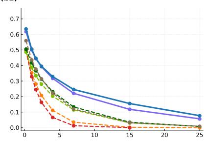

(b3)  
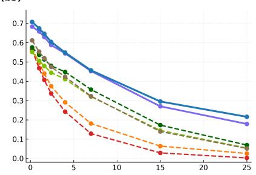

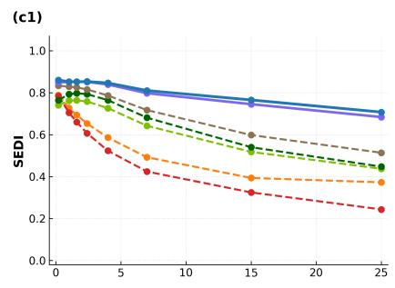

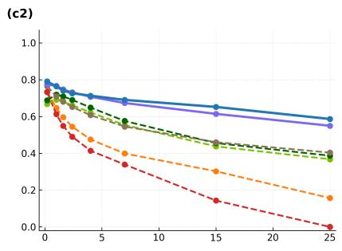

(c3)  
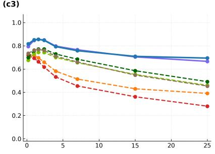

(d1)  
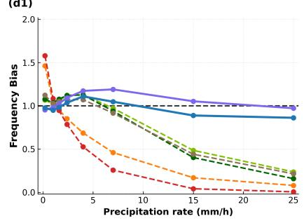

(d2)  
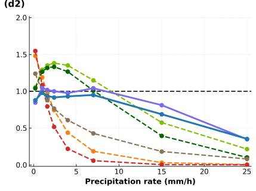

(d3)  
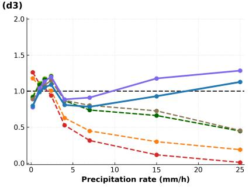  
Figure A.10.1 | Additional categorical verification metrics vs precipitation threshold across independent radar networks: MRMS (CONUS, column 1), EURADCLIM (Europe, column 2), and JMA Radar-AMeDAS (Japan, column 3). (a1–a3) Critical Success Index (CSI), including the PARDIG-LR companion dataset (numerical values in Table A.10.1). (b1–b3) $\mathrm { F _ { 1 } }$ Score (harmonic mean of precision and recall; paired precision and recall values in Table A.10.2). (c1–c3) Symmetric Extremal Dependence Index (SEDI). (d1–d3) Frequency Bias (FBIAS = 1 dashed line indicates unbiased frequency).

Table A.10.1 | CSI at selected precipitation thresholds across independent radar networks. Evaluations for hourly accumulations over the respective multi-year records against MRMS (CONUS), EURADCLIM (Europe), and JMA Radar-AMeDAS (Japan). Best values per column in bold.
<table><tr><td>Product</td><td>0.2mm/h 1mm/h 4mm/h 7mm/h 15mm/h 25mm/h 50mm/h</td><td></td><td></td><td></td><td></td><td></td><td></td></tr><tr><td colspan="8">(a) MRMS (CONUS)</td></tr><tr><td>PARDIG-NRT</td><td>0.53</td><td>0.48</td><td>0.37</td><td>0.29</td><td>0.21</td><td>0.12</td><td>0.03</td></tr><tr><td>PARDIG-LR</td><td>0.52</td><td>0.48</td><td>0.35</td><td>0.26</td><td>0.17</td><td>0.10</td><td>0.02</td></tr><tr><td>IMERG Final</td><td>0.38</td><td>0.38 0.34</td><td>0.26 0.22</td><td>0.16</td><td>0.06</td><td>0.01</td><td>0.00</td></tr><tr><td>IMERG Early</td><td>0.36 0.46</td><td>0.43</td><td>0.29</td><td>0.13</td><td>0.05</td><td>0.01</td><td>0.00</td></tr><tr><td>MSWEP-GC</td><td></td><td>0.28</td><td></td><td>0.20</td><td>0.08</td><td>0.03</td><td>0.00</td></tr><tr><td>ERA5 HRES</td><td>0.34</td><td>0.30</td><td>0.10 0.13</td><td>0.04 0.06</td><td>0.00</td><td>0.00</td><td>0.00</td></tr><tr><td>(b) EURADCLIM (Europe)</td><td>0.36</td><td></td><td></td><td></td><td>0.01</td><td>0.01</td><td>0.00</td></tr><tr><td colspan="8"></td></tr><tr><td>PARDIG-NRT PARDIG-LR IMERG Final IMERG Early</td><td>0.46 0.45 0.34 0.32</td><td>0.34 0.33 0.26 0.24</td><td>0.20 0.19 0.13 0.11</td><td>0.14 0.12 0.07 0.06</td><td>0.08 0.06 0.02 0.02</td><td>0.04 0.03 0.00 0.00</td><td>0.01 0.01 0.00 0.00</td></tr><tr><td>MSWEP-GC ERA5 HRES</td><td>0.39 0.33 0.34</td><td>0.28 0.20 0.21</td><td>0.13 0.03 0.06</td><td>0.06 0.01 0.02</td><td>0.02 0.00 0.00</td><td>0.00 0.00 0.00</td><td>0.00 0.00 0.00</td></tr><tr><td colspan="8">(c) JMA Radar-AMeDAS (Japan)</td></tr><tr><td>PARDIG-NRT</td><td>0.55</td><td>0.51</td><td>0.38</td><td>0.30</td><td>0.17</td><td>0.12</td><td></td></tr><tr><td>PARDIG-LR</td><td>0.52</td><td>0.49</td><td>0.37</td><td>0.29</td><td>0.16</td><td>0.10</td><td>0.04 0.03</td></tr><tr><td>IMERG Final</td><td>0.40</td><td>0.37</td><td>0.29</td><td>0.22</td><td>0.09</td><td>0.04</td><td></td></tr><tr><td>IMERG Early</td><td>0.38</td><td>0.34</td><td>0.26</td><td>0.19</td><td>0.08</td><td>0.03</td><td>0.00 0.00</td></tr><tr><td>MSWEP-GC</td><td>0.44</td><td>0.38</td><td>0.27</td><td>0.19</td><td>0.07</td><td>0.03</td><td>0.00</td></tr><tr><td>ERA5</td><td>0.39</td><td>0.31</td><td>0.14</td><td>0.07</td><td>0.01</td><td>0.00</td><td>0.00</td></tr><tr><td>HRES</td><td>0.40</td><td>0.33</td><td>0.17</td><td>0.10</td><td>0.03</td><td>0.01</td><td>0.00</td></tr><tr><td></td><td></td><td></td><td></td><td></td><td></td><td></td><td></td></tr></table>

## A.10.2. F1 Score, Precision, and Recall

The $\mathrm { F _ { 1 } }$ score is the harmonic mean of precision $( \mathrm { T P / ( T P + F P ) } )$ and recall (TP/(TP + FN)):

$$
\mathrm { F } _ { 1 } = \frac { 2 \mathrm { T P } } { 2 \mathrm { T P } + \mathrm { F P } + \mathrm { F N } } .\tag{A.10.1}
$$

Because achieving a high $\mathrm { F _ { 1 } }$ requires both high precision and high recall, it penalizes products that achieve high precision by underforecasting, or high recall by overforecasting.

Figure A.10.1(b1–b3) displays $\mathrm { F _ { 1 } }$ across thresholds. PARDIG-NRT achieves the highest $\mathrm { F _ { 1 } }$ at every threshold across all three radar networks, with substantial margins over IMERG Final (e.g., +0.13 at 4 mm/h and +0.19 at 25 mm/h against MRMS). Table A.10.2 decomposes performance at selected thresholds into paired precision/recall values: for instance, against EURADCLIM at 4 mm/h, IMERG Final achieves 0.21 / 0.26 (precision/recall) while PARDIG-NRT reaches 0.34 / 0.32, improving both detection completeness and prediction accuracy simultaneously.

Table A.10.2 | Precision / Recall at selected precipitation thresholds across independent radar networks. Values formatted as Precision / Recall for MRMS (CONUS), EURADCLIM (Europe), and JMA Radar-AMeDAS (Japan). Best F1 per column in bold.
<table><tr><td>Product</td><td>0.2 mm/h</td><td>1 mm/h</td><td>4mm/h</td><td>7mm/h</td><td>15 mm/h</td><td>25 mm/h</td><td>50 mm/h</td></tr><tr><td colspan="6">(a) MRMS (CONUS)</td><td></td><td></td></tr><tr><td>PARDIG-NRT0.71/0.690.67/0.630.52/0.570.44/0.470.37/0.330.24/0.200.06/0.06 PARDIG-LR</td><td>0.71/0.670.65/0.64 0.48/0.56 0.38/0.450.29/0.300.19/0.18 0.05/0.06</td><td></td><td></td><td></td><td></td><td></td><td></td></tr><tr><td>IMERG Early0.52/0.55 0.50/0.51 0.34/0.38 0.24/0.23 0.14/0.07 0.08/0.02 0.01/0.00 MSWEP-GC 0.60/0.670.59/0.61 0.44/0.47 0.34/0.31 0.25/0.11 0.16/0.03 0.03/0.00 ERA5</td><td></td><td>0.42/0.660.42/0.450.26/0.140.17/0.040.11/0.000.08/0.00</td><td>0.29/0.20</td><td></td><td></td><td></td><td>IMERG Final0.54/0.58 0.54/0.56 0.39/0.44 0.29/0.27 0.19/0.07 0.11/0.02 0.03/0.00</td></tr><tr><td colspan="4">HRES 0.45/0.65 0.45/0.47 (b) EURADCLIM (Europe)</td><td>0.19/0.09</td><td>0.10/0.02</td><td>0.08/0.01</td><td>0.03/0.00</td></tr><tr><td>PARDIG-NRT0.68/0.600.51/0.500.34/0.320.25/0.240.19/0.130.15/0.050.08/0.01 PARDIG-LR IMERG Final 0.50/0.52 0.37/0.47 0.21/0.26 0.13/0.13 0.06/0.02 0.04/0.00 0.01/0.00 IMERG Early0.47/0.500.34/0.44 0.18/0.24 0.11/0.12 0.04/0.02 0.02/0.00 0.00/0.00 MSWEP-GC ERA5</td><td>0.67/0.570.49/0.510.32/0.31 0.22/0.230.13/0.110.11/0.040.07/0.01 0.51/0.63 0.44/0.44 0.29/0.18 0.20/0.090.10/0.02 0.06/0.00 0.02/0.00</td><td></td><td></td><td></td><td></td><td></td><td></td></tr><tr><td colspan="4">0.41/0.63 0.32/0.34 0.19/0.04 0.12/0.01 0.02/0.00 0.00/0.00 HRES 0.42/0.62 0.33/0.39 0.19/0.08 0.12/0.02 0.04/0.000.02/0.000.00/0.00 (c) JMA Radar-AMeDAS (Japan)</td><td></td><td></td><td></td><td></td></tr><tr><td></td><td></td><td></td><td></td><td></td><td></td><td></td><td></td></tr><tr><td></td><td></td><td></td><td></td><td></td><td></td><td></td><td></td></tr><tr><td></td><td>PARDIG-NRT0.80/0.640.68/0.670.61/0.500.52/0.410.31/0.280.21/0.230.06/0.13</td><td></td><td></td><td></td><td></td><td></td><td></td></tr><tr><td>PARDIG-LR</td><td></td><td></td><td></td><td></td><td></td><td></td><td></td></tr><tr><td></td><td></td><td></td><td></td><td></td><td></td><td></td><td></td></tr><tr><td></td><td></td><td></td><td></td><td></td><td></td><td></td><td></td></tr><tr><td></td><td>IMERG Final0.60/0.55 0.52/0.560.48/0.42 0.42/0.31 0.22/0.14 0.11/0.05 0.06/0.00</td><td></td><td></td><td></td><td></td><td></td><td>0.78/0.610.65/0.67 0.58/0.51 0.48/0.430.25/0.290.16/0.200.04/0.10</td></tr><tr><td></td><td></td><td></td><td></td><td></td><td></td><td></td><td></td></tr><tr><td></td><td>IMERG Early0.58/0.53 0.48/0.53 0.44/0.380.38/0.28 0.18/0.12 0.09/0.040.02/0.00</td><td></td><td></td><td></td><td></td><td></td><td></td></tr><tr><td>MSWEP-GC</td><td></td><td></td><td></td><td></td><td></td><td></td><td></td></tr><tr><td></td><td></td><td></td><td></td><td></td><td></td><td></td><td>0.65/0.580.55/0.55 0.46/0.400.36/0.290.17/0.12 0.08/0.040.01/0.00</td></tr><tr><td>ERA5</td><td></td><td></td><td></td><td></td><td></td><td></td><td></td></tr><tr><td>HRES</td><td></td><td>0.53/0.62 0.48/0.51 0.38/0.24 0.29/0.13 0.14/0.04 0.08/0.02 0.01/0.00</td><td></td><td></td><td>0.51/0.640.45/0.490.35/0.190.27/0.080.14/0.02 0.13/0.00</td><td></td><td></td></tr></table>

## A.10.3. SEDI

The Symmetric Extremal Dependence Index (SEDI) (Ferro and Stephenson, 2011) assesses performance for rare and extreme events without the base-rate degeneracy that causes standard scores (such as CSI or Heidke Skill Score) to approach zero as the event frequency tends to zero:

$$
{ \mathrm { S E D I } } = { \frac { \ln F - \ln H - \ln ( 1 - F ) + \ln ( 1 - H ) } { \ln F + \ln H + \ln ( 1 - F ) + \ln ( 1 - H ) } } ,\tag{A.10.2}
$$

where $H = \mathrm { T P } / ( \mathrm { T P + F N } )$ is the hit rate and $F = \mathrm { F P } / ( \mathrm { F P + T N } )$ is the false alarm rate. A perfect prediction yields SEDI = 1, random forecasting yields SEDI = 0, and negative values indicate performance worse than random chance.

Figure A.10.1(c1–c3) shows SEDI as a function of threshold. Both PARDIG-NRT and PARDIG-LR maintain high extremal skill (SEDI > 0.55–0.8) across the full threshold spectrum up to 25 mm/h, demonstrating robust capability in capturing intense precipitation events where baseline products degrade significantly.

## A.10.4. Frequency Bias

The Frequency Bias Index measures the ratio of estimated to observed event frequency:

$$
\mathrm { F B I A S } = \frac { \mathrm { T P } + \mathrm { F P } } { \mathrm { T P } + \mathrm { F N } } ,\tag{A.10.3}
$$

where FBIAS = 1 indicates an unbiased estimate of event frequency, values above 1 indicate overestimation (overforecasting precipitation occurrences), and values below 1 indicate underestimation (missed precipitation).

Figure A.10.1(d1–d3) shows frequency bias as a function of precipitation threshold. Both PARDIG-NRT and PARDIG-LR maintain near-unity frequency bias (≈ 0.8–1.3) across the full threshold range up to 25 mm/h over CONUS and Japan, and up to 7 mm/h over Europe (where they decline at heavier rates but remain closer to unity than all baselines). In contrast, the numerical weather prediction models (ERA5 and HRES) overestimate frequency at the lowest threshold (0.2 mm/h) and exhibit severe underestimation at higher rain rates, with frequency bias dropping rapidly toward zero beyond 5 mm/h. MSWEP-GC and both IMERG variants (Early and Final) are less biased at light-to-moderate rain rates before progressively underforecasting at heavy intensities (≥ 15 mm/h).

## A.10.5. Case Study Verification and Additional Events with PARDIG-LR and MSWEP-GC

Figure A.10.2 presents two additional extreme precipitation case studies from the 2016–2023 overlap period where PARDIG-NRT, PARDIG-LR, IMERG Final, and MSWEP-GC are all available: (a) the Storm Ciarán extratropical frontal rainband over northwestern Europe (November 2023, 3h mean rate, evaluated against EURADCLIM) and (b) Hurricane Harvey’s stalling rainbands over southeast Texas (August 2017, 3h mean rate, evaluated against MRMS). Visually, both PARDIG variants capture similar synoptic and mesoscale rainband geometry, with PARDIG-NRT exhibiting finer small-scale spatial detail. During Storm Ciarán, both reconstruct a coherent frontal rainband and wrap-around occlusion without the cross-track swath striping visible in IMERG Final, and during Hurricane Harvey both resolve sharp coastal feeder bands; MSWEP-GC also captures the broad rainband structure in both events, though with noticeable pixel-level speckling across the precipitation shield.

Table A.10.3 reports the event-level CSI across all 8 sequential time steps for the three main-text case studies (Figure 4) alongside the two events in Figure A.10.2. In Storm Ciarán, PARDIG-NRT leads at 0.2–1 mm/h while MSWEP-GC is highest at 4–7 mm/h; in Hurricane Harvey, both PARDIG-NRT and PARDIG-LR lead across 0.2–4 mm/h (and PARDIG-LR at 7 mm/h), while MSWEP-GC achieves the highest CSI in the heaviest core (15–25 mm/h).

Note: CSI values across events with diferent accumulation windows are not directly comparable, because the same mean-rate threshold corresponds to diferent total accumulations and therefore diferent climatological rarities. For example, a 6-hour mean rate of 25 mm/h implies a 150 mm total over the window, an event that is rarer than a 1-hour total of 25 mm. Consequently, the rapid decline of CSI at high thresholds for the 3h and 6h events partly reflects the increasing rarity of extreme mean rates at longer accumulation windows.

## A.10.6. Fractions Skill Score (FSS)

Grid-point categorical metrics such as CSI, F , and SEDI evaluate exact cell-by-cell correspondence and can penalize high-resolution precipitation fields twice when small spatial displacements occur (once as a false alarm and once as a missed event). To evaluate spatial skill across relaxed neighborhood tolerances, we compute the Fractions Skill Score (FSS) (Roberts and Lean, 2008). For a given precipitation threshold and square spatial neighborhood of width $s ,$ let $f _ { p } ( x , y )$ and $f _ { o } ( x , y )$ denote the fraction of grid cells within the � × � window centered at $( x , y )$ where predicted and observed precipitation exceed the threshold. FSS compares the mean squared error of these neighborhood

Nov 01 18:00

Nov 01 21:00  
Nov 02 00:00  
(a) Storm Ciarán Frontal Rainband — NW Europe, November 2023 (3h mean rate)  
Nov 02 03:00  
Nov 02 06:00  
Nov 02 09:00  
Nov 02 12:00  
Nov 02 15:00  
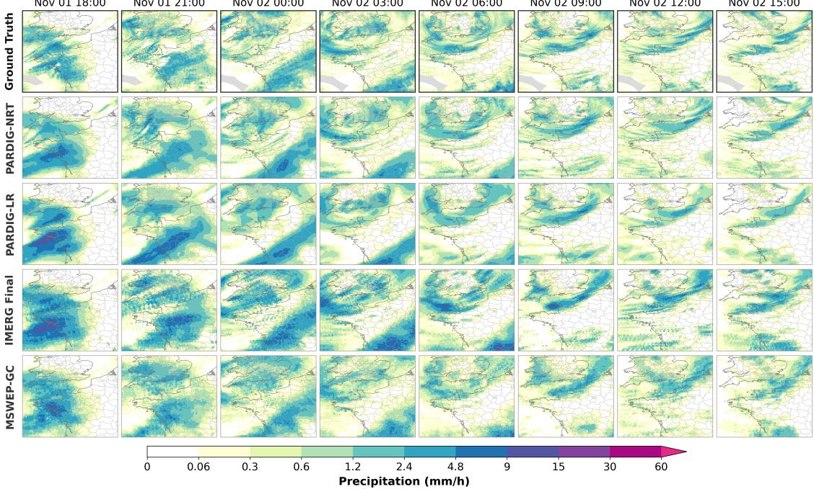

(b) Hurricane Harvey Extreme Rainbands — SE Texas, August 2017 (3h mean rate)  
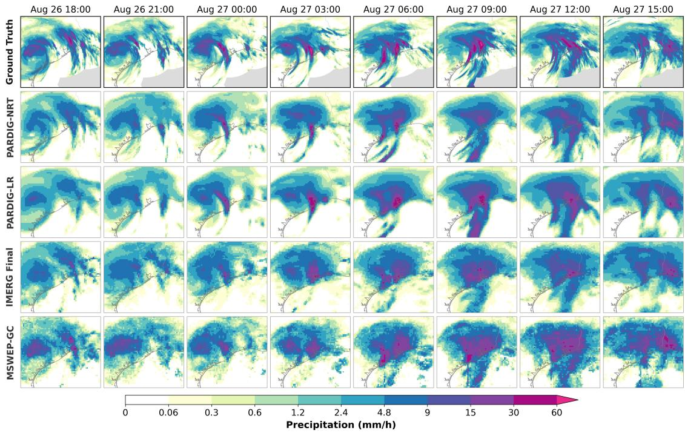  
Figure A.10.2 | Additional case studies comparing PARDIG-NRT, PARDIG-LR, IMERG Final, and MSWEP-GC. Sequential 8-step progressions (3h mean rate) for (a) Storm Ciarán frontal rainband over northwestern Europe (1–2 November 2023, EURADCLIM) and (b) Hurricane Harvey extreme rainbands over southeast Texas (26–27 August 2017, MRMS). Rows display gauge-adjusted radar ground truth (top, bold frame), PARDIG-NRT (second row), PARDIG-LR (third row), IMERG Final V07 (fourth row), and MSWEP-GC (bottom row) in mm/h at their native spatial resolutions. Column headers denote accumulation interval start times in UTC ([�, � + Δ�)); light grey shading in the groundtruth panels indicates regions outside radar coverage. Numerical CSI verification across thresholds is detailed in Table A.10.3.

Table A.10.3 | Critical Success Index (CSI) for extreme precipitation case studies. Evaluated across all 8 sequential time steps for each event against independent radar composites (Appendix $\mathsf { A } . 6 )$ ; $\ " - \ "$ indicates thresholds not exceeded in either the radar observations or the product estimates during the event.
<table><tr><td>Event</td><td>Product</td><td>Accum 0.2 mm/h 1 mm/h 4mm/h 7 mm/h 15 mm/h 25 mm/h</td><td></td><td></td><td></td><td></td><td></td><td></td></tr><tr><td rowspan="2">Texas July 2025 (MRMS)</td><td>PARDIG-NRT</td><td>1h</td><td>0.68</td><td>0.65</td><td>0.50</td><td>0.37</td><td>0.29</td><td>0.10</td></tr><tr><td>IMERG Final</td><td>1h</td><td>0.51</td><td>0.50</td><td>0.38</td><td>0.25</td><td>0.08</td><td>0.02</td></tr><tr><td rowspan="2">Slovenia Aug 2023 (EURADCLIM)</td><td>PARDIG-NRT</td><td>3h</td><td>0.86</td><td>0.67</td><td>0.38</td><td>0.22</td><td>0.08</td><td>0.06</td></tr><tr><td>IMERG Final</td><td>3h</td><td>0.78</td><td>0.56</td><td>0.32</td><td>0.16</td><td>0.03</td><td>0.00</td></tr><tr><td rowspan="2">Japan Aug 2024 (JMA Radar-AMeDAS)</td><td>)PARDIG-NRT</td><td>6h</td><td>0.79</td><td>0.64</td><td>0.46</td><td>0.38</td><td>0.12</td><td>0.00</td></tr><tr><td>IMERG Final</td><td>6h</td><td>0.73</td><td>0.56</td><td>0.43</td><td>0.36</td><td>0.09</td><td>0.00</td></tr><tr><td rowspan="4">Storm Ciarán Nov 2023 (EURADCLIM)</td><td>PARDIG-NRT</td><td>3h</td><td>0.74</td><td>0.52</td><td>0.06</td><td>0.00</td><td>一</td><td>一</td></tr><tr><td>PARDIG-LR</td><td>3h</td><td>0.69</td><td>0.48</td><td>0.07</td><td>0.01</td><td>一</td><td>一</td></tr><tr><td>IMERG Final</td><td>3h</td><td>0.68</td><td>0.43</td><td>0.07</td><td>0.01</td><td>一</td><td>一</td></tr><tr><td>MSWEP-GC</td><td>3h</td><td>0.71</td><td>0.49</td><td>0.10</td><td>0.02</td><td>一</td><td>一</td></tr><tr><td rowspan="4">Hurricane Harvey Aug 2017 (MRMS)</td><td>PARDIG-NRT</td><td>3h</td><td>0.80</td><td>0.73</td><td>0.59</td><td>0.41</td><td>0.21</td><td>0.14</td></tr><tr><td>PARDIG-LR</td><td>3h</td><td>0.80</td><td>0.73</td><td>0.60</td><td>0.45</td><td>0.25</td><td>0.15</td></tr><tr><td>IMERG Final</td><td>3h</td><td>0.76</td><td>0.66</td><td>0.50</td><td>0.39</td><td>0.21</td><td>0.05</td></tr><tr><td>MSWEP-GC</td><td>3h</td><td>0.77</td><td>0.67</td><td>0.51</td><td>0.42</td><td>0.26</td><td>0.19</td></tr></table>

fractions against a worst-case reference:

$$
\mathrm { F S S } ( s ) = 1 - \frac { \frac { 1 } { N } \sum _ { x , y } \left( f _ { p } ( x , y ) - f _ { o } ( x , y ) \right) ^ { 2 } } { \frac { 1 } { N } \sum _ { x , y } \left( f _ { p } ( x , y ) ^ { 2 } + f _ { o } ( x , y ) ^ { 2 } \right) } ,\tag{A.10.4}
$$

ranging from 0 (complete mismatch) to 1 (perfect neighborhood agreement), with $\mathrm { F S S } \approx 0 . 5 + \bar { f } _ { o } / 2 \approx$ 0.5 (where $\bar { f } _ { o }$ is the domain-wide wet-pixel fraction) commonly used as a rough reference for useful spatial skill (Roberts and Lean, 2008).

Figure A.10.3 presents FSS across precipitation thresholds (0.2–25 mm/h) for three neighborhood scales: 0.25◦ (∼25 km), 0.5◦ (∼50 km), and 1◦ (∼100 km). Across all three radar networks and spatial scales, PARDIG-NRT and PARDIG-LR outperform every baseline across nearly all thresholds (with only isolated ties at light-to-moderate rates at coarser scales). Relaxing the spatial tolerance up to $1 ^ { \circ }$ (∼100 km) also does not close the heavy-rain gap across CONUS, Europe, or Japan: over CONUS at 15 mm/h, for example, PARDIG-NRT reaches 0.55 at 0.25◦ and 0.70 at 1◦, whereas MSWEP-GC (0.51) and IMERG Final (0.37) remain substantially lower even at 1◦ (0.26 and 0.13 vs. 0.51 at 25 mm/h). Thus, the baselines’ lower grid-point CSI at heavy rain rates is not merely a double-penalty artifact of small spatial displacements.

## A.10.7. Global Station-Level CSI Across Thresholds

Figure A.10.4 shows the corresponding per-station ΔCSI map between PARDIG-NRT and MSWEP-GC at 1 mm/h across the same $^ { 3 6 , 6 7 8 }$ stations as Figure 3. Importantly, station-based verification is inherently biased against PARDIG in this comparison: because MSWEP V3 trains on and directly assimilates observations from a large fraction of the global gauge network, evaluating at gauge coordinates samples MSWEP-GC precisely where its local gauge corrections peak, whereas gaugefree PARDIG treats station cells no diferently from surrounding ungauged grid cells. Even on this unfavorable footing, PARDIG-NRT outperforms MSWEP-GC at 65.4% of stations worldwide (14.7% tied and 19.9% favoring MSWEP-GC; mean CSI 0.36 vs. 0.33). Consistent with Figure 3, the advantage is largest across the 2 841 stations in the tropical and subtropical belt (30◦S–30◦N), where PARDIG-NRT outperforms MSWEP-GC at 92.5% of stations (vs. 2.1% for MSWEP-GC and 5.5% tied) with a mean gain of +0.08 CSI points (0.36 vs. 0.27, +30% relative), compared with 63.2% of stations and a mean gain of +0.02 CSI points (0.36 vs. 0.34, +6% relative) poleward of 30◦.

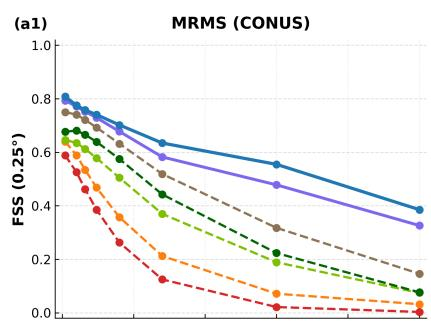

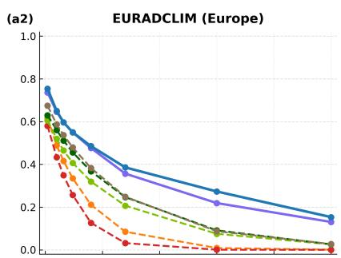

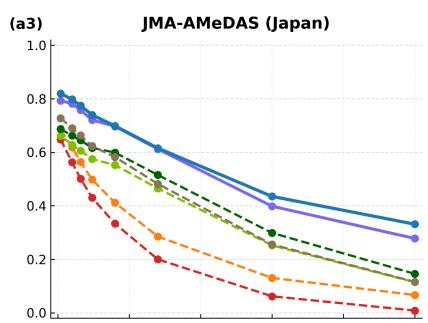

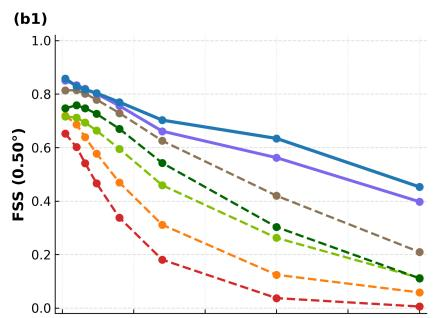

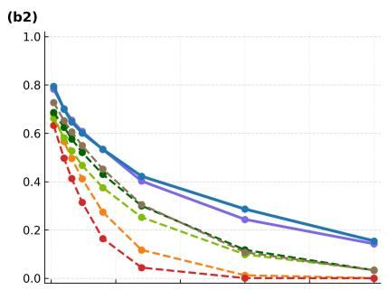

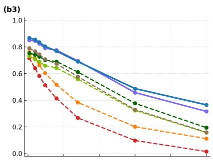

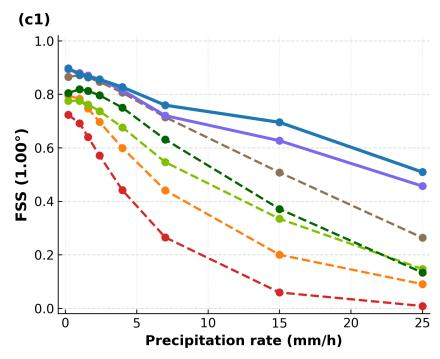

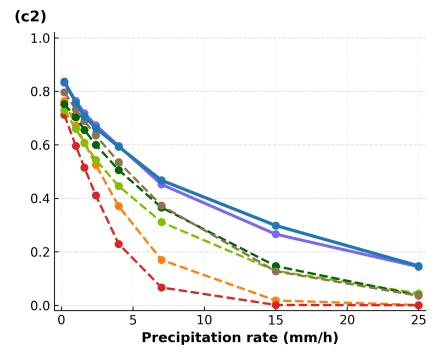

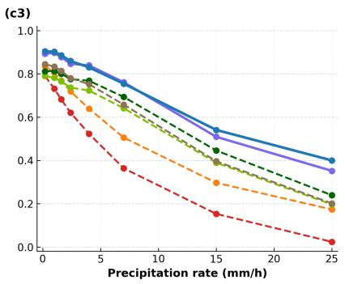  
Figure A.10.3 | Fractions Skill Score (FSS) vs precipitation threshold across spatial neighborhood scales evaluated over 2016–2023 against MRMS (CONUS, column 1), EURADCLIM (Europe, column 2), and JMA Radar-AMeDAS (Japan, column 3). (a1–a3) 0.25◦ neighborhood. (b1–b3) 0.5◦ neighborhood. (c1–c3) 1◦ neighborhood.

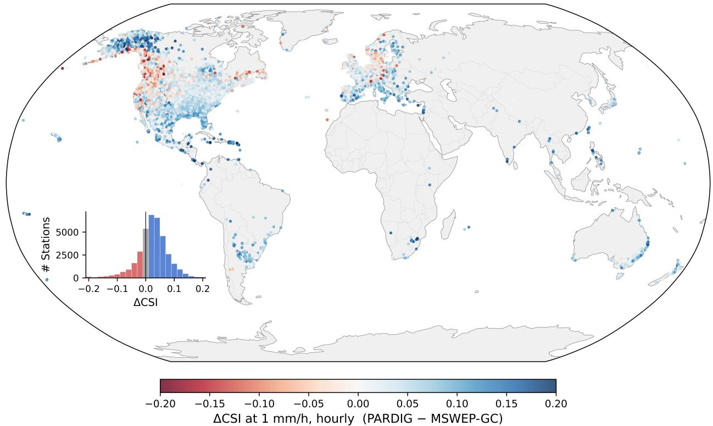  
Figure A.10.4 | Global station-level comparison between PARDIG-NRT and MSWEP-GC. Per-station CSI diference (ΔCSI: PARDIG-NRT minus MSWEP-GC) across the same 36,678 quality-controlled Synoptic surface rain-gauge stations worldwide (2018–2023) as Figure 3, evaluated at the 1 mm/h hourly accumulation threshold. Blue circles indicate stations where PARDIG-NRT achieves higher CSI; red circles indicate stations where MSWEP-GC achieves higher CSI (color scale clipped to [−0.20, +0.20]). The inset histogram shows the distribution of per-station ΔCSI values across all 36,678 stations (with the neutral center bin |ΔCSI| < 0.01 shaded grey).

Across the full hourly threshold range (0.2–25 mm/h), Figure A.10.5 and Table A.10.4 compare station-averaged CSI (Figure A.10.5a) and per-station CSI cumulative distribution functions at 1 mm/h and 4 mm/h (Figure A.10.5b–c) across all seven products. Both PARDIG-NRT and PARDIG-LR outperform every external baseline at every threshold, from moderate rain (mean CSI of 0.24 and 0.22 at 4 mm/h vs. 0.21 for MSWEP-GC and 0.17 for IMERG Final) out to heavy rates (0.06 and 0.05 at 25 mm/h vs. $\le 0 . 0 2$ for all baselines), even though MSWEP-GC directly uses gauge observations overlapping this station network—giving it an inherent advantage over the other baselines. In the per-station CDFs (Figure A.10.5b–c), the PARDIG-NRT and PARDIG-LR curves are shifted toward higher CSI across nearly the entire station distribution, showing that the higher mean skill reflects broad gains across stations rather than isolated outliers.

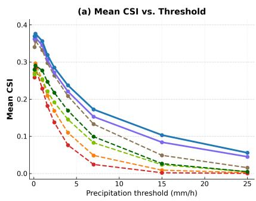

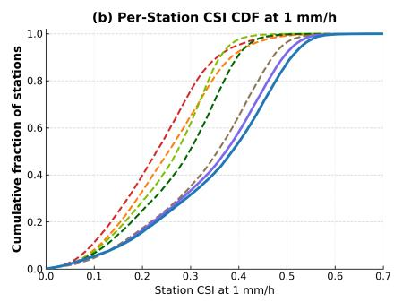

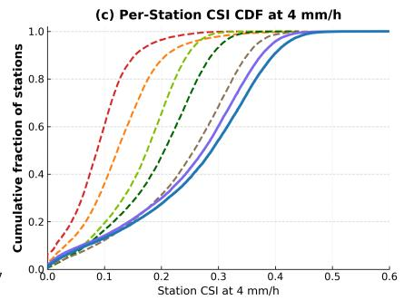  
PARDIG-NRT --IMERG Final --MSWEP-GC--HRESPARDIG-LR --IMERG Early --ERA5

Figure A.10.5 | Global Synoptic station-level CSI across hourly precipitation thresholds (2018– 2023) for PARDIG-NRT, PARDIG-LR, IMERG Final, IMERG Early, MSWEP-GC, ERA5, and HRES. (a) Station-averaged CSI vs. hourly precipitation threshold (0.2–25 mm/h) across 36,678 qualitycontrolled stations (Section 3.1; numerical values in Table A.10.4). (b) Per-station CSI cumulative distribution function (CDF) at 1 mm/h (36,678 stations). (c) Per-station CSI CDF at 4 mm/h (26,957 stations meeting the same quality-control criteria at the 4 mm/h threshold).  
Table A.10.4 | Critical Success Index (CSI) across hourly precipitation thresholds at global Synoptic surface stations. Evaluated across 36,678 quality-controlled stations worldwide (2018– 2023, 1-hour accumulation; Section 3.1). Best values per column in bold.
<table><tr><td>Product</td><td>0.2 mm/h</td><td>1 mm/h</td><td>4mm/h</td><td>7mm/h</td><td>15 mm/h</td><td>25 mm/h</td></tr><tr><td>PARDIG-NRT</td><td>0.38</td><td>0.36</td><td>0.24</td><td>0.17</td><td>0.10</td><td>0.06</td></tr><tr><td>PARDIG-LR</td><td>0.37</td><td>0.35</td><td>0.22</td><td>0.15</td><td>0.08</td><td>0.05</td></tr><tr><td>IMERG Final</td><td>0.29</td><td>0.28</td><td>0.17</td><td>0.10</td><td>0.03</td><td>0.00</td></tr><tr><td>IMERG Early</td><td>0.28</td><td>0.25</td><td>0.15</td><td>0.08</td><td>0.02</td><td>0.00</td></tr><tr><td>MSWEP-GC</td><td>0.36</td><td>0.33</td><td>0.21</td><td>0.13</td><td>0.05</td><td>0.02</td></tr><tr><td>ERA5</td><td>0.28</td><td>0.23</td><td>0.08</td><td>0.02</td><td>0.00</td><td>0.00</td></tr><tr><td>HRES</td><td>0.30</td><td>0.25</td><td>0.11</td><td>0.05</td><td>0.01</td><td>0.00</td></tr></table>

## A.11. Spatial Structure and Multi-Scale Variability

While standard categorical verification metrics (Appendix A.10) evaluate detection skill at individual grid points and across intensity thresholds, they do not directly evaluate whether precipitation fields exhibit physically realistic spatial coherence, multi-scale variance, and spatial gradients. Capturing fine-scale structure is critical for hydrological applications, where localized runof and streamflow responses depend strongly on the spatial organization and peak sharpness of precipitation fields (Cristiano et al., 2017).

As an initial exploration of the spatial characteristics of PARDIG (which is also partially complemented by the event-level case studies in Figure 4 and Figure A.10.2), we present two complementary analyses:

1. Global Spherical Harmonic Spectral Analysis (Appendix A.11.1): Evaluates the variance power distribution across spatial scales globally, from planetary wavenumbers down to the grid-scale Nyquist limit $( \lambda \approx 2 2 \mathrm { k m } )$ , across all 2023 hourly fields.

2. Spatial Variogram Analysis over CONUS (Appendix A.11.2): Evaluates the spatial correlation structure and decorrelation scale directly against independent, high-resolution radar ground truth (MRMS) on a common grid, verifying whether fine-scale spatial variations reflect genuine physical structure.

## A.11.1. Global Spectral Analysis

To evaluate the efective spatial resolution and multi-scale variance distribution of precipitation products, we compute the global spherical harmonic power spectrum (SHPS) across all hourly timesteps for 2023 on the common 0.1◦ global grid. Missing values at polar latitudes (where some satellite products lack coverage) are filled with zeros prior to the spherical harmonic transform; this has only a small efect on the spectrum given the low precipitation rates and small spherical area of polar regions. Using standard spherical harmonic decomposition on the sphere (as used in, e.g., Price et al., 2025), any spherical scalar precipitation field $P ( \theta , \phi )$ is expanded into real orthonormal spherical harmonics:

$$
P ( \theta , \phi ) = \sum _ { l = 0 } ^ { l _ { \mathrm { m a x } } } \sum _ { m = - l } ^ { l } a _ { l , m } Y _ { l , m } ( \theta , \phi ) ,\tag{A.11.1}
$$

where � is the total spherical harmonic degree (wavenumber), � is the zonal wavenumber, and $l _ { \mathrm { { m a x } } } = 1 7 9 9$ corresponds to the Nyquist truncation limit on the $0 . 1 ^ { \circ }$ grid $( \Delta x \approx 1 1 . 1$ km at the equator, $\lambda _ { \mathrm { N y q u i s t } } \approx 2 2 . 2 \mathrm { k m } )$ . The total power �(�) at degree � is given by:

$$
E ( l ) = \frac { 1 } { 4 \pi } \sum _ { m = - l } ^ { l } | a _ { l , m } | ^ { 2 } ,\tag{A.11.2}
$$

where the approximate physical spatial wavelength corresponds to $\lambda \approx 2 \pi R _ { \mathrm { E a r t h } } / l \approx 4 0 , 0 0 0 { \mathrm { k m } } / l$

Figure A.11.1 displays the time-averaged power spectrum �(�) from planetary wavelengths (� ≈ $4 0 , 0 0 0 \mathrm { k m } , l = 1 )$ down to the Nyquist limit (� ≈ 22 km, � = 1799).

At synoptic scales (1000–5000 km), PARDIG, IMERG, and MSWEP-GC exhibit comparable spectral power while HRES is consistently lower, whereas at mesoscale wavelengths (50–200 km), PARDIG-NRT retains substantially more power than all external baselines (roughly 1.6–3× higher at 100 km). PARDIG-LR tracks or slightly exceeds PARDIG-NRT down to ∼150–200 km before rolling of more steeply below 100 km. Toward the shortest wavelengths (< 50 km), MSWEP-GC and IMERG flatten

## Global Precipitation Power Spectrum (2023)

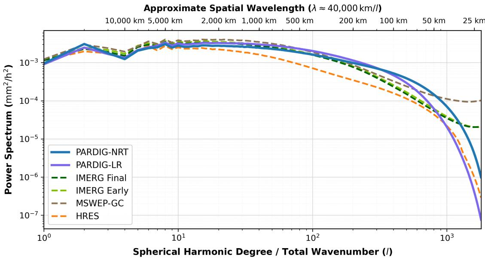  
Figure A.11.1 | Global precipitation spherical harmonic power spectrum for 2023. Spherical harmonic total power $E ( l )$ in $\mathrm { { i } } \mathrm { { m m } } ^ { 2 } / \mathrm { { h } } ^ { 2 }$ as a function of spherical harmonic degree � (bottom axis) and approximate physical spatial wavelength $\lambda \approx 4 0 , 0 0 0 \mathrm { k m } / l$ (top axis) on the global $0 . 1 ^ { \circ }$ grid for PARDIG-NRT, PARDIG-LR, IMERG Final, IMERG Early, MSWEP-GC, and ECMWF HRES (ERA5 is omitted because its native $0 . 2 5 ^ { \circ }$ grid truncates at $l = 7 1 9 )$

into high-wavenumber spectral shelves—possibly mirroring the pixel-scale speckling seen in Figure A.10.2—whereas PARDIG-NRT, PARDIG-LR, and HRES decay monotonically to the Nyquist limit. Because power spectra alone cannot distinguish physical convective variance from model-generated texture, Appendix A.11.2 evaluates spatial correlation directly against ground radar.

## A.11.2. Spatial Variogram Analysis

Because spherical harmonic decomposition requires globally continuous fields on the sphere, the spectral analysis in Appendix A.11.1 cannot directly incorporate regional ground radar; we therefore pair it with a spatial semivariogram analysis over CONUS, providing two complementary perspectives (both methodologically and in the spatial scales they cover) that allow direct comparison of finescale correlation structure against MRMS ground truth. To compute the spatial semivariogram $\begin{array} { r } { \gamma ( h ) = \frac { 1 } { 2 } \mathbb { E } [ ( P ( \mathbf { x } ) - P ( \mathbf { x } + \mathbf { h } ) ) ^ { 2 } ] } \end{array}$ over the contiguous United States (CONUS), we use high-density, gauge-adjusted MRMS radar data as a benchmark on the common $0 . 1 ^ { \circ }$ grid. We evaluate $\gamma ( h )$ across 200 randomly sampled hourly timestamps uniformly distributed across 2023, averaging zonal and meridional semivariograms across lags of 1–50 grid points (∼10 km per $0 . 1 ^ { \circ }$ step, up to 500 km). To ensure a fair comparison, all products are evaluated over the identical spatial domain defined by the MRMS spatial quality mask, which retains 94,216 valid land grid points (62.8% of the $2 5 0 \times 6 0 0$ CONUS bounding box) by excluding ocean, coastal, and beam-blocked regions. We normalize each time-averaged semivariogram by the product’s mean within-frame spatial variance $\operatorname { V a r } ( P )$ (computed across valid pixels within each hourly frame first and then averaged over the 200 frames), $\gamma ( h ) / \mathrm { V a r } ( P )$ to isolate spatial correlation structure from diferences in total intensity. The decorrelation length $L _ { d }$ is defined as the distance at which $\gamma ( h ) / \mathrm { V a r } ( P ) \ : = \ : 0 . 9$ . Because the native MRMS product is available at $0 . 0 1 ^ { \circ }$ (∼1 km), we coarsen it to $0 . 1 ^ { \circ }$ using two methods representing areal vs. point-scale references on the $0 . 1 ^ { \circ }$ grid: block-averaging $( 1 0 \times 1 0$ pixel means, representing grid-cell averages) and subsampling (retaining every 10th pixel, preserving point-measurement variance).

Normalized Spatial Semivariogram — CONUS (2023)  
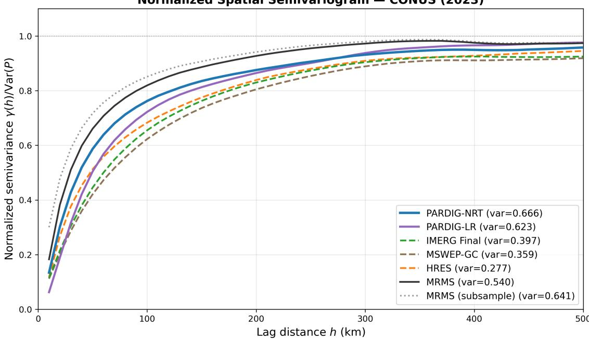  
Figure A.11.2 | Normalized spatial semivariogram over CONUS for 2023. Normalized semivariance $\gamma ( h ) / \mathrm { V a r } ( P )$ as a function of spatial lag distance ℎ (in km) evaluated across 200 random hourly timestamps in 2023 on the common $0 . 1 ^ { \circ }$ grid. All products are evaluated over the identical spatial domain defined by the MRMS radar quality mask (94,216 valid land pixels, 62.8% coverage). Mean within-frame spatial variance $\operatorname { V a r } ( P )$ $\mathsf { ( m m ^ { 2 } / h ^ { 2 } ) }$ for each product is indicated in the legend. Curves that rise more steeply indicate shorter spatial correlation lengths (sharper spatial features), while flatter curves indicate greater spatial smoothing.

As shown in Figure A.11.2, the normalized semivariogram of PARDIG-NRT tracks block-averaged MRMS more closely than any other product across mesoscale distances. Its decorrelation length $( L _ { d } = 2 4 0 \mathrm { k m } )$ is closer to the MRMS reference range (150–170 km) than that of any external baseline (290–300 km for HRES and IMERG Final, and 330 km for MSWEP-GC, which exhibits the slowest spatial decorrelation over CONUS despite its elevated sub-mesoscale spectral shelf), though it remains smoother than radar at the shortest lags. PARDIG-LR is smoother at fine scales, overtaking the external baselines beyond ∼55 km and converging with PARDIG-NRT around 200 km $( L _ { d } = 2 5 0 \mathrm { k m } )$

A common concern is that deep learning architectures inherently produce over-smoothed fields. In atmospheric forecasting, this typically arises when deterministic models trained with regression objectives (e.g., MSE) are forced toward the conditional mean of divergent trajectories at longer lead times. PARDIG operates in a fundamentally diferent regime: as an estimation model conditioned on concurrent observations, it does not face this trajectory-averaging pressure. More broadly, recent work has demonstrated that deep learning models need not produce blurred outputs when appropriate loss functions and architectures are employed (Ravuri et al., 2021; Kochkov et al., 2024; Price et al., 2025). The spectral and variogram analyses above, partially complemented by the extreme-event case studies (Figure 4 and Figure A.10.2), provide initial evidence that PARDIG preserves spatial gradients and fine-scale variance closer to radar ground truth than existing gridded precipitation products, while a more comprehensive characterization of spatial structure remains an important direction for future work.

## A.12. Sub-Hourly Temporal Dynamics and Ofset Consistency

While our primary evaluations focus on hourly accumulations to align with standard observational benchmarks and gridded products, PARDIG natively estimates instantaneous precipitation rates at 15-minute intervals (HH:00, HH:15, HH:30, and HH:45 of each hour). A natural question for any high-cadence retrieval system is whether the sub-hourly output captures genuine high-frequency meteorological variability or whether successive frames are largely copies of one another. Here, we evaluate the temporal dynamics of PARDIG-NRT against high-resolution ground radar (MRMS Instantaneous Precipitation Rate) and IMERG Final (30-minute) over the contiguous United States (CONUS), as the hourly baselines (MSWEP-GC, ERA5, and HRES) do not resolve sub-hourly intervals.

## A.12.1. Temporal Lag Autocorrelation

To quantify temporal persistence and the rate of spatial pattern evolution, we compute the spatial pattern correlation (Pearson �) between precipitation fields at successive time steps on the common 0.1◦ grid as a function of temporal lag, up to four hours (15 to 240 minutes). Figure A.12.1 compares the resulting lag autocorrelation curves for PARDIG-NRT, MRMS Rate $( 1 0 \times 1 0$ block-averaged from $0 . 0 1 ^ { \circ }$ to 0.1◦), and IMERG Final over CONUS across 2023.

Precipitation Field Temporal Autocorrelation at Sub-Hourly Lags (CONUS, 2023)  
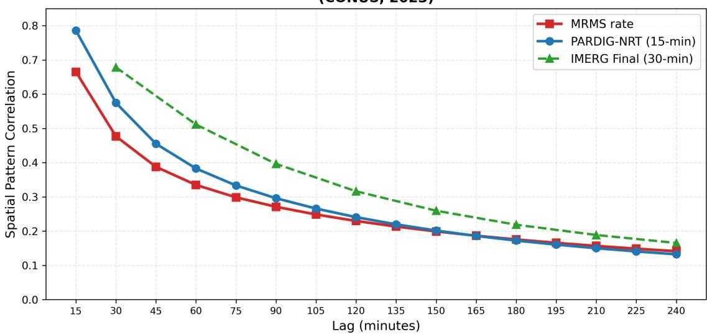  
Figure A.12.1 | Precipitation field temporal autocorrelation at sub-hourly lags (CONUS, 2023). Spatial pattern correlation (Pearson �) on the common $0 . 1 ^ { \circ }$ grid across valid radar pixels at lags up to 4 hours for PARDIG-NRT, $1 0 \times 1 0$ block-averaged MRMS Instantaneous Precipitation Rate, and IMERG Final.

The autocorrelation decay reveals two key characteristics. First, PARDIG-NRT decorrelates rapidly from step to step (dropping from $r = 0 . 7 9$ at 15 min to 0.38 at 60 min) and closely tracks the decay curve of ground radar (MRMS Rate: 0.67 at 15 min and 0.33 at 60 min, converging after ∼2 hours), indicating genuine sub-hourly pattern evolution rather than near-duplicate frames. Second, IMERG Final exhibits substantially stronger temporal persistence across all lags $( r = 0 . 6 8 $ at 30 min and 0.51 at 60 min, vs. 0.57 and 0.38 for PARDIG-NRT). While part of this diference reflects IMERG reporting 30-minute window averages rather than instantaneous snapshots, the slower decay even at 1–2 hour lags likely also reflects temporal smoothing from Lagrangian morphing between passive microwave overpasses.

## A.12.2. Consistency Across Sub-Hourly Window Ofsets

As described in Section 2, PARDIG operates on hourly inference windows, producing four instantaneous frames per window at nominal ofsets of 00:45 (−15 min), 00:00 (analysis time), 00:15 (+15 min), and 00:30 (+30 min). Because the nominal atmospheric state inputs are centered at 00:00, it is important to verify that retrieval skill remains stable across all intra-window time steps as a sanity check on model consistency.

Table A.12.1 presents Critical Success Index (CSI) across six precipitation thresholds evaluated against MRMS Instantaneous Precipitation Rate for the four intra-hour ofsets over CONUS (2023).

Table A.12.1 | PARDIG-NRT CSI by sub-hourly ofset across precipitation thresholds. Evaluated against MRMS Instantaneous Precipitation Rate (CONUS, 2023) for each sub-hourly ofset within the inference window. Values are reported to three decimal places to examine intra-hour stability.
<table><tr><td>Threshold</td><td>00:45 (-15 min)</td><td>00:00</td><td>00:15(+15 min)</td><td>00:30 (+30 min)</td></tr><tr><td>0.2 mm/h</td><td>0.484</td><td>0.487</td><td>0.486</td><td>0.483</td></tr><tr><td>1.0 mm/h</td><td>0.426</td><td>0.428</td><td>0.428</td><td>0.424</td></tr><tr><td>4.0 mm/h</td><td>0.277</td><td>0.278</td><td>0.278</td><td>0.275</td></tr><tr><td>7.0 mm/h</td><td>0.215</td><td>0.215</td><td>0.215</td><td>0.213</td></tr><tr><td>15.0 mm/h</td><td>0.194</td><td>0.194</td><td>0.192</td><td>0.190</td></tr><tr><td>25.0 mm/h</td><td>0.146</td><td>0.146</td><td>0.142</td><td>0.140</td></tr></table>

Across all thresholds, the maximum CSI variation between ofsets is ≤ 0.006 (e.g., 0.424–0.428 at 1 mm/h). The slight dip at the 00:30 ofset (furthest from the centers of the input and target windows) is consistent with expectations but negligible in practice. This stability confirms that PARDIG-NRT delivers reliable, consistent precipitation estimates across all sub-hourly output steps, without phase-dependent artifacts or substantial skill degradation away from the nominal analysis hour.

## A.13. Accumulation Timescale Evaluation

While our primary evaluations focus on hourly resolution (Figure 2 and Appendix A.10), many operational hydrology, flood prediction, and agricultural applications require sub-daily or daily precipitation accumulations. Evaluating longer accumulation windows also tests whether temporal integration, which smooths out short-term phase and timing errors in numerical weather prediction and satellite products, closes the skill gap with PARDIG.

Figure A.13.1 presents the multi-year average Critical Success Index (CSI, 2016–2023) as a function of precipitation accumulation for 6-hour (1.2–42 mm/6h) and 24-hour (2.4–144 mm/24h) windows across the three regional gauge-radar networks: MRMS (CONUS), EURADCLIM (Europe), and JMA Radar-AMeDAS (Japan).

At the 6-hour timescale, PARDIG-NRT and PARDIG-LR outperform all external baselines, including MSWEP-GC, at every threshold across all three radar networks (Figure A.13.1a1–a3), with the two variants achieving comparable CSI values. At 24-hour accumulations (Figure A.13.1b1–b3), PARDIG-NRT leads every baseline across all thresholds over CONUS and Japan (with PARDIG-LR trailing only MSWEP-GC slightly around 24–48 mm/24h over CONUS), whereas over Europe (EURADCLIM), daily gauge-corrected MSWEP-GC matches PARDIG at 2.4 mm/24h and slightly exceeds both PARDIG variants at moderate daily totals (12–48 mm/24h; e.g., 0.26 vs. 0.24 CSI at 24 mm/24h) before falling below both PARDIG-NRT and PARDIG-LR at heavy daily extremes (96–144 mm/24h).

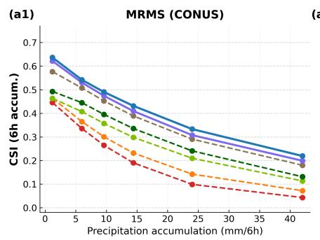

(a2)  
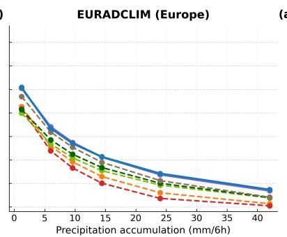  
(a3)

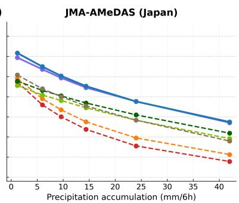

(b1)  
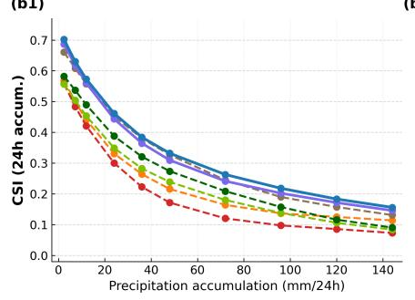

(b2)  
  
(b3)

  
Figure A.13.1 | CSI vs precipitation accumulation threshold for 6-hour and 24-hour windows across regional radar networks (2016–2023) for MRMS (CONUS, column 1), EURADCLIM (Europe, column 2), and JMA Radar-AMeDAS (Japan, column 3). (a1–a3) 6-hour accumulation (1.2– 42 mm/6h). (b1–b3) 24-hour accumulation (2.4–144 mm/24h).

## A.14. Temporal Generalization

All PARDIG models are trained on GPM CORRA observations through December 2023. To evaluate temporal stability and verify whether the model sufers from overfitting to training periods or specific sensor characteristics, we analyze multi-year performance along two complementary axes:

(i) Independent Ground Truth (Radar): Year-by-year evaluation against gauge-adjusted radar networks across three continents: MRMS (CONUS, 2016–2025, including the held-out 2024– 2025 years), EURADCLIM (Europe, 2016–2023), and JMA Radar-AMeDAS (Japan, 2016–2025, including the held-out 2024–2025 years).

(ii) Training Sensor Evaluation (GPM): Year-by-year evaluation against GPM CORRA satellite observations across 2016–2025 (with 2016–2023 representing in-training observations and 2024–2025 as the held-out test years).

## A.14.1. Multi-Year Radar Stability

Figure A.14.1 displays CSI across individual years for three precipitation thresholds: light (1 mm/h), moderate (4 mm/h), and heavy (15 mm/h). Numerical yearly CSI values at 1 mm/h are provided in Table A.14.1.

Across all three radar networks and all evaluated thresholds, PARDIG performance is consistent over time, with PARDIG-NRT and PARDIG-LR achieving the highest CSI across all evaluated years. Over Europe (EURADCLIM), CONUS (MRMS), and Japan (JMA Radar-AMeDAS), yearly CSI curves show little interannual variation across the multi-year period. In the held-out 2024–2025 years,

PARDIG-NRT performance remains in line with in-training years across both CONUS (CSI = 0.49 and 0.48 at 1 mm/h in 2024 and 2025, compared to 0.48 in 2023; and ∼0.24–0.25 across 2023– 2025 at 15 mm/h) and Japan (CSI = 0.51 and 0.49 at 1 mm/h in 2024 and 2025, compared to 0.49–0.52 during 2016–2023). Notably, at 15 mm/h over CONUS (Figure A.14.1(c1)), PARDIG-NRT CSI rises steadily from ∼0.16 in 2016 to ∼0.24–0.25 in the held-out 2024–2025 years (whereas PARDIG-LR remains flat), a trend we hypothesize may be linked to progressive improvements in GOES geostationary observations over the Americas.

While categorical verification at high hourly thresholds (≥ 10–15 mm/h) is often viewed as challenging due to event sparsity and spatial displacement penalties, Figure A.14.1 indicates that annual radar-based evaluations can remain relatively stable even at 15 mm/h. Across the evaluated networks, interannual variations are modest, and the relative performance ordering among products is largely preserved from year to year. When aggregated over a full annual cycle of radar observations, the sample size of heavy precipitation pixels appears suficient to support informative comparisons between products.

Table A.14.1 | Yearly CSI at 1 mm/h across radar networks. Years 2024–2025 are held-out test years for PARDIG-NRT on MRMS (CONUS) and JMA Radar-AMeDAS (Japan); dashes indicate unavailable full-year records (PARDIG-LR and EURADCLIM end in 2023, and IMERG Final and MSWEP-GC were not available for all of 2025). Values are reported to three decimal places to examine interannual stability. Best product per year in bold.
<table><tr><td>Product</td><td>2016</td><td>2017</td><td>2018</td><td>2019</td><td>2020</td><td>2021</td><td>2022</td><td>2023</td><td>2024 (Held-out)</td><td>2025 (Held-out)</td></tr><tr><td colspan="11">(a) MRMS (CONUS)</td></tr><tr><td>PARDIG-NRT0.4550.4650.5060.504 0.5060.478 0.478 0.475</td><td></td><td></td><td></td><td></td><td></td><td></td><td></td><td></td><td>0.489</td><td>0.480</td></tr><tr><td>PARDIG-LR</td><td></td><td>0.4790.4800.497</td><td></td><td>0.499</td><td>0.491</td><td>0.458</td><td></td><td>0.4520.447</td><td></td><td></td></tr><tr><td>IMERG Final0.3840.3780.3890.3880.378</td><td></td><td></td><td></td><td></td><td></td><td>0.361</td><td></td><td>0.3640.366</td><td>0.371</td><td></td></tr><tr><td>IMERG Early</td><td></td><td>0.3500.3440.355</td><td></td><td>0.350</td><td>0.339</td><td>0.323</td><td>0.330</td><td>0.330</td><td>0.324</td><td>0.300</td></tr><tr><td>MSWEP-GC</td><td></td><td>0.4190.420</td><td>0.4360.4340.431</td><td></td><td></td><td>0.428</td><td>0.431</td><td>0.422</td><td>0.426</td><td></td></tr><tr><td>ERA5</td><td>0.258</td><td>0.266</td><td>0.275</td><td>0.282</td><td>0.283</td><td>0.279</td><td>0.289</td><td>0.283</td><td>0.300</td><td>0.271</td></tr><tr><td>HRES</td><td></td><td>0.2740.286</td><td>0.299</td><td>0.318</td><td>0.320</td><td>0.310</td><td>0.302</td><td>0.301</td><td>0.321</td><td>0.288</td></tr><tr><td colspan="9">(b) EURADCLIM (Europe)</td><td></td></tr><tr><td>PARDIG-NRT0.3470.3390.3370.3440.3480.349</td><td></td><td></td><td></td><td></td><td></td><td></td><td></td><td>0.313 0.328</td><td></td><td></td></tr><tr><td>PARDIG-LR</td><td>0.351 0.3420.3330.3410.347</td><td></td><td></td><td></td><td></td><td>0.341</td><td>0.301</td><td>0.313</td><td></td><td></td></tr><tr><td>IMERG Final</td><td>0.281</td><td></td><td>0.2700.257</td><td></td><td>0.264 0.269</td><td>0.268</td><td>0.245</td><td>0.256</td><td></td><td></td></tr><tr><td>IMERG Early</td><td>0.255</td><td>0.245</td><td>0.2340.2410.244</td><td></td><td></td><td>0.240</td><td>0.221</td><td>0.235</td><td></td><td></td></tr><tr><td>MSWEP-GC</td><td>0.288</td><td>0.286</td><td>0.278</td><td>0.284</td><td>0.285</td><td>0.282</td><td>0.252</td><td>0.271</td><td></td><td></td></tr><tr><td>ERA5</td><td></td><td>0.202 0.204</td><td>0.189</td><td>0.199</td><td>0.205</td><td>0.198</td><td>0.178</td><td>0.195</td><td></td><td></td></tr><tr><td>HRES</td><td>0.213</td><td>0.219</td><td>0.205</td><td>0.221</td><td>0.229</td><td>0.224</td><td>0.194</td><td>0.208</td><td></td><td></td></tr><tr><td colspan="9">(c) JMA Radar-AMeDAS (Japan)</td><td></td><td></td></tr><tr><td>PARDIG-NRT 0.510 0.495 0.512 0.512</td><td></td><td></td><td></td><td></td><td></td><td></td><td></td><td>0.519 0.518 0.494 0.514</td><td>0.513</td><td>0.489</td></tr><tr><td>PARDIG-LR</td><td>0.4940.4760.498</td><td></td><td></td><td>0.502</td><td></td><td></td><td></td><td>0.501 0.494 0.481 0.478</td><td></td><td></td></tr><tr><td>IMERG Final</td><td></td><td>0.3740.347</td><td>0.365</td><td>0.372</td><td>0.371</td><td>0.374</td><td>0.363</td><td>0.369</td><td>0.371</td><td></td></tr><tr><td>IMERG Early</td><td>0.343</td><td>0.318</td><td>0.337</td><td>0.343</td><td>0.346</td><td>0.343</td><td>0.336</td><td>0.342</td><td>0.332</td><td>0.287</td></tr><tr><td>MSWEP-GC</td><td>0.382</td><td>0.361</td><td>0.384</td><td>0.382</td><td>0.386</td><td>0.394</td><td>0.380</td><td>0.391</td><td>0.377</td><td></td></tr><tr><td>ERA5</td><td></td><td>0.305 0.296 0.311 0.305</td><td></td><td></td><td>0.309</td><td></td><td>90.311 0.297</td><td>0.309</td><td>0.302</td><td>0.282</td></tr><tr><td>HRES</td><td></td><td></td><td>0.3190.3180.3380.337</td><td></td><td></td><td></td><td></td><td>0.3430.3440.3150.326</td><td>0.320</td><td>0.303</td></tr></table>

(b2)  

(c1)  

  
Figure A.14.1 | Yearly CSI stability across radar networks for MRMS (CONUS, 2016–2025), EURADCLIM (Europe, 2016–2023), and JMA Radar-AMeDAS (Japan, 2016–2025) at 1 mm/h (top row), 4 mm/h (middle row), and 15 mm/h (bottom row). The PARDIG-NRT held-out years 2024–2025 are shaded on the MRMS and JMA Radar-AMeDAS panels (PARDIG-LR and EURADCLIM end in 2023, and IMERG Final and MSWEP-GC end in 2024 as full-year 2025 records were not available). Numerical values at 1 mm/h are provided in Table A.14.1 (with paired significance tests in Table A.14.2).

## A.14.2. Statistical Significance of Inter-Product Diferences

The year-by-year CSI results in Table A.14.1 enable formal testing of whether PARDIG’s improvement over baseline products is statistically significant across evaluation years. We apply paired �-tests, treating each year’s CSI as a paired observation, across all shared evaluation years per radar network.

Table A.14.2 reports, for each PARDIG–baseline pair and radar network, the mean CSI diference (ΔCSI), its interannual standard deviation (�), the paired �-statistic, and the �-value. All comparisons reach $p < 0 . 0 0 1$ over CONUS (9–10 shared years), Europe (8 years), and Japan (9–10 shared years), confirming statistically significant improvements over every external baseline.

Table A.14.2 | Statistical significance of CSI diferences at 1 mm/h (paired �-tests across evaluation years). �: number of years; Δ: mean CSI diference (PARDIG-NRT minus baseline); �: interannual standard deviation of the diference.
<table><tr><td>Region</td><td>vs Baseline</td><td>n</td><td>Δ</td><td>σ</td><td>t</td><td>p</td></tr><tr><td rowspan="3">CONUS</td><td rowspan="3">IMERG Final IMERG Early MSWEP-GC ERA5</td><td>9</td><td>+0.109</td><td>0.018</td><td>18.2</td><td>&lt;0.001</td></tr><tr><td>10</td><td>+0.149</td><td>0.022</td><td>21.5</td><td>&lt;0.001</td></tr><tr><td>9 10</td><td>+0.056 +0.205</td><td>0.013 0.015</td><td>12.6 42.2</td><td>&lt;0.001 &lt;0.001</td></tr><tr><td>Europe</td><td>IMERG Final IMERG Early MSWEP-GC ERA5 HRES</td><td>8 8 8 8 8</td><td>+0.074 +0.099 +0.060 +0.142 +0.124</td><td>0.006 0.007 0.004 0.007 0.006</td><td>48.5 33.5 42.3 41.1 60.3 59.5</td><td>&lt;0.001 &lt;0.001 &lt;0.001 &lt;0.001 &lt;0.001</td></tr><tr><td>Japan</td><td>IMERG Final IMERG Early MSWEP-GC ERA5 HRES</td><td>9 10 9 10 10</td><td>+0.142 +0.175 +0.128 +0.205 +0.181</td><td>0.006 0.011 0.007 0.005 0.007</td><td>72.0 48.1 55.4 137.5 79.1</td><td>&lt;0.001 &lt;0.001 &lt;0.001 &lt;0.001 &lt;0.001 &lt;0.001</td></tr></table>

## A.14.3. Training Set Memorization vs Out-of-Sample Generalization

To evaluate whether the model exhibits memorization of the training set, Figure A.14.2 examines PARDIG instantaneous precipitation rate against GPM CORRA observations across individual years (2016–2025), and Table A.14.3 details numerical values across thresholds.

When evaluated against GPM directly (Figure A.14.2), PARDIG shows slightly higher performance on in-training years (2016–2023, where CSI averages ∼0.51 at 1 mm/h), followed by a modest decrease in the held-out 2024–2025 years (CSI = 0.47 in both 2024 and 2025). This occurs because the 2016–2023 GPM evaluation is performed directly on the training swaths (the exact training examples), whereas 2024–2025 represent unseen satellite orbits. Notably, performance across the two held-out years is virtually identical across all thresholds, indicating no temporal drift beyond the training horizon.

In contrast, independent ground truth networks such as MRMS and JMA Radar-AMeDAS are evaluated over continuous geographic domains where GPM orbital swaths have negligible spatialtemporal overlap (∼245 km swath width with revisit times of several days, intersecting only a few percent of the continuous domain). Consequently, radar evaluations even during 2016–2023 are essentially out-of-sample with respect to the training set.

Comparing Figure A.14.1 (independent ground radar) and Figure A.14.2 (training target) demonstrates that while in-sample GPM scores reflect a degree of training example memorization, out-ofsample ground-radar performance remains steady in 2024–2025 relative to prior years. This strongly suggests that PARDIG learns generalizable meteorological relationships rather than memorized sensor or time-period features, and that its operational skill does not meaningfully degrade between in-training years and held-out future periods.

  
Figure A.14.2 | GPM instantaneous rate yearly evaluation across thresholds (0.2, 1, 4, 7, 15, 25 mm/h) for PARDIG-NRT spanning 2016–2025. The held-out test years (2024–2025) are highlighted with orange shading, illustrating the expected diference between in-sample evaluation on training swaths (2016–2023) and out-of-sample evaluation (2024–2025), which contrasts with the steady yearover-year performance observed on spatially independent radar networks (Figure A.14.1). Numerical values are provided in Table A.14.3.

Table A.14.3 | Yearly CSI across precipitation thresholds against GPM instant rate (PARDIG-NRT). Years 2016–2023 represent in-training observations; 2024–2025 are held-out test years. Values are reported to three decimal places to demonstrate interannual stability.
<table><tr><td>Threshold 2016</td><td>2017 2018 2019</td><td>2020 2021</td><td>2022 2023</td><td>2024 (Held-out)</td><td>2025 (Held-out)</td></tr><tr><td>0.2 mm/h 0.555</td><td>0.560 0.560 0.566</td><td>0.565 0.563</td><td>0.562 0.564</td><td>0.504</td><td>0.502</td></tr><tr><td>1 mm/h</td><td></td><td>0.4900.4950.5080.5140.5130.5130.5100.514</td><td></td><td>0.468</td><td>0.465</td></tr><tr><td>4mm/h</td><td></td><td>0.3780.3820.3920.397 0.3960.3950.391 0.396</td><td></td><td>0.352</td><td>0.350</td></tr><tr><td>7mm/h</td><td></td><td>0.302 0.3030.3060.3100.3090.307 0.3030.309</td><td></td><td>0.272</td><td>0.269</td></tr><tr><td>15 mm/h</td><td></td><td>0.217 0.218 0.214 0.2150.218 0.213 0.212 0.219</td><td></td><td>0.192</td><td>0.189</td></tr><tr><td>25 mm/h</td><td></td><td>0.182 0.1820.1740.1760.1790.1740.1740.180</td><td></td><td>0.156</td><td>0.151</td></tr></table>

## A.15. GPM-Based Regional Evaluation

While the main text evaluates PARDIG against independent ground truth, these sources are geographically restricted to well-instrumented land areas. To evaluate precipitation retrieval skill across broader portions of the globe, we evaluate PARDIG-NRT against held-out GPM CORRA instantaneous precipitation rate observations (2024–2025). Because GPM CORRA observations provide quasi-global coverage between $6 7 ^ { \circ } { \bf S }$ and ${ 6 7 ^ { \circ } \mathrm { N } } ,$ they enable a systematic assessment of performance across distinct geographic and climatic regimes. At the same time, two caveats apply to this analysis: first, although evaluating on held-out years avoids direct training-set memorization and yields stable interannual scores (as shown in the preceding section when comparing 2024 and 2025), GPM CORRA remains the training target, so any systematic observational biases shared by GPM and PARDIG (such as underestimating light drizzle or snowfall) will not be captured here; second, because CSI is sensitive to the underlying climatology, absolute scores across disparate regimes (e.g., tropics, arid regions, and oceans) should be compared with caution. Even so, this evaluation provides a valuable estimate of PARDIG’s relative performance across regions where independent ground-based networks are sparse or absent.

Figure A.15.1 and Table A.15.1 report Critical Success Index (CSI) across six precipitation thresholds (0.2 to 25 mm/h) for the global domain (±67◦) and sixteen regional domains organized into three groups: latitudinal bands, continental regions, and major ocean basins:

1. Latitudinal stratification: Partitioning the globe into the Northern Extratropics, Tropics, and Southern Extratropics reveals a clear tropical-to-extratropical gradient around the global baseline: retrieval skill peaks in the Tropics and steps down into both extratropical bands. Within the extratropics, the Northern Hemisphere scores slightly higher than the Southern Hemisphere at most thresholds, consistent with its larger landmass fraction and the higher skill observed over continents than over oceans.

2. Continental regions: Seven of the eight continental domains generally exceed the global benchmark and exhibit remarkably consistent skill across diverse climate zones: all seven fall within a narrow range of CSI = 0.50–0.54 at 1 mm/h and 0.18–0.21 at 15 mm/h, spanning both well-instrumented mid-latitude landmasses (North America, East Asia, Australia) and tropical/subtropical continents (South America, Northern and Southern Africa, Southeast Asia). Strong and uniform performance across the latter is of particular practical importance, since applications in these regions rely most heavily on global products for lack of local observational alternatives. The sole exception is Europe, which scores below the global average (CSI = 0.42 at 1 mm/h) and substantially lower than North America and East Asia despite comparable mid-latitude coverage. Crucially, this pattern is not unique to GPM: in the independent ground-radar evaluations (Table A.10.1), all evaluated products exhibit a comparable drop over Europe against EURADCLIM relative to MRMS over CONUS and JMA over Japan. While reduced GPM DPR sensitivity to highlatitude light rain and snow, or geostationary sensor diferences may contribute, the parallel drop across operational baselines might suggest that European precipitation regimes are intrinsically more challenging across both satellite and NWP systems.

3. Major ocean basins and land–ocean contrast: Because oceans cover roughly 70% of the ±67◦ domain, the global aggregate is primarily governed by marine precipitation. Across all five major ocean basins, detection skill at light-to-moderate thresholds clusters tightly near the global mean and sits systematically below the non-European continents. At moderate-to-heavy thresholds (≥ 4 mm/h), the four subtropical-to-extratropical Pacific and Atlantic basins track one another closely, whereas the Indian Ocean, which extends into the deep tropics, retains substantially higher heavy-rain skill, mirroring the tropical-to-extratropical gradient seen in the latitudinal bands.

PARDIG-NRT Regional CSI Across Precipitation Thresholds (2024-2025 held-out vs GPM CORRA) 0.2 mm/h  1 mm/h  4 mm/h  7 mm/h  15 mm/h  25 mm/h  
  
Figure A.15.1 | PARDIG-NRT regional CSI across precipitation thresholds against held-out GPM CORRA (2024–2025). Critical Success Index is evaluated across six precipitation thresholds (0.2, 1, 4, 7, 15, and 25 mm/h) for the global domain and sixteen regional domains organized into three groups (Latitudinal Bands, Continental Regions, and Major Ocean Basins). Numerical values are provided in Table A.15.1.

Table A.15.1 | PARDIG-NRT regional CSI across precipitation thresholds. Evaluated against heldout GPM CORRA instantaneous precipitation rate observations (2024–2025), stratified by geographic domain.
<table><tr><td>Region</td><td>Latitude</td><td>Longitude</td><td>0.2mm/h 1mm/h 4mm/h 7mm/h 15mm/h 25mm/h</td><td></td><td></td><td></td><td></td><td></td></tr><tr><td colspan="7">Global (±67°) 67°S-67°N 180°W-180°E 0.50 0.47 0.35</td><td>0.27 0.19</td><td></td><td>0.15</td></tr><tr><td colspan="8">(a) Latitudinal Bands</td><td></td><td></td></tr><tr><td>N. Extratropics 20°N-65°N 180°W-180°E</td><td></td><td></td><td>0.52</td><td>0.46</td><td>0.32</td><td>0.24</td><td>0.16</td><td>0.14</td></tr><tr><td>Tropics S. Extratropics</td><td>20°S-20°N 65°S-20°S</td><td>180°W-180°E 180°W-180°E</td><td>0.52 0.49</td><td>0.51 0.44</td><td>0.39 0.32</td><td>0.30 0.24</td><td>0.21 0.15</td><td>0.17 0.12</td></tr><tr><td colspan="7">(b) Continental Regions</td><td></td><td></td></tr><tr><td>N. America S. America</td><td>25°N-60°N 40°S-5°N</td><td>125°W-75°W 75°W-40°W</td><td>0.54 0.57</td><td>0.50 0.54</td><td>0.37 0.38</td><td>0.28 0.28</td><td>0.21 0.19</td><td>0.17 0.12</td></tr><tr><td>Europe N. Africa</td><td>36°N-65°N</td><td>10°W-40°E 15°W-40°E</td><td>0.51 0.55</td><td>0.42 0.52</td><td>0.26</td><td>0.18</td><td>0.12</td><td>0.09</td></tr><tr><td>S. Africa</td><td>5°N-35°N</td><td></td><td></td><td></td><td>0.37</td><td>0.30</td><td>0.20</td><td>0.12</td></tr><tr><td>SE Asia</td><td>35°S-5°N</td><td>12°E-40°E</td><td>0.55</td><td>0.52</td><td>0.37</td><td>0.29</td><td>0.20</td><td>0.13</td></tr><tr><td></td><td>10°S-22°N</td><td>95°E-130°E</td><td>0.56</td><td>0.54</td><td>0.39</td><td>0.30</td><td>0.21</td><td>0.17</td></tr><tr><td>E. Asia</td><td>22°N-55°N</td><td>100°E-142°E</td><td>0.56</td><td>0.51</td><td>0.36</td><td>0.28</td><td>0.20</td><td>0.17</td></tr><tr><td>Australia</td><td>39°S-12°S</td><td>114°E-154°E</td><td>0.56</td><td>0.51</td><td>0.35</td><td>0.26</td><td>0.18</td><td>0.15</td></tr><tr><td>(c) Major Ocean Basins</td><td></td><td></td><td></td><td></td><td></td><td></td><td></td><td></td></tr><tr><td colspan="2"></td><td></td><td></td><td></td><td></td><td></td><td></td><td></td></tr><tr><td>N. Pacific</td><td></td><td>20°N-55°N145°E-130°W</td><td>0.54</td><td>0.49</td><td>0.33</td><td>0.24</td><td>0.15</td><td>0.12</td></tr><tr><td>S. Pacific</td><td>55°S-20°S</td><td>180°E-75°W</td><td>0.54</td><td>0.48</td><td>0.34</td><td>0.25</td><td>0.14</td><td>0.12</td></tr><tr><td>N. Atlantic</td><td>20°N-58°N</td><td>55°W-15°W</td><td>0.52</td><td>0.46</td><td>0.32</td><td>0.23</td><td>0.14</td><td>0.12</td></tr><tr><td>S. Atlantic</td><td>50°S-10°S</td><td>35°W-10°E</td><td>0.52</td><td>0.47</td><td>0.32</td><td>0.23</td><td>0.12</td><td>0.10</td></tr><tr><td>Indian Ocean</td><td>45°S-5°N</td><td>50°E-95°E</td><td>0.50</td><td>0.48</td><td>0.37</td><td>0.28</td><td>0.20</td><td>0.16</td></tr></table>