# PSL-RGHA: Parallel Split Learning with Reference Gradient Half-Space Alignment for Mitigating Gradient Divergence

Han Li∗   
18850543060@163.com   
Xiamen University of Technology   
Xiamen, Fujian, China   
Jing Yang   
s2147529@siswa.um.edu.my   
Universiti Malaya   
Kuala Lumpur, Malaysia Jianmin Li lijm@xmut.edu.cn   
Xiamen University of Technology   
Xiamen, Fujian, China

Zheng Lin∗ zhenglin@ieee.org SnT, University of Luxembourg Luxembourg

Zihan Fang   
zihanfang3-   
c@my.cityu.edu.hk   
City University of Hong   
Kong   
Hong Kong, China Lin Li linli@xmut.edu.cn   
Xiamen University of Technology   
Xiamen, Fujian, China Miao Yang✉   
yangmiao@xmut.edu.cn   
Xiamen University of Technology   
Xiamen, Fujian, China   
Qiyang Zhang   
qiyangzhang@pku.edu.cn   
Peking University   
Beijing, China   
Mingwei Hong   
mwhong12345@gmail.com   
Xiamen University of   
Technology   
Xiamen, Fujian, China Zehang Lin   
18850975878@163.com   
Xiamen University of Technology   
Xiamen, Fujian, China   
Zhaolu Kang   
kangzl9966@gmail.com   
Peking University   
Beijing, China

Shunzhi Zhu✉ szzhu@xmut.edu.cn Xiamen University of Technology Xiamen, Fujian, China

## Abstract

The escalating complexity of deep neural networks hinders the deployment of federated learning (FL) on resource-constrained devices, especially for multimedia applications such as on-device image classification and speech recognition. Parallel split learn ing (PSL) has emerged as a promising solution by ofloading a substantial portion of the computational workload to the server through layer-wise model partitioning, making it particularly suit able for resource-limited visual and speech intelligence scenarios. However, the absence of client-side aggregation renders PSL susceptible to severe training divergence and potential convergence failure under heterogeneous data distributions. To address this chal- lenge, we propose PSL-RGHA, a gradient-aligned PSL framework that employs reference gradient half-space alignment mechanism to mitigate training divergence among client devices. PSL-RGHA comprises two novel components: reference gradient progressive construction (RGPC) and gradient half-space alignment (GHA). Specifically, RGPC evaluates the directional consistency of client gradients and progressively synthesizes a robust reference gradient via Weiszfeld updates, efectively approximating the global descent direction. Then, GHA constrains client gradients within the refer-ence half-space defined by RGPC to mitigate gradient conflicts and rectify local updates. Extensive experiments demonstrate that our

PSL-RGHA framework outperforms existing baselines in various settings.

CCS Concepts

• Computing methodologies → Machine learning; Distributed computing methodologies.

## Keywords

Distributed learning; split learning; gradient alignment; multimedia intelligence

ACM Reference Format:   
Han Li, Zheng Lin, Miao Yang, Zehang Lin, Jing Yang, Zihan Fang, Qiyang Zhang, Zhaolu Kang, Jianmin Li, Lin Li, Mingwei Hong, and Shunzhi Zhu. 2026. PSL-RGHA: Parallel Split Learning with Reference Gradient Half-Space Alignment for Mitigating Gradient Divergence. In Proceedings of the 34th ACM International Conference on Multimedia (MM ’26), November 10–14, 2026, Rio de Janeiro, Brazil. ACM, New York, NY, USA, 10 pages. https://doi.org/10.1145/3767308.3835121

## 1 Introduction

With the proliferation of the Internet of Things (IoT), billions of interconnected smart devices continuously generate massive privacy- sensitive data [33, 49]. This unprecedented volume of data has significantly advanced the maturity of machine learning (ML), en abling intelligent IoT applications [8, 21, 34, 35, 56]. In particular, the rapid growth of multimedia intelligence, which encompasses high-fidelity image recognition and real-time speech processing, has imposed extreme demands on the computational and memory capabilities of edge devices [2, 22, 43]. Conventional ML, known as centralized learning (CL), relies on aggregating raw data at a central server for model training. However, with the exponential growth of global data creation, estimated at 173.4 zettabytes in

2025 and forecasted to triple to 527.5 zettabytes by 2029 [28, 38], CL encounters severe bottlenecks regarding communication overhead and privacy leakage [4, 48]. To address these issues, federated learning (FL) [7, 36, 52] has emerged as a privacy-preserving paradigm, which enables collaborative training by exchanging model updates rather than raw data. While FL efectively mitigates data privacy and communication concerns, it confronts severe scalability bottlenecks as modern ML models expand exponentially in size [9, 18, 27, 30, 54].

To overcome these bottlenecks, split learning (SL) [26, 40] has emerged to partition the model layer-wise, ofloading the compute- intensive workload to edge server. However, vanilla SL adopts se-quential training pipeline, which inherently sufers from exces-sive latency and system overhead due to the idle waiting time on clients [10]. To address this limitation, split federated learning (SFL) [29, 31, 39] has been proposed by parallelizing client training, yet it reintroduces a significant communication burden by requiring clients to periodically synchronize their local sub-models with a pa- rameter server. Consequently, parallel split learning (PSL) [15, 17] was proposed as a highly streamlined architecture. By completely eliminating client-side parameter aggregation, PSL successfully reduces communication overhead and system complexity, making it the most resource-eficient paradigm for deploying large-scale models on the edge.

However, PSL introduces severe training instability in hetero- geneous environments. In PSL, each client generates intermediate activations based solely on its local, typically non-IID data distri bution [45, 59]. In the absence of client-side synchronization, each client’s sub-model rapidly overfits to its local data distribution. This local divergence causes clients to upload semantically inconsistent activations to the server [6, 25]. Consequently, during server-side backpropagation, the global model receives wildly divergent and conflicting gradients. Rather than converging, the accumulation of these conflicting updates causes destructive interference, leading to severe client drift and potential convergence failure. Since reintroducing client-side aggregation would destroy PSL’s communication eficiency, the critical challenge is how to resolve these gradient conflicts entirely on the server.

To address the training instability inherent in PSL, we propose PSL-RGHA, a gradient-aligned PSL framework that employs a reference gradient half-space alignment mechanism to mitigate conflicting updates among client devices. PSL-RGHA comprises two synergistic components designed to enforce global consistency without client-side aggregation. Specifically, to approximate the global descent direction, we introduce reference gradient progres- sive construction (RGPC), which progressively filters and synthesizes directionally consistent client gradients into a robust reference vector. Building upon this trusted reference, we devise a gradi ent half-space alignment (GHA) scheme that projects conflicting client gradients onto the non-negative half-space of the reference direction, efectively neutralizing components that impede con-vergence. This collaboration ensures that local updates are con- tinuously harmonized with the global convergence trend without requiring client-side aggregation. The main contributions of this paper are summarized as follows:

• We propose PSL-RGHA, a novel gradient alignment framework for PSL that explicitly mitigates gradient conflicts in heterogeneous data environments via pure server-side geometric alignment.

• We develop the RGPC algorithm, which utilizes directional consistency metrics and Weiszfeld updates to construct a noise-resilient reference gradient that accurately captures the global convergence trend.

• We devise the GHA mechanism, which project client gradi-ents onto the reference half-space, thereby rectifying diver- gent updates and harmonizing the optimization direction across distributed clients.

• We conduct extensive experiments to evaluate PSL-RGHA. Empirical results demonstrate that our framework signifi- cantly outperforms existing baselines in both convergence speed and final accuracy across diverse data settings.

## 2 Related Work

## 2.1 Split Learning and Variants

SL was originally introduced by Vepakomma et al. [40] as a privacy-preserving alternative to FL. In vanilla SL framework, the global model is partitioned into client-side and server-side sub-models. Throughout training, clients interact with the server sequentially in a round-robin fashion to compute forward and backward passes. However, this sequential training incurs severe training latency, hindering scaling to large numbers of devices. To address the la- tency bottleneck, Thapa et al. [39] proposed SFL, which combines SL-style model partitioning with FL-style parallel client training. By allowing multiple clients to perform forward propagation in parallel and aggregating their gradients, SFL significantly reduces the training time compared to vanilla SL. Building upon the parallelization concepts of SFL, recent research has focused on further streamlining the training pipeline. Joshi et al. [15] and Kimet al. [17] introduced the PSL framework. Unlike SFL, PSL removes the require- ment for client-side model aggregation. This architectural change simplifies the synchronization process and accelerates model con- vergence. Recent work have further improved the computational and communication eficiency of SL by optimizing client-side gradient aggregation, designing scalable server-side update mechanisms, and adopting adaptive model partitioning.

## 2.2 Data Heterogeneity Mitigation

Research on mitigating data heterogeneity in distributed learning has been largely driven by FL, primarily through aggregation optimization and personalization. Representative methods such as SCAFFOLD [16], FedDyn [1], and FedDC [11] alleviate client drift via control variates or regularization, while personalization approaches (e.g., FedAPA [37], FedCPD [14]) enhance adaptability under non-IID data through adaptive aggregation or prototype-based learning. More recently, several studies have ad- dressed data heterogeneity through update consistency and conflict- aware optimization. Methods such as FedProx [24], FedNova [42], and MOON [23] improve training stability by constraining local drift, correcting objective inconsistency, or enhancing representation consistency. Conflict-aware approaches, including PCGrad [55],

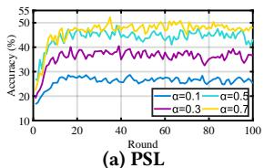

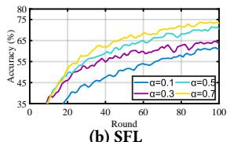

Figure 1: Performance of PSL and SFL on CIFAR-10 datasets under non-IID settings with ResNet-18.  
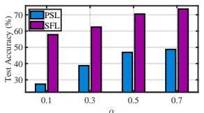  
(a) Test accuracy

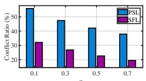  
(b) Conflict ratio  
Figure 2: Gradient conflict ratio and accuracy of PSL and SFL under diferent non-IID levels on CIFAR-10 with ResNet-18.

FedIIR [12], FedLD [57], and FedCALM [58], further mitigate interference among client updates by aligning optimization directions or suppressing conflicting components. However, these methods are mainly designed for FL, where full-model replication and it- erative client aggregation are assumed. By contrast, PSL adopts a partitioned architecture without client-side aggregation, leading to distinct gradient interaction patterns. Therefore, mitigating gradient inconsistency in PSL requires methods tailored to its unique training dynamics.

## 3 Background and Motivation

PSL has emerged as a promising training paradigm for resourceconstrained edge intelligence. By partitioning the model between edge devices and the server, PSL ofloads the majority of computation and memory overhead from clients. Crucially, by completely eliminating client-side parameter aggregation, PSL simplifies the training pipeline and minimizes communication overhead, making it highly attractive for large-scale distributed deployment compared to conventional SFL. However, this highly eficient, client-side parameter aggregation-free architecture introduces an inherent opti mization vulnerability under statistical heterogeneity. In PSL, each client executes forward and backward propagation based solely on its local, typically non-IID data, updating its sub-model without any cross-client synchronization. Consequently, local sub-models rapidly overfit to local distributions. This local bias causes clients to upload semantically disjointed intermediate activations to the server. Under non-IID settings, this semantic mismatch translates into highly divergent gradients during server-side backpropagation. Instead of a globally calibrated optimization signal, the server receives conflicting updates that accumulate over time, leading to optimization divergence and severe client drift.

This vulnerability is supported by our preliminary experiments. As shown in Fig. 1, on non-IID CIFAR-10 with ResNet-18, PSL converges more slowly and less stably than SFL, suggesting that the absence of client-side aggregation increases its sensitivity to data heterogeneity. Fig. 2 further shows that stronger heterogeneity leads to a higher gradient conflict ratio and lower test accuracy, with a more pronounced degradation in PSL. These results indicate that PSL’s performance loss is closely associated with cross-client

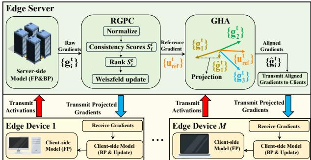  
Figure 3: An overview of PSL-RGHA architecture.

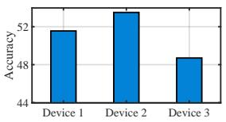  
(a) Individual performance

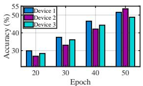  
(b) Accuracy vs. Epochs  
50) Device 1Figure 4: Performance of PSL using single client device gradiy ( Device 3ent updates on CIFAR-10 under non-IID settings (ResNet-18).

Agradient inconsistency, which introduces noisy and unstable server-20 30 40 50side updates. The above observations reveal a major limitation of existing PSL frameworks: eliminating client-side aggregation maximizes communication eficiency but simultaneously removes the essential cross-client calibration needed for stable convergence. Consequently, heterogeneous client updates can interfere with each other, causing oscillation, slow convergence, or even convergence failure. Therefore, the key challenge is how to preserve the ef- ficiency advantage of aggregation-free PSL while still enforcing directional consistency among heterogeneous client gradients. This compelling dilemma motivates the necessity of our research: de- signing a robust server-side coordination mechanism capable of inferring a reliable global descent trend from noisy client signals, and actively suppressing conflicting update directions to guarantee stable, aggregation-free distributed training.

## 4 System Design

## 4.1 Overview

In this section, we present PSL-RGHA, a robust gradient-alignment framework engineered to stabilize PSL under severe statistical het-erogeneity. As illustrated in Fig. 3, PSL-RGHA integrates two synergistic modules within an aggregation-free architecture: i) RGPC (Section 4.2), which synthesizes a global reference direction by pro-gressively aggregating consistent client gradients via Weiszfeld updates; ii)GHA (Section 4.3), which leverages the reference gradi-ent to enforce global directional consistency.

In PSL-RGHA, the model is split into client-side sub-models and a shared server-side sub-model. In each training round, clients perform forward propagation on local data and upload cut-layer activations to the server. The server then completes forward and backward propagation to obtain client-specific server gradients. RGPC constructs a robust reference gradient, and GHA aligns each client gradient within the corresponding reference half-space. The server updates the shared sub-model using the corrected gradients and returns the cut-layer gradients to the clients, which complete backpropagation and update their local sub-models.

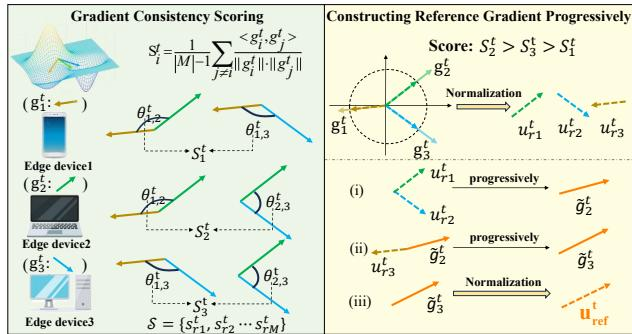  
Figure 5: An illustration of RGPC: Gradients are scored by directional consistency (left) and aggregated via ranked Weiszfeld updates (right) to construct the reference gradient.

## 4.2 Reference Gradient Progressive Construction

In PSL, the absence of client-side aggregation severely exacerbates inter-client gradient misalignment, producing conflicting updates at the server. To empirically validate this, we evaluated the opti mization trajectories of individual clients starting from identical initializations. As illustrated in Fig. 4a, the resultant test accura- cies exhibit extreme spatial variance, confirming the severe heterogeneity of local gradients. Furthermore, the client contributing the maximum performance gain fluctuates across epochs (Fig. 4b), indicating that no single client consistently aligns with the optimal global descent direction. Consequently, under such directional con flict, naive uniform aggregation inadvertently incorporates these misaligned gradients as detrimental noise, thereby degrading the global update and stalling convergence.

To this end, we propose RGPC, a robust aggregation mechanism that ranks client gradients via a directional consistency score and progressively synthesizes them using Weiszfeld updates [46] , as illustrated in Fig. 5. This procedure yields a robust reference gradient that efectively filters out noise and captures the underlying lobal conver ence trend, which is elaborated as follows.

4.2.1 Gradient Consistency Scoring. Existing methods often estimate client contributions using gradient magnitudes, assuming that larger updates are more informative [3, 41, 53]. However, un der statistical heterogeneity (non-IID data), gradients with large magnitudes often stem from local overfitting or outliers, which are directionally inconsistent with the global optimization landscape and may impede convergence. Conversely, gradients with smaller magnitudes but consistent directions often provide reli- able progress. This necessitates a metric that prioritizes directional alignment over scalar magnitude. Accordingly, we introduce the gradient consistency score, a metric designed to quantify the cross-client directional agreement. Formally, for the �-th training round, the consistency score $S _ { i } ^ { t }$ of the �-th client is defined as the average cosine similarity between its local gradient and those of all other participating clients:

$$
S _ { i } ^ { t } = \frac { 1 } { \left| \mathcal { M } \right| - 1 } \sum _ { j \neq i } \frac { \left. g _ { i } ^ { t } , g _ { j } ^ { t } \right. } { \left\| g _ { i } ^ { t } \right\| \cdot \left\| g _ { j } ^ { t } \right\| } .\tag{1}
$$

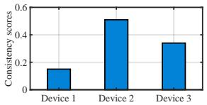

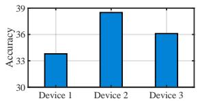  
(a) Consistency scores  
(b) Accuracy  
Figure 6: The gradient consistency scores and test accuracies of client devices on CIFAR-10 (ResNet-18).

cuwhere $M = \{ 1 , 2 , \dots , M \}$ denotes the set of participating client devices, $\langle \cdot , \cdot \rangle$ denotes the inner product, ∥·∥ is the Euclidean norm, and $g _ { k } ^ { t }$ Device 1 Device 2 Device 3is the gradient of the �-th client device at the �-th training round.

Equ. (1) provides a quantitative measure of directional centrality. A higher $S _ { i } ^ { t }$ indicates that the gradient of client � aligns closely with the prevailing descent trend of the population, suggesting a con-structive contribution to the global model. Conversely, a lower $S _ { i } ^ { t }$ signifies weak directional agreement, implying that the update may introduce noise or conflicting signals that decelerate convergence. As shown in Fig. $^ { 6 , }$ clients with higher consistency scores consistently yield higher test accuracy in single-client update studies, validating $S _ { i } ^ { t }$ as an efective indicator of optimization utility.

After computing $\{ S _ { i } ^ { t } \} _ { i \in { M } } ,$ , the server ranks clients in descending order and obtains indices $( r _ { 1 } , r _ { 2 } \ldots , r _ { M } )$ such that

$$
S _ { r _ { 1 } } ^ { t } \geq S _ { r _ { 2 } } ^ { t } \geq \cdots \geq S _ { r _ { M } } ^ { t } ,\tag{2}
$$

where $r _ { 1 }$ denotes the client with the highest directional consistency at round �. This ranking serves as the basis for RGPC, allowing the system to prioritize directionally reliable gradients while mitigating the impact of outliers during the subsequent reference construction.

4.2.2 Progressive Construction via WeiszfeldUpdates. To synthesize a robust reference gradient from the heterogeneous client updates, we employ a progressive Weiszfeld [47] scheme that prioritizes directionally consistent gradients (i.e., those with higher consis-tency scores $S _ { i } ^ { t } )$ . Unlike simple averaging which is sensitive to outliers, this approach sequentially aggregates ranked directions to approximate the geometric median, which is robust especially in high-dimensional spaces.

Given the set of client gradients $\{ g _ { i } ^ { t } \} _ { i \in \mathcal { M } }$ at round �, we first decouple directional information from magnitude by normalizing valid gradients onto the unit sphere:

$$
u _ { i } ^ { t } = \frac { g _ { i } ^ { t } } { \lVert g _ { i } ^ { t } \rVert } , \quad \forall i \in \mathcal { M } , \mathrm { ~ s . t . ~ } \lVert g _ { i } ^ { t } \rVert > \delta ,\tag{3}
$$

where � is a threshold to filter numerically unstable updates.

Let $( r _ { 1 } , r _ { 2 } \ldots , r _ { M } )$ denote the indices of clients sorted b their consistency scores in descending order. We process clients according to this rank, maintaining an evolving estimate $\pmb { g } \in \mathbb { R } ^ { d }$ con-strained within the convex unit ball $C \ \triangleq \ \left\{ \pmb { x } \in \mathbb { R } ^ { d } : \| \pmb { x } \| \leq 1 \right\}$ Crucially, we perform intermediate updates within C (a convex set) rather than the unit sphere (non-convex) to guarantee stable convergence properties. For the cumulative subset $\mathcal { P } _ { k } ^ { t } = \{ u _ { r _ { 1 } } ^ { t } , \ldots , u _ { r _ { k } } ^ { t } \}$ of the top-� clients, the smoothed geometric-median objective over C is defined as:

$$
\Phi _ { k , \varepsilon } ^ { t } ( g ) = \sum _ { \ell = 1 } ^ { k } \sqrt { \| g - u _ { r _ { \ell } } ^ { t } \| ^ { 2 } + \varepsilon ^ { 2 } } , \quad g \in C .\tag{4}
$$

where $\ell \in \{ 1 , 2 , \ldots , k \}$ is the descent index of clients.

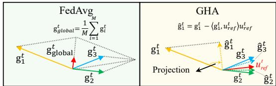  
Figure 7: The gradient alignment result of FedAvg and GHA.

We initialize the estimate as $g \gets u _ { r _ { 1 } } ^ { t }$ and sequentially incor-porate the ranked directions. Upon adding the �-th direction, we perform one warm-started Weiszfeld step using the current estimate $g$ (obtained from the previous � − 1 steps) to update the centroid:

$$
w _ { \ell } ^ { ( k ) } = \frac { 1 } { \sqrt { \| g - u _ { r _ { \ell } } ^ { t } \| ^ { 2 } + \varepsilon ^ { 2 } } } ,\tag{5a}
$$

$$
g \gets \frac { \sum _ { \ell = 1 } ^ { k } w _ { \ell } ^ { ( k ) } u _ { r _ { \ell } } ^ { t } } { \sum _ { \ell = 1 } ^ { k } w _ { \ell } ^ { ( k ) } } ,\tag{5b}
$$

where $\varepsilon > 0$ ensures numerical stability. After processing all ranked gradients, we obtain the reference direction by normalizing the final estimate:

$$
u _ { \mathrm { r e f } } ^ { t } = \frac { g } { \left\| g \right\| } \quad ( \left\| g \right\| > 0 ) .\tag{6}
$$

This progressive construction strategy confers robustness through a dual mechanism: (i) the consistency-based ranking ensures that the reference vector is anchored by the most reliable gradients during the critical early phases, thereby mitigating initialization bias; and (ii) the Weiszfeld reweighting naturally attenuates the influence of updates with large angular deviations (outliers), efectively synthesizing a noise-resilient global descent direction. Subsequently, the server broadcasts ${ u _ { \mathrm { r e f } } ^ { t } }$ to all participating clients to orchestrate the gradient alignment in the forthcoming GHA phase.

## 4.3 Gradient Half-space Alignment

The reference gradient ${ \pmb u } _ { \mathrm { r e f } } ^ { t }$ constructed by RGPC serves as a ro- bust proxy for the global optimization trajectory. In conventional aggregation schemes such as FedAvg, the server indiscriminately averages client updates, neglecting their directional disparities. As shown in Fig. 7, this simple aggregation allows conflicting gradients to destructively interfere, leading to optimization drift or cancellation in the global model.

To mitigate this, we propose the GHA mechanism, which en-forces directional agreement by geometrically projecting conflicting gradients onto the reference half-space and softly aligning non opposing updates toward the reference direction. Therefore, GHA efectively neutralizes divergent components while preserving the informative orthogonal innovations. Formally, given the server-side reference direction $\pmb { u } _ { \mathrm { r e f } } ^ { t }$ at round �, we define the permissible reference half-space:

$$
\mathcal { H } ^ { t } \triangleq \{ d \in \mathbb { R } ^ { d } : \langle d , u _ { \mathrm { r e f } } ^ { t } \rangle \geq 0 \} ,
$$

which contains all directions that form a non-obtuse angle with $u _ { \mathrm { r e f } } ^ { t }$ . For each client update $g _ { i } ^ { t } { \mathrm { : } }$ , GHA applies a piecewise alignment rule:

$$
\hat { g } _ { i } ^ { t } = \{ \begin{array} { l l } { ( 1 - \lambda _ { i } ^ { t } ) g _ { i } ^ { t } + \lambda _ { i } ^ { t }  g _ { i } ^ { t }  u _ { \mathrm { r e f } } ^ { t } , } & { \langle g _ { i } ^ { t } , u _ { \mathrm { r e f } } ^ { t } \rangle \geq 0 , } \\ {  g _ { i } ^ { t } - \langle g _ { i } ^ { t } , u _ { \mathrm { r e f } } ^ { t } \rangle u _ { \mathrm { r e f } } ^ { t } , } & { \langle g _ { i } ^ { t } , u _ { \mathrm { r e f } } ^ { t } \rangle < 0 , } \end{array}\tag{7}
$$

Algorithm 1 PSL-RGHA   
1: Input: Client gradients $\{ g _ { i } ^ { t } \} _ { i \in { \mathcal { M } } } ,$ , smoothing $\varepsilon > 0$   
2: Output: Reference gradient $u _ { \mathrm { r e f } } ^ { t } ,$ corrected updates $\{ \hat { g } _ { i } ^ { t }$ }�∈M   
3: Phase 1: Consistency scoring and ranking.   
4: for each $i \in \mathcal { M }$ do   
$\langle g _ { i } ^ { t } , g _ { j } ^ { t } \rangle$   
5: $\begin{array} { r } { S _ { i } ^ { t } \gets \frac { 1 } { | { \cal M } | - 1 } \sum _ { j \in { \cal M } , j \ne i } } \end{array}$   
∥��� ∥·∥��� ∥   
6: end for   
7: Sort to obtain $( r _ { 1 } , \ldots , r _ { M } )$ such that $S _ { r _ { 1 } } ^ { t } \geq \cdots \geq S _ { r _ { M } } ^ { t }$   
8: Phase 2: Progressive construction via Weiszfeld updates.   
9: $g  u _ { r _ { 1 } } ^ { t } \{ u _ { i } ^ { t } \triangleq g _ { i } ^ { t } / \Vert g _ { i } ^ { t } \Vert \}$   
10: for $k = 2$ to � do   
11: $w _ { \ell } ^ { ( k ) } \gets \big ( \| g - u _ { r _ { \ell } } ^ { t } \| ^ { 2 } + \varepsilon ^ { 2 } \big ) ^ { - 1 / 2 }$ for $\ell = 1 , \ldots , k$   
12: $g \gets \frac { \sum _ { \ell = 1 } ^ { k } w _ { \ell } ^ { ( k ) } u _ { r _ { \ell } } ^ { t } } { \kappa }$   
${ \boldsymbol { \Sigma } } _ { \ell = 1 } ^ { k } { \boldsymbol { w } } _ { \ell } ^ { ( k ) }$   
13: end for   
14: $u _ { \mathrm { r e f } } ^ { t }  g / \| g \|$   
15: Phase 3: Gradient half-space alignment.   
16: for each client $i \in M$ in parallel do   
17: $s \gets \langle g _ { i } ^ { t } , u _ { \mathrm { r e f } } ^ { t } \rangle$   
18: $\textbf { i f } s \ge 0$ then   
19: $\begin{array} { r } { \lambda  \frac { 1 } { 2 } ( 1 - \frac { s } { \| g _ { i } ^ { t } \| } ) } \end{array}$   
20: $\hat { g } _ { i } ^ { t } \gets ( \dot { 1 } - \lambda ) g _ { i } ^ { t } + \lambda$ ∥��� ∥ $u _ { \mathrm { r e f } } ^ { t }$   
21: else   
22: $\hat { g } _ { i } ^ { t }  g _ { i } ^ { t } - s \cdot u _ { \mathrm { r e f } } ^ { t }$   
23: end if   
24: end for   
25: return $u _ { \mathrm { r e f } } ^ { t } , \{ \hat { g } _ { i } ^ { t } \} _ { i \in \mathcal { M } . }$

where softly aligns non-opposing updates toward the reference ray (while preserving the update norm), and performs the Euclidean projection onto $\bar { \mathcal { H } } ^ { t }$ to remove only the opposing component along ${ u _ { \mathrm { r e f } } ^ { t } }$ while preserving orthogonal information.

Geometrically, Eq. (7) aligns each client update with the reference half-space. For non-conflicting updates (Case 1), GHA softly pulls $g _ { i } ^ { t }$ toward the reference ray $| | g _ { i } ^ { t } | | u _ { \mathrm { r e f } } ^ { t } ,$ with smaller perturba- tions for more consistent updates. For conflicting updates (Case 2), it removes only the negative component along ${ \boldsymbol u _ { \mathrm { r e f } } ^ { t } }$ while preserving the orthogonal component. Thus, every corrected update satisfies $\langle \hat { g } _ { i } ^ { t } , u _ { \mathrm { r e f } } ^ { t } \rangle \geq 0 .$ , supporting the global descent direction without discarding client-specific information. GHA requires only �(�) vector operations and introduces no additional communication. The full procedure is given in Algorithm 1.

## 4.4 Theoretical Analysis

We provide theoretical insights for the two key modules of PSL-RGHA. For RGPC, we demonstrate that progressively incorporating ranked client directions—and performing a warm-started Weiszfeld refinement after each step—follows a Majorization-Minimization (MM) framework over the convex set C. Consequently, the smoothed geometric-median objective $\Phi _ { k , \varepsilon } ^ { t } ( \cdot )$ monotonically decreases after each refinement. This guarantees that RGPC reliably constructs a robust reference gradient direction $u _ { \mathrm { r e f } } ^ { t }$ to proxy the global de- scent trend. Building on this reference direction, we further analyze the geometric properties and stability of GHA. GHA projects conflicting updates onto the reference half-space and softly aligns non-conflicting ones toward $u _ { \mathrm { r e f } } ^ { t } .$ Theorem 4.2 proves that these corrected updates strictly reside in the valid half-space, improve global alignment, and remain non-expansive in norm, which funda- mentally ensures training stability under heterogeneous gradient distributions.

Theorem 4.1 (MM descent of a progressive Weiszfeld step). Fix a training round � and a prefix size �. Let the feasible set be $C \triangleq \{ g \in \mathbb { R } ^ { d } : \| g \| \leq 1 \}$ and the smoothing parameter be $\varepsilon > 0$ . We define the smoothed geometric-median objective as:

$$
\Phi _ { k , \varepsilon } ^ { t } ( g ) \triangleq \sum _ { \ell = 1 } ^ { k } { \sqrt { \| g - u _ { r _ { \ell } } ^ { t } \| ^ { 2 } + \varepsilon ^ { 2 } } } , \qquad g \in C .\tag{8}
$$

Given a current estimate ${ \boldsymbol g } ^ { ( 0 ) } \in C ,$ , we define the distance and corresponding Weiszfeld weights $f o r \ell = 1 , . . . , k$ as:

$$
d _ { \ell } \triangleq \sqrt { \| g ^ { ( 0 ) } - u _ { r _ { \ell } } ^ { t } \| ^ { 2 } + \varepsilon ^ { 2 } } , \quad w _ { \ell } \triangleq \frac { 1 } { d _ { \ell } } .\tag{9}
$$

Applying a single Weiszfeld update step yields:

$$
g ^ { ( 1 ) } \triangleq \frac { \sum _ { \ell = 1 } ^ { k } w _ { \ell } u _ { r _ { \ell } } ^ { t } } { \sum _ { \ell = 1 } ^ { k } w _ { \ell } } .\tag{10}
$$

Then, the updated estimate remains strictly within the convex set $( g ^ { ( 1 ) } \in C )$ , and the objective function monotonically decreases:

$$
\Phi _ { k , \varepsilon } ^ { t } ( g ^ { ( 1 ) } ) \leq \Phi _ { k , \varepsilon } ^ { t } ( g ^ { ( 0 ) } ) .\tag{11}
$$

Proof. The core of this proof relies on the MM principle. We proceed in three logical steps: constructing a surrogate majorizer function, minimizing this surrogate, and establishing the final de- scent chain.

We utilize the algebraic inequality $\begin{array} { r } { \sqrt { z } \le \frac { z } { 2 a } + \frac { a } { 2 } } \end{array}$ (valid for any $z \geq 0$ and � $~ > 0 ,$ with equality if and only if $a = { \sqrt { z } } )$ . By substituting $z = \| g - u _ { r _ { \ell } } ^ { t } \| ^ { 2 } + \varepsilon ^ { 2 }$ and $a = d _ { \ell } \geq \varepsilon > 0$ , we obtain a localized upper bound for each term in the objective:

$$
\sqrt { \| g - u _ { r _ { \ell } } ^ { t } \| ^ { 2 } + \varepsilon ^ { 2 } } \leq \frac { \| g - u _ { r _ { \ell } } ^ { t } \| ^ { 2 } + \varepsilon ^ { 2 } } { 2 d _ { \ell } } + \frac { d _ { \ell } } { 2 } .
$$

Summing these bounds over all $\ell = 1 , \ldots , k$ yields the surrogate majorizing function $Q ( g \mid g ^ { ( 0 ) } )$ :

$$
Q ( g \mid g ^ { ( 0 ) } ) \triangleq \sum _ { \ell = 1 } ^ { k } \left( { \frac { \| g - u _ { r _ { \ell } } ^ { t } \| ^ { 2 } + \varepsilon ^ { 2 } } { 2 d _ { \ell } } } + { \frac { d _ { \ell } } { 2 } } \right) .
$$

By construction, this surrogate strictly upper-bounds our objective function $\Phi _ { k . \varepsilon } ^ { t } ( g ) \leq Q ( g \mid g ^ { ( 0 ) } )$ for all $g \in C ,$ , and tightens exactly at the current estimate: $Q ( g ^ { ( 0 ) } \mid g ^ { ( 0 ) } ) = \Phi _ { k , \varepsilon } ^ { t } ( g ^ { ( 0 ) } )$ .

Next, we find the optimal update by minimizing $Q ( { \bf \cdot } \mid g ^ { ( 0 ) } )$ over the feasible set C. Discarding constants independent of �, this is mathematically equivalent to minimizing the weighted leastsquares function:

$$
J ( g ) \triangleq \frac 1 2 \sum _ { \ell = 1 } ^ { k } w _ { \ell } \| g - u _ { r _ { \ell } } ^ { t } \| ^ { 2 } , \qquad g \in C .
$$

Let $\begin{array} { r } { \alpha \triangleq \sum _ { \ell = 1 } ^ { k } w _ { \ell } > 0 } \end{array}$ . By completing the square, we can rewrite $J ( g )$ as:

$$
J ( \boldsymbol { g } ) = \frac { \alpha } { 2 } \lVert \boldsymbol { g } - \tilde { \boldsymbol { g } } ^ { ( 1 ) } \rVert ^ { 2 } + \mathrm { c o n s t . } \quad \mathrm { w h e r e } \quad \tilde { \boldsymbol { g } } ^ { ( 1 ) } = \frac { \sum _ { \ell = 1 } ^ { k } w _ { \ell } u _ { r _ { \ell } } ^ { t } } { \sum _ { \ell = 1 } ^ { k } w _ { \ell } } .
$$

Since each $w _ { \ell } ~ > ~ 0$ and $\| u _ { r _ { \ell } } ^ { t } \| = 1$ , the vector $\tilde { g } ^ { ( 1 ) }$ is a convex combination of points on the unit sphere. Consequently, $\| \tilde { g } ^ { ( 1 ) } \| \leq 1 .$ meaning $\tilde { g } ^ { ( 1 ) }$ already lies perfectly within our constraint set C (the constraint is inactive). Therefore, the minimizer over $c$ is exactly $g ^ { ( 1 ) } = \tilde { g } ^ { ( 1 ) }$ . Because $g ^ { ( 1 ) }$ minimizes the majorizer �, we can establish the final descent chain:

$$
\Phi _ { k , \varepsilon } ^ { t } ( g ^ { ( 1 ) } ) \leq Q ( g ^ { ( 1 ) } \mid g ^ { ( 0 ) } ) \leq Q ( g ^ { ( 0 ) } \mid g ^ { ( 0 ) } ) = \Phi _ { k , \varepsilon } ^ { t } ( g ^ { ( 0 ) } ) .
$$

This confirms the monotonic descent property and completes the proof. □

Establishing Theorem 4.1 that RGPC reliably constructs a robust global descent direction, we now demonstrate how GHA utilizes this reference to regularize heterogeneous client updates. Theo- rem 4.2 proves that the GHA projection not only guarantees strict directional alignment with the global trend, but also inherently en- sures numerical stability by preventing gradient norm expansion:

Theorem 4.2 (Geometric meaning and stability of GHA). Let � $\epsilon \mathbb { R } ^ { d }$ be a unit vector and define the reference half-space $\mathcal { H } \triangleq$ $\{ d \in \mathbb { R } ^ { d } : \langle d , u \rangle \geq 0 \}$ . For any $g \in \mathbb { R } ^ { d }$ , let $\hat { \boldsymbol g }$ be given by (7). Then:

(1) (Half-space feasibility and monotone reference projection) $\langle \hat { g } , u \rangle \geq 0 \ a n d \langle \hat { g } , u \rangle \geq \langle g , u \rangle .$

(2) (Minimum change under conflict) $I f \left. g , u \right. \ < \ 0 _ { ; }$ , then ${ \hat { g } } =$ $\Pi _ { \mathcal { H } } ( g )$ and thus $\begin{array} { r } { \| \hat { g } - g \| = \operatorname* { m i n } _ { d \in \mathcal { H } } \| d - g \| } \end{array}$

(3) (Non-expansiveness in norm) $\| \hat { g } \| \leq \| g \|$

Proof. Let $s \triangleq \langle g , u \rangle$ be the projection scalar. We analyze the alignment behavior under two mutually exclusive scenarios based on the gradient conflict. According to the piecewise alignment rule in (7), we have $\hat { g } = g - s u$ . Consequently, the inner product with the reference direction becomes:

$$
\left. \hat { g } , u \right. = s - s = 0 .
$$

This implies both $\langle \hat { g } , u \rangle \geq 0$ and $\langle \hat { g } , u \rangle \geq s ,$ , satisfying condition (1). Furthermore, since $\hat { g } \perp u$ and the original update can be decom- posed as $\boldsymbol { g } = \boldsymbol { \hat { g } } + s \boldsymbol { u } ,$ , applying the Pythagorean theorem yields:

$$
\| g \| ^ { 2 } = \| \hat { g } \| ^ { 2 } + s ^ { 2 } \quad \Rightarrow \quad \| \hat { g } \| \leq \| g \| .
$$

Regarding the projection claim (2), the Euclidean projection onto the half-space H satisfies $\Pi _ { \mathcal { H } } ( g ) = g \operatorname { i f } s \geq 0 ,$ , and $\Pi _ { \mathcal { H } } ( g ) = g - s u \operatorname { i f } s <$ 0. Thus, $\hat { g } = \Pi _ { \mathcal { H } } ( g )$ , and the minimum-distance property naturally follows from the standard definition of Euclidean projections.

Let $\lambda \in [ 0 , 1 / 2 ]$ be the alignment coeficient defined in (7), such that the softly aligned gradient is $\begin{array} { r } { \hat { g } = ( 1 - \lambda ) g + \lambda \| g \| u . } \end{array}$ . The inner product with the reference direction expands as:

$$
\begin{array} { l } { \langle \hat { g } , u \rangle = ( 1 - \lambda ) s + \lambda \| g \| } \\ { \qquad \geq ( 1 - \lambda ) s + \lambda s = s \geq 0 , } \end{array}
$$

which proves condition (1) for this case.

To establish the non-expansiveness property (3), we introduce auxiliary variables $a \triangleq g$ and $b \triangleq \Vert g \Vert u$ . Notice that $\left\| a \right\| = \left\| b \right\| =$ ∥�∥, and our aligned gradient can be written as the convex combination $\hat { g } = ( 1 - \lambda ) a + \lambda b$ . Using the standard norm identity for afine combinations:

$$
\| ( 1 - \lambda ) a + \lambda b \| ^ { 2 } = ( 1 - \lambda ) \| a \| ^ { 2 } + \lambda \| b \| ^ { 2 } - \lambda ( 1 - \lambda ) \| a - b \| ^ { 2 } ,
$$

we can substitute � and � back to obtain:

$$
\| \hat { g } \| ^ { 2 } = \| g \| ^ { 2 } - \lambda ( 1 - \lambda ) \| g - \| g \| u \| ^ { 2 } \leq \| g \| ^ { 2 } .
$$

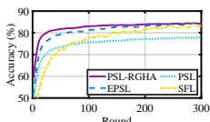  
(a) ResNet18 CIFAR10 (IID).

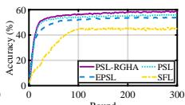  
(b) ResNet18 CIFAR100 (IID).

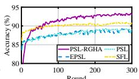  
(c) ResNet18 FMNIST (IID).

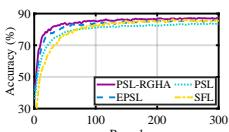  
Round(d) ResNet-32 CIFAR10 (IID).Round

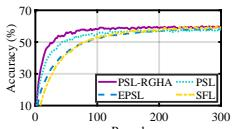

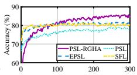

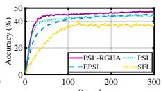

RoundRound(e) ResNet32 CIFAR100 (IID).  
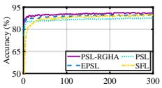

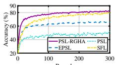

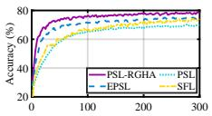

(f) ResNet32 FMNIST (IID).  
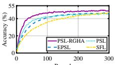

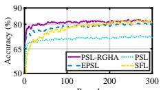  
Round   Round   Round   Round   Round   Round   0 100 200 300 0 100 200 300 0 100 2000 100 200 300 0 100 200 300 0 100 200 30  (g) ResNet18 CIFAR10 (non-IID).(h) ResNet18CIFAR100(non-IID). (i) ResNet18 FMNIST (non-IID). (j) ResNet32 CIFAR10 (non-IID).(k) ResNet32CIFAR100(non-IID). (l) ResNet32 FMNIST (non-IID)

Figure 8: Performance of PSL-RGHA on FMNIST, CIFAR10, and CIFAR100 datasets under IID and non-IID settings.  
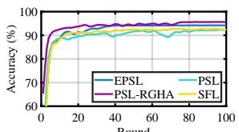  
(a) Speech commands (IID).

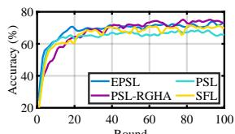

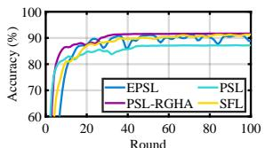  
0 20 40 60 80 1000 20 40 60(c) Speech commands (non-IID).

(b) SNIPS (IID).  
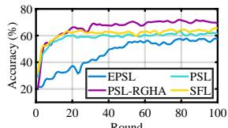  
40 60 80 1000 20 40 60 8(d) SNIPS (non-IID).  
Figure 9: Performance of PSL-RGHA on Speech commands and SNIPS datasets under IID and non-IID settings.

Since $\lambda ( 1 - \lambda ) \geq 0 \mathrm { f o r } \lambda \in [ 0 , 1 / 2 ] ,$ , this immediately yields ∥�ˆ∥ ≤ ∥�∥. Combining both cases efectively covers the entire gradient space, completing the proof. □

## 5 Experimental

## 5.1 Experimental Setup

To comprehensively evaluate the performance of PSL-RGHA, we utilize five standard benchmarks: FMNIST [50], CIFAR-10, CIFAR-100 [19], Speech commands [44] and SNIPS [5] under both IID and non-IID settings. We employ ResNet-18 and ResNet-32 [13] as the backbone architectures. To align with the split learning paradigm, each model is partitioned at a specific cut layer, with the initial layers deployed on the client and the remaining layers on the server. The training environment consists of 10 client devices. To simulate statistical heterogeneity (non-IID data), we partition the training data among clients using a Dirichlet distribution ���(�) [51], where the concentration parameter � is varied across {0.1, 0.3, 0.5, 0.7} to represent increasing degrees of data skew. All models are trained by the SGD [20] optimizer.

## 5.2 Benchmarks

To comprehensively evaluate the performance of PSL-RGHA, we compare the proposed PSL-RGHA against the following representative baselines: i) SFL [39] is a hybrid architecture that integrates SL with FL. SFL enables parallel client-side training across client devices, where each device updates its client-side model and up- loads it to the parameter server for model aggregation. ii) PSL [15] is a streamlined variant of SFL that eliminates client-side model aggregation. PSL trains a shared server-side model using activations from all clients, while each client independently updates its local sub-model without cross-device coordination. iii) EPSL [32] is optimized PSL variant that reduces computational and commu- nication burdens by aggregating only a fraction of the cut-layer gradients on the server side, providing a middle ground between full aggregation and total independence.

Table 1: Test accuracy (%) of PSL-RGHA and baselines under IID and non-IID settings.
<table><tr><td>Dataset</td><td>Setting</td><td>Backbone</td><td>PSL</td><td>SFL</td><td>EPSL</td><td>PSL-RGHA</td></tr><tr><td rowspan="4">CIFAR10</td><td rowspan="2">IID</td><td>ResNet-18</td><td>78.36</td><td>83.71</td><td>84.62</td><td>84.98</td></tr><tr><td>ResNet-32</td><td>83.71</td><td>86.11</td><td>86.41</td><td>87.66</td></tr><tr><td rowspan="2">non-IID</td><td>ResNet-18</td><td>52.32</td><td>79.74</td><td>67.01</td><td>82.68</td></tr><tr><td>ResNet-32</td><td>70.26</td><td>75.08</td><td>75.61</td><td>79.17</td></tr><tr><td rowspan="4">CIFAR100</td><td rowspan="2">IID</td><td>ResNet-18</td><td>56.42</td><td>46.52</td><td>54.08</td><td>59.28</td></tr><tr><td>ResNet-32</td><td>58.04</td><td>59.88</td><td>58.62</td><td>60.23</td></tr><tr><td rowspan="2">non-IID</td><td>ResNet-18</td><td>44.87</td><td>39.71</td><td>45.71</td><td>47.52</td></tr><tr><td>ResNet-32</td><td>46.14</td><td>47.61</td><td>46.84</td><td>49.58</td></tr><tr><td rowspan="4">FMNIST</td><td rowspan="2">IID</td><td>ResNet-18</td><td>89.17</td><td>90.95</td><td>89.21</td><td>93.49</td></tr><tr><td>ResNet-32</td><td>87.72</td><td>89.52</td><td>90.41</td><td>91.25</td></tr><tr><td rowspan="2">non-IID</td><td>ResNet-18</td><td>78.47</td><td>80.42</td><td>81.36</td><td>86.83</td></tr><tr><td>ResNet-32</td><td>72.89</td><td>82.37</td><td>81.55</td><td>83.05</td></tr></table>

## 5.3 Performance Evaluation

5.3.1 Superiority ofPSL-RGHA. We first evaluate the convergence and generalization performance of PSL-RGHA. Fig. 8 and Fig. 9 show the test accuracy curves on vision and speech tasks, respec- tively, while Table 1 reports the final top-1 accuracy under difer- ent datasets and heterogeneity settings. PSL-RGHA consistently achieves faster convergence and higher accuracy than all baselines across vision, keyword spotting, and speech classification tasks. This gain mainly comes from its gradient guidance and correction mechanism. Unlike vanilla PSL, which sufers from severe client drift, PSL-RGHA uses GHA to project conflicting gradients onto the reference half-space, ensuring constructive updates and reducing oscillations caused by data heterogeneity. EPSL only performs partial aggregation and therefore cannot fully correct gradient conflicts, resulting in lower convergence performance.

5.3.2 Impact of Client Scalability. Fig. 10 illustrates the converged accuracy as the number of participating clients varies from 10 to 40. PSL-RGHA shows superior scalability, consistently outperforming baselines across all datasets and settings. In balanced IID environ- ments, all methods remain relatively stable as the system scales.

Roundound 0 100 200Round 100 200Round (d) CIFAR-10(non-IID).

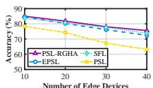  
(a) CIFAR-10 (IID).

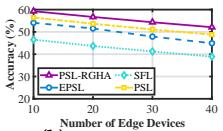  
(b) CIFAR-100 (IID).

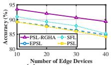

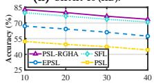

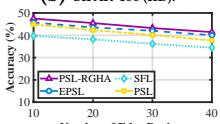  
20 3030 4030 40Number of Edge Devicesf Edge Devicesge Devic s Number of Edge Devicesmber of Edge Devices of Edge Devic s(d) CIFAR-10 (non-IID).  
10 2020 3020 30Number of ENumber of Edge Devicesmber of Edge Devic s Number of EdgNumber of Edge DevicesNumber of Edge Devic s(e) CIFAR-100 (non-IID).

(c) FMNIST (IID).  
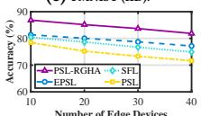  
10 200 20 3020 30Number Number of Edge DeNumber of Edge Devic s Number Number of Edge DeNumber of Edge Devic s(f) FMNIST (non-IID).

Figure 10: The impact of the number of edge devices on ResNet-18 test accuracy under IID and non-IID settings.90 50 9050 9050 90  
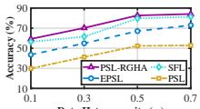  
(a) ResNet-18 CIFAR-10.

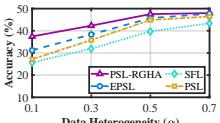  
Data Heterog Heterogenei y ( )terogeneity ( ) (b) ResNet-18 CIFAR-100.

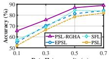  
Data HeteData Heterogenei yData Heterogeneity ( )(c) ResNet-18 FMNIST.

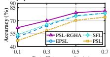  
0.1 0.3 0.540 0.3 0.5 0.7 0.3 0.5 0.7Data Heterogeneity ( )(d) ResNet-32 CIFAR-10.Data Heterogen i y ( ) Heterogeneity ( )

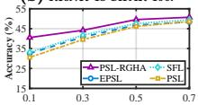

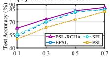  
15 Data HeterogData Heterogen i y ( )ta Heterogeneity ( ) 0.1 0.30.1 0.3 0.51 0.3 0.5 0.(e) ResNet-32 CIFAR-100.  
40Te Data HeteData Heterogen i yData Heterogeneity ( ) 0.7 0.1 0.30.1 0.3 0.51 0.3 0.5(f) ResNet-32 FMNIST.  
Figure 11: The impact of data heterogeneity on test accuracy under non-IID settings.

However, PSL-RGHA maintains a distinct performance edge. This stems from the GHA module, which refines the descent trajectory even when data distributions are uniform, while the other baselines are limited by the inherent variance of averaging stochastic gradi ents. Under heterogeneous settings, as the client scale increases, baselines sufer from significant performance deterioration. This is attributed to the accumulation of gradient noise. With naive aggre-gation, adding more heterogeneous clients introduces more conflicting update directions, which dilute the global signal. Conversely, PSL-RGHA demonstrates remarkable robustness, confirming that the RGPC module efectively filters out the tail noise introduced by additional clients, ensuring that the reference direction remains robust regardless of the system scale.

5.3.3 Impact of Data Heterogeneity. Fig. 11 evaluates the model robustness against statistical heterogeneity. As the heterogeneity increase (� decreases from 0.7 to 0.1), all baseline methods sufer from performance degradation. This confirms that standard aggre- gation mechanisms are highly sensitive to the gradient bias induced by skewed data distributions. In contrast, PSL-RGHA exhibits ex-ceptional statistical resilience. Even under extreme non-IID settings (� = 0.1), it maintains superior accuracy with only marginal degradation compared to the IID scenarios. This robustness validates that the proposed GHA mechanism efectively decouples local data bias from the global optimization direction, enabling the model to adapt to severe distribution shifts.

5.3.4 Ablation Study. We first isolate the contribution of the RGPC module by comparing it against two variants: (i) Non-RGPC (Naive Strategy), which omits the robust construction steps, and (ii) Rand-RGPC (Stochastic Strategy), which constructs the reference from a random subset of client gradients. As shown in Fig. 12, RGPC consistently outperforms both variants. The superiority over Rand-RGPC reveals that reference quality is critical: relying on random subsets introduces stochastic noise that destabilizes the alignment anchor. Similarly, the gap over Non-RGPC confirms that without the Weiszfeld-based filtering, the reference direction is easily skewed by outliers in non-IID data. RGPC efectively provides a stable anchor for the subsequent alignment.

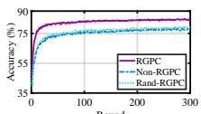  
(a) CIFAR-10(IID).

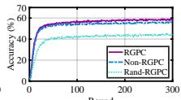  
(b) CIFAR-100(IID).

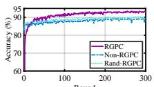  
(c) FMNIST(IID). Round

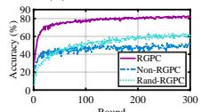  
RoundRound Round(d) CIFAR-10(non-IID).Round

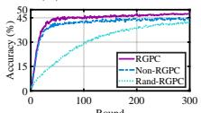

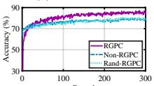  
RouRound(e) CIFAR-100(non-IID).  
RRound RRound(f) FMNIST(non-IID).

Figure 12: Ablation study of RGPC on CIFAR-10, CIFAR-100,  
and FMNIST under IID and non-IID settings (ResNet-18).90 60 9590 60 95  
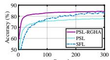

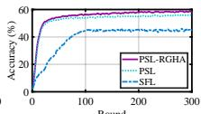  
Round(a) CIFAR-10 (IID).Round

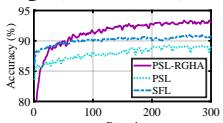

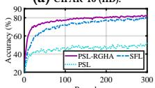

RoundRound(b) CIFAR-100 (IID).  
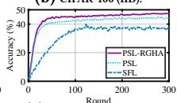  
0 100 200Round0 100 200Round (e) CIFAR-100(non-IID).

(c) FMNIST (IID).  
  
0 100 200Round0 100 200Round RoundRound(f) FMNIST(non-IID).  
Figure 13: Ablation study of GHA on CIFAR-10, CIFAR-100, and FMNIST under IID and non-IID settings (ResNet-18).

We then verify the necessity of the GHA mechanism by examining the performance gap among full PSL-RGHA framework, baseline PSL (without alignment) and SFL (naive aggregation), as illustrated in Fig. 13. Experimental results demonstrate that GHA yields substantial accuracy gains, confirming that simply aggregating gradients (SFL) or allowing independent updates (PSL) is insufi-cient under heterogeneity. The efectiveness of GHA stems from its ability to actively rectify gradient conflicts. By projecting conflicting updates onto the reference half-space, GHA eliminates destructive interference while preserving constructive local features, thereby converting optimization drift into stable convergence.

## 6 Conclusion

In this paper, we proposed PSL-RGHA to resolve the fundamental conflict between client-side parallelism and training stability in SL. Unlike traditional approaches that rely on naive model averaging, PSL-RGHA introduces a geometric perspective to distributed optimization. Through RGPC and GHA, the framework actively filters out directional noise and rectifies divergent updates, decoupling local data bias from the global optimization trajectory. Extensive ex-periments validate that PSL-RGHA achieves superior performance, proving that explicit gradient alignment is crucial for robust learning on non-IID data. These findings open new avenues for designing aggregation-free distributed learning systems. Moving forward, we aim to extend this geometric alignment principle to asynchronous training scenarios and larger-scale foundation model fine-tuning.

## Acknowledgments

This work was supported by the Fujian Provincial Science and Technology Plan Project under Grant No. 2024H6020, and the Green and Intelligent Ship Project in Fujian Province under Grant No. CBG4N21-4-4.

## References

[1] Durmus Alp Emre Acar, Yue Zhao, Ramon Matas Navarro, Matthew Mattina, Paul N. Whatmough, and Venkatesh Saligrama. 2021. Federated Learning Based on Dynamic Regularization. In Proc. ICLR

[2] Miao Cao, Lishun Wang, Huan Wang, Guoqing Wang, and Xin Yuan. 2024. Towards Real-time Video Compressive Sensing on Mobile Devices. In Proc. ACM MM.

[3] Huancheng Chen and Haris Vikalo. 2024. Heterogeneity-Guided Client Sampling: Towards Fast and Eficient Non-IID Federated Learning. In Proc. NeurIPS.

[4] Shengchao Chen, Guodong Long, Tao Shen, Jing Jiang, and Chengqi Zhang. 2024. Federated Prompt Learning for Weather Foundation Models on Devices. In Proc. IJCAI.

[5] Alice Coucke, Alaa Saade, Adrien Ball, Théodore Bluche, Alexandre Caulier, David Leroy, Clément Doumouro, Thibault Gisselbrecht, Francesco Caltagirone, Thibaut Lavril, Maël Primet, and Joseph Dureau. 2018. Snips Voice Platform: an embedded Spoken Language Understanding system for private-by-design voice interfaces. arXiv preprint arXiv: 1805.10190 (2018).

[6] Dongshang Deng, Xuangou Wu, Tao Zhang, Xiangyun Tang, Hongyang Du, Jiawen Kang, Jiqiang Liu, and Dusit Niyato. 2024. FedASA: A Personalized Federated Learning With Adaptive Model Aggregation for Heterogeneous Mobile Edge Computing. IEEE Trans. Mob. Comput. 23, 12 (2024), 14787–14802.

[7] Zihan Fang, Zheng Lin, Senkang Hu, Yanan Ma, Yihang Tao, Yiqin Deng, Xianhao Chen, and Yuguang Fang. 2026. HFedMoE: Resource-aware Heterogeneous Federated Learning with Mixture-of-Experts. arXiv preprint arXiv:2601.00583 (2026).

[8] Zihan Fang, Zheng Lin, Senkang Hu, Yihang Tao, Yiqin Deng, Xianhao Chen, and Yuguang Fang. 2025. Dynamic uncertainty-aware multimodal fusion for outdoor health monitoring. arXiv preprint arXiv:2508.09085 (2025).

[9] Zihan Fang, Qianru Wang, Haonan An, Zheng Lin, Yiqin Deng, Xianhao Chen, and Yuguang Fang. 2026. Aggregation Alignment for Federated Learning with Mixture-of-Experts under Data Heterogeneity. arXiv preprint arXiv:2603.21276 (2026).

[10] Zhen Fang, Miao Yang, Zehang Lin, Zheng Lin, Zihan Fang, Zongyuan Zhang, Tianyang Duan, Dong Huang, and Shunzhi Zhu. 2026. NSC-SL: A Bandwidth-Aware Neural Subspace Compression for Communication-Eficient Split Learning. In Proc. ICASSP. 2156–2160.

[11] Liang Gao, Huazhu Fu, Li Li, Yingwen Chen, Ming Xu, and Cheng-Zhong Xu. 2022. FedDC: Federated Learning with Non-IID Data via Local Drift Decoupling and Correction. In Proc. CVPR.

[12] Yaming Guo, Kai Guo, Xiaofeng Cao, Tieru Wu, and Yi Chang. 2023. Out-of-Distribution Generalization of Federated Learning via Implicit Invariant Rela tionships. In Proc. ICML.

[13] Kaiming He, Xiangyu Zhang, Shaoqing Ren, and Jian Sun. 2016. Deep Residual Learning for Image Recognition. In Proc. CVPR.

[14] Kaili Jin, Li Xu, Xiaoding Wang, Sun-Yuan Hsieh, Jie Wu, and Limei Lin. 2025. Fed CPD: Personalized Federated Learning with Prototype-Enhanced Representation and Memory Distillation. In Proc. IJCAI.

[15] Praveen Joshi, Chandra Thapa, Seyit Camtepe, Mohammed Hasanuzzaman, Ted Scully, and Haithem Afli. 2021. Splitfed Learning without Client-side Synchroniza tion: Anal zin Client-side S lit Network Portion Size to Overall Performance. arXiv preprint arXiv:2109.09246 (2021).

[16] Sai Praneeth Karimireddy, Satyen Kale, Mehryar Mohri, Sashank J. Reddi, Sebastian U. Stich, and Ananda Theertha Suresh. 2020. SCAFFOLD: Stochastic Controlled Averaging for Federated Learning. In Proc. ICML.

[17] Minsu Kim, Alexander C. DeRieux, and Walid Saad. 2022. A Bargaining Game for Personalized, Energy Eficient Split Learning over Wireless Networks. arXiv preprint arXiv:2212.06107 (2022).

[18] Minsu Kim, Walid Saad, Mérouane Debbah, and Choong Seon Hong. 2024. SpaFL: Communication-Eficient Federated Learning With Sparse Models And Low Computational Overhead. In Proc. NeurIPS.

[19] Alex Krizhevsky. 2009. Learning Multiple Layers of Features from Tiny Images. Technical Report. University of Toronto.

[20] Yann LeCun, Léon Bottou, Yoshua Bengio, and Patrick Hafner. 1998. Gradientbased learning applied to document recognition. Proc. IEEE 86, 11 (1998), 2278– 2324.

[21] Royson Lee, Minyoung Kim, Da Li, Xinchi Qiu, Timothy M. Hospedales, Ferenc Huszar, and Nicholas D. Lane. 2023. FedL2P: Federated Learning to Personalize. In Proc. NeurIPS.

[22] Junnan Li, Dongxu Li, Silvio Savarese, and Steven C. H. Hoi. 2023. BLIP-2: Bootstra in Lan ua e-Ima e Pre-trainin with Frozen Ima e Encoders and Large Language Models. In Proc. ICML.

[23] Qinbin Li, Bingsheng He, and Dawn Song. 2021. Model-Contrastive Federated Learning. In Proc. CVPR.

[24] Tian Li, Anit Kumar Sahu, Manzil Zaheer, Maziar Sanjabi, Ameet Talwalkar, and Virginia Smith. 2020. Federated Optimization in Heterogeneous Networks. In Proc. MLSys.

[25] Zijian Li, Zehong Lin, Jiawei Shao, Yuyi Mao, and Jun Zhang. 2024. FedCiR: Client-Invariant Representation Learning for Federated Non-IID Features. IEEE Trans. Mob. Comput. 23, 11 (2024), 10509–10522.

[26] Zheng Lin, Zhe Chen, Xianhao Chen, Wei Ni, and Yue Gao. 2026. HASFL: Heterogeneity-aware Split Federated Learning over Edge Computing Systems. IEEE Trans. Mobile Comput. (2026).

[27] Zheng Lin, Zhe Chen, Zihan Fang, Xianhao Chen, Xiong Wang, and Yue Gao. 2024. FedSN: A federated learning framework over heterogeneous LEO satellite networks. IEEE Transactions on Mobile Computing 24, 3 (2024), 1293–1307.

[28] Zheng Lin, Guanqiao Qu, Qiyuan Chen, Xianhao Chen, Zhe Chen, and Kaibin Huang. 2025. Pushing Large Language Models to the 6G Edge: Vision, Challenges, and Opportunities. IEEE Communication Magazine (2025).

[29] Zheng Lin, Guanqiao Qu, Wei Wei, Xianhao Chen, and Kin K Leung. 2025. Adaptsfl: Adaptive Split Federated Learning in Resource-Constrained Edge Net works. IEEE Trans. Netw. (2025).

[30] Zheng Lin, Zhanwei Wang, Yuxin Zhang, Yafei Wang, Ons Aouedi, Zihan Fang, Jinfeng Xu, Jing Yang, Vu Nguyen Ha, Yuanwei Liu, Mohamed-Slim Alouini, and Symeon Chatzinotas. 2026. Satellite Intelligence: Distributed Training, Collab orative Inference, and LLM Adaptation in LEO Constellation. arXiv preprint arXiv:2610.35282 (2026).

[31] Zheng Lin, Yuxin Zhang, Zhe Chen, Zihan Fang, Xianhao Chen, Praneeth Vepakomma, Wei Ni, Jun Luo, and Yue Gao. 2025. HSplitLoRA: A Heterogeneous Split Parameter-Eficient Fine-Tuning Framework for Large Language Models. arXiv preprint arXiv:2505.02795 (2025).

[32] Zheng Lin, Guangyu Zhu, Yiqin Deng, Xianhao Chen, Yue Gao, Kaibin Huang, and Yuguang Fang. 2024. Eficient Parallel Split Learning Over Resource-Constrained Wireless Edge Networks. IEEE Trans. Mob. Comput. 23, 10 (2024), 9224–9239.

[33] Yi Liu, Cong Wang, and Xingliang Yuan. 2025. FedMobile: Enabling Knowledge Contribution-aware Multi-modal Federated Learning with Incomplete Modalities. In Proc. WWW.

[34] Zechun Liu, Changsheng Zhao, Forrest N. Iandola, Chen Lai, Yuandong Tian, Igor Fedorov, Yunyang Xiong, Ernie Chang, Yangyang Shi, Raghuraman Krishnamoorthi, Liangzhen Lai, and Vikas Chandra. 2024. MobileLLM: Optimizing Sub-billion Parameter Language Models for On-Device Use Cases. In Proc. ICML.

[35] Jinbo Peng, Zhe Chen, Zheng Lin, Haoxuan Yuan, Zihan Fang, Lingzhong Bao, Zihang Song, Ying Li, Jing Ren, and Yue Gao. 2024. SUMS: Snifing Unknown Multiband Signals under Low Sampling Rates. IEEE Trans. Mobile Comput. (2024).

[36] Youbang Sun, Zitao Li, Yaliang Li, and Bolin Ding. 2024. Improving LoRA in Privacy-preserving Federated Learning. In Proc. ICLR.

[37] Yuxia Sun, Aoxiang Sun, Siyi Pan, Zhixiao Fu, and Jingcai Guo. 2025. FedAPA: Server-side Gradient-Based Adaptive Personalized Aggregation for Federated Learning on Heterogeneous Data. In Proc. IJCAI.

[38] Petroc Taylor. 2025. Data generation volume worldwide 2010-2029. https://www. statista.com/statistics/871513/worldwide-data-created/. Accessed: 2025-12-05.

[39] Chandra Thapa, Mahawaga Arachchige Pathum Chamikara, Seyit Camtepe, and Lichao Sun. 2022. SplitFed: When Federated Learning Meets Split Learning. In Proc. AAAI.

[40] Praneeth Vepakomma, Otkrist Gupta, Tristan Swedish, and Ramesh Raskar. 2018. Split Learning for Health: Distributed Deep Learning without Sharing Raw Patien Data. arXiv preprint arXiv:1812.00564 (2018).

[41] Haozhao Wang, Wenchao Xu, Yunfeng Fan, Ruixuan Li, and Pan Zhou. 2023. AOCC-FL: Federated Learning with Aligned Overlapping via Calibrated Compensation. In Proc. IEEE INFOCOM.

[42] Jianyu Wang, Qinghua Liu, Hao Liang, Gauri Joshi, and H. Vincent Poor. 2020. Tacklin the Objective Inconsistenc Problem in Hetero eneous Federated O ti mization. In Proc. NeurIPS

[43] Xin Wang, Wenwu Zhu, Yonghong Tian, and Wen Gao. 2020. Multimedia Intelli gence: When Multimedia Meets Artificial Intelligence. In Proc. ACM MM.

[44] Pete Warden. 2018. Speech Commands: A Dataset for Limited-Vocabulary Speech Reco nition. arXiv preprint arXiv: 1804.03209 (2018).

[45] Wei Wei, Zheng Lin, Tao Li, Xuanheng Li, and Xianhao Chen. 2026. Pipelining Split Learning in Multi-hop Edge Networks. IEEE Trans. Mob. Comput. (2026), 1–14.

[46] E. WEISZFELD. 1937. Sur le point pour lequel la somme des distances de n points donnés est minimum. Tohoku Mathematical Journal, First Series 43 (1937), 355–386.

[47] Endre Weiszfeld and Frank Plastria. 2009. On the point for which the sum of the distances to n given points is minimum. Ann. Oper. Res. 167, 1 (2009), 7–41.

[48] Herbert Woisetschläger, Alexander Erben, Shiqiang Wang, Ruben Mayer, and Hans-Arno Jacobsen. 2024. A Survey on Eficient Federated Learning Methods

for Foundation Model Training. In Proc. IJCAI.

[49] Di Wu, Jun Bai, Yiliao Song, Junjun Chen, Wei Zhou, Yong Xiang, and Atul Sajjanhar. 2024. FedInverse: Evaluating Privacy Leakage in Federated Learning. In Proc. ICLR.

[50] Han Xiao, Kashif Rasul, and Roland Vollgraf. 2017. Fashion-MNIST: a Novel Image Dataset for Benchmarking Machine Learning Algorithms. arXiv preprint arXiv:1708.07747 (2017).

[51] Miao Yang, Hua Qian, Ximin Wang, Yong Zhou, and Hongbin Zhu. 2022. Client Selection for Federated Learning With Label Noise. IEEE Transactions on Vehicular Technology 71, 2 (2022), 2193–2197.

[52] Miao Yang, Ximin Wang, Hua Qian, Yongxin Zhu, Hongbin Zhu, Mohsen Guizani, and Victor Chang. 2022. An improved federated learning algorithm for privacy preserving in cybertwin-driven 6G system. IEEE Trans. Ind. Inf. 18, 10 (2022), 6733–6742.

[53] Mingkun Yang, Ran Zhu, Qing Wang, and Jie Yang. 2024. FedTrans: Client-Transparent Utility Estimation for Robust Federated Learning. In Proc. ICLR.

[54] Rui Ye, Rui Ge, Xinyu Zhu, Jingyi Chai, Yaxin Du, Yang Liu, Yanfeng Wang, and Siheng Chen. 2024. FedLLM-Bench: Realistic Benchmarks for Federated Learning of Large Language Models. In Proc. NeurIPS.

[55] Tianhe Yu, Saurabh Kumar, Abhishek Gupta, Sergey Levine, Karol Hausman, and Chelsea Finn. 2020. Gradient Surgery for Multi-Task Learning. In Proc. NeurIPS.

[56] Haoxuan Yuan, Zhe Chen, Zheng Lin, Jinbo Peng, Zihan Fang, Yuhang Zhong, Zihang Song, and Yue Gao. 2025. SatSense: Multi-Satellite Collaborative Framework for Spectrum Sensing. IEEE Trans. Cogn. Commun. Netw. (2025).

[57] Shuang Zeng, Pengxin Guo, Shuai Wang, Jianbo Wang, Yuyin Zhou, and Liangqiong Qu. 2024. Tackling Data Heterogeneity in Federated Learning via Loss Decom osition. In Proc. MICCAI. 707–717. doi:10.1007/978-3-031-72117-5 66

[58] Hao Zheng, Zhigang Hu, Liu Yang, Meiguang Zheng, Aikun Xu, and Boyu Wang. 2025. FedCALM: Conflict-aware Layer-wise Mitigation for Selective Aggregation in Deeper Personalized Federated Learning. In Proc. CVPR.

[59] Weiming Zhuang and Lingjuan Lyu. 2024. FedWon: Triumphing Multi-domain Federated Learning Without Normalization. In Proc. ICLR.