# Parallel Broyden Methods for Efficiently Evaluating Nonlinear State Space Models

Ian Christopher Tanoh Department of Statistics Stanford University ictanoh@stanford.edu

Scott W. Linderman Department of Statistics Stanford University scott.linderman@stanford.edu

## Abstract

Nonlinear state space models are typically evaluated sequentially, limiting their ability to exploit modern parallel hardware. Recent work has shown that state space models can be evaluated in parallel by reformulating evaluation as a root-finding problem, which can be solved with a parallel form of Newton’s method. However, exact Newton methods require expensive multiplication of dense Jacobian matrices, and quasi-Newton methods based on diagonal approximations, while more scalable, are often slow to converge because they neglect interactions across state dimensions. We introduce a novel quasi-Newton approach based on Broyden’s method, which captures coupling terms with diagonal-plus-low-rank approximations to blocks of the Jacobian. We construct the approximations from trajectory secants, avoiding automatic differentiation while retaining the favorable scaling of diagonal approximations and remaining compatible with parallel scan through rank compression. We prove finite-step recovery of the exact trajectory under the compressed scan, and show that convergence is tracked by the compression error and by the block approximation error along the current trajectory error, rather than in spectral norm. Empirically, we show that our method is advantageous when interactions are approximately low rank or when Jacobian evaluation is expensive: on low-rank RNNs, parallel MCMC algorithms, and denoising diffusion models, it converges in fewer iterations than other quasi-Newton methods and is the fastest parallel method when Jacobian evaluation is expensive or state dimensions are large.

## 1 Introduction

Parallel computation has been a key driver of recent advances in machine learning. Architectures such as transformers [1] and linear state space models [2–5] are explicitly designed to exploit parallelism over sequence length. In contrast, general nonlinear state space models, including recurrent neural networks [6–8], diffusion samplers [9–12], and Markov chain Monte Carlo methods [13–17], seem inherently sequential, requiring time that scales linearly with trajectory length. This sequential dependency limits their ability to exploit modern parallel hardware.

Recent work, including DEER [18] and DeepPCR [19], has addressed this challenge by reformulating trajectory computation as a root-finding problem over the full sequence. In this formulation, the residual Jacobian has a block-bidiagonal structure, so Newton updates reduce to solving a linear recurrence that can be evaluated with logarithmic parallel depth via parallel scan [20]. This makes it possible to replace sequential evaluation with iterative parallel trajectory refinement.

However, exact Newton updates face two scalability bottlenecks. First, they require storing and multiplying dense dynamics Jacobian matrices, leading to memory and computational costs that scale poorly with state dimension. Second, evaluating these Jacobians with automatic differentiation can be expensive when the transition map is a large neural network or simulator. Scalable quasi-Newton variants address the first bottleneck by replacing each block with a diagonal approximation, reducing memory and computation to scale linearly with state dimension [21]. However, these methods still require estimating or computing the diagonal of the Jacobian, and therefore do not fully remove the cost of Jacobian evaluation. Moreover, the diagonal approximation discards dependencies across state dimensions, which can hinder convergence when the dynamics exhibit strong coupling [22].

In this work, we ask: Can we construct richer Jacobian approximations that retain the scalability of diagonal quasi-Newton while capturing structured cross-dimensional coupling and avoiding expensive Jacobian evaluation? We answer this question by introducing Parallel Broyden methods, a family of quasi-Newton methods based on Broyden’s method that can be parallelized over the sequence length. Broyden’s method is a classical quasi-Newton approach for updating Jacobian approximations from secant information [23], without automatic differentiation. Broyden-style updates underlie several widely used optimization methods, including BFGS and L-BFGS [24, 25]. Our approach targets regimes where cross-dimensional interactions are important but can be captured by low-rank corrections, or where automatic differentiation through the transition map is costly.

Our contributions are as follows:

• We introduce Parallel Broyden, a family of quasi-Newton methods for parallel nonlinear trajectory evaluation that build scan-compatible diagonal-plus-low-rank Jacobian approximations from trajectory secants, avoiding costly automatic differentiation.

• We develop a compressed approximate scan that controls the rank of diagonal-plus-low-rank blocks while preserving logarithmic parallel depth and scaling linearly with state dimension for small rank. We prove finite-step recovery of the exact trajectory even with compression.

• We extend the convergence analysis of parallel quasi-Newton methods to compressed scans, and show theoretically and empirically that convergence is tracked by the block approximation error along the current trajectory error, rather than in spectral norm.

• We show empirically on low-rank RNNs and hierarchical Gibbs sampling that our approach captures low-rank coupling more effectively than diagonal quasi-Newton, and on diffusion models that it avoids costly differentiation through the denoiser, reducing iteration counts relative to diagonal quasi-Newton and improving runtime over exact and diagonal methods when Jacobian computation or scaling costs dominate, with speedups of up to 30 over sequential evaluation. Code is available at https://github.com/ianctanoh/BroyDEER.

## 2 Problem Statement and Related Work

Parallel computation over sequences is central to modern sequence modeling. Structured state space models such as S4, S5, and Mamba exploit algebraic structure for efficient long-sequence computation [2, 4, 3]. For general nonlinear recurrences, recent work instead recasts trajectory evaluation as a nonlinear system solved by iterative refinement, including DEER and DeepPCR [18, 19], Picard iteration for parallel diffusion sampling [26, 27], parallel-in-time methods for ODE solvers [28], and MCMC [29]. Recent unifying work views these approaches as quasi-Newton iterations on the full trajectory residual [22]. We follow this perspective, using Broyden-style secant updates to obtain scalable quasi-Newton approximations for parallel trajectory evaluation.

Following the notation of Gonzalez et al. [22], we consider a D-dimensional nonlinear state-space model with time-indexed transition maps $f _ { t } : \mathbb { R } ^ { D }  \mathbb { R } ^ { D }$ , where the state at time t is $\boldsymbol { x } _ { t } \in \mathbb { R } ^ { D }$ The maps $f _ { t }$ may represent, for example, the transition of a recurrent neural network, one step of a numerical simulator, a sampling update, or a diffusion model denoising step. Given an initial state $x _ { 0 }$ our goal is to compute the trajectory $\mathbf { x } _ { 1 : T } \in \mathbb { R } ^ { T \times D }$ satisfying

$$
x _ { t } = f _ { t } ( x _ { t - 1 } ) , \quad t = 1 , \ldots , T .\tag{1}
$$

Although this recurrence is naturally evaluated sequentially, our aim is to expose structure that permits parallel computation across the time axis. For clarity, we absorb input dependence into the time-indexed transition maps $f _ { t }$

Residual formulation. Rather than solving (1) sequentially, we recast trajectory computation as a root-finding problem. For any candidate trajectory $\mathbf { x } _ { \mathrm { 1 : T : } }$ , define the block residual

$$
r _ { t } ( \mathbf { x } _ { 1 : T } ) : = x _ { t } - f _ { t } ( x _ { t - 1 } ) , \quad t = 1 , \ldots , T ,\tag{2}
$$

and stack these blocks into $\mathbf { r } ( \mathbf { x } _ { 1 : T } ) \in \mathbb { R } ^ { T \times D }$ . The true trajectory $\mathbf { x } _ { 1 : T } ^ { \star }$ is characterized by

$$
\mathbf { r } ( \mathbf { x } _ { 1 : T } ^ { \star } ) = 0 ,\tag{3}
$$

with each residual block measuring the one-step prediction error at time t. Our goal is to solve (3) in sublinear parallel depth while keeping the per-iteration cost favorable in the state dimension.

Exact parallel Newton [18, 19]. The root-finding formulation (3) allows trajectory evaluation to be performed by Newton iteration over the full sequence. Starting from a candidate sequence $\mathbf { x } _ { 1 : T } ^ { ( i ) }$ , Newton’s method computes a correction $\Delta \mathbf { x } ^ { ( i ) }$ that locally reduces all residuals $r _ { 1 } , \ldots , r _ { T }$ simultaneously by solving

$$
\mathbf { J } ( \mathbf { x } _ { 1 : T } ^ { ( i ) } ) \Delta \mathbf { x } ^ { ( i ) } = - \mathbf { r } ( \mathbf { x } _ { 1 : T } ^ { ( i ) } ) ,\tag{4}
$$

where $\mathbf { J } ( \mathbf { x } _ { 1 : T } ^ { ( i ) } )$ is the Jacobian of the residual map with respect to the trajectory variables. This Jacobian has special structure because each residual block $r _ { t } = x _ { t } - f _ { t } ( x _ { t - 1 } )$ depends only on the current and previous states. Treating $\mathbf { x } _ { \mathrm { 1 : } T }$ as a flattened vector in $\bar { \mathbb { R } } ^ { T \ddot { D } }$ and defining

$$
A _ { t } ^ { ( i ) } : = \frac { \partial f _ { t } } { \partial x _ { t - 1 } } \left( x _ { t - 1 } ^ { ( i ) } \right) \in \mathbb { R } ^ { D \times D } ,
$$

the residual Jacobian is block lower bidiagonal:

$$
\mathbf { J } ( \mathbf { x } _ { 1 : T } ^ { ( i ) } ) : = \frac { \partial \mathbf { r } } { \partial \mathbf { x } _ { 1 : T } } ( \mathbf { x } _ { 1 : T } ^ { ( i ) } ) = \left( \begin{array} { c c c c c } { I _ { D } } & { 0 } & { \cdots } & { 0 } & { 0 } \\ { - A _ { 2 } ^ { ( i ) } } & { I _ { D } } & { \cdots } & { 0 } & { 0 } \\ { 0 } & { - A _ { 3 } ^ { ( i ) } } & { \ddots } & { 0 } & { 0 } \\ { \vdots } & { \vdots } & { \ddots } & { I _ { D } } & { 0 } \\ { 0 } & { 0 } & { \cdots } & { - A _ { T } ^ { ( i ) } } & { I _ { D } } \end{array} \right) .
$$

Solving (4) is therefore equivalent to evaluating a linear recurrence over time, which can be computed with logarithmic parallel depth using parallel scan, a standard primitive for prefix computation.

Diagonal quasi-Newton [21]. Exact Newton is costly in high dimensions because it must form, store, and compose dense dynamics Jacobian blocks $A _ { t } ^ { ( i ) }$ inside the parallel scan, leading to $\mathcal { O } ( T D ^ { 2 } )$ memory and $\bar { \mathcal { O } } ( T D ^ { 3 } )$ work. Diagonal quasi-Newton reduces this cost by replacing each block with a diagonal approximation. Since diagonal matrices are closed under multiplication, the scan remains exact under the approximation while reducing memory and computation to scale linearly in D per block. In practice, this approach is most effective when the dynamics Jacobian is well approximated by its diagonal and when the cost of dense Newton-style updates is prohibitive at scale [22].

Beyond the diagonal approximation. However, the diagonal approximation may become too crude when the dynamics are strongly coupled across dimensions. This occurs, for example, in hierarchical Gibbs samplers, where updating one latent variable can change the conditional distribution of many others. Moreover, Gonzalez et al. [22] bound the convergence rate of quasi-Newton updates in terms of the spectral-norm error of the block Jacobian approximation, suggesting that more accurate block approximations lead to faster convergence. This motivates the search for richer quasi-Newton block approximations that better capture these interactions while retaining the $\mathcal { O } ( T D )$ memory and work of diagonal quasi-Newton methods.

## 3 Parallel Broyden methods for scalable sequence evaluation

We now introduce Broyden-based quasi-Newton approximations for parallel nonlinear trajectory evaluation. Figure 4 (Appendix A) gives an overview of the method. The methods, which we refer to as Parallel Broyden methods, construct diagonal-plus-low-rank (DPLR) approximations of local dynamics Jacobian blocks from trajectory secants rather than automatic differentiation. We first describe the rank-one Broyden updates underlying this construction, then we present a multi-secant variant that we call Accelerated Parallel Broyden. We then show how these DPLR blocks can be made compatible with logarithmic-depth parallel scan through rank compression. Finally, we show that the compressed scan preserves finite-step recovery of the exact trajectory, and analyze how block approximation error and rank compression affect the local convergence rate.

Table 1: Comparison of trajectory evaluation methods. Sequential is the baseline. All other methods are parallel via parallel scan with ${ \dot { \mathcal { O } } } ( \log T )$ depth. Parallel Broyden and Accelerated Parallel Broyden (this work) use diagonal-plus-low-rank (DPLR) block approximations with rank at most m.
<table><tr><td>Method</td><td>Block approximation  $\widetilde { A } _ { t } ^ { ( i ) }$ </td><td>Work</td><td>Memory</td><td>Uses Autodiff</td></tr><tr><td>Sequential</td><td></td><td> $\mathcal { O } ( T D ^ { 2 } )$ </td><td>O(D)</td><td>No</td></tr><tr><td>Newton [18, 19]</td><td> $A _ { t } ^ { ( i ) } = \frac { \partial f _ { t } } { \partial x _ { t - 1 } } ( x _ { t - 1 } ^ { ( i ) } )$ </td><td>O(TD3)</td><td>O(TD2)</td><td>Yes</td></tr><tr><td>Diagonal quasi-Newton [21]</td><td> $\mathrm { d i a g } \Big ( A _ { t } ^ { ( i ) } \Big )$ </td><td>O(TD)</td><td>O(TD)</td><td>Yes</td></tr><tr><td>Parallel Broyden (this paper)</td><td> $D _ { t } ^ { ( 0 ) } + U _ { t } ^ { ( i ) } V _ { t } ^ { ( i ) } { } _ { - }$  , rank ≤ m</td><td>O(TDm2)</td><td>O(TDm)</td><td>No</td></tr><tr><td>Accelerated Parallel Broyden (this paper)</td><td> $D _ { t } ^ { ( 0 ) } + U _ { t } ^ { ( i ) } V _ { t } ^ { ( i ) } ~ $  , rank ≤ m</td><td> $\mathcal { O } ( T D m ^ { 2 } + T m ^ { 3 } )$ </td><td>O(TDm)</td><td>No</td></tr></table>

## 3.1 DPLR Jacobian approximation with Broyden’s method

Parallel Broyden applies Broyden’s method blockwise to the local dynamics functions. Rather than forming Jacobians with automatic differentiation, it updates each block approximation using finite differences between successive trajectory iterates. Since Broyden updates are rank-one corrections, initializing with a diagonal baseline naturally yields diagonal-plus-low-rank approximations without automatic differentiation.

Blockwise Broyden update. After computing the iterate $\mathbf { x } _ { 1 : T } ^ { ( i + 1 ) }$ , we form a secant pair for each transition $f _ { t } { \mathrm { : } }$

$$
p _ { t } ^ { ( i ) } : = x _ { t - 1 } ^ { ( i + 1 ) } - x _ { t - 1 } ^ { ( i ) } , \qquad q _ { t } ^ { ( i ) } : = f _ { t } ( x _ { t - 1 } ^ { ( i + 1 ) } ) - f _ { t } ( x _ { t - 1 } ^ { ( i ) } ) .
$$

The new approximation $\widetilde A _ { t } ^ { ( i + 1 ) }$ is then required to satisfy the secant condition:

$$
\begin{array} { r } { \widetilde A _ { t } ^ { ( i + 1 ) } p _ { t } ^ { ( i ) } = q _ { t } ^ { ( i ) } . } \end{array}
$$

eThis is the multidimensional analogue of a finite-difference estimate of a derivative. Since the condition does not uniquely determine $\widetilde A _ { t } ^ { ( i + 1 ) }$ , Broyden’s method chooses the feasible matrix closest eto the current approximate dynamics Jacobian $\widetilde { A } _ { t } ^ { ( i ) }$

$$
\widetilde { A } _ { t } ^ { ( i + 1 ) } = \arg \operatorname* { m i n } _ { A } \| A - \widetilde { A } _ { t } ^ { ( i ) } \| _ { F } \quad \mathrm { s . t . } \quad A p _ { t } ^ { ( i ) } = q _ { t } ^ { ( i ) } .
$$

The solution is a rank-one correction to the previous approximation (see Appendix E.1).

DPLR structure and limited memory. Each Broyden update adds a rank-one correction to the current approximation. Starting from a diagonal initialization $\widetilde { A } _ { t } ^ { ( 0 ) } = D _ { t } ^ { ( 0 ) }$ , after i updates the approximation can be written as

$$
\widetilde { A } _ { t } ^ { ( i ) } = D _ { t } ^ { ( 0 ) } + U _ { t } ^ { ( i ) } { V _ { t } ^ { ( i ) } } ^ { \top } , \qquad U _ { t } ^ { ( i ) } , V _ { t } ^ { ( i ) } \in \mathbb { R } ^ { D \times i } .
$$

Each column pair in $U _ { t } ^ { ( i ) }$ and $V _ { t } ^ { ( i ) }$ corresponds to one secant correction. In our experiments, we choose $D _ { t } ^ { ( 0 ) } = \gamma I _ { D }$ , with $\gamma \textbf { a }$ task-dependent hyperparameter. Since the rank of the low-rank component grows with the number of Broyden updates, we use a limited-memory variant that retains only the most recent m secant corrections per block. This yields a DPLR approximation with rank at most m while keeping the representation bounded and compatible with the rank-truncated scan described below. We also considered an L-BFGS-style variant that rescales the diagonal baseline from the most recent secant pair before replaying the stored corrections. Since this added complexity did not substantially change performance in our experiments, we use the simpler fixed-baseline truncation as the default (see Appendix E.2).

Multi-secant variant. The rank-one Broyden update incorporates one secant condition at a time. As a standard extension, we also consider a multi-secant variant that uses the most recent m trajectory secants simultaneously [30, 31]. Rather than accumulating rank-one corrections over time, this variant fits a rank-at-most-m correction in a single step on top of a reference matrix. In our experiments, we take this reference matrix to be $\gamma I _ { D }$ , resulting in a DPLR approximation with correction at most rank m. We call this the Accelerated Parallel Broyden method. It adds only small m m linear solves and, as we will see, can substantially reduce the number of iterations in practice. Details are deferred to Appendix E.3. When needed for stability, we damp the low-rank corrections (Appendix E.4). The values used in each experiment are given in the corresponding appendices.

## 3.2 Scan-compatible DPLR approximations

The Broyden updates above naturally produce DPLR approximations of the local dynamics Jacobian blocks. Specifically, we represent each approximate block as $\tilde { A } _ { t } = \gamma I _ { D } + U _ { t } V _ { t } ^ { \top }$ with $U _ { t } , V _ { t } \in$ $\mathbb { R } ^ { D \times m }$ , and $m \ll D$ . The main challenge is compatibility with the parallel scan. Diagonal matrices are closed under multiplication, so their representation remains fixed across the scan tree. In contrast, the product of two DPLR matrices gives a diagonal matrix plus a correction of rank at most 2m, so repeated composition can eventually lead to a full rank matrix.

We address this by introducing a novel compressed approximate scan, which allows DPLR matrices to remain compatible with parallel scan by controlling rank growth at each merge. Instead of requiring closure under composition, we allow rank growth at each merge and compress the resulting correction of rank at most 2m back to rank at most $m .$ . This keeps the representation size bounded while preserving $\mathcal { O } ( \log T )$ parallel depth. Because compression is not exact, the merge is only approximately associative, so the result can depend on the order in which products are formed and compressed, i.e., on the scan tree. At the ranks used in our experiments, the choice of tree has no meaningful effect on convergence (Appendix B.4), and all experiments use the Blelloch-type scan implemented by jax.lax.associative\_scan. Note that in the purely low-rank case with no diagonal term, the class of rank-at-most m matrices is closed under multiplication, so no compression is needed.

Randomized rank compression. We compress directly in factorized form using randomized lowrank approximation [32, 33]. Given a rank-at-most-2m correction $U V ^ { \top }$ with $U , \breve { V } \in \mathbb { R } ^ { D \times { 2 m } }$ , draw $\Omega \in \mathring { \mathbb { R } } ^ { \mathcal { D } \times m }$ and form $\boldsymbol { Y } \bar { = } ( U V ^ { \top } ) \boldsymbol { \Omega } = U ( V ^ { \top } \boldsymbol { \Omega } )$ Let $Y = Q R$ be a thin QR decomposition. Projecting onto span(Q) gives $U V ^ { \top } \approx Q ( Q ^ { \top } U ) V ^ { \top } = \widetilde { U } \widetilde { V } ^ { \top }$ , with $\widetilde { U } = Q$ and $\widetilde { V } = V ( U ^ { \top } Q )$ . e e e eThis avoids dense matrices and singular value decomposition (SVD). As a reference, we also implement exact compression via a small $2 m \times 2 m$ SVD. Appendix B shows that rank compression has little effect on convergence rate at our ranks, while the randomized scheme is fastest.

Complexity. For fixed rank $m ,$ storing a DPLR block requires $\mathcal { O } ( D m )$ memory and applying it costs $\mathcal { O } ( D \bar { m } )$ . Composition followed by randomized compression costs $\mathcal { O } ( D m ^ { 2 } )$ . Across all $T$ blocks, this yields $\mathcal { O } ( T D m )$ memory while preserving the $\mathcal { O } ( \log T )$ parallel depth of the scan. Thus, small m preserves linear scaling in $D$ while extending beyond diagonal quasi-Newton (Table 1).

Global convergence. A key question is whether the compressed approximate scan preserves the finite-step recovery property of parallel (exact or quasi) Newton methods: after i iterations, the first i states are recovered exactly, and the full trajectory is recovered in at most $T$ iterations [21]. The answer is yes. Although compression changes the matrix factors used inside the scan, the inductive recovery argument remains valid because correct prefixes have zero residual offsets.

Theorem 1 (Global convergence with approximate scan). Startingfrom any initial trajectory $\mathbf { x } _ { 1 : T } ^ { ( 0 ) }$ after i iterations using the approximate scan, we have $x _ { t } ^ { ( i ) } = x _ { t } ^ { \star }$ for all $t \leq i .$ In particular, the method recovers the exact trajectory $\mathbf { x } _ { 1 : T } ^ { \star }$ in at most $T$ iterations (Proofin Appendix B.1).

## 3.3 Effect of Jacobian approximation and compression error on convergence

Theorem 1 guarantees recovery in at most $T$ iterations, but says nothing about how quickly the error decreases. For quasi-Newton updates with an exact scan, Gonzalez et al. [22, Prop. 3] show that, to first order, each iteration contracts the error by a factor $\lVert \widetilde { \mathbf { J } } ^ { - 1 } \rVert _ { 2 }$ maxt $\| \widetilde { A } _ { t } - A _ { t } \| _ { 2 }$ . We extend this result to obtain rates independent of $T$ e eand to account for rank compression inside the scan.

Assumptions. Following Gonzalez et al. [34], convergence is governed by products of Jacobians: if they contract, errors remain local and parallel Newton converges rapidly. If they grow, errors propagate over long horizons. Since the solver multiplies its approximate blocks rather than the true Jacobians, we assume products $\widetilde { A } _ { t + k } \cdot \cdot \cdot \widetilde { A } _ { t + 1 }$ grow at most at an exponential rate $\tilde { \lambda } ,$ up to a transient factor $\tilde { a } \geq 1$ e e. This rate is effectively the largest Lyapunov exponent $\mathrm { ( L L E ) }$ of the approximate system. We further assume L-Lipschitz Jacobians, that the blocks are within $\rho$ of the true Jacobians along the current trajectory error, and that each compression step in the scan introduces a relative error of at most η (Appendix C).

Theorem 2 (Local convergence with compressed scan). Suppose the assumptions above hold at every iteration $i \geq i _ { 0 }$ . Then:

(i) Effective predictability. Compression raises the effective LLEfrom λ˜ to $\lambda _ { c } : = \tilde { \lambda } + \log ( 1 +$ $\tilde { a } ^ { 2 } \eta )$

(ii) One-step contraction. Suppose $\lambda _ { c } < 0 .$ , and write $\| e \| _ { \infty } : = \operatorname* { m a x } _ { t } \| e _ { t } \| _ { 2 }$ . Then for every iteration $i \geq i _ { 0 }$

$$
\| e ^ { ( i + 1 ) } \| _ { \infty } \leq \left( c _ { 0 } + c _ { 1 } \| e ^ { ( i ) } \| _ { \infty } \right) \| e ^ { ( i ) } \| _ { \infty } ,
$$

where $c _ { 0 }$ and $c _ { 1 }$ are independent ofT, with

$$
c _ { 0 } : = \frac { \tilde { a } \rho } { 1 - e ^ { \lambda _ { c } } } + \frac { 2 \tilde { a } ^ { 3 } \eta e ^ { \tilde { \lambda } } } { ( 1 - e ^ { \tilde { \lambda } } ) ( 1 - e ^ { \lambda _ { c } } ) } , \qquad c _ { 1 } : = \frac { \tilde { a } L } { 2 ( 1 - e ^ { \lambda _ { c } } ) } .
$$

(iii) Local linear convergence. $I f c _ { 0 } \ < \ 1$ and $\| e ^ { ( i _ { 0 } ) } \| _ { \infty } < ( 1 - c _ { 0 } ) / c _ { 1 }$ , then $\| e ^ { ( i ) } \| _ { \infty } ~ \leq$ $q ^ { i - i _ { 0 } } \| e ^ { ( i _ { 0 } ) } \| _ { \infty } f o r a l l i \geq i _ { 0 } , w i t h q : = c _ { 0 } + c _ { 1 } \| e ^ { ( i _ { 0 } ) } \| _ { \infty } < 1$ (proof in Appendix C).

Implications. First, for exact parallel Newton $( \rho = \eta = 0 ) , c _ { 0 } = 0$ and (ii) gives quadratic convergence. Any approximation makes $c _ { 0 } > 0$ , so our bound guarantees only a linear rate, even with exact Jacobians under compression. Second, the result is local: once the error falls below $( 1 - c _ { 0 } ) / c _ { 1 }$ , the iteration count is independent of $T .$ , giving ${ \cal O } ( \log T )$ depth. We do not bound how long entering this region takes. When $\bar { \lambda _ { c } } \geq 0$ , it may not exist or may shrink with $T .$ . Third, whereas prior analyses measure the quality of the block approximation by its spectral-norm error [22], our bound depends on the block error along the current trajectory error, $\rho ,$ which is never larger than the spectral-norm error. Experiments on low-rank RNNs and hierarchical Gibbs sampling suggest that $\rho$ is the quantity that matters (Appendix D): the spectral-norm error is essentially the same for all three methods, whereas near convergence $\rho$ is ordered as Accelerated Parallel Broyden $<$ Parallel Broyden < diagonal quasi-Newton, matching their iteration counts, and damping helps Parallel Broyden by reducing $\rho$ but not the spectral-norm error. We note that the bound in (ii), however, is not tight.

## 4 Experiments

We study the efficacy of Parallel Broyden methods in three examples and find that for large enough state sizes and long enough sequences, these methods can be faster than sequential and parallel (quasi-) Newton methods.

## 4.1 Controlled experiments on RNNs

We begin with controlled experiments designed to understand when and why Parallel Broyden methods help, by varying the Jacobian’s structure and the cost of computing it independently. Our starting point is a family of low-rank RNNs whose Jacobians are exactly DPLR. We consider dynamics of the form,

$$
\boldsymbol { x } _ { t } = a \boldsymbol { x } _ { t - 1 } + \frac { \Delta t } { \tau } M \boldsymbol { \psi } \big ( \boldsymbol { N } ^ { \top } \boldsymbol { \phi } ( \boldsymbol { x } _ { t - 1 } ) \big ) + \epsilon _ { t } ,
$$

where $x _ { t } \in \mathbb { R } ^ { D } , a = 1 - \Delta t / \tau , \phi ( \cdot ) = \operatorname { t a n h } ( \cdot )$ is applied elementwise, $M , N \in \mathbb { R } ^ { D \times R }$ with $R \ll D$ , and $\psi : \mathbb { R } ^ { R } \to \mathbb { R } ^ { R }$ acts in the R-dimensional bottleneck. Fixing the noise sequence $\left\{ \epsilon _ { t } \right\}$ turns the model into a deterministic input-driven state-space model. We consider two choices of ψ: the standard low-rank RNN, widely used in computational neuroscience [35–37], with $\psi ( z ) = z$ and a variant we construct for this study, the MLP-RNN, with $\psi ( z ) = z + \beta \mathrm { M L P } ( z )$ , where the MLP has 8 hidden layers of width D and $\beta \ : = \ : 0 . 5$ In both cases, the transition Jacobian $\begin{array} { r } { A _ { t } ( x _ { t - 1 } ) = a I _ { D } + \frac { \Delta t } { \tau } \bar { M } J _ { \psi } \big ( N ^ { \top } \phi ( x _ { t - 1 } ) \big ) N ^ { \top } \mathrm { d i a g } ( \phi ^ { \prime } ( x _ { t - 1 } ) ) } \end{array}$ is diagonal plus rank at most $R .$ The true Jacobian therefore lies exactly in the approximation class targeted by Parallel Broyden, whereas diagonal quasi-Newton discards the low-rank coupling term. In these experiments, we treat the dynamics $f$ as a black box, as in DEER [18]: methods may evaluate $f ,$ , and Newton and diagonal quasi-Newton obtain exact Jacobian information (the full Jacobian, or its exact diagonal) by automatic differentiation of $f ,$ rather than from closed-form expressions specific to the model or from approximations to it. This keeps the comparison general: closed-form Jacobians are rarely available for learned or complex dynamics, and approximate Jacobian information can be unreliable on some problems (cf. Section 4.2). Under this assumption, Jacobian information is cheap for the standard low-rank RNN but expensive for the MLP-RNN, where it requires differentiating through the MLP. Both Broyden variants, in contrast, only require evaluations of f. We use $R = 3 , \bar { \tau } = 1 \bar { 0 } , D = 2 0 0$ and Broyden rank $m = R$ . Details are given in Appendix F.1.

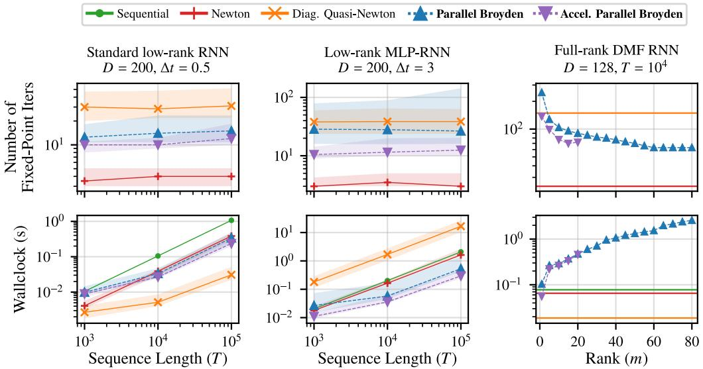  
Figure 1: Low-rank and full-rank RNNs. Left, middle: Standard $( \Delta t = 0 . 5 )$ and MLP $( \Delta t = 3 )$ low-rank RNNs $( R = 3 , D = 2 0 0 )$ ), as T varies. In both, iteration counts are ordered as diagonal quasi-Newton > Parallel Broyden > Accelerated Parallel Broyden > Newton. This ordering translates into runtime only when Jacobian information is expensive (MLP-RNN). Right: Full-rank DMF RNN $( D = 1 2 8 , T = \overset { \cdot } { 1 0 ^ { 4 } } )$ as the Broyden rank m varies. Methods without a rank parameter are shown as horizontal lines. Accelerated Parallel Broyden is shown only up to $m = 2 0$ , as for larger m it becomes numerically unstable or fails to converge. Larger m reduces iterations but increases runtime. We report median iteration counts and runtimes with interquartile ranges over 32 random realizations. Runtimes are computed over realizations that converged within the 1000 iterations budget.

We assess convergence and runtime on 32 random realizations as we vary the trajectory length T (Figure 1, left and middle). In both the standard and MLP models, iteration counts follow the same ordering at every T: diagonal quasi-Newton > Parallel Broyden > Accelerated Parallel Broyden > Newton. Both Broyden variants thus capture much of the off-diagonal coupling that diagonal quasi-Newton misses, and the multisecant updates of Accelerated Parallel Broyden capture it even more effectively. The gap between the two Broyden variants depends on the strength of the off-diagonal coupling relative to the diagonal. With $\Delta t = 0 . 5 ( a = 0 . 9 5 )$ , Parallel Broyden needs only 1.25–1.4 as many iterations as the accelerated variant. With $\Delta t = 3 \ : ( a = 0 . 7 )$ , it needs 2.1–2.7 as many, and it more often fails to converge within 1000 iterations (5 of 32 realizations vs. at most 1 of 32 for the accelerated variant). The same pattern holds for each model at both values of ∆t (Appendix F.1). Parallel Broyden therefore closes most of the gap with the accelerated variant when off-diagonal coupling is weak.

Whether this ordering carries over to runtime depends on the cost of Jacobian information. For the standard low-rank RNN, differentiating the dynamics is so cheap that diagonal quasi-Newton iterations take about 1 ms, compared with about 20 ms for Accelerated Parallel Broyden at $T = 1 0 0 \mathrm { K }$ Diagonal quasi-Newton is therefore the fastest method despite requiring 2–3 more iterations, running about $7 . 7 \times$ faster than Accelerated Parallel Broyden at $T = \bar { 1 } 0 0 \mathrm { K }$ . For the MLP-RNN, the per-iteration cost of both Broyden variants changes little, whereas diagonal quasi-Newton becomes about 400 more expensive per iteration, and Newton, whose cost is already dominated by its dense $D \times D$ scan, becomes 5–6 more expensive. The iteration ordering then translates directly into runtime, and Accelerated Parallel Broyden is the fastest method at every T. At $T = 1 0 0 \mathrm { K }$ , it is 7.0 faster than sequential evaluation, 5.5 faster than Newton, 1.8 faster than Parallel Broyden, and 56 faster than diagonal quasi-Newton.

Finally, we ask how our methods perform in an unfavorable case, where the Jacobian is far from DPLR. We consider a full-rank discretized mean-field (DMF) RNN [38], $x _ { t } = W \operatorname { t a n h } ( x _ { t - 1 } ) + \epsilon _ { t }$ with $W _ { i j } \sim \mathcal { N } ( 0 , g ^ { 2 } / D ) , g = 1 . 7$ , and $D = 1 2 8$ . Its Jacobian is dense with no dominant diagonal, and its singular values decay slowly rather than sharply (Appendix F.2). We sweep the Broyden rank m at $T = \mathrm { \bar { 1 0 K } }$ (Figure 1, right). Performance degrades gracefully: iteration counts fall steadily with m before plateauing, from 249 at $m = 1$ to 63 for $m \geq 6 0$ for Parallel Broyden, and from 138 to about 70 by $m = 1 5$ for the accelerated variant. The secant corrections therefore still capture real structure even when the spectrum does not decay sharply, and for $m \geq 5$ both variants need fewer iterations than diagonal quasi-Newton. Accelerated Parallel Broyden needs fewer iterations than Parallel Broyden at every rank where both are run, but it cannot use arbitrarily large m. Beyond $m = 2 0$ , we observed that the most recent m steps become nearly linearly dependent, so the Gram matrix of the multisecant update becomes ill-conditioned and the method becomes numerically very unstable. The question is whether the iterations saved by the secant corrections are worth their extra per-iteration cost. Because the per-iteration cost grows rapidly with $m ,$ , the modest reduction in iterations does not pay off: runtime increases with m, and for $m \geq 5$ both variants are slower than every baseline. The fastest Broyden configuration (accelerated, $m = 1 )$ is only 1.4 faster than sequential evaluation, while diagonal quasi-Newton is fastest (4.1 ). Parallel Broyden variants are thus most advantageous when a small rank already improves substantially on diagonal quasi-Newton, which happens when the off-diagonal part of the Jacobian has sharply decaying singular values, as in the low-rank RNN.

## 4.2 Gibbs sampling for hierarchical models

Recently, Zoltowski et al. [29] showed that parallel Newton methods can be applied to simulating Markov Chain Monte Carlo algorithms, leading to substantial improvements in runtime. We show that Parallel Broyden methods can further accelerate performance. We study the eight schools problem, a standard example in Bayesian hierarchical modeling [39, 40]. We observe test scores from $N$ students in each of S schools according to the hierarchical model,

$$
y _ { s , n } \mid \theta _ { s } , \sigma _ { s } ^ { 2 } \sim { \mathcal { N } } ( \theta _ { s } , \sigma _ { s } ^ { 2 } ) , \qquad \theta _ { s } \mid \mu , \tau ^ { 2 } \sim { \mathcal { N } } ( \mu , \tau ^ { 2 } ) .
$$

The model also has a global prior on $\mu , \tau ^ { 2 }$ , and $\sigma _ { s } ^ { 2 }$ . The state of the MCMC chain at iteration t is $x _ { t } = ( \theta _ { 1 : S , t } , \sigma _ { 1 : S , t } ^ { 2 } , \mathsf { \bar { \mu } } _ { t } , \tau _ { t } ^ { 2 } ) \overset { \cdot } { \in } \mathbb { R } ^ { 2 S + 2 }$ . A Gibbs sampler iteratively updates each state variable by sampling from its conditional distribution. Fixing the random numbers used in the conditional updates turns the sampler into a deterministic input-driven state-space model, $x _ { t + 1 } = f _ { t } ( x _ { t } )$ , where one transition corresponds to a full Gibbs sweep. Details are given in Appendix G.

This model provides a setting where the useful Jacobian structure is low-rank rather than diagonal. Cross-school coupling is mediated primarily by the two global variables $\mu$ and $\tau ^ { 2 }$ , which aggregate information from the school-level variables and broadcast it back through the conditional updates. Thus, the dominant off-diagonal structure has low effective rank, with rank two providing a natural approximation. Meanwhile, Gibbs updates resample variables from their conditional distributions, so the diagonal entries of the dynamics Jacobian are small (Appendix G). Motivated by this structure, we set the diagonal term to zero for Parallel Broyden variants and use rank $m = 2 .$ , matching the two global variables $( \mu , \tau ^ { 2 } )$ . In this purely low-rank setting, no rank compression is required.

We evaluate all methods on 32 random problem instances, each with independently sampled observations and initialization, as we vary the trajectory length T and state dimension $D = 2 S + 2 ( \mathrm { F i g u r e } 2 )$ The two baselines fail in opposite ways. Exact Newton captures the coupling and uses the fewest iterations, but its dense Jacobian cost grows cubically with $\bar { D _ { * } }$ and it runs out of memory at the largest settings. Diagonal quasi-Newton neglects the dominant hierarchical coupling, so it requires many more iterations, and since obtaining its exact diagonal still requires forming the full $D \times \bar { D }$ Jacobian, at $S \geq 1 0 0$ it is no faster than sequential evaluation. This cost can be avoided with the Hutchinson estimator [41], which estimates the diagonal from a few Jacobian-vector products without forming the Jacobian, as in recent quasi-Newton approaches for parallel MCMC [29]. Here, however, this estimate causes the iterations to fail to converge (Appendix G).

Both Parallel Broyden variants need fewer iterations than diagonal quasi-Newton in every setting, indicating that the low-rank secant corrections capture the cross-school coupling. Accelerated Parallel Broyden needs $2 . 3 – 4 . 2 \times$ fewer iterations still than Parallel Broyden and is the fastest approximate method throughout. Exact Newton remains fastest only for small problems $( \mathbf { e . g . } , S = 1 0$ with $T \le 5 0 \mathrm { K } )$ . Elsewhere, Accelerated Parallel Broyden is fastest overall, with an advantage that grows with T and D. $\mathbf { A } \mathbf { t } \ S = 1 0 0$ and $T = 1 0 0 \mathrm { K } .$ , it is $5 . 5 \times$ faster than exact Newton and $3 0 \times$ faster than sequential evaluation. $\mathbf { A } \mathbf { t } \ S = 2 0 0$ , both Broyden variants beat every baseline at every $T$ and remain applicable after exact Newton runs out of memory. $\begin{array} { r } { \mathrm { A t } T = 1 0 0 \mathrm { K } . } \end{array}$ , Accelerated Parallel Broyden is 24.7 faster than sequential evaluation and $4 1 \times$ faster than diagonal quasi-Newton.

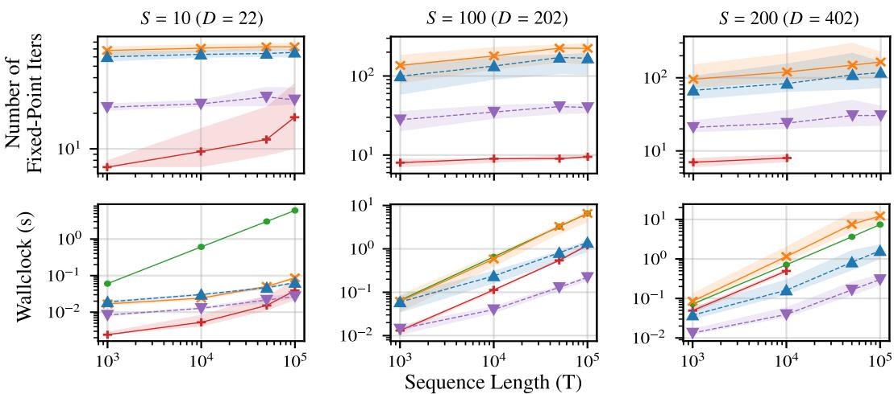  
Figure 2: Hierarchical Gibbs sampling. Across 32 problem instances, we report median iteration counts and runtimes with interquartile ranges as we vary trajectory length $T$ and state dimension $D = 2 S + 2$ . Parallel Broyden variants require fewer iterations than diagonal quasi-Newton by capturing low-rank hierarchical coupling. Accelerated Parallel Broyden is the fastest approximate method in every setting, and the fastest overall except for small problems (small S or short T). It also remains applicable at the largest settings, where exact Newton runs out of memory.

## 4.3 Denoising diffusion models

We finally consider parallelizing diffusion sampling with a pretrained DiT image denoiser, a transformer-based diffusion model over image patches [42]. We use DDIM sampling [9], which evolves a noisy latent toward a clean image through deterministic denoising updates

$$
s _ { t - 1 } = c _ { x } ( t ) s _ { t } + c _ { \epsilon } ( t ) \epsilon _ { \theta } ( s _ { t } , t ) .
$$

Re-indexing in forward time, we write this as a time-indexed state-space model $x _ { \ell } = f _ { \ell } ( x _ { \ell - 1 } )$ with $t = T - \ell + 1$ . The state dimension is $D = 4 0 9 6$ . The main challenge is Jacobian evaluation. The local dynamics Jacobian block is $\begin{array} { r } { A _ { \ell } ( x _ { \ell - 1 } ) = c _ { x } ( t ) I + c _ { \epsilon } ( t ) \frac { \partial \epsilon _ { \theta } } { \partial r } ( x _ { \ell - 1 } , t ) } \end{array}$ , so exact Newton would require differentiating through the full DiT denoiser at each time step, which is prohibitively expensive at this scale. Since $\bar { A } _ { \ell }$ is moreover dominated by its diagonal (Appendix H.1), this benchmark tests whether a good approximation can be obtained without differentiating through the denoiser, rather than whether a richer one reduces iterations.

We compare against two recent parallel diffusion samplers. The first is Picard iteration [26], which corresponds in our formulation to using the identity local approximation $\widetilde { A } _ { \ell } = I _ { D } \left[ 2 2 \right]$ . The second eis ParaTAA [27], which uses multisecant conditions to approximate the full inverse residual Jacobian ${ \bf J } ^ { - 1 }$ . In contrast, Parallel Broyden approximates the local dynamics blocks Aℓ used in the scan. Implementation details and hyperparameter searches for all methods are given in Appendix H.

Figure 3 reports iteration counts and wall-clock runtimes for 50-step DDIM sampling with the pretrained DiT model, averaged over 32 images. Parallel Broyden and Accelerated Parallel Broyden converge in roughly the same number of outer iterations (14.9 on average), and diagonal quasi-Newton requires only slightly more (16.8), consistent with $A _ { \ell }$ being dominated by its diagonal. All three local dynamics-Jacobian methods require fewer iterations than Picard and ParaTAA, with Parallel Broyden reducing the mean iteration count by 1.21 relative to Picard and by 1.68 relative to ParaTAA. This supports approximating local dynamics Jacobian blocks directly rather than using either the identity local approximation or the inverse Jacobian of the full residual system.

A  
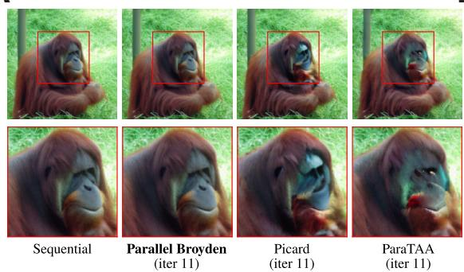

B  
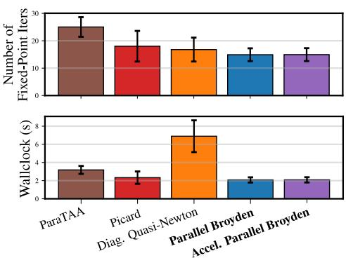  
Figure 3: DDIM sampling with a pretrained DiT denoiser. A: After 11 iterations, Parallel Broyden is visually indistinguishable from the sequential reference, while ParaTAA and Picard have not fully converged (bottom: zoom on boxed region). B: Mean iteration counts and runtimes over 32 images $( \pm \ : \mathrm { s . d . } )$ . Local dynamics-Jacobian methods need fewer iterations than Picard and ParaTAA, and Parallel Broyden variants are the fastest parallel methods by avoiding differentiation through the denoiser.

The runtime comparison highlights the cost of obtaining the Jacobian approximation. Diagonal quasi-Newton estimates the diagonal of $A _ { \ell }$ with a single-probe Hutchinson estimator, which still requires one Jacobian-vector product through the denoiser per time step and iteration, making it the slowest parallel method. Picard iteration avoids differentiation but needs more iterations. Parallel Broyden avoids both costs and achieves the fastest parallel runtime: 3.32 faster than diagonal quasi-Newton, 1.12 faster than Picard, and 1.53 faster than ParaTAA, with Accelerated Parallel Broyden performing similarly. Its advantage here therefore comes from avoiding automatic differentiation rather than from a richer Jacobian approximation. Upon convergence, all methods produce images that are visually indistinguishable from the sequential reference (Appendix H.6).

All parallel methods remain slower than sequential DDIM on a single H100 GPU, because evaluating the DiT denoiser across many timesteps in parallel quickly becomes FLOP-bound. Prior work therefore uses multiple GPUs to amortize these evaluations [26, 27], where fewer outer iterations directly mean fewer rounds of parallel denoiser evaluations.

## 5 Conclusion

We introduced Parallel Broyden, a family of Broyden-style quasi-Newton methods that build diagonalplus-low-rank approximations of local dynamics Jacobian blocks from trajectory secants. By avoiding automatic differentiation while remaining compatible with parallel scan through rank compression, Parallel Broyden provides a more scalable alternative to exact parallel Newton in high dimensions and a richer approximation class than diagonal quasi-Newton methods. We proved finite-step recovery under the compressed scan, and showed that convergence is tracked by the compression error and by the block approximation error along the current trajectory error, rather than in spectral norm.

In our experiments, Parallel Broyden reduces iterations relative to diagonal quasi-Newton when coupling is approximately low rank, and improves runtime when dense Jacobian operations or automatic differentiation are costly. The multisecant Accelerated Parallel Broyden variant is often strongest, consistent with its observed smaller block error along the current error near convergence.

Several limitations remain. Parallel Broyden is designed for dynamics whose dominant off-diagonal Jacobian structure can be captured with a small number of low-rank corrections. When accurate approximations require large rank, the advantage diminishes, as scan and compression costs grow with rank. Moreover, our convergence analysis is local and conservative. Relating block error along the current trajectory error to the secant updates is a natural next step. Beyond the settings studied here, DPLR structure also arises when a few global variables mediate interactions among many local ones, as in mean-field coupled oscillators, and Jacobian-free methods suit neural ODEs and black-box simulators, where Jacobians are costly or unavailable. These are promising applications for future work. More broadly, the compressed approximate scan applies to any DPLR block approximation, including autodiff-based sketches when differentiation is affordable.

## Acknowledgments

We thank Xavier Gonzalez and the other members of the Linderman Lab for helpful feedback through out this project, and Leo Kozachkov for valuable insights into the asymptotic theory of Newton’s method. S.W.L. is supported by grants from the NIH (U01NS136507, R01NS131987, RF1MH133778, R01AG097491, & R01NS130789), the NSF (2440859), and the Simons and McKnight Foundations.

## References

[1] Ashish Vaswani, Noam Shazeer, Niki Parmar, Jakob Uszkoreit, Llion Jones, Aidan N Gomez, Łukasz Kaiser, and Illia Polosukhin. Attention is all you need. Advances in neural information processing systems, 30, 2017.

[2] Albert Gu, Karan Goel, and Christopher Ré. Efficiently modeling long sequences with structured state spaces. arXiv preprint arXiv:2111.00396, 2021.

[3] Albert Gu. Modeling sequences with structured state spaces. Stanford University, 2023.

[4] Jimmy TH Smith, Andrew Warrington, and Scott W Linderman. Simplified state space layers for sequence modeling. arXiv preprint arXiv:2208.04933, 2022.

[5] Eric Martin and Chris Cundy. Parallelizing linear recurrent neural nets over sequence length. arXiv preprint arXiv:1709.04057, 2017.

[6] Alex Graves. Long short-term memory. Supervised sequence labelling with recurrent neural networks, pages 37–45, 2012.

[7] Kyunghyun Cho, Bart Van Merriënboer, Çaglar Gulçehre, Dzmitry Bahdanau, Fethi Bougares,˘ Holger Schwenk, and Yoshua Bengio. Learning phrase representations using rnn encoder– decoder for statistical machine translation. In Proceedings ofthe 2014 conference on empirical methods in natural language processing (EMNLP), pages 1724–1734, 2014.

[8] Ibomoiye Domor Mienye, Theo G Swart, and George Obaido. Recurrent neural networks: A comprehensive review of architectures, variants, and applications. Information, 15(9):517, 2024.

[9] Jiaming Song, Chenlin Meng, and Stefano Ermon. Denoising diffusion implicit models. arXiv preprint arXiv:2010.02502, 2020.

[10] Yang Song, Jascha Sohl-Dickstein, Diederik P Kingma, Abhishek Kumar, Stefano Ermon, and Ben Poole. Score-based generative modeling through stochastic differential equations. arXiv preprint arXiv:2011.13456, 2020.

[11] Tero Karras, Miika Aittala, Timo Aila, and Samuli Laine. Elucidating the design space of diffusion-based generative models. Advances in neural information processing systems, 35: 26565–26577, 2022.

[12] Jonathan Ho, Ajay Jain, and Pieter Abbeel. Denoising diffusion probabilistic models. Advances in neural information processing systems, 33:6840–6851, 2020.

[13] Stuart Geman and Donald Geman. Stochastic relaxation, gibbs distributions, and the bayesian restoration of images. IEEE Transactions on pattern analysis and machine intelligence, (6): 721–741, 1984.

[14] W Keith Hastings. Monte carlo sampling methods using markov chains and their applications. 1970.

[15] Nicholas Metropolis, Arianna W Rosenbluth, Marshall N Rosenbluth, Augusta H Teller, and Edward Teller. Equation of state calculations by fast computing machines. The journal of chemical physics, 21(6):1087–1092, 1953.

[16] Radford M Neal. Mcmc using hamiltonian dynamics. Handbook of markov chain monte carlo, pages 47–95, 2011.

[17] Gareth O Roberts and Jeffrey S Rosenthal. Optimal scaling of discrete approximations to langevin diffusions. Journal of the Royal Statistical Society: Series B (Statistical Methodology), 60(1):255–268, 1998.

[18] Yi Heng Lim, Qi Zhu, Joshua Selfridge, and Muhammad Firmansyah Kasim. Parallelizing non-linear sequential models over the sequence length. arXiv preprint arXiv:2309.12252, 2023.

[19] Federico Danieli, Miguel Sarabia, Xavier Suau Cuadros, Pau Rodriguez, and Luca Zappella. Deeppcr: Parallelizing sequential operations in neural networks. Advances in Neural Information Processing Systems, 36:47598–47625, 2023.

[20] Guy E Blelloch. Scans as primitive parallel operations. IEEE Transactions on computers, 38 (11):1526–1538, 1989.

[21] Xavier Gonzalez, Andrew Warrington, Jimmy T Smith, and Scott W Linderman. Towards scalable and stable parallelization of nonlinear rnns. Advances in Neural Information Processing Systems, 37:5817–5849, 2024.

[22] Xavier Gonzalez, E Kelly Buchanan, Hyun Dong Lee, Jerry Weihong Liu, Ke Alexander Wang, David M Zoltowski, Leo Kozachkov, Christopher Ré, and Scott W Linderman. A unifying framework for parallelizing sequential models with linear dynamical systems. arXiv preprint arXiv:2509.21716, 2025.

[23] Charles G Broyden. A class of methods for solving nonlinear simultaneous equations. Mathematics ofcomputation, 19(92):577–593, 1965.

[24] Charles George Broyden. The convergence of a class of double-rank minimization algorithms 1. general considerations. IMA Journal ofApplied Mathematics, 6(1):76–90, 1970.

[25] Jorge Nocedal. Updating quasi-newton matrices with limited storage. Mathematics of computation, 35(151):773–782, 1980.

[26] Andy Shih, Suneel Belkhale, Stefano Ermon, Dorsa Sadigh, and Nima Anari. Parallel sampling of diffusion models. Advances in Neural Information Processing Systems, 36:4263–4276, 2023.

[27] Zhiwei Tang, Jiasheng Tang, Hao Luo, Fan Wang, and Tsung-Hui Chang. Accelerating parallel sampling of diffusion models. In Forty-first International Conference on Machine Learning, 2024.

[28] Casian Iacob, Hassan Razavi, and Simo Särkkä. A parallel-in-time newton’s method-based ode solver. arXiv preprint arXiv:2511.01465, 2025.

[29] David M Zoltowski, Skyler Wu, Xavier Gonzalez, Leo Kozachkov, and Scott Linderman. Parallelizing MCMC across the sequence length. In The Thirty-ninth Annual Conference on Neural Information Processing Systems, 2025.

[30] Haw-ren Fang and Yousef Saad. Two classes of multisecant methods for nonlinear acceleration. Numerical linear algebra with applications, 16(3):197–221, 2009.

[31] Robert B Schnabel. Quasi-newton methods using multiple secant equations. Technical report, 1983.

[32] Rajarshi Saha, Varun Srivastava, and Mert Pilanci. Matrix compression via randomized low rank and low precision factorization. Advances in Neural Information Processing Systems, 36: 18828–18872, 2023.

[33] Rafi Witten and Emmanuel Candes. Randomized algorithms for low-rank matrix factorizations: sharp performance bounds. Algorithmica, 72(1):264–281, 2015.

[34] Xavier Gonzalez, Leo Kozachkov, David M Zoltowski, Kenneth L Clarkson, and Scott W Linderman. Predictability enables parallelization of nonlinear state space models. arXiv preprint arXiv:2508.16817, 2025.

[35] Matthijs Pals, A Erdem Sagtekin, Felix Pei, Manuel Gloeckler, and Jakob H Macke. Inferring˘ stochastic low-rank recurrent neural networks from neural data. Advances in Neural Information Processing Systems, 37:18225–18264, 2024.

[36] Friedrich Schuessler, Francesca Mastrogiuseppe, Alexis Dubreuil, Srdjan Ostojic, and Omri Barak. The interplay between randomness and structure during learning in rnns. Advances in neural information processing systems, 33:13352–13362, 2020.

[37] Francesca Mastrogiuseppe and Srdjan Ostojic. Linking connectivity, dynamics, and computations in low-rank recurrent neural networks. Neuron, 99(3):609–623, 2018.

[38] Rainer Engelken, Fred Wolf, and Larry F Abbott. Lyapunov spectra of chaotic recurrent neural networks. Physical Review Research, 5(4):043044, 2023.

[39] Donald B Rubin. Estimation in parallel randomized experiments. Journal of Educational Statistics, 6(4):377–401, 1981.

[40] Andrew Gelman, John B Carlin, Hal S Stern, and Donald B Rubin. Bayesian data analysis. Chapman and Hall/CRC, 1995.

[41] Michael F Hutchinson. A stochastic estimator of the trace of the influence matrix for laplacian smoothing splines. Communications in Statistics-Simulation and Computation, 18(3):1059– 1076, 1989.

[42] William Peebles and Saining Xie. Scalable diffusion models with transformers. In Proceedings of the IEEE/CVF international conference on computer vision, pages 4195–4205, 2023.

[43] Carl Eckart and Gale Young. The approximation of one matrix by another of lower rank. Psychometrika, 1(3):211–218, 1936.

[44] Leon Mirsky. Symmetric gauge functions and unitarily invariant norms. The quarterly journal ofmathematics, 11(1):50–59, 1960.

[45] W Daniel Hillis and Guy L Steele Jr. Data parallel algorithms. Communications of the ACM, 29(12):1170–1183, 1986.

[46] Richard Zhang, Phillip Isola, Alexei A Efros, Eli Shechtman, and Oliver Wang. The unreasonable effectiveness of deep features as a perceptual metric. In Proceedings of the IEEE conference on computer vision and pattern recognition, pages 586–595, 2018.

## A Overview of Parallel Broyden

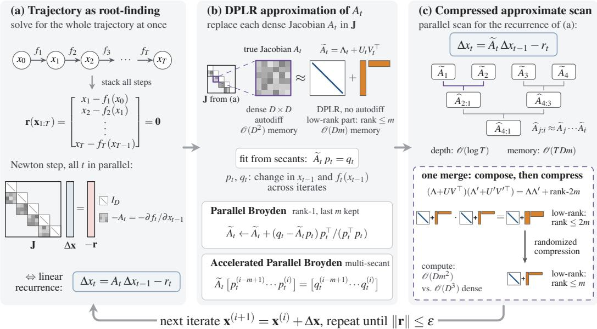

Figure 4: Overview of Parallel Broyden. (a) Evaluating the sequence is cast as solving $\mathbf { r } ( \mathbf { x } _ { 1 : T } ) = \mathbf { 0 }$ with $r _ { t } = x _ { t } - f _ { t } ( x _ { t - 1 } )$ . Each Newton step solves a block-bidiagonal system $\begin{array} { r } { \left[ \Delta \mathbf { x } = - \mathbf { \dot { r } } . \right. } \end{array}$ , which is equivalent to the linear recurrence $\Delta x _ { t } = A _ { t } \Delta x _ { t - 1 } - r _ { t }$ with Jacobians $A _ { t } = \partial f _ { t } / \partial x _ { t - 1 }$ . (b) Each dense Jacobian $A _ { t }$ is replaced by a diagonal-plus-low-rank (DPLR) matrix $\widetilde { A } _ { t } = \Lambda _ { t } + U _ { t } V _ { t } ^ { \top }$ with $\Lambda _ { t }$ diagonal and $\check { U } _ { t } , \check { V _ { t } } ^ { \ \bullet } \in \mathbb { R } ^ { D \times \check { m } }$ e. It is fitted without automatic differentiation from secants $p _ { t } = x _ { t - 1 } ^ { ( i + 1 ) } - x _ { t - 1 } ^ { ( i ) }$ and $q _ { t } = f _ { t } ( x _ { t - 1 } ^ { ( i + 1 ) } ) - f _ { t } ( x _ { t - 1 } ^ { ( i ) } )$ , either by rank-one Broyden updates (Parallel Broyden) or by fitting the last m secants jointly (Accelerated Parallel Broyden). (c) The recurrence is solved with a parallel scan over the $\widetilde { A } _ { t }$ . Each merge multiplies two DPLR matrices, which raises ethe rank of the low-rank part to at most 2m, then compresses it back to rank m with randomized compression, so $\widehat { A } _ { j : i } \approx \bar { \tilde { A } } _ { j } \cdot \cdot \cdot \widetilde { A } _ { i }$ . Each merge costs $\mathcal { O } ( D m ^ { 2 } )$ instead of $\mathcal { O } ( D ^ { 3 } )$ , giving ${ \mathcal { O } } ( \log T )$ depth and $\mathcal { O } ( T D m )$ e ememory. The iterate is updated as $\mathbf { x } ^ { ( i + 1 ) } = \mathbf { x } ^ { ( i ) } + \Delta \mathbf { x }$ until $\| \mathbf { r } \| \leq \epsilon$

## B Effect of rank compression

Our compressed approximate scan keeps diagonal-plus-low-rank (DPLR) factors at fixed rank by compressing the low-rank correction after each scan merge. This compression is necessary to prevent rank growth in long trajectories, but it also raises two questions. First, does compression preserve the finite-step trajectory recovery property of scan-based Newton methods? Second, how does the chosen compression rank affect convergence and runtime in practice?

We address these questions in three steps. First, we prove that finite-step trajectory recovery is preserved under the compressed approximate scan. Second, we describe two compression schemes: an exact small-SVD compression and a randomized factorized compression that avoids forming dense matrices. Third, we empirically study how the compression rank affects convergence and runtime on the low-rank RNN benchmark.

## B.1 Proof of Theorem 1

Theorem 1 (Global convergence with approximate scan). Startingfrom any initial trajectory $\mathbf { x } _ { 1 : T } ^ { ( 0 ) }$ after i iterations using the approximate parallel scan with low-rank compression, we have $x _ { t } ^ { ( i ) } = x _ { t } ^ { \star }$ for all $t \leq i .$ . In particular, the method recovers the exact trajectory $\mathbf { x } _ { 1 : T } ^ { \star }$ in at most T iterations.

Proof. Recursion. At iteration $i ,$ let $\widetilde { A } _ { t } ^ { ( i ) }$ denote the approximate dynamics Jacobian block used in place of

$$
A _ { t } ^ { ( i ) } = \frac { \partial f _ { t } } { \partial x _ { t - 1 } } \left( x _ { t - 1 } ^ { ( i ) } \right) .
$$

The approximate Newton update solves the linear recurrence

$$
\Delta x _ { 1 } ^ { ( i + 1 ) } = - r _ { 1 } ( \mathbf { x } _ { 1 : T } ^ { ( i ) } ) , \qquad \Delta x _ { t } ^ { ( i + 1 ) } = \widetilde { A } _ { t } ^ { ( i ) } \Delta x _ { t - 1 } ^ { ( i + 1 ) } - r _ { t } ( \mathbf { x } _ { 1 : T } ^ { ( i ) } ) , \quad t > 1 .\tag{5}
$$

Compressed scan. Each position t is represented by an affine summary

$$
( M _ { t } , c _ { t } ) , \qquad M _ { t } = \widetilde { A } _ { t } ^ { ( i ) } , \qquad c _ { t } = - r _ { t } ( { \bf x } _ { 1 : T } ^ { ( i ) } ) ,
$$

corresponding to the local update rule

$$
x \mapsto M _ { t } x + c _ { t } .
$$

The compressed scan combines two adjacent summaries $( M _ { a } , c _ { a } )$ and $( M _ { b } , c _ { b } )$ by

$$
( M _ { b } , c _ { b } ) \star ( M _ { a } , c _ { a } ) : = ( \mathrm { C o m p } ( M _ { b } M _ { a } ) , M _ { b } c _ { a } + c _ { b } ) ,\tag{6}
$$

where $\operatorname { C o m p } ( \cdot )$ denotes low-rank compression of the matrix part. Because of compression, this merge need not equal exact affine composition and need not be associative. The only property we use is that compression is applied only to the matrix component, while the offset component is updated by

$$
\begin{array} { r } { c _ { \mathrm { n e w } } = M _ { b } c _ { a } + c _ { b } . } \end{array}
$$

The scan returns, for each prefix 1:t, an affine summary

$$
( M _ { 1 : t } , c _ { 1 : t } ) ,
$$

obtained from the leaf summaries by a binary tree of merges (6), each combining the summaries of two adjacent segments. This holds for standard scan algorithms, and we make no other assumption on the shape of the tree. The update is recovered from the returned offset:

$$
\Delta x _ { t } ^ { ( i + 1 ) } = c _ { 1 : t } .\tag{7}
$$

Induction. We prove by induction on i that

$$
x _ { t } ^ { ( i ) } = x _ { t } ^ { \star } \qquad { \mathrm { f o r ~ a l l ~ } } t \leq i .
$$

Initialization. Since $x _ { 0 }$ and $f _ { 1 }$ are fixed, $x _ { 1 } ^ { \star } = f _ { 1 } ( x _ { 0 } )$ . The prefix at position 1 is a leaf, so no merge or compression is applied and

$$
\Delta x _ { 1 } ^ { ( 1 ) } = c _ { 1 } = - r _ { 1 } ( \mathbf { x } _ { 1 : T } ^ { ( 0 ) } ) = - \big ( x _ { 1 } ^ { ( 0 ) } - f _ { 1 } ( x _ { 0 } ) \big ) .
$$

Therefore

$$
x _ { 1 } ^ { ( 1 ) } = x _ { 1 } ^ { ( 0 ) } + \Delta x _ { 1 } ^ { ( 1 ) } = f _ { 1 } ( x _ { 0 } ) = x _ { 1 } ^ { \star } .
$$

Inductive step. Assume that

$$
x _ { t } ^ { ( i ) } = x _ { t } ^ { \star } \qquad { \mathrm { f o r ~ a l l ~ } } t \leq i .
$$

Then for every $t \leq i ,$

$$
r _ { t } ( \mathbf { x } _ { 1 : T } ^ { ( i ) } ) = x _ { t } ^ { ( i ) } - f _ { t } ( x _ { t - 1 } ^ { ( i ) } ) = x _ { t } ^ { \star } - f _ { t } ( x _ { t - 1 } ^ { \star } ) = 0 .
$$

Hence the corresponding leaf offsets satisfy

$$
c _ { t } = - r _ { t } ( \mathbf { x } _ { 1 : T } ^ { ( i ) } ) = 0 \qquad { \mathrm { f o r ~ a l l } } t \leq i .
$$

Now consider any prefix contained entirely in $[ 1 , i ]$ . Every leaf in this prefix has zero offset. Moreover, if two summaries have zero offsets, then their compressed merge also has zero offset:

$$
c _ { a } = 0 , \quad c _ { b } = 0 \quad \Longrightarrow \quad c _ { \mathrm { n e w } } = M _ { b } c _ { a } + c _ { b } = 0 ,
$$

regardless of the compressed matrix part. By induction over the scan tree, every prefix summary over [1, t] with $t \leq i$ therefore has offset

$$
c _ { 1 : t } = 0 .
$$

Using (7), this gives

$$
\Delta x _ { t } ^ { ( i + 1 ) } = 0 \qquad \mathrm { f o r ~ a l l } \ t \leq i ,
$$

and hence

$$
\boldsymbol { x } _ { t } ^ { ( i + 1 ) } = \boldsymbol { x } _ { t } ^ { ( i ) } = \boldsymbol { x } _ { t } ^ { \star } \qquad \mathrm { f o r } \mathrm { a l l } t \leq i .
$$

It remains to show that state $i + 1$ is recovered. The scan may build the prefix $1 { : } i + 1$ from segments of any shape, so we prove a claim about every segment that the scan forms inside $[ 1 , i + 1 ]$

Claim. Let $( M , c )$ be the summary that the scan forms for a segment $\{ p , \ldots , q \}$ with $q \leq i + 1$ . Then $c = 0 \mathrm { i f } q \leq i .$ , and $c = c _ { i + 1 } \operatorname { i f } q = i + 1$

Proofofthe claim. By induction over the scan tree. For a leaf $\{ q \}$ , the offset is $c _ { q } .$ , which is 0 if $q \leq i$ and $c _ { i + 1 } \operatorname { i f } q = i + 1$ . Now consider a merge of a left segment $\boldsymbol { \dot { a } } = \{ p , \dots , m \}$ and a right segment $b = \{ \dot { m } { + } 1 , \dots , q \}$ . Since $m < q \leq i + 1$ , we have $m \leq i ,$ so $c _ { a } = 0$ by the inductive hypothesis. Hence

$$
c _ { \mathrm { n e w } } = M _ { b } c _ { a } + c _ { b } = c _ { b } ,
$$

whatever the compressed matrix $M _ { b }$ is. Segment b ends at q, so $c _ { b } .$ , and therefore $c _ { \mathrm { n e w } } .$ , is as claimed. Applying the claim to the prefix 1:i + 1 gives

$$
c _ { 1 : i + 1 } = c _ { i + 1 } = - r _ { i + 1 } ( \mathbf { x } _ { 1 : T } ^ { ( i ) } ) ,
$$

so, by (7),

$$
\Delta x _ { i + 1 } ^ { ( i + 1 ) } = - \big ( x _ { i + 1 } ^ { ( i ) } - f _ { i + 1 } ( x _ { i } ^ { ( i ) } ) \big ) .
$$

By the induction hypothesis, $x _ { i } ^ { ( i ) } = x _ { i } ^ { \star }$ , so

$$
\Delta x _ { i + 1 } ^ { ( i + 1 ) } = - \big ( x _ { i + 1 } ^ { ( i ) } - f _ { i + 1 } ( x _ { i } ^ { \star } ) \big ) = x _ { i + 1 } ^ { \star } - x _ { i + 1 } ^ { ( i ) } .
$$

Thus

$$
x _ { i + 1 } ^ { ( i + 1 ) } = x _ { i + 1 } ^ { ( i ) } + \Delta x _ { i + 1 } ^ { ( i + 1 ) } = x _ { i + 1 } ^ { \star } .
$$

Therefore, after iteration $i + 1$ , the first $i + 1$ states are exact. By induction, after i iterations we have $x _ { t } ^ { ( i ) } = x _ { t } ^ { \star }$ for all $t \leq i ,$ and the full trajectory is recovered in at most T iterations. □

## B.2 Compression schemes

During the compressed approximate scan, composing two rank-at-most m DPLR blocks produces a new DPLR block whose low-rank correction has rank at most 2m. Thus, after each merge, we need to compress a factorized correction

$$
\Delta = U V ^ { \top } , \qquad U , V \in \mathbb { R } ^ { D \times r } , \qquad r \leq 2 m ,
$$

back to rank at most m. We consider two compression schemes: an exact best-rank-m compression based on a small SVD, and a randomized factorized compression that avoids computing an SVD.

Exact compression via a small SVD. The exact compression computes the best rank-m approximation to $\bar { \Delta } = U V ^ { \top }$ in Frobenius norm. By the Eckart–Young–Mirsky theorem [43, 44], this approximation is obtained by truncating the singular value decomposition of ∆. Since ∆ has rank at most $r \leq 2 m$ , this SVD can be computed without forming the dense $D \times D$ matrix.

$$
U = Q _ { U } R _ { U } , \qquad V = Q _ { V } R _ { V }
$$

be thin QR decompositions, where

$$
Q _ { U } , Q _ { V } \in \mathbb { R } ^ { D \times r } , \qquad R _ { U } , R _ { V } \in \mathbb { R } ^ { r \times r } .
$$

Then

$$
\Delta = U V ^ { \top } = Q _ { U } R _ { U } R _ { V } ^ { \top } Q _ { V } ^ { \top } .
$$

Define the small core matrix

$$
C : = R _ { U } R _ { V } ^ { \top } \in \mathbb { R } ^ { r \times r } .
$$

We compute its SVD

$$
C = { \bar { U } } \Sigma { \bar { V } } ^ { \top } .
$$

Since $Q _ { U }$ and $Q _ { V }$ have orthonormal columns, this gives an SVD of the rank-r correction:

$$
\Delta = ( Q _ { U } \bar { U } ) \Sigma ( Q _ { V } \bar { V } ) ^ { \top } .
$$

Let $\bar { U } _ { m } , \bar { V } _ { m }$ denote the first m singular vectors and let $\Sigma _ { m }$ contain the top m singular values. The best rank-m approximation is therefore

$$
\Delta _ { m } = ( Q _ { U } \bar { U } _ { m } ) \Sigma _ { m } ( Q _ { V } \bar { V } _ { m } ) ^ { \top } .
$$

Equivalently, we store it in factored form as

$$
\Delta _ { m } = \widetilde U \widetilde V ^ { \top } , \qquad \widetilde U : = Q _ { U } \bar { U } _ { m } \Sigma _ { m } , \qquad \widetilde V : = Q _ { V } \bar { V } _ { m } .
$$

This compression is optimal among all rank-m approximations:

$$
\Delta _ { m } = \mathop { \mathrm { a r g } } _ { \mathrm { r a n k } ( B ) \leq m } \| \Delta - B \| _ { F } .
$$

The cost is dominated by the two thin QR decompositions and the small SVD. For $r \leq 2 m$ , the QR decompositions cost $\mathcal { O } ( \overline { { D r ^ { 2 } } } )$ , the core SVD costs $\mathcal { O } ( r ^ { 3 } )$ , and forming the compressed factors costs $\mathcal { O } ( D r m )$ . Thus the total cost is

$$
\mathcal { O } ( D m ^ { 2 } + m ^ { 3 } ) ,
$$

with memory $\mathcal { O } ( D m )$ for the compressed factors.

Randomized factorized compression. The randomized compression avoids the small SVD and compresses directly in factorized form. Given

$$
\Delta = U V ^ { \top } , \qquad U , V \in \mathbb { R } ^ { D \times r } , \qquad r \leq 2 m ,
$$

we draw a Gaussian test matrix

$$
\Omega \in \mathbb { R } ^ { D \times m }
$$

and form the sketch

$$
\begin{array} { r } { Y = \Delta \Omega = U ( V ^ { \top } \Omega ) \in \mathbb { R } ^ { D \times m } . } \end{array}
$$

We then compute a thin QR decomposition

$$
Y = Q R , \qquad Q \in \mathbb { R } ^ { D \times m } ,
$$

so that the columns of $Q$ approximate the dominant column space of $\Delta$ . Projecting $\Delta$ onto this subspace gives

$$
\Delta \approx Q Q ^ { \top } \Delta = Q ( Q ^ { \top } U ) V ^ { \top } .
$$

This can again be written as a rank-m factorization

$$
\begin{array} { r } { Q Q ^ { \top } \Delta = \widetilde U \widetilde V ^ { \top } , \qquad \widetilde U : = Q , \qquad \widetilde V : = V ( U ^ { \top } Q ) . } \end{array}
$$

Indeed,

$$
\widetilde { U } \widetilde { V } ^ { \top } = Q \big ( V ( U ^ { \top } Q ) \big ) ^ { \top } = Q ( Q ^ { \top } U ) V ^ { \top } = Q Q ^ { \top } U V ^ { \top } .
$$

The randomized scheme is not guaranteed to produce the exact best rank-m approximation, but it avoids the SVD and preserves the factorized representation throughout. Its cost is dominated by multiplying the factors against the sketch and orthonormalizing $\grave { Y . }$ Since $r \leq 2 m ,$ , forming $V ^ { \top } \dot { \Omega } .$ forming $Y = U ( V ^ { \top } \Omega )$ , computing the QR factorization of $Y _ { \textrm { \textrm { \textrm { \textrm { \textrm { \textrm { F } } } } } } }$ , and forming $\widetilde { V } = V ( U ^ { \top } Q )$ together cost

$$
\mathcal { O } ( D m ^ { 2 } ) ,
$$

up to lower-order $\mathcal { O } ( m ^ { 3 } )$ terms from the QR decomposition. The memory cost is $\mathcal { O } ( D m )$ for the compressed factors.

In the experiments, we use randomized compression by default because it is simple, factorized, and avoids dense matrix construction. The exact small-SVD compression provides a useful reference implementation and gives the optimal rank-m correction after each merge.

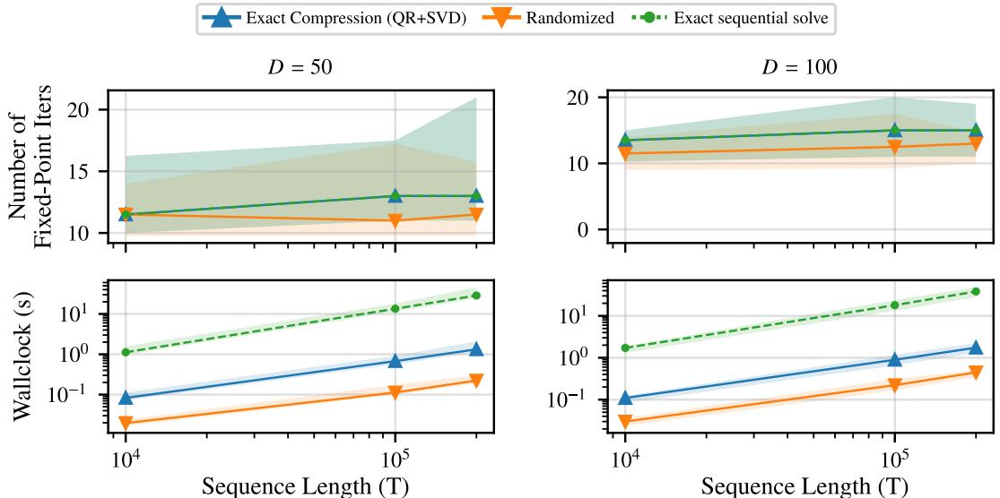  
Figure 5: Effect of compression on the low-rank RNN benchmark. We compare exact sequential forward substitution, compressed scan with exact QR+SVD rank compression, and compressed scan with randomized factorized compression. Points show medians over 32 random realizations, with error bars indicating interquartile ranges. All three variants require similar numbers of Newton iterations, indicating that compression does not materially degrade convergence. Randomized compression gives the lowest runtime by avoiding both sequential depth and the small SVDs used by exact compression.

## B.3 Empirical impact of compression

We study the effect of rank compression on the low-rank RNN benchmark using Accelerated Parallel Broyden. This experiment isolates the cost of solving the block-bidiagonal Newton system: all methods use the same multisecant Broyden block approximations and differ only in how the linearized recurrence is solved. We compare three variants. The first solves the recurrence by exact sequential forward substitution, which introduces no scan compression error but has linear depth in T. The second uses the compressed parallel scan with exact QR+SVD rank compression after each merge. The third uses the randomized factorized compression described above. We report median iteration counts and runtimes with interquartile ranges over 32 random realizations.

Figure 5 shows that compression has little effect on iteration counts. Exact sequential solution and QR+SVD compression have identical median iteration counts in all tested settings, confirming that the compressed scan preserves the relevant low-rank structure in this benchmark. The randomized compression has comparable, and sometimes slightly lower, iteration counts, with medians between roughly 11 and 13 iterations across all dimensions and horizons.

The main difference is runtime. Exact sequential forward substitution is much slower because it solves the linearized recurrence with linear depth in T. At D = 100 and $T = 2 0 0 \mathrm { K }$ , exact QR+SVD compression is 22.0 faster than the exact sequential solve, and randomized compression is 85.6 faster. Randomized compression is also 3.9 faster than exact QR+SVD compression in this setting. Thus, in this experiment, rank compression enables the scan to retain the convergence behavior of the exact linear solve while giving substantial runtime gains, and the randomized scheme provides the best practical tradeoff.

## B.4 Choice of parallel scan tree

The parallel scan composes the affine maps $x \mapsto \widetilde { A } _ { t } x + c _ { t }$ along a binary tree. With exact composition, ethe operator is associative and every tree gives the same result. With DPLR blocks, however, each composition of two rank-m blocks is compressed back to rank m with a randomized sketch, so the combine operation is only approximately associative, and the result depends on which products are formed and compressed. We compare two standard trees. The Blelloch scan [20] is work-efficient. An up-sweep builds the products of contiguous blocks of $2 ^ { k }$ steps, and a down-sweep distributes them to all prefixes, for $O ( T )$ compositions and depth about $2 \log _ { 2 } T$ . The Hillis–Steele scan [45] instead updates every prefix at each of its $\log _ { 2 } T$ levels by composing it with the prefix $2 ^ { k }$ steps earlier, for $O ( T \log { \dot { T } } )$ compositions and depth $\log _ { 2 } T$ . The two trees therefore differ in the number and order of compressions applied to each prefix product. All other experiments in this paper use the Blelloch-type scan implemented by jax.lax.associative\_scan.

To check that our results do not depend on this choice, we ran both variants of Parallel Broyden on the low-rank RNNs with the settings of Appendix F.1 and both scan trees, in float64 since only iteration counts are compared. The two trees also draw different random sketches, so the comparison includes both effects. The choice of tree has no meaningful effect on convergence (Table 2). Median iteration counts agree in 21 of 24 settings and differ by at most half an iteration otherwise, and the number of converged chains is identical in every setting. At the level of individual chains, 80% of chains take exactly the same number of iterations under both trees, and among chains that converge under both, 94% are within 5 iterations. The mean relative difference of $3 . { \bar { 7 } } \%$ comes from a few chains close to the convergence boundary.

Table 2: Effect of the scan tree on iteration counts (low-rank RNNs, $D = 2 0 0 , \mathtt { f l o a t } 6 4 )$ . Median iterations over 32 chains with the Blelloch (B) and Hillis–Steele (HS) scans, with non-converged chains counted at the 1000-iteration cap.
<table><tr><td></td><td></td><td></td><td colspan="2">PB</td><td colspan="2">Accel. PB</td></tr><tr><td>Model</td><td> $\Delta t$ </td><td>T</td><td>B</td><td>HS</td><td>B</td><td>HS</td></tr><tr><td>Standard</td><td>0.5</td><td> $1 0 ^ { 3 }$ </td><td>13</td><td>13</td><td>9</td><td>9</td></tr><tr><td></td><td></td><td> $1 0 ^ { 4 }$ </td><td>15</td><td>15</td><td>11</td><td>11</td></tr><tr><td></td><td></td><td> $1 0 ^ { 5 }$ </td><td>14</td><td>14</td><td>12.5</td><td>13</td></tr><tr><td></td><td>3</td><td> $1 0 ^ { 3 }$ </td><td>25</td><td>25</td><td>11</td><td>11</td></tr><tr><td></td><td></td><td> $1 0 ^ { 4 }$ </td><td>26</td><td>26</td><td>12</td><td>12</td></tr><tr><td></td><td></td><td> $1 0 ^ { 5 }$ </td><td>26</td><td>26</td><td>13.5</td><td>13.5</td></tr><tr><td>MLP</td><td>0.5</td><td> $1 0 ^ { 3 }$ </td><td>13</td><td>13</td><td>10</td><td>10</td></tr><tr><td></td><td></td><td> $1 0 ^ { 4 }$ </td><td>14</td><td>14</td><td>10.5</td><td>11</td></tr><tr><td></td><td></td><td> $1 0 ^ { 5 }$ </td><td>14.5</td><td>14.5</td><td>12</td><td>12</td></tr><tr><td></td><td>3</td><td> $1 0 ^ { 3 }$ </td><td>25</td><td>25</td><td>12</td><td>12</td></tr><tr><td></td><td></td><td> $1 0 ^ { 4 }$ </td><td>24</td><td>24</td><td>12</td><td>12</td></tr><tr><td></td><td></td><td> $1 0 ^ { 5 }$ </td><td>24.5</td><td>24.5</td><td>12</td><td>11.5</td></tr></table>

## C Convergence analysis of quasi-Newton updates with compressed scan

This appendix proves Theorem 2. We first fix notation and state the assumptions precisely, and give a sufficient condition in terms of the true dynamics (C.1). We then derive a one-step error bound for any scan of the form (6), which extends Proposition 3 of Gonzalez et al. [22] to compressed scans (C.2). Next, we bound the compressed products used by the scan, which proves part (i) of the theorem (C.3). We then prove parts (ii) and (iii) in a general form that does not require $\lambda _ { c } < 0 ( \mathrm { C } . 4 )$ , and discuss consequences and limitations (C.5). Empirical measurements of the quantities in the theorem are reported in Appendix D.

Proof idea. The analysis follows Proposition 3 of Gonzalez et al. [22], which writes the error after an approximate Newton step as $\widetilde { \mathbf { J } } ^ { - 1 }$ applied to the block error $(  { \widetilde { \mathbf { J } } } -  { \mathbf { J } } ) e$ plus a second-order e eremainder. The key observation is that compression acts only on the matrix components of the scan elements, which do not depend on the residual, so the compressed step remains linear in the residual, $\Delta \mathbf { x } = - \mathbf { P _ { I } }$ , with P playing the role of $\widetilde { \mathbf { J } } ^ { - 1 }$ (Lemma 1). The one-step argument therefore carries over, with one additional term $\Gamma e .$ , where $\Gamma = I - \mathbf { P } \mathbf { \widetilde { J } }$ vanishes without compression (Lemma 2). Unlike Proposition 3, which bounds the block error by $\| \widetilde { \mathbf { J } } - \mathbf { J } \| _ { 2 }$ , we keep it applied to the current trajectory error, which gives $\rho .$ e The main new ingredient is bounding P and Γ: compressed products are not products of the blocks, so we expand them over the scan tree and control the relative compression error introduced at each merge (Lemma 3).

## C.1 Setting, notation, and assumptions

Iterates and errors. At iteration $i ,$ write $A _ { t } ^ { ( i ) } : = A _ { t } ( x _ { t - 1 } ^ { ( i ) } )$ for the exact dynamics Jacobian block and $\widetilde { A } _ { t } ^ { ( i ) }$ for the approximate block used by the solver (for Parallel Broyden, the damped block of eAppendix E.4). The trajectory error is $e ^ { ( i ) } : = \mathbf { x } _ { 1 : T } ^ { ( i ) } - \mathbf { x } _ { 1 : T } ^ { \star }$ , with blocks $e _ { t } ^ { ( i ) } = x _ { t } ^ { ( i ) } - x _ { t } ^ { \star } \in \mathbb { R } ^ { D }$ and $e _ { 0 } ^ { ( i ) } = 0$ since $x _ { 0 }$ is fixed. We write $\mathbf { J } ^ { ( i ) } : = \mathbf { J } ( \mathbf { x } _ { 1 : T } ^ { ( i ) } )$ and $\widetilde { \mathbf { J } } ^ { ( i ) }$ for the exact and approximate eresidual Jacobians. When the iteration index is clear, we drop the superscript (i). We analyze full steps $\mathbf { x } ^ { ( i + 1 ) } = \mathbf { x } ^ { ( i ) } + \Delta \mathbf { x } ^ { ( i + 1 ) }$ . See Appendix C.5 for damped steps.

Per-step norm. For $v = ( v _ { 1 } , \dots , v _ { T } ) \in \mathbb { R } ^ { T D }$ with $\boldsymbol { v } _ { t } \in \mathbb { R } ^ { D }$ , define

$$
\| v \| _ { \infty } : = \operatorname* { m a x } _ { 1 \leq t \leq T } \| v _ { t } \| _ { 2 } .
$$

For a block matrix $\begin{array} { r l r } { M } & { { } \in } & { \mathbb { R } ^ { T D \times T D } } \end{array}$ with blocks $M _ { t , s } \in \mathrm { ~ \mathbb ~ { ~ R ~ } ~ } ^ { D \times D } ,$ , let $\begin{array} { r l } { \| M \| _ { \infty } } & { { } : = } \end{array}$ $\scriptstyle \operatorname* { s u p } _ { v \neq 0 } \| M v \| _ { \infty } / \| v \| _ { \infty }$ be the induced norm. Since $\begin{array} { r } { \| ( M v ) _ { t } \| _ { 2 } \leq \sum _ { s } \| M _ { t , s } \| _ { 2 } \| v _ { s } \| _ { 2 } } \end{array}$

$$
\| M \| _ { \infty } \leq \operatorname* { m a x } _ { t } \sum _ { s } \| M _ { t , s } \| _ { 2 } .\tag{8}
$$

We use this norm rather than the Euclidean norm on $\mathbb { R } ^ { T D }$ used by Gonzalez et al. [22]: for bounded states, $\| e ^ { ( 0 ) } \| _ { \infty }$ does not grow with $T ,$ , whereas $\| e ^ { ( 0 ) } \| _ { 2 }$ typically grows like $\sqrt { T }$ , which would make the region of convergence shrink artificially with T.

Geometric sums. For $\mu \in \mathbb { R } .$ , define

$$
S _ { T } ( \mu ) : = \sum _ { n = 0 } ^ { T - 1 } e ^ { \mu n } , \qquad \mathrm { s o ~ t h a t } \qquad S _ { T } ( \mu ) \leq { \frac { 1 } { 1 - e ^ { \mu } } } { \mathrm { ~ i f ~ } } \mu < 0 , \qquad S _ { T } ( 0 ) = T .
$$

$S _ { T }$ is increasing in $\mu ,$ and for $\mu > 0$ it grows like $e ^ { \mu T }$

Compressed scan. As in Appendix B.1, position t is represented by the leaf summary $( \widetilde { A } _ { t } , c _ { t } )$ with $c _ { t } = - r _ { t } ( \mathbf { x } _ { 1 : T } ^ { ( i ) } )$ , summaries of adjacent segments are combined by the merge (6),

$$
( M _ { b } , c _ { b } ) \star ( M _ { a } , c _ { a } ) = \bigl ( \mathrm { C o m p } ( M _ { b } M _ { a } ) , M _ { b } c _ { a } + c _ { b } \bigr ) ,
$$

and the update is read off the prefix offsets, $\Delta x _ { t } ^ { ( i + 1 ) } = c _ { 1 : t }$ . We assume that each prefix summary returned by the scan is obtained from the leaf summaries by a binary tree of such merges, each combining the summaries of two adjacent segments. This holds for standard scan algorithms. We call each merge a node $\nu .$ It covers a segment of consecutive time steps $\{ j { + } 1 , \ldots , k \}$ of length $| \nu | = k - j$ . At node $\nu ,$ the scan forms $X _ { \nu } : = \widehat { M } _ { \mathrm { r i g h t } } \widehat { M } _ { \mathrm { l e f t } }$ from the stored matrices of its two children and stores

$$
\widehat M _ { \nu } : = \mathrm { C o m p } ( X _ { \nu } ) = X _ { \nu } + \Delta _ { \nu } , \qquad \Delta _ { \nu } : = \mathrm { C o m p } ( X _ { \nu } ) - X _ { \nu } .
$$

Leaves are never compressed: the stored matrix of the leaf at t is $\widetilde { A } _ { t }$ . We write $\begin{array} { r l } { \prod _ { t , s } } & { { } : = } \end{array}$ $\widetilde { A } _ { t } \widetilde { A } _ { t - 1 } \cdot \cdot \cdot \widetilde { A } _ { s + 1 }$ for the exact product over $\{ s + 1 , \ldots , t \}$ , with $\Pi _ { t , t } = I $

Assumptions. All assumptions are imposed from some iteration $i _ { 0 } \geq 0$ onward, which allows for early transients.

Assumption 1 (Contraction of the approximate system). There exist $\tilde { a } \geq 1$ and $\tilde { \lambda } \in \mathbb { R }$ such that for every iteration $i \geq i _ { 0 }$ and all $0 \leq j < k \leq T$

$$
\bigl \| \widetilde { A } _ { k } ^ { ( i ) } \widetilde { A } _ { k - 1 } ^ { ( i ) } \cdot \cdot \cdot \widetilde { A } _ { j + 1 } ^ { ( i ) } \bigr \| _ { 2 } \leq \tilde { a } e ^ { \tilde { \lambda } ( k - j ) } .
$$

This is the predictability condition of Gonzalez et al. [34], applied to the approximate blocks the solver actually multiplies rather than to the true Jacobians. Only products of consecutive blocks are needed.

Assumption 2 (Lipschitz Jacobians). There exists $L \geq 0$ such that $\| A _ { t } ( x ) - A _ { t } ( y ) \| _ { 2 } \leq L \| x - y \| _ { 2 }$ 2 for all t and all $x , y \in \mathbb { R } ^ { D }$

Assumption 3 (Block error along the current trajectory error). There exists $\rho \geq 0$ such that $\rho _ { i } \le \rho$ for every iteration $i \geq i _ { 0 } ,$ , where

$$
\rho _ { i } : = \frac { \big \| \big ( \widetilde { \mathbf { J } } ^ { ( i ) } - \mathbf { J } ^ { ( i ) } \big ) e ^ { ( i ) } \big \| _ { \infty } } { \big \| e ^ { ( i ) } \big \| _ { \infty } } = \frac { \operatorname* { m a x } _ { t } \big \| \big ( \widetilde { A } _ { t } ^ { ( i ) } - A _ { t } ^ { ( i ) } \big ) e _ { t - 1 } ^ { ( i ) } \big \| _ { 2 } } { \big \| e ^ { ( i ) } \big \| _ { \infty } } ,
$$

with $\rho _ { i } : = 0 \mathrm { ~ } i f e ^ { ( i ) } = 0 .$

The quantity $\rho _ { i }$ measures the block error only along the current trajectory error. It satisfies $\rho _ { i } \leq$ $\sigma _ { i } : = \operatorname* { m a x } _ { t } \| \widetilde { A } _ { t } ^ { ( i ) } - A _ { t } ^ { ( i ) } \| _ { 2 }$ , the spectral-norm block error, and can be much smaller. Since it depends on $\mathbf { x } ^ { \star }$ e, it can only be measured a posteriori.

Assumption 4 (Relative compression error). There exists $\eta \geq 0$ such that at every iteration $i \geq i _ { 0 }$ and at every node $\nu ,$

$$
\| \Delta _ { \nu } \| _ { 2 } \leq \eta \tilde { a } e ^ { \tilde { \lambda } | \nu | } .
$$

By Assumption 1, the right-hand side bounds the size of the exact product over the segment of $\nu ,$ so Assumption 4 states that each merge loses at most a fraction η of the largest size this product can reach. It is implied by the stronger condition $\lVert \Delta _ { \nu } \rVert _ { 2 } \leq \eta \lVert \Pi _ { k , j } \rVert _ { 2 }$ . For truncated-SVD compression with fixed diagonal baseline $\gamma I , \| \Delta _ { \nu } \| _ { 2 }$ equals the largest discarded singular value of $X _ { \nu } - \gamma ^ { \left| \nu \right| } I$ , so Assumption 4 requires this value to be small. When rank is preserved under multiplication, as in the purely low-rank case $( \gamma = 0 )$ , no compression is needed and $\eta = 0$ . For randomized compression, we expect the assumption to hold approximately when the low-rank parts of the products have rapidly decaying spectra, but we do not prove this.

Effective Lyapunov exponent with compression. As in Theorem 2, define

$$
\lambda _ { c } : = \tilde { \lambda } + \log \left( 1 + \tilde { a } ^ { 2 } \eta \right) \geq \tilde { \lambda } ,
$$

with equality when $\eta = 0$

A sufficient condition from the true dynamics. Assumptions 1 and 3 follow from predictability of the true dynamics together with a bound on the spectral-norm block error.

Proposition 1 (Predictability and spectral-norm error). Suppose thatfor every iteration $i \geq i _ { 0 }$ and all $0 \leq j < k \leq T , \| A _ { k } ^ { ( i ) } \cdot \cdot \cdot A _ { i + 1 } ^ { ( i ) } \| _ { 2 } \leq a e ^ { \lambda ( k - j ) }$ with $a \ge 1$ , and that $\sigma _ { i } \leq \sigma$ . Then Assumption 1 holds with $\tilde { a } = a$ and $\widetilde { \lambda } = \log ( e ^ { \lambda } + a \sigma )$ , and Assumption 3 holds with $\rho = \sigma$

Proof. Write $\begin{array} { r } { \widetilde { A } _ { \ell } = A _ { \ell } + \delta _ { \ell } } \end{array}$ with $\| \delta _ { \ell } \| _ { 2 } \leq \sigma ,$ , and let $n = k - j$ . Expanding $\widetilde { A } _ { k } \cdot \cdot \cdot \widetilde { A } _ { j + 1 }$ gives a esum over subsets $S \subseteq \{ j + 1 , \dots , k \}$ indicating where a factor $\delta _ { \ell }$ replaces $A _ { \ell } .$ e. For $| S | = m ,$ the term consists of m factors $\delta _ { \ell }$ separated by at most m + 1 products of consecutive exact Jacobians, with total length $n - m$ , so its norm is at most $a ^ { m + 1 } e ^ { \lambda ( n - m ) } \sigma ^ { m }$ , using $a \geq 1$ . Summing over subsets,

$$
\left\| \widetilde { A } _ { k } \cdots \widetilde { A } _ { j + 1 } \right\| _ { 2 } \leq \sum _ { m = 0 } ^ { n } { \binom { n } { m } } a ^ { m + 1 } e ^ { \lambda ( n - m ) } \sigma ^ { m } = a { \left( e ^ { \lambda } + a \sigma \right) } ^ { n } .
$$

Finally, $\rho _ { i } \le \sigma _ { i } \le \sigma$

This condition is convenient but loose: in our experiments, the blocks are poor in spectral norm, so log $( e ^ { \lambda } + a \sigma ) > 0$ , while the approximate products do contract and $\rho _ { i }$ is small (Appendix D).

## C.2 One-step error bound for compressed scans

We first show that the compressed scan applies a linear operator to the residual, and identify its blocks.

Lemma 1 (Linear representation of the compressed scan). At each iteration, $\Delta \mathbf { x } ^ { ( i + 1 ) } = - \mathbf { P } \mathbf { r } ( \mathbf { x } _ { 1 : T } ^ { ( i ) } )$ where P is block lower triangular with blocks $P _ { t , s } \left( s \leq t \right)$ and $P _ { t , t } = I .$ . For $s < t ,$

$$
P _ { t , s } = \widehat { M } _ { G _ { r } } \cdot \cdot \cdot \widehat { M } _ { G _ { 1 } } ,
$$

where $G _ { 1 } , \ldots , G _ { r }$ are nodes or leaves whose segments partition $\{ s + 1 , \ldots , t \}$ into consecutive blocks, ordered in time. In particular, $P _ { t , t - 1 } = \widetilde { A } _ { t }$ . Without compression, $P _ { t , s } = \Pi _ { t , s } a n d \mathbf { P } = \widetilde { \mathbf { J } } ^ { - 1 }$

Proof. We show by induction over the merge tree that the offset of the summary of any segment $\begin{array} { r } { \{ p , \dotsc , q \} \operatorname { i s } \sum _ { s = p } ^ { q } { Q _ { s } c _ { s } } } \end{array}$ , where $Q _ { q } = I$ and, for $s < q , Q _ { s }$ is a product of stored matrices of nodes or leaves whose segments partition $\{ s + 1 , \ldots , q \}$ . For a leaf this holds with $Q _ { q } = I$ . For a merge of a left segment $a = \{ p , \ldots , m \}$ and a right segment $b = \{ m { + } 1 , \ldots , q \}$ , the new offset is $\widehat { M } _ { b } c _ { a } + c _ { b }$ Coefficients of leaves in b are unchanged, and coefficients of leaves $s \in a$ care multiplied on the left by $\widehat { M _ { b } }$ . Since the segment of b is $\{ m { + } 1 , \ldots , q \}$ and the inductive coefficient of s in a covers $\{ s + \dot { 1 } , \ldots , m \}$ , the product covers $\{ s { \mathrm { + } } 1 , \ldots , q \} .$ . Applying this to the tree of the prefix $\{ 1 , \ldots , t \}$ and using $\Delta x _ { t } ^ { ( i + 1 ) } = c _ { 1 : t }$ with $c _ { s } = - r _ { s }$ gives the claim. For $s = t - 1$ , the only partition of $\{ t \}$ is the leaf itself, so $P _ { t , t - 1 } = \widetilde { A } _ { t }$ . Without compression, every stored matrix is the exact product over its segment, so $P _ { t , s } = \Pi _ { t , s }$ e. These are exactly the blocks of $\widetilde { \mathbf { J } } ^ { - 1 }$ [22]. □

Lemma 1 also gives a direct proof of Theorem 1 for any scan tree: if $c _ { s } = 0$ for all $s \leq i$ , then $\begin{array} { r } { \Delta x _ { i + 1 } ^ { ( i + 1 ) } = \sum _ { s \leq i + 1 } P _ { i + 1 , s } c _ { s } = c _ { i + 1 } } \end{array}$ , since $P _ { i + 1 , i + 1 } = I ,$ regardless of compression.

We measure how far the compressed scan is from the exact inverse through the compression error $\mathbf { E } : = \mathbf { P } - \widetilde { \mathbf { J } } ^ { - 1 }$ , with blocks $\mathbf { E } _ { t , s } = P _ { t , s } - \Pi _ { t , s }$ , and the consistency defect

$$
\Gamma : = I - \mathbf { P } \widetilde { \mathbf { J } } .
$$

Lemma 2 (Structure of the consistency defect). Γ is strictly block lower triangular, with $\Gamma _ { t , t } =$ $\Gamma _ { t , t - 1 } = 0$ and, $f o r s < t ,$

$$
\Gamma _ { t , s } = P _ { t , s + 1 } \widetilde { A } _ { s + 1 } - P _ { t , s } .
$$

In particular, $\Gamma = 0$ without compression.

Proof. Write $\widetilde { \textbf { J } } = I - \widetilde { \textbf { N } }$ , where $\widetilde { \mathbf { N } }$ has blocks $ { \widetilde { A } } _ { u }$ at positions $( u , u - 1 )$ Then $( \mathbf { P } \widetilde { \mathbf { N } } ) _ { t , s } \ =$ $P _ { t , s + 1 } \widetilde { A } _ { s + 1 }$ efor $s < t$ e eand 0 otherwise, so $( \mathbf { P } \mathbf { \widetilde { J } } ) _ { t , s } = P _ { t , s } - P _ { t , s + 1 } \widetilde { A } _ { s + 1 }$ for $s < t ,$ and $P _ { t , t } = I$ for $s = t .$ e e. Subtracting from I gives the formula. For $s = t - 1 , P _ { t , t } \tilde { A } _ { t } - P _ { t , t - 1 } = \tilde { A } _ { t } - \tilde { A } _ { t } = 0$ by Lemma 1. Without compression, $P _ { t , s + 1 } \widetilde { A } _ { s + 1 } = \Pi _ { t , s + 1 } \widetilde { A } _ { s + 1 } = \Pi _ { t , s } = P _ { t , s }$ □

Proposition 2 (One-step bound with compressed scan). Under Assumption 2, at every iteration i,

$$
\begin{array} { r } { \| e ^ { ( i + 1 ) } \| _ { \infty } \leq \| \Gamma \| _ { \infty } \| e ^ { ( i ) } \| _ { \infty } + \| \mathbf { P } \| _ { \infty } \Big ( \rho _ { i } \| e ^ { ( i ) } \| _ { \infty } + \frac { L } { 2 } \| e ^ { ( i ) } \| _ { \infty } ^ { 2 } \Big ) . } \end{array}
$$

With an exact scan $( \mathbf { P } = \widetilde { \mathbf { J } } ^ { - 1 } , \Gamma = 0 )$ and $\rho _ { i }$ replaced by its upper bound $\sigma _ { i } ,$ this is Proposition 3 of eGonzalez et al. [22], stated in the per-step norm.

Proof. Drop the superscript (i) and let $e = e ^ { ( i ) }$ . Since $\mathbf { r } ( \mathbf { x } ^ { \star } ) = 0$ , for each $t \geq 2$

$$
r _ { t } ( \mathbf { x } ^ { ( i ) } ) = e _ { t } - \left( f _ { t } ( x _ { t - 1 } ^ { ( i ) } ) - f _ { t } ( x _ { t - 1 } ^ { \star } ) \right) = e _ { t } - A _ { t } e _ { t - 1 } + R _ { t } ,
$$

where, by Assumption 2 and Taylor’s theorem, $R _ { t } : = f _ { t } ( x _ { t - 1 } ^ { \star } ) - f _ { t } ( x _ { t - 1 } ^ { ( i ) } ) + A _ { t } e _ { t - 1 }$ satisfies $\begin{array} { r } { \| R _ { t } \| _ { 2 } \leq \frac { L } { 2 } \| e _ { t - 1 } \| _ { 2 } ^ { 2 } } \end{array}$ . Also $r _ { 1 } ( { \bf x } ^ { ( i ) } ) = e _ { 1 }$ . Hence $\mathbf { r } ( \mathbf { x } ^ { ( i ) } ) = \mathbf { J } e + R$ with $\begin{array} { r } { \| R \| _ { \infty } \leq \frac { L } { 2 } \| e \| _ { \infty } ^ { 2 } } \end{array}$ . The update $e ^ { ( i + 1 ) } = e - \mathbf { P r } ( \mathbf { x } ^ { ( i ) } )$ then gives

$$
e ^ { ( i + 1 ) } = ( I - { \bf P } { \bf J } ) e - { \bf P } R = \Gamma e + { \bf P } \big ( ( \widetilde { \bf J } - { \bf J } ) e - R \big ) .
$$

By definition of $\rho _ { i } , \| ( \widetilde { \mathbf { J } } - \mathbf { J } ) e \| _ { \infty } = \rho _ { i } \| e \| _ { \infty }$ . Taking norms concludes.

The proof applies $\widetilde { \mathbf { J } } - \mathbf { J }$ only to the current trajectory error, which is why the bound involves $\rho _ { i }$ rather ethan the spectral-norm error $\sigma _ { i }$

## C.3 Bounds on compressed products

The following lemma makes part (i) of Theorem 2 precise: while products of approximate blocks grow at most at rate $\tilde { \lambda }$ (Assumption 1), their compressed counterparts used by the scan grow at most at rate $\lambda _ { c }$

Lemma 3 (Compressed products). Under Assumptions 1 and 4, for every iteration $i \geq i _ { 0 }$ and all $s < t ,$ with $n = t - s ,$

$$
\begin{array} { r l } & { \| P _ { t , s } \| _ { 2 } \leq \tilde { a } e ^ { \tilde { \lambda } n } \big ( 1 + \tilde { a } ^ { 2 } \eta \big ) ^ { n - 1 } \leq \tilde { a } e ^ { \lambda _ { c } n } , } \\ & { \| P _ { t , s } - \Pi _ { t , s } \| _ { 2 } \leq \tilde { a } e ^ { \tilde { \lambda } n } \Big [ \big ( 1 + \tilde { a } ^ { 2 } \eta \big ) ^ { n - 1 } - 1 \Big ] \leq \tilde { a } \big ( e ^ { \lambda _ { c } n } - e ^ { \tilde { \lambda } n } \big ) . } \end{array}
$$

Proof. Expansion. For a node $\nu ,$ call a set S of nodes in the subtree of ν an antichain if no node in S is an ancestor of another. We claim that

$$
{ \widehat M } _ { \nu } = \sum _ { s } \Pi _ { \nu } ^ { ( S ) } ,
$$

where the sum is over antichains S in the subtree of $\nu ,$ and $\Pi _ { \nu } ^ { ( S ) }$ is the ordered product over the segment of ν in which the segment of each $\mu \in S$ is replaced by the single factor $\Delta _ { \mu }$ , and every remaining time step u contributes ${ \widetilde { A } } _ { u } .$ This holds for leaves (only $S = \emptyset )$ . For a node with children $l , r , \widehat { M } _ { \nu } = \widehat { M } _ { r } \widehat { M } _ { l } + \Delta _ { \nu }$ e. Expanding $\widehat { M _ { r } }$ and $\widehat { M _ { l } }$ by induction gives the sum over unions of antichains c c cof the two subtrees, and $\Delta _ { \imath }$ cis the term $S = \{ \nu \}$ . These are exactly the antichains of the subtree of $\nu .$ By Lemma 1, $P _ { t , s } = \widehat { M } _ { G _ { r } } \cdot \cdot \cdot \widehat { M } _ { G _ { 1 } }$ , so $P _ { t , s }$ expands as a sum over sets $S$ that are unions of antichains of the subtrees of $G _ { 1 } , \ldots , G _ { r }$ c. The term $\dot { S } = \emptyset \mathrm { i s } \Pi _ { t , s }$

Bounding each term. Fix S with $| S | = j$ . The corresponding term consists of the $j$ factors $\Delta _ { \mu } ,$ $\mu \in S$ , separated by at most $j + 1$ products of consecutive approximate blocks, with segment lengths summing to n. By Assumption 1, each product of consecutive approximate blocks of length ℓ has norm at most $\tilde { a } e ^ { \tilde { \lambda } \ell }$ (also for $\ell = 0$ , since $\tilde { a } \geq 1 )$ , and by Assumption $4 , \| \Delta _ { \mu } \| _ { 2 } \leq \eta \tilde { a } e ^ { \tilde { \lambda } | \mu | }$ . Hence the term has norm at most

$$
\tilde { a } ^ { j + 1 } ( \eta \tilde { a } ) ^ { j } e ^ { \tilde { \lambda } n } = \tilde { a } e ^ { \tilde { \lambda } n } \bigl ( \tilde { a } ^ { 2 } \eta \bigr ) ^ { j } .
$$

Counting. The subtrees of $G _ { 1 } , \ldots , G _ { r }$ contain $\begin{array} { r } { \sum _ { \ell } ( \vert G _ { \ell } \vert - 1 ) = n - r \le n - 1 } \end{array}$ nodes in total, so there are at most $\binom { n - 1 } { j }$ sets $S$ with $| S | = j$ . Summing over $j \geq 0$ gives the first bound, and summing over $j \geq 1$ gives the second. The final inequalities use $e ^ { \tilde { \lambda } n } ( 1 + \tilde { a } ^ { 2 } \eta ) ^ { n - 1 } \leq e ^ { \tilde { \lambda } n } ( 1 + \tilde { a } ^ { 2 } \eta ) ^ { n } = e ^ { \lambda _ { c } n } . \quad \bigsqcup$

Corollary 1 (Operator bounds). Under Assumptions 1 and 4, at every iteration $i \geq i _ { 0 }$

$$
\begin{array} { r l } { \| \widetilde { \mathbf { J } } ^ { - 1 } \| _ { \infty } \leq \widetilde { a } S _ { T } ( \widetilde { \lambda } ) , \qquad } & { \| \mathbf { P } \| _ { \infty } \leq \widetilde { a } S _ { T } ( \lambda _ { c } ) , } \\ { \| \mathbf { E } \| _ { \infty } \leq \widetilde { a } \big ( S _ { T } ( \lambda _ { c } ) - S _ { T } ( \widetilde { \lambda } ) \big ) , \qquad } & { \| \Gamma \| _ { \infty } \leq 2 \widetilde { a } \big ( S _ { T } ( \lambda _ { c } ) - S _ { T } ( \widetilde { \lambda } ) \big ) . } \end{array}
$$

If $\lambda _ { c } < 0 ;$ , then

$$
\| \mathbf { P } \| _ { \infty } \leq \frac { \tilde { a } } { 1 - e ^ { \lambda _ { c } } } , \qquad \| \Gamma \| _ { \infty } \leq \frac { 2 \tilde { a } ^ { 3 } \eta e ^ { \tilde { \lambda } } } { ( 1 - e ^ { \tilde { \lambda } } ) ( 1 - e ^ { \lambda _ { c } } ) } .
$$

Proof. We use the row-sum bound (8). In row t, the block in column s corresponds to $n = t - s \in$ $\{ 0 , \ldots , t - 1 \}$

For $\widetilde { \mathbf { J } } ^ { - 1 }$ , the blocks are $\Pi _ { t , s } ,$ and Assumption 1 gives $\begin{array} { r } { \sum _ { n = 0 } ^ { t - 1 } \tilde { a } e ^ { \tilde { \lambda } n } \le \tilde { a } S _ { T } ( \tilde { \lambda } ) } \end{array}$ , the diagonal term is $\| I \| _ { 2 } = 1 \le \tilde { a }$ . For P and E, use Lemma 3 in the same way. The diagonal blocks are I and 0 respectively.

For Γ, Lemma 2 gives $\Gamma _ { t , s } = 0$ for $n \leq 1$ . For $n \geq 2$ , since $\Pi _ { t , s + 1 } \widetilde { A } _ { s + 1 } = \Pi _ { t , s } ,$

$$
\Gamma _ { t , s } = \left( P _ { t , s + 1 } - \Pi _ { t , s + 1 } \right) \widetilde { A } _ { s + 1 } - \left( P _ { t , s } - \Pi _ { t , s } \right) .
$$

The second term is bounded by Lemma 3. For the first, expand $P _ { t , s + 1 } - \Pi _ { t , s + 1 }$ as in the proof of Lemma 3: each term has $j \geq 1$ factors $\Delta _ { \mu }$ over $\{ s + 2 , \ldots , t \}$ , and right-multiplying by $\widetilde { A } _ { s + 1 }$

only extends its last product of consecutive approximate blocks. Each term is therefore bounded by $\tilde { a } e ^ { \tilde { \lambda } n } ( \tilde { a } ^ { 2 } \eta ) ^ { j }$ , and there are at most $\binom { n - 2 } { j }$ of them, so this term is also bounded by $\tilde { a } ( e ^ { \lambda _ { c } n } - e ^ { \tilde { \lambda } n } )$ Hence $\| \Gamma _ { t , s } \| _ { 2 } \le 2 \tilde { a } ( e ^ { \lambda _ { c } n } - e ^ { \tilde { \lambda } n } )$ , and summing over n gives the bound.

If $\lambda _ { c } < 0$ , then $\tilde { \lambda } < 0$ as well. Since each term $e ^ { \lambda _ { c } n } - e ^ { \tilde { \lambda } n }$ is nonnegative,

$$
S _ { T } ( \lambda _ { c } ) - S _ { T } ( \tilde { \lambda } ) \le \frac { 1 } { 1 - e ^ { \lambda _ { c } } } - \frac { 1 } { 1 - e ^ { \tilde { \lambda } } } = \frac { e ^ { \lambda _ { c } } - e ^ { \tilde { \lambda } } } { ( 1 - e ^ { \lambda _ { c } } ) ( 1 - e ^ { \tilde { \lambda } } ) } = \frac { \tilde { a } ^ { 2 } \eta e ^ { \tilde { \lambda } } } { ( 1 - e ^ { \lambda _ { c } } ) ( 1 - e ^ { \tilde { \lambda } } ) } ,
$$

using $e ^ { \lambda _ { c } } = e ^ { \tilde { \lambda } } ( 1 + \tilde { a } ^ { 2 } \eta )$

## C.4 Proof of Theorem 2

We prove a general version that does not assume $\lambda _ { c } < 0$ . Theorem 2 is the special case $\lambda _ { c } < 0$ Theorem 3 (General form of Theorem 2). Let Assumptions 1–4 holdfrom iteration $i _ { 0 }$ onward, and define

$$
\begin{array} { r } { c _ { 0 } ^ { ( T ) } : = \tilde { a } \rho S _ { T } ( \lambda _ { c } ) + 2 \tilde { a } \bigl ( S _ { T } ( \lambda _ { c } ) - S _ { T } ( \tilde { \lambda } ) \bigr ) , \qquad c _ { 1 } ^ { ( T ) } : = { \textstyle { \frac { \tilde { a } L } { 2 } } } S _ { T } ( \lambda _ { c } ) . } \end{array}
$$

Then:

(i) For every iteration $i \geq i _ { 0 }$ and all $s < t , \| P _ { t , s } \| _ { 2 } \leq \tilde { a } e ^ { \lambda _ { c } ( t - s ) }$

(ii) For every iteration $i \geq i _ { 0 } , \| e ^ { ( i + 1 ) } \| _ { \infty } \leq \left( c _ { 0 } ^ { ( T ) } + c _ { 1 } ^ { ( T ) } \| e ^ { ( i ) } \| _ { \infty } \right) \| e ^ { ( i ) } \| _ { \infty }$

(iii) $I f c _ { 0 } ^ { ( T ) } < 1$ and $\| e ^ { ( i _ { 0 } ) } \| _ { \infty } < ( 1 - c _ { 0 } ^ { ( T ) } ) / c _ { 1 } ^ { ( T ) }$ , then $\| e ^ { ( i ) } \| _ { \infty } \leq q ^ { i - i _ { 0 } } \| e ^ { ( i _ { 0 } ) } \| _ { \infty } f o r a l l i \geq i _ { 0 }$ with $q : = c _ { 0 } ^ { ( T ) } + c _ { 1 } ^ { ( T ) } \lVert e ^ { ( i _ { 0 } ) } \rVert _ { \infty } < 1 .$

$I f \lambda _ { c } < 0 ,$ , then $c _ { 0 } ^ { ( T ) } \leq c _ { 0 }$ and $c _ { 1 } ^ { ( T ) } \leq c _ { 1 }$ , with c0 and $c _ { 1 }$ as in Theorem $^ { 2 , }$ which are independent of T.

## Proof. (i) This is Lemma 3.

(ii) Insert the bounds of Corollary 1 into Proposition 2, and use $\rho _ { i } \leq \rho \colon$

$$
\| e ^ { ( i + 1 ) } \| _ { \infty } \leq \left( 2 { \tilde { a } } \left( S _ { T } ( \lambda _ { c } ) - S _ { T } ( { \tilde { \lambda } } ) \right) + { \tilde { a } } S _ { T } ( \lambda _ { c } ) \rho + { \tilde { a } } S _ { T } ( \lambda _ { c } ) { \frac { L } { 2 } } \| e ^ { ( i ) } \| _ { \infty } \right) \| e ^ { ( i ) } \| _ { \infty } .
$$

(iii) We show by induction on $i \geq i _ { 0 }$ that $\| e ^ { ( i ) } \| _ { \infty } \leq \| e ^ { ( i _ { 0 } ) } \| _ { \infty }$ and $\| e ^ { ( i ) } \| _ { \infty } \leq q ^ { i - i _ { 0 } } \| e ^ { ( i _ { 0 } ) } \| _ { \infty }$ . Both hold for $i = i _ { 0 }$ . If they hold for i, then by (ii),

$$
\| e ^ { ( i + 1 ) } \| _ { \infty } \leq \big ( c _ { 0 } ^ { ( T ) } + c _ { 1 } ^ { ( T ) } \| e ^ { ( i _ { 0 } ) } \| _ { \infty } \big ) \| e ^ { ( i ) } \| _ { \infty } = q \| e ^ { ( i ) } \| _ { \infty } \leq q ^ { i + 1 - i _ { 0 } } \| e ^ { ( i _ { 0 } ) } \| _ { \infty } ,
$$

and since $q < 1$ , also $\| e ^ { ( i + 1 ) } \| _ { \infty } \leq \| e ^ { ( i _ { 0 } ) } \| _ { \infty }$ . The condition $q < 1$ is equivalent to $\| e ^ { ( i _ { 0 } ) } \| _ { \infty } <$ $( 1 - c _ { 0 } ^ { ( T ) } ) / c _ { 1 } ^ { ( T ) }$

Finally, if $\lambda _ { c } < 0$ , Corollary 1 gives

$$
c _ { 0 } ^ { ( T ) } \leq \frac { \tilde { a } \rho } { 1 - e ^ { \lambda _ { c } } } + \frac { 2 \tilde { a } ^ { 3 } \eta e ^ { \tilde { \lambda } } } { ( 1 - e ^ { \tilde { \lambda } } ) ( 1 - e ^ { \lambda _ { c } } ) } = c _ { 0 } , \qquad c _ { 1 } ^ { ( T ) } \leq \frac { \tilde { a } L } { 2 ( 1 - e ^ { \lambda _ { c } } ) } = c _ { 1 } .
$$

Since (ii) and (iii) remain valid when $c _ { 0 } ^ { ( T ) } , c _ { 1 } ^ { ( T ) }$ are replaced by the larger constants $c _ { 0 } , c _ { 1 }$ , this proves Theorem 2. □

## C.5 Consequences and limitations

Special cases.

• Exact Newton, exact scan $( \rho = \eta = 0 ) \colon c _ { 0 } = 0$ , and (ii) reads $\| e ^ { ( i + 1 ) } \| _ { \infty } \leq c _ { 1 } \| e ^ { ( i ) } \| _ { \infty } ^ { 2 }$ , i.e. local quadratic convergence.

• Approximate blocks, exact scan $( \eta = 0 ) \colon \Gamma = 0 , \lambda _ { c } = \tilde { \lambda }$ and $c _ { 0 } = \tilde { a } \rho / ( 1 - e ^ { \tilde { \lambda } } )$ . Compared with Proposition 3 of Gonzalez et al. [22], the inverse is bounded independently of $T _ { \ast }$ $\| \widetilde { \mathbf { J } } ^ { - 1 } \| _ { \infty } \le \widetilde { a } / ( 1 - e ^ { \widetilde { \lambda } } )$ , even when individual blocks satisfy $\| \widetilde { A } _ { t } \| _ { 2 } > 1$ , and the block error e eenters only along the current trajectory error. This case includes diagonal quasi-Newton.

• Exact blocks, compressed scan $\begin{array} { r } { ( \rho = 0 , \eta > 0 ) \colon c _ { 0 } = \frac { 2 \tilde { a } ^ { 3 } \eta e ^ { \tilde { \lambda } } } { ( 1 - e ^ { \tilde { \lambda } } ) ( 1 - e ^ { \lambda _ { c } } ) } > 0 , } \end{array}$ , so the bound guarantees only a linear rate, ${ \cal { O } } ( \eta )$

• Vanishing block error: if $\eta = 0$ and $\rho _ { i } \to 0$ , Proposition 2 gives a per-iteration factor $\begin{array} { r } { \| \mathbf { P } \| _ { \infty } ( \rho _ { i } + \frac { L } { 2 } \| e ^ { ( i ) } \| _ { \infty } )  0 , } \end{array}$ , i.e. superlinear convergence.

Dependence on T. If $\lambda _ { c } < 0$ , all constants are independent of T. If $\lambda _ { c } = 0$ , then $S _ { T } ( \lambda _ { c } ) = T$ , so $c _ { 0 } ^ { ( \bar { T } ) }$ and $c _ { 1 } ^ { ( T ) }$ grow linearly with T. If $\lambda _ { c } > 0$ , they grow like $e ^ { \lambda _ { c } T }$ . In both cases, $c _ { 0 } ^ { ( T ) } < $ 1 requires ρ and η to shrink with T, and the region $\| e ^ { ( i _ { 0 } ) } \| _ { \infty } < ( 1 - c _ { 0 } ^ { ( T ) } ) / c _ { 1 } ^ { ( T ) }$ shrinks with $T _ { \ast }$ , so the guarantee becomes uninformative for long sequences. For exact Newton on a chaotic system, this recovers the picture of Gonzalez et al. [34]: quadratic convergence holds, but only in a region whose size decays exponentially with $T .$

Iteration complexity. Under the conditions of (iii), $\| e ^ { ( i ) } \| _ { \infty } \leq \varepsilon$ as soon as

$$
i - i _ { 0 } \geq \frac { \log \left( \| e ^ { ( i _ { 0 } ) } \| _ { \infty } / \varepsilon \right) } { \log ( 1 / q ) } .
$$

When $\lambda _ { c } < 0$ and the states are bounded, this is independent of $T .$ . Since each iteration is a parallel scan of depth ${ \cal O } ( \log T )$ , this phase costs ${ \cal O } ( \log T )$ parallel depth. If accuracy is instead measured in the Euclidean norm over the whole trajectory, $\| e \| _ { 2 } \leq { \sqrt { T } } \| e \| _ { \infty }$ requires $\| e \| _ { \infty } \leq \varepsilon / \sqrt { T }$ , which adds ${ \scriptstyle { \frac { 1 } { 2 } } } \log T / \log ( 1 / q )$ iterations and gives $O ( \log ^ { 2 } T )$ ) depth, as in Gonzalez et al. [34].

Locality and damped steps. The result requires $\| e ^ { ( i _ { 0 } ) } \| _ { \infty } < ( 1 - c _ { 0 } ) / c _ { 1 }$ . We do not bound the number of iterations needed to reach such an iteration from an arbitrary initialization. Theorem 1 only guarantees that the error vanishes after at most $T$ iterations. When $L = 0$ (linear dynamics), $c _ { 1 } = 0$ and the condition reduces to $c _ { 0 } < 1$ . The analysis covers full steps. For a step scaled by $\alpha \in ( 0 , 1 ]$ $e ^ { ( i + 1 ) } = ( 1 - \alpha ) e ^ { ( i ) } + \alpha \left( e ^ { ( i ) } - \mathbf { P r } \right)$ , so the per-iteration factor becomes $1 - \alpha + \alpha ( c _ { 0 } + c _ { 1 } \| e ^ { ( i ) } \| _ { \infty } )$ which still contracts under the same conditions, more slowly. Iterations where a line search replaces the quasi-Newton step altogether are not covered.

Limitations. Theorem 2 applies to any approximate blocks satisfying Assumptions 1–4, which are imposed along the iterates. In particular, it does not show that the Broyden secant updates keep $\rho$ small enough for $c _ { 0 } < 1$ . It describes how convergence depends on the block approximation error, whatever its source. The quantity $\rho _ { i }$ depends on $\mathbf { x } ^ { \star }$ and can only be measured a posteriori. The constants are worst-case and, in our experiments, far from tight (Appendix D). The main slack comes from the row-sum bound (8), which adds the contributions of all upstream time steps as if they were aligned, and from the powers of ${ \tilde { a } } ,$ , which come from bounding each product of consecutive blocks separately. Finally, Assumption 4 is stated per merge. We do not relate $\eta$ to the compression rank m or to the spectrum of the dynamics Jacobians.

## D Empirical diagnostics of the convergence analysis

Theorem 2 measures block quality by the error along the current trajectory error, $\rho ,$ rather than by the spectral-norm error σ used in prior analyses [22]. Here we measure both, together with the other quantities in the theorem, along the iterates of the solvers. The main finding is that $\sigma$ does not track convergence while $\rho$ does.

## D.1 Setup

We use the low-rank RNNs of Appendix F.1 (standard and MLP variants, $D = 2 0 0 , \Delta t \in \{ 0 . 5 , 3 \} )$ and the hierarchical Gibbs sampler of Appendix $\mathrm { ~ G ~ } ( S \in \{ 1 0 , 5 0 , 1 0 0 \} , D = 2 S + 2 )$ , with $\dot { T } = 1 0 ^ { 3 }$ and 8 chains per method and setting. On the RNNs, we compare Accelerated Parallel Broyden, Parallel Broyden, and diagonal quasi-Newton. On the Gibbs sampler, we compare the two Broyden variants for $\mathsf { \bar { S } } \in \{ 1 0 , 5 0 \}$ , and run Accelerated Parallel Broyden alone for $\bar { S _ { \mathrm { ~ } } } = 1 0 0$ , with a single chain. All other settings (damping, rank, diagonal initialization, line search) are those of the main experiments.

At each iteration, we rebuild the blocks $\widetilde { A } _ { t } ^ { ( i ) }$ offline from the solver’s state. The rebuilt blocks ereproduce the solver’s steps to a median relative error below $4 { \cdot } 1 0 ^ { - 3 }$ . Iterations where the backtracking line search of Accelerated Parallel Broyden replaced the quasi-Newton step are excluded. Errors $e ^ { ( \bar { i } ) }$ are measured against the sequential trajectory. We record:

• the spectral-norm block error $\sigma _ { i } = \operatorname* { m a x } _ { t } \| \widetilde { A } _ { t } ^ { ( i ) } - A _ { t } ^ { ( i ) } \| _ { 2 }$

• the error-direction quantity $\rho _ { i }$ eof Assumption 3,

• the compression error at every merge of the scan tree,

• the per-iteration error ratio $\| e ^ { ( i + 1 ) } \| _ { \infty } / \| e ^ { ( i ) } \| _ { \infty } .$

We estimate $\tilde { a }$ and $\tilde { \lambda }$ by fitting Assumption 1 to the products over the segments of the merge tree, and compute η and the $\rho$ term of $c _ { 0 }$ at the replayed iterations. To isolate the effect of damping, we also evaluate $\sigma _ { i }$ and $\rho _ { i }$ with the undamped blocks along the same iterates.

## D.2 σ does not track convergence, $\rho$ does

Table 3 reports both measures of block quality at the last iteration.

Table 3: Spectral-norm block error $\sigma _ { i }$ and error-direction quantity $\rho _ { i }$ at the last iteration, and median iteration counts over the 8 diagnostic chains. Diagonal quasi-Newton was run on the RNNs only.
<table><tr><td>Setting</td><td>Method</td><td> $\sigma _ { i }$ </td><td> $\rho _ { i }$ </td><td>Iterations</td></tr><tr><td>Std RNN, ∆t = 0.5</td><td>Accel.</td><td>0.885</td><td>0.025</td><td>9</td></tr><tr><td></td><td>Broyden</td><td>0.885</td><td>0.057</td><td>13</td></tr><tr><td></td><td>Diag. QN</td><td>0.891</td><td>0.118</td><td>37.5</td></tr><tr><td>MLP RNN, ∆t = 0.5</td><td>Accel.</td><td>1.074</td><td>0.041</td><td>9.5</td></tr><tr><td></td><td>Broyden</td><td>0.991</td><td>0.044</td><td>12</td></tr><tr><td></td><td>Diag. QN</td><td>0.996</td><td>0.131</td><td>35</td></tr><tr><td>Std RNN, ∆t = 3</td><td>Accel.</td><td>5.32</td><td>0.076</td><td>9.5</td></tr><tr><td></td><td>Broyden</td><td>5.32</td><td>0.333</td><td>34†</td></tr><tr><td></td><td>Diag. QN</td><td>5.38</td><td>0.734</td><td>50.5</td></tr><tr><td>MLP RNN, ∆t = 3</td><td>Accel.</td><td>6.62</td><td>0.085</td><td>10.5</td></tr><tr><td></td><td>Broyden</td><td>6.62</td><td>0.320</td><td>38</td></tr><tr><td></td><td>Diag. QN</td><td>6.66</td><td>0.716</td><td>48.5</td></tr><tr><td>Gibbs, S = 10</td><td>Accel.</td><td>129.6</td><td>0.337</td><td>23</td></tr><tr><td></td><td>Broyden</td><td>129.6</td><td>0.907</td><td>58.5</td></tr><tr><td>Gibbs, S = 50</td><td>Accel.</td><td>73.5</td><td>0.172</td><td>27.5</td></tr><tr><td></td><td>Broyden</td><td>73.5</td><td>0.766</td><td>87.5</td></tr><tr><td>Gibbs, S = 100</td><td>Accel.</td><td>71.7</td><td>0.097</td><td>31</td></tr></table>

† 7 of 8 chains converged. All other settings 8/8.

The spectral-norm error is large and the same for all methods. At the last iteration, $\sigma _ { i }$ is about 0.9–1.1 for the RNNs at $\Delta t = \bar { 0 . 5 } , 5 . 3 – 6 . 6$ at $\Delta t = 3$ , and $7 2 \mathrm { - } 1 3 0$ for the Gibbs sampler. Relative to the true block, the error maxt $\lVert \widetilde { \boldsymbol { A } } _ { t } - \boldsymbol { A } _ { t } \rVert _ { 2 } / \lVert \boldsymbol { A } _ { t } \rVert _ { 2 }$ is about 0.54 at $\Delta t = 0 . 5 , 0 . 9 8$ at $\Delta t = 3$ , and eessentially 1 for the Gibbs sampler. Since $\sigma \geq 0 . 8 8$ in every setting, log $\zeta ( e ^ { \lambda } + a \sigma ) > 0$ , and the sufficient condition of Proposition 1 fails everywhere. More importantly, $\sigma _ { i }$ does not distinguish the methods: in every setting, it is nearly identical for Accelerated Parallel Broyden, Parallel Broyden, and diagonal quasi-Newton (within 9%, and within 1% outside the MLP RNN at $\Delta t = 0 . 5 )$ , although their iteration counts differ by up to $5 . 3 \times$ . This is expected: the worst-case error is set by the part of the off-diagonal coupling that each approximation misses in some direction. Diagonal quasi-Newton discards this coupling entirely, and rank-m secant information only corrects it along the directions the iterates have explored.

The block error along the current trajectory error is small and tracks convergence. In contrast, $\rho _ { i }$ is $7 - 7 4 0$ times smaller than $\sigma _ { i } .$ At the last iteration, the ordering of $\rho _ { i }$ matches the ordering of iteration counts in every setting: Accelerated Parallel Broyden has the smallest $\rho _ { i }$ and the fewest iterations, followed by Parallel Broyden and then diagonal quasi-Newton. The size of the gap also tracks convergence: the ratio of $\rho _ { i }$ between the two Broyden variants is 1.1 for the MLP RNN at $\Delta t = 0 . 5$ , where their iteration counts are close (9.5 versus 12), and 3.7–4.5 where Accelerated Parallel Broyden is 3–3.6 times faster.

Along the solve. Since the methods take different numbers of iterations, we also compare them on the RNNs at the same stage of the solve, by grouping iterations according to their root-mean-square residual (Table 4). Two conclusions hold at every stage. First, $\sigma _ { i }$ is the same for all three methods throughout: its relative value stays within about 0.02 across methods, at 0.53–0.62 for $\Delta t = 0 . 5$ and $0 . 9 7 { - } 0 . 9 9 $ for $\Delta t = 3$ . Second, diagonal quasi-Newton has the largest $\rho _ { i }$ at every stage, by a wide margin $( 0 . 1 3 \mathrm { - } 0 . 1 7 $ versus $0 . 0 5 \mathrm { - } 0 . { \bar { 1 0 } }$ for the Broyden variants at $\Delta t = 0 . 5 .$ , and $0 . 7 9 \mathrm { - } 0 . 9 1 $ versus 0.09–0.49 at $\Delta t = 3 )$ . The ordering between the two Broyden variants, however, emerges only near convergence. Early in the solve, the $\rho _ { i }$ of Accelerated Parallel Broyden is as large as that of Parallel Broyden or larger, and it drops clearly below only in the last decade of residual before the tolerance. This is consistent with the local nature of Theorem 2. It also means that $\rho _ { i }$ does not explain the advantage of Accelerated Parallel Broyden over the whole solve: part of this advantage comes from how quickly it reaches the regime of small $\rho _ { i }$ . Accelerated Parallel Broyden also shows transient spikes, with $\rho _ { i } > 1$ in 2–18% of iterations, which is why the assumptions are imposed only from some iteration $i _ { 0 }$ onward.

Table 4: Median $\rho _ { i }$ for the two Broyden variants on the RNNs at $\Delta t = 3 ,$ grouped by the root-meansquare residual $\| \mathbf { r } \| _ { 2 } / { \sqrt { T D } }$ . Ranges are over the standard and MLP models.
<table><tr><td>RMS residual</td><td> $\geq 1 0 ^ { - 1 }$ </td><td> $[ 1 0 ^ { - 2 } , 1 0 ^ { - 1 } )$ </td><td> $[ 1 0 ^ { - 3 } , 1 0 ^ { - 2 } )$ </td><td> $[ 1 0 ^ { - 4 } , 1 0 ^ { - 3 } )$ </td></tr><tr><td>Parallel Broyden</td><td>0.46</td><td>0.30</td><td>0.24–0.27</td><td> $0 . 2 3 \substack { - 0 . 2 7 }$ </td></tr><tr><td>Accelerated Parallel Broyden</td><td>0.48-0.49</td><td>0.36-0.40</td><td>0.19-0.29</td><td>0.09-0.11</td></tr></table>

## D.3 Damping reduces $\rho ,$ not σ

For Parallel Broyden, damping leaves $\sigma _ { i }$ essentially unchanged but lowers $\rho _ { i }$ in every setting, and nearly eliminates iterations with $\rho _ { i } > 1$ (Table 5). Damping therefore improves the blocks where it matters, which is consistent with its effect on robustness (Appendix E.4). For Accelerated Parallel Broyden, damping has little effect on $\rho _ { i } .$ , and the undamped value is often slightly smaller. For diagonal quasi-Newton, damping again leaves $\sigma _ { i }$ unchanged (6.66 versus 6.61 for the MLP RNN at $\bar { \Delta } t = 3 \bar { ) }$ but increases $\rho _ { i }$ (0.72 versus 0.22), as expected: it shrinks the blocks for stability rather than making them more accurate.

Table 5: Effect of damping on Parallel Broyden: $\sigma _ { i }$ and $\rho _ { i }$ at the last iteration and fraction of iterations with $\rho _ { i } > 1$ , with damped and undamped blocks along the same iterates.
<table><tr><td></td><td colspan="2"> $\sigma _ { i } ~ ( \mathrm { l a s t } )$ </td><td colspan="2"> $\rho _ { i } \ ( \mathrm { l a s t } )$ </td><td colspan="2">Frac.  $\rho _ { i } > 1$ </td></tr><tr><td>Setting</td><td>damped</td><td>undamped</td><td>damped</td><td>undamped</td><td>damped</td><td>undamped</td></tr><tr><td>Std RNN, ∆t = 0.5</td><td>0.885</td><td>0.885</td><td>0.057</td><td>0.066</td><td>0</td><td>0</td></tr><tr><td>MLP RNN, ∆t = 0.5</td><td>0.991</td><td>0.990</td><td>0.044</td><td>0.058</td><td>0</td><td>0</td></tr><tr><td>Std RNN, ∆t = 3</td><td>5.32</td><td>5.56</td><td>0.333</td><td>0.488</td><td>0</td><td>0.095</td></tr><tr><td>MLP RNN, ∆t = 3</td><td>6.62</td><td>6.62</td><td>0.320</td><td>0.537</td><td>0</td><td>0.034</td></tr><tr><td>Gibbs,  $S = 1 0$ </td><td>129.6</td><td>129.6</td><td>0.907</td><td>1.279</td><td>0.20</td><td>0.54</td></tr><tr><td>Gibbs, S = 50</td><td>73.5</td><td>73.5</td><td>0.766</td><td>0.885</td><td>0.05</td><td>0.31</td></tr></table>

## D.4 Other quantities in the theorem

The approximate system contracts. The fitted rates satisfy $\tilde { \lambda } ~ < ~ 0$ in every setting: $\tilde { \lambda } \in$ [ 0.031, 0.016] for the RNNs at $\Delta t = 0 . 5 , [ - 0 . 1 3 4 , - 0 . 0 3 \dot { 8 } ]$ at $\Delta t = 3 .$ , and $[ - 0 . 6 \bar { , } - 0 . 1 2 ]$ for the Gibbs sampler. Assumption 1 therefore holds even though its sufficient condition in terms of σ fails.

Compression errors are small. For the RNNs, with the rank-revealing randomized compression of Appendix F, η ranges from about $1 0 ^ { - 4 }$ to 0.11 across iterations. For the Gibbs sampler, the approximation is purely low rank, so no compression is required (Appendix G) and $\eta = 0$ in exact arithmetic. The measured values, between $4 { \cdot } 1 0 ^ { - 8 }$ and $4 { \cdot } 1 0 ^ { - 4 }$ , reflect floating-point error. Measuring the compression error relative to the exact product $\Vert \Pi _ { k , j } \Vert _ { 2 }$ instead would give spuriously large values on long segments whose exact product is numerically zero, which is why Assumption 4 uses the bound $\tilde { a } e ^ { \tilde { \lambda } | \nu | }$ . Consistent with Appendix B.3, the choice of compression scheme does not affect convergence.

## D.5 The constants are not tight

Table 6 compares the bound with the observed contraction. The $\rho$ term of $c _ { 0 }$ alone exceeds 1 in every setting, so the theorem does not certify the observed convergence. In addition, $\lambda _ { c } \geq 0$ at a substantial fraction of iterations for the RNNs, because the compression penalty $\log ( 1 + \tilde { a } ^ { 2 } \eta )$ is comparable to $| \tilde { \lambda } |$ at $\Delta t = 0 . 5$ and the fitted a˜ is large in early iterations of Accelerated Parallel Broyden. Convergence is also not monotone: the per-step error increases in 2–33% of iterations. Nevertheless, near convergence the error contracts by a factor of 0.30–0.95 per iteration, with the same ordering across methods as $\rho _ { i }$ . The main slack is the row-sum bound (8), which treats contributions from all upstream time steps as aligned. Since a˜ and $\tilde { \lambda }$ are fitted only on segments aligned with the merge tree, the true constants can only be larger, and the conclusion $c _ { 0 } > 1$ is unaffected. A bound in terms of σ instead of $\rho$ would be larger by the ratio $\sigma _ { i } / \rho _ { i }$ , which is 16–740 for the Broyden variants.

Table 6: The $\rho$ term of $c _ { 0 }$ (range over iterations with $\lambda _ { c } < 0 )$ , fraction of iterations with $\lambda _ { c } < 0$ observed contraction $\| e ^ { ( i + 1 ) } \| _ { \infty } / \| e ^ { ( i ) } \| _ { \infty }$ (median over the last three iterations), and fraction of iterations where the error increases.
<table><tr><td>Setting</td><td>Method</td><td>ρ term of  $c _ { 0 }$ </td><td>Frac.  $\lambda _ { c } < 0$ </td><td>Observed</td><td>Frac. increase</td></tr><tr><td rowspan="2">Std RNN, ∆t = 0.5</td><td>Accel.</td><td>10.7-45.3</td><td>0.83</td><td>0.35</td><td>0.18</td></tr><tr><td>Broyden</td><td>2.1-10.9</td><td>0.50</td><td>0.57</td><td>0.25</td></tr><tr><td rowspan="2">MLP RNN, ∆t = 0.5</td><td>Accel.</td><td>1.9-7.1</td><td>0.67</td><td>0.41</td><td>0.18</td></tr><tr><td>Broyden</td><td>6.1-20.9</td><td>0.50</td><td>0.61</td><td>0.17</td></tr><tr><td rowspan="2">Std RNN, ∆t = 3</td><td>Accel.</td><td>1.4-3.3</td><td>0.33</td><td>0.30</td><td>0.30</td></tr><tr><td>Broyden</td><td>4.1-10.8</td><td>1.00</td><td>0.72</td><td>0.33</td></tr><tr><td rowspan="2">MLP RNN, ∆t = 3</td><td>Accel.</td><td>1.7-4.6</td><td>0.33</td><td>0.39</td><td>0.28</td></tr><tr><td>Broyden</td><td>3.5-7.0</td><td>1.00</td><td>0.69</td><td>0.32</td></tr><tr><td rowspan="2">Gibbs, S = 10</td><td>Accel.</td><td>2.5-35.3</td><td>1.00</td><td>0.46</td><td>0.11</td></tr><tr><td>Broyden</td><td>1.6-124</td><td>1.00</td><td>0.81</td><td>0.22</td></tr><tr><td rowspan="2">Gibbs, S = 50</td><td>Accel.</td><td>1.5-6.8</td><td>1.00</td><td>0.54</td><td>0.02</td></tr><tr><td>Broyden</td><td>1.5-74.8</td><td>1.00</td><td>0.95</td><td>0.07</td></tr><tr><td>Gibbs, S = 100</td><td>Accel.</td><td>1.2–6.9</td><td>1.00</td><td>0.69</td><td>0.03</td></tr></table>

## D.6 Summary

The spectral-norm error σ is not the right measure of block quality: it is large, it is essentially the same for all three methods although their iteration counts differ by up to $5 . 3 \times$ , and damping leaves it unchanged although damping helps Parallel Broyden converge. The error along the current error, $\rho ,$ is the quantity that tracks convergence: it is 7–740 times smaller than σ, diagonal quasi-Newton has the largest $\rho$ at every stage of the solve, near convergence $\rho$ is ordered as Accelerated Parallel Broyden < Parallel Broyden $<$ diagonal quasi-Newton in every setting, matching their iteration counts, and damping reduces it. The approximate system contracts and compression errors are small. The theorem identifies this mechanism, but its constants are too conservative to certify the observed rates.

## E Broyden updates

This section gives the explicit blockwise Broyden updates used to construct the local dynamics Jacobian approximations in Section 3.1. We use the same notation as in the main text. After computing the iterate $\mathbf { x } _ { 1 : T } ^ { ( i + 1 ) }$ , for each time index t, define the trajectory secant

$$
p _ { t } ^ { ( i ) } : = x _ { t - 1 } ^ { ( i + 1 ) } - x _ { t - 1 } ^ { ( i ) }
$$

and the corresponding finite difference through the local dynamics map

$$
q _ { t } ^ { ( i ) } : = f _ { t } ( x _ { t - 1 } ^ { ( i + 1 ) } ) - f _ { t } ( x _ { t - 1 } ^ { ( i ) } ) .
$$

The goal is to update an approximation

$$
\widetilde { A } _ { t } ^ { ( i ) } \approx A _ { t } ^ { ( i ) } : = \frac { \partial f _ { t } } { \partial x _ { t - 1 } } \left( x _ { t - 1 } ^ { ( i ) } \right)
$$

using only the secant pair $( p _ { t } ^ { ( i ) } , q _ { t } ^ { ( i ) } )$ .

## E.1 Standard rank-one Broyden update

The standard Broyden update enforces the secant condition

$$
\begin{array} { r } { \widetilde A _ { t } ^ { ( i + 1 ) } p _ { t } ^ { ( i ) } = q _ { t } ^ { ( i ) } . } \end{array}\tag{9}
$$

Since this condition does not uniquely determine the full matrix $\widetilde A _ { t } ^ { ( i + 1 ) }$ , Broyden’s method chooses ethe update that is closest to the previous approximation in Frobenius norm:

$$
\widetilde { A } _ { t } ^ { ( i + 1 ) } = \arg \operatorname* { m i n } _ { A } \| A - \widetilde { A } _ { t } ^ { ( i ) } \| _ { F } \quad \mathrm { s . t . } \quad A p _ { t } ^ { ( i ) } = q _ { t } ^ { ( i ) } .\tag{10}
$$

Writing the update as $B = \widetilde { A } _ { t } ^ { ( i ) } + \Delta _ { t } ^ { ( i ) }$ , the constraint becomes

$$
\Delta _ { t } ^ { ( i ) } p _ { t } ^ { ( i ) } = q _ { t } ^ { ( i ) } - \widetilde { A } _ { t } ^ { ( i ) } p _ { t } ^ { ( i ) } .
$$

Let

$$
\begin{array} { r } { y _ { t } ^ { ( i ) } : = q _ { t } ^ { ( i ) } - \widetilde { A } _ { t } ^ { ( i ) } p _ { t } ^ { ( i ) } } \end{array}
$$

edenote the current secant residual. Then the least-change problem is

$$
\operatorname* { m i n } _ { \Delta } \| \Delta \| _ { F } \quad \mathrm { s . t . } \quad \Delta p _ { t } ^ { ( i ) } = y _ { t } ^ { ( i ) } .
$$

The minimum-norm solution is rank one:

$$
\Delta _ { t } ^ { ( i ) } = \frac { y _ { t } ^ { ( i ) } { p _ { t } ^ { ( i ) } } ^ { \top } } { { p _ { t } ^ { ( i ) } } ^ { \top } { p _ { t } ^ { ( i ) } } } .
$$

Thus the blockwise Broyden update is

$$
\boxed { \widetilde { A } _ { t } ^ { ( i + 1 ) } = \widetilde { A } _ { t } ^ { ( i ) } + \frac { \left( q _ { t } ^ { ( i ) } - \widetilde { A } _ { t } ^ { ( i ) } p _ { t } ^ { ( i ) } \right) { p _ { t } ^ { ( i ) } } ^ { \top } } { { p _ { t } ^ { ( i ) } } ^ { \top } p _ { t } ^ { ( i ) } } }\tag{11}
$$

Starting from a diagonal initialization

$$
\widetilde { A } _ { t } ^ { ( 0 ) } = D _ { t } ^ { ( 0 ) } , \qquad D _ { t } ^ { ( 0 ) } = \mathrm { d i a g } ( d _ { t } ^ { ( 0 ) } ) ,
$$

eeach update in (11) adds one rank-one correction. After i updates, the approximation can therefore be written as

$$
\widetilde { A } _ { t } ^ { ( i ) } = D _ { t } ^ { ( 0 ) } + U _ { t } ^ { ( i ) } { V _ { t } ^ { ( i ) } } ^ { \top } ,\tag{12}
$$

where the columns of $U _ { t } ^ { ( i ) }$ and $V _ { t } ^ { ( i ) }$ are the accumulated rank-one factors. In particular, if

$$
u _ { t } ^ { ( i ) } = q _ { t } ^ { ( i ) } - \widetilde { A } _ { t } ^ { ( i ) } p _ { t } ^ { ( i ) } , \qquad v _ { t } ^ { ( i ) } = \frac { p _ { t } ^ { ( i ) } } { { p _ { t } ^ { ( i ) } } ^ { \top } p _ { t } ^ { ( i ) } } ,
$$

then the update adds $u _ { t } ^ { ( i ) } v _ { t } ^ { ( i ) ^ { \top } }$ to the current approximation.

## E.2 Limited-memory Broyden updates

Simple truncation. The standard rank-one Broyden update adds one new low-rank correction at each outer iteration. To keep the representation size fixed, we use a limited-memory variant with maximum rank m. Throughout this section, we assume the diagonal baseline is initialized as $\gamma I _ { D }$ , so each approximate block has the form

$$
\begin{array} { r } { \widetilde { A } _ { t } ^ { ( i ) } = \gamma I _ { D } + U _ { t } ^ { ( i ) } { V _ { t } ^ { ( i ) } } ^ { \top } , \qquad U _ { t } ^ { ( i ) } , V _ { t } ^ { ( i ) } \in \mathbb { R } ^ { D \times m } . } \end{array}
$$

When a new rank-one correction $u _ { t } ^ { ( i ) } v _ { t } ^ { ( i ) ^ { \top } }$ is computed and the memory is already full, we discard the oldest stored correction and append the newest one:

$$
U _ { t } ^ { ( i + 1 ) } = \big [ U _ { t } ^ { ( i ) } [ : , 2 ] , \dots , U _ { t } ^ { ( i ) } [ : , m ] , u _ { t } ^ { ( i ) } \big ] , \qquad V _ { t } ^ { ( i + 1 ) } = \big [ V _ { t } ^ { ( i ) } [ : , 2 ] , \dots , V _ { t } ^ { ( i ) } [ : , m ] , v _ { t } ^ { ( i ) } \big ] .
$$

Thus the rank remains at most $m .$ , and applying each block costs $\mathcal { O } ( D m )$ . This simple truncation strategy is the default limited-memory scheme used in our experiments.

L-BFGS-style identity rescaling. We also considered an L-BFGS-style scalar-rescaling variant for the identity baseline. The motivation is that, after truncation, the stored rank-one corrections contain only the most recent secant information, so the identity baseline should reflect the scale of the local Jacobian not captured by this limited memory. For each transition $f _ { t }$ , we store the last m secant pairs $\{ ( p _ { t , j } , q _ { t , j } ) \} _ { j = i - m } ^ { i - 1 }$ . At iteration $i ,$ we choose a scalar $\gamma _ { t } ^ { ( i ) }$ from the most recent pair by fitting the identity baseline to the secant target:

$$
\gamma _ { t } ^ { ( i ) } = \arg \operatorname* { m i n } _ { \gamma } \left\| \gamma p _ { t , i - 1 } - q _ { t , i - 1 } \right\| _ { 2 } ^ { 2 } = \frac { \left. p _ { t , i - 1 } , q _ { t , i - 1 } \right. } { \left\| p _ { t , i - 1 } \right\| _ { 2 } ^ { 2 } + \varepsilon } ,
$$

with a small $\varepsilon > 0$ for numerical stability. We then rebuild the limited-memory approximation from the rescaled baseline $\widetilde { A } _ { t , 0 } ^ { ( i ) } = \gamma _ { t } ^ { ( i ) } I _ { D }$ by replaying the stored Broyden updates in chronological order:

$$
\widetilde { A } _ { t , j + 1 } ^ { ( i ) } = \widetilde { A } _ { t , j } ^ { ( i ) } + \frac { \left( q _ { t , j } - \widetilde { A } _ { t , j } ^ { ( i ) } p _ { t , j } \right) p _ { t , j } ^ { \top } } { \| p _ { t , j } \| _ { 2 } ^ { 2 } + \varepsilon } , \qquad j = i - m , \ldots , i - 1 .
$$

After replaying the stored pairs, we set $\widetilde { A } _ { t } ^ { ( i ) }$ to the resulting matrix. This corresponds to the identi $\tt t y .$ e\_rescaled variant in our implementation. It is analogous in spirit to limited-memory quasi-Newton methods such as L-BFGS, where a scalar identity baseline is chosen from recent secant information and then combined with a finite history of secant updates. In our experiments, this variant did not lead to significant improvement over simple truncation (Figure 6). We note that the L-BFGS-style approach appears slightly more stable than the simple truncation, with a lower third quartile.

## E.3 Multisecant Broyden update

The rank-one Broyden update incorporates one secant condition at a time. The multisecant variant instead fits several recent secant pairs simultaneously. For each transition $f _ { t }$ , let

$$
P _ { t } ^ { ( i ) } = \left[ p _ { t } ^ { ( i - m _ { i } ) } , \ldots , p _ { t } ^ { ( i - 1 ) } \right] \in \mathbb { R } ^ { D \times m _ { i } } , \qquad Q _ { t } ^ { ( i ) } = \left[ q _ { t } ^ { ( i - m _ { i } ) } , \ldots , q _ { t } ^ { ( i - 1 ) } \right] \in \mathbb { R } ^ { D \times m _ { i } } ,
$$

where $m _ { i } = \operatorname* { m i n } ( m , i )$ is the number of stored secants. The multisecant condition is

$$
\begin{array} { r } { \widetilde { A } _ { t } ^ { ( i ) } P _ { t } ^ { ( i ) } = Q _ { t } ^ { ( i ) } . } \end{array}\tag{13}
$$

Unlike the rank-one update, which modifies the previous approximation $\widetilde A _ { t } ^ { ( i - 1 ) }$ , our accelerated variant builds a fresh rank-m correction on top of a diagonal baseline. Let $D _ { t } ^ { ( i ) }$ denote this baseline, for example $D _ { t } ^ { ( i ) } = \gamma I _ { D }$ or a freshly computed diagonal approximation. We write

$$
\begin{array} { r } { \widetilde A _ { t } ^ { ( i ) } = D _ { t } ^ { ( i ) } + \Delta _ { t } ^ { ( i ) } . } \end{array}
$$

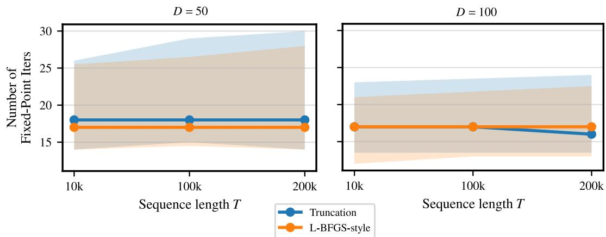  
Figure 6: Effect of the limited-memory update rule on the low-rank RNN benchmark. We compare simple truncation, which discards the oldest rank-one correction once the rank budget is full, with the L-BFGS-style identity\_rescaled variant, which rescales the identity baseline from the most recent secant pair and replays the stored updates. Points denote medians over 32 random seeds, and error bars denote interquartile ranges. The rescaled variant does not substantially improve median performance over simple truncation, but appears slightly more stable, with slightly smaller upper quartiles.

The correction is chosen to have minimum Frobenius norm while satisfying the stored secant equations:

$$
\Delta _ { t } ^ { ( i ) } = \arg \operatorname* { m i n } _ { \Delta } \| \Delta \| _ { F } \quad \mathrm { s . t . } \quad \left( D _ { t } ^ { ( i ) } + \Delta \right) P _ { t } ^ { ( i ) } = Q _ { t } ^ { ( i ) } .
$$

Equivalently,

$$
\Delta _ { t } ^ { ( i ) } P _ { t } ^ { ( i ) } = Q _ { t } ^ { ( i ) } - D _ { t } ^ { ( i ) } P _ { t } ^ { ( i ) } .
$$

Define the residual matrix

$$
R _ { t } ^ { ( i ) } : = Q _ { t } ^ { ( i ) } - D _ { t } ^ { ( i ) } P _ { t } ^ { ( i ) } \in \mathbb { R } ^ { D \times m _ { i } } .
$$

The minimum-Frobenius-norm solution is

$$
\Delta _ { t } ^ { ( i ) } = R _ { t } ^ { ( i ) } { P _ { t } ^ { ( i ) } } ^ { \dagger } ,
$$

where $P _ { t } ^ { ( i ) ^ { \dag } }$ is the Moore–Penrose pseudoinverse. If $P _ { t } ^ { ( i ) }$ has full column rank, then

$$
P _ { t } ^ { ( i ) ^ { \dag } } = \left( P _ { t } ^ { ( i ) ^ { \top } } P _ { t } ^ { ( i ) } \right) ^ { - 1 } P _ { t } ^ { ( i ) ^ { \top } } .
$$

Thus, in the full-rank case,

$$
\boxed { \widetilde { A } _ { t } ^ { ( i ) } = D _ { t } ^ { ( i ) } + \left( Q _ { t } ^ { ( i ) } - D _ { t } ^ { ( i ) } P _ { t } ^ { ( i ) } \right) \left( P _ { t } ^ { ( i ) ^ { \top } } P _ { t } ^ { ( i ) } \right) ^ { - 1 } P _ { t } ^ { ( i ) ^ { \top } } }\tag{14}
$$

In practice, we use a small ridge term for numerical stability,

$$
\widetilde { A } _ { t } ^ { ( i ) } = D _ { t } ^ { ( i ) } + \left( Q _ { t } ^ { ( i ) } - D _ { t } ^ { ( i ) } P _ { t } ^ { ( i ) } \right) \left( { P _ { t } ^ { ( i ) } } ^ { \top } P _ { t } ^ { ( i ) } + \varepsilon I \right) ^ { - 1 } P _ { t } ^ { ( i ) } { } ^ { \top } ,\tag{15}
$$

with $\varepsilon > 0$ small.

The correction in (14) has rank at most $m _ { i }$ . Therefore the accelerated multisecant update produces a DPLR approximation directly:

$$
\widetilde { A } _ { t } ^ { ( i ) } = D _ { t } ^ { ( i ) } + U _ { t } ^ { ( i ) } { V _ { t } ^ { ( i ) } } ^ { \top } , \qquad \mathrm { r a n k } \bigg ( U _ { t } ^ { ( i ) } { V _ { t } ^ { ( i ) } } ^ { \top } \bigg ) \le m _ { i } .
$$

With ridge stabilization, one can take

$$
U _ { t } ^ { ( i ) } = Q _ { t } ^ { ( i ) } - D _ { t } ^ { ( i ) } P _ { t } ^ { ( i ) } , \qquad V _ { t } ^ { ( i ) } { } ^ { \top } = \left( P _ { t } ^ { ( i ) } { } ^ { \top } P _ { t } ^ { ( i ) } + \eta I \right) ^ { - 1 } P _ { t } ^ { ( i ) } { } ^ { \top } .
$$

This is the update used in Accelerated Parallel Broyden: rather than accumulating one rank-one correction per iteration, it fits several recent secant directions at once, yielding a rank-at-most-m correction in a single update.

## E.4 Damping of the low-rank corrections

As discussed by Gonzalez et al. [21], large eigenvalues in the linearized transition dynamics can lead to unstable parallel Newton updates. Their scale-ELK method addresses this issue by shrinking the full dynamics Jacobian by a factor $( 1 - k )$ , where $k \in [ 0 , 1 ]$ is a damping parameter. We use the same idea, but apply it only to the low-rank Broyden correction rather than to the entire Jacobian approximation.

For the rank-one Broyden update, let

$$
\Delta _ { t } ^ { ( i ) } = \frac { \left( q _ { t } ^ { ( i ) } - \widetilde { A } _ { t } ^ { ( i ) } p _ { t } ^ { ( i ) } \right) { p _ { t } ^ { ( i ) } } ^ { \top } } { { p _ { t } ^ { ( i ) } } ^ { \top } p _ { t } ^ { ( i ) } }
$$

denote the secant correction. Instead of applying the full correction, we use

$$
\widetilde { A } _ { t } ^ { ( i + 1 ) } = \widetilde { A } _ { t } ^ { ( i ) } + ( 1 - k ) \Delta _ { t } ^ { ( i ) } , \qquad k \in [ 0 , 1 ] .\tag{16}
$$

Thus $k = 0$ recovers the standard Broyden update, while larger k values damp the new low-rank contribution. $\mathrm { A t } k = 1$ , the secant correction is completely suppressed and the block approximation is left unchanged.

For the multisecant update, recall that Accelerated Parallel Broyden builds a fresh correction on top of a diagonal baseline $D _ { t } ^ { ( i ) }$ . With damping, we use

$$
\widetilde { A } _ { t } ^ { \left( i \right) } = D _ { t } ^ { \left( i \right) } + \left( 1 - k \right) \left( Q _ { t } ^ { \left( i \right) } - D _ { t } ^ { \left( i \right) } P _ { t } ^ { \left( i \right) } \right) \left( { P _ { t } ^ { \left( i \right) } } ^ { \top } P _ { t } ^ { \left( i \right) } + \eta I \right) ^ { - 1 } P _ { t } ^ { \left( i \right) } ^ { \top } .\tag{17}
$$

Here $P _ { t } ^ { ( i ) }$ and ${ Q } _ { t } ^ { ( i ) }$ are the matrices of recent trajectory secants and dynamics finite differences, respectively, and $\eta > 0$ is the small ridge parameter used for numerical stability.

The damping parameter controls a stability–accuracy tradeoff. Larger values of k shrink the low-rank correction and can reduce instabilities caused by large eigenvalues in the approximate transition blocks. However, excessive damping also weakens the secant information, making the Jacobian approximation closer to its diagonal baseline and typically increases the number of Newton iterations (Figure 7). In practice, we therefore choose k heuristically as small as possible while remaining stable across the tested instances. We tune k per method and setting. The values are given in Appendices F.1 and G. We did not need damping for the diffusion experiment.

## F RNN experiment details

All RNN experiments use 32 chains, a maximum of 1000 iterations, and the stopping criterion

$$
\frac { \| \mathbf { r } ( \mathbf { x } _ { 1 : T } ) \| _ { 2 } } { \sqrt { T D } } < 1 0 ^ { - 4 } ,
$$

that ${ \mathrm { i s } } ,$ an absolute root-mean-square one-step residual below $1 0 ^ { - 4 }$ per state coordinate, which is small relative to the scale of the states. Computations are in float32 with highest-precision matrix multiplications. We report medians and interquartile ranges over chains. Iteration counts include all chains, with non-converged chains counted at the 1000-iteration cap, and runtimes are computed over converged chains. The noise sequence $\{ \epsilon _ { t } \} _ { t = 1 } ^ { T }$ is fixed before running the solver, so each model defines a deterministic input-driven state-space system. Newton uses the full Jacobian computed by reverse-mode automatic differentiation, and diagonal quasi-Newton extracts its diagonal from it. For the models considered here, the Jacobian and its diagonal are available in closed form or cheaply from the low-rank structure, and would be computed directly in practice. We nevertheless treat the transition $f$ as a black box and obtain them by automatic differentiation, as one would for a general nonlinear state-space model. For both Broyden variants, the low-rank products formed during the parallel scan are compressed back to rank $m$ with a rank-revealing variant of the randomized compression described in the main text. In this variant, sketch columns that are numerically dependent, with a relative remainder below $1 0 ^ { - 4 }$ , are dropped rather than normalized. This prevents rank-deficient corrections, which are frequent in float32, from introducing spurious directions. Accelerated Parallel Broyden uses a Gram regularization $\varepsilon = 1 0 ^ { - 6 }$ . All runtimes are measured on a single NVIDIA H100 GPU.

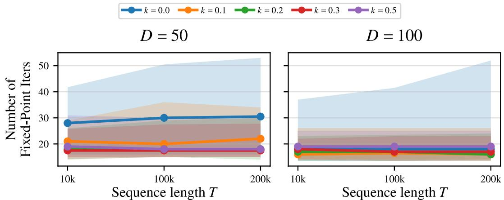  
Figure 7: Impact of damping on Parallel Broyden stability. Low-rank RNN experiment over 32 random seeds. Points denote medians and error bars denote interquartile ranges. Moderate damping reduces instability and improves robustness across seeds, while excessive damping weakens the low-rank secant correction and can degrade convergence. For example, when $\bar { D } = 1 0 0 , k = 0 . 5$ gives worse median performance than smaller damping values across all tested trajectory lengths.

## F.1 Low-rank RNNs

The state $\boldsymbol { x } _ { t } \in \mathbb { R } ^ { D }$ evolves according to

$$
\boldsymbol { x } _ { t } = a x _ { t - 1 } + \frac { \Delta t } { \tau } M \psi \big ( N ^ { \top } \phi ( x _ { t - 1 } ) \big ) + \epsilon _ { t } , \qquad M , N \in \mathbb { R } ^ { D \times R } ,\tag{18}
$$

where $a = 1 - \Delta t / \tau , \phi =$ tanh is applied elementwise, and $\epsilon _ { t } \sim \mathcal { N } ( 0 , \sigma ^ { 2 } I _ { D } )$ with $\sigma = 0 . 1$ . The standard low-rank RNN uses $\psi ( z ) = z ,$ so that the recurrent weight matrix is $W = M N ^ { \top }$ . The low-rank MLP-RNN uses $\psi ( z ) = z + \beta \mathrm { M L P } ( z )$ with $\beta = 0 . 5 .$ , where the MLP has 8 hidden layers of width $D$ and tanh activations. Given a gain g, we draw

$$
M _ { i j } \sim \mathcal { N } \bigg ( 0 , \frac { g ^ { 2 } } { D } \bigg ) , \qquad N _ { i j } \sim \mathcal { N } \bigg ( 0 , \frac { 1 } { R } \bigg ) .\tag{19}
$$

This normalization keeps the coordinate-wise recurrent input at scale $O ( g )$ when the components of $\phi ( x )$ are $O ( 1 )$ , while the nonzero singular values of $M N ^ { \top }$ are typically of order $g \sqrt { D / R }$ . Each chain draws its own weights, noise, initial state and initial guess, with $x _ { 0 } , x _ { 1 : T } ^ { ( 0 ) } \sim 0 . 1 \mathcal { N } ( 0 , I )$ . Seeds whose sequential trajectory saturates are discarded. The criteria chosen for saturation are that, after a burn-in of $T / 4$ steps, some unit has mean tanh $| > 0 . 8$ or mean tan $\mathrm { h } ^ { \prime } < 0 . 1$

The transition Jacobian of (18) is

$$
A _ { t } = \frac { \partial x _ { t } } { \partial x _ { t - 1 } } = a I _ { D } + \frac { \Delta t } { \tau } M \psi ^ { \prime } \big ( N ^ { \top } \phi ( x _ { t - 1 } ) \big ) N ^ { \top } \mathrm { d i a g } ( \phi ^ { \prime } ( x _ { t - 1 } ) ) ,\tag{20}
$$

where $\psi ^ { \prime }$ is the $R \times R$ Jacobian of $\psi .$ For both models, the off-diagonal term has rank at most $R ,$ , so the true Jacobian is exactly diagonal plus rank R (Figure 8). The MLP makes each evaluation of $f$ and each Jacobian computation more expensive without changing this structure.

We use $R = 3 , g = 2 , \tau = 1 0$ , and $D \in \{ 1 0 0 , 2 0 0 \}$ , with $D = 2 0 0$ in Figure 1. The step size $\Delta t$ controls the balance between the two terms of (20). Before modulation by $\psi ^ { \prime }$ and $\phi ^ { \prime } .$ , the low-rank term has typical spectral scale $( \Delta t / \tau ) g \sqrt { D / R }$ , which is about 0.8 for $D = 2 0 0$ and $\Delta t = 0 . 5$ against a diagonal $a = 0 . 9 5$ . For $\Delta t = 3$ it is about 4.9, against $a = 0 . 7 .$ . The off-diagonal coupling is therefore weak for $\Delta t = 0 . 5$ and dominant for $\Delta t = 3$ . Table 8 reports iteration counts for both models and both step sizes. In all settings, Accelerated Parallel Broyden needs fewer iterations than Parallel Broyden, and the gap is larger for $\Delta t = 3$ , independently of the model.

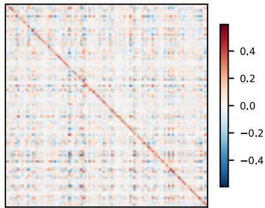  
Figure 8: Example of the dynamics Jacobian matrix of the standard low-rank RNN. The matrix is exactly diagonal plus rank $R = 3 .$

For Parallel Broyden and Accelerated Parallel Broyden, we use rank $m = R = 3$ and initialize the diagonal at $\gamma = a ,$ so that $\widetilde { A } _ { t } ^ { ( 0 ) } = a I _ { D }$ matches the diagonal of (20). Accelerated Parallel Broyden euses a backtracking line search with sufficient-decrease constant $c = 1 0 ^ { - 3 }$ , and Parallel Broyden uses none. For each method, the damping minimizes the median iteration count over chains, with non-converged chains counted at the cap. It is tuned on $T \in \{ 1 0 ^ { 4 } , 1 0 ^ { 5 } \}$ , or on $T = 1 0 ^ { 4 }$ only for diagonal quasi-Newton, and reused for $\dot { T } = 1 0 ^ { 3 }$ . The resulting values are listed in Table 7.

Table 7: Damping values for the low-rank RNNs. The same values are used for both models.
<table><tr><td>Method</td><td>∆t = 0.5  $\Delta t = 3$ </td></tr><tr><td>Newton</td><td>0</td></tr><tr><td>Diag. quasi-Newton 0.1</td><td>0 0.8</td></tr><tr><td>Parallel Broyden</td><td>0.2</td></tr><tr><td>Accel. Parallel Broyden 0.2</td><td>0.4 0.1</td></tr></table>

Table 8: Iterations of the Broyden variants on the low-rank RNNs $( D = 2 0 0 )$ . Median over all 32 chains, with non-converged chains counted at the 1000-iteration cap, and number of converged chains.
<table><tr><td colspan="3"></td><td colspan="2">Iterations</td><td colspan="2"></td></tr><tr><td>Model</td><td> $\Delta t$ </td><td> $T$ </td><td>PB</td><td>Accel. PB</td><td>PB / Accel. PB</td><td>Accel. PB</td></tr><tr><td>Standard</td><td>0.5</td><td> $1 0 ^ { 3 }$ </td><td>12.5</td><td>10</td><td>1.25</td><td>32</td><td>32</td></tr><tr><td></td><td></td><td> $1 0 ^ { 4 }$ </td><td>14</td><td>10</td><td>1.40</td><td>30</td><td>32</td></tr><tr><td></td><td></td><td> $1 0 ^ { 5 }$ </td><td>15</td><td>12</td><td>1.25</td><td>30</td><td>32</td></tr><tr><td></td><td>3</td><td> $1 0 ^ { 3 }$ </td><td>30.5</td><td>10</td><td>3.05</td><td>32</td><td>32</td></tr><tr><td></td><td></td><td> $1 0 ^ { 4 }$ </td><td>29.5</td><td>11</td><td>2.68</td><td>27</td><td>31</td></tr><tr><td></td><td></td><td> $1 0 ^ { 5 }$ </td><td>30</td><td>12</td><td>2.50</td><td>26</td><td>30</td></tr><tr><td>MLP</td><td>0.5</td><td> $1 0 ^ { 3 }$ </td><td>12</td><td>9.5</td><td>1.26</td><td>32</td><td>32</td></tr><tr><td></td><td></td><td> $1 0 ^ { 4 }$ </td><td>15</td><td>10</td><td>1.50</td><td>30</td><td>32</td></tr><tr><td></td><td></td><td> $1 0 ^ { 5 }$ </td><td>15</td><td>12.5</td><td>1.20</td><td>30</td><td>32</td></tr><tr><td></td><td>3</td><td> $1 0 ^ { 3 }$ </td><td>28.5</td><td>10.5</td><td>2.71</td><td>32</td><td>32</td></tr><tr><td></td><td></td><td> $1 0 ^ { 4 }$ </td><td>28</td><td>11.5</td><td>2.43</td><td>27</td><td>31</td></tr><tr><td></td><td></td><td> $1 0 ^ { 5 }$ </td><td>26.5</td><td>12.5</td><td>2.12</td><td>27</td><td>31</td></tr></table>

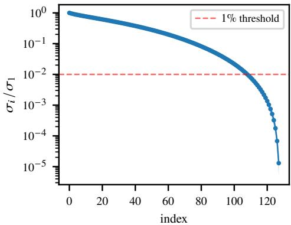  
Figure 9: Singular value spectrum of the DMF RNN Jacobian. Normalized singular values $\sigma _ { i } / \sigma _ { 1 }$ of $A _ { t }$ along trajectories (median and interquartile range over 32 independently sampled networks). The dashed line marks 1% of $\sigma _ { 1 }$

## F.2 Full-rank DMF RNN

The discretized mean-field RNN [38] evolves according to

$$
x _ { t } = W \operatorname { t a n h } ( x _ { t - 1 } ) + \epsilon _ { t } , \qquad W _ { i j } \sim { \mathcal { N } } \biggl ( 0 , \frac { g ^ { 2 } } { D } \biggr ) ,\tag{21}
$$

with $g = 1 . 7 , D = 1 2 8$ , self-couplings included, $\epsilon _ { t } \sim \mathcal { N } ( 0 , I _ { D } )$ , and $T = 1 0 ^ { 4 }$ . A single weight matrix W is shared by all 32 chains, which differ in their noise sequence and initial guess, with $x _ { 0 } = 0$ and $x _ { 1 : T } ^ { ( 0 ) } \sim \mathcal { N } ( 0 , I )$ . The Jacobian $A _ { t } = W \mathrm { d i a g } ( \mathrm { s e c h } ^ { 2 } ( x _ { t - 1 } ) )$ is dense and full rank, with no dominant diagonal. Along trajectories, its normalized singular values decay slowly, and about 108 of the 128 exceed 1% of the largest (Figure 9). No small rank m can therefore represent $A _ { t }$ exactly, which makes this model a test of how the Broyden variants degrade as m decreases.

Since the model has no leak term, the Broyden variants initialize the diagonal at $\gamma = 0 . 1$ . Both Broyden variants use a backtracking line search with $c = 1 0 ^ { - 3 }$ . We sweep $m \in \{ 1 , 5 , 1 0 , \ldots , 8 0 \}$ for Parallel Broyden and $m \in \{ 1 , 5 , \mathsf { \bar { 1 0 } } , 1 5 , 2 0 \}$ for Accelerated Parallel Broyden. For larger m, the Gram matrix of Accelerated Parallel Broyden becomes nearly singular, which degrades convergence. Newton uses damping 0.2, which prevents numerical overflow in float32, and all other methods use no damping.

## G Hierarchical Gibbs sampler details

We use a Gibbs sampler for a hierarchical normal model based on the eight schools problem, with a variable number of schools $S$ to study scaling with state dimension. For each school $s = 1 , \ldots , S$ and student $n = 1 , \ldots , N$ , the model is

$$
\begin{array} { c } { { y _ { s , n } \mid \theta _ { s } , \sigma _ { s } ^ { 2 } \sim \mathcal { N } ( \theta _ { s } , \sigma _ { s } ^ { 2 } ) , } } \\ { { \theta _ { s } \mid \mu , \tau ^ { 2 } \sim \mathcal { N } ( \mu , \tau ^ { 2 } ) . } } \end{array}
$$

We place conjugate priors on the global mean, global variance, and school-level variances:

$$
\mu \mid \tau ^ { 2 } \sim { \mathcal N } \left( \mu _ { 0 } , \tau ^ { 2 } / \kappa _ { 0 } \right) ,
$$

$$
\tau ^ { 2 } \sim \mathrm { I n v G a m m a } \left( \frac { \nu _ { 0 } } { 2 } , \frac { \nu _ { 0 } \tau _ { 0 } ^ { 2 } } { 2 } \right) ,
$$

$$
\sigma _ { s } ^ { 2 } \sim \mathrm { I n v G a m m a } \biggl ( \frac { \alpha _ { 0 } } { 2 } , \frac { \alpha _ { 0 } \sigma _ { 0 } ^ { 2 } } { 2 } \biggr ) .
$$

The MCMC state at sweep t is

$$
x _ { t } = \left( \theta _ { 1 : S , t } , \sigma _ { 1 : S , t } ^ { 2 } , \mu _ { t } , \tau _ { t } ^ { 2 } \right) \in \mathbb { R } ^ { 2 S + 2 } .
$$

In the experiments, we set

$$
N = 2 0 , \quad \mu _ { 0 } = 0 , \quad \kappa _ { 0 } = 0 . 1 , \quad \nu _ { 0 } = 0 . 1 , \quad \tau _ { 0 } ^ { 2 } = 1 0 0 , \quad \alpha _ { 0 } = 0 . 1 , \quad \sigma _ { 0 } ^ { 2 } = 1 0 .
$$

We generate synthetic school-level summaries by drawing

$$
\bar { y } _ { s } \sim \mathcal { N } ( 0 , 1 0 ^ { 2 } ) , \qquad \bar { \sigma } _ { s } = | \eta _ { s } | + 5 , \qquad \eta _ { s } \sim \mathcal { N } ( 0 , 5 ^ { 2 } ) .
$$

Given these summaries, we generate observations by first sampling

$$
y _ { s , n } ^ { \mathrm { r a w } } \sim \mathcal { N } \left( \bar { y } _ { s } , N \bar { \sigma } _ { s } ^ { 2 } \right) ,
$$

then standardizing each school’s column to $z _ { s , n }$ and setting $y _ { s , n } = \bar { y } _ { s } + \sqrt { N } \bar { \sigma } _ { s } z _ { s , n }$ . Each school’s sample mean is then exactly $\bar { y } _ { s }$ and its sample standard deviation $\sqrt { N } \bar { \sigma } _ { s }$ , so that its standard error is $\bar { \sigma } _ { s }$

Conditional updates. Each Gibbs sweep updates $\tau ^ { 2 }$ , then $\mu ,$ then $\theta _ { 1 : S }$ , then $\sigma _ { 1 : S } ^ { 2 }$ . Let

$$
\nu _ { N } = \nu _ { 0 } + S + 1 , \qquad \alpha _ { N } = \alpha _ { 0 } + N .
$$

Given independent random variates fixed by the driver at sweep t, the updates are

$$
\tau _ { N } ^ { 2 } = \frac { 1 } { \nu _ { N } } \left[ \nu _ { 0 } \tau _ { 0 } ^ { 2 } + \kappa _ { 0 } ( \mu - \mu _ { 0 } ) ^ { 2 } + \sum _ { s = 1 } ^ { S } ( \theta _ { s } - \mu ) ^ { 2 } \right] ,
$$

$$
\tau ^ { 2 } = \frac { \nu _ { N } \tau _ { N } ^ { 2 } } { 2 } \xi _ { \tau } , \qquad \xi _ { \tau } \sim \mathrm { I n v G a m m a } \Big ( \frac { \nu _ { N } } { 2 } , 1 \Big ) ,
$$

$$
v _ { \mu } = \frac { \tau ^ { 2 } } { \kappa _ { 0 } + S } , \qquad \hat { \mu } = \frac { \kappa _ { 0 } \mu _ { 0 } + \sum _ { s = 1 } ^ { S } \theta _ { s } } { \kappa _ { 0 } + S } ,
$$

$$
\mu = \hat { \mu } + \sqrt { v _ { \mu } } \xi _ { \mu } , \xi _ { \mu } \sim { \cal N } ( 0 , 1 ) ,
$$

$$
v _ { \theta _ { s } } = \left( \frac { N } { \sigma _ { s } ^ { 2 } } + \frac { 1 } { \tau ^ { 2 } } \right) ^ { - 1 } , \qquad \hat { \theta } _ { s } = v _ { \theta _ { s } } \left( \frac { \sum _ { n = 1 } ^ { N } y _ { s , n } } { \sigma _ { s } ^ { 2 } } + \frac { \mu } { \tau ^ { 2 } } \right) ,
$$

$$
\begin{array} { r } { \theta _ { s } = \hat { \theta } _ { s } + \sqrt { v _ { \theta _ { s } } } \xi _ { \theta _ { s } } , ~ \xi _ { \theta _ { s } } \sim \mathcal { N } ( 0 , 1 ) , } \end{array}
$$

$$
\sigma _ { N , s } ^ { 2 } = \frac { 1 } { \alpha _ { N } } \left[ \alpha _ { 0 } \sigma _ { 0 } ^ { 2 } + \sum _ { n = 1 } ^ { N } ( y _ { s , n } - \theta _ { s } ) ^ { 2 } \right] ,
$$

$$
\sigma _ { s } ^ { 2 } = \frac { \alpha _ { N } \sigma _ { N , s } ^ { 2 } } { 2 } \xi _ { \sigma _ { s } } , \qquad \xi _ { \sigma _ { s } } \sim \mathrm { I n v G a m m a } \Big ( \frac { \alpha _ { N } } { 2 } , 1 \Big ) .
$$

Fixing the random variates

$$
\xi _ { t } = ( \xi _ { \theta , 1 : S , t } , \xi _ { \sigma , 1 : S , t } , \xi _ { \mu , t } , \xi _ { \tau , t } )
$$

for every sweep turns the Gibbs sampler into a deterministic input-driven state-space model,

$$
x _ { t + 1 } = f _ { t } ( x _ { t } ; \xi _ { t } ) .
$$

Why the Jacobian is approximately low rank. The hierarchical structure induces strong crossschool coupling through the two global variables $\mu$ and $\tau ^ { 2 } .$ . The school-level variables affect the global updates through sums such as $\textstyle \sum _ { s } \theta _ { s }$ and $\sum _ { s } ( \theta _ { s } - \mu ) ^ { 2 }$ , while the updated global variables are then broadcast back to all school-level updates through the conditional means and variances of $\theta _ { s }$ Thus, the dominant off-diagonal interactions are mediated by a small number of global degrees of freedom. This motivates a rank-2 approximation corresponding to the two global variables $( \mu , \tau ^ { 2 } )$ (Figure 10).

At the same time, the diagonal entries of the transition Jacobian are small, because Gibbs update resample each coordinate from its conditional distribution. Each updated coordinate depends primarily on the other variables that determine its conditional distribution, rather than on its own previous value. For this reason, both Broyden variants initialize the diagonal term to zero $( \gamma = 0 )$ and use rank $m = 2$ . Since the approximation is then purely low rank, products of rank-m blocks remain rank at most $m ,$ and no rank compression is required.

A  
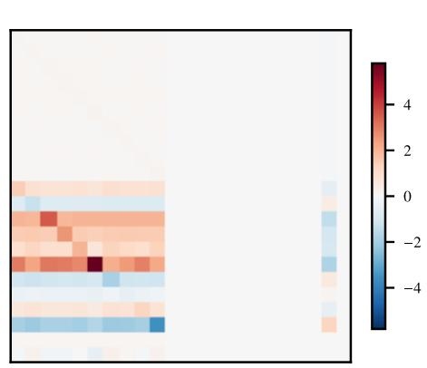

B  
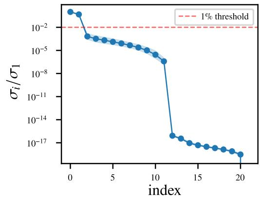  
Figure 10: Structure of the Gibbs transition Jacobian for the hierarchical normal model. A: Example transition Jacobian averaged over time, showing small diagonal entries and structured offdiagonal coupling induced by the hierarchical updates. B: Singular values of the transition Jacobian, normalized by the largest singular value and averaged over time, with error bars denoting standard deviations. The spectrum is dominated by the first two singular values, supporting the rank-2 purely low-rank approximation used by the Broyden variants in this experiment.

Experimental setup. We use $S \in \{ 1 0 , 5 0 , 1 0 0 , 2 0 0 \}$ , so that $D = 2 S + 2$ ranges from 22 to 402, and $T \in \{ 1 0 ^ { 3 } , 1 0 ^ { 4 } , 5 \cdot 1 0 ^ { 4 } , 1 0 ^ { 5 } \}$ . Each setting uses 32 chains. Each chain has its own synthetic dataset and its own random variates $\xi _ { 1 : T }$ . Its initial state is drawn from the prior and followed by one Gibbs sweep, and the initial guess repeats this state at every time step. All methods use a maximum of 1000 iterations, computations in float32 with highest-precision matrix multiplications, and the stopping criterion

$$
\frac { \| \mathbf { r } ( \mathbf { x } _ { 1 : T } ) \| _ { 2 } } { \sqrt { T D } } < 1 0 ^ { - 3 } ,
$$

a tolerance that is small relative to the scale of the Gibbs state variables. We report medians and interquartile ranges over all chains, with non-converged chains counted at the 1000-iteration cap and at their actual runtime. Newton uses the full Jacobian computed by reverse-mode automatic differentiation, and diagonal quasi-Newton extracts its diagonal from it. Newton and diagonal quasi-Newton use no damping, Parallel Broyden uses damping 0.3, and Accelerated Parallel Broyden uses damping 0.1. Accelerated Parallel Broyden also uses a backtracking line search with sufficient decrease constant $c = 1 0 ^ { - 3 }$ and a Gram regularization $\varepsilon = 1 0 ^ { - 6 }$ , while Parallel Broyden uses no line search. After each iteration, both Broyden variants clip the variances $\sigma _ { s } ^ { 2 }$ and $\tau ^ { 2 }$ to at least $1 0 ^ { - 6 }$ to keep the iterates in the support of the model. For $S = 2 0 0$ and $T \geq 5 \cdot { \mathrm { 1 0 ^ { 4 } } }$ , Newton runs out of memory. All runtimes are measured on a single NVIDIA H100 GPU.

Stochastic diagonal estimation. Replacing the exact diagonal of $A _ { t }$ with a Hutchinson estimate, as in the diffusion experiment, breaks diagonal quasi-Newton on this benchmark (Table 9). With 1 or 8 Rademacher probes per step, it fails on every chain. With 64 probes, some chains converge at $T = 1 0 ^ { 3 }$ , but only after 963 to 999 iterations, close to the worst-case bound of T. By comparison, at $T = 1 0 ^ { 3 }$ the median iteration count is 68 to 136 with the exact diagonal and 21 to 32 for Accelerated Parallel Broyden. This failure is expected from the structure of $A _ { t } \mathrm { : }$ since its diagonal entries are small, the off-diagonal entries carry most of its Frobenius norm, and the noise of the estimate is large relative to the diagonal it estimates.

## H Diffusion experiment

## H.1 Structure of the local dynamics Jacobian

Recall that the local dynamics Jacobian of the DDIM update is

$$
A _ { \ell } ( x _ { \ell - 1 } ) = c _ { x } ( t ) I + c _ { \epsilon } ( t ) { \frac { \partial \epsilon _ { \theta } } { \partial x } } ( x _ { \ell - 1 } , t ) , \qquad t = T - \ell + 1 ,
$$

Table 9: Hutchinson-based diagonal quasi-Newton on the hierarchical Gibbs sampler. Number of chains, out of 32, that reach the tolerance within 1000 iterations.
<table><tr><td>Probes</td><td> $T$ </td><td> $S = 1 0$ </td><td> $S = 5 0$ </td><td> $S = 1 0 0$ </td><td> $S = 2 0 0$ </td></tr><tr><td>1</td><td> $1 0 ^ { 3 }$ </td><td>0</td><td>0</td><td>0</td><td>0</td></tr><tr><td>1</td><td> $1 0 ^ { 4 }$ </td><td>0</td><td>0</td><td>0</td><td>0</td></tr><tr><td>8</td><td> $1 0 ^ { 3 }$ </td><td>0</td><td>0</td><td>0</td><td>0</td></tr><tr><td>8</td><td> $1 0 ^ { 4 }$ </td><td>0</td><td>0</td><td>0</td><td>0</td></tr><tr><td>64</td><td> $1 0 ^ { 3 }$ </td><td>1</td><td>19</td><td>22</td><td>16</td></tr><tr><td>64</td><td> $1 0 ^ { 4 }$ </td><td>0</td><td>0</td><td>0</td><td>0</td></tr></table>

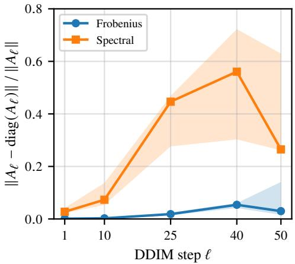  
Figure 11: Off-diagonal mass of the DDIM local dynamics Jacobian. Relative norm of $A _ { \ell } -$ diag(A ) along the sampling trajectory, in Frobenius and spectral norm (median and range over 3 images).

a 4096 4096 matrix. To quantify how well a diagonal approximation captures it, we form $A _ { \ell }$ exactly by automatic differentiation through the DiT denoiser along the DDIM sampling trajectory. We do this for $\ell \in \{ 1 , 1 0 , 2 5 , 4 0 , 5 0 \}$ and three class-conditional images, using the same pretrained model, guidance scale and $T = 5 0$ as in the main experiments. Figure 11 reports the relative off-diagonal mass $\| A _ { \ell } - \mathrm { d i a g } ( A _ { \ell } ) \| / \| A _ { \ell } \|$ in Frobenius and spectral norm.

In Frobenius norm, $A _ { \ell }$ is close to diagonal throughout sampling. Its off-diagonal part accounts for under 1% of $\| A _ { \ell } \| _ { F }$ early in sampling and at most about $5 \%$ in the median at later steps, with one image reaching 14% at the final step. The spectral ratio is larger: it rises after mid-sampling and peaks at about 0.5 around $\ell = 4 0$ . This indicates that the off-diagonal coupling is small in total but concentrated in a few directions of the state, where the diagonal approximation is inaccurate. Such an error mainly slows the corresponding modes of the iteration, which is consistent with diagonal quasi-Newton requiring only slightly more iterations than Parallel Broyden in Figure 3. The small Frobenius ratio also explains why a single-probe Hutchinson estimate is accurate on this benchmark. For a Rademacher probe z, the error of the estimate $z \odot ( A _ { \ell } z )$ comes only from the off-diagonal entries of $A _ { \ell } ,$ and its root-mean-square relative error is $\lVert \dot { \boldsymbol { A } } _ { \ell } - \mathrm { d i a g } ( \boldsymbol { A } _ { \ell } ) \rVert _ { F } / \lVert \mathrm { d i a g } ( \boldsymbol { A } _ { \ell } ) \rVert _ { F } ,$ , which nearly coincides with the Frobenius curve in Figure 11 since the diagonal dominates.

## H.2 Hyperparameter setting for ParaTAA

ParaTAA [27] parallelizes diffusion sampling by rewriting the denoising trajectory as a triangular nonlinear system and applying triangular Anderson acceleration. The method has three relevant hyperparameters: the window size w, the order k of the equivalent triangular system, and the history size m. In our DDIM-50 experiment, we follow ParaTAA and set the window size equal to the number of sampling steps, $w = T = 5 0$ , so the full trajectory is solved in a single window. The order k controls how many future timesteps are used in each triangular update, while m controls the amount of Anderson history used to build the inverse multisecant approximation.

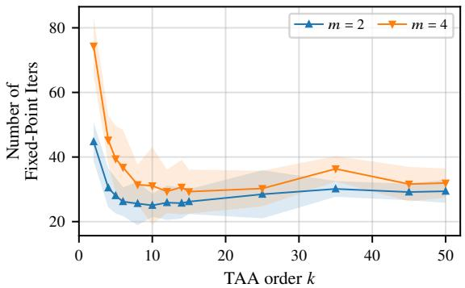  
Figure 12: ParaTAA hyperparameter search. We vary the nonlinear system order k and history size m for DDIM-50 with window size $w = T = 5 0$ . Points denote means over $3 2$ images, and shaded regions denote one standard deviation. Consistent with ParaTAA’s hyperparameter analysis, small history sizes are sufficient: $m = 2$ requires fewer iterations than $m = 4$ at every order.

Tang et al. [27] treat k and m as empirical hyperparameters and report two trends relevant to our sweep: k should be tuned because it controls a stability–information-propagation tradeoff, and the history size is typically kept small because additional history does not necessarily improve convergence and can hurt performance. We therefore perform a small grid search over k and m in our DDIM-50 setting.

Figure 12 shows that both hyperparameters matter in our setting. Small orders propagate information slowly: at $k = 2$ , the mean iteration count is 44.7 for $m = 2$ and 74.3 for $m = 4 .$ . For $m = 2$ performance improves rapidly with k and is nearly flat for $6 \leq k \leq 1 5$ (mean 25.0–26.2 iterations and mean runtime $3 . 2 { - } 3 . { \bar { 4 } } { \mathrm { s } } )$ , before degrading slightly for larger orders (mean 29.2–30.1 iterations for $k \geq 3 5 )$ , consistent with the stability vs. information-propagation tradeoff described by Tang et al. [27]. Increasing the history size to $m = 4$ is worse than $m = 2$ at every order. Based on this sweep, we use $m = 2$ and $k = 1 0$ for the ParaTAA baseline, which attains the lowest mean iteration count $( 2 5 . 0 ) $ . With $k = 8$ , it is nearly as good on average (25.6) but has a much worse worst case (62 vs. 41 iterations).

## H.3 Hyperparameter setting for Picard iteration

ParaDiGMS [26] parallelizes diffusion sampling with Picard iteration. In our notation, this corresponds to a fixed-point parallel trajectory update, or equivalently to using the identity local approximation $\widetilde { A } _ { \ell } = I _ { D }$ . Unlike Parallel Broyden, ParaDiGMS does not build secant-based Jacobian eapproximations. It repeatedly refines the full denoising trajectory using parallel denoiser evaluations.

The main hyperparameter is the sliding-window size $w ,$ which controls how many timesteps are updated in parallel. The original method uses this window to manage memory when the full trajectory is too large to evaluate at once. In our DDIM-50 experiments, we set $w = T = 5 0$ , so the full trajectory is updated in a single window. For SDE samplers, ParaDiGMS samples the noise up front and treats it as part of a deterministic input-driven trajectory. Since we evaluate DDIM here, no additional noise is injected after the initial latent is fixed.

## H.4 Setting for diagonal quasi-Newton

Diagonal quasi-Newton estimates the diagonal of each $A _ { \ell }$ with the Hutchinson estimator using a single Rademacher probe $z , \mathrm { d i a g } ( A _ { \ell } ) \approx z \odot ( A _ { \ell } z )$ , which requires one Jacobian–vector product through the denoiser per time step and iteration. Forming the exact diagonal would require the full $4 0 9 6 \times 4 0 9 6$ Jacobian. As shown in Appendix H.1, a single probe is accurate on this benchmark because $A _ { \ell }$ is close to diagonal in Frobenius norm.

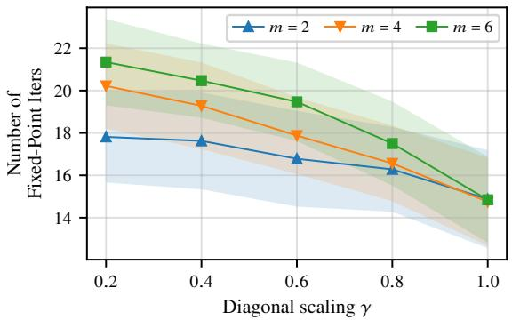  
Figure 13: Parallel Broyden hyperparameter search. We vary the diagonal scaling $\gamma$ in the initialization $\gamma I _ { D }$ and the maximum DPLR rank m on the DDIM-50 benchmark. Points denote means over $3 2$ images, and shaded regions denote one standard deviation. Larger diagonal scaling improves convergence across all tested ranks, while increasing the rank beyond $m = 2$ gives no improvement.

## H.5 Hyperparameter setting for Parallel Broyden

Parallel Broyden has two main hyperparameters in the DDIM experiment: the maximum DPLR rank $m ,$ , which controls the number of stored Broyden corrections, and the diagonal scaling γ in the initialization $\gamma I _ { D }$ . We tune these hyperparameters with a small grid search on the DDIM-50 benchmark, using the same 32 images as in the main evaluation. We use the same selected hyperparameters for Accelerated Parallel Broyden.

Figure 13 shows that the best performance is obtained with $\gamma = 1 . 0$ . For each rank, increasing $\gamma$ decreases the mean iteration count and runtime, suggesting that the identity-scaled diagonal term already captures an important part of the DDIM local dynamics. Increasing the rank from $m = 2$ to $m = 4$ or $m = 6$ does not meaningfully improve the best mean iteration count. Based on this sweep, we use $\gamma = 1 . 0$ and $m = 2$ for both Parallel Broyden and Accelerated Parallel Broyden in the DDIM experiments.

Both Broyden variants use no damping and no line search. The low-rank products formed during the parallel scan are compressed with the randomized compression described in the main text. The rank-revealing variant used in the other benchmarks is not needed here. Accelerated Parallel Broyden uses a Gram regularization $\varepsilon = 1 0 ^ { - 1 0 }$

## H.6 Image quality and stopping criterion

All DDIM experiments in this work are run on a single NVIDIA H100 GPU in float32. Since the trajectory is short $( T = 5 0 )$ , default matrix-multiplication precision suffices, unlike in the other benchmarks. The only exception is ParaTAA, which accumulates and solves its Anderson Gram system in float64 with Tikhonov regularization $\lambda = 1 0 ^ { - 3 }$ , following the reference implementation [27]. Since parallel diffusion samplers solve the sampling trajectory only approximately, we need both a stopping criterion and a way to check that the resulting images match the sequential ones.

Image-quality metric. We compare each parallel sample to the corresponding sequential DDIM sample using LPIPS, or Learned Perceptual Image Patch Similarity [46]. LPIPS measures perceptual distance by comparing deep feature activations between two images, and is often preferred to pixelwise metrics such as mean squared error because it correlates better with human perceptual judgments. Lower LPIPS values indicate greater perceptual similarity, with 0 corresponding to identical images in the learned feature space. All LPIPS values are computed over the same 32 images used for the runtime and iteration-count experiments.

Stopping criterion. For all methods we use the same criterion: we stop the trajectory solver when $\| r ( \bar { x _ { 1 : T } } ) \bar { \| _ { 2 } } / 2 < 0 . 1$ , where r is the single-step DDIM residual in latent space, with a maximum of

Table 10: LPIPS distance between each parallel sample and the corresponding sequential DDIM reference over 32 images. Lower is better.
<table><tr><td>Method</td><td>Median LPIPS</td><td>IQR</td></tr><tr><td>Diagonal quasi-Newton</td><td>0.0032</td><td>[0.0014, 0.0065]</td></tr><tr><td>Parallel Broyden</td><td>0.0032</td><td>[0.0015, 0.0051]</td></tr><tr><td>Picard</td><td>0.0034</td><td>[0.0015, 0.0055]</td></tr><tr><td>Accelerated Parallel Broyden</td><td>0.0031</td><td>[0.0014, 0.0051]</td></tr><tr><td>ParaTAA</td><td>0.0037</td><td>[0.0016, 0.0062]</td></tr></table>

100 iterations. Using a common criterion makes iteration counts directly comparable across methods.   
All hyperparameter sweeps use the same criterion.

We chose this threshold with a tolerance study: each method was run for a fixed 50 iterations, and we recorded the residual and the LPIPS distance to the sequential sample along the trajectory. At a tolerance of 0.1, the image quality of all methods is essentially at convergence: for every image, the solver has already achieved at least 96% of the total LPIPS reduction observed between iteration 3 and iteration 50, and for 31 or 32 of the 32 images per method more than 99%. Consistent with this, we could not visually distinguish samples obtained at this tolerance from fully converged ones, and tightening the tolerance further yields only marginal gains while adding iterations. A looser tolerance of 1 stops some trajectories too early: only about 22 to 28 of the 32 images per method have achieved more than 99% of their LPIPS reduction. The stricter tolerance costs a median of 2 additional iterations for the Broyden, Picard and quasi-Newton methods and 5 for ParaTAA. Using float64 for ParaTAA’s Gram system leaves its median iteration count unchanged and mainly shortens one slow case (52 41 iterations for the sea turtle image).

This choice follows the principle noted by ParaTAA [27]: generated images can appear visually satisfactory before the nonlinear residual reaches a strict numerical tolerance, so it is unnecessary to solve the full trajectory to machine precision.

Resulting image quality. Table 10 reports the LPIPS distances between the parallel samples, obtained with this stopping criterion, and the corresponding sequential DDIM samples. All methods achieve very small LPIPS values (medians of about 0.003), indicating that the images are perceptually very close to the sequential rollout and, in practice, indistinguishable by visual inspection. The two larger values (up to about 0.07) occur for the same images under every method and persist after full convergence. We report medians and interquartile ranges for LPIPS, unlike the mean-based Figures 3, 12 and 13, because these two images inflate both the mean and the standard deviation: for every method, the standard deviation is about twice the mean, so a mean standard deviation summary would not describe the typical image.

## I Runtime decomposition

The runtime ratio between a baseline and a Broyden variant factors into an iteration ratio, which reflects the quality of the Jacobian approximation, and a per-iteration cost ratio, which reflects the cost of obtaining it (Table 11). The DPLR blocks always need fewer iterations than diagonal quasi-Newton, from 1.1 fewer on DiT to 5.6 fewer on the Gibbs sampler. Most of the speedup, however, comes from avoiding automatic differentiation. On the MLP-RNN and the Gibbs sampler, diagonal quasi-Newton with the exact diagonal spends 91–99% of each iteration in automatic differentiation (Table 12). With Hutchinson’s estimator on DiT, it spends 69% in the Jacobian–vector product. The Broyden updates themselves are negligible when the transition is expensive. When it is cheap, as for the standard low-rank RNN, the low-rank scan dominates, and one Broyden iteration costs about 20 a diagonal quasi-Newton iteration.

Table 11: Decomposition of the runtime ratio. Runtime ratio = iteration ratio per-iteration cost ratio, baseline over Broyden variant (> 1: the Broyden variant is faster). $T = 1 0 ^ { 5 }$ for the RNNs and the Gibbs sampler $( D = 2 0 0$ , with $\Delta t = 3$ for the low-rank MLP-RNN and $\Delta t = 0 . 5$ for the standard low-rank RNN). Iterations: baseline / method. For the RNNs, medians are over converged chains, so that iteration and runtime ratios refer to the same chains. Figure 1 instead counts non-converged chains at the iteration cap. For the Gibbs sampler, medians are over all chains, and for DiT, means are over the 32 images, as in the corresponding figures.
<table><tr><td>Benchmark</td><td>Baseline</td><td>Method</td><td>Iterations</td><td>Iter. ratio</td><td>Per-iter. ratio</td><td>Runtime ratio</td></tr><tr><td rowspan="4">Low-rank MLP-RNN</td><td>Diag. QN</td><td>PB</td><td>38 / 19</td><td>2.00</td><td>15.74</td><td>31.48</td></tr><tr><td>Diag. QN</td><td>Accel. PB</td><td>38 / 12</td><td>3.17</td><td>17.78</td><td>56.31</td></tr><tr><td>Newton</td><td>PB</td><td>3 / 19</td><td>0.16</td><td>19.38</td><td>3.06</td></tr><tr><td>Newton</td><td>Accel. PB</td><td>3 / 12</td><td>0.25</td><td>21.89</td><td>5.47</td></tr><tr><td rowspan="4">Standard low-rank RNN</td><td>Diag. QN</td><td>PB</td><td>30 / 14.5</td><td>2.07</td><td>0.04</td><td>0.09</td></tr><tr><td>Diag. QN</td><td>Accel. PB</td><td>30 / 12</td><td>2.50</td><td>0.05</td><td>0.13</td></tr><tr><td>Newton</td><td>PB</td><td>4 /14.5</td><td>0.28</td><td>4.13</td><td>1.14</td></tr><tr><td>Newton</td><td>Accel. PB</td><td>4/ 12</td><td>0.33</td><td>4.89</td><td>1.63</td></tr><tr><td rowspan="4">Gibbs, S = 100</td><td>Diag. QN</td><td>PB</td><td>223.5 / 168</td><td>1.33</td><td>3.53</td><td>4.70</td></tr><tr><td>Diag. QN</td><td>Accel. PB</td><td>223.5 / 40</td><td>5.59</td><td>5.32</td><td>29.70</td></tr><tr><td>Newton</td><td>PB</td><td>9.5 / 168</td><td>0.06</td><td>15.29</td><td>0.86</td></tr><tr><td>Newton</td><td>Accel. PB</td><td>9.5 / 40</td><td>0.24</td><td>23.02</td><td>5.47</td></tr><tr><td rowspan="2">Gibbs, S = 200</td><td>Diag. QN</td><td>PB</td><td>164.5 / 118</td><td>1.39</td><td>5.46</td><td>7.61</td></tr><tr><td>Diag. QN</td><td>Accel. PB</td><td>164.5 / 30.5</td><td>5.39</td><td>7.53</td><td>40.62</td></tr><tr><td rowspan="2">DiT</td><td>Diag. QN (Hutch.)</td><td>PB</td><td>16.78 / 14.91</td><td>1.13</td><td>2.95</td><td>3.32</td></tr><tr><td>Diag. QN (Hutch.)</td><td>Accel. PB</td><td>16.78 / 14.94</td><td>1.12</td><td>2.94</td><td>3.30</td></tr></table>

Table 12: Wall-clock breakdown of one iteration (H100, float32, $T = 1 0 ^ { 5 }$ except DiT). Measured time per iteration, and share of each component: evaluations of the transition $f$ (for DiT, the denoiser), automatic differentiation (Jacobian or its diagonal by reverse mode, or Hutchinson Jacobian–vector products for DiT), Broyden update (rank-one updates or refit of $U _ { t } ) .$ , and parallel scan (with rank compression for the Broyden variants). Components are timed in isolation. Shares are fractions of their summed time, and the last column compares this sum with the measured iteration, in which XLA fuses part of the work (on the Gibbs sampler, the isolated components of PB and Accel. PB take the same time, but the measured Accel. PB iteration is faster, also in the sweep: 5.4 vs. 8.2 ms). Matmul precision as in the corresponding experiments (DiT: TF32), so the measured times match the sweeps.
<table><tr><td>Benchmark</td><td>Method</td><td>ms/iter.</td><td>f (%)</td><td>Autodiff (%)</td><td>Update (%)</td><td>Scan (%)</td><td>Sum/meas.</td></tr><tr><td>Low-rank MLP-RNN</td><td>Diag. QN</td><td>438</td><td>1</td><td>99</td><td>一</td><td>&lt; 1</td><td>1.00</td></tr><tr><td></td><td>Newton</td><td>538</td><td>&lt; 1</td><td>82</td><td>一</td><td>17</td><td>1.00</td></tr><tr><td></td><td>PB</td><td>27.9</td><td>22</td><td>一</td><td>5</td><td>73</td><td>0.84</td></tr><tr><td></td><td>Accel. PB</td><td>25.3</td><td>19</td><td>一</td><td>17</td><td>64</td><td>1.06</td></tr><tr><td>Standard low-rank RNN</td><td>Diag. QN</td><td>1.05</td><td>51</td><td>14</td><td>一</td><td>35</td><td>1.26</td></tr><tr><td></td><td>Newton</td><td>90.9</td><td>&lt; 1</td><td>6</td><td>一</td><td>93</td><td>1.05</td></tr><tr><td></td><td>PB</td><td>23.3</td><td>4</td><td>一</td><td>6</td><td>90</td><td>0.82</td></tr><tr><td></td><td>Accel. PB</td><td>19.8</td><td>3</td><td>一</td><td>20</td><td>77</td><td>1.13</td></tr><tr><td>Gibbs, S = 100</td><td>Diag. QN</td><td>29.4</td><td>8</td><td>91</td><td>一</td><td>1</td><td>1.07</td></tr><tr><td></td><td>Newton</td><td>127</td><td>2</td><td>26</td><td>一</td><td>73</td><td>1.02</td></tr><tr><td></td><td>PB</td><td>8.52</td><td>27</td><td>一</td><td>9</td><td>64</td><td>1.04</td></tr><tr><td></td><td>Accel. PB</td><td>5.66</td><td>27</td><td>一</td><td>9</td><td>64</td><td>1.57</td></tr><tr><td>DiT</td><td>Diag. QN (Hutch.)</td><td>418</td><td>31</td><td>69</td><td>一</td><td>&lt; 1</td><td>0.97</td></tr><tr><td></td><td>PB</td><td>128</td><td>99</td><td>一</td><td>&lt; 1</td><td>&lt; 1</td><td>1.00</td></tr><tr><td></td><td>Accel. PB</td><td>128</td><td>99</td><td>一</td><td>&lt; 1</td><td>&lt; 1</td><td>0.99</td></tr></table>