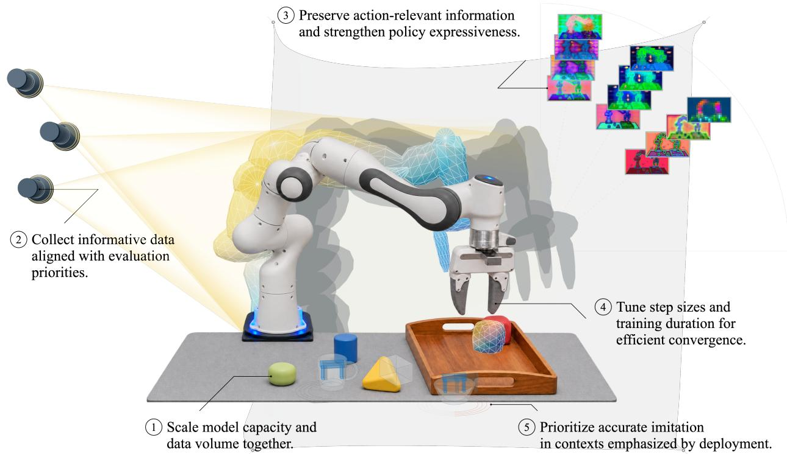

# A Recipe for Physical Action Model Training

Shaojiang Wang1 Geer Yang2,1,3

1Institute of AI for Industries, Chinese Academy of Sciences, Nanjing, China 2Institute of Computing Technology, Chinese Academy of Sciences, Beijing, China 3University of Chinese Academy of Sciences, Beijing, China

## Abstract

Choosing robot model capacity and demonstration budgets also requires decisions about data composition, representation, optimization, and deployment. We connect these decisions through a common conditional-distribution target. Nested learning oracles give exact risk accounting; local information geometry, conditional mutual information, and empirical convergence provide conditional training prescriptions. Known-target numerical checks expose capacity–data coupling, representation-induced mixture mismatch, and an example where deployment KL increases while negative log-likelihood decreases. An analysis of 206 public PushT trajectories evaluates fixed-feature information-design criteria without fitting a policy. Under asymmetric evaluation targets, the selected allocations reduce this criterion by 4.5–6.2% relative to target matching; balanced targets show no benefit. These results clarify which quantities can support training recommendations and when an apparently favorable predictive metric has a diferent interpretation.

## 1 Introduction

Robot behavior cloning couples several resource decisions. Equally sized datasets can provide diferent information about relevant actions; equally sized encoders can preserve diferent information; and converged optimization can leave a poorly matched policy. A useful framework must identify which intervention deserves the next unit of data or compute.

We compare these decisions under one conditional expert-action target. Histories may contain vision, language, proprioception, and past interaction. Holding this target fixed connects capacity, acquisition, representation, optimization, and deployment while keeping their assumptions distinct (Figure 1).

Related work. Prediction-loss scaling depends on data, compute, architecture, and tokenization [8, 9, 14]. Robot studies examine demonstration diversity [13] and distributionally robust mixtures [6]; our acquisition criterion instead specifies a fixed evaluation target. Action-token and continuousaction systems further motivate a common prediction protocol [1, 2, 11]. The analysis connects proper scoring rules, information theory, optimal design, likelihood asymptotics, and conditional optimization guarantees [4, 5, 10, 15, 17].

Contribution. We formulate five conditional training relations with explicit interfaces and distinguish learning risk from approximation and empirical convergence. Complete proofs, knowntarget numerical checks, and a public-trajectory design study show how their prescriptions depend on assumptions. The evidence concerns analytical quantities and state geometry, not trained-policy performance.

  
Figure 1: Five training decisions under a common behavior-cloning objective. The scene is a generatively edited illustration; meshes and projections depict conceptual mappings. The twelve panels show pretrained ResNet-50, CLIP, and $\mathrm { D I N O v 2 }$ features at four depths, visualized by independent RGB PCA. Colors describe within-layer variation rather than shared semantic labels.

## 2 Prediction target and risk accounting

Let H be the available history and A an action under a fixed measurement and decision protocol. An unknown expert ξ has conditional law $p _ { \xi } ( a \mid h )$ and reference history distribution $d _ { E , \xi }$ . The imitation risk is

$$
\mathcal { R } _ { E , \xi } ( \pi ) = \mathbb { E } _ { H \sim d _ { E , \xi } } D _ { \mathrm { K L } } ( p _ { \xi } ( \cdot \mid H ) \| \pi ( \cdot \mid H ) ) .\tag{1}
$$

All logarithms are natural. The action units, chunk duration, decoder, and conditioning variables are common across comparisons. Continuous distributions require a common dominating measure and finite $\operatorname { K L } ;$ a deterministic continuous target is not interchangeable with a smooth density.

For a fixed target with finite entropy and log loss, expected negative log-likelihood (NLL) satisfies $C _ { E } ( \pi ) = { \sf H } _ { E } ( A \mid H ) + { \mathcal R } _ { E } ( \pi )$ . Consequently, diferences between policies on the same target compare imitation risks without knowing expert entropy. Absolute NLL is a predictive metric, not an absolute KL estimate. In closed-loop control the visited histories also depend on the policy, so prediction and task performance remain distinct [16].

Unknown experts and common information. Fix a prior $\rho$ over experts before optimization. A design $q \in \mathcal { Q }$ specifies the acquisition distribution, g a representation, and $\mathcal { A } \in \mathcal { A } _ { N , g }$ a learner with an output-capacity budget N. With data $S _ { D } \sim P _ { \xi , q } ^ { D }$ and learner randomness U, define

$$
\mathcal { B } ( q , g , \mathcal { A } ) = \mathbb { E } _ { \xi \sim \rho , S _ { D } , U } \mathcal { R } _ { E , \xi } \big ( \mathcal { A } ( S _ { D } ; U ) \big ) .\tag{2}
$$

The baseline treats D as independent observations. Trajectory sampling is addressed explicitly in the public-data study. Pretrained information is either common side information or part of the resource budget. Taking an oracle separately for a known expert would permit hard-coding that expert and would not define a learning limit.

For fixed N, D, let

$$
L ^ { ( 0 ) } = \operatorname* { i n f } _ { \substack { q ^ { \prime } , g ^ { \prime } , A ^ { \prime } \in A _ { N , g ^ { \prime } } } } \mathcal { B } ( q ^ { \prime } , g ^ { \prime } , \mathcal { A } ^ { \prime } ) , \qquad L ^ { ( 1 ) } = \operatorname* { i n f } _ { \substack { g ^ { \prime } , A ^ { \prime } \in A _ { N , g ^ { \prime } } } } \mathcal { B } ( q , g ^ { \prime } , \mathcal { A } ^ { \prime } ) ,\tag{3}
$$

$$
L ^ { ( 2 ) } = \operatorname* { i n f } _ { \mathcal { A } ^ { \prime } \in A _ { N , g } } \mathcal { B } ( q , g , \mathcal { A } ^ { \prime } ) , \qquad L ^ { ( 3 ) } = \mathcal { B } ( q , g , \mathcal { A } ) .
$$

For the same expert, data, and learner aggregation, let $L _ { \mathrm { d e p } } = \mathbb { E } _ { \xi , S _ { D } , U } \mathcal { R } _ { \mathrm { d e p } , \xi } ( A ( S _ { D } ; U ) )$ . Define $\Delta _ { \mathrm { d a t a } } = L ^ { ( 1 ) } - L ^ { ( 0 ) } , \Delta _ { \mathrm { r e p r } } = L ^ { ( 2 ) } - L ^ { ( 1 ) } , \Delta _ { \mathrm { a l g } } = L ^ { ( 3 ) } - L ^ { ( 2 ) }$ , and $\Delta _ { \mathrm { s h i f t } } = L _ { \mathrm { d e p } } - L ^ { ( 3 ) }$ . For finite risks and nested feasible classes,

$$
\begin{array} { r } { \boxed { L _ { \mathrm { d e p } } = L ^ { ( 0 ) } + \Delta _ { \mathrm { d a t a } } + \Delta _ { \mathrm { r e p r } } + \Delta _ { \mathrm { a l g } } + \Delta _ { \mathrm { s h i f t } } . } } \end{array}\tag{4}
$$

The first three gaps are nonnegative because restrictions cannot decrease an infimum; the identity follows by telescoping. The shift term is signed. The order is an accounting convention: interactions can change each gap, and $\Delta _ { \mathrm { a l g } }$ includes statistical and regularization efects as well as optimization.

## 3 Five conditional training relations

## 3.1 Capacity and data

Nested policy families and admissible sample subsets imply that $L ^ { ( 0 ) }$ is nonincreasing in either budget. They do not determine an exponent. A candidate response surface is

$$
L ^ { ( 0 ) } ( N , D ) \approx L _ { \infty } + a N ^ { - \alpha } + c D ^ { - \beta } , \qquad a , c , \alpha , \beta > 0 .\tag{5}
$$

If this form is supported over the relevant range and compute obeys $F = \kappa N D$ , an interior allocation satisfies $\alpha a N ^ { - \alpha } = \beta c D ^ { - \beta }$ . Equalizing the two unweighted contributions instead gives a crossover, not generally the compute optimum. Both prescriptions depend on the response and cost models.

An exactly solvable calibration case exposes a diferent capacity–data coupling. Let expert action means be independent $\theta _ { j } \sim \mathcal { N } ( 0 , \tau _ { j } ^ { 2 } )$ , with $\tau _ { 1 } ^ { 2 } \geq \cdot \cdot \cdot \geq \tau _ { m } ^ { 2 } > 0$ , and observe D independent vectors $A _ { r } \sim \mathcal { N } _ { m } ( \theta , \sigma ^ { 2 } I )$ . Policies learn the first N means and fix the rest to zero. The optimal Bayes risk is

$$
L _ { G } ^ { \star } ( N , D ) = \frac { 1 } { 2 \sigma ^ { 2 } } \left[ \sum _ { j > N } \tau _ { j } ^ { 2 } + \sum _ { j = 1 } ^ { N } \frac { \tau _ { j } ^ { 2 } \sigma ^ { 2 } } { \sigma ^ { 2 } + D \tau _ { j } ^ { 2 } } \right] .\tag{6}
$$

Here N counts trainable coordinates and D counts vector observations. The prior spectrum determines the approximation curve, while the estimation term couples both budgets. This supplies a known target for numerical verification, not a fitted neural scaling law. A complementary finite-description bound is given in Appendix B.

## 3.2 Target-weighted data allocation

Fix a regular, identifiable, correctly specified conditional model $p _ { \theta } ( A \mid Z )$ of fixed dimension, where Z is the actual model input. Strata change its input distribution while sharing the same conditional

law. $\mathrm { A t }$ the true parameter, let $F _ { i }$ be the Fisher information of stratum i, $\begin{array} { r } { F ( q ) = \sum _ { i } q _ { i } F _ { i } \succ 0 } \end{array}$ and $G _ { E }$ the evaluation-risk Hessian. Under the moment and remainder assumptions stated in Appendix A,

$$
\mathbb { E } \mathcal { R } _ { E } ( p _ { \hat { \theta } _ { D } } ) = \frac { V ( q ) } { 2 D } + o ( D ^ { - 1 } ) , \qquad V ( q ) = \mathrm { t r } \big [ G _ { E } F ( q ) ^ { - 1 } \big ] .\tag{7}
$$

For fixed admissible $q$ and $q ^ { \star }$ , the leading risk diference is $[ V ( q ) - V ( q ^ { \star } ) ] / ( 2 D )$ . This local comparison holds the model fixed; it is not the globally reoptimized oracle gap in Eq. (4).

For counts $n _ { i }$ and $\begin{array} { r } { \mathcal { I } = \sum _ { i } n _ { i } F _ { i } } \end{array}$ , the marginal value of one sample is

$$
v _ { i } = - \frac { \partial } { \partial n _ { i } } \frac { 1 } { 2 } \operatorname { t r } ( G _ { E } \mathcal { T } ^ { - 1 } ) = \frac { 1 } { 2 } \operatorname { t r } ( G _ { E } \mathcal { T } ^ { - 1 } F _ { i } \mathcal { T } ^ { - 1 } ) .\tag{8}
$$

At a continuous optimum, active strata equalize $v _ { i } / c _ { i }$ , where $c _ { i }$ is acquisition cost. This criterion rewards complementary directions important to evaluation. With dependent trajectories, independent-frame counting is inappropriate; with misspecification, design-dependent bias must also be included [18]. Our public-data study evaluates a specified matrix criterion rather than claiming that it equals a trained policy’s risk.

## 3.3 Representation and policy expressiveness

For a fixed expert joint law and deterministic $Z = g ( H )$ , any policy satisfies

$$
\mathbb { E } _ { H } D _ { \mathrm { K L } } \big ( p ( A \mid H ) \| \pi ( A \mid Z ) \big ) = I \big ( A ; H \mid Z \big ) + \mathbb { E } _ { Z } D _ { \mathrm { K L } } \big ( p ( A \mid Z ) \| \pi ( A \mid Z ) \big ) .\tag{9}
$$

Thus the best N-parameter policy has population approximation floor

$$
\mathcal { E } _ { g } ( N ) = I ( A ; H \mid Z ) + \operatorname* { i n f } _ { \pi \in \Pi _ { g , N } } \mathbb { E } _ { Z } D _ { \mathrm { K L } } ( p ( A \mid Z ) \| \pi ( A \mid Z ) ) .\tag{10}
$$

The first term measures action information discarded before prediction; the second concerns what the policy family can express. Increasing the head alone can address only the second. These are fixed-law population quantities, distinct from finite-data oracle gaps. Moreover, a lossy representation can merge histories with diferent actions. Changing their mixture then changes $p _ { q } ( A \mid Z )$ even if $p ( A \mid H )$ is invariant, coupling data design and representation. Section 4 gives a finite example.

## 3.4 Optimization and generalization

Let empirical NLL $\hat { C } _ { S }$ be $L _ { s }$ -smooth, have finite infimum $\hat { C } _ { S } ^ { \star }$ , and satisfy $\| \nabla \hat { C } _ { S } ( \theta ) \| ^ { 2 } / 2 \geq \mu ( \hat { C } _ { S } ( \theta ) -$ $\hat { C } _ { S } ^ { \star } )$ along full-batch gradient-descent iterates. For $0 < \eta \leq 1 / L _ { s }$

$$
\hat { C } _ { S } ( \theta _ { t } ) - \hat { C } _ { S } ^ { \star } \leq ( 1 - \eta \mu ) ^ { t } [ \hat { C } _ { S } ( \theta _ { 0 } ) - \hat { C } _ { S } ^ { \star } ] .\tag{11}
$$

This is an empirical convergence bound under a Polyak– Lojasiewicz condition [10]. Define the uniform discrepancy between empirical and reference NLL as $u _ { S }$ . An empirical ε-optimal output satisfies

$$
\begin{array} { c } { u _ { S } = \displaystyle \operatorname* { s u p } _ { \pi \in \Pi } | \hat { \boldsymbol C } _ { S } ( \pi ) - { \boldsymbol C } _ { E } ( \pi ) | , } \\ { \mathcal { R } _ { E } ( \pi _ { t } ) - \displaystyle \operatorname* { i n f } _ { \pi \in \Pi } \mathcal { R } _ { E } ( \pi ) \leq \varepsilon + 2 u _ { S } . } \end{array}\tag{12}
$$

Additional steps can reduce optimization error while sampling uncertainty or target mismatch remains. Distinct demonstrations, repeated presentations, stopping rules, and compute therefore require separate accounting.

## 3.5 Deployment contexts

For a fixed policy and expert conditional, write $\ell _ { \pi } ( h ) = D _ { \mathrm { K L } } ( p _ { E } ( \cdot \mid h ) \| \pi ( \cdot \mid h ) )$ . A change of history measure gives

$$
\Delta _ { \mathrm { s h i f t } } ( \pi ) = \int [ d _ { \mathrm { d e p } } ( h ) - d _ { E } ( h ) ] \ell _ { \pi } ( h ) d h .\tag{13}
$$

When $d _ { \mathrm { d e p } } \ll d _ { E }$ , this is $\mathrm { C o v } _ { d _ { E } } ( w , \ell _ { \pi } )$ for $w = d _ { \mathrm { d e p } } / d _ { E }$ . It can have either sign: what matters is the alignment of deployment frequency with local imitation loss. Raw NLL shifts include a second contribution,

$$
C _ { \mathrm { d e p } } ( \pi ) - C _ { E } ( \pi ) = \Delta _ { \mathrm { s h i f t } } ( \pi ) + \int [ d _ { \mathrm { d e p } } ( h ) - d _ { E } ( h ) ] { \sf H } [ p _ { E } ( \cdot \mid h ) ] d h .\tag{14}
$$

The entropy contribution can reverse the observed direction. This fixed-policy identity also difers from comparing policies whose actions induce diferent occupancies.

## 4 Numerical checks

## 4.1 Analytical calibration and counterexamples

We evaluate specified distributions to distinguish the identities’ computational consequences from empirical claims about robot policies. In the Gaussian model, $m = 1 6 , \sigma ^ { 2 } = 1$ , and $\tau _ { j } ^ { 2 } = j ^ { - 1 . 3 }$ Across $N \in \{ 2 , 8 , 1 6 \}$ and $D \in \{ 4 , 1 6 , 6 4 , 2 5 6 \}$ , 100,000 independent draws per setting agree with the exact Bayes risk to within 0.14% relative deviation. The largest discrepancy is 1.25 estimated Monte Carlo standard errors.

A four-context Bernoulli example gives an information-loss term of 0.05123 nats after merging contexts in pairs. Changing the sampling mixture changes the optimal action conditional at that coarsened input, adding a persistent mismatch even though the full-context expert is unchanged. A second calculation holds the policy fixed: target A increases KL by 0.04200 nats while decreasing NLL by 0.06495 nats. The −0.10695-nat conditional-entropy change explains the opposite signs. Thus cross-distribution NLL diferences cannot generally be read as imitation-KL shifts.

Finally, exact trajectories of a positive-definite quadratic satisfy the stated PL bound for the two admissible step sizes; a step above $2 / L _ { s }$ diverges. These checks illustrate the roles of the assumptions and verify the calculations, rather than validate a neural-policy convergence law.

<table><tr><td>Target</td><td>∆KL</td><td>∆H</td><td>∆NLL</td></tr><tr><td>A</td><td>+0.04200</td><td>-0.10695</td><td>-0.06495</td></tr><tr><td>B</td><td>-0.04297</td><td>+0.04410</td><td>+0.00113</td></tr></table>

Table 1: Exact finite-distribution changes in nats for a fixed policy. Conditional-entropy changes account for the diferent KL and NLL signs.

## 5 Information design on public trajectories

## 5.1 Protocol and measured quantity

We examine how public demonstration-state geometry changes an information-design prescription without fitting an action predictor. The LeRobot PushT release contains 206 simulated pushing demonstrations and 25,650 state–action records at 10 Hz [3, 12]. We use the fixed dataset revision 7628202a2180; the full commit and file hashes accompany the code. A fixed episode permutation assigns 144 episodes (17,858 records) to design calibration and 62 episodes (7,792 records) to evaluation. No episode appears in both sets.

We divide the pusher positions at horizontal coordinate 256 into left and right strata. We normalize each position coordinate by dividing by 256 and subtracting 1. The primary fixed feature map is $\phi = ( 1 , x , y , x y , x ^ { 2 } , y ^ { 2 } )$ . We also evaluate $\phi = ( 1 , x , y )$ as a prespecified sensitivity check. For each split s and stratum $i ,$ let $\widehat { F } _ { s , i }$ be the mean of $\phi \phi ^ { \mathsf { T } }$ over its recorded states. These matrices would be Fisher information for a scalar unit-variance linear Gaussian reference model. They are not estimated Fisher matrices of a trained robot policy.

For left-target weights w ∈ {0.2, 0.5, 0.8}, we evaluate

$$
\widehat { V } _ { s } ( q ; w ) = \mathrm { t r } \Big [ \big ( w \widehat { F } _ { s , L } + ( 1 - w ) \widehat { F } _ { s , R } \big ) \big ( q \widehat { F } _ { s , L } + ( 1 - q ) \widehat { F } _ { s , R } + 1 0 ^ { - 6 } I \big ) ^ { - 1 } \Big ] .\tag{15}
$$

The ridge is a declared numerical regularizer, so this is a regularized design criterion. We choose $\hat { q }$ on the calibration split from $\{ 0 . 0 2 0 , 0 . 0 2 5 , \ldots , 0 . 9 8 0 \}$ , then hold it fixed when recomputing the criterion from evaluation states. Comparators are uniform allocation $q = 0 . 5$ , target matching $q = w .$ , and the calibration frame proportion $q = 0 . 5 7 3 6$ . Feature maps, strata, target weights, grid, and split seed were fixed before inspecting the results. All six cases are reported. Uncertainty is assessed with 1,000 paired resamples of whole evaluation episodes, keeping the calibrated allocation fixed; percentile intervals describe held-out moment variability conditional on this calibration split.

<table><tr><td>Basis</td><td>w</td><td>â</td><td>V()</td><td>V(0.5)</td><td>V(w)</td><td>Reduction [95% interval]</td></tr><tr><td>Linear</td><td>0.2</td><td>0.350</td><td>2.864</td><td>3.008</td><td>3.000</td><td>4.52 [3.64, 5.55]</td></tr><tr><td rowspan="5">Quadratic</td><td>0.5</td><td>0.510</td><td>3.001</td><td>3.000</td><td>3.000</td><td>−0.03 [−0.09, 0.04]</td></tr><tr><td>0.8</td><td>0.670</td><td>2.857</td><td>2.992</td><td>3.000</td><td>4.77 [3.87, 5.65]</td></tr><tr><td>0.2</td><td>0.335</td><td>5.704</td><td>6.086</td><td>6.000</td><td>4.93 [4.10, 5.97]</td></tr><tr><td>0.5</td><td>0.500</td><td>6.000</td><td>6.000</td><td>6.000</td><td>0.00 [0.00, 0.00]</td></tr><tr><td>0.8</td><td>0.660</td><td>5.626</td><td>5.914</td><td>6.000</td><td>6.23 [5.13, 7.17]</td></tr></table>

Table 2: Held-out design criteria and relative reductions $1 0 0 [ 1 - V ( \hat { q } ) / V ( w ) ]$ (%). Intervals use paired whole-episode resampling. Positive values favor the calibrated allocation; the quantities describe design geometry rather than policy performance.

## 5.2 Findings and limits

For unequal target weights, the calibrated allocations lie between uniform and target-matched sampling. On the primary quadratic basis they lower the held-out criterion by 4.93% and 6.23% relative to target matching (Table 2). Equal target weights yield no reduction for the quadratic basis and a small negative transfer for the linear basis $( - 0 . 0 3 \%$ , interval spanning zero). Thus adapting allocation is useful in these asymmetric cases, but is not an automatic improvement. The two feature maps give diferent prescriptions, consistent with information design being conditional on the representation.

This analysis uses existing simulated demonstration states and never fits an action distribution. It neither measures expert KL nor tests action success, a neural scaling exponent, or the asymptotic $1 / D$ law. Adjacent frames are correlated; they are not counted as independent demonstrations. The within-stratum moments are frame-weighted, while the uncertainty resampling unit is the episode.

Finally, the hypothetical allocations reweight state strata; physically acquiring those proportions in complete robot trajectories may have additional costs or feasibility constraints.

## 6 Discussion

The five relations describe conditional interventions rather than independent additive mechanisms. Data allocation depends on the representation through its information matrix; changing the representation can alter the conditional target seen by the predictor; and converged training can leave a population gap. A practical comparison must specify what remains fixed at every intervention.

The numerical checks provide known-target tests of the analytical constructions. The publictrajectory study supplies a diferent kind of evidence: measured feature geometry can favor allocations that difer from evaluation frequencies, while balanced targets can yield no improvement. Its criterion is conditional on the chosen features, strata, and covariance model. It does not measure imitation loss, establish learned-policy Fisher information, or demonstrate task success. The distinction matters because a useful geometric design can still be undermined by model bias, representation aliasing, or optimization.

Scope and limitations. The theory applies under the assumptions attached to each relation. Finite-description bounds do not estimate unrestricted neural capacity; local Fisher approximations can fail under singularity, misspecification, or changing features. The data study concerns one public manipulation dataset and fixed state features, rather than language-conditioned or cross-embodiment generalization. Fixed-policy reweighting excludes changes in expert conditionals and policy-induced occupancy. These boundaries motivate future comparisons of predictive likelihood and closed-loop performance as separate outcomes.

## 7 Conclusion

A common prediction target turns broad scaling questions into specific resource-allocation comparisons. Capacity and data interact, useful demonstrations depend on evaluation priorities, representation loss difers from policy approximation, and empirical convergence difers from deployment accuracy. Analytical checks and public-trajectory matrix calculations illustrate these distinctions, including null results and an NLL–KL sign reversal. The resulting prescription is conditional: identify the bottleneck, state what is held fixed, and evaluate the corresponding intervention with the appropriate quantity.

Use of generative AI tools. OpenAI Codex assisted with manuscript drafting and revision, code development, and numerical analysis. Generative image tools assisted with the conceptual illustration in Figure 1. The authors are responsible for the scientific claims, references, and results.

## References

[1] Kevin Black, Noah Brown, Danny Driess, Adnan Esmail, Michael Equi, Chelsea Finn, Niccolo Fusai, Lachy Groom, Karol Hausman, Brian Ichter, Szymon Jakubczak, Tim Jones, Liyiming Ke, Sergey Levine, Adrian Li-Bell, Mohith Mothukuri, Suraj Nair, Karl Pertsch, Lucy Xiaoyang Shi, James Tanner, Quan Vuong, Anna Walling, Haohuan Wang, and Ury Zhilinsky. π0: A vision-language-action flow model for general robot control, 2024. URL https://arxiv.org/ abs/2410.24164.

[2] Anthony Brohan, Noah Brown, Justice Carbajal, Yevgen Chebotar, Xi Chen, Krzysztof Choromanski, Tianli Ding, Danny Driess, Avinava Dubey, Chelsea Finn, et al. RT-2: Visionlanguage-action models transfer web knowledge to robotic control, 2023. URL https://arxiv. org/abs/2307.15818.

[3] Cheng Chi, Siyuan Feng, Yilun Du, Zhenjia Xu, Eric Cousineau, Benjamin Burchfiel, and Shuran Song. Difusion policy: Visuomotor policy learning via action difusion. In Robotics: Science and Systems, 2023. URL https://arxiv.org/abs/2303.04137.

[4] Thomas M. Cover and Joy A. Thomas. Elements of Information Theory. Wiley, 2 edition, 2006. doi: 10.1002/047174882X. URL https://doi.org/10.1002/047174882X.

[5] Tilmann Gneiting and Adrian E. Raftery. Strictly proper scoring rules, prediction, and estimation. Journal of the American Statistical Association, 102(477):359–378, 2007. doi: 10.1198/016214506000001437. URL https://doi.org/10.1198/016214506000001437.

[6] Joey Hejna, Chethan Anand Bhateja, Yichen Jiang, Karl Pertsch, and Dorsa Sadigh. ReMix: Optimizing data mixtures for large scale imitation learning. In Proceedings of The 8th Conference on Robot Learning, volume 270 of Proceedings of Machine Learning Research, pages 145–164. PMLR, 2025. URL https://proceedings.mlr.press/v270/hejna25a.html.

[7] Wassily Hoefding. Probability inequalities for sums of bounded random variables. Journal of the American Statistical Association, 58(301):13–30, 1963. doi: 10.1080/01621459.1963.10500830. URL https://doi.org/10.1080/01621459.1963.10500830.

[8] Jordan Hofmann, Sebastian Borgeaud, Arthur Mensch, Elena Buchatskaya, Trevor Cai, Eliza Rutherford, Diego de Las Casas, Lisa Anne Hendricks, Johannes Welbl, Aidan Clark, Tom Hennigan, Eric Noland, Katie Millican, George van den Driessche, Bogdan Damoc, Aurelia Guy, Simon Osindero, Karen Simonyan, Erich Elsen, Jack W. Rae, Oriol Vinyals, and Laurent Sifre. Training compute-optimal large language models, 2022. URL https: //arxiv.org/abs/2203.15556.

[9] Jared Kaplan, Sam McCandlish, Tom Henighan, Tom B. Brown, Benjamin Chess, Rewon Child, Scott Gray, Alec Radford, Jefrey Wu, and Dario Amodei. Scaling laws for neural language models, 2020. URL https://arxiv.org/abs/2001.08361.

[10] Hamed Karimi, Julie Nutini, and Mark Schmidt. Linear convergence of gradient and proximalgradient methods under the Polyak– Lojasiewicz condition, 2016. URL https://arxiv.org/ abs/1608.04636.

[11] Moo Jin Kim, Karl Pertsch, Siddharth Karamcheti, Ted Xiao, Ashwin Balakrishna, Suraj Nair, Rafael Rafailov, Ethan Foster, Grace Lam, Pannag Sanketi, Quan Vuong, Thomas

Kollar, Benjamin Burchfiel, Russ Tedrake, Dorsa Sadigh, Sergey Levine, Percy Liang, and Chelsea Finn. OpenVLA: An open-source vision-language-action model, 2024. URL https: //arxiv.org/abs/2406.09246.

[12] LeRobot Contributors. PushT demonstration dataset. Hugging Face Datasets, 2024. URL https://huggingface.co/datasets/lerobot/pusht. Revision 7628202a2180; 206 episodes, 25,650 frames.

[13] Fanqi Lin, Yingdong Hu, Pingyue Sheng, Chuan Wen, Jiacheng You, and Yang Gao. Data scaling laws in imitation learning for robotic manipulation, 2024. URL https://arxiv.org/ abs/2410.18647.

[14] Tim Pearce, Tabish Rashid, David Bignell, Raluca Georgescu, Sam Devlin, and Katja Hofmann. Scaling laws for pre-training agents and world models. In Proceedings of the 42nd International Conference on Machine Learning, volume 267 of Proceedings of Machine Learning Research, pages 48542–48562. PMLR, 2025. URL https://proceedings.mlr.press/v267/pearce25a. html.

[15] Friedrich Pukelsheim. Optimal Design of Experiments, volume 50 of Classics in Applied Mathematics. Society for Industrial and Applied Mathematics, 2006. doi: 10.1137/1.9780898719109. URL https://epubs.siam.org/doi/book/10.1137/1.9780898719109.

[16] Stephane Ross, Geofrey Gordon, and Drew Bagnell. A reduction of imitation learning and structured prediction to no-regret online learning. In Proceedings of the Fourteenth International Conference on Artificial Intelligence and Statistics, volume 15 of Proceedings of Machine Learning Research, pages 627–635. PMLR, 2011. URL https://proceedings.mlr.press/ v15/ross11a.html.

[17] A. W. van der Vaart. Asymptotic Statistics, volume 3 of Cambridge Series in Statistical and Probabilistic Mathematics. Cambridge University Press, 1998. doi: 10.1017/CBO9780511802256. URL https://doi.org/10.1017/CBO9780511802256.

[18] Halbert White. Maximum likelihood estimation of misspecified models. Econometrica, 50(1): 1–25, 1982. URL https://www.jstor.org/stable/1912526.

## A Proofs of the conditional relations

## A.1 Gaussian calibration

For Gaussian distributions with common covariance $\sigma ^ { 2 } I$ , the conditional prediction KL is $\lVert \theta -$ $\hat { \theta } \| ^ { 2 } / ( 2 \sigma ^ { 2 } )$ . Given D observations, coordinate j has posterior variance and mean

$$
v _ { j } = ( \tau _ { j } ^ { - 2 } + D / \sigma ^ { 2 } ) ^ { - 1 } , \qquad m _ { j } = v _ { j } ( D / \sigma ^ { 2 } ) \bar { A } _ { j } .\tag{16}
$$

The posterior mean minimizes conditional squared loss in each trainable coordinate, giving Bayes squared error $v _ { j }$ . A coordinate fixed to zero contributes unconditional error $\tau _ { j } ^ { 2 }$ . Summing proves Eq. (6); at $D = 0$ , the posterior means equal zero. Among subsets of N coordinates chosen before observing data, training a coordinate with prior variance x reduces unscaled error by

$$
r ( x ) = { \frac { D x ^ { 2 } } { \sigma ^ { 2 } + D x } } , \qquad r ^ { \prime } ( x ) = { \frac { D x ( 2 \sigma ^ { 2 } + D x ) } { ( \sigma ^ { 2 } + D x ) ^ { 2 } } } \geq 0 .\tag{17}
$$

Thus selecting the largest prior variances is optimal. For fixed N and positive selected variances,

$$
L _ { G } ^ { \star } ( N , D ) = \frac { \sum _ { j > N } \tau _ { j } ^ { 2 } } { 2 \sigma ^ { 2 } } + \frac { N } { 2 D } + O ( D ^ { - 2 } ) .\tag{18}
$$

The expansion need not be uniform when the dimension or selected spectrum changes with D.

## A.2 Conditional compute allocation

Substitute $D = F / ( \kappa N )$ into the reducible terms of Eq. (5). Diferentiating with respect to log N gives

$$
- \alpha a N ^ { - \alpha } + \beta c ( \kappa N / F ) ^ { \beta } .\tag{19}
$$

Its derivative with respect to log N is strictly positive, so the unique positive stationary point is the minimum:

$$
N ^ { \star } = \left( { \frac { \alpha a } { \beta c } } \right) ^ { 1 / ( \alpha + \beta ) } ( F / \kappa ) ^ { \beta / ( \alpha + \beta ) } , \qquad D ^ { \star } = \left( { \frac { \beta c } { \alpha a } } \right) ^ { 1 / ( \alpha + \beta ) } ( F / \kappa ) ^ { \alpha / ( \alpha + \beta ) } .\tag{20}
$$

This interior formula is subject to the feasible budget range. Equalizing $a N ^ { - \alpha }$ and $c D ^ { - \beta }$ instead gives $D _ { \times } ( N ) = ( c / a ) ^ { 1 / \beta } N ^ { \alpha / \beta }$

## A.3 Local information design

Assume the maximum-likelihood estimate is consistent, $\sqrt { D } ( \hat { \theta } _ { D } - \theta _ { 0 } ) \Rightarrow \mathcal { N } ( 0 , F ( q ) ^ { - 1 } )$ , and its scaled second moments converge to $F ( q ) ^ { - 1 }$ . Also assume the expected evaluation-risk Taylor remainder is $o ( D ^ { - 1 } )$ . These are assumptions about the actual conditional model at its fixed input representation, including invariance across strata.

At the true parameter, risk and its gradient vanish. With $u = \widehat { \theta } _ { D } - \theta _ { 0 }$ , Taylor expansion yields $\mathcal { R } _ { E } ( p _ { \hat { \theta } _ { D } } ) = u ^ { \mathsf { T } } G _ { E } u / 2 + r _ { D }$ . Taking expectations and using second-moment convergence gives

$$
{ \cal D } \mathbb { E } [ u ^ { \mathsf { T } } G _ { E } u ] \longrightarrow \mathrm { t r } [ G _ { E } F ( q ) ^ { - 1 } ] ,\tag{21}
$$

which proves Eq. (7). Subtracting expansions proves the comparison for two fixed admissible designs. Asymptotic normality alone does not supply the needed moment or remainder control; optimizing a D-dependent design requires a uniform version.

The matrix derivative $\partial \mathcal { T } ^ { - 1 } / \partial n _ { i } = - \mathcal { T } ^ { - 1 } F _ { i } \mathcal { T } ^ { - 1 }$ proves Eq. (8). Convexity follows from the second directional derivative

$$
\left. { \frac { d ^ { 2 } } { d t ^ { 2 } } } { \frac { 1 } { 2 } } \operatorname { t r } [ G _ { E } ( { \mathcal { T } } + t B ) ^ { - 1 } ] \right| _ { t = 0 } = \operatorname { t r } ( G _ { E } { \mathcal { T } } ^ { - 1 } B { \mathcal { T } } ^ { - 1 } B { \mathcal { T } } ^ { - 1 } ) \geq 0 .\tag{22}
$$

Indeed, the final expression is $\operatorname { t r } ( C X ^ { 2 } )$ , where

$$
C = \mathcal { I } ^ { - 1 / 2 } G _ { E } \mathcal { T } ^ { - 1 / 2 } \succeq 0 , \qquad X = \mathcal { I } ^ { - 1 / 2 } B \mathcal { T } ^ { - 1 / 2 }
$$

and X is symmetric. The KKT conditions therefore equalize $v _ { i } / c _ { i }$ among active strata; inactive strata have no greater value. This concerns the continuous criterion, rather than a noisy finite-batch greedy implementation.

## A.4 Representation and mixture interaction

Insert $p ( A \mid Z )$ into the log-density ratio defining the left side of Eq. (9). The expectation of $\log [ p ( A \mid H ) / p ( A \mid Z ) ]$ is $I ( A ; H \mid Z )$ because $Z = g ( H )$ . The remaining ratio depends only on $( A , Z )$ and has expectation $\mathbb { E } _ { Z } D _ { \mathrm { K L } } ( p ( A \mid Z ) \| \pi ( A \mid Z ) )$ . Taking the policy infimum afects only the second term, proving Eq. (10). The information term vanishes precisely when $Z$ is action suficient, up to null sets.

Proposition A.1 (Mixture-induced aliasing). Let $H = ( Z , S )$ and suppose acquisition changes $p _ { q } ( S \mid Z )$ while preserving $p ( A \mid Z , S )$ . Then

$$
p _ { q } ( A \mid Z ) = \sum _ { s } p ( A \mid Z , S = s ) p _ { q } ( S = s \mid Z ) .\tag{23}
$$

Therefore invariance before discarding S does not imply invariance at the retained input Z.

Proof. The equality is the law of total probability. If two discarded states have distinct conditional action laws and their conditional mixture weights change, the resulting convex combination can change. In the binary-state case it changes whenever the weight changes and the two laws difer.

This gives a direct reason to check conditional invariance after compression before applying a fixed-model information-design theorem.

## A.5 Convergence and population comparison

The descent lemma with $\eta \leq 1 / L _ { s }$ gives

$$
\hat { C } _ { S } ( \theta _ { t + 1 } ) \leq \hat { C } _ { S } ( \theta _ { t } ) - \frac { \eta } { 2 } \| \nabla \hat { C } _ { S } ( \theta _ { t } ) \| ^ { 2 } \leq \hat { C } _ { S } ( \theta _ { t } ) - \eta \mu [ \hat { C } _ { S } ( \theta _ { t } ) - \hat { C } _ { S } ^ { \star } ] .\tag{24}
$$

Subtract the infimum and iterate to obtain Eq. (11). For the population comparison, empirical ε-optimality and uniform deviation imply, for every $\pi \in \Pi$

$$
C _ { E } ( \pi _ { t } ) \le \hat { C } _ { S } ( \pi _ { t } ) + u _ { S } \le \hat { C } _ { S } ( \pi ) + \varepsilon + u _ { S } \le C _ { E } ( \pi ) + \varepsilon + 2 u _ { S } .\tag{25}
$$

Taking the infimum and subtracting the common conditional entropy proves Eq. (12). A finite-data control of $u _ { S }$ requires a separate complexity and sampling argument.

## A.6 Deployment reweighting

Subtracting the two integrals defining reference and deployment risk proves Eq. (13). When $w = d _ { \mathrm { d e p } } / d _ { E }$ exists, $\mathbb { E } _ { d _ { E } } w = 1$ gives $\mathbb { E } _ { d _ { E } } [ ( w - 1 ) \ell _ { \pi } ] = \mathrm { C o v } _ { d _ { E } } ( w , \ell _ { \pi } )$ . Cauchy–Schwarz yields

$$
| \Delta _ { \mathrm { s h i f t } } ( \pi ) | \le \sqrt { \mathrm { V a r } _ { d _ { E } } ( w ) \mathrm { V a r } _ { d _ { E } } ( \ell _ { \pi } ) } .\tag{26}
$$

For each history, expected log loss is the sum of expert conditional entropy and local KL. Integrating their sum against $d _ { \mathrm { d e p } } - d _ { E }$ proves Eq. (14). No entropy cancellation across diferent history laws is assumed.

## B A finite-description capacity guarantee

Fix a finite action alphabet and a codebook $\Pi _ { N }$ of $K _ { N }$ policies before observing the data. Assume $\pi ( a \mid h ) \geq \epsilon > 0$ , let $M = \log ( 1 / \epsilon )$ , and suppose $K _ { N } \le 2 ^ { C _ { N } }$ . Here $C _ { N }$ counts all policy-specific description bits; relating it to a raw parameter count is an additional coding assumption. For IID data from the fixed evaluation joint law, define

$$
a _ { N } = \underset { \xi } { \operatorname* { s u p } } \ \underset { \pi \in \Pi _ { N } } { \operatorname* { m i n } } \ \mathcal { R } _ { \xi } ( \pi ) , \qquad \mathfrak { R } _ { N } ( D ) = \underset { \substack { \boldsymbol { \mathcal { A } } : \boldsymbol { S } _ { D } \mapsto \boldsymbol { \Pi } _ { N } } } { \operatorname* { i n f } } \ \underset { \xi } { \operatorname* { s u p } } \mathbb { E } \mathcal { R } _ { \xi } ( \boldsymbol { \mathcal { A } } ( \boldsymbol { S } _ { D } ) ) .\tag{27}
$$

This minimax statement is separate from the Bayes aggregation in Eq. (2).

Theorem B.1. Under these assumptions,

$$
a _ { N } \leq \Re _ { N } ( D ) \leq a _ { N } + 2 M \sqrt { \frac { \log ( 2 K _ { N } ) } { 2 D } } \leq a _ { N } + 2 M \sqrt { \frac { C _ { N } \log 2 + \log 2 } { 2 D } } .\tag{28}
$$

Proof. Each negative log loss lies in $[ 0 , M ]$ . Hoefding’s lemma bounds each signed empirical deviation by a sub-Gaussian moment generating function with variance proxy $M ^ { 2 } / ( 4 D ) \ [ 7 ]$ . Bounding the maximum over $2 K _ { N }$ signed deviations yields

$$
\mathbb { E } \operatorname* { s u p } _ { \pi \in \Pi _ { N } } | \hat { C } _ { S } ( \pi ) - C ( \pi ) | \leq M \sqrt { \frac { \log ( 2 K _ { N } ) } { 2 D } } .\tag{29}
$$

The empirical-minimizer comparison used above gives excess population cross-entropy at most twice this deviation; expert entropy cancels on the common target. Taking the supremum over experts proves the upper bound. Every output, including a randomized output, has risk at least the best codeword for that expert. Taking the supremum and then the algorithm infimum proves the lower bound. □

The bound separates an approximation curve $a _ { N }$ from a suficient estimation term without specifying a power-law approximation exponent.

## C Numerical specifications

The Gaussian calculation uses independent $\theta _ { j } \sim \mathcal { N } ( 0 , j ^ { - 1 . 3 } )$ and $\bar { A } _ { j } = \theta _ { j } + \varepsilon _ { j } / \sqrt { D }$ with independent standard-normal $\varepsilon _ { j }$ . The posterior mean is $\hat { \theta } _ { j } = D \tau _ { j } ^ { 2 } \bar { A } _ { j } / ( 1 + D \tau _ { j } ^ { 2 } )$ for $j \leq N$ and zero otherwise. We average $\| { \hat { \theta } } - \theta \| ^ { 2 } / 2$ over 100,000 draws. Common random numbers pair the settings; each setting’s draws remain independent. The random seed is 20261112.

The finite example has reference context probabilities (0.1, 0.2, 0.3, 0.4) and Bernoulli expert probabilities (0.05, 0.2, 0.6, 0.9). The representation merges contexts 1, 2 and 3, 4. The two training mixtures are (0.25, 0.05, 0.1, 0.6) and (0.05, 0.5, 0.4, 0.05); their represented action conditionals are computed by exact weighted averaging. For the shift calculation, the fixed policy predicts (0.2, 0.2, 0.7, 0.7), and target mixtures A and B are (0.05, 0.05, 0.05, 0.85) and (0.1, 0.65, 0.2, 0.05). All KL and entropy quantities are exact finite sums in nats.

The quadratic is $f ( x ) = x ^ { \mathsf { T } } \mathrm { d i a g } ( 1 , 4 , 1 2 ) x / 2$ , with $x _ { 0 } = ( 2 , - 1 , 0 . 5 )$ . Thus $\mu = 1$ and $L _ { s } = 1 2$ The objective values are evaluated directly as

$$
f _ { t } = \frac { 1 } { 2 } \sum _ { j } \lambda _ { j } x _ { 0 j } ^ { 2 } ( 1 - \eta \lambda _ { j } ) ^ { 2 t } , \qquad 0 \le t \le 6 0 ,\tag{30}
$$

for $\eta \in \{ 1 / 2 4 , 1 / 1 2 , 0 . 1 8 \}$ . This is a closed-form evaluation of the quadratic recurrence.