# Interpretable machine learning diagnosis of degradation mechanisms in lead-free $\mathrm { R b S n _ { 0 . 5 } G e _ { 0 . 5 } I _ { 3 } }$ solar cells from temperature- and illumination-dependent electrical measurements

Nabanita Sarker1 and Hafiz Imtiaz\*1

1Department of Electrical and Electronic Engineering, Bangladesh University of Engineering and Technology, Dhaka 1205, Bangladesh

\*Email: hafizimtiaz@eee.buet.ac.bd

## Abstract

Machine learning coupled with device simulation is widely used to optimize thin-film solar cells, but almost exclusively in the forward direction, from device parameters to predicted performance. The inverse problem encountered after fabrication, namely identifying the mechanism that limits a given device, is still addressed by manual inspection of characterization data. In this work, both directions are examined for lead-free RbSn0.5Ge0.5I3 solar cells using approximately 42,000 SCAPS-1D simulations. Replacing the Spiro-OMeTAD hole transport layer with CuI increases the simulated power conversion eficiency from 19.6% to 21.6%, almost entirely through the fill factor. Surrogate models trained and tested on a factorial parameter grid substantially overstate their predictive accuracy. An XGBoost regressor attains $R ^ { 2 } = 0 . 9 9 9 7$ on held-out grid points but only 0.58 on independently sampled devices, whereas training on a Latin hypercube design of comparable size restores $R ^ { 2 } = 0 . 9 9 5$ . For the inverse problem, a multi-label classifier identifies which of six degradation mechanisms are present from simulated temperature- and illumination-dependent open-circuit-voltage measurements. It achieves a macro $F _ { 1 }$ score of 0.938, compared to 0.687 for a calibrated physics-rule baseline. The classifier does not, however, generalize to combinations of mechanisms absent from the training set.

## Keywords

lead-free perovskite; $\mathrm { R b S n } _ { 0 . 5 } \mathrm { G e } _ { 0 . 5 } \mathrm { I } _ { 3 } ;$ ; SCAPS-1D; machine learning; defect diagnosis; ideality factor; activation energy; interpretable models

## 1 Introduction

Lead halide perovskite solar cells now exceed 26% eficiency 1. The toxicity of lead, however, remains an obstacle to their deployment, and regulations on hazardous substances make lead-free alternatives a practica as well as an environmental requirement. The search for a substitute has concentrated on the group-14 congeners of lead, and on tin in particular. The reason is that $\mathrm { { S n ^ { 2 + } } }$ reproduces the electronic structure that makes the lead compounds efective absorbers. Stoumpos et al. 2 characterized the tin and lead iodide perovskites side by side. They reported high carrier mobilities and narrower band gaps for the tin compounds, which places these compounds closer to the single-junction optimum. Reviews of the field nevertheless record a persistent gap between this promise and the measured device performance 3. For example, a CsSnI cell without a hole transport layer reached 3.56%, the highest eficiency reported for that absorber at the time 4. The more air-stable, vacancy-ordered $\mathrm { C s _ { 2 } S n I _ { 6 } }$ has been proposed precisely because the parent compound degrades so rapidly5. The cause of this gap is chemical rather than optoelectronic. $\mathrm { { S n ^ { 2 + } } }$ readily oxidizes to $\mathrm { S n } ^ { \mathrm { \Delta \breve { 4 } \mathrm { + } } }$ , which self-dopes the absorber and introduces deep traps. Tin-based devices therefore lose performance on a timescale over which lead-based devices remain stable.

Alloying tin with germanium addresses the oxidation pathway directly rather than merely slowing it. Ju et al. 6 predicted that germanium in a mixed Sn–Ge sublattice oxidizes preferentially and forms a thin native oxide that protects the underlying material. Chen et al. 7 demonstrated this efect experimentally in all-inorganic lead-free cells and attributed their stability to this native-oxide passivation. The tin–germanium family has since been reviewed as a distinct route to stable lead-free absorbers 8. Mixed-cation compositions have also been explored to balance the band gap against stability 9. These approaches complement the surface and bulk passivation strategies developed separately for lead and tin perovskites. Such strategies include ligand-assisted control of crystallization 10 and $\mathrm { { S n X _ { 2 } } }$ additives that modulate the defect population in $\mathrm { { F A S n I _ { 3 } } ^ { 1 1 } }$ . They also include surface treatments that stabilize inorganic $\mathrm { { C s } \mathrm { { P b } \mathrm { { I } _ { 3 } } ^ { 1 2 } } }$ and simultaneous passivation of the bulk and the surface 13. None of these strategies, however, removes the need for an absorber that is intrinsically less prone to oxidation.

$\mathrm { R b S n _ { 0 . 5 } G e _ { 0 . 5 } I _ { 3 } }$ lies at the favorable end of this family. It combines germanium stabilization with a direct band gap of approximately 1.2 eV, strong absorption and low carrier efective masses. It has therefore been identified computationally as a promising absorber 14,15. Related rubidium and cesium germanium compositions have been examined in the same way. Pindolia et al. 16 optimized an inorganic cell based on $\mathrm { R b G e I _ { 3 } }$ , the germanium-only end member, to an eficiency of 10.11%. Nazari et al. 17 combined $\mathrm { C s _ { 0 . 5 } S n _ { 0 . 5 } G e I _ { 3 } }$ with an alloyed $\mathrm { Z n O _ { 0 . 3 } S _ { 0 . 7 } }$ electron transport layer. No experimental $\mathrm { R b S n } _ { 0 . 5 } \mathrm { G e } _ { 0 . 5 } \mathrm { I } _ { 3 }$ device has yet been reported. Every quantitative statement about this absorber, including those made in this work, therefore rests on simulation.

This situation is typical for a candidate absorber, and device simulation with $\mathrm { S C A P S  – 1 D ^ { 1 8 } }$ is the standard method for assessing one. Yasin et al. 19 designed a lead-free heterostructure and raised the eficiency of their simulated cell from 14.34% to 24.81%. They achieved this by lowering the absorber defect density to $1 \times 1 0 ^ { 1 4 } \mathrm { c m ^ { - 3 } }$ and tuning the layer thicknesses. Khatun et al. 20 reported 31.45% for a $\mathrm { C s \mathrm { P b I _ { 3 } / C s S n I _ { 3 } } }$ dual-absorber stack. The same approach is used to screen individual transport materials and to carry first-principles predictions through to a device-level estimate 21,22. Screening of device architectures is equally common. For example, Vaishnavi and Seetharaman 23 compared twenty-one MASnI3 configurations using three electron transport and six hole transport materials, with eficiencies ranging from 14.28% to 24.28%. The method is not purely speculative. Yadav et al. 24 fitted a simulated SnSe device to their own measured J–V and quantum-eficiency curves before extrapolating to 22.69%. However, Saidarsan et al. 25 surveyed approximately 250 published SCAPS studies. They found unrealistic parameter choices and results to be common enough to warrant a corrective review. For this reason, the baseline used here is checked against its published source before any new result is generated.

Because each SCAPS evaluation carries a small but non-negligible computational cost, machine learning is increasingly used to accelerate the associated parameter searches. Mustafa et al. 26 simulated 56,390 CsPbI configurations and trained five regressors, of which XGBoost reached $R ^ { 2 } = 0 . 9 9 9 8$ on held-out test data. They used SHAP to identify absorber thickness and defect density as the key parameters, and they raised the predicted eficiency from 15.15% to 19.16%. Ikram et al. 27 applied the same framework to Sb2S3. They improved a 9.86% baseline to 17.69% and identified a critical bulk defect density of $1 \times 1 0 ^ { 1 6 } \mathrm { c m ^ { - 3 } }$ . Malek et al. 28 optimized eficiency and stability together in a cell without a hole transport layer. They raised the eficiency from 13.7% to 16.84% and reduced the degradation over 1000 h from 6.61% to 2.39%. Ghosh et al. 29 improved a sulfide reference cell from 22.96% to 31.43% by the same approach. Jiang et al. 30 used machine learning to guide the KI doping of MAPbI and fabricated a best device with an eficiency of 20.91%. Finally, Odabaşı and Yıldırım 31 applied the approach to published rather than simulated data and mined the literature for the factors that govern perovskite stability.

Gradient-boosted trees 32 are the usual choice of model. They remain competitive with neural networks when only a small number of simulations is available for training, as comparisons in other simulation-driven domains also show33. The workflow is uniform across this literature. A grid of device parameters is simulated, a regressor is trained to predict the photovoltaic outputs, and $\mathrm { S H A P ^ { 3 \bar { 4 } } }$ or a similar method is used to rank the inputs. Two consequences of this uniformity motivate the present work.

The first consequence concerns the evaluation of such surrogates. When the training and test devices are drawn from the same parameter grid, the held-out accuracy measures agreement at the grid nodes. It does not measure prediction at parameter combinations that the grid never visited. Tree ensembles are, moreover, known to extrapolate poorly beyond the region on which they were fitted 35. Space-filling designs 36 avoid the axis-aligned structure that creates this problem. Nevertheless, the grid protocol remains the default, and the accuracy it reports is the value that is subsequently quoted.

The second consequence concerns a question that the forward workflow does not address. Predicting the outputs of a parameter set answers the question of which parameters a fabricated device should aim for. It does not answer the question that an experimentalist faces after fabrication, namely which mechanism is degrading the device at hand. This inverse question has a long-established experimental $\mathrm { b a s i s ^ { 3 7 , 3 8 } }$ . The temperature dependence of $V _ { \mathrm { O C } }$ yields an activation energy, and a deficit of this activation energy relative to the band gap indicates interface rather than bulk recombination. The ideality factor, obtained from the light-intensity dependence of $V _ { \mathrm { O C } }$ , distinguishes trap-assisted from band-to-band recombination. Both measurements are in routine experimental use. Kim et al. 39 attributed the large $V _ { \mathrm { O C } }$ loss of $\mathrm { C H _ { 3 } N H _ { 3 } S n I _ { 3 } }$ cells to interface rather than bulk recombination on exactly this evidence. Stolterfoht et al. 40 used related measurements to separate the eficiency potential of a perovskite film from the losses imposed by its contacts. Ebadi et al. 41 combined temperature-dependent $V _ { \mathrm { O C } }$ , quantum eficiency and luminescence to identify tail states in a double perovskite. These signatures are nevertheless interpreted by inspection, one device at a time42. They also become ambiguous when several loss mechanisms act together, which is the usual condition in a fabricated cell.

This work addresses both gaps. We first show that the standard evaluation protocol for grid-trained surrogates substantially overstates their accuracy. We also show that space-filling sampling corrects this problem at a lower computational cost. We then train models to invert the problem. From simulated measurements that are experimentally accessible, these models identify which of six modeled degradation mechanisms are present in a device and estimate the severity of the degradation. Together with the healthy reference, this gives seven diagnostic classes. The models are benchmarked against a calibrated implementation of the established physics rules. They are tested against measurement noise and outside their training range. Finally, they are applied to published measurements of tin perovskite devices fabricated by other groups.

The specific contributions of this work are as follows.

1. The sampling-design problem. A quantification of this problem in SCAPS-based surrogate modeling: the same model, trained on the same grid devices, attains $R ^ { 2 } = 0 . 9 9 9 7$ on grid test points but only 0.579 on independently sampled devices.

2. An interpretable diagnostic framework. The framework identifies the degradation mechanisms of a device from $V _ { \mathrm { O C } } ( T )$ and $V _ { \mathrm { O C } } ( \Phi )$ , achieving a macro $F _ { 1 }$ score of 0.938 compared with 0.687 for calibrated physics rules. On single-degradation devices, its forced-choice accuracy is 99% compared with 61%. On devices with two simultaneous mechanisms, its exact-match accuracy is 69% compared with 22%.

3. Practical requirements for applying such models to measured data. Training must include measurement noise, and the analyzed measurement range must match the training range. Abstention should be based on model confidence rather than on the quality of the extracted fits.

4. A loss-channel attribution of the CuI gain. This attribution concerns the eficiency gain obtained by replacing Spiro-OMeTAD with an inorganic CuI hole transport layer in a TiO2-based $\mathrm { R b S n } _ { 0 . 5 } \mathrm { G e } _ { 0 . 5 } \mathrm { I } _ { 3 }$ stack, and separates the contributions of series resistance, absorber defects and hole mobility. Al Amin et al. 43 independently identified CuI as the preferred hole transport layer for this absorber by screening five candidates. The decomposition reported here complements that screening and is not a claim of priority.

## 2 Methods

## 2.1 Device structure and simulation settings

A planar n–i–p device with the structure $\mathrm { F T O / T i O _ { 2 } / R b S n _ { 0 . 5 } G e _ { 0 . 5 } I _ { 3 } / C u I / A u }$ was modeled with SCAPS-1D (version 3.3.12) 18, with $\mathrm { T i O _ { 2 } }$ as the electron transport layer (ETL) and CuI as the hole transport layer (HTL). Unless stated otherwise, all simulations were performed under AM1.5G illumination at $1 0 0 \mathrm { { m W } \mathrm { { c m } ^ { - 2 } } }$ and at a temperature of 300 K. Light enters through the FTO contact, and the p-side of the structure is placed at the left of the simulation domain $( \mathrm { F i g . ~ 1 } )$ , as recommended in the SCAPS manual for numerical stability.

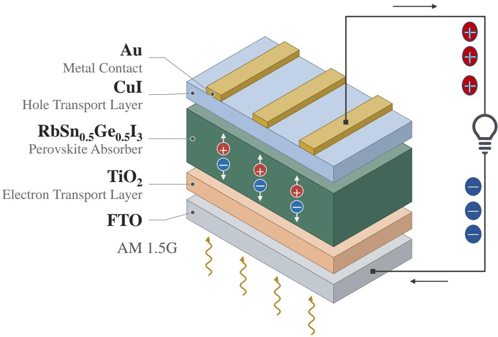  
Figure 1: Schematic of the simulated $\mathrm { F T O / T i O _ { 2 } / R b S n _ { 0 . 5 } G e _ { 0 . 5 } I _ { 3 } / C u I / A u }$ device. Light enters through the FTO front contact; electrons are collected at the FTO contact and holes at the Au contact. Layer thicknesses are not to scale. In the simulation, the p-side is placed at the left of the SCAPS domain, as recommended in the SCAPS manual for numerical stability, and the Au contact is represented as a boundary condition rather than as a layer of finite thickness.

The absorber, $\mathrm { T i O _ { 2 } }$ and FTO parameters were taken from Gomathi $\mathrm { e t ~ a l . ~ } ^ { 1 4 }$ , who studied the same absorber with a Spiro-OMeTAD $\mathrm { H T L } ,$ and the CuI parameters follow Al Amin et $\mathrm { a l . ^ { 4 3 } }$ . Because the relative permittivity of the absorber is not reported in the 2023 study, the value of 6.5 was taken from Laouid et al. 15 , Al Amin et al. 43 . The complete parameter set is listed in Table 1.

Recombination in the absorber comprises Shockley–Read–Hall (SRH), radiative $( 1 \times 1 0 ^ { - 1 1 } \mathrm { c m ^ { 3 } s ^ { - 1 } } )$ and Auger $( 1 \times 1 0 ^ { - 2 8 } \mathrm { c m ^ { 6 } s ^ { - 1 } } )$ channels. Bulk defects are neutral, single-level and located at midgap $( E _ { t } = 0 . 6 \mathrm { e V }$ above $\textstyle E _ { V } )$ , with capture cross-sections $\sigma _ { n } = \sigma _ { p } = 1 \times 1 0 ^ { - 1 5 } \mathrm { c m } ^ { 2 }$ . Each heterointerface contains a neutral midgap defect with the same cross-sections, specified on both sides of the interface. This specification is required because SCAPS assigns separate cross-sections to carriers arriving from the left and right layers, and leaving either side at its default value suppresses recombination at that interface. The baseline series and shunt resistances are 2 and $1 0 0 0 \Omega \mathrm { c m } ^ { 2 }$ , respectively, and the baseline Au work function is $5 . 0 \mathrm { { e V } ; }$ all three quantities are varied from device to device in the diagnostic dataset of Section 2.3. Because the absorption data used in the reference study are not tabulated in the source publication, the absorption coeficient follows the SCAPS $\sqrt { h \nu - E _ { \mathrm { g } } }$ model with $\alpha _ { 0 } = 1 \times 1 0 ^ { 5 } \mathrm { c m } ^ { - 1 }$

Saidarsan et al. 25 surveyed approximately 250 published SCAPS-1D perovskite architectures and found that a substantial fraction report eficiencies exceeding the Shockley–Queisser limit for the stated band gap, an outcome they attributed mainly to the radiative recombination coeficient being left at its SCAPS default of zero. They accordingly recommend that this coeficient be stated explicitly and that simulated results be checked against the limit. In the present work, the radiative coeficient is $1 \times 1 0 ^ { - 1 1 } \mathrm { c m ^ { 3 } s ^ { - 1 } }$ for both the absorber and CuI (Table 1), and the detailed-balance limit was evaluated from the same AM1.5G spectrum file that SCAPS reads. At $E _ { \mathrm { g } } = 1 . 2 \mathrm { e V }$ , the limit corresponds to $V _ { \mathrm { O C } } = 0 . 9 5 0 \mathrm { V } , J _ { \mathrm { S C } } = 3 8 . 7 1 \mathrm { m A c m ^ { - 2 } }$ $\mathrm { F F } = 8 7 . 7 \%$ and $\eta = 3 2 . 3 \% ;$ as a check, the same calculation yields 33.5% at 1.34 eV, compared with the commonly quoted value of 33.7%. No device in any of the datasets generated here exceeds the limit in any of these four quantities. The highest values encountered are $V _ { \mathrm { O C } } = 0 . 9 0 9 \mathrm { V } , J _ { \mathrm { S C } } = 3 7 . 9 1 \mathrm { m A c m ^ { - 2 } }$ $\mathrm { F F } = 8 4 . 1 \%$ and $\eta = 2 7 . 3 \%$ , and the best SCAPS-verified candidate of Section 3.2 reaches 71% of the detailed-balance

Table 1: Baseline layer parameters of the simulated FTO $\mathrm { / T i O _ { 2 } / R b S n _ { 0 . 5 } G e _ { 0 . 5 } I _ { 3 } / C u I / A u }$ device, read from the SCAPS definition file used for all simulations. A value of zero indicates that the mechanism is disabled for that layer, not a missing value. Several parameters are overridden in individual runs, as described in Section 2.3. Absorber, $\mathrm { T i O _ { 2 } }$ and FTO values follow Gomathi et al. 14 , and CuI values follow Al Amin et al. 43 ; the absorber permittivity, which Gomathi et al. 14 do not report, is taken from Laouid et al. 15 , Al Amin et al. 43 .
<table><tr><td>Parameter</td><td>FTO</td><td> $\mathrm { T i O _ { 2 } }$ </td><td> $\mathrm { R b S n } _ { 0 . 5 } \mathrm { G e } _ { 0 . 5 } \mathrm { I } _ { 3 }$ </td><td>CuI</td></tr><tr><td>Thickness  $\left( \mathrm { { \textmu m } } \right)$ </td><td>0.4</td><td>0.02</td><td>0.35</td><td>0.1</td></tr><tr><td>Band gap  $E _ { \mathrm { g } } \ ( \mathrm { e V } )$ </td><td>3.3</td><td>3.0</td><td>1.2</td><td>3.1</td></tr><tr><td>Electron affinity χ (eV)</td><td>4.1</td><td>4.0</td><td>4.0</td><td>2.1</td></tr><tr><td> $\mathrm { R e l a t i v e ~ p e r m i t t i v i t y } \ : \varepsilon _ { r }$ </td><td>9</td><td>9</td><td>6.5</td><td>6.5</td></tr><tr><td> $N _ { C } \ \mathrm { ( c m ^ { - 3 } ) }$ </td><td> $1 . 2 \times 1 0 ^ { 1 8 }$ </td><td> $1 . 2 \times 1 0 ^ { 1 9 }$ </td><td> $2 \times 1 0 ^ { 1 8 }$ </td><td> $2 . 8 \times 1 0 ^ { 1 9 }$ </td></tr><tr><td> $N _ { V } \ \mathrm { ( c m ^ { - 3 } ) }$ </td><td> $1 . 8 \times 1 0 ^ { 1 9 }$ </td><td> $1 . 8 \times 1 0 ^ { 1 9 }$ </td><td> $1 \times 1 0 ^ { 1 9 }$ </td><td> $1 \times 1 0 ^ { 1 9 }$ </td></tr><tr><td> $\mu _ { e } \ \mathrm { ( c m ^ { 2 } V ^ { - 1 } s ^ { - 1 } ) }$ </td><td>50</td><td>0.001</td><td>20</td><td>100</td></tr><tr><td> $\mu _ { h } \ \mathrm { ( c m ^ { 2 } V ^ { - 1 } s ^ { - 1 } ) }$ </td><td>50</td><td>0.001</td><td>20</td><td>43.9</td></tr><tr><td> $N _ { A } \ \mathrm { ( c m ^ { - 3 } ) }$ </td><td>0</td><td>0</td><td> $1 \times 1 0 ^ { 1 5 }$ </td><td> $1 \times 1 0 ^ { 1 8 }$ </td></tr><tr><td> $N _ { D } \ \mathrm { ( c m ^ { - 3 } ) }$ </td><td> $1 \times 1 0 ^ { 1 8 }$ </td><td> $1 \times 1 0 ^ { 1 8 }$ </td><td>0</td><td>0</td></tr><tr><td>Radiative coeff.  $\left( \mathrm { c m ^ { 3 } s ^ { - 1 } } \right)$ </td><td>0</td><td>0</td><td> $1 \times 1 0 ^ { - 1 1 }$ </td><td> $1 \times 1 0 ^ { - 1 1 }$ </td></tr><tr><td>Auger coeff.  $( \mathrm { c m } ^ { 6 } \mathrm { s } ^ { - 1 } )$ </td><td>0</td><td>0</td><td> $1 \times 1 0 ^ { - 2 8 }$ </td><td>0</td></tr></table>

eficiency.

## 2.2 Baseline check against the reference simulation

Before any data were generated, the Spiro-OMeTAD reference device of Gomathi et al. 14 was compared with the values reported in that study: an optimum absorber thickness near 300 nm, with $V _ { \mathrm { O C } } = 0 . 8 5 5 \mathrm { V } .$ , a JSC saturating at $3 8 . 5 \mathrm { m A c m ^ { - 2 } }$ , an FF of 82.36% and an eficiency of 27.1%. For a bulk defect density of $1 \times 1 0 ^ { 1 4 } \mathrm { c m ^ { - 3 } }$ , our model of the same structure reaches an eficiency of 20.2% at 0.6 µm. At the reported optimum of 300 nm, it yields $V _ { \mathrm { O C } } = 0 . 8 8 7 \mathrm { V }$ $J _ { \mathrm { S C } } = 3 2 . 0 \mathrm { m A c m ^ { - 2 } }$ , an FF of 67.2% and an eficiency of 19.1%. This comparison is made against the reported values and does not constitute a reproduction of the published figures: Fig. 4 of Gomathi et al. 14 is a one-dimensional thickness sweep and its Fig. 5 a contour plot against carrier lifetime, whereas the second axis in the present analysis is the bulk defect density, which is related to, but not identical with, the lifetime.

The fill-factor diference was apportioned among individual loss channels by removing each channel separately from the same baseline. Series resistance accounts for 6.0 points, absorber defects for 5.2 points, the low hole mobility of Spiro-OMeTAD $( 1 \times 1 0 ^ { - 4 } \mathrm { c m ^ { 2 } V ^ { - 1 } s ^ { - 1 } } )$ for 7.2 points and shunt leakage for 1.0 point, whereas the $\mathrm { T i O _ { 2 } }$ mobility contributes 0.05 points, which is not a measurable efect. Removing the channels cumulatively yields a total of 20.7 points, compared with 19.4 points for the sum of the individual contributions. The channels therefore interact, and neither figure constitutes an exact decomposition. Series and shunt resistance are reported separately because their contributions difer by a factor of six.

With every tested loss channel removed, the model reaches 26.0%, compared with the reported 27.1%. This agreement, however, arises from compensating discrepancies: our $J _ { \mathrm { S C } }$ is $6 . 4 \mathrm { m A c m ^ { - 2 } }$ lower than the reported value, whereas our FF is 5.6 points higher and our $V _ { \mathrm { O C } }$ is 67 mV higher. The $J _ { \mathrm { S C } }$ shortfall at 300 nm is the largest single diference and is unafected by any of the tested loss channels. Our $J _ { \mathrm { S C } }$ nonetheless reaches $3 7 . 9 \mathrm { { m A } \mathrm { { c m } ^ { - 2 } } }$ at 1.0 µm, close to the reported saturation value, which points to the absorption model, rather than to recombination or transport, as the source of the diference. Table 1 of Gomathi et al. 14 attributes the absorption of the absorber to Ju et al. 6 without specifying a functional form, and its text describes the absorption as constant and uniform, with an internal quantum eficiency of 100%. The present model, in contrast, uses the SCAPS $\sqrt { h \nu - E _ { \mathrm { g } } }$ law with $\alpha _ { 0 } = 1 \times 1 0 ^ { 5 } \mathrm { c m } ^ { - 1 }$ . This diference cannot be tested through the script interface, which does not expose the absorption parameters. The model therefore reproduces the qualitative thickness dependence of the reference device and its $J _ { \mathrm { S C } }$ at large thickness, but not the published photovoltaic parameters quantitatively, and the remaining diference is not attributed to a single cause.

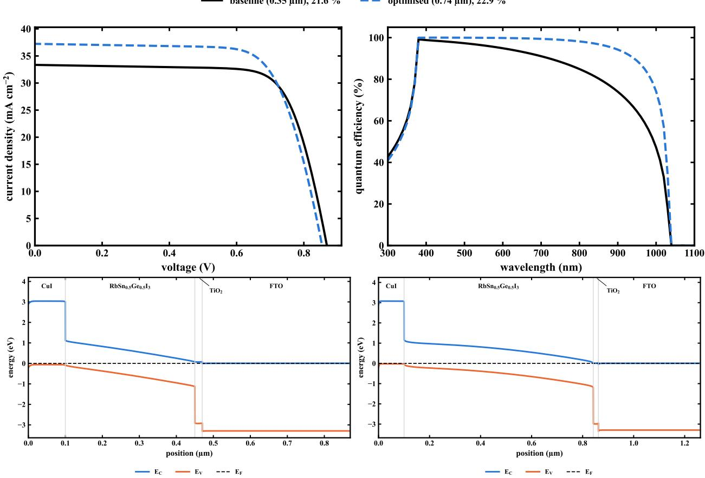  
Figure 2: Baseline $\mathrm { F T O / T i O _ { 2 } / R b S n _ { 0 . 5 } G e _ { 0 . 5 } I _ { 3 } / C u I / A u }$ device, including the interface defects described in Section 2.1. Top: simulated J–V curves and external quantum eficiency of the baseline device (21.6%) and the surrogate-optimized device (22.9%). Bottom: equilibrium band diagrams of the baseline device (left) and the surrogate-optimized device (right).

Replacing Spiro-OMeTAD with CuI removes most of the transport loss: at an absorber thickness of 0.35 µm, the fill factor increases from 68.1% to 74.6% and the eficiency from 19.6% to 21.6%. Both HTL configurations are defined through the same set of layer parameters, so that the two devices are matched in every property controlled by the script. The comparison is made on the final device definition, which includes the interface defects described in Section 2.1; the CuI device in this comparison is therefore the baseline for every dataset in Section 2.3 and the device shown in Fig. 2. Reported values of the absorber mobility range from $ { 2 \mathrm { c m } ^ { 2 } \mathrm { V } ^ { - 1 } \mathrm { s } ^ { - 1 } \mathrm { t o } 2 0 \mathrm { c m } ^ { 2 } \mathrm { V } ^ { - 1 } \mathrm { s } ^ { - 1 } }$ . Switching between the two values changed the eficiency of either device by less than 0.05 percentage points, so the results are insensitive to this choice. The resulting J–V and quantum-eficiency curves are shown in Fig. 2, together with the equilibrium band diagrams.

## 2.3 Dataset generation

All simulations were performed through the SCAPS script interface, with several instances running in parallel; a single J–V calculation requires approximately 1.5 s. In total, 42,238 simulations were attempted, of which 297 (0.7%) failed to converge, all within the diagnostic datasets described below. Every value reported in this work is obtained from a converged run, and a per-batch ledger that reconciles this total with the stored run records is included with the data (see Data availability).

Forward dataset (Part 1) Six inputs were varied: the absorber thickness (0.2 µm to 1.0 µm), the absorber bulk defect density $( 1 \times 1 0 ^ { 1 4 } \mathrm { c m } ^ { - 3 } \mathrm { \dot { \ t o } ~ 1 \times 1 0 ^ { 1 7 } c m ^ { - 3 } ) }$ , the interface defect densities at both heterojunctions $( 1 \times 1 0 ^ { 1 0 } \mathrm { c m } ^ { - 2 } \mathrm { t o } 1 \times 1 0 ^ { 1 3 } \mathrm { c m } ^ { - 2 } )$ , and the doping densities of $\mathrm { T i O _ { 2 } }$ and CuI $( 1 \times 1 0 ^ { 1 6 } \mathrm { c m } ^ { - 3 } \mathrm { t o } 1 \times 1 0 ^ { 1 9 } \mathrm { c m } ^ { - 3 } )$ Three datasets were generated: a full factorial grid with four levels per input (4,096 devices), a space-filling Latin hypercube set of 3,000 devices 36, and an independent Latin hypercube test set of 300 devices drawn with a diferent random seed. All of these simulations converged. In both the grid and the space-filling datasets, most of the linear signal is carried by the bulk defect density and the absorber thickness, whereas the transport-layer doping densities are nearly uncorrelated with the outputs, which accounts for the poor performance of the linear model in Table 2.

Diagnostic dataset (Part 2) Each device was assigned labels from seven diagnostic classes: a healthy reference class and six introduced degradation mechanisms, namely bulk defects, ETL-side interface defects, HTL-side interface defects, a back-contact barrier, low absorber mobility and parasitic resistance. A mechanism was introduced by degrading the corresponding parameter, while all remaining parameters were drawn at random from their healthy ranges. A label therefore records the parameter that was deliberately degraded, which is not necessarily the mechanism that dominates the losses of that device.

This correspondence was verified directly by simulation. For 72 single-degradation training devices (twelve per class), only the labeled parameter was restored to the middle of its healthy range. Depending on the class, this restoration raises the eficiency by 1.8–11.8 percentage points and brings 97% of the devices within the eficiency range of the healthy population and 92% above its 5th percentile. In 8% of cases, the gain is below one percentage point, indicating that the labeled parameter was degraded but has little efect on the eficiency. The restoration is a defined intervention rather than a reconstruction of the original healthy value of the device, which the generator overwrites. It therefore quantifies the eficiency cost of the intervention and does not attribute the total losses of a device to a single mechanism.

The labels are a weaker indicator of the dominant loss when several mechanisms coexist. In 39 multi-defect devices, each label was restored individually, and the result was compared with restoring all labels together. A single label accounts for a median of 0.40 of the recoverable eficiency loss, and 37% of the labels account for less than one quarter of it. The two interface classes are the weakest, with median fractions of 0.13 for the ETL side and 0.005 for the HTL side, compared with 0.71 for bulk defects and 0.64 for the back barrier. The HTL interface also produces the smallest eficiency loss when it acts alone (mean gain 1.8 points, negligible in one third of the devices), which is consistent with its being the class that the diagnostic model identifies least reliably (Section 3.3).

Two classes represent grouped interventions rather than single physical parameters. The parasitic-resistance class degrades the series and shunt resistances together, so the framework identifies resistive losses as a group and cannot attribute a device to series or shunt resistance individually. This grouping entails a genuine loss of information, since removing the two resistances independently from the reference device changes the fill factor by 6.0 and 1.0 points, respectively. Similarly, the low-mobility class sets the electron and hole mobilities together, so that restoring this class tests a combined transport intervention rather than the transport of a single carrier type.

The background parameters carry no label information on their own: a classifier trained on these parameters alone reaches a macro-averaged $F _ { 1 }$ score (macro $F _ { 1 } )$ of only 0.031. Thirty percent of the devices received two simultaneous defects, which makes the task a multi-label classification problem. Each device was simulated at five temperatures (300 K to 400 K at 1 sun) and at five light intensities (0.01–1 sun at 300 K); because the standard condition is shared, this amounts to nine runs per device. Temperatures below approximately 290 K were avoided because SCAPS convergence deteriorates in that range, as also noted in the reference study.

A second, more demanding dataset was generated after the initial analysis showed that measured devices are considerably more degraded than the simulated population. In this dataset, bulk defect densities extend to $1 \times 1 0 ^ { 1 8 } \mathrm { c m ^ { - 3 } }$ , interface defect densities to $1 \times 1 0 ^ { 1 4 } \mathrm { c m ^ { - 2 } }$ and back-contact work functions down to 4.0 eV, and 55% of the devices exhibit two or three simultaneous losses. The two diagnostic datasets comprise 2,000 and 1,200 training devices and 300 and 200 test devices, respectively. In the first dataset, 0.15% of the runs failed to converge, compared with 2.2% in the harder dataset, mostly at 0.01 sun. Devices with any failed condition were discarded, which removed 6% of the intended population, so the coverage of the most degraded devices is limited by convergence rather than by design.

## 2.4 Features and models

The forward and inverse directions share the same device structure and simulation settings but use separate datasets. The forward direction follows the established workflow, in which device parameters are simulated and a surrogate model predicts the photovoltaic outputs. The inverse direction starts from curves that can be measured in the laboratory, reduces them to physically interpretable descriptors, and returns the degradation mechanisms present together with their severity.

The forward models predict $V _ { \mathrm { O C } } , \ J _ { \mathrm { S C } }$ , FF and PCE from the six device parameters, with the defect and doping densities log-transformed. Five regressors were compared: linear regression, quadratic regression, random forest, XGBoost 32 and a multilayer perceptron (MLP). The models were evaluated with a 75/25 train–test split and with repeated five-fold cross-validation, and they were interpreted with SH $\mathrm { A P ^ { 3 4 } }$ . XGBoost was used through its own library, and all other models were implemented with scikit-learn 44.

The diagnostic models use only quantities that correspond to laboratory measurements. Every input is derived from simulated $J { - } V$ curves at a set temperature and illumination intensity, as obtainable with a solar simulator equipped with a temperature stage and neutral-density filters, and no internal simulation variable, such as the carrier density, the recombination rate or the band profile, is used. The inputs are nevertheless not direct readings: the activation energy, the ideality factor and the various slopes are inferred from measured points through a fitting model and inherit its assumptions. In particular, $E _ { \mathrm { a } }$ is the zero-temperature intercept of a linear fit to $V _ { \mathrm { O C } } ( T )$ between 300 and 400 K. This intercept equals the activation energy of the dominant recombination path only if that path remains dominant across the fitted range and the temperature dependence of the band gap and of the efective densities of states is negligible. The quality of the fit is therefore included as a feature in its own right, and the linearity requirement is stated explicitly in Section 3.8. Similarly, the ideality factor assumes that $V _ { \mathrm { O C } }$ varies logarithmically with illumination over the fitted intensity range. The prediction targets, in contrast, are SCAPS input parameters. The bulk and interface defect densities are known by construction in simulation, whereas in a real device they would have to be determined independently, for example by space-charge-limited-current or admittance measurements.

The fifteen input features fall into three groups:

• Temperature series (six features): the activation energy $E _ { \mathrm { a } } ,$ obtained by linear extrapolation of $V _ { \mathrm { O C } } ( T )$ to 0 K; its deficit $E _ { \mathrm { a } } - E _ { \mathrm { g } }$ relative to the absorber band gap; $\mathrm { d } V _ { \mathrm { O C } } / \mathrm { d } T$ and the linearity of that fit; $\mathrm { d F F / d } T ;$ and the relative $\mathrm { d } J _ { \mathrm { S C } } / \mathrm { d } T$

• Intensity series (five features): the ideality factor obtained from $\mathrm { d } V _ { \mathrm { O C } } / \mathrm { d }$ ln Φ, together with the linearity and curvature of that fit; the fill-factor slope dFF/d ln Φ; and the ratio of $J _ { \mathrm { S C } }$ per sun between the brightest and the dimmest illumination.

• Standard test conditions (four features): $V _ { \mathrm { O C } } , J _ { \mathrm { S C } } , \mathrm { F F }$ and PCE.

Diagnostic classifier and metrics The seven classes are predicted by independent one-versus-rest models, so that a device can receive more than one label. Performance is reported mainly as the macro $F _ { 1 }$ score, defined as the unweighted mean of the per-class $F _ { 1 }$ scores. Exact-match accuracy is defined as the fraction of devices whose predicted label set is identical to the true label set.

Physics-rule baseline Kumar and $\mathrm { R a n j a n } ^ { 4 2 }$ describe the signatures that individual device shortcomings leave in $V _ { \mathrm { O C } } ( T )$ and $V _ { \mathrm { O C } } ( \Phi )$ , but they read these signatures qualitatively from plots and do not specify numerical decision rules. A rule set codifying those signatures was therefore implemented, with every threshold calibrated on the healthy devices of the training set (5th and 95th percentiles) rather than chosen by hand, so that the comparison does not depend on an arbitrary choice of cut-of values. An ideality factor above the healthy range indicates parasitic resistance; an $E _ { \mathrm { a } }$ below the healthy range indicates a contact barrier; a low $V _ { \mathrm { O C } }$ with a steep $\mathrm { d } V _ { \mathrm { O C } } / \mathrm { d } T$ indicates bulk recombination; a low $V _ { \mathrm { O C } }$ with a low ideality factor indicates interface recombination; and a low FF at normal $V _ { \mathrm { O C } }$ indicates a transport limitation. Because the rules cannot distinguish which interface is responsible, they are credited with a correct answer if either interface class is true. In practice, this concession has no efect: no device is predicted as exactly the two interface classes, and scoring with and without it gives the same exact-match accuracy of 58.8%.

Table 2: Coeficient of determination $( R ^ { 2 } )$ for PCE prediction by five models trained on the same 3,072 grid devices and scored on two test sets. The two columns difer only in the location of the test devices.
<table><tr><td>Model Held-out grid (1,024) Off-grid (300)</td></tr><tr><td>XGBoost 0.9997 0.579</td></tr><tr><td>Random forest 0.9987 0.811</td></tr><tr><td>MLP 0.9979 0.994</td></tr><tr><td>Quadratic 0.9689 0.955</td></tr><tr><td>Linear 0.8024 0.725</td></tr></table>

Measurement noise was applied to the simulated $V _ { \mathrm { O C } } .$ , temperature, intensity, $J _ { \mathrm { S C } }$ and FF values before the features were computed, with magnitudes of 3 mV, 1 K, 5%, 2% and $1 \% ,$ respectively. In the robustness study (Section 3.5), these magnitudes were scaled by a common multiplier.

## 3 Results and discussion

## 3.1 Surrogate accuracy depends on how the parameter space is sampled

When trained on 75% of the factorial grid and tested on the remaining 25%, XGBoost predicts PCE with $R ^ { 2 } = 0 . 9 9 9 7$ (RMSE 0.06% absolute), the highest score among the five models on this test. Both the ranking and the magnitude agree with previous SCAPS-based machine-learning studies, which report 0.9998 for $\mathrm { C s } \mathrm { P b } { \mathrm { I } } _ { 3 }$ and 0.997 for $\mathrm { S b _ { 2 } S _ { 3 } }$ for the same model under the same $7 5 / 2 5$ protocol 26,27. The present value is thus typical of the field, and the analysis that follows concerns the evaluation protocol rather than any particular study. The same concern applies to the one-factor-at-a-time sweeps that remain common in purely numerical studies of this absorber43, which explore an even smaller part of the parameter space than a factorial grid. When the same model is evaluated on 300 independent devices drawn at random from the same parameter ranges, however, its $R ^ { 2 }$ falls to 0.579, and its $J _ { \mathrm { S C } }$ prediction fails entirely $( R ^ { 2 } = - 0 . 3 4 )$

Both values are obtained from a single model trained on a single dataset and difer only in the location of the test devices. Table 2 lists the corresponding PCE results for all five models, each fitted to the same 3,072 grid devices (the 75% split used throughout this section) and scored on both test sets. This design ensures that the decline in accuracy is not an artifact of training-set size or of a comparison across experiments. The tree-based models, whose predictions are piecewise constant, lose most of their accuracy of the grid, whereas the smooth models retain it.

The test devices were drawn by Latin hypercube sampling on the natural scale of each parameter: log-uniformly for the five density parameters, whose grid levels are spaced by decades, and uniformly for the absorber thickness. Every sampled value lies within the parameter box of the grid, so the comparison measures interpolation between grid nodes rather than extrapolation beyond them. All 300 test simulations converged, as did all 4,096 grid simulations and all 3,000 space-filling simulations; consequently, no selection based on convergence afects the comparison.

The cause of this decline is structural. With four levels per input, a tree ensemble can place split points only between grid values, so its predictions are piecewise constant across precisely the regions that the grid does not sample35. Training the same model on the 3,000 space-filling devices, a slightly smaller training set than the 3,072 grid devices, restores the of-grid accuracy to $R ^ { 2 } = 0 . 9 9 5$ , with a bootstrap 95% confidence interval of 0.993–0.997 (Fig. 3). This interval lies far from the grid-trained value of 0.579, so the contrast greatly exceeds the sampling uncertainty of the test set.

Because the two training sets difer in size as well as in design, a control experiment was performed with 2,500 devices drawn from each set, using three independent draws per strategy. In this experiment, grid-trained XGBoost reaches $R ^ { 2 } = 0 . 5 8 2 \pm 0 . 0 0 2$ of the grid and space-filling-trained XGBoost reaches $0 . 9 9 4 0 \pm 0 . 0 0 0 2$ , close to the values obtained with the full training sets (0.579 and 0.995 in Fig. 3). The spread over draws is two orders of magnitude smaller than the diference between the strategies, which confirms that the efect arises from the sampling design rather than from the number of simulations.

An important practical consequence is that this deficiency cannot be detected from within the grid.

Five-fold cross-validation within the full grid ranks XGBoost first $( R ^ { 2 } = 0 . 9 9 9 8 )$ , followed by the random forest (0.9984) and the MLP (0.9981), whereas the same three models, trained on the full grid and tested of the grid, are ranked in exactly the reverse order $( R ^ { 2 } = 0 . 5 8 0 , 0 . 8 1 2$ and 0.994, respectively). Cross-validation within the space-filling training set, by contrast, reproduces the of-grid ranking (0.9969, 0.9947 and 0.9856 for the MLP, XGBoost and random forest, respectively). A practitioner who samples on a grid and selects a model by cross-validation will therefore tend to choose the model that generalizes worst between the grid points.

The value of 0.579 thus characterizes a grid-trained surrogate on devices located between the grid nodes; it is not the accuracy of the surrogates recommended in this work. When trained on a space-filling design of comparable size, the same architectures reach 0.995 (XGBoost) and 0.997 (MLP) on the same independent devices. These values are comparable to those reported in the literature for grid test points, but they are obtained here on an independent test set, which grid sampling does not provide.

Two qualifications apply. First, the space-filling model can also be scored on the 4,096 grid nodes, where XGBoost reaches $R ^ { 2 } = 0 . 9 7 7$ and the MLP 0.992. Although these nodes are excluded from its training, they form a structured lattice rather than an independent sample from the test distribution, and this result is therefore not treated as a third measure of generalization. Second, the 4,096 grid devices, the 3,000 space-filling devices and the 300 test devices were all generated from the same definition file, with the same parameter mappings and the same fixed device settings, and no configuration is shared between any training set and any test set. The contrast therefore cannot be attributed to a diference in simulation setup.

All of the above results concern interpolation. Genuine extrapolation reduces the accuracy further, but only moderately: when the models are trained only on absorbers thinner than 0.6 µm and tested on thicker ones, XGBoost reaches $R ^ { 2 } = 0 . 9 8 2$ and the MLP 0.950, compared with interpolation values of 0.990 and 0.996 in the same experiment.

With space-filling training, the model ranking also changes. The MLP becomes the most accurate model for PCE $( R ^ { 2 } = 0 . 9 9 6 7$ on the held-out split and 0.9973 of the grid), followed by XGBoost (0.9945 and 0.9950, respectively). The MLP also leads for $V _ { \mathrm { O C } }$ and FF, whereas XGBoost remains the best model for $J _ { \mathrm { S C } }$ Because the margins are small (at most 0.003 in $R ^ { 2 } )$ , no general superiority of one architecture is claimed; the grid-based ranking reported in the literature reflects the test design rather than intrinsic properties of the models. The SHAP attributions below are computed for the XGBoost model, for which exact tree-based attributions are available.

As a consistency check on the four separately trained models, the product $V _ { \mathrm { O C } } \times J _ { \mathrm { S C } } \times \mathrm { F F }$ of the predicted values was compared with the separately predicted PCE. The two agree to within 0.10% absolute on average, with a maximum deviation of 0.68%, whereas the corresponding SCAPS outputs are exactly consistent by construction.

The leading SHAP ranking is qualitatively stable with respect to the sampling design, although the attributed magnitudes change. Bulk defect density dominates PCE under both designs, accounting for 47% of the total SHAP magnitude with grid training and 57% with space-filling training, followed by absorber thickness with 25% and 18%, respectively; all values are computed on held-out devices only (Fig. 4). The ordering of the leading inputs obtained from grid-trained models thus survives the change of design, even though their reported accuracy does not. SHAP attributions quantify the contribution of each input to the model prediction; although they are consistent with the device physics in this case, they do not by themselves constitute causal evidence.

The sampling result has implications beyond this device. Tree ensembles are the most widely used regressors in SCAPS-based studies, and the factorial grid is the most widely used design. This combination produces test points that coincide with the training levels, so that the reported accuracy measures agreement at the grid nodes rather than the ability to interpolate between them. The physical conclusions of such studies are not invalidated, and the SHAP rankings obtained here are the same for both designs; the reported $R ^ { 2 }$ values should not, however, be interpreted as predictive accuracy for devices between the grid points. Space-filling designs remove this problem, and in this work they also required fewer simulations in total (3,000 compared with 4,096).

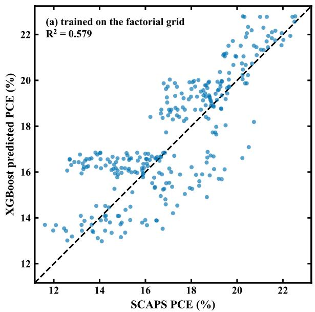

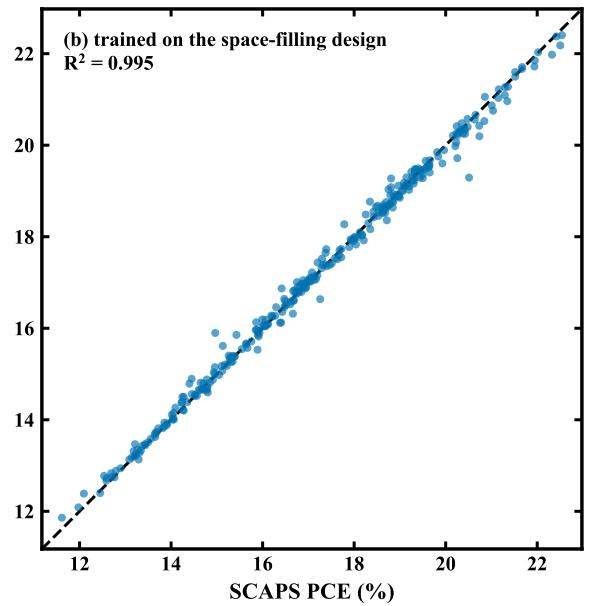  
Figure 3: Predicted against simulated PCE for the same 300 independent of-grid devices. XGBoost was trained on (a) 3,072 devices of the factorial grid, which form the 75% split of Table 2, and (b) the 3,000 devices of the space-filling design. The $R ^ { 2 }$ values shown in the panels (0.579 and 0.995) are those reported in Table 2 and Section 3.1. The horizontal banding in (a), which is absent in (b), reflects the piecewise-constant predictions that a tree ensemble produces between grid levels.

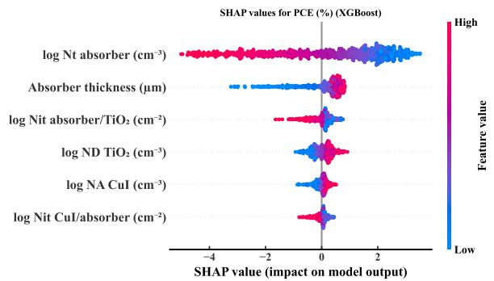

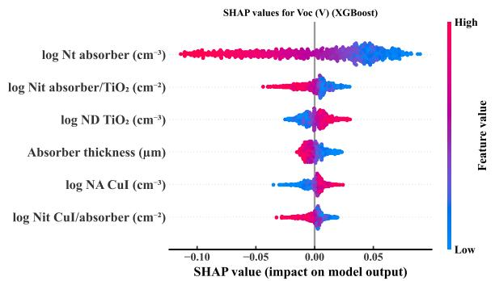

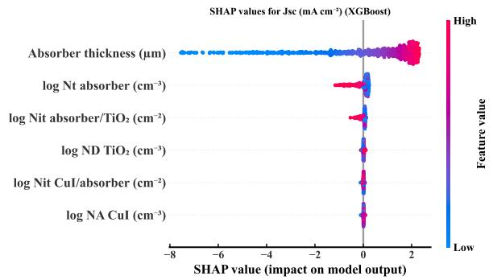

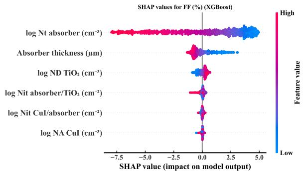  
Figure 4: SHAP attributions of the space-filling-trained XGBoost surrogate, computed on held-out devices, for (a) PCE, (b) VOC, (c) $J _ { \mathrm { S C } }$ and (d) FF (left to right, top to bottom). Bulk defect density dominates PCE and $V _ { \mathrm { O C } }$ , and absorber thickness dominates $J _ { \mathrm { S C } }$ . FF is governed jointly by the defect density and the transport-layer doping.

## 3.2 Forward optimization

A surrogate trained on the space-filling set was used to screen 200,000 candidate devices, and the highest ranked candidate and four diverse runners-up were then re-simulated in SCAPS. All five simulations completed successfully, and their results agree with the predictions to within 0.14 percentage points. The best SCAPSverified candidate reaches an eficiency of 22.94% $( V _ { \mathrm { O C } } = 0 . 8 5 4 \mathrm { V } , \ : J _ { \mathrm { S C } } = 3 7 . 2 4 \mathrm { m A c m ^ { - 2 } } , \ : \mathrm { F F } = 7 2 . 1 \% )$ with an absorber thickness of $0 . 7 4 \mu \mathrm { m }$ , a bulk defect density of $1 \times 1 0 ^ { 1 4 } \mathrm { c m ^ { - 3 } }$ , interface defect densities of approximately $1 \times 1 0 ^ { 1 0 } \mathrm { c m ^ { - 2 } }$ and doping densities of approximately $1 \times 1 0 ^ { 1 9 } \mathrm { c m ^ { - 3 } }$ in both transport layers For comparison, the untuned baseline of the same definition file reaches 21.6%.

Four qualifications bear on the interpretation of this value. First, it is the best candidate that this search found and verified rather than a global optimum, since 200,000 candidates were ranked but only five were simulated. It also does not exceed the best of the 4,096 grid points, which reaches 22.95%; the search matches that value from a diferent region of the parameter space rather than improving on it. Second, the surrogate is considerably less accurate in the region selected by the search: on independent devices, its $R ^ { 2 }$ for PCE is 0.995 overall but only 0.786 within the top decile of eficiency. Moreover, selecting the maximum of noisy predictions favors points at which the model over-predicts, which explains why all five verified candidates fall below their predicted values. Third, the optimum is a plateau rather than a single point. Repeating the search with diferent candidate pools and model seeds gives a stable predicted eficiency of $2 3 . 0 3 \pm 0 . 0 4 \%$ over six repeats but markedly diferent parameter values, with the absorber thickness, for example, ranging from 0.64 µm to 0.91 µm. The individual optimized parameters should therefore not be over-interpreted. Because the search also operates where the surrogate is least accurate, this part of the study is afected, in milder form, by the sampling problem identified in Section 3.1.

Fourth, the search is limited in scope. The six searched parameters are all properties of a fixed $\mathrm { T i O } _ { 2 } /$ $\mathrm { R b S n _ { 0 . 5 } G e _ { 0 . 5 } I _ { 3 } / C u I }$ stack, and neither the transport materials nor the back-contact metal were varied. Al Amin et al. 43 report 26.01% for the same absorber by changing precisely these fixed choices, replacing $\mathrm { T i O _ { 2 } }$ with $\mathrm { I n _ { 2 } S e _ { 3 } }$ and Au with Ni and tuning the back-contact work function, a gain larger than any improvement available within the present parameter space. The value reported here is therefore not a performance ceiling for $\mathrm { R b S n } _ { 0 . 5 } \mathrm { G e } _ { 0 . 5 } \mathrm { I } _ { 3 }$ , nor is it presented as one; it is the eficiency that a surrogate search recovers within one architecture whose parameters are restricted to literature-supported ranges. The contribution of this section lies in the search protocol and the associated assessment of accuracy rather than in the peak eficiency.

Three of the six optimized parameters lie at a boundary of the search space: the bulk defect density and the ETL-side interface defect density are at their minima, and the $\mathrm { T i O _ { 2 } }$ doping density is at its maximum. The design space therefore contains no interior maximum, and the contribution of the surrogate in this case is accurate interpolation rather than the discovery of an unexpected optimum. Moreover, the defect densities are material-quality parameters rather than quantities that an experimenter sets directly, so this configuration should be regarded as a performance target rather than as a fabrication recipe.

## 3.3 Diagnosis of degradation mechanisms

On 298 independent test devices, the XGBoost classifier recovers the introduced degradation mechanisms from $V _ { \mathrm { O C } } ( T )$ and $V _ { \mathrm { O C } } ( \Phi )$ with macro $F _ { 1 } = 0 . 9 3 8$ , compared with 0.687 for the calibrated physics rules. Five-fold cross-validation on the training set gives $0 . 9 3 0 \pm 0 . 0 1 0$ , indicating that the held-out score does not depend on the particular split. For the 204 single-degradation devices, each method was additionally required to name its single highest-scoring class. Under this forced-choice scoring, the accuracy is 99% for the model and 61% for the rules (Fig. 5).

Although the forced choice is applied identically to both methods, it does not reflect how either method natively reports its output; the rules, for example, name more than one mechanism for 49 of the 204 devices. Two further scoring conventions were therefore considered. The first counts a prediction as correct if the true class appears anywhere in the predicted set, a convention that favors a method naming several mechanisms; under it, the rules reach 82.4% and the model 97.5%. The second requires exact agreement between the predicted and true label sets and gives 58.8% for the rules and 95.1% for the model. The model thus leads under every convention, by margins of 15 to 38 percentage points. The rules fail systematically: between 86% and 90% of the interface-limited devices are attributed to bulk recombination, because both mechanisms lower $V _ { \mathrm { O C } }$ and steepen $\mathrm { d } V _ { \mathrm { O C } } / \mathrm { d } T$

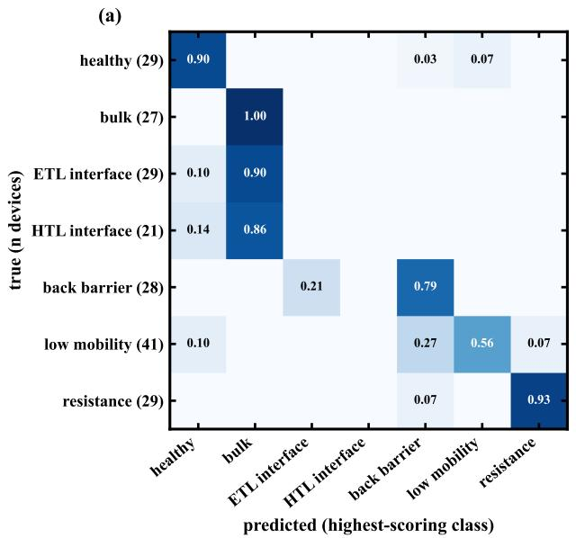

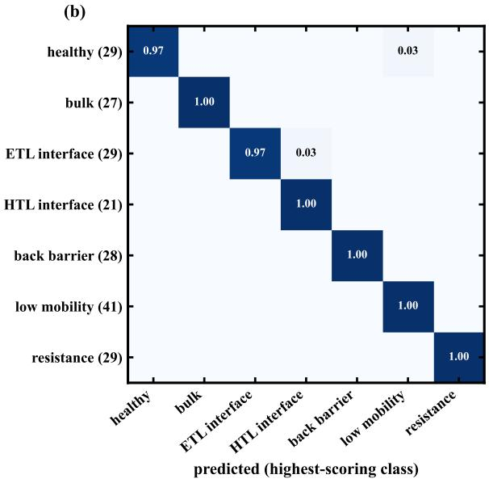  
Figure 5: Confusion matrices for the single-degradation devices. Each method was required to name one class instead of giving its native multi-label output: (a) calibrated physics rules, with a forced-choice accuracy of 61%; (b) XGBoost classifier, with 99%. Row labels give the number of test devices in each class.

The advantage of the model is largest when mechanisms coexist. For devices with two simultaneous degradations, the rules recover the complete label set in 22% of cases and the model in 69%. Among the learned models, XGBoost (0.938) is followed by the random forest (0.928) and the MLP (0.915), whereas logistic regression (0.698) performs only slightly better than the rules, indicating that the task is not linearly separable in these features. The rule baseline is also close to its own optimum: recalibrating its thresholds at the 1st, 5th, 10th and 25th percentiles of the healthy population gives macro $F _ { 1 }$ values between 0.539 and 0.692, so the comparison is not made against an artificially weak baseline.

Because the seven classes are predicted by independent one-versus-rest models, a device could in principle be labeled both healthy and defective, or receive no label at all. Neither case is frequent: no test device received a contradictory label, and the three of the 298 devices that received no label are reported as indeterminate rather than assigned to a class. Tuning a separate decision threshold for each class by cross-validation on the training set did not improve the result (macro $F _ { 1 } = 0 . 9 3 8$ in both cases, and 0.768 and 0.775 on mixed-defect devices), so the default threshold of 0.5 was retained. Finally, the test devices are no closer to their nearest training device than the training devices are to one another, with median nearest-neighbor distances in standardized feature space of 0.342 and 0.335, respectively. This result confirms that the independent sampling of the test set introduces no leakage through near-duplicate devices.

The severity of the bulk defect density is predicted well, with $R ^ { 2 } = 0 . 9 2$ and a mean absolute error (MAE) of 0.08 decades (Fig. 7), whereas the interface defect densities are predicted poorly $( R ^ { 2 } = 0 . 5 3$ and 0.02 for the ETL and HTL sides, respectively). These values are obtained on devices that the classifier itself identifies as bulk-limited, rather than on devices whose true class is assumed to be known. The classifier identified 61 such devices in the test set, all of them correctly, so the end-to-end pipeline attains the same accuracy as the case with known labels. The weakness for interfaces reflects what these measurements can determine rather than a limitation of the regressor: as the controlled sweeps described below show, the interface defect density is the least identifiable of the six mechanisms from $V _ { \mathrm { O C } } ( T )$ and $V _ { \mathrm { O C } } ( \Phi )$ , because it changes the measurable signals much less than the bulk defect density does.

The systematic misattribution by the rules has a specific cause. The signal that distinguishes interface from bulk recombination, a lower ideality factor combined with an activation-energy deficit, is too weak for a threshold on any single feature to separate the two mechanisms. The learned model, in contrast, uses the features jointly, and its per-class SHAP rankings recover the signatures that the experimental literature associates with each mechanism 37,38,42 (Fig. 6): the ideality factor dominates the resistance class, the linearity of $V _ { \mathrm { O C } } ( T )$ the contact-barrier class, the temperature slope of FF the transport class, and $\mathrm { d } V _ { \mathrm { O C } } / \mathrm { d } T$ together with $V _ { \mathrm { O C } }$ the bulk class.

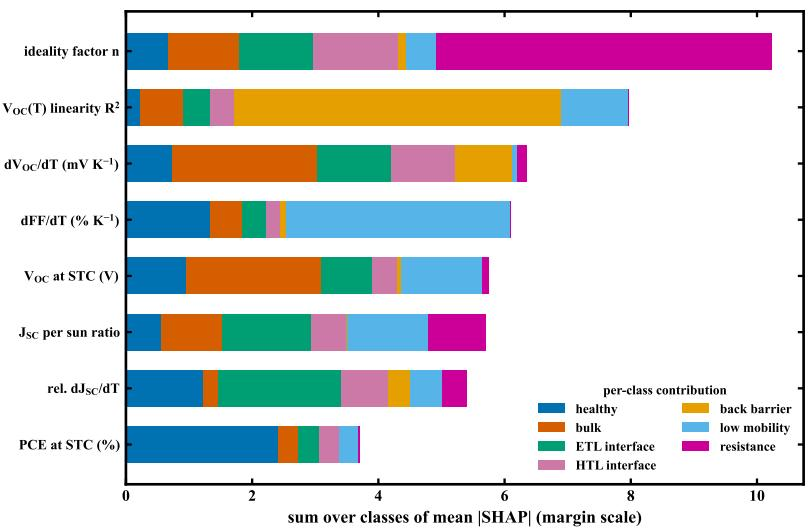

Figure 6: Per-class SHAP attributions of the diagnostic classifier. The ideality factor dominates the resistance class, and the linearity of $V _ { \mathrm { O C } } ( T )$ dominates the contact-barrier class. $\mathrm { d } V _ { \mathrm { O C } } / \mathrm { d } T$ , together with $V _ { \mathrm { O C } }$ , dominates the bulk class.  
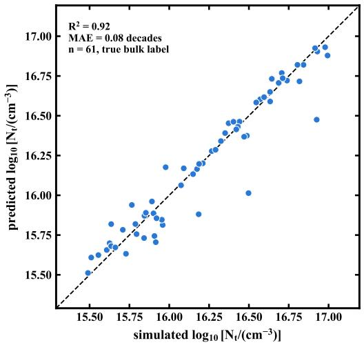  
Figure 7: Predicted against simulated bulk defect density for the test devices that contain a bulk defect. The dashed line indicates the identity.

SHAP, however, explains the fitted model and distributes credit among correlated inputs, so a high attribution may indicate that a feature is a convenient proxy rather than a quantity that the mechanism actually changes. The attributions were therefore tested directly against the simulator. Each mechanism was swept individually, with its defining parameter varied from the middle of the healthy range to the far end of the degraded range while every other parameter was held at its healthy midpoint. The response of each feature was quantified as its peak-to-peak variation over the sweep, max ${ \mathrm { \Omega } } _ { i } x _ { i } - \operatorname* { m i n } _ { i } x _ { i }$ , where i denotes the sweep level, divided by the standard deviation of that feature across the training set so that features with diferent units can be compared (Fig. 8). The sweep comprises 60 devices, each simulated at nine conditions.

The resulting signatures are distinct and largely specific to each mechanism. Sweeping the back-contact work function changes the linearity of $V _ { \mathrm { O C } } ( T )$ by 6.1 standard deviations and the extrapolated $E _ { \mathrm { a } }$ by 3.8, while both features remain essentially unchanged for every other mechanism $( \leq 0 . 1 )$ . Sweeping the resistances changes the curvature of $V _ { \mathrm { O C } } ( \Phi )$ by 5.7, the linearity of that fit by 5.0 and the ideality factor by 3.1, again with no response to the other mechanisms. For four of the six mechanisms (bulk defects, back barrier, low mobility and parasitic resistance), the feature on which the model relies most responds to that mechanism in isolation, by 1.4 to 6.1 standard deviations. The physical interpretation of the SHAP results is therefore supported by the simulator itself and not only by analogy with the literature.

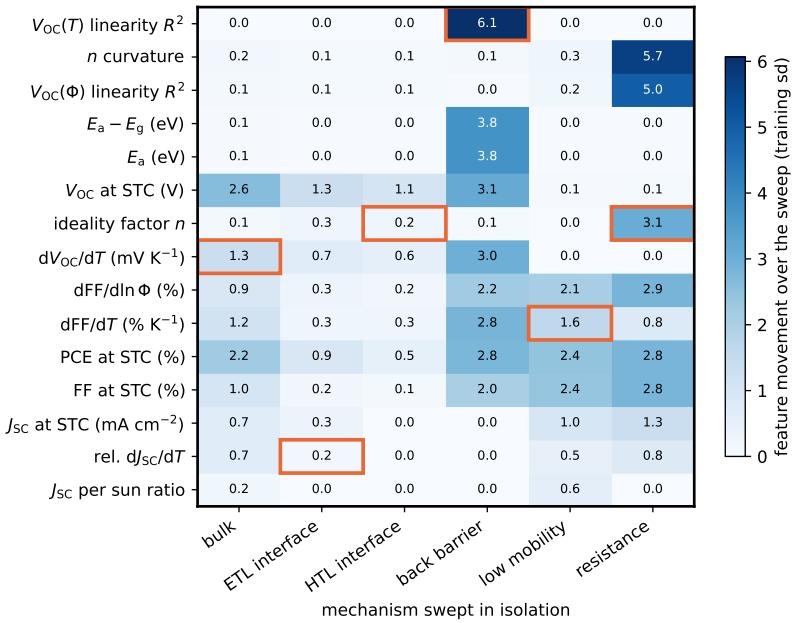  
Figure 8: Simulated response of each feature when a single mechanism is swept in isolation. Each cell gives the peak-to-peak variation of the feature over the sweep (its maximum minus its minimum across the sweep levels), divided by the standard deviation of the feature across the training set so that features with diferent units can be compared. Orange outlines mark the feature on which the classifier relies most for each mechanism (highest mean |SHAP|). The back-barrier and resistance signatures are sharp and exclusive, whereas the two interface columns are uniformly weak, which explains why these classes are the most dificult to diagnose.

The two interface classes behave diferently, and the diference is informative. Sweeping either interface defect density from healthy to fully degraded changes no feature by more than 1.3 standard deviations, compared with a maximum of 2.4–6.1 for the other four mechanisms, and the features on which the model relies for the interface classes change by only 0.2. An interface defect thus leaves a much weaker signature in these measurements than a contact barrier or a series resistance does. This is an identifiability limit of the measurement set rather than a shortcoming of the classifier: no model, whether learned or rule-based, can separate mechanisms that the measurements barely distinguish, and when the signal is this weak, the attribution is distributed over residual correlations between features.

This conclusion is consistent with three independent observations reported elsewhere in this work. The HTL interface has the lowest per-class F (0.72) and the lowest area under the ROC curve (0.912), and it is also the least well-calibrated class (Section 3.7). In addition, restoring an interface label recovers the least eficiency of any class when mechanisms coexist (Section 2.3). Together with the sweep, these four results indicate that interface recombination is the mechanism least well constrained by $V _ { \mathrm { O C } } ( T )$ and $V _ { \mathrm { O C } } ( \Phi )$ . Improving its diagnosis requires an additional measurement channel, such as admittance spectroscopy, capacitance–voltage profiling or spectrally resolved quantum eficiency, rather than a better classifier operating on the same inputs.

The scope of the sweep is limited. It shows how the features respond when one parameter is varied in isolation in this device; it does not convert SHAP into a causal attribution, and the features remain mutually correlated in the training datasets. The model therefore does not replace physical analysis but applies the same physical signals without the simplification imposed by fixed thresholds.

The advantage of the model over the rules increases with device complexity, which is the experimentally most relevant regime, because a fabricated cell is rarely subject to a single loss mechanism. As shown in

Section 3.4, however, this advantage has been measured only on combinations of mechanisms that are present in the training set.

## 3.4 Generalization to unseen combinations of mechanisms

The multi-mechanism accuracy reported above is measured on devices whose combination of mechanisms also occurs in the training set. All fifteen pairs of the six degradation mechanisms are represented in training, with 27 to 47 devices each, so the exact-match accuracy of 69% is that of a model trained on every pair. A separate question is whether the model composes individual mechanisms or merely recognizes familiar combinations, which is decisive for a device that exhibits a combination of mechanisms absent from the training set.

This question was addressed within the training set, leaving the independent test set unchanged. For each of the fifteen pairs, the devices containing that pair were divided into two halves, and two models were scored on the same evaluation half: one trained with the other half included, so that the combination was familiar to it, and one trained after every device containing that pair had been removed.

The diference between the two models is large. Exact-match accuracy on the same evaluation devices falls from 0.541 when the combination is familiar to 0.016 when it is new (Fig. 9a). The model therefore does not generalize to unseen combinations of mechanisms.

The failure is systematic rather than random, in that the classifier typically recovers one constituent mechanism and misses the other. The mean recall over the two constituent mechanisms is close to 0.5 for every pair, with one mechanism usually reported with a recall above 0.9 and the other almost entirely missed. Although this behavior does not make the output usable as a complete diagnosis, it shows that the error is a predictable omission rather than an arbitrary misassignment.

Which mechanism is reported can be predicted from the sweep described in Section 3.3. In all fifteen pairs, the reported mechanism is the one with the larger feature signature in the sweep. This holds even for the closest pair, the back barrier (6.1 standard deviations) and resistance (5.7), which is also the only pair in which both mechanisms retain partial recall. A quantity obtained independently from the simulator therefore predicts, for each pair, which mechanism the model will report when it cannot report both.

Each pair is present in the training set but accounts for only about 2% of it, which suggests assigning a larger weight to multi-mechanism devices during training. Several weighting schemes were tested: twomechanism devices were upweighted by factors of 2, 4 and 8, the fifteen pairs were reweighted to equal mass, and the combined two-mechanism mass was matched to the single-mechanism mass. Across these schemes, the exact-match accuracy on multi-mechanism test devices changed from 0.691 to values between 0.681 and 0.713. The best scheme, a uniform factor of 4, changed the outcome for four of the 94 evaluation devices, three of which became correctly classified and one misclassified, and the paired bootstrap interval for the change (−0.021 to +0.064) contains zero. Reweighting therefore yields no significant improvement.

Class imbalance is thus not the factor that limits multi-mechanism recovery. This finding is consistent with the identifiability interpretation given above: the model does not lack examples of these pairings, but the measurements contain too little signal to distinguish the weaker constituent. Consequently, every pairing that a diagnosis must cover has to be simulated explicitly.

By contrast, performance depends only weakly on the severity of the degradation. Single-degradation devices were grouped into quarters according to the position of the degraded parameter within its degraded range and scored with out-of-fold predictions. From the mildest to the most severe quarter, the exact-match accuracy is 0.895, 0.936, 0.961 and 0.958 (Fig. 9b), and no severity threshold was found below which the diagnosis fails. The only class that is appreciably weaker at low severity is again the HTL interface, whose recall rises from 0.85 to 1.00 across the range.

## 3.5 Requirements for reliable diagnosis

Measurement noise must be included during training Noise is applied to every recorded quantity before the features are computed: additive Gaussian noise for VOC (3 mV) and temperature (1 K), and multiplicative lognormal noise for illumination (5%), J (2%) and FF (1%). The eficiency is then recomputed from the perturbed values, so that each simulated operating point remains internally consistent. Each noise level is evaluated with three independent measurement realizations on the same devices and labels, so that diferences between levels reflect the noise rather than a change of dataset, and the mean and standard deviation over the three realizations are reported. The noise model assumes independent Gaussian and lognormal errors. Hysteresis, preconditioning history and drift during a temperature series are not represented, although all three afect real measurement campaigns.

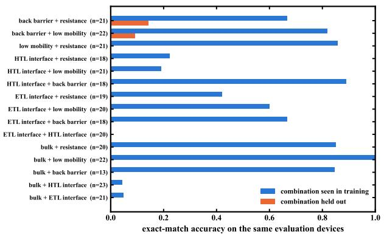

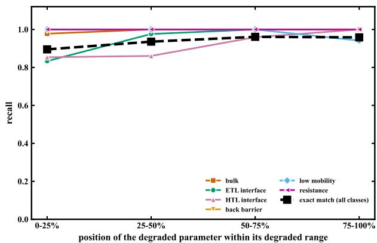  
Figure 9: Generalization of the diagnostic model. (a) Exact-match accuracy on the same evaluation devices when the pair of mechanisms they contain is present in training (blue) and when every device containing that pair is removed from training (orange). (b) Per-class recall and exact-match accuracy as a function of how far the degraded parameter lies within its degraded range, obtained from out-of-fold predictions within the training set.

A model trained on noise-free data performs poorly on noisy data, with its macro $F _ { 1 }$ falling from 0.938 to $0 . 6 0 9 \pm 0 . 0 2 5$ at the 1× noise level, below the physics rules. When the model is trained on noisy data and tested on independently generated noisy data, it retains $0 . 8 5 9 \pm 0 . 0 1 0$ at 0.5× and $0 . 8 2 0 \pm 0 . 0 1 3$ at $3 \times$ , the latter corresponding to 9 mV of $V _ { \mathrm { O C } }$ noise and 15% intensity noise. Over the same range, the rule baseline falls from 0.687 to 0.567 (Fig. 10a). The 1× level corresponds to a well-maintained measurement setup. The $3 \times$ level, which corresponds to a thermocouple reading that deviates by 3 K from the device temperature combined with uncalibrated neutral-density filters, represents a pessimistic bound rather than a typical measurement.

The errors considered above are independent between measurements. Calibration errors, by contrast, are systematic, because a single thermocouple ofset and a single filter transmission factor apply to an entire measurement series. Adding a per-device systematic ofset to the 1× random noise does not degrade the diagnosis: the macro $F _ { 1 }$ changes from $0 . 8 4 0 { \pm } 0 . 0 2 2$ to $0 . 8 4 6 \pm 0 . 0 0 7$ for an ofset of $1 \mathrm { K } / 3 \%$ and is $0 . 8 4 8 { \pm } 0 . 0 1 2$ for $3 \mathrm { K } / 1 0 \%$ . This behavior follows from the form of the features. A constant intensity scale factor shifts ln Φ by a constant and leaves the ideality factor, which is a slope, unchanged, and a constant temperature ofset δ shifts the extrapolated $E _ { \mathrm { a } }$ by only $\left( \mathrm { d } V _ { \mathrm { O C } } / \mathrm { d } T \right) \delta \approx 5 \mathrm { m e V }$ at $\delta = 3 \mathrm { K }$ . Random scatter, which degrades the fits themselves, is the more demanding case, and the noise levels reported above are therefore the conservative ones.

Temperature and intensity series carry most of the information The standard 1-sun J–V parameters alone give macro $F _ { 1 } = 0 . 6 7 9$ . Adding the intensity series raises this value to 0.896, adding the temperature series raises it to 0.917, and adding both raises it to 0.938, an improvement of 0.26 over a single J–V curve (Fig. 10b). Without the standard-condition values, the intensity and temperature series give 0.839 and 0.888, respectively, and 0.938 together. The standard-condition parameters are therefore informative on their own but become redundant once both series are available. Five-fold cross-validation within the training set gives the same ordering (0.680, 0.889, 0.904 and 0.930); the feature groups were compared on this basis, and the test set was used only to report the final values.

Generalization across absorber thickness When trained on absorbers thinner than 0.7 µm and tested on thicker ones, the model scores 0.913, compared with $0 . 9 0 4 \pm 0 . 0 1 3$ for a reference model trained on the same number of devices drawn from the full thickness range; extrapolation to thicker absorbers therefore incurs no loss of accuracy in this case. In the reverse direction, the model scores 0.879, compared with

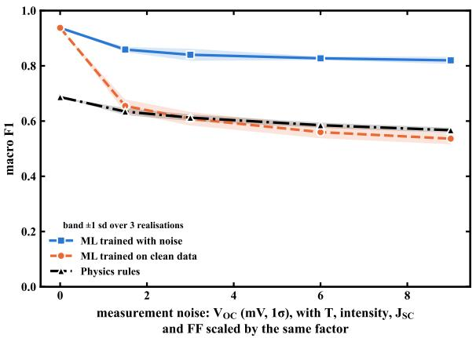

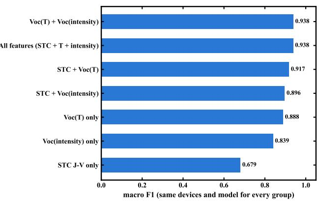  
Figure 10: (a) Macro $F _ { 1 }$ as a function of measurement noise. Shaded bands indicate ±1 standard deviation over three independent measurement realizations per level. (b) Feature ablation. The three lowest bars isolate each measurement series. The standard-condition rows quantify the contribution of each series relative to a single J–V curve.

Table 3: Macro $F _ { 1 }$ for combinations of input representation and model architecture, all evaluated on the same devices. Values are means over three seeds ± one standard deviation.
<table><tr><td>Input</td><td>Model</td><td>macro  $F _ { 1 }$ </td></tr><tr><td>15 physics features (Section 2.4)</td><td>XGBoost</td><td> $\mathbf { 0 . 9 3 5 \ : \pm { \ : 0 . 0 0 1 } }$ </td></tr><tr><td>15 physics features</td><td>MLP</td><td> $0 . 9 1 5 \pm 0 . 0 0 7$ </td></tr><tr><td>raw  $V _ { \mathrm { O C } }$  curves only (13 values)</td><td>XGBoost</td><td> $0 . 8 1 1 \pm 0 . 0 0 3$ </td></tr><tr><td>raw  $V _ { \mathrm { O C } }$  curves only (13 values)</td><td>1-D CNN</td><td> $0 . 8 5 7 \pm 0 . 0 0 7$ </td></tr><tr><td>information-matched raw curves (33)</td><td>XGBoost</td><td> $0 . 8 5 5 \pm 0 . 0 0 5$ </td></tr><tr><td>information-matched raw curves (33)</td><td>MLP</td><td> $0 . 8 6 3 \pm 0 . 0 1 2$ </td></tr><tr><td>information-matched raw curves (33)</td><td>1-D CNN</td><td> $0 . 8 4 8 \pm 0 . 0 0 9$ </td></tr><tr><td>raw curves + physics features</td><td>1-D CNN</td><td> $0 . 8 8 0 \pm 0 . 0 0 4$ </td></tr></table>

$0 . 9 3 3 \pm 0 . 0 1 2$ for a size-matched reference. This diference of 0.054 is a genuine loss of accuracy, which arises because training on thick absorbers does not capture the collection-limited behavior of thin devices. In both directions, the training and test sets are disjoint in thickness and contain every class. The test addresses distribution shift in thickness only and provides no information about unseen ranges of defect severity, other device architectures or other measurement conditions.

## 3.6 Physics-derived features outperform the tested end-to-end models

The features defined in Section 2.4 encode physical knowledge in the form of an extrapolation to 0 K, a logarithmic slope and a set of ratios. An alternative approach is to supply the measured curves directly as model inputs. A direct comparison of the two approaches is, however, confounded, because the physics features are derived from $V _ { \mathrm { O C } } , \ J _ { \mathrm { S C } }$ and FF at every temperature and every intensity, whereas a raw representation limited to the two $V _ { \mathrm { O C } }$ curves carries strictly less information. Two raw representations were therefore evaluated: the two $V _ { \mathrm { O C } }$ curves together with the standard-condition point (13 values), and an informationmatched set comprising $V _ { \mathrm { O C } } , \ J _ { \mathrm { S C } }$ and FF at all five temperatures and all five intensities (33 values). Each representation was evaluated with several architectures, so that the efect of the representation could be separated from that of the model. All models were trained and scored on the same 1,992 training devices and 298 test devices, matched by device identifier rather than by row order, and every value is the mean over three random seeds (Table 3).

Three conclusions follow from Table 3. First, providing the raw-input models with the information-matched measurements improves them, with the XGBoost score rising from 0.811 to 0.855, so part of the original gap reflects a diference in information content rather than in representation. Second, the remaining gap is not caused by a weak convolutional network: a standard MLP on the same 33 raw values reaches 0.863, comparable to the 0.848 of the convolutional network, which indicates that the ceiling for raw inputs is a property of the representation rather than of a particular architecture. Third, the efect of the architecture is small compared with that of the representation. On the physics features, XGBoost leads the MLP by 0.020, and on the raw values, XGBoost and the convolutional network difer by less than 0.010, whereas the gap between the best physics-feature model and the best raw-input model is 0.072. Supplying the physics features alongside the raw curves recovers much of this diference (0.880), suggesting that the features provide a useful inductive bias rather than additional information.

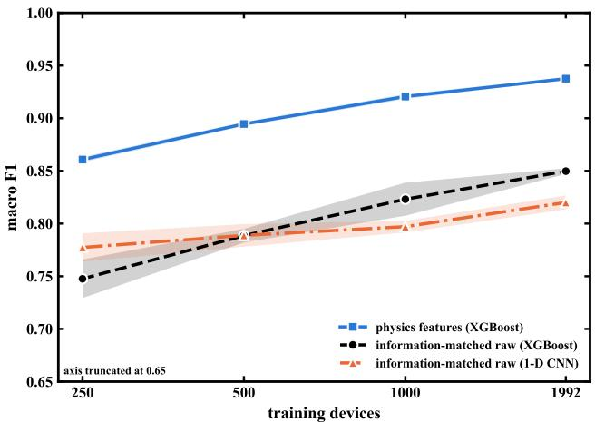  
Figure 11: Learning curves of the feature-based model and the convolutional network on raw curves.

The gap does not close as the training set grows within the range tested. The training subsets used for the learning curves are nested, each being a prefix of a single shufled device order, so that a larger subset always contains the smaller ones. The feature-based model outperforms the convolutional network on raw curves at every training-set size tested (Fig. 11); the physics features are therefore more data-eficient and retain their advantage up to the largest dataset generated in this work, although whether the gap closes for larger datasets was not tested. Nor is the gap an artifact of undertraining: the network is trained with early stopping on a validation split of the training devices, so its stopping point adapts to the amount of available data, and the test set is never used for this choice.

This conclusion is restricted to the conditions tested. For this simulated device distribution, these measurement sets and the dataset sizes available here, physically motivated descriptors outperform the tested raw-input and end-to-end architectures, which supports their use at dataset sizes realistic for device simulation. Feature engineering is not claimed to be inherently superior to representation learning, since a larger network, a diferent architecture or a dataset several orders of magnitude larger might close the gap. Because only a limited set of neural architectures was tested, the result describes the approaches examined here rather than the best achievable performance.

Per-class discrimination is strong for every mechanism except the HTL-side interface. The areas under the receiver operating characteristic (ROC) curve, rounded to three decimal places, are 1.000 for bulk defects, the back-contact barrier, low mobility and parasitic resistance, 0.999 for healthy devices, 0.983 for the ETL-side interface and 0.912 for the HTL-side interface, giving a macro-averaged area of 0.985. In every case, the operating points of the physics rules lie well below the ROC curves of the model (Fig. 12).

## 3.7 Exploratory application to measured devices

This section addresses a narrower question than the rest of the paper: whether the required features can be extracted from a published measurement, and what a model trained only on simulated $\mathrm { R b S n } _ { 0 . 5 } \mathrm { G e } _ { 0 . 5 } \mathrm { I } _ { 3 }$ devices predicts for a diferent absorber. The analysis is an exploratory external transfer. With two devices and no verified class labels, it cannot measure experimental accuracy and can establish only the validity of the feature extraction and the qualitative consistency of the result with the attribution given by the original authors.

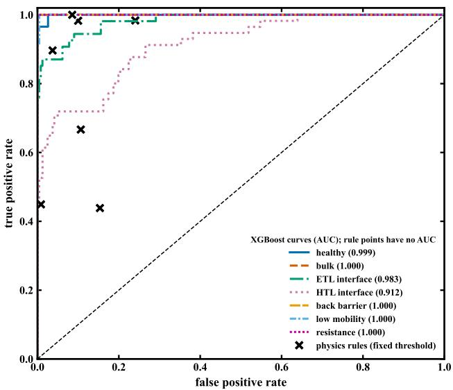  
Figure 12: Per-class ROC curves of the diagnostic classifier. The operating points of the calibrated physics rules are marked.

Two $\mathrm { F A S n I _ { 3 } }$ cells with light-intensity-dependent $V _ { \mathrm { O C } }$ measurements45 Fig. S21b were digitized. The measured curves are sampled at 14 intensities spaced linearly from 6.7 mW $\mathrm { c m ^ { - 2 } }$ to $1 0 0 \mathrm { { m W } \mathrm { { c m } ^ { - 2 } } }$ , whereas the simulated devices span 0.01–1 sun. The features of both were therefore computed at the same three intensities (0.1, 0.3 and 1 sun), with the measured $V _ { \mathrm { O C } }$ interpolated in ln Φ, so that no extrapolation is involved. The ideality factors obtained in this way, 1.91 and 1.57, agree with the published values of 1.98 and 1.62, both evaluated at the temperature of 298 K stated by the authors, which validates the feature extraction itself. All twelve measured feature values lie within the range spanned by the simulated training set.

When restricted to band-gap-relative and dimensionless features, the model reaches macro $F _ { 1 } = 0 . 9 0 7$ on held-out simulated devices. This value depends on the composition of the test set: when the model is retrained on the original and hard datasets, it scores 0.906 on the ordinary test devices but only 0.700 on the deliberately harder ones, for a pooled value of 0.869. Pooled values should therefore be interpreted together with the composition of the test set. Per-class performance is uneven, with $F _ { 1 }$ scores of 0.98 for bulk defects, resistance and low mobility, 0.93 for the back barrier and only 0.65 for the HTL interface, whose scores are also the least well calibrated (largest bin-wise gap of 0.19).

Applied to the two measured cells, the model assigns a high score to bulk recombination (0.99 and 0.96), consistent with the attribution of the losses to defect density by the original authors. It also assigns high scores to the ETL interface (0.90 and 0.95) and, for the treated cell, to series and shunt resistance (0.84). The model therefore does not identify a single mechanism for these devices, but indicates bulk recombination together with at least one interface contribution (Fig. 13). These values are model scores rather than calibrated probabilities of an experimental loss mechanism. An interface contribution is nevertheless plausible for this material family: Kim et al. 39 measured $V _ { \mathrm { O C } } ( T )$ on $\mathrm { C H _ { 3 } N H _ { 3 } S n I _ { 3 } }$ cells and attributed their large $V _ { \mathrm { O C } }$ loss to interface rather than bulk recombination. This finding provides independent evidence that tin perovskites can be interface-limited, but it does not confirm the present diagnosis, which concerns diferent devices and cannot be verified without labels.

Quantitative severity does not transfer to the measured devices. A regressor trained on simulated bulklimited devices, which reaches $R ^ { 2 } = 0 . 9 6$ and an MAE of 0.07 decades in simulation, predicts $9 . 5 \times 1 0 ^ { 1 6 }$ and $2 . 5 \times 1 0 ^ { 1 6 } \mathrm { c m } ^ { - 3 }$ for the two cells. The published densities, $2 . 8 9 \times 1 0 ^ { 1 6 }$ and $5 . 4 1 \times 1 0 ^ { { \bar { 1 5 } } } \mathrm { c m ^ { - 3 } }$ , were obtained from a Mott–Schottky $C { - } V$ fit; they are ionized-acceptor densities and not the SRH bulk trap density that the regressor predicts. Because the two are diferent physical quantities, the agreement to within a factor of 3–5 should not be interpreted as a validation.

Several analysis choices were required, namely the source of $V _ { \mathrm { O C } }$ (the intensity curve or the J–V table), the assumed band gap of FASnI3 and the intensity window. Across these choices, the prediction for the treated cell varies from $8 . 2 \times 1 0 ^ { 1 5 } \mathrm { c m ^ { - 3 } }$ to $4 . 4 \times 1 0 ^ { 1 6 } \mathrm { c m ^ { - 3 } }$ , a factor of 5.4. Digitization noise is not the limiting factor, since resampling the digitized points with 5 mV of scatter changes the predictions by less than 2%. The severity prediction is therefore regarded as validated in simulation only, and same-material calibration is recommended before any quantitative use.

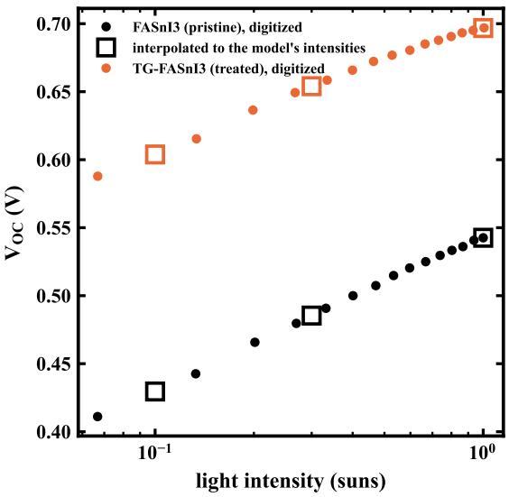

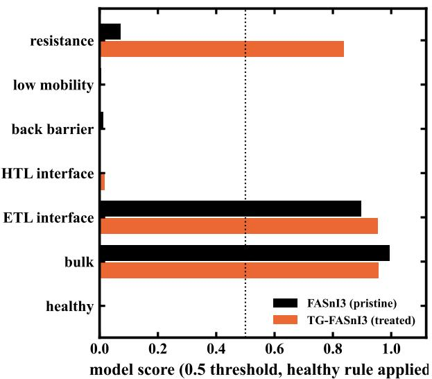  
Figure 13: Application to two published $\mathrm { F A S n I _ { 3 } ~ c e l l s ^ { 4 5 } }$ . Left: digitized $V _ { \mathrm { O C } } ( \Phi )$ points and their interpolation onto the three intensities used for training. Right: resulting class scores. Bulk recombination scores highest for both cells, but an interface term scores almost as highly, so the diagnosis does not identify a single mechanism.

Table 4: Sensitivity of the predicted bulk trap-density ratio for two untreated/treated pairs. Pub.: ratio reported by the original authors. Pred.: ratio predicted from their published $V _ { \mathrm { O C } } ( \Phi )$ data. Dev.: factor by which the prediction deviates from the published value. Range: factor spanned by the prediction when the digitized points are perturbed by 4 mV. TG denotes the templated-growth treatment of Liu et al. 45 , and SP denotes the combined solvent and surface engineering of Faheem et al. 46 . Both treatments are reported by their authors to reduce the trap density.
<table><tr><td>Pair</td><td>Pub.</td><td>Pred.</td><td>Dev.</td><td>Range</td></tr><tr><td> $\mathrm { F A S n I _ { 3 } ~ / ~ T G ^ { 4 5 } }$ </td><td>5.34</td><td>94.6</td><td>17.7×</td><td>55×</td></tr><tr><td> $\mathrm { F A S n I _ { 3 } ~ / ~ S P ^ { 4 6 } }$ </td><td>2.38</td><td>10.8</td><td>4.6×</td><td>5.6×</td></tr></table>

A second, more demanding test examined whether the ratio of trap densities between an untreated and a treated cell transfers to measured devices. For this test, a model trained on the original and hard datasets (3,120 devices) was used to predict log $_ { 1 0 } ( N _ { t , A } / N _ { t , B } )$ directly. Three success criteria were fixed before the experiment, so that the outcome could not be judged retrospectively: agreement with the published ratio within a factor of $^ { 2 , }$ a digitization-perturbation interval narrower than a factor of 3, and agreement between feature sets within a factor of 2. The predicted ratios exceed the published ones by factors of 4.6 and 17.7, and when the digitized points are perturbed, the predictions vary over intervals of 5.6× and 55×. Neither of the first two criteria is therefore met (Table 4).

The third criterion is met, with the feature sets agreeing within a factor of 1.4–1.9, which identifies the source of the failure: the limitation lies not in the choice of features but in the sensitivity of a slope diference to read-of error. The perturbation interval widens from a factor of 13.9 to 55 and then to 684 as the assumed digitization error increases from 2 to 4 and then to 8 mV. On simulated pairs, the same model performs well, with $R ^ { 2 } = 0 . 9 1$ , a median error factor of 1.7 and a device-level bootstrap interval for the MAE of 0.33–0.42 decades. The failure therefore lies in the transfer to measured devices rather than in the model itself.

Two further cautions apply to the published values. First, the two ratios are not the same physical quantity: Liu et al. 45 obtained theirs from a Mott–Schottky C–V fit and Faheem et al. 46 from the trap-filled-limit voltage of a space-charge-limited-current measurement, and neither quantity is the SRH bulk trap density represented in SCAPS. Second, the second pair fails an internal consistency check, since the ideality factors extracted here from its published $V _ { \mathrm { O C } } ( \Phi )$ figure (0.91 and 0.83) do not reproduce the values of 1.32 and 1.13 reported in the same paper. This pair therefore cannot serve as ground truth and is reported only for completeness.

A third device, the mixed-cation lead perovskite CsRbFAMA of López-González et al. $^ { 4 7 }$ , was measured by its authors between 253 and 333 K. Because the authors performed the same $V _ { \mathrm { O C } } ( T )$ extrapolation and reported their own value, this device provides a check on the feature extraction itself. Fitting between 253 and 313 K, we obtain $ { E _ { \mathrm { a } } } = 1 . 4 9 7  { \mathrm { e V } }$ , compared with their value of 1.49 eV; the diference of 7 meV confirms that the digitization and the fit reproduce a published analysis.

The choice of fitting window also proved important. The authors report that bulk SRH recombination dominates up to 323 K and that surface recombination dominates above this temperature. Fitting across this transition degrades the fit, with $R ^ { 2 }$ decreasing from 0.988 to 0.941, and raises the extrapolated $E _ { \mathrm { a } }$ from 1.497 to 1.567 eV, approaching the band gap of 1.609 eV. When the raw digitized points are used directly, without first interpolating the four measured curves onto a common temperature axis, the extrapolated value exceeds the band gap. The window that overlaps the simulated training range (300 K to 400 K) contains only three usable measured points, too few for a reliable slope, so the overlap between this measurement and the training domain is too narrow to be exploited.

The diagnosis for this device is not stable enough to be reported as a result: resampling the digitized points with 5 mV of scatter in $V _ { \mathrm { O C } }$ and 0.5 points in FF gives a back-barrier score of 0.74 ± 0.32 and a low-mobility score of $0 . 3 1 \pm 0 . 3 6$ . This device is accordingly reported as a validation of the feature extraction rather than of the diagnosis.

Two general requirements follow from these results. First, the extrapolation must be performed over a range in which $V _ { \mathrm { O C } } ( T )$ is linear, because a curved fit invalidates the extrapolated value. Second, this requirement applies to the manual reading and not to the learned model: as shown in Section 3.8, curvature is itself the signature of a contact barrier, so excluding non-linear devices from the model would remove the class that it diagnoses most reliably.

## 3.8 A protocol for applying the method to measured devices

The robustness experiments lead to the following practical requirements.

• Train with realistic measurement noise. A model trained without noise falls below the physics rules at 3 mV of $V _ { \mathrm { O C } }$ noise, which is within normal experimental scatter.

• Match the measurement range, and extract the features identically for measurement and simulation. The features depend on the measurement range and sampling: a curve measured at 14 linearly spaced intensities and a curve sampled at three logarithmically spaced intensities do not yield the same ideality factor or curvature, even when the underlying physics is identical. Measured data should therefore be interpolated onto the intensities used for training before the features are extracted. In this work, changing the analyzed range from 0.1–1 sun to 0.03–1 sun altered a predicted defect density by two orders of magnitude.

• Check linearity before a manual extrapolation, but do not exclude non-linear devices from the model. For a manual determination of $E _ { \mathrm { a } }$ , curvature is disqualifying: the mixed-cation device of López-González et al. 47 changes its dominant recombination mechanism above 323 K, and fitting across this transition yields an unphysical activation energy above the band gap. The same criterion could be applied as a data-quality filter for the model, and such a filter was initially considered, but the data do not support it, because curvature in $V _ { \mathrm { O C } } ( T )$ is itself diagnostic. Contact-barrier devices have a median fit quality of $R ^ { 2 } = 0 . 9 4$ , compared with 0.998 for every other class, and constitute 85% of the least linear fifth of the test set. Removing these devices discards the class that the model identifies most reliably (AUC 1.000) and lowers the accuracy on the remaining devices, with the macro $F _ { 1 }$ decreasing from 0.830 to 0.793 under noise.

• Abstain on the basis of model confidence, not fit quality. Withholding a diagnosis for the 20% of devices with the lowest predicted probability raises the macro $F _ { 1 }$ on the remaining devices from 0.830 to 0.845 under measurement noise. Abstention based on the standard error of the ideality factor performs similarly (0.843), whereas abstention based on the standard error of $E _ { \mathrm { a } }$ gives no improvement (0.813).

• Treat cross-material application as exploratory. A model trained only on simulated $\mathrm { R b S n } _ { 0 . 5 } \mathrm { G e } _ { 0 . 5 } \mathrm { I } _ { 3 }$ devices assigned its highest score to bulk recombination for both measured $\mathrm { F A S n I _ { 3 } }$ cells, in agreement with the attribution of the original authors, but it assigned an almost equally high score to an interface term, and the predicted defect densities varied by a factor of five across defensible analysis choices. Two devices without verified labels cannot establish whether the classification transfers, and same-materia calibration is required before the severity output is used.

## 3.9 Limitations

The simulations are one-dimensional and therefore omit lateral inhomogeneity, grain-boundary transport and ion migration, the last of which is interface-dependent in halide perovskites 48 and cannot be represented in one dimension even in principle. Material parameters are held constant with temperature, as is common in SCAPS studies, so computed activation energies should be compared with measurements in relative rather than absolute terms. Conventional defaults such as the capture cross-sections $( 1 \times 1 0 ^ { - 1 5 } \mathrm { c m ^ { 2 } } )$ and thermal velocities $( 1 \times 1 0 ^ { 7 } \mathrm { c m s ^ { - 1 } } )$ were not subjected to a sensitivity analysis. The class set is also closed: a device limited by an unmodeled mechanism, such as the ion migration and temperature-dependent HTL conductivity reported for the measured lead perovskite device, is still assigned to the nearest class, and the present novelty check, based on feature distributions, does not detect such cases.

The sampling result of Section 3.1 is reproduced in the supplementary material for four further absorbers with band gaps from 1.31 eV to 2.00 eV in the same device stack, and selection by grid score chooses the worst-generalizing model in every case. Generality beyond SCAPS-1D and this architecture is, however, not established. The 2.00 eV parameter set of Khatun et al. 20 , well above the band gap usually reported for $\mathrm { C s S n I _ { 3 } } .$ , is used without modification as the wide-gap endpoint, and no material-specific conclusion is drawn from it. Finally, all real-device results rely on data digitized from published figures, and in one case the published ideality factors could not be reproduced from the plotted data.

## 3.10 Outlook

The natural next step is calibration on devices measured in-house, where the ground truth is controlled and both $V _ { \mathrm { O C } } ( T )$ and $V _ { \mathrm { O C } } ( \Phi )$ can be recorded on the same cell. Extending the class set to transport-layer degradation and ion migration would cover mechanisms that were encountered in the measured devices but could not be represented here. Finally, repeating the diagnostic analysis for several absorbers would establish whether a single model can serve a family of thin-film technologies or whether material-specific training is required.

## 4 Conclusions

This work combined SCAPS-1D device simulation with machine learning for lead-free $\mathrm { R b S n } _ { 0 . 5 } \mathrm { G e } _ { 0 . 5 } \mathrm { I } _ { 3 }$ solar cells in both the forward and the inverse directions. The contribution is methodological rather than a new eficiency record. Replacing Spiro-OMeTAD with CuI raises the simulated eficiency from 19.6% to 21.6% at identical absorber quality, almost entirely through the fill factor. A surrogate-guided search then identified a high-performance region of the design space and showed it to be a plateau. The best SCAPS-verified candidate reaches 22.94%, matching rather than exceeding the best of the 4,096 grid points, although it lies in a diferent region of the design space.

Two methodological results extend beyond this device. The first concerns the evaluation of surrogate models. Models trained on factorial grids report accuracies that do not hold between the grid points: in this work, one model reached $R ^ { 2 } = 0 . 9 9 9 7$ on held-out grid points but only 0.579 on independent devices, whereas a space-filling design of comparable size achieved $R ^ { 2 } = 0 . 9 9 5$ . Model selection within the grid aggravates the problem, because it favors the model that generalizes worst.

The second result concerns the inverse direction. The degradation mechanisms present in a simulated cell can be identified from temperature- and intensity-dependent electrical characteristics, with the classifier reaching a macro $F _ { 1 }$ of 0.938, compared with 0.687 for calibrated physics rules, and forced-choice accuracies of 99% and 61%, respectively, on single-degradation devices. The advantage over the rules is largest for devices with more than one degradation mechanism, but it holds only for combinations of mechanisms that are represented in the training set. For a pairing excluded from training, the model reports the mechanism with the stronger electrical signature and misses the other, an outcome that a controlled parameter sweep predicts correctly for every pair tested.

Finally, the framework was applied to published measurements of two FASnI3 devices. The classifier assigned its highest score to bulk recombination, in agreement with the attribution of the original authors, but it also indicated an interface contribution. With two devices and no verified labels, this result constitutes an exploratory cross-material application rather than an experimental validation, and the quantitative severity estimates proved sensitive to analysis choices and require same-material calibration.

## Author Contributions

N.S.: conceptualization, methodology, software, investigation, formal analysis, visualization, writing – original draft. H.I.: supervision, methodology, writing – review and editing.

## Notes

The authors declare no competing financial interest.

## Supporting Information

The Supporting Information is available free of charge.

• Supporting Information (PDF): sampling-design results for four further absorbers, additional dataset, feature and model details, and supplementary figures and tables.

## Acknowledgments

The authors thank the Department of Electrical and Electronic Engineering, Bangladesh University of Engineering and Technology (BUET), for the institutional and computational support that made this work possible. The authors also gratefully acknowledge Prof. Marc Burgelman and colleagues at the Department of Electronics and Information Systems (ELIS), Ghent University, for developing SCAPS-1D and making it freely available to the photovoltaic research community.

## Data Availability Statement

The simulation datasets, the SCAPS definition files and the analysis code are available at [repository DOI to be added on acceptance]. Each quantitative result reported here is written to a named CSV file by the script that produces it, so every number in the text and every figure can be traced to the run that generated it. The complete simulation ledger, listing every batch and its run count, is provided as scaps\_run\_ledger.csv and is regenerated by run\_ledger.py.

## References

[1] National Renewable Energy Laboratory Best Research-Cell Eficiency Chart. https://www.nrel.gov/ pv/cell-efficiency.html, 2026; Accessed 26 October 2026.

[2] Stoumpos, C. C.; Malliakas, C. D.; Kanatzidis, M. G. Inorganic Chemistry 2013,

[3] Saranya, K.; Janarthanan, B. Journal of Molecular Structure 2023, 1287, 135663.

[4] Marshall, K. P.; Walker, M.; Walton, R. I.; Hatton, R. A. Nature Energy 2016, 1, 16178.

[5] Qiu, X.; Cao, B.; Yuan, S.; Chen, X.; Qiu, Z.; Jiang, Y.; Ye, Q.; Wang, H.; Zeng, H.; Liu, J.; Kanatzidis, M. G. Solar Energy Materials and Solar Cells 2017,

[6] Ju, M.-G.; Dai, J.; Ma, L.; Zeng, X. C. Journal of the American Chemical Society 2017, 139, 8038–8043.

[7] Chen, M.; Ju, M.-G.; Garces, H. F.; Carl, A. D.; Ono, L. K.; Hawash, Z.; Zhang, Y.; Shen, T.; Qi, Y. Nature Communications 2019,

[8] Azizman, M. S. A.; Azhari, A. W.; Che Halin, D. S.; Ibrahim, N.; Sepeai, S.; Ludin, N. A. Synthetic Metals 2023, 299, 117475.

[9] Azizman, M. S. A.; Azhari, A. W.; Ibrahim, N.; Che Halin, D. S.; Sepeai, S.; Ludin, N. A.; Md Nor, M. N.; Ho, L. N. Heliyon 2024, 10, e29676.

[10] Zhu, Z.; Mi, Q. Cell Reports Physical Science 2022, 3, 100690.

[11] Joy, S.; Hossain, T.; Tichy, A.; Johnson, S.; Graham, K. R. The Journal of Physical Chemistry Letters 2024, 15, 3851–3858.

[12] Li, B.; Zhang, Y.; Fu, L.; Yu, T.; Zhou, S.; Zhang, L.; Yin, L. Nature Communications 2018,

[13] Mahmud, M. A.; Zheng, J.; Tang, S.; Wang, G.; Bing, J.; Bui, A. D.; Qu, J.; Yang, L.; Liao, C.; Chen, H.; Bremner, S. P.; Nguyen, H. T.; Cairney, J.; Ho-Baillie, A. W. Y. Advanced Energy Materials 2022,

[14] Gomathi, S.; Sivapriya, J.; Kalaiyarasi, M.; Sivakumar, J.; Jaanaa Rubavathy, S.; Kumar, A. Optical and Quantum Electronics 2023, 55, 734.

[15] Laouid, A.; Alaoui Belghiti, A.; Wisniewski, K.; Abouais, A.; Tlemçani, M.; Płóciennik, P.; Hajjaji, A.; Zawadzka, A. Materials Science and Engineering: B 2024, 310, 117672.

[16] Pindolia, G.; Shinde, S. M.; Jha, P. K. Solar Energy 2022, 236, 802–821.

[17] Nazari, S. M. J.; Islam, M.; Khan, L.; Masud, R.; Imam, S.-A. Results in Engineering 2025,

[18] Burgelman, M.; Nollet, P.; Degrave, S. Thin Solid Films 2000, 361–362, 527–532.

[19] Yasin, S.; Al Zoubi, T.; Moustafa, M. Optik 2021, 229, 166258.

[20] Khatun, M. A.; Imam, A.; Mustak, M. S.; Mia, R. Next Energy 2026, 11, 100554.

[21] Teimouri, R.; Mohammadpour, R. Superlattices and Microstructures 2018, 118, 116–122.

[22] Rafi, M. R. I.; Tanisha, T. T.; Subrina, S. Journal of Physics and Chemistry of Solids 2026, 113632.

[23] Vaishnavi, S.; Seetharaman, G. Energy Conversion and Management 2025, 119747.

[24] Yadav, R. K.; Pawar, P. S.; Nandi, R.; Neerugatti, K. E.; Kim, Y. T.; Cho, J. Y.; Heo, J. Solar Energy Materials and Solar Cells 2022, 244, 111835.

[25] Saidarsan, A.; Guruprasad, S.; Malik, A.; Basumatary, P.; Ghosh, D. S. Solar Energy Materials and Solar Cells 2025, 279, 113230.

[26] Mustafa, U. G.; Wu, W.; Wang, M.; Hashibon, A.; Anwar, H. Energy and AI 2025, 21, 100559.

[27] Ikram, A.; Mustafa, U. G.; Hashibon, A.; Wang, M.; Anwar, H. Energy and AI 2026, 24, 100743.

[28] Malek, I. I.; Imtiaz, H.; Subrina, S. Sustainable Energy Technologies and Assessments 2026, 105048.

[29] Ghosh, A.; Dey, N. L.; Moumita, M.; Talukder, M. J.; Habibullah, A. A.; Prodhan, R. K.; uz Zaman, M. T.; Islam, M. M.; Chaudhry, A. R.; Aktarujjaman, M. Physical Chemistry Chemical Physics 2025, 27, 15645–15668.

[30] Jiang, S.; Wu, C.-C.; Li, F.; Zhang, Y.-Q.; Zhang, Z.-H.; Zhang, Q.-H.; Chen, Z.-J.; Qu, B.; Xiao, L.-X.; Jiang, M.-L. Rare Metals 2021,

[31] Odabaşı, Ç.; Yıldırım, R. Solar Energy Materials and Solar Cells 2019,

[32] Chen, T.; Guestrin, C. XGBoost: a scalable tree boosting system. Proceedings of the 22nd ACM SIGKDD International Conference on Knowledge Discovery and Data Mining. 2016; pp 785–794.

[33] Stevanović, S.; Dashti, H.; Milošević, M.; Al-Yakoob, S.; Stevanović, D. PLOS ONE 2024,

[34] Lundberg, S. M.; Lee, S.-I. A unified approach to interpreting model predictions. Advances in Neural Information Processing Systems 30. 2017; pp 4765–4774.

[35] Numata, K.; Tanaka, K. arXiv preprint 2023, arXiv:2009.09171.

[36] McKay, M. D.; Beckman, R. J.; Conover, W. J. Technometrics 1979, 21, 239–245.

[37] Hegedus, S. S.; Shafarman, W. N. Progress in Photovoltaics: Research and Applications 2004, 12, 155–176.

[38] Tress, W.; Yavari, M.; Domanski, K.; Yadav, P.; Niesen, B.; Correa Baena, J. P.; Hagfeldt, A.; Grätzel, M. Energy & Environmental Science 2018, 11, 151–165.

[39] Kim, H. D.; Miyamoto, Y.; Kubota, H.; Yamanari, T.; Ohkita, H. Chemistry Letters 2017, 46, 253–256.

[40] Stolterfoht, M.; Grischek, M.; Caprioglio, P.; Wolf, C. M.; Gutierrez-Partida, E.; Peña-Camargo, F.; Rothhardt, D.; Zhang, S.; Raoufi, M.; Wolansky, J.; Abdi-Jalebi, M.; Stranks, S. D.; Albrecht, S.; Kirchartz, T.; Neher, D. Advanced Materials 2020,

[41] Ebadi, F.; Meraji, K.; Torre Cachafeiro, M. A.; Wolf, F.; Sirtl, M. T.; Bein, T.; Tress, W. Advanced Energy Materials 2025,

[42] Kumar, A.; Ranjan, P. Solar Energy 2021, 220, 35–42.

[43] Al Amin, M.; Hossain, M. S.; Ali, M. F.; Alam, M. S.; Ali, M.; AlAqil, M. A. Advanced Materials Interfaces 2026, e70644.

[44] Pedregosa, F. et al. Journal of Machine Learning Research 2011, 12, 2825–2830.

[45] Liu, X.; Wu, T.; Chen, J.-Y.; Meng, X.; He, X.; Noda, T.; Chen, H.; Yang, X.; Segawa, H.; Wang, Y.; Han, L. Energy & Environmental Science 2020, 13, 2896–2902.

[46] Faheem, M. B.; Khan, B.; Zhang, Y.; Li, H.; Saud, M.; Lin, H.; Zhang, H.; Ahmed, S. B.; Vanshika, V.; Qiao, R.; Kaswekar, P.; Wang, Y.; Zheng, W.; He, J.-H.; Qiao, Q. ACS Energy Letters 2025, 10, 3337–3348.

[47] López-González, M. C.; del Pozo, G.; Arredondo, B.; Delgado, S.; Martín-Martín, D.; García-Pardo, M.; Romero, B. Organic Electronics 2023, 120, 106843.

[48] Levine, I.; Nayak, P. K.; Wang, J. T.-W.; Sakai, N.; Van Reenen, S.; Brenner, T. M.; Mukhopadhyay, S.; Snaith, H. J.; Hodes, G.; Cahen, D. The Journal of Physical Chemistry C 2016,

## TOC Graphic

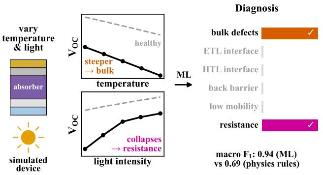