# An Invariant Neural-Network Eddy-Viscosity Closure with Iterative Solver Coupling for Molten Salt Fast Reactor Thermal-Hydraulics

Zaid Abulawia, William Oliveirab, Akzhol Almukhametova, Jun Fangc, Ling Zouc, Rui Huc, Stefano Lorenzib, Yang Liua,∗

aDepartment of Nuclear Engineering, Texas A&M University, College Station, TX 77843, USA bDepartment of Energy, Nuclear Engineering Division, Politecnico di Milano, Milan, Italy cNuclear Science and Engineering Division, Argonne National Laboratory, Lemont, IL 60439, USA

## Abstract

System thermal-hydraulics codes such as the System Analysis Module (SAM) close turbulence on coarse meshes with algebraic zero-equation mixing-length models. These models cannot represent the non-equilibrium turbulence, flow separation, and large-scale recirculation of open-cavity advanced reactors. We develop an invariant neural-network eddy-viscosity closure for SAM and apply it to the Molten Salt Fast Reactor (MSFR). The closure predicts the turbulent kinetic energy and timescale of each element from the flow and geometry of its neighbors, without solving turbulence transport equations. The resulting non-negative eddy viscosity enters the implicit difusive operator, which keeps the momentum equations well conditioned. We prove that the closure is exactly invariant to translation, Galilean boost, rotation, reflection, and neighbor ordering. A network trained on high-order Nek5000 fields sees a diferent feature distribution on the coarse SAM mesh. We remove this covariate shift by iteratively retraining the network on SAM flow states against fixed Nek5000 targets. For a held-out steady state, the coupled closure reproduces the single recirculation cell and eddy-viscosity plume of the Nek5000 reference. In a 120 s pump-coastdown transient, it halves the velocity error of the mixing-length model, from 37.6% to 17.7%, and matches the Nek5000 eddy viscosity with a time-averaged relative error of 12%. The remaining velocity error comes from the coarse mesh. The coupled transient takes about 0.2 core-hours, compared with about 330 core-hours for Nek5000. The results show that the closure can recover two-equation RANS turbulence behavior in a coarse-mesh system code at a small fraction of the CFD cost.

Keywords: Molten Salt Fast Reactor, Turbulence Closure Modeling, Galilean Invariance, Coarse-Mesh Thermal-Hydraulics

## Nomenclature

<table><tr><td colspan="2">Physical quantities</td><td> $\mathcal { F } _ { \Theta }$   $\mathbf { G }$   $m$ </td><td>neural closure mapping embedding matrix number of embedding channels</td></tr><tr><td> $A$   $d _ { w }$   $k$ </td><td>element area  $[ \mathrm { m } ^ { 2 } ]$  wall distance [m] turbulent kinetic energy  $[ \mathrm { m ^ { 2 } s ^ { - 2 } } ]$ </td><td> $n , { \mathcal { N } }$ </td><td>neighbor count and neighborhood</td></tr><tr><td> $L , T$   $N _ { e }$ </td><td>characteristic length [m] and time [s]</td><td> $\mathbf { Q } , \mathbf { q }$ </td><td>feature matrix and row</td></tr><tr><td> $p$ </td><td>number of mesh elements effective mean pressure  $\mathrm { [ P a ] }$ </td><td> $\mathbf { r } , \mathbf { w }$   $\mathbf { z }$ </td><td>relative position and velocity vectors  $\begin{array} { r } { \left( z _ { k } , z _ { \tau } \right) ^ { \top } } \end{array}$ </td></tr><tr><td></td><td></td><td> $\Theta$ </td><td>transformed target vector,</td></tr><tr><td> $r , z$ </td><td>radial and axial coordinates [m]</td><td></td><td>network parameters</td></tr><tr><td> $R e$ </td><td>Reynolds number</td><td> $\phi$ </td><td>neural network</td></tr><tr><td> $\mathbf { S }$ </td><td>mean strain-rate tensor  $[ \mathrm { s } ^ { - 1 } ]$ </td><td> $\psi$ </td><td>normalization map</td></tr><tr><td>t</td><td>time [s]</td><td>Subscripts and superscripts</td><td></td></tr><tr><td> $U$ </td><td>velocity scale or inlet speed  $[ \mathrm { m } \mathrm { s } ^ { - 1 } ]$ </td><td> $a , e$ </td><td>element indices</td></tr><tr><td>u</td><td>mean velocity vector  $[ \mathrm { m } \mathrm { s } ^ { - 1 } ]$ </td><td> $0$ </td><td>target element; characteristic scale</td></tr><tr><td> $V$ </td><td>axisymmetric element volume  $[ \mathrm { m ^ { 3 } } ]$ </td><td> $c , z$ </td><td>features and targets</td></tr><tr><td> $\mu$ </td><td>dynamic viscosity [Pa s]</td><td></td><td>emb, pred embedding and prediction networks</td></tr><tr><td> $\rho$ </td><td>fluid density [kg m  $^ { - 3 } ]$ </td><td>in, pk inlet and peak</td><td></td></tr><tr><td> $\tau$ </td><td>turbulence timescale [s]</td><td> $k , \tau$ </td><td>target components</td></tr><tr><td> $\Omega$ </td><td>fluid domain</td><td> $t$ </td><td>turbulent</td></tr><tr><td></td><td>Neural-network and closure quantities</td><td> $w$ </td><td>wall</td></tr><tr><td> $\mathcal { A }$ </td><td>aggregated SAM feature dataset</td><td>*</td><td>Nek5000 reference</td></tr><tr><td> $b$ </td><td>wall-adjacency indicator</td><td> $\widehat { \cdot }$ </td><td>network prediction</td></tr><tr><td>C,c</td><td>scalar feature matrix and row</td><td>~</td><td>transformed frame</td></tr><tr><td> $\mathcal { D }$ </td><td>invariant descriptor matrix</td><td>1</td><td>reduced</td></tr><tr><td> $E$ </td><td>relative  $L _ { 2 }$ </td><td> $\bar { \cdot }$ </td><td></td></tr><tr><td></td><td>error</td><td> $\top$ </td><td>domain or time mean transpose</td></tr></table>

## 1. Introduction

Liquid-fueled molten salt reactors (MSRs) dissolve fissile and fertile actinides in a circulating fluoride or chloride carrier salt [1, 2, 3]. The Molten Salt Fast Reactor (MSFR) is the MSR concept selected by the Generation-IV International Forum. The fuel salt generates fission heat and carries delayed-neutron precursors through an open core cavity without coolant channels. Reactor neutronics and safety margins therefore depend strongly on the multidimensional core flow [4, 5, 6]. The MSFR core has curved inner shield walls, an abrupt expansion from the cold-leg inlet, and strong centripetal acceleration toward the hot-leg outlet. At Reynolds numbers above $1 0 ^ { 6 }$ , this geometry produces shear-layer separation, impinging jets, and persistent recirculation zones. These zones govern residence times, wall heat transfer, and peak fuel temperatures in normal operation and during pump-coastdown transients [1, 7]. Through thermal and precursor-transport feedback, they also shape the core reactivity [4, 5]. A flow model that misrepresents them can mispredict the power and temperature evolution, including hot spots in low-velocity regions near the walls [1].

Simulating these multidimensional phenomena over long plant transients requires a balance between physical fidelity and computational cost [8, 9]. High-fidelity computational fluid dynamics (CFD) codes such as Nek5000 [10, 11], OpenFOAM [4, 5], and commercial finitevolume packages [12] resolve the MSFR cavity on fine boundary-layer meshes. They use two-equation Reynolds-averaged Navier–Stokes (RANS) models, large-eddy simulation (LES), or direct numerical simulation (DNS) [13, 14, 15]. However, their fine meshes and small time steps make them too expensive for routine plant-level transient sweeps, sensitivity studies, and uncertainty quantification [16, 17, 18, 19, 20, 21]. Conversely, system and coarse-mesh multidimensional codes such as the System Analysis Module (SAM) [22, 23, 24] are fast because they use coarse finite-element meshes and algebraic zero-equation mixing-length closures [25, 26]. System codes in general rely on empirical closures calibrated against separate-efect tests in simple tube and channel geometries [27]. Mixing-length closures work well in simple pipe and channel flows. They assume local equilibrium between turbulent production and dissipation and set the mixing length from the wall distance alone. In the open MSFR cavity, this local assumption misses non-local history and transport efects and produces qualitatively incorrect core recirculation patterns.

Data-driven turbulence modeling can transfer high-fidelity closure physics into coarse-mesh solvers without adding stif transport partial diferential equations (PDEs) at runtime [28, 29, 30, 31, 32, 33, 34, 35, 36, 37, 38]. Early machine-learning RANS models trained neural networks or random forests to predict Reynolds-stress anisotropy or optimal eddy viscosity from Pope’s integrity basis of strain-rate and rotation-rate invariants and other mean-flow features [39, 40, 41, 42, 43]. These models can be accurate a priori on held-out CFD snapshots. Inside a momentum solver, a posteriori, they face three challenges [44, 45, 46].

First, the coupled momentum equations must remain well conditioned. Wu et al. [44], Liu et al. [45], and McConkey et al. [43] showed that a learned Reynolds stress injected explicitly as a source term can make the discretized RANS system severely ill-conditioned at high Reynolds numbers. Small regression errors then grow into large mean-velocity errors unless a non-negative eddy viscosity is treated implicitly.

Second, the closure needs non-local inputs that respect the symmetries of the flow. Furthermore, purely local strain-rate mappings $\mu _ { t } = f ( \mathbf { S } )$ become multi-valued in separated or recirculating flows, because regions with similar local strain rates carry diferent turbulence levels [45, 47]. A constitutive closure must also be Galilean invariant under uniform boosts and frame invariant under translations, rotations, and reflections [48, 40, 42, 49, 50]. Non-local closures built on sampled point sets represent spatial transport on fine CFD grids [51, 52, 53].

Coarse-mesh finite-element solvers such as SAM and the underlying MOOSE framework [54, 24, 23] have too few, variably sized elements for point-set sampling. A non-local closure for these solvers must instead gather flow and geometry data from neighboring elements. It must also be independent of the order of those neighbors and insensitive to how many there are.

Third, discretization diferences cause covariate shift. A network trained on velocity and strain-rate fields projected from a fine, high-order spectral-element solver (Nek5000) sees a diferent feature distribution when it runs inside a coarse, first-order stabilized finite-element solver (SAM). Recent iterative and field-inversion RANS studies show that this shift degrades a posteriori stability and accuracy unless the training adapts to the flow states the solver actually produces [45, 32, 55].

Closest to the present work, Cervi et al. [56] added neural-network eddy-viscosity closures trained on CFD data to SAM to model thermal mixing and stratification in liquid-metal fast reactor plena. They found that transformer-based models outperform convolutional networks. The present closure difers in two ways. It is invariant to frame changes and neighbor ordering by construction, and it is retrained iteratively on SAM flow states to remove the covariate shift.

This work develops an invariant neural-network eddy-viscosity closure for SAM and applies it to steady-state and transient MSFR flows. Building on high-to-low data-driven modeling for advanced reactor flows [7, 35], the closure takes its inputs from a two-layer neighborhood of mesh elements in SAM and MOOSE [24, 23]. This PDE-free closure predicts the turbulent kinetic energy and turbulence timescale of each element and forms a non-negative eddy viscosity from them, without solving transport PDEs. The network is trained iteratively with SAM [45, 55]. Section 3.3 shows that the closure satisfies the required frame and permutation invariances exactly. Section 3.4 shows how the closure and its iterative training address each of the three challenges. We evaluate the closure a priori on held-out Nek5000 snapshots and a posteriori inside SAM, for steady states over a range of Reynolds numbers and for a 120 s pump-coastdown transient. SAM’s mixing-length model serves as the baseline.

The remainder of this paper is organized as follows. Section 2 presents the governing equations and baseline turbulence closures in Nek5000 and SAM. Section 3 details the neural closure and the iterative training. Section 4 describes the detailed MSFR case study. Section 5 presents the a priori and a posteriori evaluation results and iterative convergence analysis, and Section 6 summarizes the main conclusions.

## 2. Governing Equations and Baseline Turbulence Closures

Both the high-fidelity reference solver (Nek5000) and the coarse-mesh target solver (SAM) model turbulent incompressible and low-Mach-number single-phase flows via the Reynolds-

averaged conservation of mass and momentum:

$$
\nabla \cdot \left( \rho \mathbf { u } \right) = 0 ,\tag{1}
$$

$$
\rho { \frac { \partial \mathbf { u } } { \partial t } } + \rho ( \mathbf { u } \cdot \nabla ) \mathbf { u } = - \nabla p + \nabla \cdot \left[ ( \mu + \mu _ { t } ) { \Big ( } \nabla \mathbf { u } + \nabla \mathbf { u ^ { \intercal } } { \Big ) } \right] + \rho \mathbf { g } ,\tag{2}
$$

where u is the mean velocity vector in the two-dimensional axisymmetric meridional domain $\Omega \subset \mathbb { R } ^ { 2 } , \rho$ is the fluid density, $p$ is the efective mean pressure, $\mu$ is the molecular dynamic viscosity, $\mu _ { t }$ is the eddy viscosity, and $\mathbf { g }$ is gravitational acceleration. The pressure p absorbs the isotropic turbulent normal stress ${ \scriptstyle { \frac { 2 } { 3 } } } \rho k$ . Both benchmarks in this study are isothermal with constant fluid properties, so the energy equation is not solved. Under the Boussinesq eddy-viscosity hypothesis, the deviatoric Reynolds stress tensor $\boldsymbol { \tau } ^ { R } = - \rho \overline { { \mathbf u ^ { \prime } \otimes \mathbf u ^ { \prime } } } + { \frac { 2 } { 3 } \rho k \mathbf I }$ is modeled linearly in terms of the mean strain-rate tensor S:

$$
\pmb { \tau } ^ { R } = 2 \mu _ { t } \mathbf { S } , \qquad \mathbf { S } = \frac { 1 } { 2 } \Big ( \nabla \mathbf { u } + \nabla \mathbf { u } ^ { \intercal } \Big ) .\tag{3}
$$

The high-fidelity reference and the baseline coarse-mesh code difer in how they close the scalar field $\mu _ { t } ( \mathbf { x } , t )$

## 2.1. High-Fidelity Reference: k–τ RANS Closure in Nek5000

The reference data come from the spectral-element code Nek5000 [10] with the twoequation $k { \mathrm { - } } \tau \ \mathrm { R A N S }$ model [15, 57]. The $k { - } \tau$ model is derived from the Wilcox $k { \mathrm { - } } \omega$ model by introducing the turbulence timescale $\tau \equiv 1 / ( \beta ^ { * } \omega ) = k / \varepsilon$ . Both k and τ vanish smoothly at no-slip walls, where $k = 0$ and $\tau = 0$ on $\partial \Omega _ { w } .$ , so the model avoids the singular wall boundary condition of $\omega$ . This property suits high-order spectral-element discretizations of curved-wall domains [15].

In the $k { - } \tau$ formulation, the reference eddy viscosity is defined as

$$
\mu _ { t } ^ { * } = \rho k \tau ,\tag{4}
$$

where the turbulent kinetic energy k and turbulence timescale $\tau$ evolve according to two coupled advection–difusion–reaction transport PDEs [15, 57]:

$$
\rho \frac { { \partial { k } } } { { \partial t } } + \rho ( { \bf { u } } \cdot \nabla ) { k } = \nabla \cdot \left[ { \left( { \mu + \frac { { { \mu } _ { t } } } { { { \sigma } _ { k } } } } \right) \nabla k } \right] + { { \mathcal P } _ { k } } - \frac { { \rho k } } { \tau } ,\tag{5}
$$

$$
\begin{array} { l } { \displaystyle \rho \frac { \partial \tau } { \partial t } + \rho ( \mathbf { u } \cdot \nabla ) \tau = \nabla \cdot \left[ \left( \mu + \frac { \mu _ { t } } { \sigma _ { \tau } } \right) \nabla \tau \right] - \gamma \frac { \tau } { k } \mathcal { P } _ { k } + \rho \beta _ { 1 } - 2 \frac { \mu } { k } \nabla k \cdot \nabla \tau } \\ { \displaystyle \quad + \frac { 2 } { \tau } \left( \mu + \frac { \mu _ { t } } { \sigma _ { \tau } } \right) \nabla \tau \cdot \nabla \tau + \rho \sigma _ { d } \frac { \tau ^ { 2 } } { k } \operatorname* { m a x } ( \nabla k \cdot \nabla \omega ^ { * } , 0 ) , } \end{array}\tag{6}
$$

in which $\mathcal { P } _ { k } = \pmb { \tau } ^ { R } : \nabla \mathbf { u } = 2 \mu _ { t } \| \mathbf { S } \| _ { F } ^ { 2 }$ is the shear production of turbulent kinetic energy, $\omega ^ { * } = { }$ $1 / ( \beta ^ { * } \operatorname* { m a x } ( \tau , \tau _ { \operatorname* { m i n } } ) )$ , and $\left( \sigma _ { k } , \sigma _ { \tau } , \gamma , \beta _ { 1 } , \beta ^ { * } , \sigma _ { d } \right)$ are standard closure constants [15]. Solving Eqs. (5)–(6) accurately requires resolving the steep near-wall gradients of ∇k and $\nabla \tau$ with fine boundary-layer elements at $y ^ { + } \sim \mathcal { O } ( 1 )$ , which is infeasible on the coarse meshes used by system-level codes.

In this high-to-low study, the two-dimensional axisymmetric Nek5000 k–τ RANS solution is the assumed reference. Neither RANS nor the axisymmetric assumption fully captures the three-dimensional turbulence of the MSFR core. The comparisons therefore benchmark the closure against this reference and do not validate it against experiments or scale-resolving simulations. The aim is to show that the neural closure recovers on the coarse SAM mesh the two-equation RANS behavior that the mixing-length model loses.

## 2.2. Coarse-Mesh Target Solver: Zero-Equation Closure in SAM

In SAM’s multidimensional porous-medium and open-fluid finite-element module [23, 24], the conservation equations (1) and (2) are discretized using first-order Lagrange $\left( Q _ { 1 } \right)$ quadrilateral elements stabilized with the Streamline-Upwind/Petrov–Galerkin and Pressure-Stabilizing/Petrov–Galerkin (SUPG/PSPG) formulations [24, 26]. Time integration uses the implicit backward Euler scheme with adaptive time steps. At each step, Newton’s method in the MOOSE framework [54, 23] solves the nonlinear system with a finite-diference Jacobian, computed with graph coloring, and a direct LU factorization.

By default, SAM closes the eddy viscosity with Prandtl’s algebraic zero-equation mixinglength model [25, 26]:

$$
\mu _ { t } ^ { \mathrm { z e r o - e q } } = \rho \ell _ { m } ^ { 2 } \sqrt { 2 \mathbf { S } : \mathbf { S } } = \sqrt { 2 } \rho \ell _ { m } ^ { 2 } \| \mathbf { S } \| _ { F } ,\tag{7}
$$

where $\| \mathbf { S } \| _ { F } = \sqrt { \mathrm { t r } ( \mathbf { S } ^ { \mathsf { T } } \mathbf { S } ) }$ is the Frobenius norm of the strain-rate tensor and $\ell _ { m }$ is a capped Van Driest mixing length defined solely in terms of the minimum distance $d _ { w } ( \mathbf { x } )$ to the nearest solid wall:

$$
\ell _ { m } ( d _ { w } ) = \operatorname* { m i n } ( \kappa d _ { w } , \ell _ { m , \mathrm { m a x } } ) , \ell _ { m , \mathrm { m a x } } = 0 . 0 9 \delta _ { b } ,\tag{8}
$$

with von Kármán constant $\kappa = 0 . 4 1$ and user-prescribed boundary-layer thickness $\delta _ { b }$ . Because Eq. (7) depends only on the pointwise strain-rate magnitude $\| \mathbf { S } ( \mathbf { x } ) \| _ { F }$ and geometric wall distance $d _ { w } ( \mathbf { x } )$ , it enforces $\mu _ { t } ^ { \mathrm { z e r o - e q } } = 0$ wherever $\| \mathbf { S } \| _ { F } = 0$ , for example in vortex cores and at shear-layer inflection points. It also cannot represent the convective and difusive transport of turbulent kinetic energy from high-shear inlet jets into central recirculating cavities.

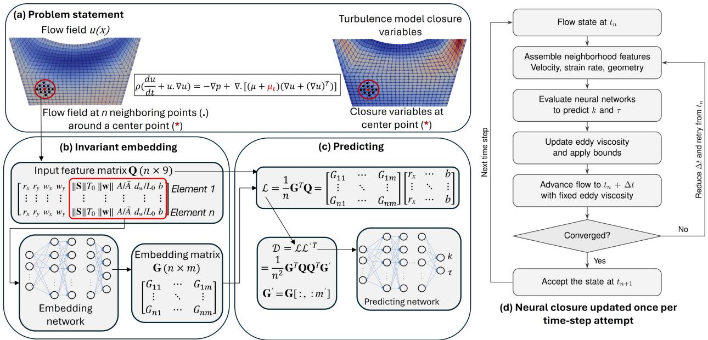  
Figure 1: Overview of the closure and its coupling with SAM. (a) The eddy viscosity $\mu _ { t }$ at each target element (∗) is inferred from the flow state on its n neighboring elements (•). (b) A shared-weight embedding network maps the scalar features of each row of $\mathbf { Q } \in \mathbb { R } ^ { n \times 9 }$ to the embedding matrix G. (c) The invariant descriptor D (Eq. (15)) and $R e$ are mapped to $\widehat { k }$ and ${ \widehat { \tau } } ,$ giving $\widehat { \mu } _ { t } = \rho \widehat { k } \widehat { \tau } \geq 0 .$ . (d) $\widehat { \mu } _ { t }$ is evaluated once per time step from the accepted state, capped at 30 Pa s, and held fixed during the Newton iterations; a failed step is retried with a smaller $\Delta t$

## 3. Neural-Network Closure and Iterative Training

The goal is $k { - } \tau$ closure fidelity in SAM on a coarse mesh without solving the stif transport PDEs (5)–(6). We build a neural closure that takes its inputs from neighboring elements of the SAM mesh and train it iteratively with SAM. Figure 1 illustrates the overall two-stage framework. Stage 1 trains ofline: Nek5000 k–τ fields are projected onto the coarse mesh to initialize the neural closure. Stage 2 trains iteratively: the closure runs inside SAM’s Newton solver and is retrained on the element flow states from all coupled runs. The regression targets stay fixed at the projected Nek5000 turbulence fields.

## 3.1. Neighborhood and Input Features

In a non-equilibrium recirculating flow on a coarse mesh, the eddy viscosity $\mu _ { t } ( \mathbf { x } _ { 0 } , t )$ of a target element 0 with centroid $\mathbf { x } _ { \mathrm { 0 } }$ depends on its local strain rate. It also depends on the velocity, shear, and mesh resolution of the neighboring elements. In SAM [54, 24, 23], individual elements span large physical volumes, and near-wall regions have only a few element layers. Rather than sampling points from a continuous or fine-grid point set [51, 52, 53], we formulate the closure directly on the finite elements of the computational mesh. For each target element 0, we define its neighborhood $\mathcal { N } _ { 0 }$ as the target element together with its edge-adjacent elements and their edge-adjacent elements, which form a two-layer topological neighborhood:

$$
\mathcal { N } _ { 0 } = \{ 0 \} \cup \mathcal { E } ( 0 ) \cup \bigcup _ { b \in \mathcal { E } ( 0 ) } \mathcal { E } ( b ) , \qquad n = | \mathcal { N } _ { 0 } | ,\tag{9}
$$

where element indices are taken from $\{ 1 , 2 , \ldots , N _ { e } \}$ , the label 0 denotes the target element, which is itself included in $\mathcal { N } _ { 0 }$ , and ${ \mathcal { E } } ( a )$ is the set of elements that share an edge with element a. The neighborhood size n varies with the local mesh topology and the proximity to walls or the symmetry axis. On the coarse SAM mesh, n ranges from 6 to 14, with a mean of 12.2. A topological neighborhood is used instead of a fixed Euclidean radius because it adapts automatically to the local element size, requires no mesh-dependent radius parameter, and is built directly from the element connectivity available in SAM at runtime.

Let $L _ { 0 } , U _ { 0 }$ , and $T _ { 0 } = L _ { 0 } / U _ { 0 }$ denote the characteristic length, velocity, and convective time scales of the flow system. Each neighbor $a \in \mathcal { N } _ { 0 }$ has a centroid $\mathbf { x } _ { a } .$ , velocity ${ \bf u } _ { a }$ , strain-rate tensor $\mathbf { S } _ { a }$ , area $A _ { a } .$ , minimum wall distance $d _ { w , a }$ , and wall-adjacency indicator $b _ { a } \in \{ 0 , 1 \}$ From these we build a dimensionless feature row $\mathbf { q } _ { a } ^ { \mathsf { T } } \in \mathbb { R } ^ { 1 \times 9 }$ with two relative vectors and five scalar features:

$$
\mathbf { q } _ { a } ^ { \mathsf { T } } = \left[ \mathbf { r } _ { a } ^ { \mathsf { T } } , \mathbf { w } _ { a } ^ { \mathsf { T } } , \mathbf { c } _ { a } ^ { \mathsf { T } } \right] \in \mathbb { R } ^ { 1 \times 9 } ,\tag{10}
$$

where the dimensionless relative position vector $\mathbf { r } _ { a } \in \mathbb { R } ^ { 2 }$ and relative velocity vector ${ \bf w } _ { a } \in \mathbb { R } ^ { 2 }$ are measured with respect to the target element 0:

$$
\mathbf { r } _ { a } = { \frac { \mathbf { x } _ { a } - \mathbf { x } _ { 0 } } { L _ { 0 } } } , \qquad \mathbf { w } _ { a } = { \frac { \mathbf { u } _ { a } - \mathbf { u } _ { 0 } } { U _ { 0 } } } .\tag{11}
$$

The scalar features $\mathbf { c } _ { a } \in \mathbb { R } ^ { 5 }$ follow from a fixed componentwise logarithmic map $\psi _ { c } : \mathbb { R } _ { + } ^ { 4 } \times$ $\{ 0 , 1 \} \to { \mathbb { R } } ^ { 5 }$ applied to five dimensionless invariants of neighbor a:

$$
\mathbf { c } _ { a } = \psi _ { c } \bigg ( \| \mathbf { S } _ { a } \| _ { F } T _ { 0 } , \ \| \mathbf { w } _ { a } \| _ { 2 } , \ \frac { A _ { a } } { \bar { A } } , \ \frac { d _ { w , a } } { L _ { 0 } } , \ b _ { a } \bigg ) \in \mathbb { R } ^ { 5 } ,\tag{12}
$$

where $\begin{array} { r } { \bar { A } = \frac { 1 } { N _ { e } } \sum _ { e = 1 } ^ { N _ { e } } A _ { e } } \end{array}$ is the domain-mean element area and $b _ { a } = 1$ if element a is adjacent to a physical wall and $b _ { a } = 0$ if it lies in the fluid interior. The normalized area $A _ { a } / \bar { A }$ and wall indicator $b _ { a }$ of every neighbor tell the closure about mesh grading and under-resolved near-wall elements. The logarithmic map $\psi _ { c }$ compresses the multi-decade ranges of the strain rate $\| \mathbf { S } _ { a } \| _ { F } T _ { 0 }$ and relative speed $\Vert \mathbf { w } _ { a } \Vert _ { 2 }$ into $\mathcal { O } ( 1 )$ intervals that suit network training [42]. Stacking the n neighbor rows defines the feature matrix $\mathbf { Q } \in \mathbb { R } ^ { n \times 9 }$ and its scalar submatrix

C $\in \mathbb { R } ^ { n \times 5 }$

$$
\mathbf { Q } = [ \begin{array} { l } { \mathbf { q } _ { 1 } ^ { \mathsf { T } } ] } \\ { : } \\ { \mathbf { \Phi } } \\ { \mathbf { q } _ { n } ^ { \mathsf { T } } } \end{array} ] \in \mathbb { R } ^ { n \times 9 } , \qquad \mathbf { C } = [ \begin{array} { l } { \mathbf { c } _ { 1 } ^ { \mathsf { T } } } \\ { : } \\ { \mathbf { \Phi } } \\ { \mathbf { c } _ { n } ^ { \mathsf { T } } } \end{array} ] \in \mathbb { R } ^ { n \times 5 } .\tag{13}
$$

## 3.2. Invariant Embedding and Prediction Architecture

Because the number of neighboring elements n varies across unstructured mesh locations and the indexing order of rows in Q is arbitrary, a fixed-input multilayer perceptron (MLP) cannot be applied directly to $\mathbf { Q } .$ . Instead, we employ a two-stage invariant architecture consisting of a shared-weight embedding network $\phi _ { \mathrm { e m b } }$ and a prediction network $\phi _ { \mathrm { p r e d } }$ [31, 52, 53].

First, the embedding network $\phi _ { \mathrm { e m b } } : \mathbb { R } ^ { 5 }  \mathbb { R } ^ { m }$ acts identically and independently on each row $\mathbf { c } _ { a } ^ { \mathsf { T } }$ of the scalar feature submatrix $\mathbf { C } \in \mathbb { R } ^ { n \times 5 }$ to produce an m-channel embedding matrix $\mathbf { G } \in \mathbb { R } ^ { n \times m }$ :

$$
\mathbf { G } _ { a : } = \phi _ { \mathrm { e m b } } \bigl ( \mathbf { c } _ { a } ^ { \mathsf { T } } ; \Theta _ { \mathrm { e m b } } \bigr ) \in \mathbb { R } ^ { 1 \times m } , \qquad a = 1 , \ldots , n ,\tag{14}
$$

and we denote by $\mathbf { G } ^ { \prime } \in \mathbb { R } ^ { n \times m ^ { \prime } } \ ( m ^ { \prime } < m )$ the reduced embedding submatrix formed by the first $m ^ { \prime }$ columns of G.

Second, G and G′ project the feature matrix $\mathbf { Q } \in \mathbb { R } ^ { n \times 9 }$ into the neighborhood-averaged feature matrix $\mathcal { L } \in \mathbb { R } ^ { m \times 9 }$ and the fixed-size invariant descriptor matrix $\mathcal { D } \in \mathbb { R } ^ { m \times m ^ { \prime } }$ :

$$
{ \mathcal { L } } = { \frac { 1 } { n } } \mathbf { G } ^ { \mathsf { T } } \mathbf { Q } \in \mathbb { R } ^ { m \times 9 } , \qquad { \mathcal { D } } = { \frac { 1 } { n ^ { 2 } } } \mathbf { G } ^ { \mathsf { T } } \mathbf { Q } \mathbf { Q } ^ { \mathsf { T } } \mathbf { G } ^ { \prime } \in \mathbb { R } ^ { m \times m ^ { \prime } } .\tag{15}
$$

Regardless of the neighborhood cardinality $n , \mathcal { D }$ has fixed dimension $m \times m ^ { \prime }$ and vectorizes to vec $\mathbf { \chi } ( \mathcal { D } ) \in \mathbb { R } ^ { m m ^ { \prime } }$

The embedding network acts on one neighbor at a time. For each of its m channels, it learns how strongly that neighbor contributes to the averages in Eq. (15), so the closure can emphasize, for example, wall-adjacent or high-shear neighbors. Using the scalar features C directly as these weights would tie each neighbor’s contribution linearly to its feature values. Neighbors with near-zero features would then be ignored, and physically distinct neighborhoods could map to the same descriptor.

Third, the prediction network $\phi _ { \mathrm { p r e d } } : \mathbb { R } ^ { m m ^ { \prime } + 1 } \to \mathbb { R } ^ { 2 }$ maps the concatenation of vec(D) and the global operating Reynolds number $\mathit { R e } = \rho U _ { \mathrm { i n } } L _ { 0 } / \mu$ through a fully connected MLP to predict the dimensionless transformed turbulence vector $\widehat { \mathbf { z } } = ( \widehat { z } _ { k } , \widehat { z } _ { \tau } ) ^ { \top }$

$$
\begin{array} { r } { \widehat { \mathbf { z } } = \left[ \widehat { \dot { z } } _ { k } \right] = \phi _ { \mathrm { p r e d } } \Big ( \big [ \mathrm { v e c } ( \mathcal { D } ) ^ { \mathsf { T } } , R e \big ] ^ { \mathsf { T } } ; \Theta _ { \mathrm { p r e d } } \Big ) . } \end{array}\tag{16}
$$

The dimensionless targets $\mathbf { z } = ( z _ { k } , z _ { \tau } ) ^ { \top }$ are defined by a smooth componentwise logarithmic bijection $\psi _ { z } : \mathbb { R } _ { + } ^ { 2 } \to \mathbb { R } ^ { 2 }$ . Its inverse returns positive $\widehat { k }$ and $\widehat { \tau }$ over several decades, and hence a non-negative eddy viscosity:

$$
\mathbf { z } = \psi _ { z } \bigg ( \frac { k } { U _ { 0 } ^ { 2 } } , ~ \frac { \tau } { T _ { 0 } } \bigg ) , \qquad ( \widehat { k } , \widehat { \tau } ) = \psi _ { z } ^ { - 1 } ( \widehat { \mathbf { z } } ) > 0 , \qquad \widehat { \mu } _ { t } = \rho \widehat { k } \widehat { \tau } \geq 0 .\tag{17}
$$

## 3.3. Frame and Permutation Invariance

A constitutive closure must give the same prediction under a change of inertial frame, meaning translation, Galilean boost, rotation or reflection, and under any re-indexing of the neighbors [48, 53, 49]. For any parameters $\Theta = \left( \Theta _ { \mathrm { e m b } } , \Theta _ { \mathrm { p r e d } } \right)$ , the mapping $\mathcal { F } _ { \Theta } : ( \mathbf { Q } , R e ) \mapsto$ $( \widehat { k } , \widehat { \tau } , \widehat { \mu } _ { t } )$ defined by Eqs. (10)–(17) satisfies all four properties exactly. This follows by tracking the feature rows $\mathbf { q } _ { a } ^ { \mathsf { T } } = [ \mathbf { r } _ { a } ^ { \mathsf { T } } , \mathbf { w } _ { a } ^ { \mathsf { T } } , \mathbf { c } _ { a } ^ { \mathsf { T } } ]$ through the descriptor D of Eq. (15). Under a uniform spatial translation $\tilde { \mathbf { x } } = \mathbf { x } + \mathbf { x } _ { c } \left( \mathbf { x } _ { c } \in \mathbb { R } ^ { 2 } \right)$ and Galilean boost $\tilde { \mathbf { x } } ( t ) = \mathbf { x } ( t ) - \mathbf { u } _ { \mathrm { b } } t .$ $\tilde { \mathbf { u } } ( \tilde { \mathbf { x } } , t ) = \mathbf { u } ( \mathbf { x } , t ) - \mathbf { u } _ { \mathrm { b } } \ ( \mathbf { u } _ { \mathrm { b } } \in \mathbb { R } ^ { 2 } )$ , the uniform ofsets ${ \bf x } _ { c } - { \bf u } _ { \mathrm { b } } t$ and $- \mathbf { u } _ { \mathrm { b } }$ cancel identically in the relative vectors of every neighbor $a \in \mathcal { N } _ { 0 }$

$$
\tilde { \mathbf { r } } _ { a } = \frac { \tilde { \mathbf { x } } _ { a } - \tilde { \mathbf { x } } _ { 0 } } { L _ { 0 } } = \mathbf { r } _ { a } , \qquad \tilde { \mathbf { w } } _ { a } = \frac { \tilde { \mathbf { u } } _ { a } - \tilde { \mathbf { u } } _ { 0 } } { U _ { 0 } } = \mathbf { w } _ { a } .\tag{18}
$$

Because the translation Jacobian is the identity and $\nabla { \mathbf u } _ { \mathrm { b } } = { \mathbf 0 }$ , the spatial gradient operator and strain-rate tensor are preserved $( \tilde { \nabla } \tilde { \mathbf { u } } _ { a } = \nabla \mathbf { u } _ { a }$ and $\tilde { \mathbf { S } } _ { a } = \mathbf { S } _ { a } )$ , as are $\lVert \tilde { \mathbf { w } } _ { a } \rVert _ { 2 } = \lVert \mathbf { w } _ { a } \rVert _ { 2 }$ element areas $\tilde { A } _ { a } = A _ { a }$ , wall distances $\tilde { d } _ { w , a } = d _ { w , a }$ , and boundary indicators $b _ { a }$ . Consequently, every argument of $\psi _ { c }$ in Eq. (12) is invariant, so $\tilde { \mathbf { c } } _ { a } = \mathbf { c } _ { a }$ and $\tilde { \mathbf { Q } } = \mathbf { Q }$ . Moreover, the Reynolds number $\mathit { R e } = \rho U _ { \mathrm { i n } } L _ { 0 } / \mu$ uses the inlet speed relative to the vessel walls, so $\mathcal { F } _ { \Theta } ( \tilde { \bf Q } , R e ) =$ $\mathcal { F } _ { \Theta } ( \mathbf { Q } , R e )$

For orthogonal coordinate transformations x˜ = Rx and u˜ = Ru with any orthogonal matrix $\mathbf { R } \in O ( 2 )$ satisfying $\mathbf { R } ^ { \mathsf { T } } \mathbf { R } = \mathbf { R } \mathbf { R } ^ { \mathsf { T } } = \mathbf { I } _ { 2 } \left( \operatorname* { d e t } \mathbf { R } = \pm 1 \right)$ , the relative vectors and strain-rate tensor transform objectively as

$$
\tilde { \mathbf { r } } _ { a } = \mathbf { R } \mathbf { r } _ { a } , \qquad \tilde { \mathbf { w } } _ { a } = \mathbf { R } \mathbf { w } _ { a } , \qquad \tilde { \mathbf { S } } _ { a } = \mathbf { R } \mathbf { S } _ { a } \mathbf { R } ^ { \mathsf { T } } .\tag{19}
$$

By the orthogonality of R and the cyclic property of the matrix trace, the relative speed and strain-rate Frobenius norm are invariant:

$$
\| \widetilde { \mathbf { w } } _ { a } \| _ { 2 } = \sqrt { \mathbf { w } _ { a } ^ { \mathsf { T } } \mathbf { R } ^ { \mathsf { T } } \mathbf { R } \mathbf { w } _ { a } } = \| \mathbf { w } _ { a } \| _ { 2 } , \qquad \| \widetilde { \mathbf { S } } _ { a } \| _ { F } = \sqrt { \mathrm { t r } ( \mathbf { R } \mathbf { S } _ { a } ^ { \mathsf { T } } \mathbf { R } ^ { \mathsf { T } } \mathbf { R } \mathbf { S } _ { a } \mathbf { R } ^ { \mathsf { T } } ) } = \| \mathbf { S } _ { a } \| _ { F } .\tag{20}
$$

Since cell areas $A _ { a } \ ( \vert \operatorname* { d e t } \mathbf { R } \vert = 1 )$ , Euclidean wall distances $d _ { w , a }$ , and boundary indicators $b _ { a }$ are unchanged under $O ( 2 )$ , the scalar invariant vector satisfies $\tilde { \mathbf { c } } _ { a } = \mathbf { c } _ { a } , \mathrm { o r } \tilde { \textbf { C } } = \mathbf { C }$

Because $\phi _ { \mathrm { e m b } }$ depends only on $\mathbf { C } ,$ the embedding matrices are invariant: $\tilde { \mathbf { G } } = \phi _ { \mathrm { e m b } } ( \tilde { \mathbf { C } } ) = \mathbf { G }$ and $\tilde { \mathbf { G } } ^ { \prime } = \mathbf { G } ^ { \prime }$ . Meanwhile, each feature row of Q is right-multiplied by the block-diagonal orthogonal matrix ${ \bf B } _ { R } = \mathrm { d i a g } ( { \bf R } ^ { \top } , { \bf R } ^ { \top } , { \bf I } _ { 5 } ) \in O ( 9 )$ :

$$
\tilde { \mathbf { q } } _ { a } ^ { \mathsf { T } } = \left[ \mathbf { r } _ { a } ^ { \mathsf { T } } \mathbf { R } ^ { \mathsf { T } } , \mathbf { w } _ { a } ^ { \mathsf { T } } \mathbf { R } ^ { \mathsf { T } } , \mathbf { c } _ { a } ^ { \mathsf { T } } \right] = \mathbf { q } _ { a } ^ { \mathsf { T } } \mathbf { B } _ { R } \quad \Longrightarrow \quad \tilde { \mathbf { Q } } = \mathbf { Q } \mathbf { B } _ { R } .\tag{21}
$$

Since ${ \bf B } _ { R } { \bf B } _ { R } ^ { \mathsf { T } } = \mathrm { d i a g } ( { \bf R } ^ { \mathsf { T } } { \bf R } , { \bf R } ^ { \mathsf { T } } { \bf R } , { \bf I } _ { 5 } ) = { \bf I } _ { 9 }$ , substituting $\tilde { \mathbf { Q } } = \mathbf { Q } \mathbf { B } _ { R }$ and $\tilde { \mathbf { G } } = \mathbf { G }$ into Eq. (15) yields

$$
\tilde { \mathcal { D } } = \frac { 1 } { n ^ { 2 } } \tilde { \mathbf { G } } ^ { \mathsf { T } } \tilde { \mathbf { Q } } \tilde { \mathbf { Q } } ^ { \mathsf { T } } \tilde { \mathbf { G } } ^ { \prime } = \frac { 1 } { n ^ { 2 } } \mathbf { G } ^ { \mathsf { T } } \mathbf { Q } \underbrace { \mathbf { B } _ { R } \mathbf { B } _ { R } ^ { \mathsf { T } } } _ { \mathbf { I } _ { \mathrm { 9 } } } \mathbf { Q } ^ { \mathsf { T } } \mathbf { G } ^ { \prime } = \mathcal { D } .\tag{22}
$$

Thus every entry of D is an exact $O ( 2 )$ invariant, and $\mathcal { F } _ { \Theta } ( \tilde { \mathbf { Q } } , R e ) = \mathcal { F } _ { \Theta } ( \mathbf { Q } , R e )$

Finally, under any neighbor-index permutation $\pi \in S _ { n }$ with permutation matrix $\mathbf { P } _ { \pi } \in$ $\{ 0 , 1 \} ^ { n \times n }$ satisfying $\mathbf { P } _ { \pi } ^ { \mathsf { T } } \mathbf { P } _ { \pi } = \mathbf { I } _ { n }$ , reordering the neighboring elements gives $\tilde { \mathbf { Q } } = \mathbf { P } _ { \pi } \mathbf { Q }$ and $\tilde { \mathbf { C } } = \mathbf { P } _ { \pi } \mathbf { C }$ . Because $\phi _ { \mathrm { e m b } }$ acts identically row-by-row on C, it is permutation-equivariant: $\tilde { \mathbf { G } } = \phi _ { \mathrm { e m b } } ( \mathbf { P } _ { \pi } \mathbf { C } ) = \mathbf { P } _ { \pi } \mathbf { G }$ and $\tilde { \mathbf { G } } ^ { \prime } = \mathbf { P } _ { \pi } \mathbf { G } ^ { \prime }$ . Substituting into Eq. (15) gives

$$
\tilde { \mathcal { L } } = \frac { 1 } { n } \tilde { \mathbf { G } } ^ { \mathsf { T } } \tilde { \mathbf { Q } } = \frac { 1 } { n } \mathbf { G } ^ { \mathsf { T } } \underbrace { \mathbf { P } _ { \pi } ^ { \mathsf { T } } \mathbf { P } _ { \pi } } _ { \mathbf { I } _ { n } } \mathbf { Q } = \mathcal { L } \quad \Longrightarrow \quad \tilde { \mathcal { D } } = \frac { 1 } { n } \tilde { \mathcal { L } } \tilde { \mathbf { Q } } ^ { \mathsf { T } } \tilde { \mathbf { G } } ^ { \prime } = \mathcal { D } ,\tag{23}
$$

so the closure output is independent of neighbor indexing. In addition to exact permutation invariance under $S _ { n }$ , the factor $1 / n$ in Eq. (15) ensures that $\begin{array} { r } { \mathcal { L } _ { k j } = \frac { 1 } { n } \sum _ { a = 1 } ^ { n } G _ { a k } Q _ { a j } } \end{array}$ represents an empirical average over the n elements of the neighborhood $\mathcal { N } _ { 0 }$ . Because the neighbor count n difers between graded near-wall layers and the core, this $1 / n$ normalization keeps $\mathcal { L }$ and D from scaling with n.

## 3.4. Iterative Training

The closure addresses the first two challenges of Section 1 by construction, and the iterative training addresses the third. First, $\widehat { \mu } _ { t } = \rho \widehat { k } \widehat { \tau } \geq 0$ by Eq. (17), and $\mu + \widehat { \mu } _ { t }$ enters the implicit difusive operator of SAM’s momentum equation (2) instead of an explicit source term [44]. Shan et al. [58] further showed that the spatial distribution and magnitude of the implicit eddy viscosity control the numerical stability of the coupled RANS system. As depicted in Fig. 1d, $\widehat { \mu } _ { t }$ is evaluated from the accepted velocity state at the start of each time step and held fixed during the Newton iterations. This keeps the Jacobian free of network derivatives, and the added viscous term improves its diagonal dominance, as shown in Appendix Appendix A. Second, the feature matrix Q resolves the multi-valued local strain-rate relation [45, 47] by combining the surrounding velocity and shear with wall distance, element area, and wall adjacency.

The third challenge, covariate shift, remains. The velocity and strain-rate fields resolved on SAM’s coarse $Q _ { 1 }$ mesh difer systematically from the projected Nek5000 fields. To remove this covariate shift [45], we use the iterative training depicted in Fig. 2. After Stage 1 initializes the network ofline on projected Nek5000 snapshots, Stage 2 alternates between two steps. It runs coupled SAM simulations over the transient or steady-state horizon. It then retrains the network parameters $\Theta$ on the SAM feature matrices $\mathbf { Q } ,$ , aggregated over all previous coupled runs, against the fixed projected Nek5000 targets $\left( z _ { k } ^ { * } , z _ { \tau } ^ { * } , \mu _ { t } ^ { * } \right)$ . Network optimization minimizes, over mini-batches $\boldsymbol { B }$ of element-time samples,

$$
J ( \Theta ) = \frac { 1 } { \left| \mathcal { B } \right| } \sum _ { a \in \mathcal { B } } \left[ w _ { k } \left( \widehat { z } _ { k , a } - z _ { k , a } ^ { * } \right) ^ { 2 } + w _ { \tau } \left( \widehat { z } _ { \tau , a } - z _ { \tau , a } ^ { * } \right) ^ { 2 } + w _ { \mu } \frac { V _ { a } } { V } \frac { \left( \widehat { \mu } _ { t , a } - \mu _ { t , a } ^ { * } \right) ^ { 2 } } { \langle \mu _ { t } ^ { * 2 } \rangle _ { V } } \right] ,\tag{24}
$$

where $V _ { a }$ is the axisymmetric volume of the element of sample $a , \ { \bar { V } }$ is its mean over the training set, $\langle \mu _ { t } ^ { * 2 } \rangle _ { V }$ is the volume-weighted mean of $\mu _ { t } ^ { * 2 }$ over the training set, and $( w _ { k } , w _ { \tau } , w _ { \mu } ) = ( 2 . 5 , 1 , 1 )$ , as listed in Table 3. The penalty on the reconstructed eddy viscosity $\widehat { \mu } _ { t } = \rho \widehat { k } \widehat { \tau }$ prevents opposite-signed errors in $\widehat { z } _ { k }$ and ${ \widehat { z } } _ { \tau }$ from compounding in the momentum equation (2). Retraining on the latest run makes the coupled errors oscillate between iterations, as shown in Section 5.2. We therefore retrain on all previous runs, whose feature states are kept in the aggregated dataset A. Algorithm 1 summarizes the two training stages and the adaptive time stepping.

(a) Closure training strategies on a coarse mesh  
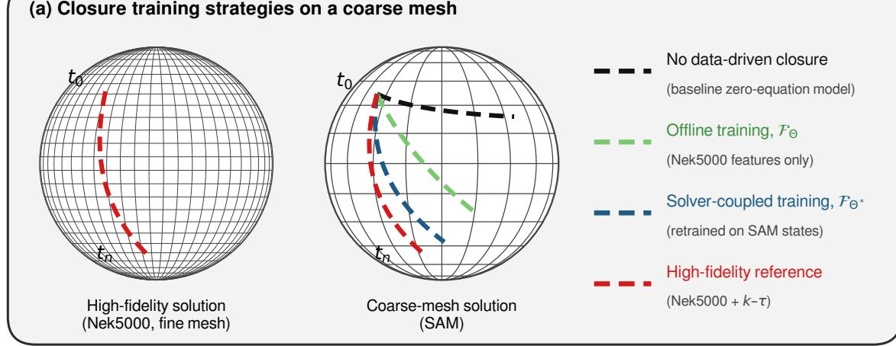

(b) Solver-coupled iterative training with dataset aggregation  
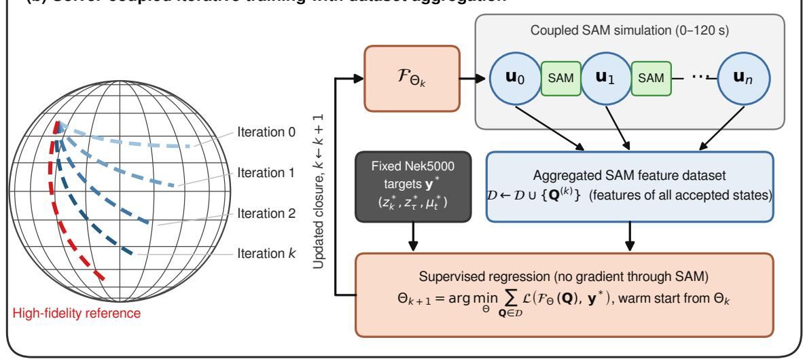  
Figure 2: Iterative training. (a) Training strategies on the coarse mesh: no neural closure, ofline training on Nek5000 features, and retraining on SAM states. (b) Iterative training: each coupled SAM run adds its feature states to the aggregated dataset A, and the closure is retrained on A against the fixed Nek5000 targets without diferentiating through the solver.

Algorithm 1 Two-stage closure training: ofline training (Stage 1) and iterative training   
(Stage 2).   
Input: High-fidelity Nek5000 reference fields $( \mathbf { u } ^ { * } , k ^ { * } , \tau ^ { * } ) ;$ ; coarse SAM mesh $( N _ { e }$ elements).   
Output: Trained closure parameters Θ and coupled coarse-mesh SAM predictions.   
Stage 1: Ofline target projection and initial training   
1: Project Nek5000 reference fields onto the coarse SAM mesh to obtain fixed targets $( z _ { k } ^ { * } , z _ { \tau } ^ { * } , \mu _ { t } ^ { * } )$   
and baseline feature matrices $\mathbf { Q } .$   
2: Train initial network parameters Θ on the training snapshots by minimizing the loss of Eq. (24),   
and export as a TorchScript module for $\mathrm { C } + +$ runtime inference in SAM.   
Stage 2: Iterative training   
3: Initialize the aggregated SAM feature dataset ${ \mathcal { A } }  \emptyset .$   
4: for each outer training iteration do   
5: Initialize coarse-mesh SAM simulation with the current TorchScript closure $\mathcal { F } _ { \Theta }$   
6: while $t < t _ { \mathrm { e n d } }$ do   
7: At the beginning of a time-step, assemble neighborhood features Q from the accepted   
SAM velocity state u and evaluate $\widehat { \mu } _ { t } = \mathcal { F } _ { \Theta } ( \mathbf { Q } , R e )$ across all $N _ { e }$ elements.   
8: Solve the nonlinear SUPG/PSPG finite-element system by Newton’s method with a   
finite-diference (graph-colored) Jacobian and LU factorization, with $\mu + \widehat { \mu } _ { t }$ embedded in the   
implicit difusive operator of Eq. (2).   
9: If Newton converges, accept the step and record the realized SAM features $\mathbf { Q } ;$ otherwise,   
reduce $\Delta t$ by a factor of 0.8 and retry.   
10: end while   
11: Aggregate the realized SAM feature states of this coupled run: $A  A \cup \{ \mathbf { Q } \}$   
12: Warm-start retrain Θ on all of A against the fixed targets $( z _ { k } ^ { * } , z _ { \tau } ^ { * } , \mu _ { t } ^ { * } )$ , select the checkpoint   
on the held-out interior snapshots, and export the updated TorchScript module.   
13: end for

## 4. MSFR Benchmark Configuration and Closure Implementation

## 4.1. Axisymmetric Core Geometry and Multi-Fidelity Discretization

We evaluate the closure on the two-dimensional axisymmetric meridional cross-section of the reference MSFR cavity [1, 11, 59]. As shown in Fig. 3, the computational domain spans $r \in [ 0 . 0 , 2 . 1 7 ]$ m in the radial direction, with the symmetry axis at $r = 0 ~ \mathrm { m }$ , and $z \in [ - 1 . 3 2 5 , 1 . 3 2 5 ]$ m in the axial direction. Fuel salt enters the lower core leg through the cold-leg inlet at $z = - 0 . 3 4$ m and flows upward through the central cavity. The cavity is bounded by a curved inner fertile-blanket/reflector shield wall and inclined upper and lower reflector walls. The salt exits through the hot-leg outlet at $z = + 0 . 3 4 \mathrm { ~ m ~ }$ . Both openings span $r \in [ 1 . 9 3 5 , 2 . 1 7 ]$ m.

Figure 3 compares the Nek5000 reference mesh in Fig. 3a with the coarse SAM mesh used with the neural closure in Fig. 3b. Figures 3c and 3d show close-ups of the near-wall discretization along the upper reflector and curved inner shield wall. The Nek5000 mesh has 4,456 spectral elements of polynomial order $p = 7$ . With 8 Gauss–Lobatto–Legendre quadrature points per direction in each element, it has about $2 . 2 \times 1 0 ^ { 5 }$ nodal degrees of freedom, and eight graded boundary-layer elements resolve the steep near-wall velocity and turbulence gradients. The SAM mesh has only $N _ { e } = 1 , 2 9 6$ coarse elements, with two boundary-layer elements across the near-wall region. It has 70.9% fewer elements than the Nek5000 mesh and more than two orders of magnitude fewer nodal degrees of freedom. For comparison with the mixing-length model, a coarse SAM mesh of 1,080 bilinear $\left( Q _ { 1 } \right)$ elements is also evaluated, with 1,825 elements for the steady states.

## 4.2. Steady-State Operating Regimes

The first benchmark campaign examines isothermal steady-state flow at six operating conditions spanning a factor of five in Reynolds number, ${ R e } \in [ 4 . 5 2 \times 1 0 ^ { 5 } , 2 . 2 6 \times 1 0 ^ { 6 } ]$ Table 1 summarizes the dimensionless parameters and thermophysical properties of the six steady-state cases. The steady-state Reynolds number $\mathit { R e } = \rho U _ { \mathrm { i n } } L _ { 0 } / \mu$ uses the core diameter, $L _ { 0 } = 2 . 0 ~ \mathrm { m }$ . The transient closure features instead use the cold-leg inlet width, $L _ { 0 } = 0 . 2 3 5$ m, as listed in Table 3. Cases 1–5 train the steady-state closure. Case 6, at $R e = 4 . 5 2 \times 1 0 ^ { 5 }$ just below the training range, is held out to test steady-state generalization.

## 4.3. Transient Pump-Coastdown Benchmark

The second benchmark campaign evaluates a 120 s pump-coastdown transient starting from a fully developed steady-state flow field. During the transient, the cold-leg inlet velocity

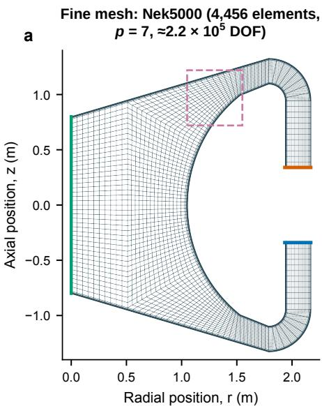

b Coarse mesh: SAM + NN (1,296 elements)  
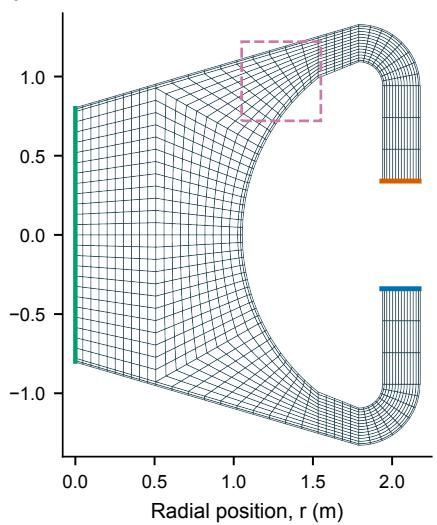

Near-wall zoom: fine mesh (8 boundary-layer elements)  
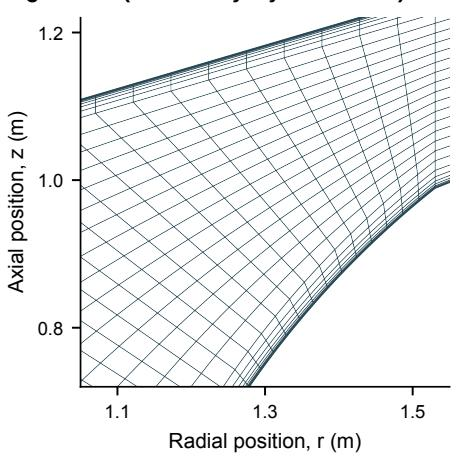

d  
Near-wall zoom: coarse mesh (2 boundary-layer elements)  
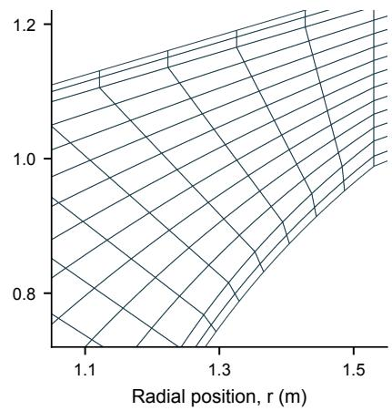  
Figure 3: Computational meshes and boundary conditions for the axisymmetric MSFR cavity. a, Nek5000 spectral-element mesh (4,456 elements, $p = 7 )$ . b, Coarse SAM mesh (1,296 elements). $\mathbf { c } , \mathbf { d } .$ Near-wall views of the dashed region in Nek5000 (eight boundary-layer elements) and SAM (two).

Table 1: Operating parameters and thermophysical properties for the six steady-state MSFR cases.
<table><tr><td>Parameter</td><td>Case 1</td><td>Case 2</td><td>Case 3</td><td>Case 4</td><td>Case 5</td><td>Case 6 (Test)</td></tr><tr><td>Reynolds number, Re</td><td> $2 . 2 6 \times 1 0 ^ { 6 }$ </td><td> $1 . 5 0 \times 1 0 ^ { 6 }$ </td><td> $1 . 1 3 \times 1 0 ^ { 6 }$ </td><td> $9 . 0 3 \times 1 0 ^ { 5 }$ </td><td> $5 . 6 4 \times 1 0 ^ { 5 }$ </td><td> $4 . 5 2 \times 1 0 ^ { 5 }$ </td></tr><tr><td>Inlet speed,  $U _ { \mathrm { i n } } ~ \mathrm { ( m / s ) }$ </td><td>1.25</td><td>1.25</td><td>1.25</td><td>1.25</td><td>1.25</td><td>1.25</td></tr><tr><td>Length scale,  $L _ { 0 } \ \mathrm { ( m ) }$ </td><td>2.0</td><td>2.0</td><td>2.0</td><td>2.0</td><td>2.0</td><td>2.0</td></tr><tr><td>Density,  $\rho ~ ( \mathrm { k g } / \mathrm { m } ^ { 3 } )$ </td><td>4125</td><td>4125</td><td>4125</td><td>4125</td><td>4125</td><td>4125</td></tr><tr><td>Viscosity,  $\mu \ ( \mathrm { P a s } )$ </td><td>0.0046</td><td>0.0069</td><td>0.0091</td><td>0.0114</td><td>0.0183</td><td>0.0228</td></tr></table>

Table 2: Thermophysical properties and boundary-condition parameters for the 120 s transient flow-decay benchmark.
<table><tr><td>Quantity</td><td>Value</td></tr><tr><td>Fluid density,  $\rho$ </td><td> $4 3 0 6 . 7 1 ~ \mathrm { k g / m ^ { 3 } }$ </td></tr><tr><td>Molecular dynamic viscosity,  $\mu$ </td><td> $0 . 0 0 8 9 4 { \mathrm { ~ P a s } }$ </td></tr><tr><td>Molecular kinematic viscosity, ν</td><td> $2 . 0 8 \times 1 0 ^ { - 6 } ~ \mathrm { { m } ^ { 2 } / \mathrm { { s } } }$ </td></tr><tr><td>Reference CFD turbulence closure</td><td>Two-equation k−τ RANS</td></tr><tr><td>Initial peak inlet velocity,  $U _ { \mathrm { p k } } ( 0 )$ </td><td> $1 . 2 5 ~ \mathrm { m } / \mathrm { s }$ </td></tr><tr><td>Asymptotic peak inlet velocity,  $U _ { \infty }$ </td><td> $0 . 3 0 ~ \mathrm { m / s }$ </td></tr><tr><td>Excess-velocity decay half-life,  $t _ { 1 / 2 }$ </td><td>20 s</td></tr><tr><td>Transient duration,  $t _ { \mathrm { e n d } }$ </td><td>120 s</td></tr></table>

profile decays exponentially according to

$$
U _ { \mathrm { p k } } ( t ) = U _ { \infty } + \left( U _ { \mathrm { p k } } ( 0 ) - U _ { \infty } \right) \exp \left( - \frac { \ln 2 } { t _ { 1 / 2 } } t \right) ,\tag{25}
$$

$$
u _ { \mathrm { i n } } ( r , t ) = - C _ { Q } \eta ( r ) U _ { \mathrm { p k } } ( t ) , \qquad C _ { Q } = 1 . 0 2 7 3 0 6 4 ,\tag{26}
$$

where $U _ { \mathrm { p k } } ( 0 ) = 1 . 2 5 ~ \mathrm { m / s }$ is the initial peak inlet velocity, $U _ { \infty } = 0 . 3 0$ m $\mathrm { \Omega } / \mathrm { s }$ is the asymptotic circulation speed, $t _ { 1 / 2 } = 2 0 ~ \mathrm { s }$ is the excess-velocity half-life, and $\eta ( r )$ is the inlet velocity profile prescribed in the Nek5000 simulation, normalized by its centerline value. $U _ { \mathrm { p k } } ( t )$ is evaluated exactly at every SAM time step, as in the Nek5000 simulation. The quadrature correction factor $C _ { Q }$ ensures exact conservation of the integrated volumetric inflow rate when $\eta ( r )$ is represented on the coarse SAM inlet boundary. No-slip boundary conditions are enforced along all solid core walls, axial symmetry is imposed at $r = 0$ m, and a constant outlet pressure of 161 kPa is prescribed at the hot-leg exit. As in the Nek5000 simulation, the flow is isothermal and no body force is applied. Table 2 lists the physical properties and simulation settings for the transient benchmark.

To assess temporal interpolation and extrapolation across the 120 s transient, the Nek5000 trajectory is sampled at one-second intervals and projected onto the 1,296 elements of the coarse SAM mesh. The training set $\mathcal { T } _ { \mathrm { t r } }$ has 56 complete snapshots in the window $t \in [ 1 1 , 6 9 ]$ s. The snapshots at $t = 2 0 , 4 0$ , and $6 0 ~ \mathrm { s }$ in this window, 3,888 element-time samples, are held out to test interior temporal interpolation. The snapshots at $t \in [ 2 , 1 0 ] \mathrm { s } , 1 1 , 6 6 4$ samples, test early temporal extrapolation during the high-speed initial deceleration. Those at $t \in [ 7 0 , 1 2 0 ] \mathrm { s }$ 2 66,096 samples, test late temporal extrapolation in the low-speed asymptotic circulation. Each snapshot is assigned as a complete spatial field to either training or testing, preventing spatial data leakage between neighboring elements at the same time step.

Table 3: Case-specific normalization maps and neural-network architecture hyperparameters for the MSFR closure implementation.
<table><tr><td>Parameter / Component</td><td>MSFR Implementation Specification</td></tr><tr><td>Characteristic scales  $( L _ { 0 } , U _ { 0 } , T _ { 0 } )$  Strain-rate normalization in  $\psi _ { c } ,$  Eq. (12)</td><td>0.235 m (2.0 m steady-state), 1.25 m/s, 0.188 s  $\begin{array} { r } { \frac { 1 } { 2 } \ln \operatorname* { m a x } ( \| \mathbf { S } _ { a } \| _ { F } T _ { 0 } , 1 0 ^ { - 1 2 } ) + 2 } \end{array}$ </td></tr><tr><td>Relative-speed normalization in  $\psi _ { c } ,$  Eq. (12) Wall-distance normalization in  $\psi _ { c } ,$  Eq. (12)</td><td> $^ { \frac { 1 } { 6 } } \ln ( 1 + 1 0 0 \operatorname* { m a x } ( \| \mathbf { w } _ { a } \| _ { 2 } , 1 0 ^ { - 8 } ) )$ </td></tr><tr><td>Target k transform in  $\psi _ { z } , \mathrm { E q . }$  (17)</td><td> $\operatorname* { m i n } ( d _ { w , a } / L _ { 0 } , 1 )$   $z _ { k } = \textstyle { \frac { 1 } { 2 } } \ln ( 1 + 1 2 5 0 k / U _ { 0 } ^ { 2 } )$ </td></tr><tr><td>Target  $\tau$  transform in  $\psi _ { z } .$  Eq. (17)</td><td> $z _ { \tau } = { \textstyle \frac { 1 } { 4 } } [ \ln \operatorname* { m a x } ( \tau / T _ { 0 } , 1 0 ^ { - 1 2 } ) + 7 ]$ </td></tr><tr><td>Embedding MLP  $\phi _ { \mathrm { e m b } }$  widths</td><td> $5  3 2  6 4 $  64 (leaky ReLU activations)</td></tr><tr><td>Embedding channels  $( m , m ^ { \prime } )$ </td><td> $m = 6 4 , m ^ { \prime } = 8 \ ( D \in \mathbb { R } ^ { 6 4 \times 8 }$   $( \mathcal { D } ) \in \mathbb { R } ^ { 5 1 2 } )$ </td></tr><tr><td>Prediction MLP  $\phi _ { \mathrm { p r e d } }$  widths</td><td>vec  $5 1 3 \to 1 2 8 \to 6 4 \to 8 \to 2$  (leaky ReLU activations)</td></tr><tr><td>Neighborhood  $\mathcal { N } _ { 0 } , \mathrm { E q . ~ ( 9 ) }$ </td><td></td></tr><tr><td>Loss weights  $( w _ { k } , w _ { \tau } , w _ { \mu } )$  , Eq. (24)</td><td>Two-layer edge adjacency,  $n = 6 – 1 4$  (mean 12.2)</td></tr><tr><td>Optimizer</td><td>(2.5, 1, 1)</td></tr><tr><td></td><td>Adam, batch size 512, gradient-norm clipping at 5</td></tr><tr><td>Learning rate</td><td> $1 0 ^ { - 3 } \ { \mathrm { ( S t a g e \ 1 ) } } , 1 0 ^ { - 4 } \ { \mathrm { ( S t a g e \ 2 ) } }$  , cosine decay to 10%</td></tr><tr><td>Epochs</td><td></td></tr><tr><td>Checkpoint selection</td><td> $\leq 4 0 0 ( \mathrm { S t a g e } 1 ) , \leq 1 5 0$  per outer iteration Lowest  $\mu _ { t }$  error on held-out snapshots  $t = 2 0 , 4 0 , 6 0 \mathrm { ~ s ~ }$ </td></tr></table>

## 4.4. Feature Scaling, Network Hyperparameters, and Training Configuration

Table 3 lists the reference scales, the normalization maps $\psi _ { c }$ and $\psi _ { z }$ , and the network hyperparameters used for the MSFR benchmark. For the transient benchmark, the scales in Eqs. (11)–(12) are the cold-leg inlet width $L _ { 0 } = 0 . 2 3 5 ~ \mathrm { m }$ , the initial peak inlet velocity $U _ { 0 } = 1 . 2 5 ~ \mathrm { m / s }$ , and $T _ { 0 } = L _ { 0 } / U _ { 0 } = 0 . 1 8 8 \mathrm { ~ s ~ }$ . At MSFR operating conditions, $R e \sim 1 0 ^ { 6 }$ 2 $\mu \approx 0 . 0 0 9$ Pa s, and $\mu _ { t } \sim 5 – 2 0$ Pa s, so the eddy-to-molecular viscosity ratio reaches $\mu _ { t } / \mu \sim$ $\mathcal { O } ( 1 0 ^ { 3 } )$ . The eddy viscosity therefore dominates the viscous term of Eq. (2), so it is treated implicitly there. Appendix Appendix A shows its efect on the Newton solver.

The maps $\psi _ { c }$ and $\psi _ { z }$ are logarithmic, with the forms listed in Table 3. They compress the multi-decade ranges of strain rate, relative speed, k, and $\tau$ across the MSFR jet, boundary layer, and recirculation core into $\mathcal { O } ( 1 )$ intervals. The wall distance is capped at $L _ { 0 }$ , and $A _ { a } / \bar { A }$ and $b _ { a }$ enter unscaled. The element strain-rate magnitude $\Vert \mathbf { S } _ { a } \Vert _ { F }$ is computed from the full two-dimensional velocity-gradient tensor at the element quadrature points, both at runtime in SAM and in the ofline projection of the Nek5000 fields.

The embedding network $\phi _ { \mathrm { e m b } }$ is a three-layer MLP with $m = 6 4$ channels, of which the first $m ^ { \prime } = 8$ form $\mathbf { G } ^ { \prime }$ . The descriptor $\mathcal { D }$ thus has $6 4 \times 8 = 5 1 2$ entries. The prediction network $\phi _ { \mathrm { p r e d } }$ is a four-layer MLP that takes vec(D) together with $R e ( t )$ , a 513-dimensional input. Both networks use leaky rectified linear unit (leaky ReLU) activations, and Table 3 lists the layer widths. The single-trajectory ofline study omits $R e _ { \ast }$ , giving 512 inputs.

## 5. Results and Discussion

## 5.1. A Priori Closure Evaluation on Held-Out Nek5000 Trajectories

Before coupling the closure with SAM, we evaluate its a priori accuracy on the 63 held-out Nek5000 snapshots, 81,648 element-time samples in total, using fixed weights trained only on the 56 Nek5000 training snapshots. The Nek5000 velocity is projected onto the coarse SAM mesh, so that the network inputs are computed in the same way as at runtime in SAM. For any temporal subset of element-time samples $s ,$ we quantify prediction accuracy using the pooled volume-weighted relative $L _ { 2 }$ error and root-mean-square error (RMSE):

$$
E _ { q } ( \boldsymbol { S } ) = \left[ \frac { \sum _ { a \in \mathcal { S } } V _ { a } \left( \widehat { q } _ { a } - q _ { a } ^ { * } \right) ^ { 2 } } { \sum _ { a \in \mathcal { S } } V _ { a } \left( q _ { a } ^ { * } \right) ^ { 2 } } \right] ^ { 1 / 2 } , \qquad \mathrm { R M S E } _ { q } ( \boldsymbol { S } ) = \left[ \frac { 1 } { \left| \mathcal { S } \right| } \sum _ { a \in \mathcal { S } } \left( \widehat { q } _ { a } - q _ { a } ^ { * } \right) ^ { 2 } \right] ^ { 1 / 2 } ,\tag{27}
$$

where $q \in \{ k , \tau , \mu _ { t } \}$ denotes the physical turbulence variable reconstructed via Eq. (17), $q ^ { * }$ is the Nek5000 reference value, and $V _ { a }$ is the axisymmetric volume of the element of sample $a .$

Figure 4 shows the a priori parity plots for $k , \tau .$ , and $\mu _ { t }$ in the three held-out temporal regimes. Figure 5 tracks the instantaneous relative $L _ { 2 }$ error and physical-unit RMSE at all 119 checkpoints from $t = 2 \mathrm { ~ s ~ }$ to 120 s. In the interior interpolation regime at $t = 2 0 , 4 0$ , and 60 s, shown in Figs. 4d–f, the pooled relative $L _ { 2 }$ errors are 5.0% for k, 6.8% for $\tau ,$ and 3.5% for $\mu _ { t }$ , with $\mathrm { R M S E } _ { \mu _ { t } } = 0 . 2 0 \ \mathrm { P a s }$

In the early extrapolation regime at $t = 2 { - } 1 0$ s, shown in Figs. 4a– $\mathbf { \partial } ^ { - } \mathbf { C } ,$ the core flow experiences rapid initial deceleration from $U _ { \mathrm { p k } } ( 0 ) ~ { = } ~ 1 . 2 5 ~ \mathrm { m / s }$ , generating higher strain rates and turbulent kinetic energy than any state inside the 11–69 s training window. Consequently, the network underpredicts the upper tail of k at $t = 2 \mathrm { ~ s ~ }$ , with $E _ { k } = 1 9 . 5 \%$ and $\mathrm { R M S E } _ { \mu _ { t } } = 1 . 8 6$ Pa s. The error decays monotonically as t approaches the start of the training window at 11 s, as shown in Figs. 5a and 5d. The pooled early-extrapolation eddy-viscosity relative $L _ { 2 }$ error is 13.4%, with $\mathrm { R M S E } _ { \mu _ { t } } = 1 . 1 4 \ \mathrm { P a s }$

In the late extrapolation regime at $t = 7 0 – 1 2 0 \ \mathrm { s } .$ , shown in Figs. 4g–i and 5, the inlet velocity falls below the range covered by the training window, and the prediction error grows with time. The relative $L _ { 2 }$ error in $\mu _ { t }$ rises from 5.0% at $t = 7 0 ~ \mathrm { s }$ to 50.2% at $t = 1 2 0 ~ \mathrm { s }$ with a pooled late-extrapolation error of 28.9%, as shown in Fig. 5c. Part of this rise comes from the decay of the reference norm $\| q ^ { * } ( t ) \| _ { 2 }$ in the denominator of the relative error as the flow slows down. However, the physical-unit RMSE in $\mu _ { t }$ also increases, from 0.21 to 1.64 Pa s with a pooled value of 1.03 Pa s, as shown in Fig. 5f. The RMSE of k stays below $1 . 3 \times 1 0 ^ { - 3 } ~ \mathrm { { m ^ { 2 } / s ^ { 2 } } }$ , as shown in Fig. 5d. The turbulence timescale is the least robust quantity in this regime, with a pooled $E _ { \tau } = 7 3 . 1 \%$ , as Fig. 4h shows. The late-time error is therefore a genuine extrapolation error and not only an efect of the decaying reference norm. Reporting both the relative $L _ { 2 }$ error and the physical RMSE separates the two efects.

a  
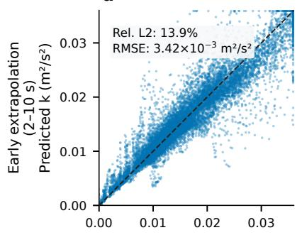

b  
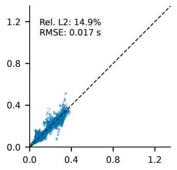

c  
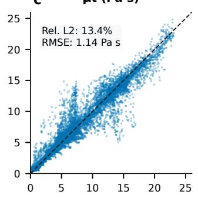

d  
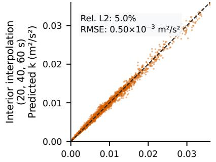

e  
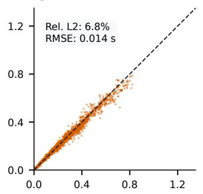

f  
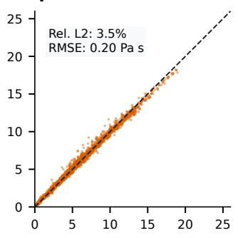

g  
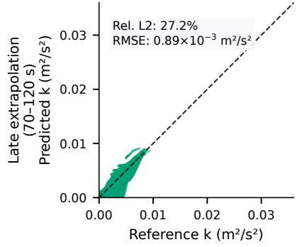

h  
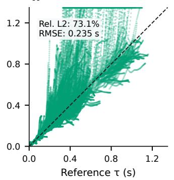

i  
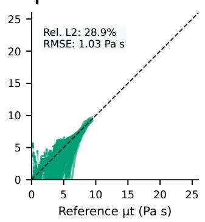  
Figure 4: A priori parity plots of the network predictions against the Nek5000 k–τ reference. Columns: $k , \tau ,$ and $\mu _ { t }$ . Rows: early extrapolation $( 2 \mathrm { - } 1 0 \ \mathrm { s } ; \ \mathbf { a } \mathrm { - } \mathbf { c } )$ , interior interpolation $( 2 0 , 4 0 , 6 0 \ \mathrm { s } ; \ \mathbf { d } \mathbf { - f } )$ , and late extrapolation $\left( 7 0 { - } 1 2 0 \ \mathrm { s } ; \ \mathbf { g } { - } \mathbf { i } \right)$ . Dashed lines indicate 1:1 agreement.

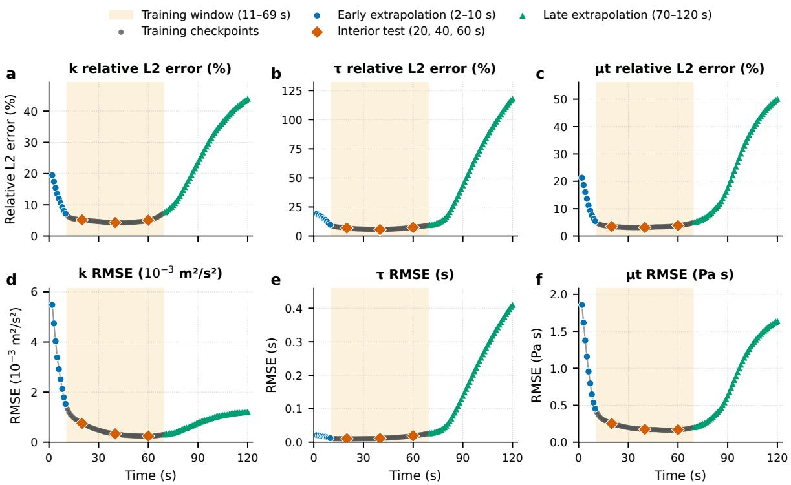  
Figure 5: Temporal evolution of a priori prediction errors across $t \in [ 2 , 1 2 0 ]$ s. a–c, Relative $L _ { 2 }$ errors for k $( \mathbf { a } ) , \tau \mathbf { \Psi } ( \mathbf { b } )$ , and $\mu _ { t } \mathbf { \Sigma } ( \mathbf { c } )$ . d–f, Physical-unit RMSE for k $( \mathbf { d } ) , \tau \mathbf { \tau } ( \mathbf { e } )$ , and $\mu _ { t } \mathbf { \Sigma } ( \mathbf { f } )$ . The shaded amber band denotes the 11–69 s training window, within which $t = 2 0 , 4 0$ , 60 s are held out for interior interpolation testing.

## 5.2. A Posteriori Coupled Evaluation in SAM

We next evaluate the neural closure a posteriori, embedded in SAM after the iterative training of Section 3.4. Figure 6 compares the steady-state axial and radial velocity components $( u _ { z }$ and $u _ { r } )$ and eddy-viscosity $\left( \mu _ { t } \right)$ fields on held-out Case 6 at $R e = 4 . 5 2 \times 1 0 ^ { 5 }$ . It shows the Nek5000 $k { - } \tau$ reference and SAM coupled with the neural closure, labeled $\mathrm { S A M } +$ NN in the figures and tables.

As shown in Fig. 6, SAM coupled with the neural closure reproduces the single recirculation cell and the $\mathrm { { h i g h } }  { - } \mu _ { t }$ core plume of the Nek5000 $k { - } \tau$ reference on the coarse mesh. In the plume, $\mu _ { t } \approx 1 6 \ – 2 5$ Pa s.

For the 120 s pump-coastdown transient, SAM states are available exactly at each onesecond Nek5000 checkpoint, $t \in \{ 2 , 3 , \ldots , 1 2 0 \}$ s. At each checkpoint we compute the volume-weighted relative $L _ { 2 }$ error on the $N _ { e } = 1 , 2 9 6$ coarse mesh, along with its time average:

$$
E _ { q } ( t ) = \left[ \frac { \sum _ { e = 1 } ^ { N _ { e } } V _ { e } \left. q _ { e } ( t ) - q _ { e } ^ { * } ( t ) \right. _ { 2 } ^ { 2 } } { \sum _ { e = 1 } ^ { N _ { e } } V _ { e } \left. q _ { e } ^ { * } ( t ) \right. _ { 2 } ^ { 2 } } \right] ^ { 1 / 2 } , \qquad \overline { { E } } _ { q } = \frac { 1 } { 1 1 9 } \sum _ { t = 2 } ^ { 1 2 0 } E _ { q } ( t ) ,\tag{28}
$$

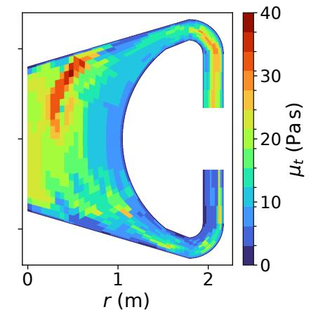

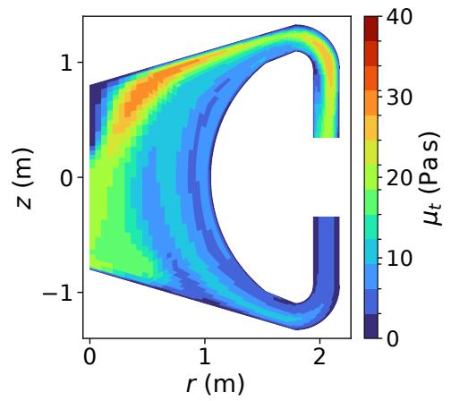

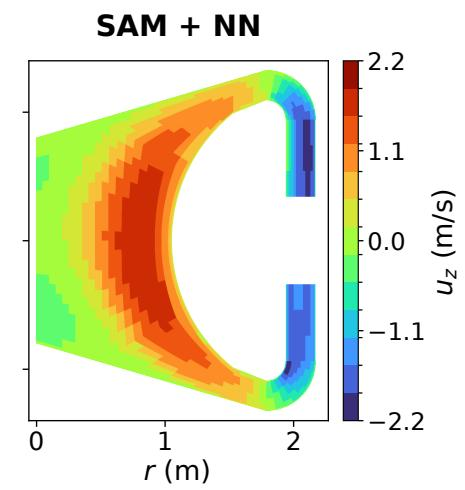

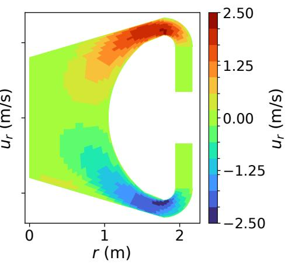

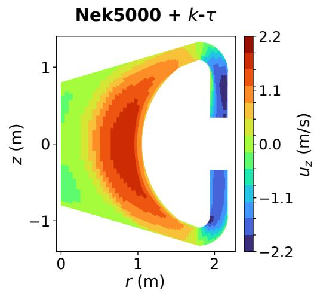

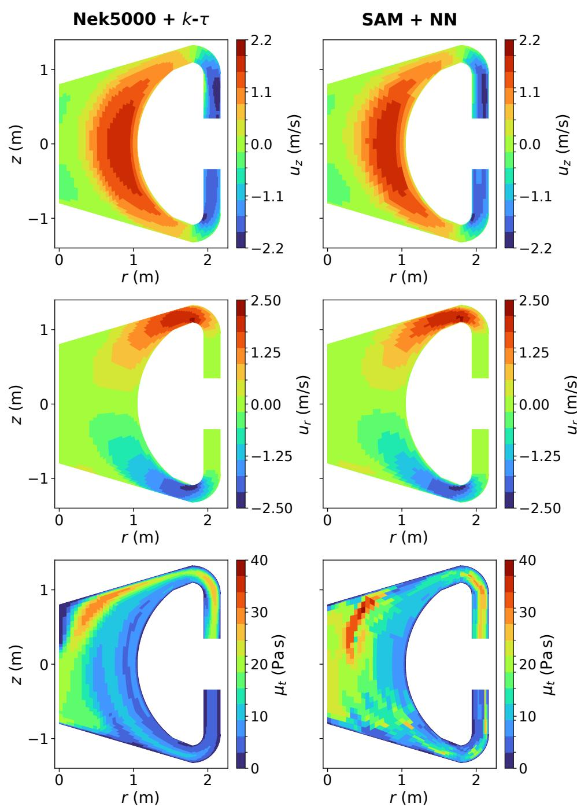  
Figure 6: Steady-state a posteriori comparison for held-out Case 6 $( R e = 4 . 5 2 \times 1 0 ^ { 5 } )$ : Nek5000 + k–τ (left) and $\mathrm { S A M } + \mathrm { N N }$ (right). Rows: axial velocity $u _ { z }$ (labeled $u _ { x } )$ , negative radial velocity −ur (labeled $u _ { y } )$ , and eddy viscosity $\mu _ { t }$ . Panel axes x and y correspond to r and z. The symmetry axis is at the left edge and the cold-leg inlet at the bottom, as in all contour figures.

Table 4: Volume-weighted relative $L _ { 2 }$ errors of SAM + NN relative to the projected Nek5000 reference across the 120 s transient, evaluated via Eq. (28).
<table><tr><td>Checkpoint / Temporal Statistic</td><td>Velocity Error  $E _ { \mathbf { u } }$  (%) Viscosity Error  $E _ { \mu _ { t } }$  (%)</td></tr><tr><td>t = 10 s (early extrapolation)</td><td>17.88 11.28</td></tr><tr><td>t = 30 s (training window)</td><td>20.09 4.85</td></tr><tr><td>t = 60 s (interior held-out checkpoint)</td><td>18.90 4.51</td></tr><tr><td> $t = 1 2 0 ~ \mathrm { s }$  (end of late extrapolation)</td><td>14.08 29.71</td></tr><tr><td>Time-averaged error  $\overline { { E } } _ { q } ~ ( 2 \mathrm { - } 1 2 0 ~ \mathrm { } \mathrm { } \mathrm { \bf s } )$ </td><td>17.73 12.02</td></tr></table>

where $q \in \{ \mathbf { u } , \mu _ { t } \}$ denotes the SAM velocity vector or eddy viscosity, $q ^ { * }$ is the projected Nek5000 reference field, and $V _ { e }$ is the axisymmetric volume of coarse element e.

Figures 7 and 8 compare the spatial evolution of the velocity magnitude |u| and eddy viscosity $\mu _ { t }$ at four snapshots: $t = 1 0 ~ \mathrm { s }$ in early extrapolation, $t = 3 0$ and 60 s in the training window, and $t = 1 2 0$ s at the end of late extrapolation. As shown in Figs. 7c, g, k, and $\mathbf { o } ,$ the mixing-length model in SAM underpredicts turbulent difusion in the core interior. It concentrates the flow in a thin, fast jet along the outer cavity wall and leaves a weak, difuse core flow, with a time-averaged velocity error of 37.6%. Figures 7b, f, j, n and 8b, d, f, h show SAM coupled with the neural closure. It tracks the contraction of the high-speed stream along the curved inner wall, with a time-averaged velocity error of 17.7%. It also tracks the decay of the core eddy-viscosity plume from $\mu _ { t } \approx 1 5 – 2 4$ Pa s at $t = 1 0 ~ \mathrm { s }$ to $\mu _ { t } \approx 3  – 5$ Pa s at $t = 1 2 0 ~ \mathrm { s }$ . The last column of Fig. 7 shows SAM with prescribed Nek5000 $\mu _ { t }$ in place of the network. Its velocity field is close to that of SAM with the neural closure, with a time-averaged error of 18.8% against 17.7%. Table 5 identifies the source of this shared error.

Figure 9 examines the one-dimensional profiles of $\lvert \mathbf { u } \rvert$ and $\mu _ { t }$ along the interior sampling line $r = 0 . 5 0$ m at $t = 1 0 , 3 0 , 6 0$ , and 120 s. Along this line, the eddy-viscosity profiles of SAM with the neural closure agree closely with the Nek5000 reference at $t = 3 0$ and 60 s and fall below it near $z \approx - 0 . 8$ m at $t = 1 0 \mathrm { ~ s ~ }$ . At $t = 1 2 0 \ \mathrm { s } .$ , in the late extrapolation window, the near-wall peak at $z \approx 0 . 8$ m is missed. The velocity profiles have the correct shape. However, SAM with the neural closure underpredicts the peak core speed on this line by about 35–45% at $t = 1 0 – 6 0 \mathrm { ~ s ~ }$ , for example 0.44 versus 0.68 m/s at $t = 1 0 ~ \mathrm { s }$ , and by about 20% at $t = 1 2 0 ~ \mathrm { s }$ SAM with prescribed Nek5000 $\mu _ { t }$ has a similar velocity error, 18.8% against 17.7%, so this diference does not originate in the closure. Table 5 traces it to the coarse mesh.

Figure 10 and Table 4 show the time history of the a posteriori errors $E _ { \mathbf { u } } ( t )$ and $E _ { \mu _ { t } } ( t )$ over the full 120 s transient. Between $t = 1 0$ and 60 s, $E _ { \mathbf { u } } ( t )$ follows the error of SAM with prescribed Nek5000 $\mu _ { t }$ , shown as the dotted line in Fig. 10a with a time average of 18.8%. After $t \approx 6 5 \ \mathrm { s } ,$ it falls below that curve, giving $\overline { { E } } _ { \mathbf { u } } = 1 7 . 7 3 \%$ . The eddy-viscosity error is smallest inside the training window, at 4.85% for $t = 3 0$ s and 4.51% for $t = 6 0 ~ \mathrm { s }$ . It grows in the late extrapolation window to 29.71% at $t = 1 2 0 ~ \mathrm { s }$ , following the a priori trend of Section 5.1, with a time mean of $\overline { { E } } _ { \mu _ { t } } = 1 2 . 0 2 \%$ . The coupled simulation completes all 169 adaptive implicit time steps without a failed nonlinear solve. Appendix Appendix A analyzes the efect of the closure on solver convergence.

p  
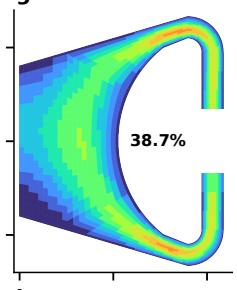

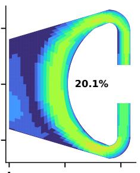

e  
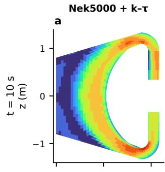

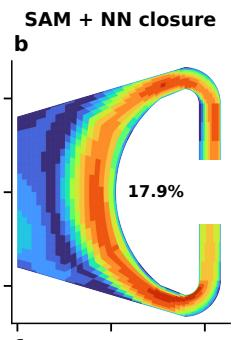

g  
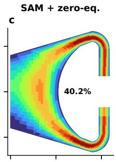  
SAM with prescribed Nek5000 μt

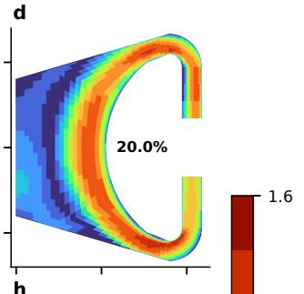

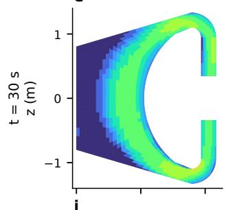

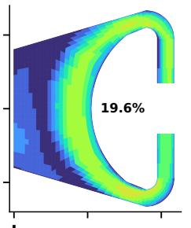

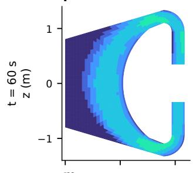

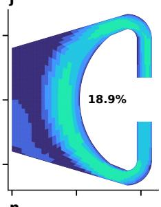

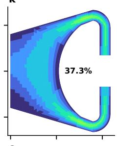

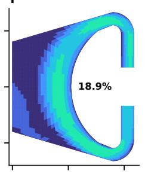

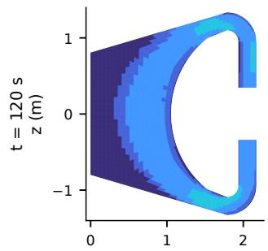  
r (m)

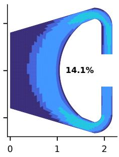  
r (m)

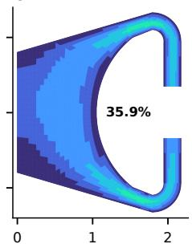  
r (m)

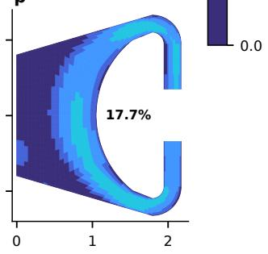  
r (m)  
Figure 7: Velocity magnitude |u| at t = 10, 30, 60, and 120 s (rows). Columns: projected Nek5000 reference, SAM + NN, SAM + mixing length, and SAM with prescribed Nek5000 $\mu _ { t } ;$ panels a–p are ordered row by row. In-panel labels give the relative $L _ { 2 }$ velocity error.

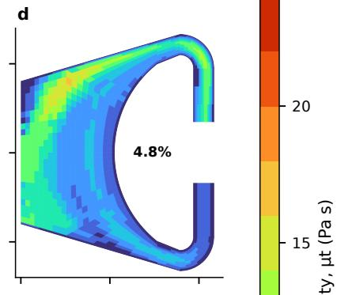

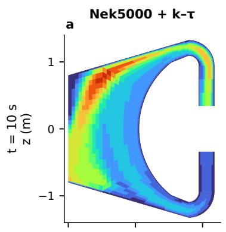

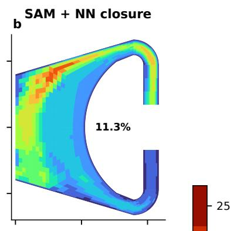

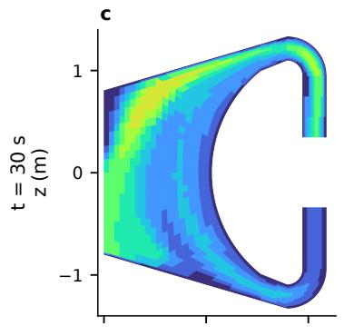

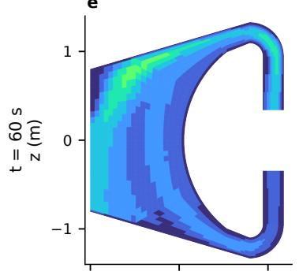

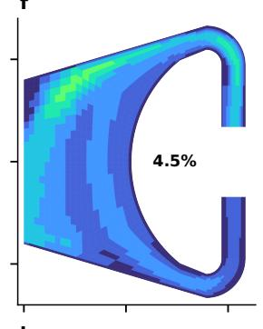

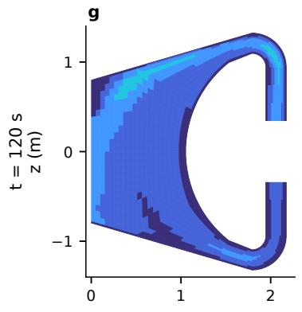  
r (m)

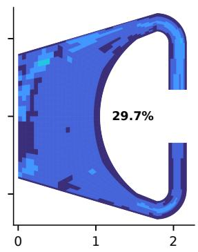  
r (m)  
Figure 8: A posteriori transient eddy-viscosity fields $\mu _ { t }$ at $t = 1 0 , 3 0 , 6 0$ , and $1 2 0 \mathrm { ~ s ~ } ( \mathrm { r o w s } )$ comparing the projected $\mathrm { N e k 5 0 0 0 } + k { - \tau }$ reference $( \mathbf { a } , \mathbf { c } , \mathbf { e } , \mathbf { g } )$ and SAM + NN (b, d, f, h) on the 1,296-element coarse mesh. In-panel labels give the volume-weighted relative $L _ { 2 }$ eddy-viscosity error.

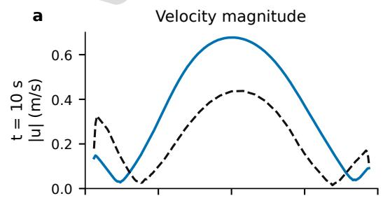

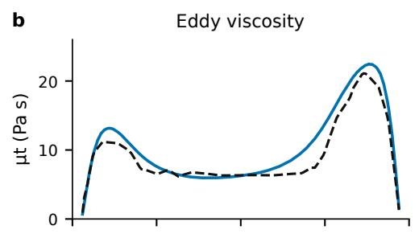

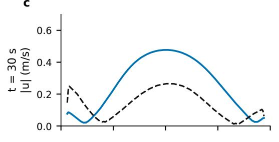

  
Figure 9: One-dimensional transient profiles of velocity magnitude |u| (left column) and eddy viscosity µt (right column) along the cross-core sampling line $r = 0 . 5 0$ m (indicated in the top-left inset) at $t = 1 0 , 3 0 , 6 0$ and 120 s.

  
Figure 10: Temporal evolution of a posteriori volume-weighted relative $L _ { 2 }$ errors for SAM + NN across $t \in [ 2 , 1 2 0 ]$ s. a, Velocity error $E _ { \mathbf { u } } ( t )$ ; the dotted line is SAM with prescribed Nek5000 $\mu _ { t }$ . b, Eddy-viscosity relative error $E _ { \mu _ { t } } ( t )$ . Dashed horizontal lines denote the time means (17.73% and 12.02%), and orange markers highlight the four snapshot times displayed in Figs. 7–9.

Figure 11 shows the efect of the iterative training on the coupled SAM fields and pointwise discrepancy maps at $t = 3 0 ~ \mathrm { s }$ . In Iteration 0, the network has been trained only on Nek5000 features and sufers strong covariate shift when coupled with SAM. Its eddy-viscosity error is 45.3%, and its velocity error is 31.1%. Iteration 1, retrained on the SAM features of Iteration 0, reduces the velocity error to 16.0%. The following iterations, each retrained on all previous SAM runs, reduce the eddy-viscosity error to 29.0%, 17.9%, 9.1%, 6.4%, and 4.8% in Iterations 2–6, close to a tenfold reduction relative to Iteration 0. The velocity error settles at 18–20% in Iterations 4–6, close to the 19.6% obtained at $t = 3 0 ~ \mathrm { s }$ with prescribed Nek5000 $\mu _ { t }$ . The velocity error is not monotonic in the eddy-viscosity error. Its minimum, 13.5%, occurs at Iteration 2, because the lower velocity errors of the early iterations reflect a partial cancellation between closure and coarse-mesh discretization errors that disappears as $\widehat { \mu } _ { t }$ approaches the reference.

Figure 12 summarizes the convergence of the iterative training using the time-averaged errors over the full transient. With retraining on the latest run, the coupled velocity error oscillates between about 15% and 24% and the eddy-viscosity error stays near 35%. Each network is trained on the states of the previous run, but once coupled it moves the flow to a Predicted fields across outer-loop iterations at t = 30 s (Reference: Nek5000 + k–τ; Iter. 0: trained on Nek5000 features; Iter. 1–6: retrained on SAM features)

b Pointwise absolute discrepancy at t = 30 s (labels: volume-weighted relative L2 error)  
  
Figure 11: Convergence of the iterative training at t = 30 s. a, Predicted velocity magnitude |u| (top row) and eddy viscosity $\mu _ { t }$ (bottom row) comparing the $\mathrm { N e k 5 0 0 0 } + k { - \tau }$ reference against coupled $\mathrm { S A M } + \mathrm { N N }$ Iterations 0–6 (Iteration 0: network trained on Nek5000 features; Iterations $1 { - } 6 { : }$ retrained on all previous SAM runs). b, Corresponding pointwise absolute discrepancy fields $\lVert \Delta \mathbf { u } \rVert _ { 2 } = \lVert \mathbf { u } - \mathbf { u } ^ { * } \rVert _ { 2 }$ (top row) and $\left| \Delta \mu _ { t } \right| = \left| \widehat { \mu } _ { t } - \mu _ { t } ^ { * } \right|$ (bottom row), where the inset labels report the domain-integrated volume-weighted relative $L _ { 2 }$ error for each iteration.

  
Figure 12: Convergence of the iterative training for the transient. Time-averaged (2–120 s) volume-weighted relative $L _ { 2 }$ errors of a, the velocity vector and b, the eddy viscosity versus iteration, for retraining on the latest run (orange) and on all previous runs (blue). The dotted line in a is SAM with prescribed Nek5000 $\mu _ { t } .$

Table 5: Velocity error of SAM with prescribed Nek5000 $\mu _ { t } .$ , using first-, second-, and third-order velocity elements on the coarse mesh and first-order elements on the fine mesh. $E _ { \mathbf { u } }$ is the volume-weighted relative $L _ { 2 }$ error of Eq. (28).
<table><tr><td rowspan="2"></td><td colspan="3">Coarse mesh</td><td rowspan="2">Fine mesh</td></tr><tr><td>First order</td><td>Second order</td><td>Third order First order</td></tr><tr><td>Elements</td><td>1,296</td><td>1,296</td><td>1,296</td><td>4,456</td></tr><tr><td>Degrees of freedom</td><td>4,197</td><td>16,167</td><td>35,913</td><td>13,926</td></tr><tr><td>Velocity error  $E _ { \mathbf { u } }$  at the coarse element centers (%)</td><td></td><td></td><td></td><td></td></tr><tr><td>t = 10 s</td><td>20.02</td><td>20.11</td><td>19.56</td><td>7.04</td></tr><tr><td>t = 30 s</td><td>19.61</td><td>19.03</td><td>18.53</td><td>5.19</td></tr><tr><td>t = 60 s</td><td>18.85</td><td>18.21</td><td>17.77</td><td>3.80</td></tr><tr><td>t = 120 s</td><td>17.68</td><td>17.04</td><td>16.65</td><td>2.98</td></tr><tr><td>Time average (2–120 s)</td><td>18.85</td><td>18.38</td><td>17.93</td><td>4.29</td></tr></table>

states outside its training data. The flow therefore keeps shifting between iterations, and the eddy-viscosity error stalls. Retraining on all previous SAM runs removes this oscillation. Because the training set keeps every state visited so far, each new network stays accurate on the states produced by earlier networks. The time-averaged eddy-viscosity error then decreases monotonically from 40.2% at Iteration 0 to 12.0% at Iteration 6. The velocity error settles at 17–18%, close to the 18.8% of SAM with prescribed Nek5000 $\mu _ { t }$

Table 5 tests whether element order or mesh resolution sets this common velocity error. SAM is run with prescribed Nek5000 $\mu _ { t }$ , so the closure is the same in all cases. The coarse SAM mesh is run with first-, second-, and third-order velocity elements, and the 4,456-element fine mesh with first-order elements. The initial steady state of each run uses the Nek5000 eddy viscosity at $t = 2 \mathrm { ~ s ~ }$ . For the second and third orders, the SUPG/PSPG element length is divided by the polynomial order, and the third-order case uses hierarchic shape functions with penalty boundary conditions. Because the velocity of these cases varies within each coarse element, all cases are compared at the coarse element centers.

On the coarse mesh, raising the order from one to three increases the degrees of freedom by a factor of 8.6 and lowers the time-averaged velocity error only from 18.8% to 17.9%. On the fine mesh, first-order SAM with 3.3 times the degrees of freedom of the coarse first-order case reduces the error to 4.3%, and to 3.0% at t = 120 s. The velocity error of about 18% on the coarse mesh is therefore set by the mesh resolution. Higher-order elements do not remove it, but the fine mesh largely does. The remaining error on the fine mesh, 4.6% when the two velocity fields are compared directly on that mesh, comes from diferences between the two solvers. The main diference is SAM’s first-order finite elements against Nek5000’s seventh-order spectral elements. Because the coarse-mesh velocity error comes from the mesh resolution rather than the closure, a second network could reduce it without refining the mesh. Such a network would correct the coarse-mesh velocity field toward the Nek5000 solution and would be trained with SAM in the loop, as the eddy-viscosity closure is [60, 61, 62].

## 5.3. Computational Cost

Table 6 compares the computational cost of the Nek5000 reference simulations with that of SAM coupled with the final neural closure. The SAM simulations were run on a single core of an AMD Ryzen Threadripper PRO 5995WX workstation. For the steady state, the Nek5000 cost is given for Case 1, the maximum-Reynolds-number case. It ran on 64 cores with a fixed time step of $2 . 0 \times 1 0 ^ { - 5 }$ . A segment of $1 . 0 \times 1 0 ^ { 6 }$ time steps, or 20 time units, took 22,700 s of wall-clock time, which is 22.7 ms per step. The full duration of 72 time units is extrapolated from this segment. The SAM steady state is the initial condition of the transient, at $R e \approx 1 . 2 \times 1 0 ^ { 6 }$ with $L _ { 0 } = 2 . 0$ m, and is computed by pseudo-transient time stepping. For the 120 s transient, Nek5000 was run on 32 cores with a time step of $1 . 0 \times 1 0 ^ { - 4 }$ In terms of CPU core-hours, SAM with the neural closure is about four orders of magnitude cheaper than Nek5000 for the steady state and about three orders of magnitude cheaper for the transient. These timings exclude the one-time cost of the iterative training, which consists of seven coupled SAM runs and the corresponding network retraining.

Table 6: Computational cost of the Nek5000 reference simulations and of SAM coupled with the mixing-length model and with the final neural closure.
<table><tr><td>Simulation</td><td>Code</td><td>CPU cores</td><td>Time steps</td><td>Wall-clock time</td><td>CPU core-hours</td></tr><tr><td>Steady state</td><td> $\mathrm { N e k 5 0 0 0 } + k { - \tau }$ </td><td>64</td><td> $3 . 6 \times 1 0 ^ { 6 }$ </td><td>22.7 h</td><td>1,450</td></tr><tr><td>Steady state</td><td>SAM + mixing length</td><td>1</td><td>64</td><td>2.3 min</td><td>0.038</td></tr><tr><td>Steady state</td><td> $\mathrm { S A M } + \mathrm { N N }$ </td><td>1</td><td>63</td><td>4.5 min</td><td>0.075</td></tr><tr><td>Transient (120 s)</td><td>Nek5000 + k−τ</td><td>32</td><td> $1 . 2 \times 1 0 ^ { 6 }$ </td><td>10.3 h</td><td>330</td></tr><tr><td>Transient (120 s)</td><td>SAM + mixing length</td><td>1</td><td>169</td><td>6.3 min</td><td>0.11</td></tr><tr><td>Transient (120 s)</td><td> $\mathrm { S A M } + \mathrm { N N }$ </td><td>1</td><td>169</td><td>10.5 min</td><td>0.17</td></tr></table>

## 6. Conclusions

In this work, we developed an invariant neural-network eddy-viscosity closure for the coarse-mesh system thermal-hydraulics code SAM and evaluated it on steady-state and transient Molten Salt Fast Reactor (MSFR) flows. The closure inputs are formed on a two-layer neighborhood of edge-adjacent finite elements and pass through a shared-weight embedding network and a quadratic descriptor, so no point-set sampling is needed. The closure satisfies spatial translation, Galilean boost, rotation and reflection, and neighborelement permutation invariance exactly, and it reconstructs $\widehat { \mu } _ { t } = \rho \widehat { k } \widehat { \tau }$ algebraically at runtime without solving turbulence transport PDEs.

The non-negative eddy viscosity enters SAM’s difusive operator implicitly. This keeps the momentum equations well conditioned and avoids the error amplification that explicit Reynolds-stress source terms cause at high Reynolds numbers. Iterative training against fixed Nek5000 targets removes the discretization-induced covariate shift between seventhorder spectral-element Nek5000 features and coarse $Q _ { 1 }$ finite-element SAM features. With retraining on all previous runs, the coupled a posteriori eddy-viscosity error at $t = 3 0 ~ \mathrm { s }$ decreases from 45.3% at Iteration 0 to 4.8% at Iteration 6. Its time average over the transient decreases from 40.2% to 12.0%. Retraining on the latest run does not converge.

The coarse SAM mesh has 1,296 $Q _ { 1 }$ elements and more than two orders of magnitude fewer nodal degrees of freedom than the 4,456-element seventh-order Nek5000 mesh. On this mesh, the neural closure reproduces the single recirculation cell and eddy-viscosity plume of the Nek5000 reference in the held-out steady-state case. In the 120 s pump-coastdown transient, it halves the velocity error of the mixing-length model, from 37.6% to 17.7%, and captures the spatial structure and temporal decay of the core eddy-viscosity field. The remaining velocity error is close to the 18.8% of SAM with prescribed Nek5000 $\mu _ { t } .$ so it is set mainly by the coarse discretization. The coupled transient takes about 10 minutes, or 0.2 core-hours, on a single core, compared with about 330 core-hours for the Nek5000 reference.

The steady state takes about 5 minutes, compared with an estimated 1,450 core-hours for the maximum-Reynolds-number Nek5000 case, as listed in Table 6.

The present evaluation has several limitations. The reference is a two-dimensional axisymmetric k–τ RANS solution, so the closure is benchmarked against this RANS model rather than validated against experiments or scale-resolving simulations of the three-dimensional MSFR core. Both benchmarks are isothermal, so the closure has not been tested with buoyancy or heat transfer. The transient evaluation covers a single pump-coastdown trajectory from which the training states were also drawn, and the steady-state generalization test uses one held-out Reynolds number. Accuracy degrades outside the training window. In the late extrapolation window, the pooled a priori errors are 28.9% for $\mu _ { t }$ and 73.1% for $\tau ,$ and the coupled eddy-viscosity error reaches 29.7% at t = 120 s. The reported speedups also exclude the one-time cost of the iterative training.

Adjoint or diferentiable solver-in-the-loop sensitivities [60], or derivative-free ensemble training [63], could accelerate the convergence of the iterative training and enforce smoothness of the learned eddy-viscosity field directly through the discretized momentum residual. Integration with the framework of Almukhametov et al. [64] would allow end-to-end calibration of the closure against thermal-hydraulic responses, so that the training objective accounts for the closure’s efect on the coupled flow solution.

## Acknowledgments

This work is supported by the U.S. Department of Energy Ofice of Nuclear Energy Distinguished Early Career Program under contract number DE-NE0009468.

The submitted manuscript has been co-created by UChicago Argonne, LLC, Operator of Argonne National Laboratory (“Argonne”). Argonne, a U.S. Department of Energy Ofice of Science laboratory, is operated under Contract No. DE-AC02-06CH11357.

## Appendix A. Neural Closure in the Nonlinear Solver and Its Efect on Convergence

This appendix describes how the neural closure enters SAM’s nonlinear solver and how it afects convergence, in comparison with SAM’s mixing-length model and with prescribed Nek5000 $\mu _ { t }$

Appendix A.1. Coupling of the closure with the solver

After the SUPG/PSPG finite-element discretization of Section 2.2 and implicit Euler time integration, each time step solves

$$
\mathcal { R } ( \mathbf { U } ^ { n + 1 } ) = \mathbf { M } \frac { \mathbf { U } ^ { n + 1 } - \mathbf { U } ^ { n } } { \Delta t } + \mathbf { F } \left( \mathbf { U } ^ { n + 1 } ; \boldsymbol { \mu } _ { t } ^ { n } \right) = \mathbf { 0 } , \qquad \boldsymbol { \mu } _ { t } ^ { n } = \mathcal { F } _ { \boldsymbol { \Theta } } \left( \mathbf { Q } ( \mathbf { U } ^ { n } ) , R e ( t _ { n } ) \right) ,\tag{A.1}
$$

where U holds the nodal velocity and pressure unknowns, 4,197 on the coarse mesh, M is the mass matrix, and F contains the convective, pressure, viscous, and stabilization terms. The network is evaluated once per time step, from the accepted state $\mathbf { U } ^ { n }$ , and $\mu _ { t } ^ { n }$ is held fixed during the Newton iterations

$$
\mathbf { J } \delta \mathbf { U } _ { k } = - \mathcal { R } ( \mathbf { U } _ { k } ) , \qquad \mathbf { J } = \frac { \mathbf { M } } { \Delta t } + \frac { \partial \mathbf { F } } { \partial \mathbf { U } } \bigg | _ { \mu _ { t } ^ { n } } .\tag{A.2}
$$

The Jacobian therefore contains no derivative of the network. A fully implicit coupling would instead solve $\mathcal { R } ( \mathbf { U } ^ { n + 1 } ; \mu _ { t } ( \mathbf { U } ^ { n + 1 } ) ) = \mathbf { 0 }$ . The two difer by

$$
\mu _ { t } ( \mathbf { U } ^ { n + 1 } ) - \mu _ { t } ( \mathbf { U } ^ { n } ) = \frac { \partial \mu _ { t } } { \partial \mathbf { U } } \left( \mathbf { U } ^ { n + 1 } - \mathbf { U } ^ { n } \right) + \mathcal { O } \left( \| \mathbf { U } ^ { n + 1 } - \mathbf { U } ^ { n } \| ^ { 2 } \right) = \mathcal { O } ( \Delta t ) ,\tag{A.3}
$$

which is of the same order as the implicit Euler truncation error, so the lagged coupling keeps first-order accuracy in time.

The lagged coupling is used for two reasons. First, the Jacobian J is assembled by finite diferences of the residual with graph coloring, which costs about 43 residual evaluations per Newton iteration on this mesh. An implicit coupling would require evaluating the feature extraction and the network in every residual evaluation, about 110 times per step. Second, $\mu _ { t }$ of an element depends on the velocities of its two-layer neighborhood $\mathcal { N } _ { 0 }$ of Eq. (9). The derivative $\partial \mu _ { t } / \partial \mathbf { U }$ would therefore couple each momentum equation to velocity unknowns about three element layers away. This would widen the sparsity pattern of J, increase the number of colors, and increase the fill of the LU factorization. With the lagged coupling, J has the same sparsity and cost as for a constant viscosity, and the finite-diference Jacobian is exact for Eq. (A.1), so Newton’s method converges quadratically.

The final solver settings are: Newton’s method with the colored finite-diference Jacobian and an LU factorization; relative and absolute nonlinear tolerances of 10−6 with at most 15 iterations; adaptive time steps starting at $\Delta t = 0 . 0 1$ s with growth factor 1.1 and $\Delta t \leq 1$ s for the transient, and growth factor 1.15 and $\Delta t \leq 1 0 \mathrm { ~ s ~ }$ for the steady state.

## Appendix A.2. Efect on the linear systems

The eddy viscosity enters the momentum equations through the viscous term. Its Galerkin form is the symmetric bilinear form

$$
a ( \mathbf { u } , \mathbf { w } ) = \int _ { \Omega } 2 \left( \mu + \mu _ { t } \right) \varepsilon ( \mathbf { u } ) : \varepsilon ( \mathbf { w } ) d V , \qquad \varepsilon ( \mathbf { u } ) = \textstyle { \frac { 1 } { 2 } } \left( \nabla \mathbf { u } + \nabla \mathbf { u } ^ { \mathsf { T } } \right) ,\tag{A.4}
$$

so its matrix $\mathbf { K } _ { \mu }$ satisfies $\begin{array} { r } { \mathbf { v } ^ { \mathsf { T } } \mathbf { K } _ { \mu } \mathbf { v } = \int _ { \Omega } 2 ( \mu + \mu _ { t } ) \boldsymbol { \varepsilon } ( \mathbf { v } _ { h } ) : \boldsymbol { \varepsilon } ( \mathbf { v } _ { h } ) d V \geq 0 } \end{array}$ for $\mu _ { t } \geq 0$ . Because $\mu _ { t }$ is treated implicitly in this term, the network adds a symmetric positive semidefinite matrix to the momentum block of J. The network output is non-negative by construction and capped at 30 Pa s, so this property holds for any input. The size of the efect is measured by the element Péclet number $P e _ { h } = | \bar { \mathbf { u } } | h / ( 2 \nu _ { \mathrm { e f f } } )$ , with $\nu _ { \mathrm { e f f } } = ( \mu + \mu _ { t } ) / \rho ,$ , element-averaged velocity u¯, and smallest vertex distance h. At $t = 1 0 \mathrm { ~ s } , P e _ { h }$ has a median of 4,400 with molecular viscosity only, 7 with the network $\mu _ { t }$ , and 1.0 with the mixing-length $\mu _ { t }$ , whose median is 45 Pa s and maximum 257 Pa s. The network $\mu _ { t }$ thus turns a strongly convection-dominated momentum operator into a moderately convection-dominated one, which improves the diagonal dominance of J. The network output also enters the SUPG parameter $\tau _ { m }$ through $\nu _ { \mathrm { e f f } } .$ ; the viscous term dominates $\tau _ { m }$ in 7% of the elements with the network and in 49% with the mixing-length model.

## Appendix A.3. Efect on the transient

Table A.7 compares three closures with the same mesh, boundary conditions, and solver settings. SAM evaluates the mixing-length model inside every residual evaluation, so it is coupled implicitly. The neural closure is lagged by one time step. The prescribed Nek5000 $\mu _ { t }$ is a function of time only and receives no feedback from the flow. In the transient, the three closures need almost the same nonlinear work: 2.2–2.7 Newton iterations per step, no failed solves, and about 16,500–20,000 residual evaluations. In all three, the time step reaches its maximum of 1 s at t = 14 s, so the network does not limit the time step. At $\Delta t \leq 1 \mathrm { ~ s ~ }$ , the mass term $\mathbf { M } / \Delta t$ in Eq. (A.2) dominates the change of $\mu _ { t }$ from one step to the next. The cost of the network appears outside the solver: feature extraction, network evaluation, and output take 113 s, or 0.66 s per step and 18% of the run.

## Appendix A.4. Efect on the steady state

The steady states are computed by pseudo-transient continuation with a growing time step, and here the lagged coupling matters. Linearizing one step of Eq. (A.1) about the steady solution $\mathbf { U } ^ { * }$ gives the error recursion $\mathbf { e } ^ { n + 1 } = \mathbf { A } \mathbf { e } ^ { n }$ with

$$
\mathbf { A } = \left( { \frac { \mathbf { M } } { \Delta t } } + \mathbf { F } _ { U } \right) ^ { - 1 } \left( { \frac { \mathbf { M } } { \Delta t } } - \mathbf { F } _ { \mu } \mu _ { U } \right) , \qquad \mathbf { F } _ { U } = { \frac { \partial \mathbf { F } } { \partial \mathbf { U } } } , \quad \mathbf { F } _ { \mu } = { \frac { \partial \mathbf { F } } { \partial \mu _ { t } } } , \quad \mu _ { U } = { \frac { \partial \mu _ { t } } { \partial \mathbf { U } } } .\tag{A.5}
$$

Table A.7: Convergence of SAM with three eddy-viscosity closures, with identical mesh, boundary conditions, and solver settings.
<table><tr><td>Closure</td><td></td><td></td><td>Coupling Steps Newton its./step Failed solves Residual evals.</td><td></td></tr><tr><td>Transient (0–120 s)</td><td></td><td></td><td></td><td>19,692</td></tr><tr><td>Mixing length</td><td>Implicit</td><td>169</td><td>2.67</td><td>0</td></tr><tr><td>Neural closure (final)</td><td>Lagged</td><td>169</td><td>2.60</td><td>19,176</td></tr><tr><td>Prescribed Nek5000  $\mu _ { t }$ </td><td>None</td><td>169</td><td>2.24</td><td>16,510</td></tr><tr><td>Steady state (pseudo-transient)</td><td></td><td></td><td></td><td></td></tr><tr><td>Mixing length</td><td>Implicit</td><td>64</td><td>2.48</td><td>6,907</td></tr><tr><td>Neural closure (final)</td><td>Lagged</td><td>63</td><td>3.17</td><td>8,663</td></tr><tr><td>Neural closure (Iteration 0) Lagged</td><td></td><td>198</td><td>4.70</td><td>42,416</td></tr></table>

As $\Delta t \to \infty , \mathbf { A } \to - \mathbf { F } _ { U } ^ { - 1 } \mathbf { F } _ { \mu } \pmb { \mu } _ { U }$ . This is a fixed-point (Picard) iteration between the flow and the closure, which converges only if the spectral radius of $\mathbf { F } _ { U } ^ { - 1 } \mathbf { F } _ { \mu } \mu _ { U }$ is less than one. In words, the flow change caused by a closure update, multiplied by the closure change caused by that flow change, must be smaller than the original perturbation. A finite $\Delta t$ keeps part of the previous state through $\mathbf { M } / \Delta t$ and acts as under-relaxation. A closure that is more sensitive to the velocity needs smaller pseudo-time steps, and if it is too sensitive the iteration diverges.

To measure this sensitivity, we define the closure gain

$$
K _ { \mu } = \frac { \lVert \delta \mu _ { t } \rVert _ { V } / \lVert \mu _ { t } \rVert _ { V } } { \lVert \delta \mathbf { u } \rVert _ { V } / \lVert \mathbf { u } \rVert _ { V } } ,\tag{A.6}
$$

the relative change of $\mu _ { t }$ divided by the relative change of the element velocity, in the volume-weighted norm. $K _ { \mu }$ was computed for smooth random velocity perturbations of 0.5%, using eight samples with a correlation length of 0.15 m, applied to SAM states at $t = 1 0$ and 60 s. The final network has $K _ { \mu } = 3 . 0$ and 1.8, the Iteration 0 network 4.3 and 2.4, and a network trained on features computed on the fine Nek5000 mesh 4.5 and 4.9. The steady-state convergence follows this order, as listed in Table A.7. The final network converges in 63 steps without failures. The Iteration 0 network needs 198 steps, 4.7 Newton iterations per step, and three failed solves, and its output reaches the 30 Pa s cap. Because $K _ { \mu }$ is a norm ratio and not the spectral radius of Eq. (A.5), it is an indicator rather than a convergence criterion. The mixing-length model has $K _ { \mu } \approx 2 . 0$ but is evaluated inside each residual, so its feedback is resolved by Newton’s method within each step and does not enter Eq. (A.5).

The lag also costs Newton iterations in the steady state: each step starts from a state that is not consistent with the updated $\mu _ { t }$ . The final network needs 3.2 Newton iterations per step and 25% more residual evaluations than the mixing-length model, which needs 2.5.

Finally, the step-to-step relative change in the steady runs with the network levels of near $1 0 ^ { - 5 }$ because of the lagged update, so the steady-state tolerance was set to $3 \times 1 0 ^ { - 5 }$

In summary, embedding the network implicitly in the viscous operator, but evaluating it once per step from the previous state, keeps the Jacobian sparsity and solver cost of a constant-viscosity problem, improves the diagonal dominance of the momentum block, and does not limit the transient time step. Steady-state convergence depends on how sensitive the closure is to the velocity. The final network is the least sensitive and reaches steady state as fast as the mixing-length model, as discussed in Section 3.4. If a more sensitive closure is needed, an under-relaxed update $\mu _ { t } ^ { n } = \left( 1 - \omega \right) \mu _ { t } ^ { n - 1 } + \omega { \mathcal { F } } _ { \Theta } ( \mathbf { Q } ( \mathbf { U } ^ { n } ) , R e )$ with $0 < \omega < 1$ would reduce the gain of the fixed-point iteration.

## References

[1] H. Rouch, O. Geofroy, P. Rubiolo, A. Laureau, M. Brovchenko, D. Heuer, E. Merle-Lucotte, Preliminary thermal–hydraulic core design of the Molten Salt Fast Reactor (MSFR), Annals of Nuclear Energy 64 (2014) 449–456. doi:10.1016/j.anucene.2013. 09.012.

[2] P. R. Rubiolo, M. T. Retamales, V. Ghetta, J. Giraud, High temperature thermal hydraulics modeling of a molten salt: application to a Molten Salt Fast Reactor (MSFR), ESAIM: Proceedings and Surveys 58 (2017) 98–117.

[3] M. Brovchenko, J.-L. Kloosterman, L. Luzzi, E. Merle, D. Heuer, A. Laureau, O. Feynberg, V. Ignatiev, M. Aufiero, A. Cammi, C. Fiorina, F. Alcaro, S. Dulla, P. Ravetto, L. Frima, D. Lathouwers, B. Merk, Neutronic benchmark of the Molten Salt Fast Reactor in the frame of the EVOL and MARS collaborative projects, EPJ Nuclear Sciences & Technologies 5 (2019) 2. doi:10.1051/epjn/2018052.

[4] M. Aufiero, A. Cammi, O. Geofroy, M. Losa, L. Luzzi, M. E. Ricotti, H. Rouch, Development of an OpenFOAM model for the Molten Salt Fast Reactor transient analysis, Chemical Engineering Science 111 (2014) 390–401. doi:10.1016/j.ces.2014.03.003.

[5] A. Di Ronco, S. Lorenzi, F. Giacobbo, A. Cammi, Multiphysics analysis of RANS-based turbulent transport of solid fission products in the Molten Salt Fast Reactor, Nuclear Engineering and Design 391 (2022) 111739.

[6] T. Mui, D. O’Grady, T. Hua, A. N. Fierro Lopez, L. Zou, R. Hu, M. Tano, R. Freile, V. Coppo Leite, D. Reger, et al., Integrated Molten Salt Reactor modeling capabilities in NEAMS thermal hydraulics tools, Tech. rep., Argonne National Laboratory (ANL), Argonne, IL (United States) (2025).

[7] Y. Liu, R. Hu, L. Zou, D. Nunez, SAM-ML: Integrating data-driven closure with nuclear system code SAM for improved modeling capability, Nuclear Engineering and Design 400 (2022) 112059. doi:10.1016/j.nucengdes.2022.112059.

[8] J. Long, B. Zhang, B.-W. Yang, S. Wang, Review of researches on coupled system and CFD codes, Nuclear Engineering and Technology 53 (9) (2021) 2775–2787.

[9] A. Petruzzi, F. D’Auria, Thermal-hydraulic system codes in nuclear reactor safety and qualification procedures, Science and Technology of Nuclear Installations 2008 (1) (2008) 460795.

[10] E. Merzari, P. Fischer, M. Min, S. Kerkemeier, A. Obabko, D. Shaver, H. Yuan, Y. Yu, J. Martinez, L. Brockmeyer, L. Fick, G. Busco, A. Yildiz, Y. Hassan, Toward exascale: Overview of large eddy simulations and direct numerical simulations of nuclear reactor flows with the spectral element method in Nek5000, Nuclear Technology 206 (9) (2020) 1308–1324. doi:10.1080/00295450.2020.1748557.

[11] J. Fang, D. R. Shaver, A. Tomboulides, M. Min, P. Fischer, Y.-H. Lan, R. Rahaman, P. Romano, S. Benhamadouche, Y. A. Hassan, A. Kraus, E. Merzari, Feasibility of full-core pin resolved CFD simulations of small modular reactor with momentum sources, Nuclear Engineering and Design 378 (2021) 111143. doi:10.1016/j.nucengdes.2021. 111143.

[12] J. Fang, M. Tano, N. Saini, A. Tomboulides, V. Coppo-Leite, E. Merzari, B. Feng, D. Shaver, CFD simulations of Molten Salt Fast Reactor core cavity flows, Nuclear Engineering and Design 424 (2024) 113294.

[13] Z. Yang, Large-eddy simulation: Past, present and the future, Chinese Journal of Aeronautics 28 (1) (2015) 11–24.

[14] G. Alfonsi, On direct numerical simulation of turbulent flows, Applied Mechanics Reviews 64 (2) (2011) 020802.

[15] A. Tomboulides, N. Saini, D. R. Shaver, A. V. Obabko, H. Yuan, E. Merzari, P. F. Fischer, A robust spectral element implementation of the k–τ RANS model in Nek5000/NekRS, International Journal of Heat and Fluid Flow 112 (2025) 109679. doi:10.1016/j. ijheatfluidflow.2024.109679.

[16] Y. Liu, N. T. Dinh, R. C. Smith, X. Sun, Uncertainty quantification of two-phase flow and boiling heat transfer simulations through a data-driven modular Bayesian approach, International Journal of Heat and Mass Transfer 138 (2019) 1096–1116.

[17] Y. Liu, D. Wang, X. Sun, N. Dinh, R. Hu, Uncertainty quantification for Multiphase-CFD simulations of bubbly flows: a machine learning-based Bayesian approach supported by high-resolution experiments, Reliability Engineering & System Safety 212 (2021) 107636.

[18] Y. Liu, N. Dinh, X. Sun, R. Hu, Uncertainty quantification for multiphase computational fluid dynamics closure relations with a physics-informed Bayesian approach, Nuclear Technology 209 (12) (2023) 2002–2015.

[19] Z. Abulawi, R. Hu, P. Balaprakash, Y. Liu, Bayesian optimized deep ensemble for uncertainty quantification of deep neural networks: a system safety case study on sodium fast reactor thermal stratification modeling, Reliability Engineering & System Safety 264 (2025) 111353. doi:10.1016/j.ress.2025.111353.

[20] X. Wu, L. E. Moloko, P. M. Bokov, G. K. Delipei, J. Kaizer, K. N. Ivanov, Uncertainty quantification for data-driven machine learning models in nuclear engineering applications: Where we are and what do we need?, Nuclear Science and Engineering 200 (8) (2025) 1798–1820. doi:10.1080/00295639.2025.2552500.

[21] Z. Abulawi, D. Lim, A. Garimidi, Y. Liu, Bayesian-optimized, feature-augmented deep ensemble for physics-guided critical heat-flux prediction with uncertainty quantification, Annals of Nuclear Energy 230 (2026) 112139.

[22] R. Hu, G. Hu, M. Gorman, J. Fang, T. Mui, D. O’Grady, T. Fei, R. Salko, SAM developments for MSR modeling (FY21), Tech. rep., Argonne National Laboratory (ANL), Argonne, IL (United States) (2021).

[23] R. Hu, L. Zou, D. O’Grady, T. Mui, Z. J. Ooi, G. Hu, E. Cervi, G. Yang, D. Andrs, A. Lindsay, C. Permann, R. Salko, Q. Zhou, L. Fick, A. Heald, H. Zhao, SAM: A modern system code for advanced non-LWR safety analysis, Nuclear Technology 211 (9) (2025) 1883–1902.

[24] L. Zou, D. Nunez, R. Hu, Development and validation of SAM multi-dimensional flow model for thermal mixing and stratification modeling, Tech. rep., Argonne National Laboratory (ANL), Argonne, IL (United States) (2020).

[25] P. Bradshaw, Possible origin of Prandtl’s mixing-length theory, Nature 249 (5453) (1974) 135–136.

[26] R. Hu, L. Zou, T. Mui, D. O’Grady, E. Cervi, Z. J. Ooi, G. Yang, T. Fei, G. Hu, G. Zhang, et al., SAM theory manual, Tech. rep., Argonne National Laboratory (ANL), Argonne, IL (United States) (2025).

[27] Q. Liu, H. Sun, Y. Liu, J. Kelly, X. Sun, Experimental study of post-CHF heat transfer in a vertical tubular test section, International Journal of Heat and Mass Transfer 166 (2021) 120697. doi:10.1016/j.ijheatmasstransfer.2020.120697.

[28] K. Duraisamy, G. Iaccarino, H. Xiao, Turbulence modeling in the age of data, Annual Review of Fluid Mechanics 51 (1) (2019) 357–377.

[29] A. Beck, D. Flad, C.-D. Munz, Deep neural networks for data-driven LES closure models, Journal of Computational Physics 398 (2019) 108910.

[30] M. Kurz, P. Ofenhäuser, A. Beck, Deep reinforcement learning for turbulence modeling in large eddy simulations, International Journal of Heat and Fluid Flow 99 (2023) 109094. doi:10.1016/j.ijheatfluidflow.2022.109094.

[31] L. Zhu, W. Zhang, J. Kou, Y. Liu, Machine learning methods for turbulence modeling in subsonic flows around airfoils, Physics of Fluids 31 (1) (2019) 015105. doi:10.1063/ 1.5061693.

[32] S. Taghizadeh, F. D. Witherden, Y. A. Hassan, S. S. Girimaji, Turbulence closure modeling with data-driven techniques: Investigation of generalizable deep neural networks, Physics of Fluids 33 (11) (2021) 115132. doi:10.1063/5.0070890.

[33] Y. Zhang, D. Zhang, H. Jiang, Review of challenges and opportunities in turbulence modeling: A comparative analysis of data-driven machine learning approaches, Journal of Marine Science and Engineering 11 (2023) 1440. doi:10.3390/jmse11071440.

[34] S. S. Girimaji, Turbulence closure modeling with machine learning: a foundational physics perspective, New Journal of Physics 26 (7) (2024) 071201. doi:10.1088/1367-2630/ ad6689.

[35] D. Lanade, Y. Liu, Y. Hassan, High-to-low flow dynamics learning with deep convolutional encoder–decoder networks for randomly packed pebble-bed geometry, Physics of Fluids 37 (2) (2025) 025176. doi:10.1063/5.0253234.

[36] M. Oulghelou, S. Cherroud, X. Merle, P. Cinnella, Machine-learning-assisted blending of data-driven turbulence models, Flow, Turbulence and Combustion 115 (3) (2025) 1095–1132. doi:10.1007/s10494-025-00661-8.

[37] C. Toma, B. Ganapathisubramani, S. Symon, Mixed data-source transfer learning for a turbulence model augmented physics-informed neural network, Data-Centric Engineering 7 (2026) e25. doi:10.1017/dce.2026.10054.

[38] E. Deanesi, Thermal-hydraulics and multi-physics modelling of Molten Salt Fast Reactors in OpenFOAM, Master’s thesis, Politecnico di Milano (2023).

[39] S. B. Pope, A more general efective-viscosity hypothesis, Journal of Fluid Mechanics 72 (2) (1975) 331–340. doi:10.1017/S0022112075003382.

[40] J. Ling, A. Kurzawski, J. Templeton, Reynolds averaged turbulence modelling using deep neural networks with embedded invariance, Journal of Fluid Mechanics 807 (2016) 155–166.

[41] J.-L. Wu, J.-X. Wang, H. Xiao, J. Ling, A priori assessment of prediction confidence for data-driven turbulence modeling, Flow, Turbulence and Combustion 99 (1) (2017) 25–46.

[42] Y. Yin, P. Yang, Y. Zhang, H. Chen, S. Fu, Feature selection and processing of turbulence modeling based on an artificial neural network, Physics of Fluids 32 (10) (2020) 105117. doi:10.1063/5.0022561.

[43] R. McConkey, E. Yee, F.-S. Lien, Deep structured neural networks for turbulence closure modeling, Physics of Fluids 34 (3) (2022) 035110. doi:10.1063/5.0083074.

[44] J.-L. Wu, H. Xiao, R. Sun, Q. Wang, Reynolds-averaged Navier–Stokes equations with explicit data-driven Reynolds stress closure can be ill-conditioned, Journal of Fluid Mechanics 869 (2019) 553–586. doi:10.1017/jfm.2019.205.

[45] W. Liu, J. Fang, S. Rolfo, C. Moulinec, D. R. Emerson, An iterative machine-learning framework for RANS turbulence modeling, International Journal of Heat and Fluid Flow 90 (2021) 108822. doi:10.1016/j.ijheatfluidflow.2021.108822.

[46] S. Bhushan, G. W. Burgreen, W. Brewer, I. D. Dettwiller, Assessment of neural network augmented Reynolds averaged Navier Stokes turbulence model in extrapolation modes, Physics of Fluids 35 (5) (2023) 055129. doi:10.1063/5.0146456.

[47] A. Man, M. Jadidi, A. Keshmiri, H. Yin, Y. Mahmoudi, Non-unique machine learning mapping in data-driven Reynolds-averaged turbulence models, Physics of Fluids 36 (9) (2024) 095119. doi:10.1063/5.0220444.

[48] C. G. Speziale, Turbulence modeling for time-dependent RANS and VLES: a review, AIAA Journal 36 (2) (1998) 173–184. doi:10.2514/2.7499.

[49] G. Kaszuba, T. Krakowski, B. Ziegler, A. Jaszkiewicz, P. Sankowski, Implicit modeling of equivariant tensor basis with Euclidean turbulence closure neural network, Physics of Fluids 37 (2) (2025) 025137. doi:10.1063/5.0249490.

[50] S. Berrone, D. Oberto, An invariances-preserving vector basis neural network for the closure of Reynolds-averaged Navier–Stokes equations by the divergence of the Reynolds stress tensor, Physics of Fluids 34 (9) (2022) 095136. doi:10.1063/5.0104605.

[51] X.-H. Zhou, J. Han, H. Xiao, Learning nonlocal constitutive models with neural networks, Computer Methods in Applied Mechanics and Engineering 384 (2021) 113927. doi: 10.1016/j.cma.2021.113927.

[52] X.-H. Zhou, J. Han, H. Xiao, Frame-independent vector-cloud neural network for nonlocal constitutive modeling on arbitrary grids, Computer Methods in Applied Mechanics and Engineering 388 (2022) 114211. doi:10.1016/j.cma.2021.114211.

[53] R. Xu, X.-H. Zhou, J. Han, R. P. Dwight, H. Xiao, A PDE-free, neural network-based eddy viscosity model coupled with RANS equations, International Journal of Heat and Fluid Flow 98 (2022) 109051. doi:10.1016/j.ijheatfluidflow.2022.109051.

[54] A. Lindsay, R. Stogner, D. Gaston, D. Schwen, C. Matthews, W. Jiang, L. K. Aagesen, R. Carlsen, F. Kong, A. Slaughter, C. Permann, R. Martineau, Automatic diferentiation in MetaPhysicL and its applications in MOOSE, Nuclear Technology 207 (7) (2021) 905–922. doi:10.1080/00295450.2020.1838877.

[55] L. Fang, P. He, Field inversion machine learning augmented turbulence modeling for timeaccurate unsteady flow, Physics of Fluids 36 (5) (2024) 055117. doi:10.1063/5.0207704.

[56] E. Cervi, Y. Liu, A. Millischer, D. Rotilio, L. Zou, R. Hu, SAM capability enhancement for thermal mixing and stratification in LMFR transient simulations, Tech. Rep. ANL/NSE-26/73, Argonne National Laboratory (ANL), Argonne, IL (United States) (2026). doi: 10.2172/17152873.

[57] Nek5000 Developers, Nek5000 documentation: Theory—Reynolds-averaged Navier– Stokes, Argonne National Laboratory (2024).

[58] X. Shan, W. Cao, W. Zhang, New interpretation for error propagation of data-driven Reynolds stress closures via global stability analysis, Physics of Fluids 37 (2) (2025) 025217. doi:10.1063/5.0252753.

[59] Idaho National Laboratory, MSFR Nek5000 CFD modeling, Nuclear Energy Advanced Modeling and Simulation (NEAMS) Virtual Test Bed (2024).

[60] K. Um, R. Brand, Y. R. Fei, P. Holl, N. Thuerey, Solver-in-the-loop: Learning from diferentiable physics to interact with iterative PDE-solvers, Advances in Neural Information Processing Systems 33 (2020) 6111–6122.

[61] R. Jendersie, N. Margenberg, C. Lessig, T. Richter, A robust and stable hybrid neural network/finite element method for 2D flows that generalizes to diferent geometries, Computer Methods in Applied Mechanics and Engineering 461 (2026) 119254. doi: 10.1016/j.cma.2026.119254.

[62] M. Reza, F. Faraji, RECAST: A machine-learning framework for correction and superresolution of coarse-grid PDE solvers, arXiv preprint arXiv:2608.11572 (2026).

[63] Q. Luo, X.-L. Zhang, G. He, Ensemble variational method with adaptive covariance inflation for learning neural network-based turbulence models, Physics of Fluids 36 (3) (2024) 035164. doi:10.1063/5.0199175.

[64] A. Almukhametov, Y. Liu, Torch-dphys: A torch-native, moose-compatible framework for diferentiable physics simulation and hybrid machine learning integration (2026).

arXiv:2610.24301.

URL https://arxiv.org/abs/2610.24301