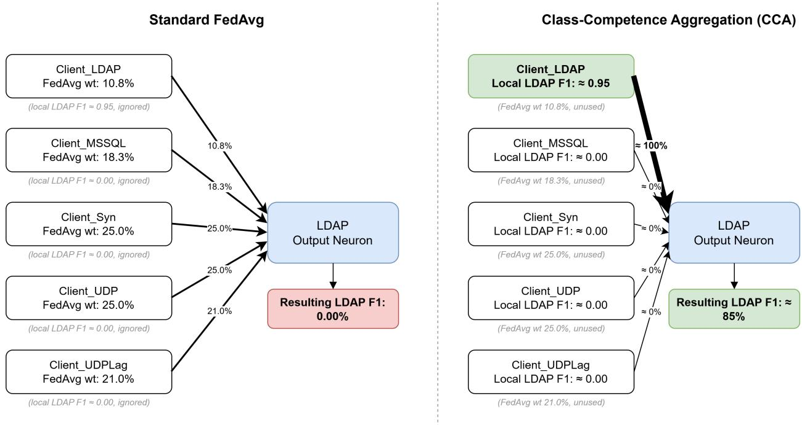
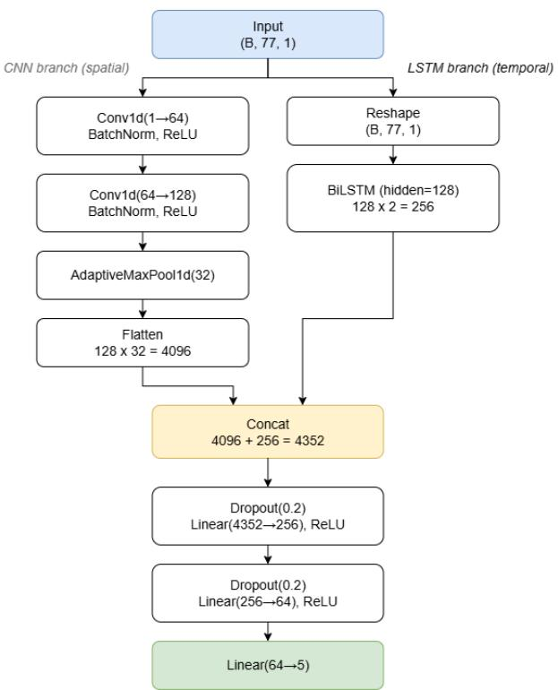
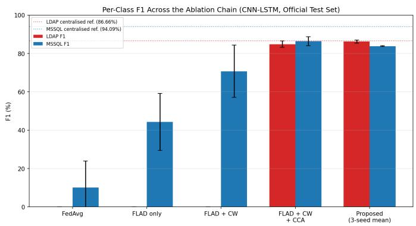

# Class-Competence Aggregation: Output-Layer Routing for Federated Multiclass DDoS Detection under Class-Concentrated Non-IID Data

Tapu Datta and Hafiz Imtiaz∗

Abstract—Federated learning over distributed intrusion-detection sensors naturally produces classconcentrated non-IID data, where an entire attack class is held by a single client and absent elsewhere. We show this collapses federated averaging in a specific, localized way: the output layer holds one decision boundary per class, and when a class’s aggregation weight comes overwhelmingly from clients that have never seen it, its neuron receives an active anti-signal rather than mere dilution, collapsing to zero. On CIC-DDoS2019, standard FedAvg drives the concentrated LDAP class to 0.00 ± 0.00% F1 across every seed. We propose Class-Competence Aggregation (CCA), which aggregates the output layer per class using each client’s own locally reported validation F1 as the weight, while hidden layers remain under standard size-weighted FedAvg. CCA requires no server-held auxiliary data and adds only one F1 scalar per class per round beyond the feature-scaling and class-count exchanges common to any federated pipeline. On our primary CNN-LSTM architecture, CCA alone raises LDAP F1 from 0% to $8 4 . 8 3 \pm 1 . 6 5 \% ,$ and the full method reaches 91.64 ± 0.57% macro F1, closing the federated-to-centralized gap from −42.53 to −4.05 points. Benchmarked against four other federated methods under identical partitions and seeds, CCA is the only one that recovers the concentrated class substantially and reliably; a 178× smaller MLP shows the same qualitative recovery, though less completely, confirming the efect holds across architecture scale even as its magnitude varies. Results are validated across three seeds and replicated on a second dataset, CICIDS2017.

Index Terms—Federated learning, intrusion detection, DDoS detection, non-IID data, class imbalance, aggregation.

## I. Introduction

Network intrusion detection in the real world is a distributed task: privacy regulation and inter-organizational confidentiality often prohibit pooling raw flow records across organizations, and streaming them to a central collector is bandwidth-prohibitive in any case. Detection instead runs at each organization’s own vantage point: edge routers, ingress points, cloud gateways, individual service endpoints. Therefore, no single sensor sees the full trafic mix. Federated learning [1] is a natural fit here:

it trains a shared model from these local vantage points without requiring any of them to give up their raw data.

In our setting, a federated binary classifier (attack vs. benign) reaches 99.56% macro F1, within 0.28 points of its centralized ceiling. This is consistent with results reported elsewhere on this dataset: Akgun et al. [2] report 99.99% accuracy for binary classification and 99.30% for multiclass classification using a centralized CNN-based model on CIC-DDoS2019, indicating that our own centralized reference is in line with the literature before the federated setting is introduced. Every client holds both benign and attack trafic in the binary case; therefore, averaging local models yields a near-optimal global model with no data sharing at all.

The multiclass setting breaks this. FedAvg does not merely lose some accuracy under class-concentrated non-IID data; it destroys the learned representation for the concentrated class in the output layer specifically. A sensor at an LDAP service captures LDAP amplification attacks; a sensor at an MSSQL endpoint captures MSSQL amplification; sensors on high-volume paths capture Syn and UDP floods. This partitioning of attack visibility produces what we call the class-concentrated non-IID regime, in which LDAP and MSSQL are concentrated almost exclu sively (over 98%) at a single client each, absent from all others but a trivial tail; Syn and UDP are primarily associated with one client but retain a substantial secondary presence at the mixed Client\_UDPLag (Table II). Zhao et al. [3] identified this as the most severe form of federated data heterogeneity, but their remedy, maintaining a small globally shared dataset, reintroduces precisely the data sharing that federated learning exists to avoid.

The failure has a precise mechanism, not just a low score. Every client trains the same five-class architecture; therefore, even a client that has never seen a single LDAP sample still produces an “LDAP neuron” after local training: the question is what that neuron encodes. At Client\_LDAP, real LDAP examples push the neuron’s weights toward correctly firing on LDAP trafic. But crossentropy loss does not act on one class in isolation: rewarding the correct class on a training step simultaneously pushes down the logits of every other class. This means that at the clients holding no LDAP data, ordinary training on their own Syn, UDP, MSSQL, and Benign trafic actively pushes their LDAP-neuron weights in the opposite direction: toward suppressing LDAP activation.

These clients are not contributing noise around zero; they are contributing an opposing signal, and because they vastly outnumber the one specialist in aggregation weight, standard FedAvg’s dataset-size-weighted average is dominated by suppression rather than merely diluted. We work out this imbalance in exact figures once the partition is introduced (Section IV, Table II) and formalize the mechanism in Section III-A. Client\_LDAP must relearn its specialization from scratch each round, only to have it overwritten again. In our five-client partition of CIC-DDoS2019 [4], [5], this produces total failure: LDAP F1 $= 0 . 0 0 \pm 0 . 0 0 \%$ across every seed, with macro F1 falling 42.53 points below centralized training.

Our central observation is that this failure is not uniformly distributed across the network: it is confined to the output layer, the one place where a parameter block belongs to a single class (Section III-A formalizes why hidden layers are unafected).

This suggests a correction that is targeted rather than global. We introduce Class-Competence Aggregation (CCA): after each round, every client reports its per-class validation F1, and the server uses these as aggregation weights for the output layer only. A client with no examples of class c reports $\mathrm { F } 1 _ { c } \approx 0$ and receives near-zero weight for that class’s neuron; the specialist client receives near-total weight. Hidden layers remain under standard size-weighted FedAvg. No server-held data and no interclient sharing are required.

Our contributions are:

1) We propose CCA, a federated aggregation mechanism that applies per-class F1-weighted averaging exclusively to the output layer. Added alone to a class-weighted, adaptively scheduled federated pipeline, it raises CNN-LSTM LDAP F1 from 0.00± 0.00% to $8 4 . 8 3 \pm 1 . 6 5 \%$ and macro F1 by 20.00 points: the largest and most reproducible single effect in our ablation.

2) We show empirically that the output layer is the bottleneck. Because CCA corrects aggregation nowhere else, its efect isolates the locus of failure. Changing how a single layer is averaged, out of 1.29M parameters in the CNN-LSTM, takes LDAP F1 from total collapse (0.00%) to within 0.5 points of the centralized ceiling (86.66%): the best achievable with no federation constraints at all.

3) We report a reliability result. Benchmarked against FedAvg, FedProx, FedNova, and FedDWC under identical partitions, splits and seeds, CCA is the only method that recovers the concentrated class both substantially and reliably. FedAvg and FedProx fail completely and consistently $( 0 . 0 0 { \pm } 0 . 0 0 \% )$ ; FedNova and FedDWC recover it only on some seeds, with standard deviations of 40.8 and 23.5 points. CCA’s is under 1 point.

4) We show that single-run ablations can misattribute credit. A single unseeded run of one ablation configuration reported 85.65% LDAP F1; the same configuration under three-seed validation yields 0.00 ±

0.00%. We report the seeded results throughout and treat this as a methodological finding in its own right.

## II. Related Work

## A. Non-IID federated learning

McMahan et al. [1] introduced FedAvg, aggregating client weights in proportion to local dataset size, and reported robustness to non-IID data (on a 2-class-perclient partition). Zhao et al. [3] showed this robustness degrades sharply in the 1-class regime, with CIFAR-10 accuracy falling 51.31%, and attributed the loss to weight divergence between locally homogeneous clients. Their proposed fix is a globally shared dataset, unavailable under our privacy constraint. Li et al. [6] proposed FedProx, adding a proximal penalty $\frac { \mu } { 2 } \lVert w _ { \mathrm { l o c a l } } - w _ { \mathrm { g l o b a l } } \rVert ^ { 2 }$ to constrain client drift. FedProx targets quantity skew, where clients difer in volume and balance but each still holds most classes; we show its behavior under class concentration is architecture-dependent (Section V). FedNova [7] normalizes for unequal local computation, a distinct axis of heterogeneity. A broader family targets general non-IID op timization without addressing class concentration specifically: SCAFFOLD [8] corrects client drift with control variates but still averages every layer uniformly; MOON [9] adds a model-contrastive loss between local and global representations; FedBN [10] excludes batch-norm parameters from aggregation entirely, addressing feature-distribution shift rather than a class being absent from all but one client; clustered FL [11] trains a separate model per client cluster, trading away the cross-client generalization a single global model provides on shared classes; adaptive server optimizers [12] improve convergence orthogonally to which parameters are aggregated how. Kairouz et al. [13] survey this landscape and list class imbalance among federated learning’s open problems without a solution specific to output-layer concentration. Separately, Wang et al. [14] address general (non-IDS) class imbalance with Ratio Loss, a training-level reweighting similar in spirit to our class-weighted loss (Section III-C) that, like ours alone, does not correct aggregation-level dilution.

## B. Federated intrusion detection

Federated IDS was established as viable by Rahman et al. [15] and Nguyen et al. [16]’s DÏoT, neither addressing multiclass non-IID structure; Agrawal et al. [17] survey the field and flag statistical heterogeneity as open, consistent with the gap below. FLAD [18] is the closest prior work: it schedules local epochs adaptively, giving more training time to clients the global model explains worst. FLAD was designed and evaluated for binary DDoS detection and aggregates by unweighted arithmetic mean, which cannot correct output-neuron dilution. FedMADE [19] computes a class probability matrix per client using a server-held auxiliary set (10 samples per class) and solves for cluster weights; FedDWC [20] adjusts per-client weights by round-over-round accuracy change. In both cases, each client receives a single scalar competence score, and that one score scales every parameter in that client’s model: hidden layers and output layer alike, with no per-class or per-layer distinction. FedDWC’s signal is additionally counterproductive here: overall accuracy correlates with data volume; therefore, the large clients are rewarded and Client\_LDAP, the sole holder of LDAP knowledge, is penalized, amplifying the imbalance that already causes the failure. DS-FedIDS [21] rebalances each client’s local dataset by resampling, addressing intra-client imbalance; resampling cannot create signal at a client with zero examples of a class; therefore, it is complementary rather than competing.

## C. Gap

Table I summarizes. No prior FL-IDS method (i) constructs or evaluates a class-concentrated partition in which an attack class is held entirely by one sensor, or (ii) restricts performance-based aggregation to the output layer, where the class-concentrated failure is structurally localized.

## III. Method

## A. Why FedAvg Collapses the Concentrated Class

FedAvg aggregates client parameters proportionally to local dataset size:

$$
w _ { \mathrm { g l o b a l } } = \sum _ { i = 1 } ^ { K } { \frac { n _ { i } } { n _ { \mathrm { t o t a l } } } } w _ { i } .\tag{1}
$$

For the final linear layer, class logits are computed as

$$
\mathrm { l o g i t } _ { c } = { \cal W } _ { \mathrm { o u t } } [ c , : ] \cdot h + b _ { c } ,\tag{2}
$$

where h is the penultimate representation. The row $W _ { \mathrm { o u t } } [ c , : ]$ together with $b _ { c }$ constitutes a dedicated linear decision boundary for class $c ;$ we refer to this pair as the output neuron for c.

Consider the LDAP output neuron after one round of local training. Client\_LDAP has received gradient updates from 1,884 LDAP samples, pushing $W _ { \mathrm { o u t } } [ c _ { \mathrm { L D A P } } , : ]$ toward the direction in feature space that discriminates LDAP from all other classes. Every other client has observed only Benign, Syn, UDP, or MSSQL trafic. For those clients, LDAP is a class that never appears as the target label; therefore, cross-entropy pushes $W _ { \mathrm { o u t } } [ c _ { \mathrm { L D A P } } , : ]$ in directions that suppress LDAP activation on the trafic they do see. Their contribution is not noise around zero; it is systematic anti-signal.

Eq. 1 then combines these five vectors with the size-proportional weights of Table II, [0.108, 0.183, 0.250, 0.250, 0.210]. The specialist’s contribution is outvoted roughly eight to one, the aggregated neuron is destroyed, and Client\_LDAP must rebuild it from scratch in the following round. This loop never terminates in a useful state: LDAP F1 is 0.00% at every round of every seed.

Two properties of this analysis matter for the design that follows. First, the failure is confined to the output layer, because only there is a parameter block dedicated to a single class. Second, the fix requires no data: the server needs only to know which client is competent for which class, a quantity each client can compute locally.

## B. Class-Competence Aggregation

Figure 1 contrasts the two aggregation rules side by side. Standard FedAvg (left) weights every client by dataset size alone; therefore, all five clients contribute comparably to the hidden layers. CCA (right) instead weights each client’s contribution to a given class’s output row by that client’s own local competence on that class, collapsing nearly all of the weight onto the specialist.

After local training in round $t ,$ each client i evaluates its local model on its own held-out validation split and reports per-class F1 scores $f 1 _ { i , c } .$ . No data leaves the client; the reported quantity is a scalar per class. The $f 1 _ { i , c }$ score is computed with scikit-learn’s zero\_division=0 convention: if client i’s local validation split contains no examples of class $c ,$ precision and recall are both the mathematically undefined $0 / 0 ,$ and this convention resolves them to exactly 0 rather than an undefined value or a warning. This is the mechanism that produces the $f 1 _ { i , c } \approx 0$ behavior described above, and it is applied identically to the oficialtest-set per-class F1 reported throughout Section V.

Raw per-round F1 is noisy; therefore, we smooth with an exponential moving average:

$$
\widetilde { f 1 } _ { i , c , t } = \alpha f 1 _ { i , c , t } + \left( 1 - \alpha \right) \widetilde { f 1 } _ { i , c , t - 1 } ,\tag{3}
$$

with $\alpha = 0 . 7$ and $\widetilde { f 1 } _ { i , c , 0 } = 0$ . Weights are then normalized across clients, per class. Rather than a smoothed denominator, this normalization is implemented as an exact conditional on whether any client has learned the class yet:

$$
\tilde { w } _ { i , c } = \left\{ \begin{array} { l l } { \widetilde { f 1 } _ { i , c , t } } & { \mathrm { i f ~ } \sum _ { j } \widetilde { f 1 } _ { j , c , t } > 0 , } \\ { \sum _ { j } \widetilde { f 1 } _ { j , c , t } } & { } \\ { 1 / K } & { \mathrm { o t h e r w i s e } . } \end{array} \right.\tag{4}
$$

The second case, uniform weighting, applies exactly when every client reports zero F1 for class $^ { c , }$ which occurs in early rounds before any client has learned a minority class; no smoothing constant ϵ is added in either branch.

a) Output layer: For output weight matrix $W _ { \mathrm { o u t } } ~ \in$ $\mathbb { R } ^ { C \times H }$ and bias $b _ { \mathrm { o u t } } \in \mathbb { R } ^ { C }$ , each class row is aggregated with its own weight vector:

$$
W _ { \mathrm { o u t } } ^ { \mathrm { g l o b a l } } [ c , : ] = \sum _ { i } \tilde { w } _ { i , c } W _ { \mathrm { o u t } } ^ { i } [ c , : ] ,\tag{5}
$$

$$
b _ { \mathrm { o u t } } ^ { \mathrm { g l o b a l } } [ c ] = \sum _ { i } \tilde { w } _ { i , c } b _ { \mathrm { o u t } } ^ { i } [ c ] .\tag{6}
$$

b) All other layers: Every remaining parameter uses unmodified size-weighted FedAvg (Eq. 1). This is deliberate. Hidden representations are built from trafic that all clients observe, and reweighting them by per-class competence would discard genuine contributions from clients that happen to be weak on one class while distorting the shared feature space that the corrected output layer depends on.

TABLE I  
Positioning against the most closely related federated intrusion detection methods.
<table><tr><td>Dimension</td><td>FLAD</td><td>FedMADE</td><td>FedDWC</td><td>DS-FedIDS</td><td>This work</td></tr><tr><td>Non-IID type Task</td><td></td><td>General het.</td><td>General het.</td><td>Intra-client</td><td>Class-concentrated</td></tr><tr><td></td><td>Binary DDoS</td><td>IDS (7-class)</td><td>DDoS IDS</td><td>IDS (multi)</td><td>5-class DDoS</td></tr><tr><td>Aggregation scope</td><td>Full model</td><td>Full model</td><td>Full model</td><td>Full model</td><td>Output layer only</td></tr><tr><td>Weight signal</td><td></td><td>Cluster perf.</td><td>Round acc.</td><td></td><td>Per-class F1</td></tr><tr><td>Server aux. data</td><td>No</td><td>Yes (10/class)</td><td>No</td><td>No</td><td>No</td></tr><tr><td>Multi-seed validated</td><td></td><td></td><td></td><td></td><td>3 seeds</td></tr></table>

  
Fig. 1. Standard FedAvg (left) vs. CCA (right) for the LDAP class. Line thickness represents aggregation weight. Under FedAvg, all five clients contribute comparably regardless of whether they hold any LDAP data. Under CCA, weight for the LDAP output row is routed almost entirely to Client\_LDAP, the only client with meaningful local LDAP competence.

The mechanism is self-selecting. Once Client\_LDAP reaches a local LDAP F1 near 1.0 and all other clients remain near 0, Eq. 4 collapses onto the specialist, assigning it near-total weight for that one neuron while leaving the other four neurons and every hidden layer untouched.

## C. Preconditions: Adaptive Scheduling and Class Weighting

CCA is a routing mechanism: it can only route toward competence that already exists. Two standard components establish it.

a) Adaptive epoch scheduling: Following FLAD [18], we allocate local epochs by how poorly the current global model explains each client’s data. We use validation loss $\ell _ { i }$ as the scheduling signal rather than F1, since loss remains informative under majority-class dominance in

the multiclass setting:

$$
\tilde { \ell } _ { i } = \frac { \ell _ { i } - \ell _ { \mathrm { m i n } } } { \ell _ { \mathrm { m a x } } - \ell _ { \mathrm { m i n } } + \epsilon } ,\tag{7}
$$

$$
E _ { i } = \mathrm { r o u n d } \big ( E _ { \mathrm { m i n } } + \tilde { \ell } _ { i } ( E _ { \mathrm { m a x } } - E _ { \mathrm { m i n } } ) \big ) .\tag{8}
$$

The allocation converges by round 5: harder clients (MSSQL, LDAP) receive 7–10 local epochs, versus 1–3 for the high-volume clients, concentrating budget exactly where FLAD intends.

b) Class-weighted loss: Adaptive scheduling corrects imbalance between clients but not within them; benign trafic is the local majority everywhere. We apply inverse-frequency weighting to the local cross-entropy, weigh $\mathrm { \mathrm { { t } } } _ { c } = n _ { \mathrm { { t o t a l } } } / ( | \mathcal { C } | \cdot n _ { c } )$ , which gives each LDAP sample at Client\_LDAP roughly 10× the gradient contribution of a benign sample. The $n _ { c }$ is computed once, during ofline dataset preparation, from label counts pooled across the entire federation, not per client; since all five retained classes have a nonzero count somewhere in the federation by construction (Section IV’s exclusion criteria already rule out classes too sparse for this), $ { n _ { c } } \ = \ 0$ cannot occur for any class this formula is applied to. Pooling raw label counts this way is subject to the same simulationvs-deployment caveat as the feature scaler above: a live deployment could instead have each client report only its own local per-class counts (aggregate volumes, not raw records) for the server to sum via secure aggregation, which is exact because summation, like the min/max used for scaling, is associative across clients.

Section V-C shows these two components are necessary but not suficient: together they add 18.30 points of macro F1 while leaving LDAP F1 at exactly 0.00%.

## D. Implementation Details

We add FedProx regularization [6] with $\mu ~ = ~ 0 . 0 1$ and track the best-validation-macro-F1 checkpoint rather than taking the final round, since CCA’s round-to-round weight updates make training non-monotonic. Learning rate decays as $\mathrm { l r } _ { t } = 1 0 ^ { - 3 } \times 0 . 9 5 ^ { ( t - 1 ) }$ . Both are stabilizers, not sources of the efect; their measured contributions are reported in Section V-C.

## IV. Experimental Setup

a) Data and partition: We use the Kaggle Parquet redistribution of CIC-DDoS2019 [4], [5], with 77 CICFlowMeter features per flow. Of the twelve attack categories, four (DNS, NTP, SNMP, TFTP) are absent from the training partition, and three (NetBIOS, Portmap, UD-PLag) have fewer than ten oficial test samples each, making per-class F1 statistically meaningless. We retain five classes: Benign, LDAP, MSSQL, Syn, UDP. The four attack classes span both mechanistic families of the dataset, reflection-based (LDAP, MSSQL) and exploitation-based (Syn, UDP).

Five clients are constructed by assigning four of them the trafic for one primary attack type each; the fifth, Client\_UDPLag, receives the residual Syn and UDP trafic left over from that assignment and therefore holds a mixed attack profile rather than a single specialization (Table II). Every client also holds a benign share; therefore, the concentration is of attack classes specifically. LDAP is 98.8% concentrated at one client. Clients whose raw data exceeds a fixed cap of 15,000 samples are subsampled once, with a fixed seed, before the three federated training seeds: within each such client, every class is sampled in proportion to its own share of that client’s data; therefore, the client’s internal class mixture, the property this partition is designed around, is preserved rather than disturbed by the cap. Integer truncation of each class’s proportional allocation means the resulting per-client totals land just under 15,000 rather than exactly at it, which is why Table II reports 14,999 for Client\_Syn and Client\_UDP.

b) Evaluation: Each client splits locally into 85% train / 15% validation. All models, federated and centralized, are evaluated on the oficial CIC-DDoS2019 test partition (70,009 samples; Benign 73.4%, UDP 14.9%, MSSQL 8.9%, LDAP 2.1%, Syn 0.8%). A global MinMax scaler fitted on pooled federated training data is applied without refitting; therefore, no test statistics leak. This scaler was fitted once during ofline preparation of the CIC-DDoS2019 benchmark, before any client–server protocol runs, since our federation is simulated by partitioning a dataset we already hold in full. A live deployment could reproduce the same global scaler without pooling raw data: each client reports only its local per-feature minimum and maximum (two scalars per feature) in a onetime setup exchange before training begins, and the server merges these into the exact global min/max (min and max are associative statistics; therefore, this is mathematically identical to fitting on pooled data). Unlike CCA’s perround F1 reporting (Section III-B), this exchange happens only once, and each disclosed value is a genuine observation from the client’s data rather than a derived aggregate. We report macro F1: with benign at 73.4% of the test set, accuracy would mask complete failure on the minority classes.

  
Fig. 2. The dual-branch CNN-LSTM architecture (1,290,629 parameters). The two branches are fused before the final 5-way output layer, whose row-wise structure (Eq. 2) is what CCA targets.

c) Architectures: Figure 2 shows the primary model, a dual-branch CNN-LSTM (1,290,629 parameters). We also evaluate a three-layer MLP (178× smaller): Linear(77→64) → ReLU → Linear(64→32) → ReLU → Linear(32→5), 7,237 parameters total, to test whether the findings are architecture-dependent.

d) Reproducibility: Every reported federated configuration is run under three fixed seeds (42, 123, 7), with PyTorch, CUDA, NumPy and Python RNGs seeded and cuDNN set deterministic before any data loading.All models are implemented in PyTorch 2.10.0 (CUDA 12.8)

TABLE II  
Full class-by-client sample count matrix for the training partition. LDAP appears at two clients (1,884 at Client\_LDAP + 22 at Client\_MSSQL); MSSQL likewise at two (8,378 + 122 at Client\_UDP); Syn and UDP are each split between their primary client and the mixed Client\_UDPLag. Benign traffic (column 1) is present at every client.
<table><tr><td>Client</td><td>Benign</td><td>LDAP</td><td>MSSQL</td><td> $\mathbf { S y n }$ </td><td>UDP</td><td>Total</td><td>FedAvg wt.</td></tr><tr><td>Client_LDAP</td><td>4,585</td><td>1,884</td><td>0</td><td>0</td><td>0</td><td>6,469</td><td>10.8%</td></tr><tr><td>Client_MSSQL</td><td>2,574</td><td>22</td><td>8,378</td><td>0</td><td>0</td><td>10,974</td><td>18.3%</td></tr><tr><td>Client_Syn</td><td>5,765</td><td>0</td><td>0</td><td>9,234</td><td>0</td><td>14,999</td><td>25.0%</td></tr><tr><td>Client_UDP</td><td>2,391</td><td>0</td><td>122</td><td>0</td><td>12,486</td><td>14,999</td><td>25.0%</td></tr><tr><td>Client_UDPLag</td><td>3,748</td><td>0</td><td>0</td><td>5,538</td><td>3,298</td><td>12,584</td><td>21.0%</td></tr><tr><td>Total</td><td>19,063</td><td>1,906</td><td>8,500</td><td>14,772</td><td>15,784</td><td>60,025</td><td>100.0%</td></tr></table>

and optimized with Adam, batch size 64, for a fixed 30 federated rounds; training data is reshufled each local epoch, and all layers use PyTorch’s default initialization (no custom scheme applied). We report mean ± standard deviation. Training used a T4×2 GPU. Significance is assessed with a paired t-test over the three seeds; we note in Section VII that n=3 has severely limited power. Code and experimental configurations will be made available upon publication.

## V. Results

## A. The Gap

Centralized CNN-LSTM reaches 95.69% macro F1 with LDAP at 86.66%; LDAP is the hardest class even with full data access. Federated training with standard FedAvg reaches 53.16 ± 8.29% macro F1 with LDAP at exactly $0 . 0 0 \pm 0 . 0 0 \%$ . Benign $( 9 9 . 3 5 \pm 0 . 8 9 \% )$ is near-perfect and stable across seeds, while Syn’s mean of $7 6 . 7 1 \pm 3 2 . 4 1 \%$ conceals large per-seed swings rather than consistently near-perfect performance: the global model has learned the majority class reliably, is unreliable on Syn, and fails entirely on the concentrated class. This is the −42.53-point gap the method aims to close.

## B. Comparison Against Federated Baselines

We re-implement FedProx, FedNova and FedDWC in their canonical published form (fixed local epochs, plain cross-entropy, no adaptive scheduling) and run them under the identical partition, splits, test set and seeds. Table III reports CNN-LSTM.

Two failure modes appear. FedAvg and FedProx fail on the concentrated class completely and consistently: neither corrects output-layer dilution; therefore, LDAP F1 is exactly zero in every seed. FedNova and FedDWC sometimes recover it, but with standard deviations of 40.79 and 23.45 points, recovering strongly on one seed and collapsing on others. Neither targets the output layer; therefore, when they succeed it is an incidental side efect of broader reweighting rather than a mechanism.

We consider this reliability gap as informative as the mean: a standard deviation under one point, against 23– 41 points for the two methods that occasionally succeed, suggests targeted output-layer correction is a diferent kind of intervention, not a better-tuned instance of generalpurpose reweighting. The ordering holds for the MLP too (Table IV): FedDWC degrades to $3 1 . 9 7 { \pm } 0 . 7 5 \%$ , below the FedAvg baseline, while our method reaches $8 9 . 5 9 \pm 0 . 9 0 \%$

## C. Ablation

Table V decomposes the method in dependency order: training-level components first (they must be active before CCA has competence to route), then the aggregation-level fix, then stabilizers.

  
Fig. 3. LDAP and MSSQL F1 across the ablation chain (mean ± std over seeds 42/123/7 where seeded). LDAP F1 stays at exactly 0.00% through FedAvg, FLAD-only, and FLAD+CW, and only recovers once CCA is added. The dotted lines mark the centralized (nonfederated) per-class F1 ceiling for LDAP (86.66%) and MSSQL (94.09%), matching the Centralized reference row in Table V.

a) Scheduling and class weighting help broadly but do not recover the concentrated class: Adaptive scheduling and class weighting each add a substantial share of macro F1 over plain FedAvg (Table V), with most of the gain coming from majority-adjacent classes such as MSSQL. LDAP F1, however, remains exactly $0 . 0 0 { \pm } 0 . 0 0 \%$ throughout, and does so consistently across every seed rather than intermittently: local specialization at Client\_LDAP, however strong, is still overwritten each round by the aggregation weight held by the LDAP-free clients. Neither training-level fix touches the aggregation rule itself; therefore, neither can reach the class this failure is localized to.

TABLE III  
CNN-LSTM, full per-class F1, mean ± std over seeds 42/123/7. Gap is macro F1 minus the centralized reference (95.69%).
<table><tr><td>Method</td><td>Benign</td><td>LDAP</td><td>MSSQL</td><td>Syn</td><td>UDP</td><td>Macro F1</td><td>Gap</td></tr><tr><td>FedAvg</td><td> $9 9 . 3 5 \pm 0 . 8 9$ </td><td> $0 . 0 0 \pm 0 . 0 0$ </td><td> $1 0 . 0 2 \pm 1 3 . 8 3$ </td><td> $7 6 . 7 1 \pm 3 2 . 4 1$ </td><td> $7 9 . 7 3 \pm 0 . 9 7$ </td><td> $5 3 . 1 6 \pm 8 . 2 9$ </td><td>-42.53</td></tr><tr><td>FedProx</td><td> $9 9 . 9 1 \pm 0 . 0 2 $ </td><td> $0 . 0 0 \pm 0 . 0 0$ </td><td> $2 0 . 1 2 \pm 4 . 6 9$ </td><td> $9 5 . 0 1 \pm 1 . 0 7$ </td><td> $7 9 . 4 4 \pm 0 . 6 8$ </td><td> $5 8 . 9 0 \pm 1 . 2 2 $ </td><td>-36.79</td></tr><tr><td>FedNova</td><td> $9 9 . 9 6 \pm 0 . 0 2$ </td><td> $2 8 . 8 4 \pm 4 0 . 7 9$ </td><td> $1 4 . 2 4 \pm 9 . 1 0$ </td><td> $9 7 . 6 0 \pm 1 . 9 6$ </td><td> $7 9 . 0 6 \pm 0 . 6 6$ </td><td> $6 3 . 9 4 \pm 6 . 4 8$ </td><td>-31.75</td></tr><tr><td>FedDWC</td><td> $9 9 . 6 6 \pm 0 . 2 3 $ </td><td> $6 6 . 3 9 \pm 2 3 . 4 5$ </td><td> $2 9 . 3 9 \pm 2 1 . 9 4$ </td><td> $3 9 . 8 4 \pm 4 2 . 6 4$ </td><td> $5 5 . 1 4 \pm 3 9 . 1 0$ </td><td> $5 8 . 0 9 \pm 9 . 7 5$ </td><td>-37.60</td></tr><tr><td>CCA (ours)</td><td> $\mathbf { 9 9 . 8 8 \pm 0 . 0 1 }$ </td><td> ${ \bf 8 6 . 6 9 \pm 0 . 8 1 }$ </td><td> ${ \bf 8 3 . 8 4 \pm 0 . 9 9 }$ </td><td> ${ \bf 9 4 . 6 3 \pm 1 . 1 2 }$ </td><td> $\mathbf { 9 3 . 1 3 \pm 0 . 5 4 }$ </td><td> ${ \bf 9 1 . 6 4 \pm 0 . 5 7 }$ </td><td>-4.05</td></tr></table>

TABLE IV

MLP, full per-class F1, mean ± std over seeds 42/123/7. Gap is macro F1 minus the centralized reference (94.66%).
<table><tr><td>Method</td><td>Benign</td><td>LDAP</td><td>MSSQL</td><td>Syn</td><td>UDP</td><td>Macro F1</td><td>Gap</td></tr><tr><td>FedAvg</td><td> $9 9 . 6 3 \pm 0 . 0 7$ </td><td> $0 . 0 0 \pm 0 . 0 0$ </td><td> $6 1 . 7 6 \pm 1 1 . 7 5$ </td><td> $2 8 . 6 8 \pm 1 5 . 9 5$ </td><td> $8 7 . 9 7 \pm 2 . 9 9$ </td><td> $5 5 . 6 1 \pm 6 . 0 4$ </td><td>-39.05</td></tr><tr><td>FedProx</td><td> $9 9 . 8 4 \pm 0 . 0 6$ </td><td> $0 . 0 0 \pm 0 . 0 0$ </td><td> $7 1 . 4 0 \pm 1 . 2 9$ </td><td> $9 3 . 5 2 \pm 1 . 7 5$ </td><td> $9 0 . 2 2 \pm 0 . 6 9$ </td><td> $7 1 . 0 0 \pm 0 . 7 4$ </td><td>-23.66</td></tr><tr><td>FedNova</td><td> $9 9 . 5 7 \pm 0 . 0 9$ </td><td> $0 . 1 7 \pm 0 . 2 4$ </td><td> $3 8 . 2 7 \pm 3 1 . 7 2$ </td><td> $2 6 . 0 3 \pm 2 7 . 6 3$ </td><td> $8 5 . 6 1 \pm 5 . 1 0$ </td><td> $4 9 . 9 3 \pm 6 . 6 1$ </td><td>-44.73</td></tr><tr><td>FedDWC</td><td> $9 3 . 9 4 \pm 3 . 7 5$ </td><td> $0 . 3 7 \pm 0 . 1 9$ </td><td> $0 . 0 0 \pm 0 . 0 0$ </td><td> $6 5 . 2 7 \pm 1 . 4 8$ </td><td> $0 . 2 8 \pm 0 . 0 4$ </td><td> $3 1 . 9 7 \pm 0 . 7 5$ </td><td>-62.69</td></tr><tr><td>CCA (ours)</td><td> $\mathbf { 9 9 . 8 6 \pm 0 . 0 0 }$ </td><td> ${ \bf 8 5 . 4 0 \pm 2 . 2 7 }$ </td><td> ${ \bf 7 8 . 6 9 \pm 1 . 9 9 }$ </td><td> ${ \bf 9 2 . 6 7 \pm 0 . 3 1 }$ </td><td> ${ \bf 9 1 . 3 4 \pm 0 . 4 7 }$ </td><td> ${ \bf 8 9 . 5 9 \pm 0 . 9 0 }$ </td><td>-5.07</td></tr></table>

CNN-LSTM ablation, full per-class F1, three seeds each. CW = class-weighted loss. The $\mathrm { F L A D + C W } \to + \mathrm { C C A }$ transition is significant at $p = 0 . 0 0 6$ (paired t-test, n=3); proposed vs. FedAvg a ${ \textrm { T } } p = 0 . 0 2 0 .$
<table><tr><td>Configuration</td><td>Benign</td><td>LDAP</td><td>MSSQL</td><td>Syn</td><td>UDP</td><td>Macro F1</td><td>Gap</td></tr><tr><td>Centralized (reference)</td><td>99.97</td><td>86.66</td><td>94.09</td><td>99.44</td><td>98.30</td><td>95.69</td><td></td></tr><tr><td>FedAvg</td><td> $9 9 . 3 5 \pm 0 . 8 9$ </td><td> $0 . 0 0 \pm 0 . 0 0$ </td><td> $1 0 . 0 2 \pm 1 3 . 8 3$ </td><td> $7 6 . 7 1 \pm 3 2 . 4 1$ </td><td> $7 9 . 7 3 \pm 0 . 9 7$ </td><td> $5 3 . 1 6 \pm 8 . 2 9$ </td><td>-42.53</td></tr><tr><td>FLAD only</td><td> $9 9 . 9 6 \pm 0 . 0 1$ </td><td> $0 . 0 0 \pm 0 . 0 0$ </td><td> $4 4 . 3 1 \pm 1 4 . 7 9$ </td><td> $9 8 . 0 2 \pm 1 . 2 2 $ </td><td> $8 4 . 0 7 \pm 3 . 3 7$ </td><td> $6 5 . 2 7 \pm 3 . 7 1$ </td><td>-30.42</td></tr><tr><td> $\mathrm { F L A D + C W }$ </td><td> $9 9 . 9 3 \pm 0 . 0 3$ </td><td> $0 . 0 0 \pm 0 . 0 0$ </td><td> $7 0 . 7 4 \pm 1 3 . 5 6$ </td><td> $9 5 . 2 3 \pm 3 . 1 2$ </td><td> $9 1 . 4 1 \pm 4 . 3 4$ </td><td> $7 1 . 4 6 \pm 3 . 2 5$ </td><td>-24.23</td></tr><tr><td> $\mathrm { F L A D } + \mathrm { C W } + \mathrm { C C A }$ </td><td> $9 9 . 8 9 \pm 0 . 0 6$ </td><td> ${ \bf 8 4 . 8 3 \pm 1 . 6 5 }$ </td><td> $8 6 . 3 6 \pm 2 . 3 1$ </td><td> $9 1 . 4 0 \pm 6 . 3 3$ </td><td> $9 4 . 8 3 \pm 1 . 0 8$ </td><td> ${ \bf 9 1 . 4 6 \pm 1 . 1 6 }$ </td><td>-4.23</td></tr><tr><td>+ FedProx</td><td> $9 9 . 8 3 \pm 0 . 0 2 $ </td><td> $8 6 . 0 5 \pm 1 . 2 2$ </td><td> $8 2 . 6 7 \pm 0 . 5 5$ </td><td> $9 4 . 0 0 \pm 0 . 0 7$ </td><td> $9 2 . 4 0 \pm 0 . 1 1$ </td><td> $9 0 . 9 9 \pm 0 . 3 2$ </td><td>-4.70</td></tr><tr><td>+ FedProx + best ckpt</td><td> $9 9 . 8 3 \pm 0 . 0 1 $ </td><td> $8 6 . 6 5 \pm 1 . 1 5$ </td><td> $8 3 . 1 3 \pm 0 . 4 5$ </td><td> $9 4 . 8 2 \pm 1 . 1 0$ </td><td> $9 2 . 5 5 \pm 0 . 1 2$ </td><td> $9 1 . 4 0 \pm 0 . 5 1$ </td><td>-4.29</td></tr><tr><td>+ all (proposed)</td><td> $9 9 . 8 8 \pm 0 . 0 1$ </td><td> $8 6 . 6 9 \pm 0 . 8 1$ </td><td> $8 3 . 8 4 \pm 0 . 9 9$ </td><td> $9 4 . 6 3 \pm 1 . 1 2$ </td><td> $9 3 . 1 3 \pm 0 . 5 4$ </td><td> $9 1 . 6 4 \pm 0 . 5 7$ </td><td>-4.05</td></tr></table>

b) CCA is the decisive component: Adding CCA alone (no FedProx, no checkpoint tracking, no learning rate decay) raises macro F1 by 20.00 points and LDAP F1 from 0.00% to $8 4 . 8 3 \pm 1 . 6 5 \%$ . This is the largest efect in the chain and among the most stable, and it is produced by modifying the aggregation rule for a single layer holding 325 of the model’s 1,290,629 parameters. With the stabilizers added, LDAP F1 reaches 86.69 ± 0.81% against a centralized ceiling of 86.66%.

c) Stabilizers are secondary but architecture-sensitive: FedProx without checkpoint tracking has a mean efect of −0.47 points that disagrees in sign across seeds (−1.99, −0.89, +1.47), consistent with ordinary training variance rather than a mechanism. On the MLP its role is entirely diferent: adding FedProx to FLAD+CW+CCA moves macro F1 from $7 0 . 1 3 \pm 7 . 0 0 \%$ to $8 9 . 4 7 \pm 0 . 6 0 \%$ and LDAP F1 from 54.22 ± 6.70% to $8 5 . 2 1 \pm 1 . 8 7 \%$ , cutting seed variance by 3.5×. CCA alone recovers the class substantially on both architectures; the smaller model additionally needs FedProx to complete and stabilize that recovery. Directionally consistent across all three seeds, this efect nonetheless does not clear $p \ < \ 0 . 0 5$ at n=3 $( p ~ = ~ 0 . 0 5 9 )$ . The final two stabilizers (LR decay and

EMA) were selected using CNN-LSTM’s ablation, where they extend a monotonic improvement $( 9 1 . 4 0  9 1 . 6 4 ) ;$ we deliberately kept this same fixed recipe for the MLP rather than re-tuning per architecture, to avoid selecting the best-looking configuration after the fact. Under that fixed recipe, the MLP shows a small non-monotonic dip (90.36 → 89.59, 0.77 points) when these two components are added on top of +FedProx+best ckpt; the diference is smaller than the seed-to-seed standard deviation of either row $( \pm 0 . 8 3 / \pm 0 . 9 0 )$ and does not change the section’s conclusion: FedProx remains necessary for the MLP to complete recovery, and the fixed proposed recipe still closes the large majority of the gap.

d) On single-run ablations: An earlier single unseeded run of the FLAD+CW configuration reported LDAP F1 of 85.65%, which would have credited the training-level components with the recovery and reduced CCA to a refinement. Under three-seed validation the same configuration yields 0.00 ± 0.00%. Single-run ablations are common in this literature; this case illustrates that they can invert the attribution of a multi-component method’s central efect.

TABLE VI  
MLP ablation, full per-class F1, three seeds each, same configuration chain as Table V. CCA alone is again the largest single jump $\mathrm { ( F L A D + C W  + C C A : + 1 9 . 0 9 }$ points macro F1, +54.22 points LDAP F1), but unlike CNN-LSTM does not complete the recovery without FedProx. Proposed vs. FedAvg is significant at $p = 0 . 0 1 1$ (paired t-test, n=3).
<table><tr><td>Configuration</td><td>Benign</td><td>LDAP</td><td>MSSQL</td><td>Syn</td><td>UDP</td><td>Macro F1</td><td>Gap</td></tr><tr><td>Centralized (reference)</td><td>99.89</td><td>86.01</td><td>93.94</td><td>95.24</td><td>98.19</td><td>94.66</td><td></td></tr><tr><td>FedAvg</td><td> $9 9 . 6 3 \pm 0 . 0 7$ </td><td> $0 . 0 0 \pm 0 . 0 0$ </td><td> $6 1 . 7 6 \pm 1 1 . 7 5$ </td><td> $2 8 . 6 8 \pm 1 5 . 9 5$ </td><td> $8 7 . 9 7 \pm 2 . 9 9$ </td><td> $5 5 . 6 1 \pm 6 . 0 4$ </td><td>-39.05</td></tr><tr><td>FLAD only</td><td> $9 9 . 6 9 \pm 0 . 0 1$ </td><td> $0 . 0 0 \pm 0 . 0 0$ </td><td> $1 5 . 9 6 \pm 2 2 . 5 7$ </td><td> $2 0 . 5 0 \pm 2 . 3 2$ </td><td> $7 9 . 8 0 \pm 3 . 3 6$ </td><td> $4 3 . 1 9 \pm 4 . 9 4$ </td><td>-51.47</td></tr><tr><td> $\mathrm { F L A D + C W }$ </td><td> $9 9 . 7 0 \pm 0 . 0 1$ </td><td> $0 . 0 0 \pm 0 . 0 0$ </td><td> $4 7 . 5 4 \pm 2 8 . 7 7$ </td><td> $2 4 . 5 5 \pm 2 . 1 1$ </td><td> $8 3 . 4 2 \pm 4 . 8 4$ </td><td> $5 1 . 0 4 \pm 6 . 4 8$ </td><td>-43.62</td></tr><tr><td> $\mathrm { F L A D } + \mathrm { C W } + \mathrm { C C A }$ </td><td> $9 9 . 5 8 \pm 0 . 1 2 $ </td><td> ${ \bf 5 4 . 2 2 \pm 6 . 7 0 }$ </td><td> $7 1 . 4 7 \pm 4 . 9 4$ </td><td> $3 2 . 6 6 \pm 2 6 . 8 6$ </td><td> $9 2 . 7 0 \pm 1 . 1 9$ </td><td> $\mathbf { 7 0 . 1 3 \pm 7 . 0 0 }$ </td><td>-24.53</td></tr><tr><td>+ FedProx</td><td> $9 9 . 8 6 \pm 0 . 0 1$ </td><td> $8 5 . 2 1 \pm 1 . 8 7$ </td><td> $7 8 . 4 2 \pm 0 . 9 4$ </td><td> $9 2 . 5 4 \pm 0 . 6 0$ </td><td> $9 1 . 3 1 \pm 0 . 0 1$ </td><td> $8 9 . 4 7 \pm 0 . 6 0$ </td><td>-5.19</td></tr><tr><td>+ FedProx + best ckpt</td><td> $9 9 . 8 6 \pm 0 . 0 1$ </td><td> $8 5 . 6 4 \pm 1 . 5 3$ </td><td> $8 1 . 2 6 \pm 1 . 9 9$ </td><td> $9 2 . 8 6 \pm 0 . 3 4$ </td><td> $9 2 . 2 0 \pm 0 . 5 2$ </td><td> $9 0 . 3 6 \pm 0 . 8 3$ </td><td>-4.30</td></tr><tr><td>+ all (proposed)</td><td> $9 9 . 8 6 \pm 0 . 0 0$ </td><td> $8 5 . 4 0 \pm 2 . 2 7$ </td><td> $7 8 . 6 9 \pm 1 . 9 9$ </td><td> $9 2 . 6 7 \pm 0 . 3 1$ </td><td> $9 1 . 3 4 \pm 0 . 4 7$ </td><td> $8 9 . 5 9 \pm 0 . 9 0$ </td><td>-5.07</td></tr></table>

## D. Replication on CICIDS2017

We replicate the protocol on CICIDS2017 [22], [23] with a comparably constructed five-client class-concentrated partition (51,704 training samples, 196,841 test samples), the same two architectures and the same three seeds. CICIDS2017 ships no oficial test split; therefore, we construct one directly analogous to CIC-DDoS2019’s official partition: each raw capture file is stratified split 85%/15% by class, seeded, before any client construction or attack/benign capping is applied; the 15% slice from every file is pooled into one global held-out test set, and the MinMax scaler is fitted on the remaining 85% training pool only, never on the held-out data. The 15% hold-out fraction is a standard split ratio, not tuned to this study. Combined with each client’s own 85%/15% local train/validation split (as in Section IV), the net proportions are approximately 72% train / 13% validation / 15% test. Minority-class selection required care: our initial choice, the Bot class, proved to have a centralized F1 ceiling of 9.08%, barely separable with full data access; therefore, no aggregation mechanism could fairly be expected to recover it. We replaced it with a merged DoSvariants class whose centralized ceiling (93.09%) clears the same bar LDAP does, and report Bot results as a disclosed boundary case rather than dropping them.

For CNN-LSTM the mechanism reproduces, with an added nuance: the FedAvg baseline here is not uniformly collapsed but unreliable, giving per-seed minority-class F1 of 37.86%, 0.00% and 30.64%. Our method converts this into 92.30 ± 1.66% and closes the macro F1 gap from $- 5 4 . 2 3 \mathrm { \ t o \ - 5 . 8 0 }$ points $( p ~ = ~ 0 . 0 0 9 )$ . We read this as a stronger demonstration than a uniformly zero baseline would have been: the contribution is a reliability guarantee where FedAvg is not merely weaker but nondeterministic. MLP’s recovery is markedly weaker here (gap −43.84); it additionally fails to recover FTP-Patator at exactly 0.00% under every configuration despite a 57.46% centralized ceiling (Section VII), an architecture-specific limitation absent on CIC-DDoS2019.

## E. Multi-Holder Robustness

All results above concentrate each minority class at a single specialist client, giving CCA one clearly competent client to route weight toward. We test whether this still holds when competence for a class is split across two partial holders instead: on the CICIDS2017 partition, we split DoS-Variants and PortScan roughly in half across two clients each (raising the federation to seven clients), leaving the other three classes single-holder.

For CNN-LSTM, splitting competence across two partial specialists is not harder than routing to one: the gap closes to essentially zero (+1.64 points, within noise of the centralized reference) and PortScan, which never exceeded 0.84% under FedAvg even in the single-holder partition, recovers to 45.16 ± 7.92%. CCA’s per-class weighting blends two partial specialists as efectively as it routes to one full specialist, at least for this architecture. MLP’s existing limitation persists rather than worsens under sharing (gap only closes to −39.00), consistent with Section V-D rather than a new failure mode.

## VI. Discussion

The CNN-LSTM has 1.29M parameters, but the LDAP failure is repaired by changing how only 325 of them in the output layer are aggregated. This layer determines how the classification of a specific class is done, because it maps directly to the result. The other layers seem like a more complex, uninterpretable representation, but the output layer is not; averaging destroys the representation because clients without a given class present contribute to its aggregation in a negative way. This shows that the fix is locality-oriented: it implies that the solution matches how the problem is structured.

FedMADE and FedDWC both compute a competence score per client (FedMADE from a server-held auxiliary set, FedDWC from round-over-round accuracy change) and apply that single score to scale every parameter in the client’s model, hidden layers and output layer alike. This confounds two separate questions: whether that score is estimated well, and whether applying it globally, to the whole model, is the right move. When a failure is localized, as it is here, correcting it globally disrupts the feature representation that was learned generally across all the data samples. This suggests the real design question for an aggregation rule is not only what weights to use, but also how that importance is distributed across the model’s parameters.

TABLE VII  
CICIDS2017, mean ± std over 3 seeds. Gap vs. centralized (90.93% CNN-LSTM, 80.11% MLP).
<table><tr><td>Model</td><td>Method</td><td>Macro F1</td><td>Gap</td><td> $\mathbf { D o S \mathrm { - } V a r . \ F 1 }$ </td></tr><tr><td>CNN-LSTM</td><td>FedAvg</td><td> $3 6 . 7 0 \pm 7 . 4 4$ </td><td> $- 5 4 . 2 3 $ </td><td> $2 2 . 8 3 \pm 1 6 . 4 1$ </td></tr><tr><td>CNN-LSTM</td><td>CCA</td><td> ${ \bf 8 5 . 1 3 \pm 0 . 7 6 }$ </td><td>-5.80</td><td> $\mathbf { 9 2 . 3 0 \pm 1 . 6 6 }$ </td></tr><tr><td>MLP</td><td>FedAvg</td><td> $2 4 . 2 8 \pm 3 . 9 9$ </td><td>-55.83</td><td> $4 . 6 2 \pm 3 . 2 7$ </td></tr><tr><td>MLP</td><td>CCA</td><td> $3 6 . 2 7 \pm 6 . 3 0$ </td><td>-43.84</td><td> $1 2 . 7 6 \pm 3 . 6 8$ </td></tr></table>

TABLE VIII

Shared (multi-holder) partition, mean ± std over 3 seeds. Gap vs. this run’s own centralized reference (83.77% CNN-LSTM, 76.43% MLP; retrained fresh, hence not directly comparable to Table VII’s reference).
<table><tr><td>Model</td><td>Method</td><td>Macro F1</td><td>Gap</td><td>PortScan F1</td></tr><tr><td>CNN-LSTM</td><td>FedAvg</td><td> $4 4 . 3 1 \pm 1 0 . 7 3$ </td><td>-39.46</td><td> $0 . 0 0 \pm 0 . 0 0$ </td></tr><tr><td>CNN-LSTM</td><td>CCA</td><td> ${ \bf 8 5 . 4 1 \pm 1 . 0 2 }$ </td><td>+1.64</td><td> ${ \bf 4 5 . 1 6 \pm 7 . 9 2 }$ </td></tr><tr><td>MLP</td><td>FedAvg</td><td> $2 4 . 6 3 \pm 5 . 0 7$ </td><td> $- 5 1 . 8 0$ </td><td> $0 . 0 0 \pm 0 . 0 0$ </td></tr><tr><td>MLP</td><td>CCA</td><td> $3 7 . 4 3 \pm 6 . 6 2$ </td><td>-39.00</td><td> $8 . 8 4 \pm 7 . 9 2$ </td></tr></table>

The CNN-LSTM needs only CCA to fully recover the concentrated class; the MLP additionally needs FedProx to do the same. We hypothesize this happens because CNN-LSTM’s larger, more complex hidden-layer structure is robust to averaging noise, while the MLP’s simpler structure is not; our data backs this up (±1.16 points macro F1 for CNN-LSTM’s CCA-alone result versus ±7.00 for the $\mathrm { M L P ^ { \prime } s ) }$ . This would mean the output neuron CCA routes weight to has a workable input to work with in the CNN-LSTM’s case, but not in the $\mathrm { M L P ^ { \prime } s }$ case, since the MLP could not capture as strong a representation due to its smaller size. This is a hypothesis we haven’t directly tested; a probing analysis (training a simple classifier on the hidden-layer representations to see how easily it can recognize LDAP-specific features) could confirm or rule it out.

a) Overhead: Every method compared here, CCA included, transmits the same payload per round (one full model download and upload) since none change what is sent, only how the server combines it (1.44 GiB total over 30 rounds/5 clients for CNN-LSTM, 8.28 MiB for MLP). CCA’s only addition is the per-class F1 vector each client already computes for adaptive scheduling: 5 floats/client/round, or 5 × 4 bytes × 5 clients × 30 rounds = 2.93 KiB total across the entire run, 0.0002% overhead on CNN-LSTM, which is very low in bandwidth requirement. On compute, FLAD’s [1, 10]-epoch schedule is bounded between 150 and 1,500 client-epochs against a fixed baseline’s 750; in practice it concentrates the extra budget on the hardest clients (LDAP, MSSQL) while the easy ones drop to the epoch floor within a handful of rounds, rather than spending it uniformly.

## VII. Limitations

a) Statistical power: Three seeds provide very limited power. Several efects we describe as large and consistent, including the MLP FedProx efect (+19.34 points, unanimous in direction) and the CICIDS2017 MLP gain (+12.00 points, $p = 0 . 0 5 1 )$ , do not clear $p < 0 . 0 5$ at this sample size. Wilcoxon signed-rank cannot reach significance at n=3 regardless of efect size. We report the direction and unanimity explicitly rather than claiming significance.

b) A reproducible architecture-specific failure: On CICIDS2017, the MLP recovers FTP-Patator at exactly $0 . 0 0 \pm 0 . 0 0 \%$ under every configuration tested, including the full method, across two independently constructed partitions and six seeded runs. This is not an unlearnable class: the MLP’s own centralized ceiling for it is 57.46%, and CNN-LSTM recovers it to 88.54±4.88%. Our method reproducibly fails on a class that is demonstrably learnable by that architecture. MLP’s overall CICIDS2017 recovery is correspondingly weak (gap −43.84), in contrast to its strong CIC-DDoS2019 result.

c) Scale and scope: Five clients, one class per client. We have not evaluated CCA where several clients share a class, nor beyond ten clients, nor under heterogeneous client compute where partially trained models would make F1 estimates unreliable. The $\mu = 0 . 0 1$ proximal coeficient was fixed, not tuned, and so was the EMA smoothing factor $\alpha = 0 . 7 ~ \mathrm { ( E q . ~ 3 ) }$ ; neither was swept. The 50-round extended-training result remains a single unseeded run.

d) Signal integrity: CCA trusts self-reported perclass F1. An adversarial or miscalibrated client could inflate its competence score and capture a class’s output neuron. We assume honest participants; the mechanism has no defense against a malicious one.

## VIII. Conclusion

We identified a structurally localized failure mode of federated averaging under class-concentrated non-IID data:

the output layer, where each row is a dedicated per-class decision boundary, is overwhelmed by anti-signal from clients that have never observed that class, while hidden layers remain unafected because no hidden unit belongs to a single class. Class-Competence Aggregation (CCA) corrects this by routing output-layer aggregation weight according to each client’s own locally reported per-class competence, leaving every other parameter under standard FedAvg. On CIC-DDoS2019, CCA alone recovers the concentrated LDAP class from total collapse (0.00±0.00% F1) to $8 4 . 8 3 \pm 1 . 6 5 \%$ , and the full method closes the federatedto-centralized macro F1 gap from −42.53 to −4.05 points. Benchmarked against FedAvg, FedProx, FedNova, and FedDWC under identical partitions and seeds, CCA is the only method that recovers the concentrated class both substantially and reliably; the efect replicates on CICIDS2017 and under a multi-holder partition where competence for a class is split across clients rather than concentrated at one.

CCA’s benefit is architecture-dependent: the CNN-LSTM needs only CCA, while the smaller MLP additionally requires FedProx to complete and stabilize the recovery, and reproducibly fails to recover one class (FTP-Patator) on CICIDS2017 despite that class being learnable by the same architecture centrally. We leave a representation-level account of this architecturedependence to future work; it does not change CCA’s core mechanism and is a direct extension of the ablation already reported in Section V-C. We also flag, but do not resolve here, the privacy question of whether reporting per-class competence scores leaks class-holder identity, and whether a robust aggregation rule can be constructed against adversarial or miscalibrated competence reports.

## Ethical Considerations

This work is defensive. It improves detection of denialof-service attacks and produces no capability for conducting them; the method operates on flow-level statistical features and generates no attack trafic, payloads, or evasion techniques.

Both datasets are public research benchmarks generated in controlled testbeds [4], [22], containing synthetic trafic rather than records of real users’ network activity; therefore, no personal data was accessed and no human subjects were involved.

The federated design is itself privacy-motivated: no raw flow record leaves its originating sensor. CCA’s additional communication is one scalar F1 value per class per client per round. This is a small but nonzero disclosure, and an unusually legible one: a client with no examples of class c reports $\mathrm { F } 1 _ { c } \approx 0$ by construction; therefore, four of five clients report LDAP F1 ≈ 0 every round while Client\_LDAP converges to ≈ 0.85–0.87 within the first 8–10 rounds. An observer of this stream can identify which client holds which class after a handful of rounds without inverting any model weights – a more direct exposure than the reconstruction attacks needed to extract comparable information from gradients [24]. In an interorganizational deployment this may indirectly indicate which organization observes which attacks. We consider this minor relative to sharing flow records, and our privacy claim should read as “no raw data leaves any client,” not “no information about data composition is disclosed.” Standard DP mitigation [24] – adding noise to the reported F1 – is not a free fix here: because CCA’s weight (Eq. 4) is a ratio of one client’s F1 to the sum across clients, noise large enough to obscure who the specialist is is also large enough to distort that ratio during aggregation, risking the reintroduction of the exact dilution CCA exists to correct – a tighter privacy-utility coupling than typical DP-on-weights, where noise degrades accuracy smoothly rather than threatening the mechanism’s function. We did not run a noised-CCA experiment; this trade-of is left for future work. Deployments with adversarial participants would need to account for both this leakage and the trust assumption noted in Section VII.

Finally, intrusion detection systems act on their outputs. A model that silently returns 0% recall on an attack class while reporting 91% accuracy is worse than an obviously broken one, because it will be deployed. We report macro F1 and per-class scores throughout for this reason, and consider the reliability results (Section V) to carry more operational weight than the mean improvements.

## Acknowledgment

Author contributions. Tapu Datta: conceptualization, methodology, software, validation, formal analysis, investigation, data curation, writing – original draft, visualization. Hafiz Imtiaz: conceptualization, supervision, writing – review & editing.

Declaration of competing interest. The authors declare that they have no known competing financial interests or personal relationships that could have appeared to influence the work reported in this paper.

Data availability. The datasets used (CIC-DDoS2019, CICIDS2017, and their Kaggle Parquet redistributions) are publicly available at the cited sources.

AI disclosure. Generative AI (Claude, Anthropic) was used to assist with editing and drafting portions of the explanatory text in the Introduction, Discussion, and Con clusion sections; all content was reviewed and verified by the authors, who take full responsibility for it.

## References

[1] H. Brendan McMahan, Eider Moore, Daniel Ramage, Seth Hampson, and Blaise Agüera y Arcas. Communication-eficient learning of deep networks from decentralized data. In Proceedings of AISTATS, pages 1273–1282, 2017.

[2] Devrim Akgun, Selman Hizal, and Unal Cavusoglu. A new DDoS attacks intrusion detection model based on deep learning for cybersecurity. Computers & Security, 118:102748, 2022.

[3] Yue Zhao, Meng Li, Liangzhen Lai, Naveen Suda, Damon Civin, and Vikas Chandra. Federated learning with non-IID data. arXiv preprint arXiv:1806.00582, 2018.

[4] Iman Sharafaldin, Arash Habibi Lashkari, Saqib Hakak, and Ali A. Ghorbani. Developing realistic distributed denial of service (DDoS) attack dataset and taxonomy. In Proceedings of IEEE 53rd ICCST, 2019.

[5] dhoogla. CICDDoS2019 (Parquet). Kaggle dataset, kaggle.com/datasets/dhoogla/cicddos2019, 2022.

[6] Tian Li, Anit Kumar Sahu, Manzil Zaheer, Maziar Sanjabi, Ameet Talwalkar, and Virginia Smith. Federated optimization in heterogeneous networks. In Proceedings of MLSys, 2020.

[7] Jianyu Wang, Qinghua Liu, Hao Liang, Gauri Joshi, and H. Vincent Poor. Tackling the objective inconsistency problem in heterogeneous federated optimization. In Proceedings of NeurIPS, 2020.

[8] Sai Praneeth Karimireddy, Satyen Kale, Mehryar Mohri, Sashank J. Reddi, Sebastian U. Stich, and Ananda Theertha Suresh. SCAFFOLD: Stochastic controlled averaging for federated learning. In Proceedings of ICML, PMLR 119:5132–5143, 2020.

[9] Qinbin Li, Bingsheng He, and Dawn Song. Model-contrastive federated learning. In Proceedings of IEEE/CVF CVPR, 2021.

[10] Xiaoxiao Li, Meirui Jiang, Xiaofei Zhang, Michael Kamp, and Qi Dou. FedBN: Federated learning on non-IID features via local batch normalization. In Proceedings of ICLR, 2021.

[11] Felix Sattler, Klaus-Robert Müller, and Wojciech Samek. Clustered federated learning: Model-agnostic distributed multitask optimization under privacy constraints. IEEE Transactions on Neural Networks and Learning Systems, 32(8):3710–3722, 2021.

[12] Sashank Reddi, Zachary Charles, Manzil Zaheer, Zachary Garrett, Keith Rush, Jakub Konečný, Sanjiv Kumar, and H. Brendan McMahan. Adaptive federated optimization. In Proceedings of ICLR, 2021.

[13] Peter Kairouz, H. Brendan McMahan, et al. Advances and open problems in federated learning. Foundations and Trends in Machine Learning, 14(1–2):1–210, 2021.

[14] Lixu Wang, Shichao Xu, Xiao Wang, and Qi Zhu. Addressing class imbalance in federated learning. In Proceedings of AAAI, pages 10165–10173, 2021.

[15] Sawsan Abdul Rahman, Hanine Tout, Chamseddine Talhi, and Azzam Mourad. Internet of Things intrusion detection: Centralized, on-device, or federated learning? IEEE Network, 34(6):310–317, 2020.

[16] Thien Duc Nguyen, Samuel Marchal, Markus Miettinen, Hossein Fereidooni, N. Asokan, and Ahmad-Reza Sadeghi. DÏoT: A federated self-learning anomaly detection system for IoT. In Proceedings of IEEE ICDCS, pages 756–767, 2019.

[17] Shaashwat Agrawal, Sagnik Sarkar, Ons Aouedi, Gokul Yenduri, Kandaraj Piamrat, Mamoun Alazab, Sweta Bhattacharya, Praveen Kumar Reddy Maddikunta, and Thippa Reddy Gadekallu. Federated learning for intrusion detection system: Concepts, challenges and future directions. Computer Communications, 195:346–361, 2022.

[18] Roberto Doriguzzi-Corin and Domenico Siracusa. FLAD: Adaptive federated learning for DDoS attack detection. Computers & Security, 137, 2024.

[19] Shihua Sun, Pragya Sharma, Kenechukwu Nwodo, Angelos Stavrou, and Haining Wang. FedMADE: Robust federated learning for intrusion detection in IoT networks using a dynamic aggregation method. arXiv preprint arXiv:2408.07152, 2024.

[20] Yonas Kibret Beshah, Surafel Lemma Abebe, and Henock Mulugeta Melaku. Dynamic weight clustered federated learning for IoT DDoS attack detection. Scientific Reports, 15:34036, 2025.

[21] Sungkwan Youm and Taeyoung Kim. Enhancing federated intrusion detection with class-specific dynamic sampling. Applied Sciences, 15(9):5067, 2025.

[22] Iman Sharafaldin, Arash Habibi Lashkari, and Ali A. Ghorbani. Toward generating a new intrusion detection dataset and intrusion trafic characterization. In Proceedings of ICISSP, pages 108–116, 2018.

[23] dhoogla. CICIDS2017 (Parquet). Kaggle dataset, kaggle.com/datasets/dhoogla/cicids2017, 2022.

[24] Kang Wei, Jun Li, Ming Ding, Chuan Ma, Howard H. Yang, Farhad Farokhi, Shi Jin, Tony Q. S. Quek, and H. Vincent Poor. Federated learning with diferential privacy: Algorithms and performance analysis. IEEE Transactions on Information Forensics and Security, 15:3454–3469, 2020.