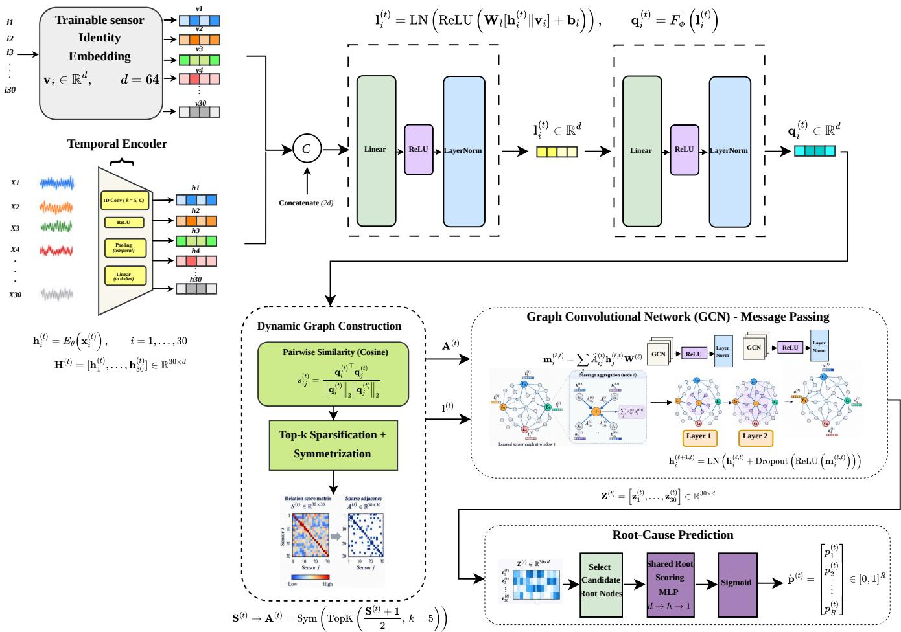
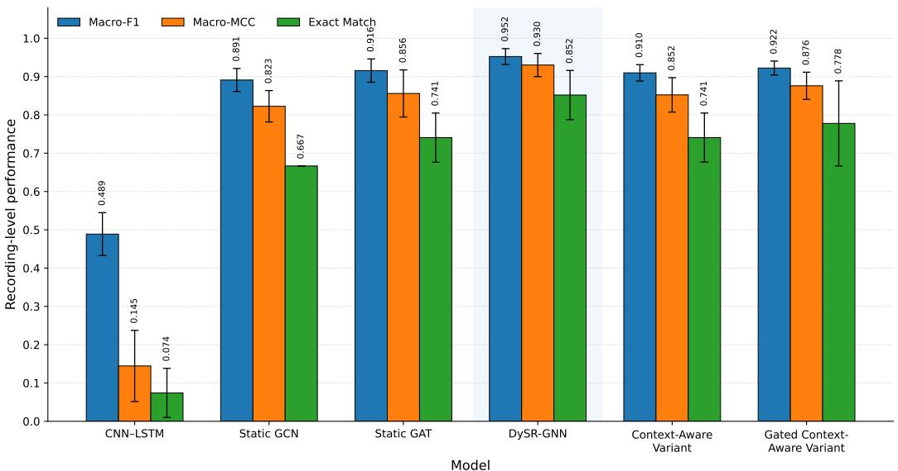
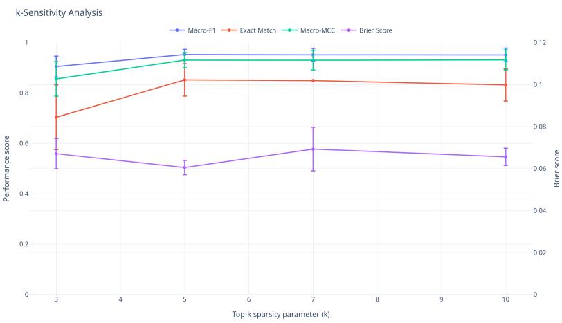
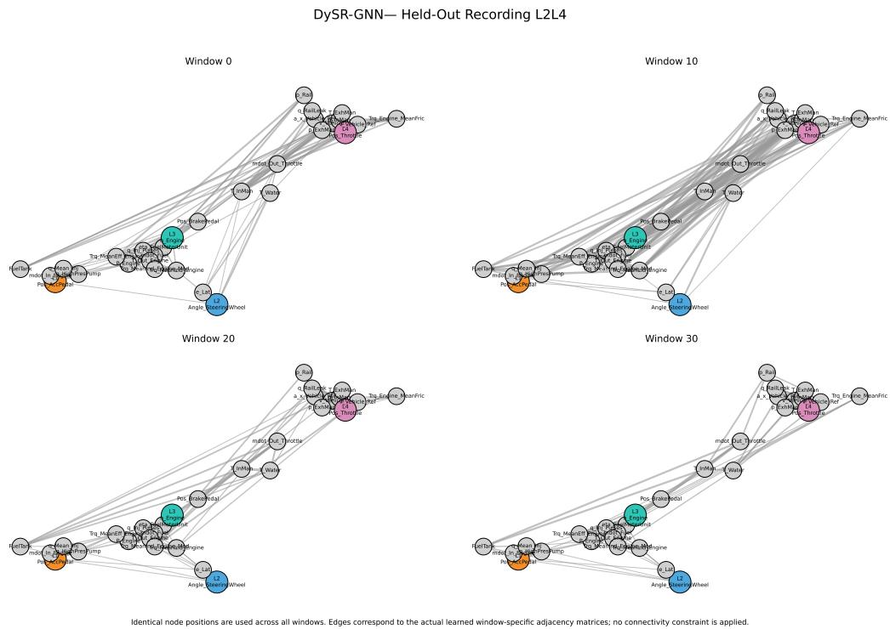
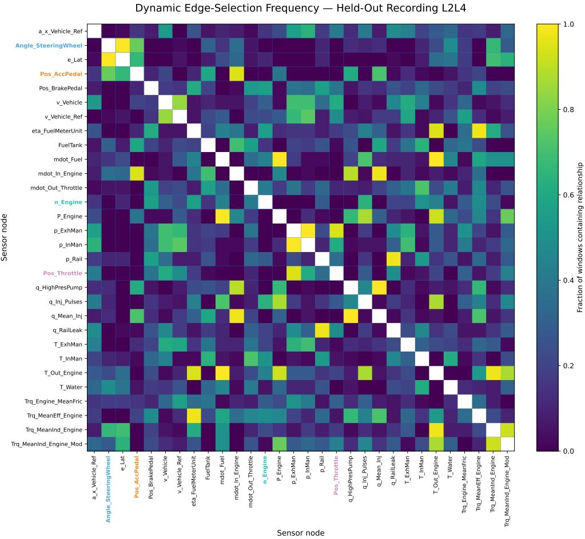
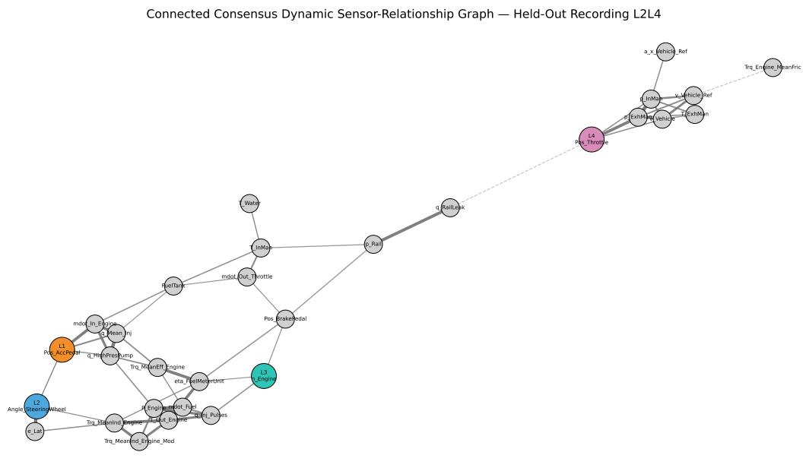
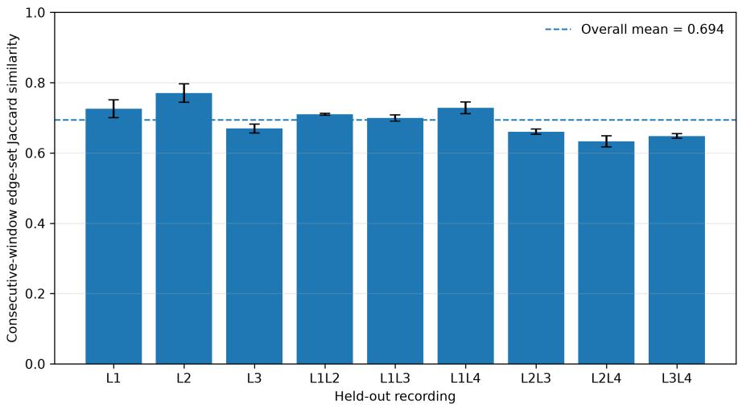

Article

# DySR-GNN: Dynamic Sensor-Relationship Graph Neural Network for Root Cause Analysis in Automotive HiL Multivariate Time Series

Hamza Ouarrad 1,\* , Mohammad Abboush 1 and Andreas Rausch 1

1 Institute for Software and Systems Engineering, Technische Universität Clausthal, 38678 Clausthal-Zellerfeld, Germany; hamza.ouarrad@tu-clausthal.de (H.O.); mohammad.abboush@tu-clausthal.de (M.A.); andreas,rausch@tu-clausthal.de (A.R.)

mohammad.abboush@tu-clausthal.de (M.A.); andreas.rausch@tu-clausthal.de (A.R.)

米 Correspondence: hamza.ouarrad@tu-clausthal.de

## Abstract

Root-cause analysis in automotive Hardware-in-the-Loop (HiL) systems is challenging because faults can propagate across multiple interacting signals, making the most abnormal sensor different from the actual fault origin. This work proposes DySR-GNN, a Dynamic Sensor-Relationship Graph Neural Network for supervised multi-label root-cause identification in multivariate HiL time series. The approach jointly extracts temporal patterns within individual sensor signals and structural relationships across sensors. Each sensor is processed by a shared temporal encoder and combined with a trainable sensor-identity representation, from which a sparse relationship graph is reconstructed independently for every input window. This window-specific structure provides an explicit representation of the sensor relationships used for graph message passing and direct root-location prediction. Under a recording-disjoint evaluation protocol, the proposed model outperforms CNN–LSTM, Static GCN, Static GAT, and context-based variants, achieving a recordinglevel Macro-F1 of 0.9524, MCC of 0.9302, and strict exact-match accuracy of 0.8519. Analysis of the learned graphs reveals both persistent and state-dependent relationships among sensor variables. The results demonstrate that extracting adaptive relational structure alongside temporal representations can improve multi-label root-cause identification in complex automotive cyber–physical systems.

Keywords: root cause analysis; graph neural networks; dynamic graph learning; multivariate time series; Hardware-in-the-Loop; automotive fault diagnosis; multi-label classification; sensor relationship modeling

Received: Revised: Accepted: Published:

## 1. Introduction

Copyright: © 2026 by the authors. Submitted to Mach. Learn. Knowl. Extr. for possible open access publication under the terms and conditions of the Creative Commons Attribution (CC BY) license.

Modern vehicles are software-intensive cyber–physical systems in which electronic control units, sensors, actuators, communication interfaces, and software functions interact to realize increasingly complex and safety-critical functionality. Their development therefore requires rigorous verification and validation activities, particularly for safetyrelated electrical and electronic systems governed by the ISO 26262 functional-safety standard [1]. Within this development process, Hardware-in-the-Loop (HiL) [2] testing provides a controlled and repeatable environment in which implemented control software and hardware can be exercised under realistic operating conditions, including abnormal situations that would be difficult, costly, or unsafe to reproduce directly in a physical vehicle.

A direct consequence of large-scale HiL validation is the generation of high-dimensional multivariate time-series recordings. Measurements from driver inputs, vehicle dynamics, powertrain components, control variables, pressures, temperatures, and actuator states evolve simultaneously and interact through the physical and software-controlled system. As system complexity increases, manual inspection of these recordings becomes increasingly difficult. More importantly, a disturbance originating at one location can propagate through several dependent variables before becoming visible at the system level. Consequently, the signal exhibiting the strongest deviation is not necessarily the signal at which the fault originated. This distinction is central to root cause analysis (RCA), whose objective is not only to detect an abnormal state, but to identify the underlying source responsible for the observed system behaviour [3,4].

Classical fault detection and diagnosis (FDD) approaches include signal-based monitoring, predefined thresholds, expert rules, and model-based residual analysis [5]. Although these approaches remain valuable in industrial validation, their performance can depend strongly on manually engineered knowledge or sufficiently accurate reference models. Data-driven methods provide an alternative by learning diagnostic representations directly from historical measurements. Machine learning (ML) and deep learning (DL) have therefore become increasingly important for time-series analysis and fault diagnosis, with recurrent and convolutional architectures providing powerful mechanisms for learning temporal dependencies [6,7].

This temporal modeling capability has also dominated much of the existing datadriven automotive FDD literature. Automotive HiL studies have employed CNN–LSTM architectures for fault detection and classification [8] and GRU-based representation learning for unknown single and concurrent faults [9]. Such architectures are well suited to extracting patterns along the temporal dimension and have demonstrated that diagnostically relevant information can be learned directly from sequential vehicle measurements. However, conventional sequence models primarily represent the sensor channels within a Euclidean feature space and do not explicitly expose the relationships through which information is shared among interacting variables. Consequently, although dependencies between sensors may be captured implicitly within the learned representations, the model does not provide an explicit relational structure describing which sensors are connected or most relevant to one another for a given observation. In this sense, these approaches primarily model how sensor signals evolve over time, while the complementary question of how the sensors relate to one another remains only implicitly represented.

This distinction is particularly relevant in multivariate automotive systems. For example, a perturbation of an accelerator-pedal signal may subsequently influence throttle position, engine speed, torque, vehicle speed, manifold pressure, and other quantities. Diagnostically relevant information is therefore contained not only in the temporal evolution of each signal but also in the structure of the dependencies between signals. From a knowledge-extraction perspective, this problem can be interpreted as the joint discovery of hidden temporal and structural patterns in high-dimensional observations [10]. Recent research on graph neural networks for time-series analysis similarly emphasizes the importance of modeling both inter-temporal and inter-variable relationships [11].

Graphs provide a natural mathematical representation of the latter. Graph Neural Networks (GNNs) extend neural representation learning to graph-structured data [12], while Graph Convolutional Networks (GCNs) enable node representations to be updated through neighborhood-based information aggregation [13]. When applied to multivariate sensor data, each signal can be represented as a graph node and the connections between nodes can encode relationships through which information is exchanged. This provides an explicit relational inductive bias that conventional sequence models do not naturally expose. A major challenge, however, is that an appropriate sensor graph is rarely known a priori. Physical connectivity alone may not fully describe the relationships that are useful for a diagnostic task, and a single static graph may be insufficient when the system operates under changing conditions. Vehicle speed, driver commands, controller responses, engine state, and fault manifestations vary throughout a recording, potentially changing which inter-sensor relationships are most informative. A growing body of GNN-based time-series research therefore considers learned and adaptive graph structures rather than assuming a fixed topology [11,14]. GDN, for example, demonstrated that trainable sensor embeddings and learned sensor relationships can improve multivariate anomaly detection [15].

For RCA, the challenge is even more specific. A diagnostic model must distinguish the variable at which a fault was directly introduced from other variables that react to the resulting disturbance. Statistical association alone is not sufficient to establish such a causal interpretation. Causal graphical modeling explicitly distinguishes association from cause–effect structure and requires assumptions stronger than those required for predictive dependency learning [16]. In particular, probabilistic dependence between two variables does not by itself determine the direction or existence of a causal relation. Accordingly, the graph learned in this work is not interpreted as a causal graph. Instead, it represents task-relevant statistical sensor relationships that are optimized for the supervised identification of known fault-injection locations.

The resulting research problem therefore contains two complementary dimensions. First, the model must capture the temporal dynamics within each sensor signal. Second, it must capture the relational structure between sensors and allow that structure to adapt to the current observation. This motivates an architecture in which temporal representation learning and graph structure learning are treated as distinct but jointly optimized components.

To address this problem, this paper proposes DySR-GNN, a Dynamic Sensor-Relationship Graph Neural Network for supervised multi-label RCA of automotive HiL time series. Each sensor window is first processed by a shared one-dimensional convolutional temporal encoder to extract a compact representation of its local dynamics. The temporal representation is then combined with a trainable sensor-identity embedding, allowing the model to distinguish window-specific signal behaviour from persistent sensor identity. The resulting node features are transformed into graph-state representations from which pairwise sensor similarities are estimated. Top-k sparsification and symmetrization yield a sparse adjacency matrix reconstructed independently for each input window.

The learned graph subsequently defines the neighborhood over which a two-layer GCN performs message passing. Thus, the temporal encoder models how individual sensor signals evolve, whereas dynamic graph construction determines which sensor representations should interact for the current window. Finally, the learned representations of the predefined candidate root nodes are evaluated by a shared scoring mechanism that produces independent root probabilities. The multi-label formulation allows the same architecture to represent both individual and concurrent fault locations.

The central hypothesis investigated in this work is that jointly modeling temporal sensor behaviour and adaptive inter-sensor structure improves root-source identification compared with architectures that use temporal information alone or a fixed sensor graph. The contribution is therefore not a new graph convolution operator and does not constitute causal discovery. Instead, it lies in dynamically reconstructing a task-relevant sensor-relationship graph from each multivariate observation and using that representation for direct supervised root-location identification.

The principal contributions of this work are summarized as follows:

We formulate automotive HiL root cause analysis as a supervised multi-label sensorlocation problem, supporting both individual and concurrent fault origins.

We propose a dual temporal–relational representation in which a shared temporal encoder captures within-sensor dynamics, while graph structure learning explicitly captures inter-sensor relationships.

We introduce a window-specific dynamic sensor-relationship graph constructed from temporal sensor representations and trainable sensor-identity embeddings, allowing the relational structure to adapt to the current multivariate observation.

We combine the learned topology with GCN-based message passing and shared root scoring, maintaining a clear separation between sensor-relationship learning and root-location prediction.

We evaluate the proposed architecture using a recording-disjoint experimental protocol and compare it with temporal and graph-based baselines, including CNN– LSTM, Static GCN, and Static GAT models, while additionally assessing robustness across multiple random seeds.

We analyze the knowledge encoded by the learned graph through window-specific topology and edge-persistence analysis and report computational complexity and inference latency to assess the practical cost of dynamic graph learning.

The remainder of this article is organized as follows. Section 2 reviews automotive HiL fault diagnosis, graph-based multivariate time-series learning, and graph-based RCA. Section 3 presents the proposed methodology and its mathematical formulation. The automotive HiL case study, data preparation, and experimental protocol are subsequently described in Section 4. The experimental results and learned graph behavior are then analyzed and discussed in Section 5. Finally, the conclusions, limitations, and directions for future research are presented.

## 2. Related Work

The proposed approach lies at the intersection of three research areas: data-driven fault diagnosis for automotive Hardware-in-the-Loop (HiL) validation, graph-based learning for multivariate sensor time series, and graph-based root cause analysis (RCA). This section reviews the most relevant developments in these areas and clarifies the distinction between existing fault-diagnosis and anomaly-detection approaches and the sensor-level RCA formulation considered in this work.

## 2.1. Data-Driven Fault Diagnosis in Automotive HiL Validation

Hardware-in-the-Loop simulation provides a controlled environment in which faults can be injected during automotive software validation without exposing a physical vehicle or test driver to hazardous conditions [17].At the same time, modern automotive validation generates large volumes of multivariate sensor data, motivating increasingly datadriven approaches to anomaly and fault diagnosis [18]. Abboush et al. [8] investigated intelligent fault detection and classification for automotive software validation using realtime HiL fault injection. Their approach combined one-dimensional convolutional neural networks and Long Short-Term Memory networks to automatically extract temporal features from multivariate sensor recordings and classify injected faults. This work demonstrated that deep neural architectures can effectively automate the analysis of automotive HiL recordings and established an important basis for data-driven diagnosis in this application domain. Subsequent work addressed the more difficult case in which fault classes are not necessarily known during model development. Abboush et al. [9] combined a GRU-based denoising autoencoder with clustering to detect and group unknown single and concurrent faults during automotive system-integration testing. The study demonstrated the feasibility of identifying simultaneous fault manifestations from multivariate HiL recordings under noisy conditions without requiring fully supervised fault labels.

More recently, explainable hybrid deep-learning architectures have been investigated for fault detection, identification, and localization in automotive software-system validation [19]. Such approaches improve the ability to associate complex multivariate observations with faulty components and provide additional information about the signals contributing to a diagnostic decision.

Although these studies demonstrate the effectiveness of deep learning for automotive HiL analysis, the sensor channels are primarily treated as components of a Euclidean multivariate input. Inter-sensor relationships are therefore represented implicitly by the neural network rather than explicitly through a learned graph structure. This distinction is important for RCA, where abnormalities can propagate from an injected root signal to multiple downstream variables. In such situations, identifying abnormal signals alone does not necessarily identify the original fault location.

## 2.2. Graph Learning for Multivariate Sensor Time Series

Graph neural networks provide an alternative representation in which individual sensor channels are modeled as nodes and their dependencies as graph edges. This formulation is particularly attractive for multivariate time series because message passing allows information from related signals to be explicitly aggregated while preserving a sensor-level representation. One influential approach is the Graph Deviation Network (GDN) proposed by Deng and Hooi [15]. GDN associates each sensor with a trainable embedding, learns relationships between sensors, and performs graph-attention-based forecasting. Deviations between observed and predicted behavior are subsequently used for anomaly detection and diagnostic interpretation. In contrast to conventional sequence models, GDN explicitly exposes learned inter-sensor relationships, while Kovalenko et al. [20] further investigated trainable adjacency structures for fault diagnosis when sensor dependencies are not known a priori.

Zhao et al. [21] proposed MTAD-GAT, which employs graph-attention mechanisms to model dependencies in both the temporal and feature dimensions of multivariate time series. Forecasting and reconstruction objectives are jointly optimized in a self-supervised setting, enabling anomaly detection while capturing dependencies among variables. Han and Woo [22] subsequently introduced a sparse latent graph representation for multivariate anomaly detection, combining representation learning, graph structure learning, and forecasting to exploit cross-variable dependencies.

These studies motivated further research into graph structures that adapt to the observed data instead of remaining fixed. MSDG [23], for example, employs dynamic graph learning to capture changing correlations in industrial multivariate time series. Such methods recognize that the interaction structure among sensor signals may vary with system state and that a single global adjacency matrix can therefore be restrictive. Dynamic graph learning has also been increasingly adopted for explicit fault-diagnosis tasks. Wang et al. [24] proposed an attention-aware temporal–spatial GNN for multi-sensor fault diagnosis, using graph learning to fuse structural and temporal information. Duan et al. [25] introduced DyGAT-FTNet, where time–frequency representations are used to dynamically construct multi-sensor graphs that are subsequently processed by a dynamic graph attention network. Other work has explored causal intervention in learned sensor graphs to reduce spurious dependencies in industrial fault diagnosis [26]. More recently, Gu et al. [27] proposed a Dynamic Multi-Scale Graph Neural Network for hydraulic-system health monitoring, in which the sensor topology is inferred adaptively rather than specified a priori.

Graph-based diagnosis is also receiving attention in the target journal of the present study. Li et al. [28] proposed adaptive multi-view hypergraph learning for cross-condition bearing fault diagnosis. Their framework dynamically constructs high-order relationships across multiple signal representations and demonstrates the increasing role of adaptive relational modeling in intelligent fault diagnosis.

Collectively, these works establish that graph learning can provide substantial advantages over models that process sensor channels independently or through fixed Euclidean structures. However, the majority of existing methods formulate the downstream task as anomaly detection or fault-state classification. Consequently, the learned graph is generally optimized to distinguish normal from abnormal behavior or to identify a fault category, rather than to directly identify the sensor location at which a fault originated.

## 2.3. Graph-Based Root Cause Analysis

Root cause analysis differs from conventional fault classification in that the objective is not only to recognize that a system is operating abnormally, but to identify the source that produced the observed downstream effects. Graph representations are particularly attractive for this purpose because they can encode dependencies and propagation paths among system variables or components.

Graph-based RCA has been investigated across several interconnected systems. Dong et al. [29] used hierarchical causal graphs to identify fault origins and propagation paths in complex industrial processes, while graph structure learning has also been combined with GNNs for RCA in communication networks. In [30], hidden dependencies among multivariate network KPIs are inferred using graph structure learning and subsequently used by a GNN to identify root-cause and affected nodes. This demonstrates that learned relational structure can be directly exploited for root-source identification rather than solely for anomaly detection.

More recently, ST-GraphRCA [31] employed dynamically weighted propagation graphs for RCA in distributed IoT systems, while Chen et al. [32] introduced a causalconstraint graph attention framework for anomaly interpretation and root-cause diagnosis in intelligent vehicles. Both approaches illustrate the value of relational structure for root-source localization, but their graph semantics differ from those considered here. The former models service-level propagation, while the latter incorporates causal constraints; the present study instead learns window-specific task-relevant statistical relationships directly from automotive HiL time series.

The distinction between graph-based anomaly explanation and direct RCA is also important. Methods such as GDN can rank variables associated with an anomalous event, but such a ranking is derived from forecasting deviations after an anomaly has been detected. In automotive HiL validation, multiple downstream signals may react strongly to a fault injected elsewhere in the system. A large deviation therefore does not necessarily imply that the corresponding sensor is the originating fault location.

## 2.4. Positioning of the Present Work

The reviewed literature reveals three complementary developments. First, deeplearning methods have demonstrated that automotive HiL recordings can support accurate data-driven fault detection, classification, clustering, and localization. Second, graphbased time-series methods have shown that explicitly modeling inter-sensor dependencies can improve anomaly detection and fault diagnosis. Third, recent RCA methods demonstrate that graph structure can support root-source localization in complex interconnected systems.

The present work connects these directions through a supervised sensor-level RCA formulation for automotive HiL time series. Each sensor window is first encoded using a shared temporal encoder and combined with a trainable sensor-identity embedding. Unlike approaches that rely on a single fixed sensor topology, a sparse relationship graph is reconstructed independently for each input window from the current sensor representations. Standard GCN message passing is then performed over this window-specific topology, while a shared root scorer produces independent probabilities for the predefined candidate fault locations.

Accordingly, the methodological contribution is not a new graph convolution operator, nor is the learned graph interpreted as a causal graph. Rather, the contribution lies in using a dynamically learned, window-specific sensor relationship structure as an intermediate representation for direct multi-label root cause identification. This formulation differs from forecasting- and reconstruction-based graph anomaly detectors, from graphbased fault-state classifiers, and from topology-driven RCA methods. It is designed specifically to distinguish directly injected root signals from correlated downstream responses in multivariate automotive HiL recordings.

## 3. Methodology

This section presents the problem formulation, data preparation, and the proposed DySR-GNN. As shown in Figure 1, the model combines sensor-wise temporal encoding with trainable sensor identities, constructs a sparse window-specific graph, and performs graph message passing for multi-label root-cause prediction.

  
Figure 1. Architecture of the proposed DySR-GNN for multi-label root-cause analysis of automotive HiL multivariate time series.

## 3.1. Problem Formulation

The RCA task is formulated as supervised multi-label prediction over a set of candidate root locations. Let a multivariate sensor window be represented as

$$
\mathbf { \boldsymbol { x } } ^ { ( t ) } = \left[ \mathbf { \boldsymbol { x } } _ { 1 } ^ { ( t ) } , \ldots , \mathbf { \boldsymbol { x } } _ { N } ^ { ( t ) } \right] \in \mathbb { R } ^ { N \times T } ,\tag{1}
$$

where N denotes the number of monitored signals, T the number of temporal samples within a window, and t the window index.

Rather than treating the N signals only as a collection of feature channels, they are represented as nodes of a graph. Following the standard graph formulation $G = \left( V , E \right)$ where vertices denote objects and edges encode relations between them [16], the sensor graph for window t is written as

$$
\mathcal { G } ^ { ( t ) } = \Big ( \nu , \mathcal { E } ^ { ( t ) } \Big ) ,\tag{2}
$$

with

$$
\mathcal { V } = \{ v _ { 1 } , \ldots , v _ { N } \} .\tag{3}
$$

Each node $v _ { i }$ corresponds to one monitored signal $\mathbf { x } _ { i } ^ { ( t ) } .$ , while $\mathcal { E } ^ { ( t ) }$ represents the relationships used to exchange information between sensor nodes. The node set remains fixed, whereas the edge structure is allowed to vary with the observed window. The pro-

posed architecture therefore seeks to learn both a temporal representation of each signal and a window-dependent relational representation of the multivariate system.

Given R candidate root locations, the RCA target is defined as

$$
\mathbf { y } ^ { ( t ) } = \left[ y _ { 1 } ^ { ( t ) } , \ldots , y _ { R } ^ { ( t ) } \right] \in \{ 0 , 1 \} ^ { R } ,\tag{4}
$$

where $y _ { r } ^ { ( t ) } = 1$ indicates that root location r is active. Multiple entries may be active simultaneously, allowing individual and concurrent root causes to be represented within the same formulation.

The learning objective is to estimate

$$
f _ { \Theta } : \mathbb { R } ^ { N \times T }  [ 0 , 1 ] ^ { R } ,\tag{5}
$$

or, equivalently, for each candidate root,

$$
\hat { p } _ { r } ^ { ( t ) } = P _ { \Theta } \Big ( Y _ { r } = 1 \mid \mathbf { X } ^ { ( t ) } \Big ) , \qquad r = 1 , \ldots , R .\tag{6}
$$

Unlike approaches that first detect anomalous sensor behavior and infer the root cause in a subsequent step, the proposed formulation learns these root-location probabilities directly from the multivariate sensor window. The problem consequently involves two complementary forms of information: the temporal behavior within individual signals and the relationships among signals. The following subsection describes how both are learned jointly by the proposed dynamic graph architecture.

## 3.2. Proposed DySR-GNN Architecture

The proposed architecture is designed around a simple premise: root-cause information is contained not only in how individual sensor signals evolve, but also in how their relationships change with the current system state. Accordingly, the model separates temporal representation learning from relationship learning. As illustrated in Figure 1, each sensor is first encoded independently, then embedded into a window-dependent graph on which message passing is performed.

## 3.2.1. Temporal and Sensor-Identity Representation

For sensor i in window t, the temporal signal $\pmb { x } _ { i } ^ { ( t ) } \in \mathbb { R } ^ { T }$ is processed by a shared one-dimensional convolutional encoder $E _ { \theta . }$

$$
\mathbf { h } _ { i } ^ { ( t ) } = E _ { \theta } \left( \mathbf { x } _ { i } ^ { ( t ) } \right) , \qquad \mathbf { h } _ { i } ^ { ( t ) } \in \mathbb { R } ^ { d } .\tag{7}
$$

The same encoder is applied to every sensor. It consists of two convolutional blocks: a 1→32 convolution with kernel size $^ { 7 , }$ followed by batch normalization, ReLU activation, and max pooling; and a 32 → 64 convolution with kernel size 5, again followed by batch normalization and ReLU. Adaptive average pooling removes the remaining temporal dimension, and a linear projection maps the representation to d = 64 dimensions.

Weight sharing is deliberate. The network learns a common mechanism for extracting temporal patterns rather than maintaining a separate encoder for every sensor. Yet temporal behavior alone does not identify which physical signal produced a representation. Each sensor therefore receives a trainable identity embedding

$$
\mathbf { v } _ { i } \in \mathbb { R } ^ { d } .\tag{8}
$$

The temporal and identity representations play different roles: $\mathbf { h } _ { i } ^ { ( t ) }$ describes what the sensor is doing in the current window, whereas $\mathbf { v } _ { i }$ encodes which sensor it is. Their concatenation is projected into a local node representation,

$$
\mathbf { l } _ { i } ^ { ( t ) } = \mathrm { L N } \Big ( \mathrm { R e L U } \Big ( \mathbf { W } _ { l } \Big [ \mathbf { h } _ { i } ^ { ( t ) } \lVert \mathbf { v } _ { i } \Big ] + \mathbf { b } _ { l } \Big ) \Big ) ,\tag{9}
$$

where ∥ denotes concatenation and $\operatorname { L N } ( \cdot )$ denotes layer normalization.

A second transformation maps the local representation into a graph-state embedding,

$$
\mathbf { q } _ { i } ^ { ( t ) } = F _ { \phi } \left( \mathbf { 1 } _ { i } ^ { ( t ) } \right) = \mathrm { L N } \Big ( \mathrm { R e L U } \Big ( \mathbf { W } _ { q } \mathbf { 1 } _ { i } ^ { ( t ) } + \mathbf { b } _ { q } \Big ) \Big ) .\tag{10}
$$

This separation is important. The local state $\mathbf { l } _ { i } ^ { ( t ) }$ is retained as the node feature used later for message passing, whereas $\mathbf { q } _ { i } ^ { ( t ) }$ is used specifically to determine the graph structure.

## 3.2.2. Dynamic Sensor-Relationship Graph Construction

The graph is reconstructed independently for every input window. Rather than assuming a predefined physical topology, pairwise relationships are derived from the current graph-state embeddings. For sensors i and $j ,$ cosine similarity is computed as

$$
s _ { i j } ^ { ( t ) } = \frac { \left( \mathbf { q } _ { i } ^ { ( t ) } \right) ^ { \top } \mathbf { q } _ { j } ^ { ( t ) } } { \left\| \mathbf { q } _ { i } ^ { ( t ) } \right\| _ { 2 } \left\| \mathbf { q } _ { j } ^ { ( t ) } \right\| _ { 2 } + \epsilon } .\tag{11}
$$

The similarities are mapped from $[ - 1 , 1 ]$ to non-negative edge weights,

$$
w _ { i j } ^ { ( t ) } = \frac { s _ { i j } ^ { ( t ) } + 1 } { 2 } .\tag{12}
$$

A dense similarity matrix would allow every sensor to exchange information with every other sensor. Instead, each node retains only its k strongest neighbors, with $k =$ 5. The sparse directed graph is then symmetrized using the maximum weight in either direction,

$$
A _ { i j } ^ { ( t ) } = \operatorname* { m a x } \biggl ( \widetilde { A } _ { i j } ^ { ( t ) } , \widetilde { A } _ { j i } ^ { ( t ) } \biggl ) .\tag{13}
$$

In compact form,

$$
\mathbf { A } ^ { ( t ) } = \mathrm { S y m } \left[ \mathrm { T o p K } \left( \frac { \mathbf { S } ^ { ( t ) } + 1 } { 2 } , k = 5 \right) \right] .\tag{14}
$$

Because the graph-state embeddings depend on the current temporal window, the resulting topology is generally time-varying,

$$
\mathbf { A } ^ { ( t ) } \neq \mathbf { A } ^ { ( t + 1 ) } .\tag{15}
$$

Thus, the graph does not prescribe a permanent neighborhood for a sensor. Some relationships may persist, while others are replaced as the multivariate state changes. The learned adjacency represents task-relevant statistical relationships and is not interpreted as a causal graph.

## 3.2.3. Graph Message Passing and Root Prediction

Before message passing, self-loops are added and the adjacency matrix is symmetrically normalized following the standard GCN formulation [13],

$$
\widehat { \mathbf { A } } ^ { ( t ) } = \left( \mathbf { D } ^ { ( t ) } \right) ^ { - \frac { 1 } { 2 } } \left( \mathbf { A } ^ { ( t ) } + \mathbf { I } \right) \left( \mathbf { D } ^ { ( t ) } \right) ^ { - \frac { 1 } { 2 } } .\tag{16}
$$

The initial node-feature matrix contains the local sensor representations,

$$
\mathbf { H } ^ { ( 0 , t ) } = \left[ \mathbf { l } _ { 1 } ^ { ( t ) } , \dots , \mathbf { l } _ { N } ^ { ( t ) } \right] ^ { \top } .\tag{17}
$$

Two graph-convolutional layers are then applied. At layer $\ell ,$

$$
\mathbf { M } ^ { ( \ell , t ) } = \widehat { \mathbf { A } } ^ { ( t ) } \mathbf { H } ^ { ( \ell , t ) } \mathbf { W } ^ { ( \ell ) } + \mathbf { b } ^ { ( \ell ) } ,\tag{18}
$$

followed by residual propagation,

$$
\mathbf { H } ^ { ( \ell + 1 , t ) } = \mathrm { L N } \Big [ \mathbf { H } ^ { ( \ell , t ) } + \mathrm { D r o p o u t } \Big ( \mathrm { R e L U } \Big ( \mathbf { M } ^ { ( \ell , t ) } \Big ) \Big ) \Big ] .\tag{19}
$$

The residual path preserves sensor-local information while the graph branch incorporates information from neighboring nodes. After two layers, the model obtains

$$
\mathbf { Z } ^ { ( t ) } = \mathbf { H } ^ { ( 2 , t ) } \in \mathbb { R } ^ { N \times d } .\tag{20}
$$

Root prediction is performed directly from the final representations of the predefined candidate root nodes. For root $r ,$ the corresponding node embedding $\mathbf { z } _ { r } ^ { ( t ) }$ is passed through the same shared scoring network,

$$
s _ { r } ^ { ( t ) } = \mathbf { w } _ { 2 } ^ { \top } \mathrm { D r o p o u t } \Big [ \mathrm { R e L U } \Big ( \mathbf { W } _ { 1 } \mathbf { z } _ { r } ^ { ( t ) } + \mathbf { b } _ { 1 } \Big ) \Big ] + b _ { 2 } ,\tag{21}
$$

and converted into a root probability by

$$
p _ { r } ^ { ( t ) } = \sigma \Big ( s _ { r } ^ { ( t ) } \Big ) .\tag{22}
$$

Applying the scorer independently to all R candidate root nodes yields

$$
{ \widehat { \mathbf { p } } } ^ { ( t ) } = \left[ p _ { 1 } ^ { ( t ) } , \ldots , p _ { R } ^ { ( t ) } \right] .\tag{23}
$$

Independent sigmoid outputs are used instead of a Softmax layer because the root locations are not mutually exclusive. The architecture can therefore assign high probability to several roots within the same window, which is required for concurrent-fault RCA.

## 3.3. Training Objective

Because the candidate root locations are not mutually exclusive, the network is trained as a multi-label classifier using independent sigmoid outputs. Each root therefore contributes a separate binary prediction, while several roots may be active within the same sample.

The model is optimized using a weighted binary cross-entropy objective,

$$
\mathcal { L } = - \frac { 1 } { B R } \sum _ { b = 1 } ^ { B } \sum _ { r = 1 } ^ { R } [ \omega _ { r } y _ { b r } \log ( p _ { b r } ) + ( 1 - y _ { b r } ) \log ( 1 - p _ { b r } ) ] ,\tag{24}
$$

where B denotes the mini-batch size, R the number of candidate root locations, $y _ { b r } \in \{ 0 , 1 \}$ the ground-truth label, and $p _ { b r }$ the corresponding predicted root probability. The weight ωr compensates for differences in the occurrence frequency of individual root locations and is computed from the training partition only as

$$
\omega _ { r } = \frac { N _ { r } ^ { - } } { \operatorname* { m a x } ( N _ { r } ^ { + } , 1 ) } ,\tag{25}
$$

with $N _ { r } ^ { + }$ and $N _ { r } ^ { - }$ denoting the number of positive and negative training samples for root $r ,$ respectively.

This formulation penalizes each candidate root independently and thus preserves the multi-label nature of the RCA task. Model selection is based on the validation loss, with the checkpoint achieving the lowest validation loss retained for evaluation. The same optimization protocol is applied to the proposed model and all reference and ablation models to maintain a consistent comparison.

The principal training settings used throughout the experiments are summarized in Table 1.

Table 1. Training and implementation settings used in the experiments.
<table><tr><td>Setting</td><td>Value</td></tr><tr><td>Optimizer</td><td>AdamW</td></tr><tr><td>Initial learning rate</td><td> $1 \times 1 0 ^ { - 3 }$ </td></tr><tr><td>Weight decay</td><td>1 × 10−4</td></tr><tr><td>Batch size</td><td>32</td></tr><tr><td>Maximum epochs</td><td>150</td></tr><tr><td>Early-stopping patience Learning-rate scheduler</td><td>20 epochs</td></tr><tr><td>Scheduler reduction factor</td><td>ReduceLROnPlateau 0.5</td></tr><tr><td>Scheduler patience</td><td></td></tr><tr><td></td><td>5 epochs</td></tr><tr><td>Gradient clipping</td><td>Maximum norm 5.0</td></tr><tr><td>Embedding dimension d</td><td>64</td></tr><tr><td>GCN hidden dimension</td><td>64</td></tr><tr><td>Root-scoring hidden dimension</td><td>32</td></tr><tr><td>Dropout probability</td><td>0.30</td></tr><tr><td>Dynamic graph neighborhood k</td><td>5</td></tr><tr><td>Decision threshold τ</td><td>0.50</td></tr><tr><td>Random seeds</td><td>42, 123, 2026</td></tr></table>

## 4. Case Study and Experimental Setup

## 4.1. HiL Platform, Fault Injection, and Dataset

The experimental study is based on an automotive Hardware-in-the-Loop (HiL) environment in which the behavior of the vehicle and its subsystems is executed in real time while the control system interacts with the simulated plant in closed loop. HiL testing provides a repeatable laboratory setting in which operating conditions can be reproduced and abnormal system behavior can be investigated without requiring physical road tests. The experimental platform employs the dSPACE SCALEXIO real-time simulation system, which is designed for HiL testing of automotive electronic control systems [33].

Faulty operating conditions were generated using the real-time fault-injection concept developed by Abboush et al. [17]. The framework integrates fault injection with the HiL execution environment, allowing selected system variables to be manipulated during runtime without restructuring the underlying vehicle model. This makes it possible to observe how a locally injected disturbance is reflected across multiple interacting signals under controlled and repeatable conditions. Such a setting is particularly relevant for rootcause analysis: the injected location is known, whereas its effects may propagate through several measured variables.

Four candidate root locations are considered in the present study, covering driverinput, vehicle-control, and powertrain-related signals. They are denoted by L1–L4:

• L1: accelerator-pedal position (Pos\_AccPedal);

• L2: steering-wheel angle (Angle\_SteeringWheel);

• L3: engine speed (n\_Engine);

• L4: throttle position (Pos\_Throttle).

The dataset is a multivariate time series data that contains one healthy reference recording and nine faulty recordings. Each recording spans approximately 0–100 s and contains about 96,000 observations, corresponding to an effective acquisition rate close to 1 kHz. For the faulty recordings, the fault injection is active between 25 and 65 s, while the intervals before and after the injection represent non-faulted system operation within the same experiment.

Importantly, the faulty cases are not restricted to isolated roots. Several recordings contain two simultaneously active root locations, providing the multi-label conditions required to evaluate RCA under concurrent faults. The available scenarios are summarized in Table 2.

Table 2. HiL recordings and corresponding active root locations.
<table><tr><td>Recording</td><td>Active root location(s)</td></tr><tr><td>H</td><td>Healthy reference</td></tr><tr><td>L1</td><td>L1</td></tr><tr><td>L2</td><td>L2</td></tr><tr><td>L3</td><td>L3</td></tr><tr><td>L1L2</td><td>L1, L2</td></tr><tr><td>L1L3</td><td>L1, L3</td></tr><tr><td>L1L4</td><td>L1, L4</td></tr><tr><td>L2L3</td><td>L2, L3</td></tr><tr><td>L2L4</td><td>L2, L4</td></tr><tr><td>L3L4</td><td>L3, L4</td></tr></table>

The supervised RCA experiments are based on the nine faulty recordings, for which the injected root locations provide the ground-truth multi-label targets. The healthy recording is retained as a reference for the underlying system behavior. The raw HiL recordings contain a considerably larger set of measured and commanded signals; their selection and transformation into fixed-length model inputs are described in the following subsection.

## 4.2. Signal Selection, Data Preprocessing, and Window Generation

The raw HiL recordings contain approximately 60 measured and commanded signals. Not all of them provide useful information for relational modeling. Globally constant channels and strongly redundant variables were therefore removed, yielding a common set of N = 30 signals. Each retained signal corresponds to one graph node and is kept consistently across all recordings.

The original measurements were acquired at approximately 1 kHz. To reduce computational load while preserving the dynamics relevant to the considered fault scenarios, the signals were resampled to 100 Hz. Finite-impulse-response filtering was applied before decimation to suppress frequency components above the new Nyquist limit and avoid aliasing. Supervised samples were extracted only from the interval in which the fault injection was active, i.e., from 25 to 65 s. Rather than using isolated time points, the multivariate recordings were segmented using overlapping sliding windows of 2 s with a stride of 1 s. At the resulting sampling rate, each window contains

$$
T = 2 { \mathrm { s } } \times 1 0 0 { \mathrm { H z } } = 2 0 0\tag{26}
$$

samples per sensor. Only windows fully contained within the fault-active interval were retained. This produces 39 windows for each faulty recording and, across the nine faulty recordings, a total of 351 multivariate samples,

$$
\mathbf { X } ^ { \left( t \right) } \in \mathbb { R } ^ { 3 0 \times 2 0 0 } .\tag{27}
$$

The overlap between consecutive windows preserves temporal continuity while exposing the model to different local realizations of the same fault episode. Importantly, these windows are not treated as independent experiments during data partitioning; all windows originating from one HiL recording remain assigned to the same training, validation, or test partition, as described in the following subsection.

Sensor-wise normalization is performed using statistics estimated from the training recordings only. For sensor $i ,$

$$
\widetilde { x } _ { i } = \frac { x _ { i } - \mu _ { i } ^ { \mathrm { t r a i n } } } { \sigma _ { i } ^ { \mathrm { t r a i n } } + \epsilon } ,\tag{28}
$$

where $\mu _ { i } ^ { \mathrm { t r a i n } }$ and ${ \sigma } _ { i } ^ { \mathrm { t r a i n } }$ denote the corresponding training-set mean and standard deviation. The same parameters are subsequently applied to the validation and held-out test recordings, preventing information from these recordings from influencing the preprocessing stage.

## 4.3. Experimental Protocol, Reference Models, and Evaluation

The evaluation was designed at the recording level rather than at the window level. This distinction is essential because consecutive windows from the same HiL run overlap in time and share the same underlying fault episode. Randomly distributing such windows across training and test sets would therefore expose the model to closely related samples from the same experiment and could lead to overly optimistic estimates of generalization.

A fixed recording-disjoint protocol was consequently adopted. In each fold, seven faulty recordings are used for training, one complete recording for validation, and one complete recording for testing. All 39 windows generated from a given recording remain in the same partition. Across nine folds, every faulty recording serves exactly once as the held-out test case. The validation recording is changed accordingly, as summarized in Table 3.

Table 3. Recording-disjoint training, validation, and test protocol.
<table><tr><td>Fold</td><td>Validation recording</td><td>Test recording</td></tr><tr><td>1</td><td>L2</td><td>L1</td></tr><tr><td>2</td><td>L3</td><td>L2</td></tr><tr><td>3</td><td>L1</td><td>L3</td></tr><tr><td>4</td><td>L3L4</td><td>L1L2</td></tr><tr><td>5</td><td>L2L4</td><td>L1L3</td></tr><tr><td>6</td><td>L2L3</td><td>L1L4</td></tr><tr><td>7</td><td>L1L4</td><td>L2L3</td></tr><tr><td>8</td><td>L1L3</td><td>L2L4</td></tr><tr><td>9</td><td>L1L2</td><td>L3L4</td></tr></table>

The remaining seven recordings in each fold constitute the training partition. To account for stochastic variation during optimization, each fold is repeated with three random seeds: 42, 123, and 2026. Model selection relies exclusively on the corresponding validation recording.

DySR-GNN is compared against models chosen to separate the contributions of temporal modeling, graph-based reasoning, and adaptive topology. A CNN–LSTM serves as a non-graph temporal baseline.

The Static GCN follows the same general sensor representation pipeline as the proposed model, including the shared temporal encoder, trainable sensor-identity embeddings, local feature fusion, and shared root-scoring mechanism. Its sensor graph, however, is constructed only from the trainable identity embeddings. Pairwise cosine similarities are computed between sensor embeddings, followed by the same top-k sparsification with $k = 5$ and graph symmetrization used in the proposed model. The resulting sparse adjacency is shared by all input windows and therefore represents a fixed learned sensor topology. The Static GAT retains this same static sparse graph and sensor representation pipeline but replaces conventional graph convolution with graph-attention-based neighborhood aggregation [34]. It therefore evaluates whether a more expressive aggregation mechanism can account for the observed performance differences without adapting the topology itself. In contrast, the proposed model reconstructs the sensor graph from the current temporal and sensor-identity representations independently for every input window.

Two additional variants assess whether explicit global context provides further benefit. The first augments the dynamic architecture with a dedicated context representation; the second introduces a gated context fusion mechanism. These variants are evaluated under the same data partitions and optimization conditions as the main model. The resulting comparison therefore addresses three distinct questions: whether graph reasoning improves over purely temporal modeling, whether adapting the topology is beneficial relative to a static graph, and whether an additional explicit context pathway improves upon the dynamic graph representation alone.

Predictions are first produced at window level. For a held-out recording containing M windows, the root probabilities are subsequently aggregated by averaging,

$$
\bar { p } _ { r } = \frac { 1 } { M } \sum _ { t = 1 } ^ { M } p _ { r } ^ { ( t ) } ,\tag{29}
$$

where $p _ { r } ^ { ( t ) }$ denotes the predicted probability for candidate root r in window t. In the present setup, $M = 3 9$ . A root location is assigned to the recording when

$$
\bar { p } _ { r } \ge \tau , \qquad \tau = 0 . 5 .\tag{30}
$$

Performance is evaluated at both window and recording level. Macro-F1 and the Matthews correlation coefficient (MCC) quantify label-wise classification quality, while strict exact-match accuracy measures whether the complete multi-label root set is recovered correctly. Exact match is particularly demanding in concurrent-fault cases: a prediction is counted as correct only when every active and inactive root label is assigned correctly. The Brier score is additionally reported to quantify the squared error of the predicted root probabilities.

Because windows from the same HiL experiment are not statistically independent, inferential comparisons are performed at the recording level. Predictions are first averaged across the three seeds for each held-out recording. Pairwise differences between the proposed dynamic model and the static graph baselines are then evaluated using an exact paired sign-flip permutation test. In parallel, 95% confidence intervals for the mean paired differences are estimated by bootstrap resampling the independent test recordings.

The statistical analysis is intentionally based on the nine held-out recordings rather than the 351 overlapping windows. This yields a much more conservative assessment of model differences, although the small number of independent experiments necessarily limits statistical power. The statistical results are therefore interpreted together with the effect direction and descriptive performance rather than from p-values alone.

## 5. Results and Discussion

## 5.1. Overall Root Cause Identification Performance

Table 4 summarizes the performance of the investigated models at window and recording level. Since neighboring windows originate from the same HiL experiment and are strongly correlated, the recording-level results provide a more relevant measure of whether a model can correctly identify the root causes of an unseen diagnostic case.

Table 4. Performance comparison across three independent random seeds. Results are reported as mean ± standard deviation.
<table><tr><td>Model</td><td>Window Macro-F1</td><td>Window MCC</td><td>Recording Macro-F1</td><td>Recording MCC</td><td>Exact Match</td><td>Brier Score</td></tr><tr><td>CNN-LSTM</td><td>0.5116 ± 0.0189</td><td>0.1308 ± 0.0501</td><td>0.4888 ± 0.0561</td><td>0.1445 ± 0.0928</td><td>0.0741 ± 0.0642</td><td>0.2684 ± 0.0053</td></tr><tr><td>Static GCN</td><td>0.8776 ± 0.0372</td><td>0.7910 ± 0.0619</td><td>0.8911 ± 0.0300</td><td>0.8225 ± 0.0410</td><td>0.6667 ± 0.0000</td><td>0.0686 ± 0.0089</td></tr><tr><td>Static GAT</td><td>0.8830 ± 0.0131</td><td>0.7960 ± 0.0239</td><td>0.9157 ± 0.0304</td><td>0.8560 ± 0.0615</td><td>0.7407 ±</td><td>0.0706 ±</td></tr><tr><td>DySR-GNN</td><td>0.8940 ± 0.0057</td><td>0.8211 ± 0.0079</td><td>0.9524 ±</td><td>0.9302 ±</td><td>0.0642 0.8519 ±</td><td>0.0185 0.0605 ±</td></tr><tr><td>Context-aware variant</td><td>0.8764 ± 0.0209</td><td>0.7782 ±</td><td>0.0206 0.9098 ±</td><td>0.0302 0.8523 ±</td><td>0.0642 0.7407 ±</td><td>0.0034 0.0687 ±</td></tr><tr><td>Gated context-aware variant</td><td>0.8853 ± 0.0175</td><td>0.0396 0.8046 ± 0.0286</td><td>0.0214 0.9223 ± 0.0182</td><td>0.0449 0.8760 ± 0.0354</td><td>0.0642 0.7778 ± 0.1111</td><td>0.0160 0.0687 ± 0.0135</td></tr></table>

A clear separation is observed between the temporal-only baseline and the graphbased models. The CNN-LSTM reaches a recording-level Macro-F1 of $0 . 4 8 8 8 \pm 0 . 0 5 6 1$ whereas the Static GCN increases this value to $0 . 8 9 1 1 \pm 0 . 0 3 0 0 .$ . The corresponding MCC increases from 0.1445 to 0.8225. This large difference suggests that, for the present RCA task, learning temporal patterns alone is not sufficient. Fault effects are distributed across multiple interacting signals, and representing these signals as an explicitly connected system provides a considerably stronger diagnostic representation.

The improvement obtained by the Static GAT over the Static GCN is smaller but still consistent. Its recording-level Macro-F1 increases to 0.9157 ± 0.0304 and MCC to 0.8560 ± 0.0615. This indicates that the way information is aggregated from neighboring sensors also matters. Nevertheless, DySR-GNN achieves a further increase to $0 . 9 5 2 4 \pm 0 . 0 2 0 6$ Macro-F1 and 0.9302 ± 0.0302 MCC despite using a standard graph-convolutional operator. This pattern is important because it suggests that the gain cannot be attributed solely to a more expressive neighborhood aggregation mechanism; adapting the sensor topology itself appears to provide additional useful information for the RCA objective.

The same tendency becomes more pronounced under the strict exact-match criterion. Exact match requires the complete predicted root set to correspond to the ground truth and therefore penalizes both missing and spurious root locations. This is particularly relevant for the present multi-label setting, where concurrent faults must be identified jointly rather than independently. The CNN–LSTM correctly recovers the complete root set in only 7.4% of cases on average, compared with 66.7% for the Static GCN and 74.1% for the Static GAT. The proposed model increases this value to 85.2%. Thus, the advantage of the dynamic formulation is not limited to improving individual root-label scores; it is also reflected in a substantially higher rate of correctly recovering the complete fault configuration.

  
Figure 2. Recording-level root cause identification performance across three independent random seeds. Bars show the mean Macro-F1, MCC, and strict exact-match accuracy, while error bars indicate one standard deviation.

Figure 2 further shows that the performance ordering is consistent across the three principal recording-level metrics. In particular, DySR-GNN improves Macro-F1 by approximately 6.1 percentage points over the Static GCN and 3.7 percentage points over the Static GAT. For exact-match accuracy, the corresponding gains are approximately 18.5 and 11.1 percentage points, respectively. The larger differences observed for exact match indicate that dynamic relationship modeling is especially useful when the model must recover the complete combination of active root locations. The probability estimates follow the same general pattern. The proposed model obtains the lowest Brier score $( 0 . 0 6 0 5 \pm 0 . 0 0 3 4 )$ compared with $0 . 0 6 8 6 \pm 0 . 0 0 8 9$ for the Static GCN and $0 . 0 7 0 6 \pm 0 . 0 1 8 5$ for the Static GAT. Although these differences are comparatively small and should not by themselves be interpreted as evidence of superior calibration, they indicate that the higher classification performance is not accompanied by a degradation in probabilistic prediction quality.

Finally, the context-aware and gated variants do not improve upon the simpler dynamic formulation. This observation suggests that the benefit does not arise merely from increasing architectural complexity. Instead, the results point toward the window-specific sensor relationship structure as the principal modeling component associated with the observed performance gain. The contribution of this mechanism and the effect of the investigated architectural variants are examined in more detail in the following subsection.

## 5.2. Effect of Dynamic Sensor-Relationship Modeling

The comparison between the static and dynamic graph models provides a direct view of the contribution of adaptive sensor relationships. Both models use sensor-wise temporal representations and sensor identity information. The difference lies in the topology: the Static GCN applies one learned graph to all inputs, whereas the proposed model reconstructs $\mathbf { A } ^ { ( t ) }$ for every window. This change has a clear effect at the recording level. Macro-F1 increases from 0.8911 to 0.9524, while exact-match accuracy rises from 0.6667 to 0.8519. The proposed model also remains ahead of the Static GAT. Hence, a more expressive aggregation rule alone does not explain the observed gain. Allowing the neighborhood structure itself to change with the current temporal state appears to be the more important difference. Such behavior is plausible in HiL recordings. Relationships among driver commands, actuator responses, vehicle dynamics, and powertrain variables are not equally informative at every moment. A fixed graph must represent all operating states with the same set of neighbors. The dynamic model, in contrast, can retain recurring relationships while replacing others as the sensor state changes.

The ablation results reinforce this interpretation. The explicit context-aware variant achieved a recording-level Macro-F1 of 0.9098 ± 0.0214, and the gated variant reached $0 . 9 2 2 3 \pm 0 . 0 1 8 2 ,$ both below the proposed model $( 0 . 9 5 2 4 \pm 0 . 0 2 0 6 )$ . In the present setting, the temporal sensor representations already seem to carry much of the information needed to characterize the operating state. Likewise, the residual GCN provides a sufficient balance between local and relational information without an additional gating mechanism.

Overall, the strongest configuration is also the simpler one. Its main advantage comes from reconstructing the sensor topology from the current temporal state rather than from adding further context or fusion components. The learned adjacency is therefore treated as a task-specific predictive relationship structure and not as a physical or causal graph.

## 5.3. Robustness and Statistical Analysis

The results were repeated across three independent random seeds to assess the stability of the observed performance. DySR-GNN showed comparatively low variation, reaching 0.9524 ± 0.0206 Macro-F1 and 0.9302 ± 0.0302 MCC at the recording level. Its Brier score was also the lowest among the evaluated models $( 0 . 0 6 0 5 \pm 0 . 0 0 3 4 )$ , compared with $0 . 0 6 8 6 \pm 0 . 0 0 8 9$ for the Static GCN and $0 . 0 7 0 6 \pm 0 . 0 1 8 5$ for the Static GAT. The difference in Brier score is modest; importantly, however, the improvement in classification performance is not accompanied by less reliable probability estimates.

Statistical testing was performed on the nine held-out recordings rather than on individual windows, since overlapping windows from the same HiL experiment are not independent observations. For each recording, predictions were first averaged across the three seeds and then compared pairwise between models.

For the paired analysis, an F1 score was additionally computed for each individual recording across its complete set of root labels. For recording $j ,$ this recording-wise F1 is defined as

$$
F 1 _ { \mathrm { r e c } , j } = \frac { 2 T P _ { j } } { 2 T P _ { j } + F P _ { j } + F N _ { j } } ,\tag{31}
$$

where $T P _ { j } , F P _ { j } .$ , and $F N _ { j }$ are determined across the four candidate root locations of that recording. This example-based measure provides one scalar F1 value per independent recording and is therefore used for the paired statistical comparisons. It is distinct from the recording-level Macro-F1 reported in the overall performance analysis, which is calculated label-wise across all held-out recordings and then macro-averaged over the root locations.

Table 5. Paired recording-level comparison between DySR-GNN and the static graph baselines. Confidence intervals were obtained by bootstrap resampling of recordings.
<table><tr><td>Comparison</td><td>Metric</td><td>Mean Difference</td><td>95% CI Low</td><td>95% CI High</td><td>p-value</td></tr><tr><td>DySR-GNN vs. Static GCN</td><td>Recording-wise F1</td><td>+0.0963</td><td>-0.0123</td><td>0.2543</td><td>0.2500</td></tr><tr><td>DySR-GNN vs. Static GCN</td><td>Exact Match</td><td>+0.1852</td><td>-0.0000</td><td>0.4074</td><td>0.2500</td></tr><tr><td>DySR-GNN vs. Static GCN</td><td>Brier Score</td><td>-0.0081</td><td>-0.0188</td><td>0.0028</td><td>0.2031</td></tr><tr><td>DySR-GNN vs. Static GAT</td><td>Recording-wise F1</td><td>+0.0321</td><td>0.0000</td><td>0.0642</td><td>0.2500</td></tr><tr><td>DySR-GNN vs. Static GAT</td><td>Exact Match</td><td>+0.1111</td><td>0.0000</td><td>0.2222</td><td>0.2500</td></tr><tr><td>DySR-GNN vs. Static GAT</td><td>Brier Score</td><td>-0.0101</td><td>-0.0285</td><td>0.0040</td><td>0.3789</td></tr></table>

approximately 18.5 percentage points; compared with the Static GAT, the gain is approximately 11.1 percentage points. However, none of the paired tests reaches conventional statistical significance.

The limited number of independent test recordings is important here. With only nine paired cases, even relatively large performance differences are difficult to establish statistically. The results should therefore be interpreted as a consistent empirical advantage of dynamic graph construction rather than as evidence of statistically significant superiority. A larger collection of independently acquired HiL recordings would be required for a more conclusive statistical assessment.

## 5.4. Sensitivity to Graph Sparsity

  
Figure 3. Sensitivity of DySR-GNN to the number of retained neighbors k. Results are reported at recording level across three random seeds.

To assess the robustness of the dynamic graph construction to the sparsification parameter, the number of retained neighbors was varied over $k \in \{ 3 , 5 , 7 , 1 0 \}$ while keeping all remaining experimental settings unchanged. Figure 3 summarizes the recording-level performance across three random seeds.

Performance decreases for $k = 3 ,$ with recording Macro-F1 falling to $0 . 9 0 4 8 \pm 0 . 0 4 1 2 ,$ indicating that excessive sparsification can remove useful sensor relationships. In contrast, $k = 5 , k = 7$ and $k = 1 0$ produce closely comparable results, with Macro-F1 remaining around 0.95. Exact-match accuracy follows the same general trend. These results indicate that the proposed method is not strongly dependent on a narrowly tuned graph density once a sufficient number of neighbors is retained. The choice $k = 5$ is therefore main tained as a comparatively sparse configuration without a meaningful loss in predictive performance.

## 5.5. Analysis of Learned Sensor Relationships

  
Figure 4. Four window-specific sensor-relationship graphs learned for the same held-out L2L4 recording. Identical node positions are used across panels to highlight changes in the learned topology.

Beyond predictive performance, the dynamic adjacency matrices provide a direct view of the sensor relationships used by the model during inference. Unlike the static baselines, the proposed architecture produces a separate graph $\mathbf { A } ^ { ( t ) }$ for every input window.

Figure 4 shows that the learned topology changes across windows. Some edges remain visible over several temporal states, whereas others appear or disappear as the sensor representations evolve. The graph is therefore neither fully fixed nor reconstructed without continuity; rather, it combines recurring relationships with state-dependent changes.

To quantify the persistence of learned sensor relationships, we define the edgeselection frequency $f _ { i j }$ as

$$
f _ { i j } = \frac { 1 } { M } \sum _ { t = 1 } ^ { M } \mathbb { I } \Big [ A _ { i j } ^ { ( t ) } > 0 \Big ] ,\tag{32}
$$

where M denotes the total number of windows, $A _ { i j } ^ { ( t ) }$ is the adjacency value between sensors i and j in window t, and I[·] is the indicator function. A value close to one corresponds to a relationship selected repeatedly, while intermediate values identify edges that are active only during parts of the recording.

  
Figure 5. Edge-selection frequency across the 39 windows of the held-out L2L4 recording. High values correspond to persistent relationships, while intermediate values reflect state-dependent graph changes.

The heatmap in Figure 5 reveals a sparse but structured pattern. The relationship between Angle\_SteeringWheel and e\_Lat, for example, is selected frequently, while recurring connections also appear among several engine- and fuel-related variables, including mdot\_Fuel, mdot\_In\_Engine, q\_HighPresPump, and q\_Mean\_Inj. Other relationships occur only intermittently. This mixture is consistent with the intended behavior of the model: stable dependencies can be retained, while less persistent neighborhoods change with the current temporal state.

The active L4 node, Pos\_Throttle, provides a useful example. Its neighborhood includes manifold-, vehicle-, and temperature-related variables, but the same connections are not maintained throughout the recording. A static graph would enforce one neighborhood for all windows; the dynamic formulation does not.

Figure 6 summarizes the most persistent part of this structure. The resulting graph highlights repeatedly selected local groups while preserving weaker connections required to visualize the overall topology. Together with the individual graphs and frequency heatmap, it shows that the model learns a combination of stable and transient sensor relationships rather than relying on a single global structure. These visualizations should be interpreted as views of the predictive representation learned for the RCA objective. They provide insight into which sensor relationships support message passing, but they do not establish physical or causal dependencies between the corresponding variables.

  
Figure 6. Consensus graph for the held-out L2L4 recording. Solid edges were selected in at least 35% of the window-specific graphs. Dashed edges form an additional connectivity backbone using only relationships observed in at least one learned graph.

To verify that the observed topology changes are not limited to the illustrative L2L4 example, graph dynamicity was additionally quantified across all nine held-out recordings. For consecutive windows, the similarity between the corresponding undirected edge sets was measured using the Jaccard coefficient,

$$
J _ { t } = { \frac { | { \mathcal { E } } ^ { ( t ) } \cap { \mathcal { E } } ^ { ( t + 1 ) } | } { | { \mathcal { E } } ^ { ( t ) } \cup { \mathcal { E } } ^ { ( t + 1 ) } | } } .\tag{33}
$$

  
Figure 7. Mean consecutive-window edge-set Jaccard similarity for the nine held-out recordings. Error bars indicate variability across the three random seeds, and the dashed line denotes the overall mean.

As shown in Figure $^ { 7 , }$ the overall mean consecutive-window Jaccard similarity is approximately 0.694. The learned graphs therefore retain a substantial fraction of their relationships between neighboring windows while still undergoing consistent topology changes. The degree of persistence also varies across recordings, indicating that graph adaptation depends on the observed system state rather than following a fixed transition pattern. This quantitative analysis supports the intended behavior of the proposed architecture: the learned sensor graph is dynamic, but its evolution remains structured rather than arbitrary.

## 5.6. Computational Efficiency and Practical Implications

The performance gain of the dynamic formulation comes with only a moderate increase in model complexity. As summarized in Table 6, the proposed model contains approximately 40.2k effective trainable parameters, compared with 35.9k for the Static GCN and 36.2k for the Static GAT.

Relative to the Static GCN, the proposed model uses only about 12% more parameters while increasing recording-level Macro-F1 from 0.8911 to 0.9524. Single-window inference requires approximately 0.736 ms, remaining below the 0.886 ms of the Static GAT despite the additional graph-construction step. Processing all 39 windows of one recording in a single batch takes approximately 0.832 ms; this value reflects batch throughput rather than the response time of an individual window. From a practical perspective, dynamic graph construction therefore does not introduce a prohibitive computational burden. The additional cost is small relative to the improvement in root-cause identification, and the model remains lightweight enough for offline HiL analysis and potentially for near-realtime diagnostic support.

Table 6. Model complexity and inference latency measured on an NVIDIA RTX PRO 6000 Blackwell Server Edition GPU. The 39-window value represents amortized batch throughput and should not be interpreted as single-window latency.
<table><tr><td>Model</td><td>Parameters</td><td>Batch-1 [ms]</td><td>[ms]</td><td>39 Windows 9-Fold Runtime [s]</td></tr><tr><td>CNN-LSTM</td><td>104,900</td><td>0.218</td><td>0.221</td><td> $1 0 . 3 \pm 2 . 0$ </td></tr><tr><td>Static GCN</td><td>35,905</td><td>0.653</td><td>0.727</td><td> $2 0 . 6 \pm 0 . 9$ </td></tr><tr><td>Static GAT</td><td>36,161</td><td>0.886</td><td>0.922</td><td> $2 1 . 0 \pm 1 . 6$ </td></tr><tr><td>DySR-GNN</td><td>40,193</td><td>0.736</td><td>0.832</td><td> ${ \bf 2 1 . 2 \pm 1 . 7 }$ </td></tr><tr><td>Context-aware variant</td><td>52,673</td><td>0.758</td><td>0.843</td><td> $2 0 . 4 \pm 1 . 0$ </td></tr><tr><td>Gated context-aware variant</td><td>56,834</td><td>0.850</td><td>0.939</td><td> $2 1 . 1 \pm 0 . 9$ </td></tr></table>

## 6. Conclusions

This work introduced a Dynamic Sensor-Relationship GNN (DySR-GNN) for supervised multi-label root-cause analysis in automotive HiL time series. The model combines sensor-wise temporal encoding with trainable sensor identities and reconstructs a sparse graph for each input window before applying graph message passing. Across the recording-disjoint evaluation, the proposed model achieved the best overall performance, reaching a recording-level Macro-F1 of 0.9524, an MCC of 0.9302, and an exact-match accuracy of 0.8519. The comparison with CNN–LSTM, Static GCN, and Static GAT baselines shows that adaptive relational structure provides useful information beyond temporal modeling or a fixed graph topology.

The learned graphs further reveal a mixture of persistent and state-dependent sensor relationships. These structures should be interpreted as task-relevant predictive relationships rather than causal dependencies. A current limitation is that the RCA formulation assumes a predefined set of candidate root locations and uses windows extracted from the known fault-active interval. Open-set root causes, fault-onset identification, and transfer beyond the controlled HiL environment are therefore not addressed in the present study.

Future work should investigate these settings while extending the evaluation to additional fault locations, operating conditions, and automotive platforms. Alternative graphconstruction strategies and the integration of causal knowledge also provide promising directions for developing more generalizable RCA models.

Author Contributions: Conceptualization, H.O.; methodology, H.O.; software, H.O.; validation, H.O.; formal analysis, H.O.; investigation, H.O.; resources, H.O. and M.A.; data curation, H.O.; writing—original draft preparation, H.O.; writing—review and editing, H.O. and M.A.; visualization, H.O.; supervision, M.A. and A.R.; project administration, H.O., M.A. and A.R. All authors have read and agreed to the published version of the manuscript.

Funding: We acknowledge support by the Open Access Publishing Fund of Clausthal University of Technology.

Institutional Review Board Statement: Not applicable.

Informed Consent Statement: Not applicable.

Data Availability Statement: Data are available on request due to restrictions.

## References

1. International Organization for Standardization. ISO 26262-10:2018 Road Vehicles — Functional Safety — Part 10: Guideline on ISO 26262. Technical Report ISO 26262-10:2018, International Organization for Standardization, Geneva, Switzerland, 2018. Accessed: 2026-02-14.

2. Hanselmann, H. Hardware-in-the-Loop Simulation as a Standard Approach for Development, Customization, and Production Test. In Proceedings of the SAE International Congress and Exposition. SAE International, 1993, number 930207. https: //doi.org/10.4271/930207.

3. Pietsch, D.; Matthes, M.; Wieland, U.; Ihlenfeldt, S.; Munkelt, T. Root Cause Analysis in Industrial Manufacturing: A Scoping Review of Current Research, Challenges and the Promises of AI-Driven Approaches. Journal of Manufacturing and Materials Processing 2024, 8, 277. https://doi.org/10.3390/jmmp8060277.

4. Rooney, J.J.; Vanden Heuvel, L.N. Root Cause Analysis for Beginners. Quality Progress 2004, 37, 45–53.

5. Isermann, R. Model-Based Fault-Detection and Diagnosis—Status and Applications. Annual Reviews in Control 2005, 29, 71–85. https://doi.org/10.1016/j.arcontrol.2004.12.002.

6. Hochreiter, S.; Schmidhuber, J. Long Short-Term Memory. Neural Computation 1997, 9, 1735–1780. https://doi.org/10.1162/ neco.1997.9.8.1735.

7. Ismail Fawaz, H.; Forestier, G.; Weber, J.; Idoumghar, L.; Muller, P.A. Deep Learning for Time Series Classification: A Review. Data Mining and Knowledge Discovery 2019, 33, 917–963. https://doi.org/10.1007/s10618-019-00619-1.

8. Abboush, M.; Bamal, D.; Knieke, C.; Rausch, A. Intelligent Fault Detection and Classification Based on Hybrid Deep Learning Methods for Hardware-in-the-Loop Test of Automotive Software Systems. Sensors 2022, 22, 4066. https://doi.org/10.3390/s2 2114066.

9. Abboush, M.; Knieke, C.; Rausch, A. GRU-Based Denoising Autoencoder for Detection and Clustering of Unknown Single and Concurrent Faults during System Integration Testing of Automotive Software Systems. Sensors 2023, 23, 6606. https: //doi.org/10.3390/s23146606

10. Holzinger, A. Introduction to MAchine Learning & Knowledge Extraction (MAKE). Machine Learning and Knowledge Extraction 2019, 1, 1–20. https://doi.org/10.3390/make1010001.

11. Jin, M.; Koh, H.Y.; Wen, Q.; Zambon, D.; Alippi, C.; Webb, G.I.; King, I.; Pan, S. A Survey on Graph Neural Networks for Time Series: Forecasting, Classification, Imputation, and Anomaly Detection. IEEE Transactions on Pattern Analysis and Machine Intelligence 2024, 46, 10466–10485. https://doi.org/10.1109/TPAMI.2024.3443141.

12. Scarselli, F.; Gori, M.; Tsoi, A.C.; Hagenbuchner, M.; Monfardini, G. The Graph Neural Network Model. IEEE Transactions on Neural Networks 2009, 20, 61–80. https://doi.org/10.1109/TNN.2008.2005605.

13. Kipf, T.N.; Welling, M. Semi-Supervised Classification with Graph Convolutional Networks. In Proceedings of the International Conference on Learning Representations, 2017.

14. Zheng, Y.; Yi, L.; Wei, Z. A Survey of Dynamic Graph Neural Networks. Frontiers of Computer Science 2025, 19, 196323. https: //doi.org/10.1007/s11704-024-3853-2.

15. Deng, A.; Hooi, B. Graph Neural Network-Based Anomaly Detection in Multivariate Time Series. In Proceedings of the Proceedings of the AAAI Conference on Artificial Intelligence, 2021, Vol. 35, pp. 4027–4035. https://doi.org/10.1609/aaai.v3 5i5.16523.

16. Sucar, L.E. Causal Discovery: Foundations, Algorithms and Applications; Computer Science Foundations and Applied Logic, Birkhäuser: Cham, Switzerland, 2026. https://doi.org/10.1007/978-3-031-98345-0.

17. Abboush, M.; Bamal, D.; Knieke, C.; Rausch, A. Hardware-in-the-loop-based real-time fault injection framework for dynamic behavior analysis of automotive software systems. Sensors 2022, 22, 1360.

18. Fang, Y.; Min, H.; Wu, X.; Wang, W.; Zhao, X.; Martinez-Pastor, B.; Teixeira, R. Anomaly Diagnosis of Connected Autonomous Vehicles: A Survey. Information Fusion 2024, 105, 102223. https://doi.org/10.1016/j.inffus.2024.102223.

19. Abboush, M.; Ghannoum, E.; Rausch, A. An Explainable Hybrid Deep Learning-Enabled Intelligent Fault Detection and Diagnosis Approach for Automotive Software Systems Validation. Knowledge-Based Systems 2025, 334, 114922. https: //doi.org/10.1016/j.knosys.2025.114922.

20. Kovalenko, A.; Pozdnyakov, V.; Makarov, I. Graph Neural Networks With Trainable Adjacency Matrices for Fault Diagnosis on Multivariate Sensor Data. IEEE Access 2024, 12, 152860–152872. https://doi.org/10.1109/ACCESS.2024.3481331.

21. Zhao, H.; Wang, Y.; Duan, J.; Huang, C.; Cao, D.; Tong, Y.; Xu, B.; Bai, J.; Tong, J.; Zhang, Q. Multivariate Time-Series Anomaly Detection via Graph Attention Network. In Proceedings of the 2020 IEEE International Conference on Data Mining (ICDM), 2020, pp. 841–850. https://doi.org/10.1109/ICDM50108.2020.00093.

22. Han, S.; Woo, S.S. Learning Sparse Latent Graph Representations for Anomaly Detection in Multivariate Time Series. In Proceedings of the Proceedings of the 28th ACM SIGKDD Conference on Knowledge Discovery and Data Mining. Association for Computing Machinery, 2022, pp. 2977–2986. https://doi.org/10.1145/3534678.3539117.

23. Zhao, Z.; Xiao, Z.; Tao, J. MSDG: Multi-Scale Dynamic Graph Neural Network for Industrial Time Series Anomaly Detection. Sensors 2024, 24, 7218. https://doi.org/10.3390/s24227218.

24. Wang, Z.; Wu, Z.; Li, X.; Shao, H.; Han, T.; Xie, M. Attention-Aware Temporal–Spatial Graph Neural Network with Multi-Sensor Information Fusion for Fault Diagnosis. Knowledge-Based Systems 2023, 278, 110891. https://doi.org/10.1016/j.knosys.2023.110 891.

25. Duan, H.; Chen, G.; Yu, Y.; Du, C.; Bao, Z.; Ma, D. DyGAT-FTNet: A Dynamic Graph Attention Network for Multi-Sensor Fault Diagnosis and Time–Frequency Data Fusion. Sensors 2025, 25, 810. https://doi.org/10.3390/s25030810.

26. Liu, R.; Zhang, Q.; Lin, D.; Zhang, W.; Ding, S.X. Causal Intervention Graph Neural Network for Fault Diagnosis of Complex Industrial Processes. Reliability Engineering & System Safety 2024, 251, 110328. https://doi.org/10.1016/j.ress.2024.110328.

27. Gu, Z.; He, X.; Song, Y.; Li, G.; Zhang, S.; Yang, X.; Zhao, X.; Yao, J.; Lu, C. Explainable Dynamic Graph Learning and Multi-Scale Feature Fusion for Hydraulic System Health Monitoring. Sensors 2026, 26, 1478. https://doi.org/10.3390/s26051478.

28. Li, Y.; Bwar, K.H.; Chai, R.; Tse, K.M.; Chai, B.X. Adaptive Multi-View Hypergraph Learning for Cross-Condition Bearing Fault Diagnosis. Machine Learning and Knowledge Extraction 2025, 7, 147. https://doi.org/10.3390/make7040147.

29. Dong, J.; Cao, K.; Peng, K. Hierarchical Causal Graph-Based Fault Root Cause Diagnosis and Propagation Path Identification for Complex Industrial Process Monitoring. IEEE Transactions on Instrumentation and Measurement 2023, 72, 1–11. https://doi. org/10.1109/TIM.2023.3268464.

30. Yen, C.C.; Sun, W.; Purmehdi, H.; Park, W.; Deshmukh, K.R.; Thakrar, N.; Nassef, O.; Jacobs, A. Graph Neural Network Based Root Cause Analysis Using Multivariate Time-Series KPIs for Wireless Networks. In Proceedings of the NOMS 2022-2022 IEEE/IFIP Network Operations and Management Symposium, 2022, pp. 1–7. https://doi.org/10.1109/NOMS54207.2022.9789 858.

31. Su, T.; Mo, R.; Gong, Y.; Wang, H. ST-GraphRCA: A Root Cause Analysis Model for Spatio-Temporal Graph Propagation in IoT Edge Computing. Sensors 2026, 26, 1474. https://doi.org/10.3390/s26051474.

32. Chen, S.; Min, H.; Wu, X.; Zhao, X. Enhanced Anomaly Interpretation in Intelligent Vehicles: A Causal Constraint Graph Attention Network for Root Cause Diagnosis. Engineering Applications of Artificial Intelligence 2026, 169, 114030. https://doi. org/10.1016/j.engappai.2026.114030.

33. dSPACE. SCALEXIO Hardware-in-the-Loop Simulation System. https://www.dspace.com/en/ltd/home/products/hw/ simulator\_hardware/scalexio.cfm. Accessed: 2026-11-05.

34. Veliˇckovi´c, P.; Cucurull, G.; Casanova, A.; Romero, A.; Liò, P.; Bengio, Y. Graph Attention Networks. In Proceedings of the International Conference on Learning Representations, 2018.

Disclaimer/Publisher’s Note: The statements, opinions and data contained in all publications are solely those of the individual author(s) and contributor(s) and not of MDPI and/or the editor(s). MDPI and/or the editor(s) disclaim responsibility for any injury to people or property resulting from any ideas, methods, instructions or products referred to in the content.