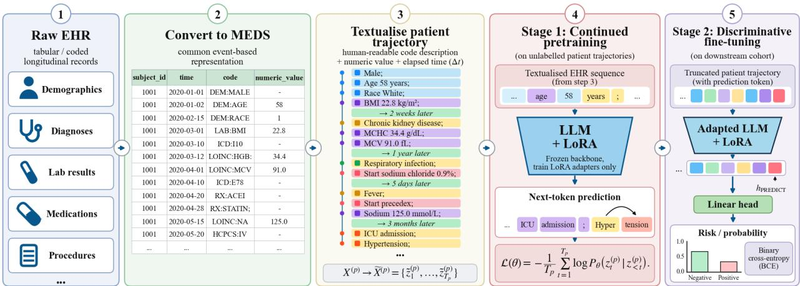
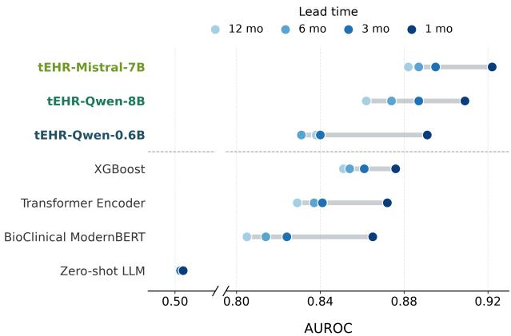
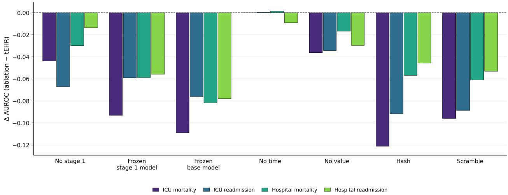
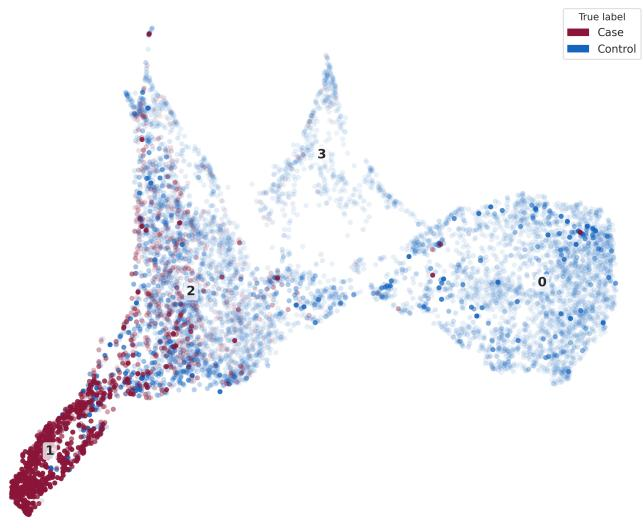
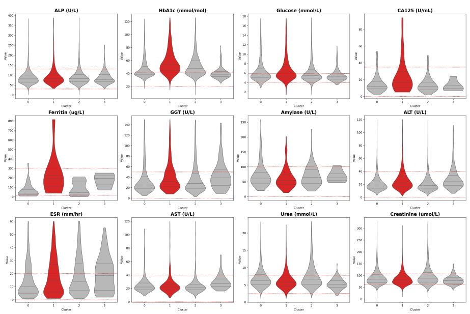
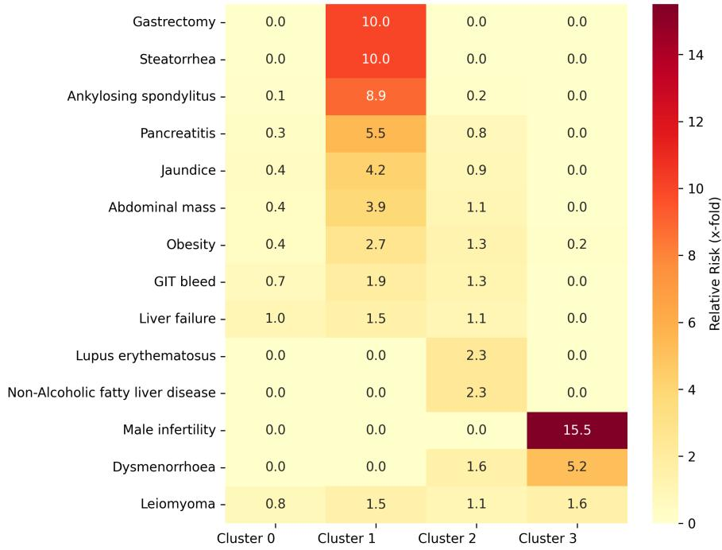
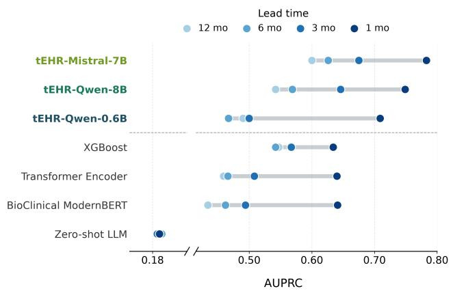

# Evaluating Pretrained Language Semantics for Structured EHR Prediction Tasks

Ashvin Gupta

Brendan Delaney

ashvin.gupta19@imperial.ac.uk

Alessandra Russo

brendan.delaney@imperial.ac.uk

Imperial College London, United Kingdom

a.russo@imperial.ac.uk

## Abstract

Structured Electronic Health Records (EHR) models typically treat each clinical concept as a dataset-specific token, discarding the naturallanguage semantics associated with the event. As a result, relationships between concepts must largely be learned from EHR co-occurrence, without directly exploiting any prior semantic knowledge. We investigate how pretrained causal language models can be adapted for longitudinal EHR prediction by developing tEHR. Here, we represent events with their natural language description and use this text stream to apply EHR-adaptive continued pretraining, followed by task-specific discriminative fine-tuning using LoRA, utilising the LLM as a longitudinal patient-encoder. We evaluate this approach across four prediction tasks on the MIMIC-IV dataset and pancreatic cancer prediction on the CPRD dataset at 1–12 month horizons, with tEHR using the Mistral-7B-v0.3 backbone achieving the strongest overall performance. Ablations show that performance declines when clinical descriptions are removed or misaligned, when numerical values are omitted, and when either stage of adaptation is removed, while explicit elapsed-time descriptions provide little additional benefit. Analysis of the learned patient representations further reveals clinically coherent structure associated with distinct patterns of disease risk and clinical history.

Keywords: EHR, LLMs,Health AI

Data and Code Availability We use the publicly available MIMIC-IV dataset (Johnson et al., 2024) and private Clinical Practice Research Datalink (CPRD) dataset (Wolf et al., 2019), processed into the Medical Event Data Standard (MEDS) format (McDermott and Xu, 2025) with downstream cohorts assembled using the ACES framework (Xu et al., 2025). For confidentiality constraints, the CPRD dataset cannot

be shared. Code can be found at https://github. com/Ashvin-Gupta/tEHR.

Institutional Review Board (IRB) This research uses the publicly available MIMIC-IV dataset, which has been previously approved for research use and does not require additional IRB approval. A research protocol, reference 23\_002840, was submitted and approved by the Clinical Practice Research Datalink (CPRD) Independent Scientific Advisory Committee before the study was conducted.

## 1. Introduction

Electronic Health Records (EHRs) provide longitudinal records of diagnoses, medications, procedures, laboratory measurements, and other clinical events. Transformer-based architectures have achieved strong performance across tasks including early pancreatic cancer detection (Placido et al., 2023; Steinberg et al., 2023) and ICU outcome prediction (Harutyunyan et al., 2019), with recent work extending to generative sequence models (Kraljevic et al., 2023; Wornow et al., 2023; Renc et al., 2024; Shmatko et al., 2025; Rajamohan et al., 2025; Waxler et al., 2025), state-space models (Fallahpour et al., 2024), and prompt-based prediction (Chandak et al., 2026).

Despite their architectural diferences, these approaches largely rely on each clinical event being expressed as unique tokens. Consequently, models must learn representations and relationships between concepts from their EHR co-occurrence, and cannot exploit any prior semantic knowledge. These clinical concepts are recorded using a range of coding systems, including SNOMED-CT (Stearns et al., 2001), ICD (World Health Organization), and Read Codes (Chisholm, 1990), with the choice of vocabulary varying across healthcare systems. Even within a single coding system, the subset of codes used can difer between sites and evolve over time as coding practices and terminologies change. Consequently, the same underlying clinical concept may be represented by multiple codes across datasets, while the overall vocabulary can contain thousands of possible concepts: Non-Type 1 Diabetes Mellitus is represented by 768 out of > 360, 000 active concepts in SNOMED-CT (NHS England Primary Care Domain, 2025). This heterogeneity often requires ontology mapping, code collapsing, or vocabulary refinement before modelling (Wang et al., 2024; Makarov and Lipkovich, 2025), creating a dataset-specific vocabulary and model. Transferring a model to a new dataset therefore requires mapping clinical codes to the expected vocabulary of the model, which can lead to information loss. Furthermore, models take diferent approaches to representing the time intervals between events or continuous values of recordings (Guo et al., 2026; Attrach et al., 2025; Lee et al., 2026). These preprocessing requirements make structured-EHR modelling dificult to reuse consistently across datasets and healthcare systems.

Replacing symbolic clinical codes with their naturallanguage descriptions provides a direct way to exploit the semantic knowledge encoded in pretrained language models and avoid these preprocessing issues. Recent work suggests that these representations can improve structured EHR prediction, but it remains unclear how pretrained language semantics are beneficial for longitudinal modelling and how the language model should be incorporated into the prediction pipeline. Prompt-based approaches present patient histories directly to an LLM, either without parameter updates (Zhu et al., 2024) or with supervised fine-tuning (Shoham and Rappoport, 2024), treating prediction primarily as a language-generation problem. Other work uses pretrained language models as representation encoders. Event-level embedding approaches encode each clinical event and pass these through a separate longitudinal aggregator, typically a Transformer, for the final prediction (Hur et al., 2024; Park et al., 2025). Patient-level embedding approaches encode the full patient trajectory into a single representation that is subsequently used by a lightweight classifier, using either clinically pretrained encoders (Munoz-Farre et al., 2022) or general-purpose embedding-specific models (Hegselmann et al., 2026). These studies establish that natural-language representations can provide useful inductive bias for clinical prediction tasks, but leave unresolved how much performance comes from the pretrained semantics themselves.

To investigate these questions, we develop tEHR, a two-stage framework applicable to causal LLMs. tEHR converts structured clinical events into a natural-language event stream, applies continued pretraining on unlabelled EHR trajectories, and then performs task-specific discriminative fine-tuning using the LLM as the longitudinal patient-encoder. We use this framework to study which aspects of pretrained language representations and downstream adaptation are responsible for predictive performance in structured EHR tasks.

## Our contributions are:

1. We present tEHR, a framework for adapting pretrained autoregressive LLMs to structured EHR prediction through continued pretraining on longitudinal patient trajectories followed by taskspecific discriminative fine-tuning.

2. We investigate how pretrained language semantics contribute to EHR prediction through controlled ablations of lexical grounding, model capacity, and adaptation, alongside comparisons with alternative semantic representations and their computational trade-ofs.

3. We demonstrate strong predictive performance across four MIMIC-IV tasks and pancreatic cancer prediction in CPRD, showing that tEHR can be independently applied across distinct healthcare settings and clinical coding systems.

## 2. Methodology

## 2.1. Patient Trajectory Representation

A patient trajectory, $X ^ { ( p ) }$ , is represented as a time-ordered sequence of clinical events, $\begin{array} { r l } { X ^ { ( p ) } } & { { } = } \end{array}$ $( e _ { 1 } ^ { ( p ) } , e _ { 2 } ^ { ( p ) } , \dots , e _ { L _ { n } } ^ { ( p ) } )$ , where $L _ { p }$ denotes the number of clinical events for patient $p .$ Each event is represented as $e _ { i } ^ { ( p ) } = ( c _ { i } ^ { ( p ) } , v _ { i } ^ { ( p ) } , t _ { i } ^ { ( p ) } ,$ ), where $c _ { i } ^ { ( p ) } \in \mathcal { V }$ is a discrete medical code, $v _ { i } ^ { ( p ) } \in \mathbb { R }$ is an optional continuous numerical value, and $t _ { i } ^ { ( p ) }$ is the event timestamp. Static patient attributes, such as sex and year of birth, are retained at the beginning of the patient sequence.

## 2.2. Clinical Narrative Textualisation

All datasets are first transformed into the Medical Event Data Standard (MEDS) (Bert Arnrich et al., 2024), which provides a common event-based representation across coding systems. We then apply a deterministic textualisation function that converts each structured patient trajectory into a sequence of natural-language event descriptions:

  
Figure 1: Structured EHRs are converted into the MEDS event-based representation (Bert Arnrich et al., 2024) and textualised using natural-language descriptions of clinical events, numerical values, and elapsed time between events. A pretrained large language model (LLM) is adapted to unlabelled patient trajectories using next-token prediction, with low-rank adaptation (LoRA) while keeping the backbone frozen. For downstream prediction tasks, patient trajectories are truncated at the prediction time and appended with a [PREDICT] token. The adapted LLM produces a contextual representation of this token, which is passed to a linear classification head to estimate the probability of the target outcome using binary cross-entropy loss.

$$
X ^ { ( p ) } \longrightarrow \tilde { X } ^ { ( p ) } = \left( \tilde { x } _ { 1 } ^ { ( p ) } , \dots , \tilde { x } _ { { L _ { p } } } ^ { ( p ) } \right) ,\tag{1}
$$

where $\tilde { x } _ { i } ^ { ( p ) }$ denotes the textual representation of event $e _ { i } ^ { ( p ) }$

For each event $e _ { i } ^ { ( p ) }$ , the symbolic concept $c _ { i } ^ { ( p ) }$ is replaced by its human-readable description using official coding-system translation metadata. Numerical measurements are retained in the resulting text and rounded to one decimal place. Elapsed time between consecutive events is also included in the text stream, $\Delta t _ { i } ^ { ( p ) } = t _ { i } ^ { ( p ) } - t _ { i - 1 } ^ { ( p ) }$ , using the nearest clinically interpretable unit, such as minutes, hours, days, weeks, months, or years. Conceptually, the representation remains a time-ordered event sequence, but with all events expressed through their natural-language description together with any associated numerical value or time delta, rather than as a single code token. Unlike code-based approaches, it does not require a dataset-specific clinical vocabulary, frequency-based code pruning, or specialised temporal and numerical embedding modules.

## 2.3. Two-Stage Training Framework

The tEHR framework adapts a causal LLM in two stages. First, the LLM is fine-tuned on the unlabelled patient trajectories through continued pretraining. The second involves discriminative fine-tuning with a prediction head on top of a specific hidden representation for the downstream task of interest. Both stages use Low-Rank Adaptation (LoRA) (Hu et al., 2021; Schulman and Lab, 2025) applied to the self-attention and linear projection layers. For a pre-trained weight matrix $W _ { 0 } \in \mathbb { R } ^ { d \times k }$ , LoRA represents the update $\Delta W$ as the product of two low-rank matrices $B \in \mathbb { R } ^ { d \times r }$ and $A \in \mathbb { R } ^ { r \times k }$ , such that the modified forward pass is: $\begin{array} { r } { h = ( W _ { 0 } + \Delta W ) x = ( W _ { 0 } + \frac { \alpha } { r } B A ) x } \end{array}$ , where α is the scaling constant and r is the rank. During both stages of training, $W _ { 0 }$ remains frozen while only A and B are updated, substantially reducing the number of trainable parameters while retaining the pretrained representations of the backbone model.

Stage 1: Domain-adaptive continued pretraining. The model is trained on the textualised training set patient trajectories using the standard next-token prediction loss, updating the LoRA parameters θ. The textual sequence $\tilde { X } ^ { ( p ) }$ is tokenised using the LLM’s built-in tokeniser, producing $Z ^ { ( p ) } \ = \ \bar { z } _ { 1 } ^ { ( p ) } , . . . , z _ { T _ { v } } ^ { ( p ) }$ ， where $T _ { p }$ denotes the number of LLM tokens in the tokenised trajectory for patient p. Note that $T _ { p }$ difers from $L _ { p } ,$ since each clinical event description may be represented by multiple language-model tokens.

$$
\mathcal { L } _ { \mathrm { C L M } } ( \theta ) = - \frac { 1 } { T _ { p } } \sum _ { t = 1 } ^ { T _ { p } } \log P _ { \theta } \left( z _ { t } ^ { ( p ) } \mid z _ { < t } ^ { ( p ) } \right) .\tag{2}
$$

This stage is intended to align the pretrained model with the distribution of longitudinal EHR trajectories without downstream outcome labels.

Stage 2: Discriminative fine-tuning. For each downstream task, the adapted model receives the patient narrative truncated at the corresponding prediction time, appended with a special [PREDICT] token. The hidden representation of this token, $h _ { \mathrm { P R E D I C T } } ^ { ( p ) } \in \mathbb { R } ^ { d }$ , is input to a linear classifier layer to produce the probability $\hat { y } _ { p } = \sigma ( w ^ { \top } h _ { \mathrm { P R E D I C T } } ^ { ( p ) } + b )$ with the model further fine-tuned under the Binary Cross-Entropy objective:

$$
\mathcal { L } _ { \mathrm { B C E } } = - \frac { 1 } { N } \left[ \sum _ { p = 1 } ^ { N } y _ { p } \log \hat { y } _ { p } + ( 1 - y _ { p } ) \log ( 1 - \hat { y } _ { p } ) \right]\tag{3}
$$

for N patients. This stage updates the task-specific classification head and the LoRA adapters inherited from Stage 1, while the original backbone weights remain frozen. We use a linear head so that downstream performance primarily reflects the quality of the learned patient representation. The hidden state of the [PREDICT] token is used as it outperformed alternative pooling strategies such as mean pooling in preliminary experiments. Both adaptation stages are implemented with Unsloth (Daniel Han and team, 2023) and trained with early stopping on validation loss using a fixed 80:10:10 patient-level split and three random seeds. Performance is reported using AUROC and AUPRC.

## 3. Experiments

## 3.1. Datasets and Prediction Tasks

MIMIC-IV: We use MIMIC-IV version 3.1 (Johnson et al., 2024), a large critical-care dataset containing events recorded during hospital and intensive-care admissions. We assess four binary prediction tasks: ICU mortality, ICU readmission, hospital mortality, and 30-day hospital readmission. MIMIC-IV contains clinical concepts represented primarily using ICD and NDC coding systems. In our processed dataset, this corresponds to roughly 15k unique medical codes. It provides a high-acuity evaluation setting characterised by dense event sequences and comparatively short prediction horizons.

CPRD: The Clinical Practice Research Datalink (CPRD) (Wolf et al., 2019) is a private UK primarycare database containing over 16 million patients, accessible only via a secure environment. Its clinical events are represented using Read Codes. Due to the heterogeneous nature of primary care coding practices in the UK, this dataset contains over 241k unique medical codes. We construct a task-specific cohort for pancreatic cancer prediction. Eligible pancreatic cancer cases are matched to up to five controls on sex, birth year within ±3 years, and general-practice region, resulting in 73,732 patients with up to 10 years of preceding clinical history (Appendix 6.2). This design focuses evaluation on clinically comparable cases and controls rather than the highly imbalanced full CPRD population. To assess prediction at diferent lead times, patient histories are right-censored at 1, 3, 6, and 12 months before the index date.

## 3.2. Baselines

We group our baselines into structured code-based models and text-based prediction approaches.

Structured Code-Based Models: XGBoost which is trained on bag-of-codes frequency features. Transformer Encoder following Placido et al. (2023), is trained on the corresponding symbolic event sequences with an analogous pretraining and supervised fine-tuning procedure. CLMBR-T (Wornow et al., 2023), is a 141M-parameter structured-EHR Transformer pretrained on 2.57 million patients. Applying CLMBR-T to our datasets requires mapping the dataset codes to the model’s vocabulary. Using the public MIMIC-IV-to-OMOP mapping pipeline (OHDSI), 79.4% of event occurrences are mapped.

We did not identify an equivalent mapping for CPRD Read Codes, so CLMBR-T is evaluated only on MIMIC-IV. We evaluate both a frozen CLMBR-T representation with a trainable linear-classifier head and a task-specific fine-tuned variant.

Text-based Models: BioClinical Modern-BERT is fine-tuned on the same textualised patient trajectories as tEHR (Sounack et al., 2025). We evaluate zero-shot LLM prompting of an LLM following Zhu et al. (2024) and prompt-based supervised fine-tuning of an LLM following (Shoham and Rappoport, 2024) (only performed on MIMIC-IV due to compute restrictions in the CPRD secure environment).

## 3.3. Ablations

All ablations are conducted on the MIMIC-IV tasks because computational restrictions in the CPRD secure environment prevented an equivalent sweep on CPRD. We investigate four questions: (1) which stages of the tEHR training procedure are necessary, (2) which components of the textualised EHR representation contribute predictive information, (3) how sensitive performance is to backbone choice and model capacity, and (4) whether pretrained language semantics can be incorporated through alternative event representations.

Two-stage training framework. We evaluate three training variants to disentangle the contributions of domain-adaptive continued pretraining and task-specific adaptation. (1) we remove Stage 1 and initialise directly from the base LLM, applying the same supervised LoRA adaptation and linear classification head used in the full model. (2) we retain Stage 1 but freeze the adapted backbone during downstream training, optimising only the linear classification head. (3) we freeze the initial unadapted base LLM and train only the classification head. Together, these variants separate the contribution of unlabelled EHR adaptation, task-specific backbone adaptation, and generic pretrained representations.

Clinical information representation. We next test which components of the textualised EHR representation contribute to predictive performance using controlled perturbations. In the hashed-concept condition, each clinical concept is replaced by a deterministic, unique, and semantically meaningless identifier, preserving concept identity and recurrence structure while removing lexical meaning. In the scrambledconcept condition, concept descriptions are deterministically permuted within event categories for the events that occurred for that patient, preserving plausible medical language and broad event type while breaking the correspondence between each concept and its true clinical meaning. In the no-time condition, explicit textualised elapsed-time intervals are removed while chronological event order is preserved. In the no-value condition, numerical measurement values are removed while retaining the identity of the corresponding laboratory or vital-sign event. Across all conditions, demographics, hospital-transfer events and event ordering are preserved, and only the targeted component of the representation is modified.

Backbone and model capacity. We evaluate the full two-stage tEHR framework using Mistral-7Bv0.3, Qwen3-8B, and Qwen3-0.6B to assess robustness across LLM families and sensitivity to model capacity. To distinguish the contribution of pretrained lexical information from model capacity, we additionally construct a capacity-controlled variant using the Mistral-7B backbone, Mistral-7B atomic codes, replacing natural-language event descriptions with atomic clinical-code tokens. The vocabulary is extended with the clinical codes used by the structured baselines, whose embeddings are newly initialised. This variant follows the same two-stage training framework as tEHR, preserving backbone capacity and the twostage adaptation procedure while replacing pretrained lexical representations with newly initialised code embeddings.

Alternative semantic representations. We investigate three alternative approaches to incorporating pretrained language semantics into longitudinal EHR prediction. First, LLM-initialised Transformer uses a code-based Transformer whose clinical-code embeddings are initialised from pretrained LLM representations of their corresponding natural-language descriptions, Hur et al. (2024). Second, Event LLM embeddings, following Park et al. (2025), represents individual clinical events using frozen LLM embeddings, which are passed to a trainable Transformer for longitudinal prediction. Third, LLM projection projects pretrained event-level LLM embeddings into the input embedding space of a longitudinal LLM. The latter two approaches use task-specific supervised training without the autoregressive next-token continued pretraining stage employed by tEHR. We report AUROC and computational cost in the main text, with

Table 1: AUROC across ICU Mortality, ICU Readmission, Hospital Mortality and Hospital Readmission MIMIC-IV prediction tasks, averaged over three seeds. Best results are shown in bold. Standard deviations and AUPRC are reported in the appendix.
<table><tr><td>Model</td><td>ICU Mort.</td><td>ICU Read.</td><td>Hosp. Mort.</td><td>Hosp. Read.</td></tr><tr><td>XGBoost</td><td>0.817</td><td>0.713</td><td>0.868</td><td>0.742</td></tr><tr><td>Transformer Encoder</td><td>0.866</td><td>0.773</td><td>0.911</td><td>0.765</td></tr><tr><td>CLMBR-T (frozen)</td><td>0.793</td><td>0.724</td><td>0.881</td><td>0.708</td></tr><tr><td>CLMBR-T (fine-tuned)</td><td>0.861</td><td>0.762</td><td>0.915</td><td>0.762</td></tr><tr><td>BioClinical ModernBERT</td><td>0.824</td><td>0.739</td><td>0.860</td><td>0.766</td></tr><tr><td>Zero-shot LLM (Mistral-7B)</td><td>0.559</td><td>0.539</td><td>0.627</td><td>0.528</td></tr><tr><td>Prompt SFT (Mistral-7B)</td><td>0.811</td><td>0.668</td><td>0.786</td><td>0.724</td></tr><tr><td>Mistral-7B (atomic codes)</td><td>0.772</td><td>0.703</td><td>0.871</td><td>0.766</td></tr><tr><td>LLM-initialised Transformer</td><td>0.843</td><td>0.778</td><td>0.897</td><td>0.766</td></tr><tr><td>Event LLM embeddings</td><td>0.739</td><td>0.547</td><td>0.876</td><td>0.739</td></tr><tr><td>LLM projection</td><td>0.737</td><td>0.651</td><td>0.817</td><td>0.737</td></tr><tr><td>tEHR-Qwen3-0.6B</td><td>0.822</td><td>0.738</td><td>0.903</td><td>0.759</td></tr><tr><td>tEHR-Qwen3-8B</td><td>0.870</td><td>0.780</td><td>0.927</td><td>0.764</td></tr><tr><td>tEHR-Mistral-7B</td><td>0.887</td><td>0.794</td><td>0.932</td><td>0.775</td></tr></table>

AUPRC and full implementation details provided in Appendix 6.3 and Appendix 6.9 respectively.

## 3.4. Representation Analysis and Clinical Characterisation

To investigate the patient representations learned by tEHR, we extract the 4,096-dimensional [PREDICT] embeddings from the test set of the 1-month pancreatic cancer model. We focus on this setting because it provides a strong predictive signal and pancreatic cancer has well-characterised clinical risk factors that facilitate interpretation of the learned representations. Embeddings are first ℓ -normalised and reduced to 10 dimensions using UMAP (McInnes et al., 2020). We use UMAP rather than PCA to preserve potentially nonlinear local neighbourhood structure in the learned representations, rather than prioritising linear explained variance and allow us to use densitybased clustering. HDBSCAN is applied in this 10- dimensional space to identify dense groups of patients without specifying the number of clusters in advance. A separate two-dimensional UMAP projection is used solely for visualisation and does not afect cluster assignment. Clusters are characterised by their size, pancreatic cancer prevalence, categorical-event enrichment, and distributions of continuous laboratory measurements and hyperparameters are selected using silhouette scores on the validation set and fixed before test-set analysis (Appendix 6.4). For categorical events, enrichment is defined as the prevalence of an event within a cluster relative to its prevalence in the full population. This analysis is intended to assess whether the task-adapted representation organises patients into clinically coherent phenotypes beyond the binary case-control label.

## 4. Results

tEHR-Mistral achieved the strongest overall performance across all four MIMIC-IV tasks (Table 1) and all pancreatic cancer prediction horizons in CPRD (Figure 2). On MIMIC-IV, the strongest competing baselines were the code-based Transformer and finetuned CLMBR-T, while zero-shot prompting showed near chance-level discrimination on several tasks. On CPRD, tEHR also outperformed all baselines, with XGBoost being the strongest competitor. Performance declined across all models as the prediction horizon increased, reflecting the greater dificulty of earlier risk prediction.

The ablations demonstrate the importance of both adaptation stages (Figure 3). Removing continued pretraining reduced AUROC across all four MIMIC-IV tasks, while restricting downstream adaptation to only the linear head led to further deterioration. Perturbing lexical grounding through hashed or scrambled concept representations also substantially reduced performance. Numerical values contributed consistently, whereas explicit elapsed-time descriptions provided little additional benefit.

Performance varied across LLM backbones, with Mistral-7B outperforming both Qwen3-8B and Qwen3- 0.6B. The capacity-controlled Mistral-7B variant using atomic clinical-code tokens performed substantially below full tEHR despite retaining the same backbone and two-stage adaptation framework. Together, these findings indicate that performance depends on both backbone choice and clinical event representation, rather than model capacity alone.

All three alternative approaches to incorporating pretrained language semantics performed below full tEHR across the MIMIC-IV tasks. The LLMinitialised Transformer was the strongest alternative, ofering a more computationally eficient approach at the cost of predictive performance.

Table 2 shows the computational cost for the experiments on MIMIC-IV. Although tEHR required greater computational resources, its training cost remained of the same order of magnitude as the code-based Transformer (85.11 versus 96.11 GPU-hours for EHRpretraining, and 26.09 versus 15.65 GPU-hours for ICU mortality fine-tuning). Inference was substantially slower (301 versus 8.8 ms per patient), although remaining below one second per patient on a single NVIDIA H200.

Table 2: Computational cost on one NVIDIA H200. EHR PT denotes EHR-specific pretraining, and Task FT denotes supervised task training (ICU mortality), both in GPU-hours. Latency is measured per patient at batch size 1. External pretraining is excluded.
<table><tr><td>Model</td><td>EHR PT GPU-h</td><td>Task FT GPU-h</td><td>Latency ms</td></tr><tr><td>XGBoost</td><td></td><td></td><td>0.21</td></tr><tr><td>Transformer Encoder</td><td>96.11</td><td>15.65</td><td>8.8</td></tr><tr><td>CLMBR-T (frozen)</td><td>Ext.</td><td>0.14</td><td>3.9</td></tr><tr><td>CLMBR-T (fine-tuned)</td><td>Ext.</td><td>1.52</td><td>4.0</td></tr><tr><td>BioClinical-ModernBERT</td><td>Ext.</td><td>3.09</td><td>487</td></tr><tr><td>Zero-shot LLM</td><td></td><td></td><td>373</td></tr><tr><td>Prompt SFT</td><td></td><td>28.68</td><td>385</td></tr><tr><td>Mistral-7B (atomic codes)</td><td>5.45</td><td>4.67</td><td>87.7</td></tr><tr><td>LLM-initialised Transformer</td><td>96.10</td><td>15.65</td><td>8.75</td></tr><tr><td>Event LLM embeddings</td><td></td><td>16.03</td><td>8.86</td></tr><tr><td>LLM projection</td><td></td><td>4.73</td><td>77.7</td></tr><tr><td>tEHR-Qwen3-0.6B</td><td>19.66</td><td>6.62</td><td>68.0</td></tr><tr><td>tEHR-Qwen3-8B</td><td>90.70</td><td>28.04</td><td>328</td></tr><tr><td>tEHR-Mistral-7B</td><td>85.11</td><td>26.09</td><td>301</td></tr></table>

  
Figure 2: AUROC for pancreatic cancer prediction at horizons of 1, 3, 6 and 12 months preceding diagnosis for tEHR, XGBoost, Transformer Encoder, BioClinical-ModernBERT and Zero-shot LLM.

UMAP projection followed by HDBSCAN clustering of the [PREDICT] patient embeddings (Figure 4) identified four clinically distinct regions with markedly diferent case prevalence (Appendix 6.5, Figure 5). Cluster 1 was strongly enriched for pancreatic cancer cases and exhibited the clearest disease-associated clinical profile. It showed substantial enrichment of steatorrhoea, pancreatitis, jaundice, and abdominal mass, alongside higher distributions of HbA1c, CA125, and ferritin. These features are consistent with clinical manifestations and biomarkers associated with pancreatic malignancy (Tao et al., 2026; Schmidt-Hansen et al., 2016; Meng et al., 2017). The remaining clusters captured distinct clinical structure rather than simply reflecting case–control status. Cluster 0 was predominantly composed of controls and showed comparatively little enrichment of the selected pancreaticcancer-associated features. Cluster 2 contained a mixture of cases and controls and was distinguished by enrichment of lupus erythematosus and non-alcoholic fatty liver disease, together with higher inflammatorymarker distributions, including ESR, consistent with systemic inflammation or hepatic dysfunction (Newsome et al., 2018). Cluster 3 was also predominantly control-associated and showed a distinct reproductive and gynaecological profile, with particularly strong enrichment of male infertility and dysmenorrhoea and more modest enrichment of leiomyoma (Stewart, 2001).

Figure 3: Change in AUROC relative to the full tEHR-Mistral-7B model across four downstream tasks on MIMIC-IV for the ablation experiments.  
  
Figure 4: Two-dimensional UMAP visualisation of pancreatic-cancer patient embeddings. Colour denotes case-control status and opacity denotes predicted cancer probability.

## 5. Discussion

We present tEHR, a framework for adapting pretrained autoregressive LLMs to EHR prediction tasks. tEHR can in principle be applied to diferent autoregressive LLMs and relies on clinical events being represented with their natural-language descriptions rather than as symbolic tokens, allowing the model to reuse semantic information learnt during large-scale pretraining. tEHR requires simple data preprocessing, avoids the construction of a model-specific vocabulary and can still be applied to large models through parameter-eficient fine-tuning with LoRA. However, the other LLM-based experiments show that simply introducing pretrained semantic embeddings does not recover the performance of full textualisation. Neither zero-shot, description-initialised code embeddings nor event-level LLM representations matched tEHR, suggesting that the manner in which semantic information is incorporated into longitudinal modelling is also important.

The ablations provide a possible explanation for the success of tEHR. Continued pretraining adapts the model to the distribution and sequential structure of the EHR data, while task-specific fine-tuning further shapes the representation for the downstream prediction task. The frozen base-model ablation assesses the predictive utility of generic pretrained representations without EHR-specific adaptation. The improvements obtained through continued pretraining and task-specific fine-tuning suggest that both stages contribute to learning efective longitudinal patient representations. The lexical ablations further demonstrate the importance of correctly grounding clinical events in natural-language. In hashed-concept, the model is unable to identify the semantic meaning of the events occurring and performs worse. Similarly, the scrambled-concept ablation indicates that it is not suficient for the input to contain plausible clinical language but that the correspondence between a clinical event and its surrounding context matters. Together, these perturbations suggest that the model benefits from the correspondence between clinical concepts and their pretrained lexical representations. This is further supported by the capacity-controlled Mistral-7B experiment, where replacing natural-language descriptions with atomic clinical-code tokens substantially reduced performance despite retaining the same backbone and two-stage training framework. Together, these findings suggest that pretrained lexical knowledge contributes to tEHR’s performance beyond model capacity alone.

A possible explanation for the drop in performance when the clinical values are removed is that the model can no longer directly distinguish normal from abnormal measurement values. This is not the same case for time, consistent with previous work (Attrach et al., 2025) and suggesting that chronological ordering may therefore capture much of the required temporal information. Performance also varied across pretrained backbones. Diferences between Mistral-7B and Qwen3-8B, despite similar parameter counts, suggest that pretraining diferences may influence downstream performance, although these experiments do not isolate their source. The weaker performance of Qwen3-0.6B further indicates sensitivity to model capacity. These performance improvements come with a computational trade-of as tEHR was an expensive method for both training and inference. More compact semantic representation strategies ofered lower training costs, albeit with reduced predictive performance.

The CLMBR-T experiment illustrates a practical limitation of structured-EHR foundation models with fixed vocabularies. Although CLMBR-T performs strongly within its intended representation setting, applying it to our MIMIC-IV cohorts required mapping source concepts into the vocabulary expected by the model. Only 79.4% of event occurrences were successfully mapped, which may partly explain the remaining performance gap. We did not identify an equivalent mapping suitable for CPRD Read Codes, preventing a corresponding evaluation there. In contrast, tEHR operates on natural-language concept descriptions, avoiding explicit alignment to a pretrained symbolic vocabulary. An interesting future experiment would be to evaluate the cross-dataset transfer of a tEHR model which would complement recent work by Ding et al. (2026) on unifying vocabularies across datasets.

The CPRD experiments further evaluate the tEHR method on primary-care, which is a substantially different setting from MIMIC-IV. CPRD contains longitudinal primary-care data recorded across many practices and therefore results in a much larger and more heterogeneous clinical vocabulary. A common preprocessing step is to map codes to higher-level clinical concepts, which is manually intensive and can lead to incorrect medical timelines if there are mistakes. The strong performance of tEHR in this setting suggests that predictive models can be developed without extensive code simplification. The strong performance of XGBoost also shows that model complexity alone is not suficient for strong prediction in this setting. The latent-space analysis provides additional evidence that the learned representation contains clinically meaningful structure. The pancreatic-cancerenriched region contains features associated with the disease, while other regions capture distinct inflammatory, metabolic, reproductive, and urological patterns. However, clustering does not establish causal mechanisms, and the identified groups may be sensitive to the choice of dimensionality-reduction and clustering parameters.

Several limitations remain. First, CPRD evaluation was restricted by the approved study protocol and computational constraints to pancreatic cancer prediction, with the full ablation suite therefore performed only on MIMIC-IV. Evaluation across additional diseases and prediction tasks would provide a stronger test of generality. Second, textualisation expands clinical events into multiple language-model tokens, increasing sequence length and computational cost. We therefore limit the LLM context window to 16K tokens and retain the most recent clinical history for longer trajectories (Appendix 6.6). Finally, further work could investigate cross-dataset transfer, retention of pretrained knowledge, and the interpretability of learned patient representations.

## References

Rafi Al Attrach, Rajna Fani, David Restrepo, Yugang Jia, and Peter Schüfler. Rethinking Tokenization for Clinical Time Series: When Less is More. 12 2025.

Bert Arnrich, Edward Choi, Jason Alan Fries, Matthew B.A. McDermott, Jungwoo Oh, Tom Pollard, Nigam Shah, Ethan Steinberg, Michael Wornow, and Robin van de Water. Medical Event Data Standard ({MEDS}): Facilitating Machine Learning for Health. ICLR 2024 Workshop on Learning from Time Series For Health, 2024.

Payal Chandak, Gregory Kondas, Liat Antwarg Friedman, Isaac Kohane, and Matthew McDermott. EveryQuery: Zero-Shot Clinical Prediction via Task-Conditioned Pretraining over Electronic Health Records. 5 2026.

J Chisholm. The Read clinical classification. BMJ, 300(6732):1092–1092, 4 1990. ISSN 0959-8138. doi: 10.1136/bmj.300.6732.1092.

Michael Han Daniel Han and Unsloth team. Unsloth, 2023. URL https://github.com/unslothai/ unsloth.

Jacob Devlin, Ming-Wei Chang, Kenton Lee, and Kristina Toutanova. BERT. In Proceedings of the 2019 Conference of the North, pages 4171–4186, Stroudsburg, PA, USA, 2019. Association for Computational Linguistics. doi: 10.18653/v1/N19-1423.

Tong Ding, Caiwei Tian, Dongmin Bang, Ming Y. Lu, Sophia J. Wagner, Andrew Zhang, Rowland Pettit, Long Phi Le, and Faisal Mahmood. Discrete Neural Interlingua for Ontology-Agnostic EHR Modeling. 10 2026.

Adibvafa Fallahpour, Mahshid Alinoori, Wenqian Ye, Xu Cao, Arash Afkanpour, and Amrit Krishnan. EHRMamba: Towards Generalizable and Scalable Foundation Models for Electronic Health Records. 11 2024.

Lin Lawrence Guo, Santiago Eduardo Arciniegas, Joseph Jihyung Lee, Adam Paul Yan, George Tomlinson, Jason Fries, and Lillian Sung. Tokenization Tradeofs in Structured EHR Foundation Models. 3 2026.

Hrayr Harutyunyan, Hrant Khachatrian, David C. Kale, Greg Ver Steeg, and Aram Galstyan. Multitask learning and benchmarking with clinical time series data. 8 2019. doi: 10.1038/ s41597-019-0103-9.

Stefan Hegselmann, Georg von Arnim, Tillmann Rheude, Noel Kronenberg, David Sontag, Gerhard Hindricks, Roland Eils, and Benjamin Wild. Large language models are powerful electronic health record encoders. npj Digital Medicine, 9 (1):530, 7 2026. ISSN 2398-6352. doi: 10.1038/ s41746-026-02915-9.

Edward J. Hu, Yelong Shen, Phillip Wallis, Zeyuan Allen-Zhu, Yuanzhi Li, Shean Wang, Lu Wang, and Weizhu Chen. LoRA: Low-Rank Adaptation of Large Language Models. 10 2021.

Kyunghoon Hur, Jungwoo Oh, Junu Kim, Jiyoun Kim, Min Jae Lee, Eunbyeol Cho, Seong-Eun Moon, Young-Hak Kim, and Edward Choi. UniHPF : Universal Healthcare Predictive Framework with Zero Domain Knowledge. 9 2024.

Alistair Johnson, Lucas Bulgarelli, Tom Pollard, Brian Gow, Benjamin Moody, Steven Horng, Leo Anthony Celi, and Roger Mark. MIMIC-IV. PhysioNet, 10 2024. doi: 10.13026/kpb9-mt58. URL https: //doi.org/10.13026/kpb9-mt58.

Zeljko Kraljevic, Dan Bean, Anthony Shek, Rebecca Bendayan, Harry Hemingway, Joshua Au Yeung, Alexander Deng, Alfie Baston, Jack Ross, Esther Idowu, James T Teo, and Richard J Dobson. Foresight – Generative Pretrained Transformer (GPT) for Modelling of Patient Timelines using EHRs. 1 2023.

Inhyeok Lee, Luke Solo, Michael C. Burkhart, Bashar Ramadan, William F. Parker, and Brett K. Beaulieu-Jones. Representation Before Training: A Fixed-Budget Benchmark for Generative Medical Event Models. 4 2026.

Nikolai Makarov and Mikhail Lipkovich. A transformer-based model for next disease prediction using electronic health records. The European Physical Journal Special Topics, 1 2025. ISSN 1951- 6355. doi: 10.1140/epjs/s11734-024-01447-1.

Matthew McDermott and Justin Xu. MIMIC-IV MEDS: An ETL pipeline to extract

MIMIC-IV data into the MEDS format, 4 2025. URL https://github.com/ Medical-Event-Data-Standard/MIMIC\_IV\_MEDS.

Leland McInnes, John Healy, and James Melville. UMAP: Uniform Manifold Approximation and Projection for Dimension Reduction. 9 2020.

Qingcai Meng, Si Shi, Chen Liang, Jinfeng Xiang, Dingkong Liang, Bo Zhang, Yi Qin, Shunrong Ji, Wenyan Xu, Jin Xu, Quanxing Ni, and Xianjun Yu. Diagnostic Accuracy of a CA125-Based Biomarker Panel in Patients with Pancreatic Cancer: A Systematic Review and Meta-Analysis. Journal of Cancer, 8(17):3615–3622, 2017. ISSN 1837-9664. doi: 10.7150/jca.18901.

Anna Munoz-Farre, Harry Rose, and Sera Aylin Cakiroglu. sEHR-CE: Language modelling of structured EHR data for eficient and generalizable patient cohort expansion. 11 2022.

Philip N Newsome, Rob Cramb, Suzanne M Davison, John F Dillon, Mark Foulerton, Edmund M Godfrey, Richard Hall, Ulrike Harrower, Mark Hudson, Andrew Langford, Anne Mackie, Robert Mitchell-Thain, Karen Sennett, Nicholas C Sheron, Julia Verne, Martine Walmsley, and Andrew Yeoman. Guidelines on the management of abnormal liver blood tests. Gut, 67(1):6–19, 1 2018. ISSN 0017- 5749. doi: 10.1136/gutjnl-2017-314924.

NHS England Primary Care Domain. Non-Type 1 Diabetes Mellitus (DMNON-TYPE1\_COD), 2025. URL https: //www.opencodelists.org/codelist/ nhsd-primary-care-domain-refsets/ dmnontype1\_cod/20250912/.

OHDSI. MIMIC IV to OMOP CDM Conversion. https://github.com/OHDSI/MIMIC.

Jiheum Park, Jason Patterson, Jose M. Acitores Cortina, Tian Gu, Chin Hur, and Nicholas Tatonetti. Enhancing EHR-based pancreatic cancer prediction with LLM-derived embeddings. npj Digital Medicine, 8(1):465, 7 2025. ISSN 2398-6352. doi: 10.1038/s41746-025-01869-8.

Davide Placido, Bo Yuan, Jessica X. Hjaltelin, Chunlei Zheng, Amalie D. Haue, Piotr J. Chmura, Chen Yuan, Jihye Kim, Renato Umeton, Gregory Antell, Alexander Chowdhury, Alexandra Franz, Lauren Brais, Elizabeth Andrews, Debora S. Marks, Aviv

Regev, Siamack Ayandeh, Mary T. Brophy, Nhan V. Do, Peter Kraft, Brian M. Wolpin, Michael H. Rosenthal, Nathanael R. Fillmore, Søren Brunak, and Chris Sander. A deep learning algorithm to predict risk of pancreatic cancer from disease trajectories. Nature Medicine, 29(5):1113–1122, 5 2023. ISSN 1078-8956. doi: 10.1038/s41591-023-02332-5.

Haresh Rengaraj Rajamohan, Xiang Gao, Weicheng Zhu, Shih-Lun Huang, Long Chen, Kyunghyun Cho, Cem M. Deniz, and Narges Razavian. Foundation Models for Clinical Records at Health System Scale. 7 2025.

Pawel Renc, Yugang Jia, Anthony E. Samir, Jaroslaw Was, Quanzheng Li, David W. Bates, and Arkadiusz Sitek. Zero shot health trajectory prediction using transformer. npj Digital Medicine, 7(1):256, 9 2024. ISSN 2398-6352. doi: 10.1038/s41746-024-01235-0.

Mia Schmidt-Hansen, Sabine Berendse, and William Hamilton. Symptoms of Pancreatic Cancer in Primary Care. Pancreas, 45(6):814–818, 7 2016. ISSN 0885-3177. doi: 10.1097/MPA.0000000000000527.

John Schulman and Thinking Machines Lab. LoRA Without Regret. Thinking Machines Lab: Connectionism, 2025. doi: 10.64434/tml.20250929.

Artem Shmatko, Alexander Wolfgang Jung, Kumar Gaurav, Søren Brunak, Laust Hvas Mortensen, Ewan Birney, Tom Fitzgerald, and Moritz Gerstung. Learning the natural history of human disease with generative transformers. Nature, 9 2025. ISSN 0028-0836. doi: 10.1038/s41586-025-09529-3.

Ofir Ben Shoham and Nadav Rappoport. CPLLM: Clinical Prediction with Large Language Models. 5 2024.

Thomas Sounack, Joshua Davis, Brigitte Durieux, Antoine Chafin, Tom J. Pollard, Eric Lehman, Alistair E. W. Johnson, Matthew McDermott, Tristan Naumann, and Charlotta Lindvall. BioClinical Modern-BERT: A State-of-the-Art Long-Context Encoder for Biomedical and Clinical NLP. 6 2025.

M Q Stearns, C Price, K A Spackman, and A Y Wang. SNOMED clinical terms: overview of the development process and project status. Proceedings. AMIA Symposium, pages 662–6, 2001. ISSN 1531-605X.

Ethan Steinberg, Jason Fries, Yizhe Xu, and Nigam Shah. MOTOR: A Time-To-Event Foundation Model For Structured Medical Records. 12 2023.

Elizabeth A Stewart. Uterine fibroids. The Lancet, 357(9252):293–298, 1 2001. ISSN 01406736. doi: 10.1016/S0140-6736(00)03622-9.

Lan Valerie Tao, Joanna M. Karasinska, Vanessa G. P. Souza, Jonathan M. Loree, James D. Johnson, Daniel J. Renouf, and David F. Schaefer. Newonset diabetes as an emerging risk group for early detection of pancreatic cancer: current evidence, clinical challenge, and future directions. Frontiers in Gastroenterology, 4, 1 2026. ISSN 2813-1169. doi: 10.3389/fgstr.2025.1645459.

Lan Wang, Yonghua Yin, Ben Glampson, Robert Peach, Mauricio Barahona, Brendan C. Delaney, and Erik K. Mayer. Transformer-based deep learning model for the diagnosis of suspected lung cancer in primary care based on electronic health record data. eBioMedicine, 110:105442, 12 2024. ISSN 23523964. doi: 10.1016/j.ebiom.2024.105442.

Shane Waxler, Paul Blazek, Davis White, Daniel Sneider, Kevin Chung, Mani Nagarathnam, Patrick Williams, Hank Voeller, Karen Wong, Matthew Swanhorst, Sheng Zhang, Naoto Usuyama, Clif Wong, Tristan Naumann, Hoifung Poon, Andrew Loza, Daniella Meeker, Seth Hain, and Rahul Shah. Generative Medical Event Models Improve with Scale. 11 2025.

Achim Wolf, Daniel Dedman, Jennifer Campbell, Helen Booth, Darren Lunn, Jennifer Chapman, and Puja Myles. Data resource profile: Clinical Practice Research Datalink (CPRD) Aurum. International Journal of Epidemiology, 48(6):1740–1740, 12 2019. ISSN 0300-5771. doi: 10.1093/ije/dyz034.

World Health Organization. International Statistical Classification of Diseases and Related Health Problems (ICD). https://www.who.int/standards/classifications/classificationof-diseases.

Michael Wornow, Rahul Thapa, Ethan Steinberg, Jason A. Fries, and Nigam H. Shah. EHRSHOT: An EHR Benchmark for Few-Shot Evaluation of Foundation Models. 12 2023.

Justin Xu, Jack Gallifant, Alistair E. W. Johnson, and Matthew B. A. McDermott. ACES: Automatic Co-

hort Extraction System for Event-Stream Datasets. 3 2025.

Yinghao Zhu, Zixiang Wang, Junyi Gao, Yuning Tong, Jingkun An, Weibin Liao, Ewen M. Harrison, Liantao Ma, and Chengwei Pan. Prompting Large Language Models for Zero-Shot Clinical Prediction with Structured Longitudinal Electronic Health Record Data. 2 2024.

## 6. Appendix

## 6.1. Acknowledgements

This work is supported by UK Research and Innovation (UKRI AI Centre for Doctoral Training in Digital Healthcare grant number EP/Y030974/1), NIHR Imperial Biomedical Research Centre and the NIHR Invention for Innovation grant “Artificial Intelligence to support cancer early diagnosis in general practice" (NIHR207533).

## 6.2. Dataset information

The Clinical Practice Research Datalink (CPRD) Aurum is a UK-based longitudinal primary care database derived from routinely collected electronic health records in general practice. CPRD contains detailed patient-level information including diagnoses, prescriptions, laboratory results, referrals, and demographic variables, with linkage options to additional datasets such as hospital admissions and mortality records. The database is broadly representative of the UK population.

CPRD pancreatic cancer cohort construction. Pancreatic cancer cases were identified from CPRD and assigned an index date corresponding to their recorded date of diagnosis. For each case, we sought up to five controls matched on sex, birth year within ±3 years, and general-practice region. Controls were required to have no recorded pancreatic cancer diagnosis throughout their available follow-up, and patients who subsequently developed pancreatic cancer were not eligible to serve as controls. Each control was used at most once. For controls, the index date was defined as two years before their final recorded clinical event to reduce the likelihood of including patients with an undiagnosed pancreatic cancer near the end of follow-up. Consequently, matching was performed on birth year rather than age at index, and diferences in age at index between cases and controls are expected because their index dates are defined diferently. Matching was performed before the cohort was divided into training, validation, and test sets. Up to five eligible controls were selected for each case; cases were retained when fewer than five matching controls were available. Due to case-control matching, AUPRC values should not be interpreted as population screening precision.

Table 3: CPRD Patient Demographics and Clinical Event Statistics by Dataset Split. Values are reported as Count (%) or Median [IQR].
<table><tr><td></td><td colspan="2">Train</td><td colspan="2">Validation</td><td colspan="2">Test</td></tr><tr><td>Feature</td><td>Case</td><td>Control</td><td>Case</td><td>Control</td><td>Case</td><td>Control</td></tr><tr><td>Total Patients (N)</td><td>10725</td><td>48246</td><td>1336</td><td>6014</td><td>1348</td><td>6063</td></tr><tr><td>Gender</td><td></td><td></td><td></td><td></td><td></td><td></td></tr><tr><td>Male</td><td>5397 (50.3%)</td><td>23750 (49.2%)</td><td>659 (49.3%)</td><td>2975 (49.5%)</td><td>658 (48.8%)</td><td>3051 (50.3%)</td></tr><tr><td>Female</td><td>5328 (49.7%)</td><td>24496 (50.8%)</td><td>677 (50.7%)</td><td>3039 (50.5%)</td><td>690 (51.2%)</td><td>3012 (49.7%)</td></tr><tr><td>Age at Index (Years)</td><td>69.0 [61.0–77.0]</td><td>72.0 [62.0–79.0]</td><td>70.0 [60.0–78.0]</td><td>72.0 [63.0–79.0]</td><td>69.0 [61.0–78.0]</td><td>72.0 [63.0–79.0]</td></tr></table>

MIMIC-IV (version 3.1) is a dataset sourced from the Beth Israel Deaconess Medical Center, containing data from ICU admissions. In our tasks, ICU mortality is evaluated using ICU admission as the appropriate final time point, ICU readmission is evaluated with ICU discharge, hospital mortality with hospital admission and hospital readmission with hospital discharge. Splitting is by unique subject ID, all admissions/stays belonging to a patient remain in the same partition, but one patient may contribute multiple datapoints depending on how many stays they have.

Table 4: MIMIC-IV Population and Task-Specific Distribution
<table><tr><td rowspan="2">Metric / Task</td><td colspan="2">Train</td><td colspan="2">Validation</td><td colspan="2">Test</td></tr><tr><td>Count</td><td>%</td><td>Count</td><td>%</td><td>Count</td><td>%</td></tr><tr><td>Unique Patients</td><td>291,702</td><td>80.0%</td><td>36,463</td><td>10.0%</td><td>36,462</td><td>10.0%</td></tr><tr><td>ICU Mortality</td><td></td><td></td><td></td><td></td><td></td><td></td></tr><tr><td>Case (Positive)</td><td>5,881</td><td>7.8%</td><td>705</td><td>7.7%</td><td>715</td><td>7.7%</td></tr><tr><td>Control (Negative)</td><td>69,169</td><td>92.2%</td><td>8,508</td><td>92.3%</td><td>8,628</td><td>92.3%</td></tr><tr><td>ICU Readmission</td><td></td><td></td><td></td><td></td><td></td><td></td></tr><tr><td>Case (Positive)</td><td>10,745</td><td>14.2%</td><td>1,345</td><td>14.5%</td><td>1,350</td><td>14.3%</td></tr><tr><td>Control (Negative)</td><td>64,978</td><td>85.8%</td><td>7,947</td><td>85.5%</td><td>8,079</td><td>85.7%</td></tr><tr><td>Hospital Mortality</td><td></td><td></td><td></td><td></td><td></td><td></td></tr><tr><td>Case (Positive)</td><td>8,061</td><td>2.9%</td><td>1,014</td><td>2.9%</td><td>988</td><td>2.8%</td></tr><tr><td>Control (Negative)</td><td>271,056</td><td>97.1%</td><td>34,271</td><td>97.1%</td><td>33,840</td><td>97.2%</td></tr><tr><td>Hospital Readmission</td><td></td><td></td><td></td><td></td><td></td><td></td></tr><tr><td>Case (Positive)</td><td>86,859</td><td>20.4%</td><td>11,074</td><td>20.6%</td><td>11,480</td><td>21.2%</td></tr><tr><td>Control (Negative)</td><td>339,559</td><td>79.6%</td><td>42,659</td><td>79.4%</td><td>42,676</td><td>78.8%</td></tr></table>

## 6.3. Baselines and Ablations

XGBoost We implement XGBoost using bag-of-codes frequency features constructed from all discrete medical concepts observed in each patient’s available history. Each feature corresponds to a clinical code and records the number of times that code occurs before the task-specific prediction time. This provides a nonsequential structured-data baseline that retains event frequency but discards temporal ordering, continuous values, and relationships between events.

Transformer Encoder We implement a code-based Transformer encoder, similar to Placido et al. (2023), with 12 encoder layers, 8 attention heads, and a maximum context length of 2,048 events. The model operates directly on symbolic medical codes rather than natural-language descriptions, with each code becoming a unique token. Temporal information and continuous measurements are discretised into additional learned representations following the code-based preprocessing pipeline.

The encoder follows an analogous two-stage training procedure to tEHR. In Stage 1, it is pretrained on trajectories from the training split using masked language modelling with a masking probability of 15%; of selected tokens, 80% are replaced by the mask token, 10% by a random token, and 10% are left unchanged, following BERT (Devlin et al., 2019). In Stage 2, a linear classification head is added to the patient representation and the encoder is fine-tuned jointly for each downstream prediction task using binary cross-entropy. We train both stages for 50 epochs with early stopping on validation loss.

CLMBR-T We evaluate CLMBR-T (Wornow et al., 2023), a 141M-parameter structured-EHR Transformer pretrained on 2.57 million patients, on the four MIMIC-IV tasks. Because CLMBR-T operates over a predefined structured vocabulary, MIMIC-IV concepts were mapped using the public MIMIC-IV-to-OMOP pipeline (OHDSI). This mapped 79.4% of observed event occurrences, with unmapped events omitted from the input sequence. We evaluate two variants. In the frozen setting, CLMBR-T is used as a fixed patient representation and only a logistic-regression classification head is trained. In the fine-tuned setting, the pretrained model is additionally adapted to each downstream task before classification. Because the mapping is incomplete, these results should be interpreted as a transfer benchmark under partial vocabulary alignment rather than as a comparison under fully matched input representations.

BioClinical-ModernBERT We use BioClinical-ModernBERT-base (150M parameters) Sounack et al. (2025) as a pretrained medical text encoder and fine-tune all model parameters for each downstream prediction task. BioClinical-ModernBERT receives the same textualised EHR representation as tEHR. Its maximum context length is 8,192 tokens; trajectories exceeding this limit are truncated from the left to retain the most recent clinical history, while demographic information is preserved at the beginning of the sequence. A linear binary classification head is applied to the patient-level representation and all parameters are optimised jointly with the encoder using binary cross-entropy.

Zero-shot LLM To evaluate whether pretrained LLM knowledge alone is suficient for clinical prediction, we use the instruction-tuned version of the corresponding LLM without any parameter updates. The model is provided with the textualised patient trajectory together with a task-specific instruction requesting a binary prediction, encoded as 0 for control and 1 for case. Predictions are obtained from the model’s output logits for the two candidate labels, which are normalised to produce a continuous case score for AUROC and AUPRC evaluation. No examples or demonstrations are included in the prompt. The patient trajectory is truncated only when it exceeds the context window of the underlying LLM.

Prompt-based Supervised Fine-tuning The prompt-based SFT baseline uses the same input representation and binary prediction prompt as the zero-shot setting, but adapts the LLM to the labelled downstream cohort using LoRA. Unlike tEHR, no continued pretraining on unlabelled EHR trajectories is performed and no discriminative classification head is introduced. Instead, the model is trained directly to generate the correct binary outcome token from the textualised patient trajectory. This baseline therefore evaluates whether conventional generative supervised fine-tuning of an LLM is suficient for EHR prediction, relative to directly optimising the patient-level hidden representation as performed by tEHR.

The prompts for both are as follows:

You are an expert in clinical prediction from longitudinal electronic health record (EHR) data. Your task is to predict whether the patient will {task} based only on the EHR information provided below. Demographic information appears at the beginning, followed by clinical events in chronological order. Events are separated by semicolons. Numerical measurements are reported to one decimal place with their units,,→ and elapsed time between events is included.,→

Consider the patient's longitudinal history, including relevant clinical events, measurements, and trends over ,→ time.

Answer with exactly one digit on a single line:

1 = yes

0 = no

Do not output any additional text, explanation, probability, or symbols.

Patient's medical history:

{ehr\_text}

## Answer:

Mistral-7B with Atomic Clinical-Code Tokens To assess whether tEHR’s performance can be explained by the capacity of the pretrained LLM rather than its use of NL event descriptions, we construct a capacitycontrolled variant using the same Mistral-7B backbone. Instead of textualising clinical codes, each unique medical concept is represented by an atomic token. We extend the Mistral vocabulary with the same clinical-code vocabulary used by the code-based Transformer baselines, with newly initialised embeddings for these codes.

The model follows the same two-stage training procedure as tEHR. During Stage 1, the LoRA adapters and newly introduced code embeddings are updated through autoregressive next-token continued pretraining on patient trajectories. During Stage 2, the same linear classification head is introduced, and the LoRA adapters and code embeddings are further optimised jointly with the classification head using binary cross-entropy. This preserves the pretrained backbone, model capacity, and adaptation procedure while replacing natural-language descriptions with learned symbolic code representations.

LLM-initialised Transformer We evaluate whether pretrained language semantics can be incorporated into a conventional code-based EHR Transformer through its input embedding layer. This variant uses the same architecture and structured event representation as the Transformer Encoder baseline, but initialises its clinical-code embedding table using representations extracted from a pretrained LLM. Each clinical code is mapped to its corresponding natural-language description, which is independently encoded by the LLM to obtain a semantic embedding used to initialise that code’s representation, which can be further adapted in subsequent training. Following initialisation, the model uses the same two-stage training procedure as the standard Transformer Encoder, consisting of masked language modelling on unlabelled patient trajectories followed by task-specific supervised fine-tuning using binary cross-entropy. The remaining model architecture and training procedure are kept consistent with the original code-based Transformer baseline. This allows pretrained lexical information to be introduced through the code embeddings without requiring full naturallanguage trajectories to be processed by the longitudinal model.

Event LLM Embeddings To evaluate the utility of pretrained language representations without adapting the LLM itself, we encode each textualised clinical event independently using the frozen base LLM to obtain event-level embeddings. These embeddings are then passed to a trainable six-layer, eight-head Transformer encoder that models the longitudinal patient sequence and produces a patient-level representation for binary classification. The LLM parameters remain fixed throughout, while the Transformer aggregator and classification head are trained on the labelled cohort. This provides an event-level representation baseline analogous to Park et al. (2025).

LLM Projection We evaluate an alternative approach in which pretrained event-level semantic representations are supplied directly to the longitudinal LLM rather than processing clinical event descriptions as natural-language token sequences. Each clinical event is independently encoded using a frozen pretrained LLM to obtain an event-level embedding. These embeddings are then projected into the input embedding space of Mistral-7B, allowing each clinical event to occupy a single position in the longitudinal sequence rather than multiple subword tokens.

The resulting sequence of projected event representations is processed by Mistral-7B to obtain a patient-level representation for downstream binary classification. Next-token prediction is not done, instead it is adapted directly to each downstream prediction task using supervised training. This separates event-level semantic encoding from longitudinal aggregation while reducing the sequence expansion associated with textualising clinical concepts.

The same patient-level train/validation/test splits are used as for tEHR and the diferent hyperparameters for each of the models can be seen in Table 5.

Table 5: Hyperparameter Search Space for Baseline Models.
<table><tr><td>Model</td><td>Hyperparameter</td><td>Search Space / Values</td></tr><tr><td rowspan="4">XGBoost</td><td>Learning Rate (η)</td><td>{0.01, 0.05, 0.1, 0.2}</td></tr><tr><td>Max Depth</td><td>{5, 6, 7, 8, 9, 10}</td></tr><tr><td>Subsample Ratio</td><td>{0.6, 0.8, 1.0}</td></tr><tr><td>Gamma</td><td>log-uniform [0.1, 5.0]</td></tr><tr><td rowspan="4">BioClinical-ModernBERT</td><td>Learning Rate</td><td>{1e − 5, 2e − 5, 5e − 5}</td></tr><tr><td>Weight Decay</td><td>{0.01,0.1}</td></tr><tr><td>Dropout Rate</td><td>{0.1, 0.2, 0.3}</td></tr><tr><td>Batch Size</td><td>{16, 32}</td></tr><tr><td rowspan="3">Transformer Encoder</td><td>Hidden Dimension (dmodel)</td><td>{256, 512, 768, 1024}</td></tr><tr><td>Number of Layers</td><td>{4, 6, 8, 12}</td></tr><tr><td>Attention Heads</td><td>{4, 8}</td></tr><tr><td rowspan="4">Main experiments (All LoRA models)</td><td>LoRA Rank (r)</td><td>{8, 16, 32}</td></tr><tr><td>LoRA Alpha (α)</td><td>{16, 32, 64}</td></tr><tr><td>Learning Rate</td><td>{5e − 5, 1e − 4, 2e − 4}</td></tr><tr><td>Weight Decay</td><td>{0.01,0.1}</td></tr></table>

## 6.4. UMAP and HDBSCAN Implementation

Patient representations were analysed using UMAP followed by HDBSCAN clustering. Hyperparameters were selected on the validation set and then fixed before applying the analysis to the held-out test set. All embeddings were $\ell _ { 2 } \cdot$ -normalised before dimensionality reduction.

Clustering. For hyperparameter selection, validation-set embeddings were reduced from 4,096 to 10 dimensions using UMAP. We searched over UMAP and HDBSCAN configurations, including $\mathrm { n \_ n e i g h b o r s = }$ 10–50, min\_cluster\_size = 50–200, and min\_samples = 10–40. Candidate configurations were required to produce 4–12 non-noise clusters with a noise fraction between 0.5% and 20%, and were ranked by silhouette score on the non-noise validation samples.

The selected configuration used UMAP with n\_neighbors = 22, min\_dist = 0.0, and Euclidean distance, followed by HDBSCAN with min\_cluster\_size = 127, min\_samples = 12, Euclidean distance, and the eom cluster-selection method. These hyperparameters were then fixed and applied to embeddings from the held-out test set. HDBSCAN noise points were excluded from the clinical phenotype analysis.

Visualisation. For visualisation only, the test-set embeddings were independently projected to two dimensions using UMAP with n\_neighbors = 15 and min\_dist = 0.1. Cluster assignments from the 10-dimensional representation were overlaid on this projection; the two-dimensional projection was not used for clustering.

Table 6: Hyperparameter search space for UMAP and HDBSCAN clustering. Candidate configurations were filtered by cluster-count and noise-fraction constraints, and valid configurations were ranked using silhouette score in the 10-dimensional UMAP space.
<table><tr><td>Component</td><td>Hyperparameter</td><td>Search space</td></tr><tr><td>UMAP</td><td>Nneighbors</td><td>10 - 50</td></tr><tr><td>UMAP</td><td>Ncomponents</td><td>10</td></tr><tr><td>UMAP</td><td>min_dist</td><td>0.0</td></tr><tr><td>UMAP</td><td>Metric</td><td>Euclidean</td></tr><tr><td>HDBSCAN</td><td>min cluster size</td><td>50-200</td></tr><tr><td>HDBSCAN</td><td>min_samples</td><td>10-40</td></tr><tr><td>HDBSCAN</td><td>Cluster selection method</td><td>eom</td></tr><tr><td>HDBSCAN</td><td>Metric</td><td>Euclidean</td></tr><tr><td>Search</td><td>Number of trials</td><td>50</td></tr><tr><td>Search</td><td>Allowed number of clusters</td><td>4-12</td></tr><tr><td>Search</td><td>Allowed noise fraction</td><td>0.5-20%</td></tr><tr><td>Search</td><td>Optimisation metric</td><td>Silhouette score</td></tr></table>

## 6.5. Clinical characterisation.

For each resulting cluster k, we quantify the enrichment of a categorical clinical concept c using the foldenrichment ratio

$$
\mathrm { F E } _ { c , k } = \frac { P ( c \mid z = k ) } { P ( c ) } = \frac { m _ { c , k } / n _ { k } } { M _ { c } / N } ,\tag{4}
$$

where $m _ { c , k }$ is the number of patients in cluster k containing concept $c , n _ { k }$ is the total number of patients in cluster $k , M _ { c }$ is the number of patients containing concept c in the full test population, and N is the total number of patients in the test set. Values of $\mathrm { F E } _ { c , k } > 1$ 1 indicate that concept c is more prevalent within cluster k than in the overall test population.

  
Figure 5: Clinical phenotypes of interest and their fold enrichment for each cluster. Cluster 0: baseline, cluster 1: pancreatic malignancy, cluster 2: inflammatory phenotype, cluster 3: gynaecological and urological conditions.  
Figure 6: Lab value distribution by cluster. Red dotted lines indicate clinically healthy range.

## 6.6. Tokenisation and context length

Textualising structured EHR events expands each clinical event into multiple language-model subword tokens. On MIMIC-IV training trajectories, we measured a median expansion of 8.41 Mistral tokens per event (Table 7). At this rate, tEHR’s 16,000-token context window corresponds to approximately 1,900 clinica events at the median expansion rate. This is close to, but slightly below, the 2,048-event context used by the code-based Transformer. Consequently, tEHR does not gain an advantage from access to longer longitudinal histories. For suficiently long trajectories, the Transformer Encoder can retain somewhat more clinical events than tEHR. For shorter trajectories that fit within both context limits, both models receive the full available history.

Table 7: Mistral BPE tokens per clinical event on MIMIC-IV training trajectories, measured after textualising the most recent 2,048 events with temporal information and numerical values retained. Percentiles are computed within each task and averaged equally across the four tasks.
<table><tr><td></td><td>25th pct.</td><td>Median</td><td>75th pct.</td></tr><tr><td>BPE / event</td><td>8.04</td><td>8.41</td><td>8.81</td></tr></table>

## 6.7. MIMIC-IV Full results

Table 8: MIMIC-IV baseline, ablation, and tEHR results. Point estimates are test-set AUROC / AUPRC presented as mean ± standard deviation across 3 seeds. Ablations use tEHR-Mistral-7B-v0.3 unless otherwise specified.
<table><tr><td rowspan="2">Model / experiment</td><td colspan="2">ICU Mortality</td><td colspan="2">ICU Readmission</td><td colspan="2">Hospital Mortality</td><td colspan="2">Hospital Readmission</td></tr><tr><td>AUROC</td><td>AUPRC</td><td>AUROC</td><td>AUPRC</td><td>AUROC</td><td>AUPRC</td><td>AUROC</td><td>AUPRC</td></tr><tr><td colspan="9">Baselines</td></tr><tr><td>XGBoost</td><td> $0 . 8 1 7 { \scriptstyle \pm 0 . 0 0 0 9 }$ </td><td> $0 . 3 0 6 { \scriptstyle \pm 0 . 0 0 5 3 }$ </td><td> $0 . 7 1 3 { \scriptstyle \pm 0 . 0 0 0 8 }$ </td><td> $0 . 3 3 3 { \scriptstyle \pm 0 . 0 0 1 8 }$ </td><td> $0 . 8 6 8 { \scriptstyle \pm 0 . 0 0 0 7 }$ </td><td> $0 . 2 3 5 { \scriptstyle \pm 0 . 0 0 3 1 }$ </td><td> $0 . 7 4 2 { \scriptstyle \pm 0 . 0 0 1 0 }$ </td><td> $0 . 4 8 3 { \scriptstyle \pm 0 . 0 0 2 8 }$ </td></tr><tr><td>Transformer Encoder</td><td> $0 . 8 6 6 _ { \pm 0 . 0 0 1 0 }$ </td><td> $0 . 3 7 0 { \scriptstyle \pm 0 . 0 0 5 6 }$ </td><td> $0 . 7 7 3 { \scriptstyle \pm 0 . 0 0 0 9 }$ </td><td> $0 . 4 5 6 _ { \pm 0 . 0 0 1 6 }$ </td><td> $0 . 9 1 1 { \scriptstyle \pm 0 . 0 0 0 7 }$ </td><td> $0 . 2 8 1 { \scriptstyle \pm 0 . 0 0 4 0 }$ </td><td> $0 . 7 6 5 { \scriptstyle \pm 0 . 0 0 1 3 }$ </td><td> $0 . 5 3 1 { \scriptstyle \pm 0 . 0 0 2 5 }$ </td></tr><tr><td>CLMBR-T (frozen)</td><td> $0 . 7 9 3 _ { \pm 0 . 0 0 0 4 }$ </td><td> $0 . 2 3 5 { \scriptstyle \pm 0 . 0 0 3 1 }$ </td><td> $0 . 7 2 4 { \scriptstyle \pm 0 . 0 0 0 6 }$ </td><td> $0 . 3 4 0 { \scriptstyle \pm 0 . 0 0 0 9 }$ </td><td> $0 . 8 8 1 { \scriptstyle \pm 0 . 0 0 0 4 }$ </td><td> $0 . 2 0 4 _ { \pm 0 . 0 0 2 2 }$ </td><td> $0 . 7 0 8 { \scriptstyle \pm 0 . 0 0 0 5 }$ </td><td> $0 . 4 0 9 _ { \pm 0 . 0 0 1 5 }$ </td></tr><tr><td>CLMBR-T (fine-tuned)</td><td> $0 . 8 6 1 _ { \pm 0 . 0 0 0 5 }$ </td><td> $0 . 4 0 6 _ { \pm 0 . 0 0 3 8 }$ </td><td> $0 . 7 6 2 _ { \pm 0 . 0 0 0 9 }$ </td><td> $0 . 4 2 8 _ { \pm 0 . 0 0 1 1 }$ </td><td> $0 . 9 1 5 { \scriptstyle \pm 0 . 0 0 0 6 }$ </td><td> $0 . 3 2 8 { \scriptstyle \pm 0 . 0 0 2 9 }$ </td><td> $0 . 7 6 2 _ { \pm 0 . 0 0 0 7 }$ </td><td> $0 . 5 1 5 { \scriptstyle \pm 0 . 0 0 2 2 }$ </td></tr><tr><td>BioClinical-ModernBERT</td><td> $0 . 8 2 4 _ { \pm 0 . 0 0 1 1 }$ </td><td> $0 . 3 0 0 { \scriptstyle \pm 0 . 0 0 5 2 }$ </td><td> $0 . 7 3 9 { \scriptstyle \pm 0 . 0 0 1 0 }$ </td><td> $0 . 3 5 9 { \scriptstyle \pm 0 . 0 0 2 1 }$ </td><td> $0 . 8 6 0 _ { \pm 0 . 0 0 0 8 }$ </td><td> $0 . 1 9 7 _ { \pm 0 . 0 0 4 1 }$ </td><td> $0 . 7 6 6 _ { \pm 0 . 0 0 1 2 }$ </td><td> $0 . 5 3 2 _ { \pm 0 . 0 0 3 0 }$ </td></tr><tr><td>Zero-shot LLM</td><td> $0 . 5 5 9 { \scriptstyle \pm 0 . 0 0 1 9 }$ </td><td> $0 . 1 0 9 _ { \pm 0 . 0 0 7 4 }$ </td><td> $0 . 5 3 9 { \scriptstyle \pm 0 . 0 0 1 9 }$ </td><td> $0 . 1 4 7 _ { \pm 0 . 0 0 3 5 }$ </td><td> $0 . 6 2 7 _ { \pm 0 . 0 0 1 5 }$ </td><td> $0 . 0 4 8 { \scriptstyle \pm 0 . 0 0 5 0 }$ </td><td> $0 . 5 2 8 { \scriptstyle \pm 0 . 0 0 2 0 }$ </td><td> $0 . 2 3 2 _ { \pm 0 . 0 0 4 6 }$ </td></tr><tr><td>Prompt SFT – Mistral-7B-v0.3</td><td> $0 . 8 1 1 { \scriptstyle \pm 0 . 0 0 1 7 }$ </td><td> $0 . 2 2 1 { \scriptstyle \pm 0 . 0 0 6 3 }$ </td><td> $0 . 6 6 8 { \scriptstyle \pm 0 . 0 0 1 8 }$ </td><td> $0 . 2 1 9 _ { \pm 0 . 0 0 3 2 }$ </td><td> $0 . 7 8 6 _ { \pm 0 . 0 0 1 2 }$ </td><td> $0 . 0 7 3 { \scriptstyle \pm 0 . 0 0 4 4 }$ </td><td> $0 . 7 2 4 { \scriptstyle \pm 0 . 0 0 1 6 }$ </td><td> $0 . 4 3 7 _ { \pm 0 . 0 0 4 3 }$ </td></tr><tr><td colspan="9">Ablations: alternative semantic injection</td></tr><tr><td>LLM-initialised Transformer</td><td> $0 . 8 4 3 _ { \pm 0 . 0 0 0 7 }$ </td><td> $0 . 3 5 1 { \scriptstyle \pm 0 . 0 0 4 9 }$ </td><td> $0 . 7 7 8 { \scriptstyle \pm 0 . 0 0 0 8 }$ </td><td> $0 . 4 6 7 _ { \pm 0 . 0 0 2 0 }$ </td><td> $0 . 8 9 7 _ { \pm 0 . 0 0 0 8 }$ </td><td> $0 . 2 7 5 { \scriptstyle \pm 0 . 0 0 3 9 }$ </td><td> $0 . 7 6 6 _ { \pm 0 . 0 0 1 1 }$ </td><td> $0 . 5 3 2 _ { \pm 0 . 0 0 2 8 }$ </td></tr><tr><td>Event LLM embeddings</td><td> $0 . 7 3 9 { \scriptstyle \pm 0 . 0 0 0 8 }$ </td><td> $0 . 1 9 4 { \scriptstyle \pm 0 . 0 0 6 0 }$ </td><td> $0 . 5 4 7 _ { \pm 0 . 0 0 1 4 }$ </td><td> $0 . 1 6 6 _ { \pm 0 . 0 0 2 8 }$ </td><td> $0 . 8 7 6 _ { \pm 0 . 0 0 0 9 }$ </td><td> $0 . 2 1 5 { \scriptstyle \pm 0 . 0 0 4 9 }$ </td><td> $0 . 7 3 9 _ { \pm 0 . 0 0 1 2 }$ </td><td> $0 . 4 8 0 { \scriptstyle \pm 0 . 0 0 2 9 }$ </td></tr><tr><td>LLM projection</td><td> $0 . 7 3 7 { \scriptstyle \pm 0 . 0 0 0 9 }$ </td><td> $0 . 2 1 0 { \scriptstyle \pm 0 . 0 0 5 5 }$ </td><td> $0 . 6 5 1 { \scriptstyle \pm 0 . 0 0 0 9 }$ </td><td> $0 . 2 7 3 { \scriptstyle \pm 0 . 0 0 2 6 }$ </td><td> $0 . 8 1 7 _ { \pm 0 . 0 0 1 0 }$ </td><td> $0 . 1 5 6 _ { \pm 0 . 0 0 3 6 }$ </td><td> $0 . 7 3 7 { \scriptstyle \pm 0 . 0 0 0 9 }$ </td><td> $0 . 4 8 3 _ { \pm 0 . 0 0 3 3 }$ </td></tr><tr><td colspan="9">Ablations: training framework</td></tr><tr><td>No Stage 1</td><td> $0 . 8 4 3 _ { \pm 0 . 0 0 1 4 }$ </td><td> $0 . 3 4 7 _ { \pm 0 . 0 0 1 6 }$ </td><td> $0 . 7 2 7 _ { \pm 0 . 0 1 0 7 }$ </td><td> $0 . 3 2 6 _ { \pm 0 . 0 0 2 0 }$ </td><td> $0 . 9 0 0 { \scriptstyle \pm 0 . 0 0 0 9 }$ </td><td> $0 . 2 6 5 { \scriptstyle \pm 0 . 0 0 1 4 }$ </td><td> $0 . 7 6 8 { \scriptstyle \pm 0 . 0 0 0 5 }$ </td><td> $0 . 5 2 2 _ { \pm 0 . 0 0 0 9 }$ </td></tr><tr><td>Frozen stage 1 model</td><td> $0 . 7 9 4 { \scriptstyle \pm 0 . 0 0 1 5 }$ </td><td> $0 . 2 4 0 { \scriptstyle \pm 0 . 0 0 1 8 }$ </td><td> $0 . 7 3 5 { \scriptstyle \pm 0 . 0 0 1 8 }$ </td><td> $0 . 3 6 6 _ { \pm 0 . 0 0 2 1 }$ </td><td> $0 . 8 7 1 { \scriptstyle \pm 0 . 0 0 1 0 }$ </td><td> $0 . 2 0 7 _ { \pm 0 . 0 0 1 5 }$ </td><td> $0 . 7 2 6 _ { \pm 0 . 0 0 0 5 }$ </td><td> $0 . 4 6 2 _ { \pm 0 . 0 0 1 1 }$ </td></tr><tr><td>Frozen base LLM</td><td> $0 . 7 7 8 { \scriptstyle \pm 0 . 0 0 1 6 }$ </td><td> $0 . 2 2 2 { \scriptstyle \pm 0 . 0 0 1 9 }$ </td><td> $0 . 7 1 8 { \scriptstyle \pm 0 . 0 0 1 9 }$ </td><td> $0 . 3 3 5 { \scriptstyle \pm 0 . 0 0 2 3 }$ </td><td> $0 . 8 4 8 { \scriptstyle \pm 0 . 0 0 1 1 }$ </td><td> $0 . 1 8 9 { \scriptstyle \pm 0 . 0 0 1 6 }$ </td><td> $0 . 7 0 3 { \scriptstyle \pm 0 . 0 0 0 5 }$ </td><td> $0 . 4 1 8 { \scriptstyle \pm 0 . 0 0 1 0 }$ </td></tr><tr><td>Mistral-7B atomic codes</td><td> $0 . 7 7 2 { \scriptstyle \pm 0 . 0 0 0 8 }$ </td><td> $0 . 2 2 1 { \scriptstyle \pm 0 . 0 0 5 5 }$ </td><td> $0 . 7 0 3 { \scriptstyle \pm 0 . 0 0 0 9 }$ </td><td> $0 . 3 2 3 { \scriptstyle \pm 0 . 0 0 1 9 }$ </td><td> $0 . 8 7 1 { \scriptstyle \pm 0 . 0 0 0 6 }$ </td><td> $0 . 2 2 6 _ { \pm 0 . 0 0 3 2 }$ </td><td> $0 . 7 6 6 { \scriptstyle \pm 0 . 0 0 1 0 }$ </td><td> $0 . 5 1 1 { \scriptstyle \pm 0 . 0 0 2 3 }$ </td></tr><tr><td colspan="9">Ablations: clinical information representation</td></tr><tr><td>Hashed concepts</td><td> $0 . 7 6 6 _ { \pm 0 . 0 0 1 6 }$ </td><td> $0 . 2 4 5 { \scriptstyle \pm 0 . 0 0 2 0 }$ </td><td> $0 . 7 0 2 _ { \pm 0 . 0 0 1 8 }$ </td><td> $0 . 2 9 9 _ { \pm 0 . 0 0 2 2 }$ </td><td> $0 . 8 7 3 { \scriptstyle \pm 0 . 0 0 0 9 }$ </td><td> $0 . 2 1 8 { \scriptstyle \pm 0 . 0 0 1 5 }$ </td><td> $0 . 7 3 6 { \scriptstyle \pm 0 . 0 0 0 5 }$ </td><td> $0 . 4 6 3 _ { \pm 0 . 0 0 1 0 }$ </td></tr><tr><td>Scrambled concepts</td><td> $0 . 7 9 1 { \scriptstyle \pm 0 . 0 0 1 5 }$ </td><td> $0 . 2 8 5 { \scriptstyle \pm 0 . 0 0 1 9 }$ </td><td> $0 . 7 0 5 { \scriptstyle \pm 0 . 0 0 1 8 }$ </td><td> $0 . 2 9 5 { \scriptstyle \pm 0 . 0 0 2 2 }$ </td><td> $0 . 8 6 9 _ { \pm 0 . 0 0 1 0 }$ </td><td> $0 . 2 2 6 _ { \pm 0 . 0 0 1 5 }$ </td><td> $0 . 7 2 8 { \scriptstyle \pm 0 . 0 0 0 5 }$ </td><td> $0 . 4 5 0 { \scriptstyle \pm 0 . 0 0 1 0 }$ </td></tr><tr><td>No elapsed-time text</td><td> $0 . 8 8 7 { \scriptstyle \pm 0 . 0 0 1 2 }$ </td><td> $0 . 4 2 8 { \scriptstyle \pm 0 . 0 0 1 5 }$ </td><td> $0 . 7 9 4 { \scriptstyle \pm 0 . 0 0 1 6 }$ </td><td> $0 . 4 9 9 { \scriptstyle \pm 0 . 0 0 1 8 }$ </td><td> $0 . 9 3 1 { \scriptstyle \pm 0 . 0 0 0 8 }$ </td><td> $0 . 3 4 6 { \scriptstyle \pm 0 . 0 0 1 2 }$ </td><td> $0 . 7 7 2 { \scriptstyle \pm 0 . 0 0 0 5 }$ </td><td> $0 . 5 4 0 { \scriptstyle \pm 0 . 0 0 0 9 }$ </td></tr><tr><td>No numerical values</td><td> $0 . 8 5 1 { \scriptstyle \pm 0 . 0 0 1 3 }$ </td><td> $0 . 3 4 6 _ { \pm 0 . 0 0 1 7 }$ </td><td> $0 . 7 5 9 { \scriptstyle \pm 0 . 0 0 1 7 }$ </td><td> $0 . 4 1 1 { \scriptstyle \pm 0 . 0 0 2 1 }$ </td><td> $0 . 9 1 3 { \scriptstyle \pm 0 . 0 0 0 9 }$ </td><td> $0 . 2 9 7 _ { \pm 0 . 0 0 1 4 }$ </td><td> $0 . 7 5 2 _ { \pm 0 . 0 0 0 5 }$ </td><td> $0 . 4 8 1 { \scriptstyle \pm 0 . 0 0 1 0 }$ </td></tr><tr><td colspan="9">tEHR</td></tr><tr><td>tEHR-Qwen3-0.6B</td><td> $0 . 8 2 2 _ { \pm 0 . 0 0 1 0 }$ </td><td> $0 . 2 8 9 _ { \pm 0 . 0 0 5 2 }$ </td><td> $0 . 7 3 8 { \scriptstyle \pm 0 . 0 0 1 1 }$ </td><td> $0 . 4 1 4 _ { \pm 0 . 0 0 2 3 }$ </td><td> $0 . 9 0 3 _ { \pm 0 . 0 0 0 9 }$ </td><td> $0 . 2 7 3 _ { \pm 0 . 0 0 4 1 }$ </td><td> $0 . 7 5 9 { \scriptstyle \pm 0 . 0 0 1 0 }$ </td><td> $0 . 5 2 2 _ { \pm 0 . 0 0 3 7 }$ </td></tr><tr><td>tEHR-Qwen3-8B</td><td> $0 . 8 7 0 _ { \pm 0 . 0 0 1 1 }$ </td><td> $0 . 3 9 1 { \scriptstyle \pm 0 . 0 0 4 4 }$ </td><td> $0 . 7 8 0 { \scriptstyle \pm 0 . 0 0 0 9 }$ </td><td> $0 . 4 8 0 { \scriptstyle \pm 0 . 0 0 1 6 }$ </td><td> $0 . 9 2 7 _ { \pm 0 . 0 0 1 5 }$ </td><td> $0 . 3 2 4 { \scriptstyle \pm 0 . 0 0 3 9 }$ </td><td> $0 . 7 6 4 _ { \pm 0 . 0 0 1 2 }$ </td><td> $0 . 5 2 7 { \scriptstyle \pm 0 . 0 0 2 5 }$ </td></tr><tr><td>tEHR-Mistral-7B-v0.3</td><td> $\mathbf { 0 . 8 8 7 { \scriptstyle \pm 0 . 0 0 0 8 } }$ </td><td> $\mathbf { 0 . 4 2 4 { \scriptstyle \pm 0 . 0 0 4 8 } }$ </td><td> $\mathbf { 0 . 7 9 4 { \scriptstyle \pm 0 . 0 0 0 8 } }$ </td><td> $\mathbf { 0 . 4 9 8 _ { \pm 0 . 0 0 1 5 } }$ </td><td> $\mathbf { 0 . 9 3 2 _ { \pm 0 . 0 0 0 7 } }$ </td><td> $\mathbf { 0 . 3 3 3 _ { \pm 0 . 0 0 3 5 } }$ </td><td> $\mathbf { 0 . 7 7 5 { \scriptstyle \pm 0 . 0 0 0 9 } }$ </td><td> $\mathbf { 0 . 5 5 6 { \scriptstyle \pm 0 . 0 0 2 4 } }$ </td></tr></table>

## 6.8. Additional Metrics

We report precision, recall, F1, balanced accuracy, accuracy, and Matthews correlation coeficient (MCC) for all MIMIC-IV tasks, as indicated in the table below. Because these metrics require a decision threshold, the threshold for each model and task was selected exclusively on the validation set by maximising F1 score, and was then fixed before evaluation on the test set. This avoids tuning the operating point on the test data. Across the four tasks, tEHR-Mistral-7B achieves the highest F1 and MCC in all four settings, while other models occasionally attain higher recall or accuracy depending on the selected operating point.

Table 9: ICU mortality. Thresholds maximise validation F1 and are then fixed and applied to the test set. Best test-set value for each metric is shown in bold.
<table><tr><td>Model</td><td>Thr.</td><td>Prec.</td><td>Rec.</td><td>F1</td><td>Bal. acc.</td><td>Acc.</td><td>MCC</td></tr><tr><td>XGBoost</td><td>0.180</td><td>0.331</td><td>0.399</td><td>0.362</td><td>0.666</td><td>0.892</td><td>0.305</td></tr><tr><td>BioClinical-ModernBERT</td><td>0.222</td><td>0.323</td><td>0.411</td><td>0.362</td><td>0.670</td><td>0.889</td><td>0.304</td></tr><tr><td>Transformer Encoder</td><td>0.156</td><td>0.363</td><td>0.484</td><td>0.415</td><td>0.707</td><td>0.895</td><td>0.363</td></tr><tr><td>Zero-shot LLM</td><td>0.150</td><td>0.168</td><td>0.179</td><td>0.174</td><td>0.553</td><td>0.870</td><td>0.103</td></tr><tr><td>Prompt SFT</td><td>0.400</td><td>0.223</td><td>0.660</td><td>0.333</td><td>0.735</td><td>0.798</td><td>0.298</td></tr><tr><td>CLMBR-T (frozen)</td><td>0.722</td><td>0.273</td><td>0.392</td><td>0.322</td><td>0.653</td><td>0.874</td><td>0.259</td></tr><tr><td>CLMBR-T (fine-tuned)</td><td>0.097</td><td>0.337</td><td>0.580</td><td>0.426</td><td>0.743</td><td>0.880</td><td>0.382</td></tr><tr><td>tEHR-Mistral-7B</td><td>0.245</td><td>0.422</td><td>0.485</td><td>0.451</td><td>0.715</td><td>0.910</td><td>0.403</td></tr></table>

Table 10: ICU readmission. Thresholds maximise validation F1 and are then fixed and applied to the test set. Best test-set value for each metric is shown in bold.
<table><tr><td>Model</td><td>Thr.</td><td>Prec.</td><td>Rec.</td><td>F1</td><td>Bal. acc.</td><td>Acc.</td><td>MCC</td></tr><tr><td>XGBoost</td><td>0.165</td><td>0.285</td><td>0.435</td><td>0.344</td><td>0.633</td><td>0.777</td><td>0.224</td></tr><tr><td>BioClinical-ModernBERT</td><td>0.154</td><td>0.305</td><td>0.521</td><td>0.385</td><td>0.668</td><td>0.776</td><td>0.273</td></tr><tr><td>Transformer Encoder</td><td>0.149</td><td>0.403</td><td>0.483</td><td>0.440</td><td>0.686</td><td>0.835</td><td>0.346</td></tr><tr><td>Zero-shot LLM</td><td>0.240</td><td>0.151</td><td>0.727</td><td>0.250</td><td>0.546</td><td>0.414</td><td>0.066</td></tr><tr><td>Prompt SFT</td><td>0.480</td><td>0.222</td><td>0.548</td><td>0.316</td><td>0.625</td><td>0.681</td><td>0.181</td></tr><tr><td>CLMBR-T (frozen)</td><td>0.594</td><td>0.319</td><td>0.453</td><td>0.375</td><td>0.652</td><td>0.797</td><td>0.263</td></tr><tr><td>CLMBR-T (fine-tuned)</td><td>0.284</td><td>0.381</td><td>0.454</td><td>0.414</td><td>0.670</td><td>0.827</td><td>0.316</td></tr><tr><td>tEHR-Mistral-7B</td><td>0.217</td><td>0.430</td><td>0.514</td><td>0.468</td><td>0.704</td><td>0.843</td><td>0.379</td></tr></table>

Table 11: Hospital mortality. Thresholds maximise validation F1 and are then fixed and applied to the test set. Best test-set value for each metric is shown in bold.
<table><tr><td>Model</td><td>Thr.</td><td>Prec.</td><td>Rec.</td><td>F1</td><td>Bal. acc.</td><td>Acc.</td><td>MCC</td></tr><tr><td>XGBoost</td><td>0.185</td><td>0.340</td><td>0.292</td><td>0.314</td><td>0.638</td><td>0.964</td><td>0.297</td></tr><tr><td>BioClinical-ModernBERT</td><td>0.093</td><td>0.228</td><td>0.385</td><td>0.286</td><td>0.673</td><td>0.946</td><td>0.270</td></tr><tr><td>Transformer Encoder</td><td>0.134</td><td>0.331</td><td>0.351</td><td>0.341</td><td>0.665</td><td>0.962</td><td>0.321</td></tr><tr><td>Zero-shot LLM</td><td>0.230</td><td>0.049</td><td>0.381</td><td>0.087</td><td>0.584</td><td>0.776</td><td>0.068</td></tr><tr><td>Prompt SFT</td><td>0.234</td><td>0.088</td><td>0.555</td><td>0.151</td><td>0.694</td><td>0.825</td><td>0.167</td></tr><tr><td>CLMBR-T (frozen)</td><td>0.858</td><td>0.237</td><td>0.387</td><td>0.294</td><td>0.675</td><td>0.948</td><td>0.277</td></tr><tr><td>CLMBR-T (fine-tuned)</td><td>0.068</td><td>0.338</td><td>0.444</td><td>0.384</td><td>0.709</td><td>0.960</td><td>0.367</td></tr><tr><td>tEHR-Mistral-7B</td><td>0.202</td><td>0.363</td><td>0.447</td><td>0.401</td><td>0.712</td><td>0.962</td><td>0.384</td></tr></table>

Table 12: Hospital readmission. Thresholds maximise validation F1 and are then fixed and applied to the test set. Best test-set value for each metric is shown in bold.
<table><tr><td>Model</td><td>Thr.</td><td>Prec.</td><td>Rec.</td><td>F1</td><td>Bal. acc.</td><td>Acc.</td><td>MCC</td></tr><tr><td>XGBoost</td><td>0.203</td><td>0.370</td><td>0.638</td><td>0.468</td><td>0.673</td><td>0.693</td><td>0.293</td></tr><tr><td>BioClinical-ModernBERT</td><td>0.232</td><td>0.418</td><td>0.607</td><td>0.495</td><td>0.690</td><td>0.737</td><td>0.336</td></tr><tr><td>Transformer Encoder</td><td>0.155</td><td>0.403</td><td>0.638</td><td>0.494</td><td>0.692</td><td>0.723</td><td>0.332</td></tr><tr><td>Zero-shot LLM</td><td>0.240</td><td>0.235</td><td>0.772</td><td>0.361</td><td>0.549</td><td>0.420</td><td>0.087</td></tr><tr><td>Prompt SFT</td><td>0.321</td><td>0.326</td><td>0.736</td><td>0.452</td><td>0.663</td><td>0.621</td><td>0.267</td></tr><tr><td>CLMBR-T (frozen)</td><td>0.540</td><td>0.361</td><td>0.583</td><td>0.446</td><td>0.653</td><td>0.693</td><td>0.264</td></tr><tr><td>CLMBR-T (fine-tuned)</td><td>0.521</td><td>0.416</td><td>0.613</td><td>0.496</td><td>0.691</td><td>0.736</td><td>0.337</td></tr><tr><td>tEHR-Mistral-7B</td><td>0.266</td><td>0.457</td><td>0.594</td><td>0.517</td><td>0.702</td><td>0.764</td><td>0.370</td></tr></table>

## 6.9. CPRD AUPRC

  
Figure 7: AUPRC for pancreatic cancer prediction at horizons of 1, 3, 6 and 12 months preceding diagnosis for tEHR, XGBoost, Transformer Encoder and BioClinical ModernBERT and zero-shot LLM.