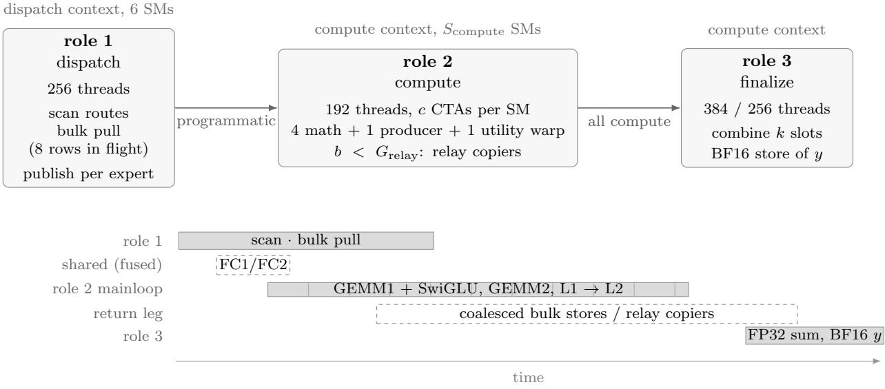
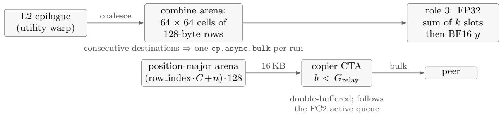
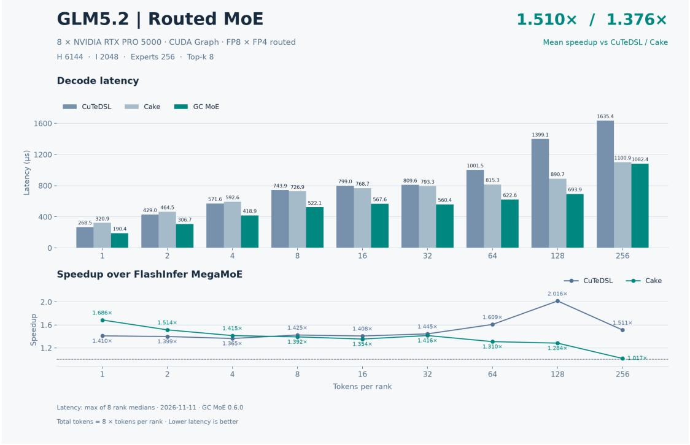
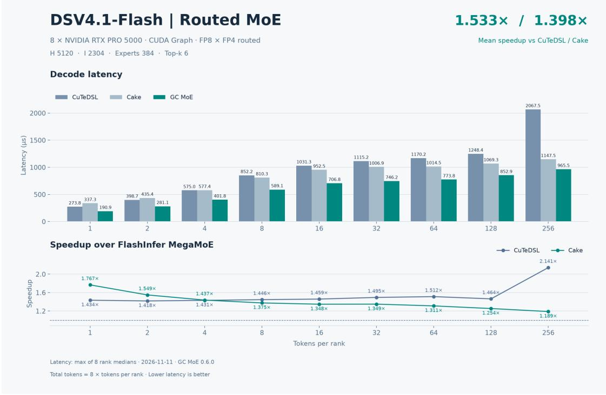
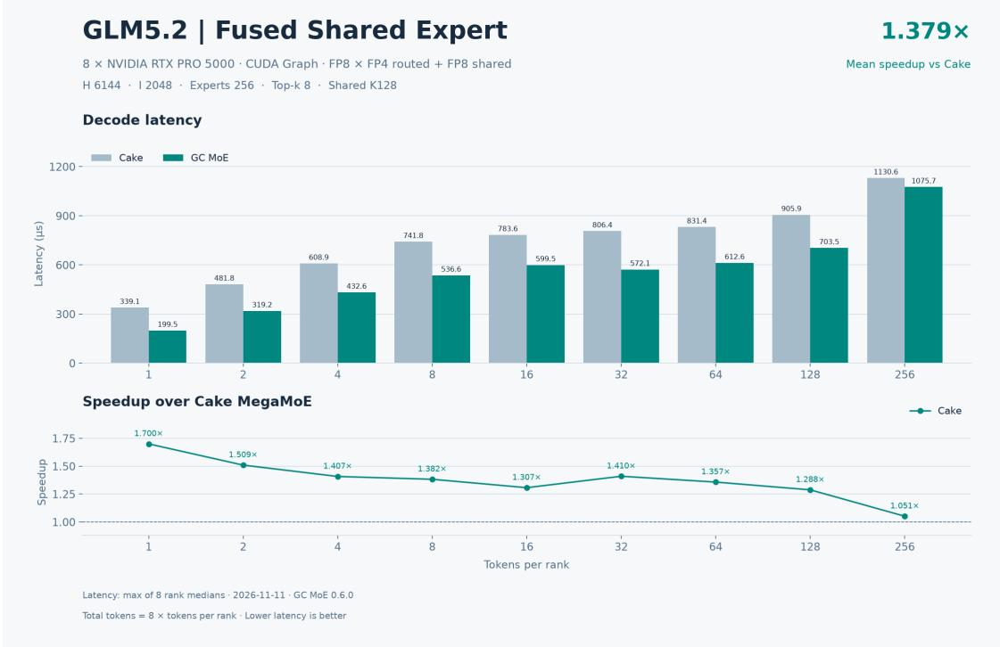
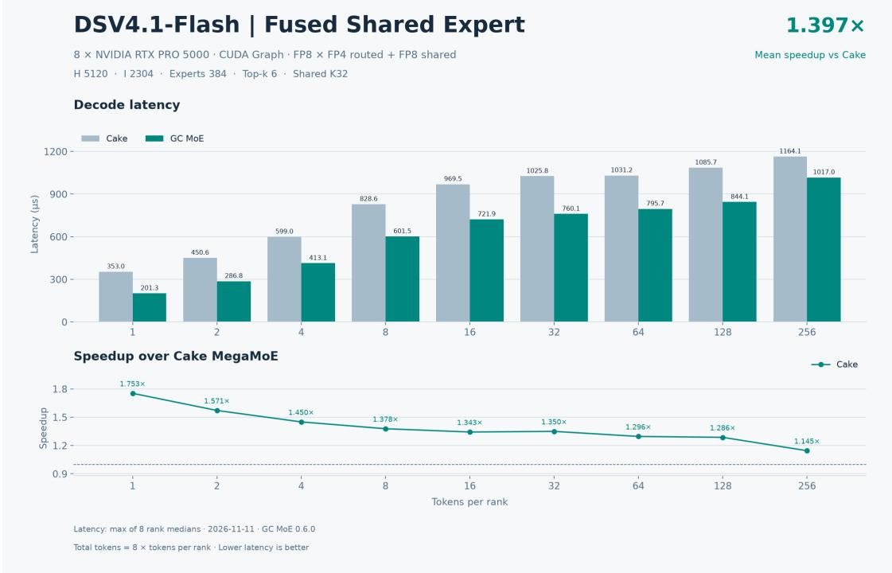

# GC-MoE on SM120: Overlapping Expert-Parallel Token Dispatch with Warp-Level FP8×FP4 Block-Scaled MMA on Consumer Blackwell

Yong Li Haoyu Wang Kan Liu Tao Lan

Alibaba Inc.

{brucelee.ly, why492961, liukan.lk, tao.lant}@alibaba-inc.com

## Abstract

Expert-parallel (EP) Mixture-of-Experts (MoE) decoding is a latency problem before it is a throughput problem: every layer serializes a token exchange over the interconnect, a grouped GEMM over the routed experts, and a combine, while only a few tokens per rank are in flight. Prior GC-MoE work attacks this serialization on Hopper (SM90) and datacenter Blackwell (SM100) by co-scheduling the communication and the compute of one layer inside one persistent, Green-Context-partitioned CUDA Graph.

This paper describes GC-MoE for SM120 (compute capability 12.0, e.g. RTX PRO 5000), the consumer/workstation Blackwell variant. SM120 is not a mechanical port of the datacenter design. It exposes block-scaled tensor cores only through warp-level mma.sync.aligned.kind::mxf8f6f4, so there is no tensor memory, no two-CTA MMA and no cluster-wide multicast to lean on; FP4 weight nibbles must be presented to the MMA per warp; the SM budget that can be partitioned between communication and compute is small; and the inter-GPU fabric is PCIe. We therefore rebuild the kernel around a swap-AB warp-level block-scaled MMA in which FP4 weights occupy the register A operand and FP8 activations the B operand, and we add a set of SM120-specific mechanisms: packed block-scale byte selection through MMA immediates that removes all scale-byte shufling from the inner loop; a compact-weights path that halves weight staging and expands FP4 in registers; a run-time adaptive token-tile geometry that selects among register/SMEM/global handofs; an expert-granular streaming dispatch with a batched bulk-pull engine, a 64-bit pull cache that deduplicates activation reads by (source rank, token), and packed-route and mirrored-metadata exchange; full-width BF16 returns that are coalesced into bulk stores on the direct path and drained by resident relay copiers over a position-major arena; and shared experts folded into the compute role, which reuses the routed role’s shared-memory budget instead of occupying a kernel of its own. On 8×RTX PRO 5000 over PCIe, the resulting operator is on average 1.522× faster than the FlashInfer CuTe DSL W4A8 MegaMoE and 1.387× faster than the Cake MegaMoE across 18 decode points and two model shapes (18/18 wins each), and 1.388× faster than Cake on the fused shared-expert variant; all 94 numerical cases and 752 per-rank checks pass, with cross-operator cosine similarity of at least 0.9999997.

## 1 Introduction

A Mixture-of-Experts (MoE) layer replaces one dense feed-forward network with E experts and a router that sends each token to its top-k experts. Under expert parallelism (EP) the experts are partitioned across ranks, so a single layer performs three dependent phases: (i) dispatch, an all-to-all-like exchange that moves each token’s activation to the ranks owning its selected experts; (ii) a grouped GEMM over the experts, computing the gate/up projection with a fused SwiGLU and then the down projection; and (iii) a combine, which returns each expert’s contribution to the token’s owner and weights and sums the k contributions.

At decode time the batch per rank is tiny—one to a few hundred tokens—so the layer is latency bound and badly under-utilized in each phase separately. The motivating observation of GC-MoE [1] is that the three phases do not need to be separated by global barriers: once a peer’s token row has landed, the experts that consume it can start, and the combine of one expert tile can proceed while later experts are still multiplying. GC-MoE therefore fuses dispatch, expert computation and combine into one three-node CUDA Graph whose nodes are pinned to disjoint SM partitions created with CUDA Green Contexts [9]: a communication partition runs the dispatch, a compute partition runs the grouped GEMM, and a small finalize partition performs the combine, all replaying per layer.

That design was built for Hopper and for datacenter Blackwell, and it leans on hardware those parts have: TMA multicast and distributed shared memory within a cluster, the fifth-generation tensor core with tensor memory (tcgen05) and two-CTA collaborative MMA, and NVLink-class interconnect bandwidth. The subject of this paper is the same operator on SM120, the compute capability that powers the RTX PRO 5000 and similar workstation/consumer Blackwell parts, connected over PCIe. Porting the SM100 kernel there fails for four structural reasons.

(1) The tensor-core programming model changes. SM120 does expose block-scaled (“microscaling”) tensor cores, but only through the warp-level

mma.sync.aligned.kind::mxf8f6f4.block scale.scale vec::1X.m16n8k32.row.col

instruction, which we call QMMA. There is no tcgen05.mma, hence no tensor memory, no asynchronous MMA with a separate completion barrier, no two-CTA collaborative MMA, and no clusterwide activation multicast. A 64 × N × K128 tile must be assembled out of m16n8k32 atoms issued by four math warps, and every operand must reach registers through SMEM.

(2) FP4 weights must be manufactured per warp. Routed weights are MXFP4 (E2M1 with UE8M0 scales), i.e. half a byte per element, while activations are FP8 (E4M3). The mixed-input QMMA consumes both operands from registers, so the 4-bit payload has to be turned into a legal operand: either expanded to 8-bit during the global-to-shared transfer, or staged as raw nibbles and expanded in registers. Both options exist in our kernel, and the choice interacts with SMEM capacity, which in turn decides how many CTAs can co-reside on the compute partition.

(3) The partition is small, so geometry must adapt. With six SMs defaulted to dispatch, the compute partition must still hold at least 32 SMs and an even count, and the whole compute grid (including the CTAs that stream results back) must be resident—the role kernels synchronize grid-wide. There is no room for a fixed, generously provisioned tile.

(4) The interconnect is PCIe. A routed activation row costs H bytes of FP8 plus H/32 bytes of packed scales; its contribution returns as BF16, i.e. 2H bytes. Over PCIe the return leg is therefore the single largest term of the exchange, and it is the term that the datacenter designs treat as free.

This paper presents the SM120 GC-MoE operator (GC MoE 0.6.0, commit 141d287), which addresses these four points with new mechanisms rather than retuning. Our contributions are:

• Swap-AB block-scaled mainloop. We place the FP4 weights in the QMMA A operand and the FP8 activations in B. This keeps the weight tile (M=64 rows, K=128) invariant and lets the token extent—the N dimension—change at run time without touching the weight pipeline, which is what makes the adaptive geometry of §4.4 cheap. We also feed the QMMA packed scale words and select the per-K32 scale byte with the instruction’s byte-id immediates, eliminating the shift/permute scale bookkeeping from the persistent loop (§4.3).

• Two FP4 operand paths. A 4D TensorMap expands FP4 to 8-bit during the TMA; a compact path instead keeps the raw nibble tile at half the bytes and expands it with four ld.shared.u16 plus prmt per fragment. The geometry selects between them (§4.3, §4.4).

• Adaptive geometry with global and shared handofs. Token-tile width, pipeline depth, weight compactness, L1 handof placement (SMEM vs. global vs. shared 32-row chunks), coresidency and register ceiling are derived from the routed-row count and the SMEM budget at launch time (§4.4).

• Streaming, expert-granular dispatch. Experts are published the instant their last row lands; peer rows are pulled with a batched cp.async.bulk engine that keeps several PCIe reads in flight; a producer-side pull cache keyed by (source rank, token) turns the several local experts a single token usually reaches into one PCIe read, and publishes the local row address through a single 64-bit acquire/release word; routes travel as a packed array and activation scales and route weights are mirrored into the peer workspace so the compute partition reads them locally (§4.5).

• Full-width BF16 returns with resident relay copiers. The return leg is twice the forward payload and is the largest term of the exchange on PCIe, so the operator spends its efort on how those bytes move rather than on a custom codec: the direct path coalesces consecutive destination rows of a tile into one bulk store with a single copy group in flight, while the relay path parks every finished row in a position-major arena that a resident copier CTA drains with double-bufered 16 KB transfers, following the FC2 active queue so a slow expert cannot hold up output that is already complete (§4.6).

• Shared experts inside the compute role. Rather than launching FC1/FC2 as separate kernels, the compute role runs them on its first four warps against the same dynamic shared memory the routed mainloop uses, ordered by per-token-tile completion counters and a named barrier, so the shared path costs neither an extra role nor extra residency (§4.7).

On 8×RTX PRO 5000 (PCIe) the operator wins all 18 decode points of two model shapes against both baselines, averaging 1.522× over CuTe DSL and 1.387× over Cake for the routed operator and 1.388× over Cake with the fused shared expert, and passes 94/94 numerical cases.

## 2 Background

## 2.1 MoE decoding under expert parallelism

Let a rank own L = E/R local experts, let B be the number of tokens resident on a rank per decode step, and let k be the routing fan-out. Each rank contributes Bk assignments to the layer and computes Bk of them on average, so the layer moves RBk assignments in total. The

assignments a rank receives are spread over its L local experts, which fixes the routed row count per expert,

$$
\begin{array} { r } { r \ = \ \left\lceil \frac { B k } { L } \right\rceil , } \end{array}\tag{1}
$$

is the quantity that decides the GEMM tile shape. Decode batches make r small: with L=32, k=8 and B=1 (§6), r=1; even at B=256 we have $r { = } 6 4$ , which the geometry of §4.4 covers with a single tile n=80 tile. These are token-side rows: in the swap-AB orientation of §4.3 they are the N extent, while the M=64 extent belongs to the weights.

For every remote assignment the exchange moves the activation row (H bytes of FP8), its microscaling factors (H/128 int32 words, i.e. H/32 bytes) and, after the down projection, a BF16 partial sum (2H bytes). Thus the per-assignment wire volume is

$$
\begin{array} { r } { \boldsymbol { v } = \boldsymbol { H } + \frac { \boldsymbol { H } } { 3 2 } + 2 \boldsymbol { H } , } \end{array}\tag{2}
$$

which on PCIe makes the return leg twice the forward leg. The SM120 operator keeps this payload intact and attacks the term from the other side: it removes redundant reads of the forward leg (§4.5), and it makes the return leg a bulk-copy problem handled by CTAs that are not doing arithmetic (§4.6).

## 2.2 GPU execution model

Green Contexts. CUDA 12.4+ exposes driver-level SM partitioning: a device resource is queried with cuDeviceGetDevResource, split by SM count with cuDevSmResourceSplitByCount, and turned into an independent execution context with cuGreenCtxCreate. A balanced workqueue resource (CU WORKQUEUE SCOPE GREEN CTX BALANCED with concurrency limit 1) guarantees that concurrently resident green contexts make forward progress instead of one starving the other. GC-MoE uses exactly this: the dispatched partition and the compute partition are separate contexts with separate streams, so a spinning consumer cannot block the producer.

Persistent role graphs. Each layer is a CUDA Graph of kernel nodes whose dependencies are declared explicitly. Because the role kernels synchronize grid-wide through epoch-tagged counters in device memory, every CTA of a role must be co-resident with the rest of its role; the runtime therefore validates each role’s grid against the occupancy of its partition before instantiating the graph.

Scale formats. An MXFP4 weight is a 4-bit E2M1 code with a shared UE8M0 exponent per 32 contiguous elements; an MXFP8 activation uses E4M3 with the same block structure. The QMMA multiplies a 4-bit operand by an 8-bit operand, adds into FP32, and applies both block scales. A K=128 reduction therefore needs four K32 blocks, i.e. four scale bytes per lane.

## 3 Motivation: what SM120 changes

With the dispatch overlapped against compute, the steady-state cost of a layer is

$$
T _ { \mathrm { s t e p } } ~ = ~ t _ { \mathrm { s c a n } } + t _ { \mathrm { p r o } } + \operatorname* { m a x } \bigl ( T _ { \mathrm { p u l l } } , ~ T _ { \mathrm { g e m m } } \bigr ) + \operatorname* { m a x } \bigl ( T _ { \mathrm { r e t } } , ~ t _ { \mathrm { c l e a n } } \bigr ) + t _ { \mathrm { t a g } } ,\tag{3}
$$

where $t _ { \mathrm { s c a n } }$ is route scanning, $t _ { \mathrm { p r o } }$ the time to publish the first expert, $T _ { \mathrm { p u l l } }$ the PCIe pull time of the activation stream, $T _ { \mathrm { g e m m } }$ the grouped GEMM time, $T _ { \mathrm { r e t } }$ the return trafic, $t _ { \mathrm { c l e a n } }$ the SMEM/global recycling, and $t _ { \mathrm { t a g } }$ the completion handshake. Compared with the SM90/SM100 case, each term changes character.

MMA eficiency. One QMMA retires $1 6 \times 8 \times 3 2$ multiply-accumulates from registers. To keep the tensor pipe busy the inner loop must issue back-to-back, which leaves no budget for scale bookkeeping. On SM100 the scale factors are gathered by the tensor core from SMEM; on SM120 they are ordinary register operands, so any per-issue byte extraction (shf, lop3, prmt) directly steals MMA issue slots. Our first design decision follows: keep the four K32 scale bytes of a K128 block in one 32-bit register and let the instruction choose the byte (§4.3).

Operand orientation. If the token dimension is placed on M, the activation tile’s SMEM footprint and its legal TMA descriptor change with the token count, and the weight operand would have to be transposed (which the FP4 matrix load cannot do). Placing the weights on M and the tokens on N decouples the two: M=64 is fixed, and the only run-time quantity is how many N=8 groups are issued.

SM budget and co-residency. The compute partition holds the MMA CTAs and the CTAs that stream returns, all resident. The number of co-resident CTAs per SM is

$$
c = \mathrm { m a x } \Big ( 1 , \mathrm { m i n } \big ( 4 , \big \lfloor S _ { \mathrm { s m } } / S _ { \mathrm { r o l e 2 } } \big \rfloor \big ) \Big ) , \qquad R _ { \mathrm { c a p } } = 1 6 \Big \lfloor \frac { 6 5 5 3 6 } { 1 9 2 c \cdot 1 6 } \Big \rfloor ,\tag{4}
$$

where $R _ { \mathrm { c a p } }$ is the per-thread register budget rounded down to the allocator’s 16-register granularity (and left unset when only one CTA co-resides). A few kilobytes of SMEM therefore decide whether the kernel runs one CTA per SM (and loses half its latency hiding) or four. Geometry must therefore be selected per shape, not per architecture.

PCIe and the return leg. By (2) the return leg is 2× the forward leg per assignment. At B=128 with k=8 over 8 ranks (GLM5.2) the measured payload rate is only 24 GB/s per GPU (§6), far below the memory system, so the return path is where the operator must be frugal in transactions rather than in bytes: one bulk copy per contiguous run, and copiers that do not steal MMA CTAs.

Small batches. At $B \le 2$ the whole schedule is dominated by control: the scan, the publish handshake and the completion tag. There, an alternative dispatch path that scans peers directly from one CTA and opens a local gate for the rest beats the general pipeline.

## 4 The SM120 GC-MoE Design

## 4.1 Overview

The layer is executed by three role kernels. A role is a (grid, threads, SMEM) tuple launched into one of two Green contexts; role 1 runs in the dispatch context and roles 2 and 3 in the compute context. Table 1 lists them and Algorithm 1 states how the graph is composed. There is no fourth role: the shared expert of §4.7 is compiled into role 2, and the return leg of §4.6 is served by role-2 CTAs and by the utility warp of the mainloop, so the fused variant runs the same three kernels with a diferent argument vector.

Figure 1(a) draws the three kernels and the two contexts they occupy, and panel 1(b) shows the schedule of one replayed layer. Two properties of the graph are load-bearing. First, the edge from role 1 to the compute roles is a programmatic dependency: the compute nodes are released once the dispatch CTAs have taken their seats, not when dispatch finishes, and the actual data dependency is carried by the per-expert readiness words. Second, all roles keep their synchronization state in the workspace and derive their barrier phases from monotone issuance counters, so replaying the graph never re-initializes anything; this is what allows the whole layer to be captured and replayed a hundred times per timing window.

<table><tr><td>Role</td><td>Threads</td><td>Context</td><td>Work</td></tr><tr><td>1</td><td>256</td><td>dispatch (6 SMs)</td><td>scan routes, pull peer rows, publish experts</td></tr><tr><td>2</td><td>192</td><td>compute</td><td>grouped GEMM1+SwiGLU, GEMM2, return staging, relay, shared-expert FC1/FC2</td></tr><tr><td>3</td><td></td><td>384 / 256 compute</td><td>combine k partial sums, BF16 store of y</td></tr></table>

Table 1: SM120 role kernels. Role 3 runs with 384 threads on the unbatched path and with 256 once returns are batched through the relay arena. The copiers are role-2 CTAs: the blocks below $G _ { \mathrm { r e l a y } }$ stream the arena instead of running the MMA.

Algorithm 1 Layer replay (SM120)   
1: ▷ persistent, replay-aware counters; no per-layer reset   
2: epoch ← epoch +1 in the header word (release)   
3: launch role 1 with a programmatic-dependency edge to role 2   
4: for each role-2 CTA b do   
5: if $b < G _ { \mathrm { r e l a y } }$ then   
6: drain the position-major relay arena to the peer it owns   
7: else   
8: if shared expert is fused then   
9: warps < 4: FC1/FC2 tiles, ordered by completion counters   
10: end if   
11: per expert: claim → W/X pipeline → L1 → L2   
12: end if   
13: end for   
14: role 3 depends on all compute nodes; combines and writes y

## 4.2 Green-context partition and residency

The runtime queries the device SM resource, splits it by count with the co-scheduling alignment a reported by CUDA,

$$
S _ { \mathrm { c o m p u t e } } = \Big \lfloor \frac { S _ { \mathrm { t o t a l } } - S _ { \mathrm { d i s p a t c h } } } { a } \Big \rfloor a , \qquad S _ { \mathrm { d i s p a t c h } } = 6 \ ( \mathrm { d e f a u l t } ) ,\tag{5}
$$

and creates two green contexts, each with its own stream. It then verifies that the split is usable $( S _ { \mathrm { c o m p u t e } } \geq 3 2 , S _ { \mathrm { c o m p u t e } }$ even, $S _ { \mathrm { d i s p a t c h } } > 1$ , and the two parts sum to the device count). Both contexts request the balanced workqueue so that a spinning consumer in the compute context cannot starve the producer.

Residency is checked, not assumed. Before a child graph is instantiated the runtime asks the driver for the number of active blocks per SM at the role’s exact thread and dynamic-SMEM footprint and rejects the graph if

$$
G _ { \mathrm { r o l e } } > c _ { \mathrm { r o l e } } \cdot S _ { \mathrm { r o l e } } ,\tag{6}
$$

because the role’s grid-wide rendezvous would otherwise deadlock. The check covers all three roles, so neither the shared-expert staging nor the relay arena—both of which raise role 2’s dynamic

mma.sync.aligned.kind::mxf8f6f4.block\_scale.scale\_vec::1X.m16n8k32   
.row.col.f32.e2m1.e4m3.f32.ue8m0   
{\$0, \$1, \$2, \$3}, // d: 4 x f32 accumulator   
{\$4, \$5, \$6, \$7}, // a: FP4 weights, 4 x b32   
{\$8, \$9}, // b: FP8 activations, 2 x b32   
{\$0, \$1, \$2, \$3}, // c

  
Figure 1: (a) The three role kernels and the two Green contexts they run in. (b) One replayed layer: the phases overlap because no barrier separates them—an expert starts as soon as its last row lands, and the return leg of one expert runs under the next expert’s MMA.

footprint—can smuggle in a grid that only fits in one of the two modes. It is also what makes the geometry of §4.4 authoritative: the heuristic may not propose a grid the partition cannot hold.

## 4.3 Swap-AB block-scaled mainloop

Why swap A and B. The QMMA has shape m16n8k32 and takes A from four 32-bit registers and B from two. We assign

A: FP4 routed weights, M=64 weight rows, B: FP8 activations, N= token columns.

This has three consequences. (i) The weight operand is the one with the M=64 extent, so the weight TensorMap, the weight SMEM tile and the weight swizzle are the same for every shape; only the number of N=8 groups issued against that tile varies with the token count. (ii) The FP4 operand is loaded by the 4-bit matrix load, which cannot transpose, and a K-major packed weight tile is exactly what a tile-invariant descriptor produces. (iii) Four math warps each own one M16 atom of the M64 slice, so the reduction over K is replicated four times and no warp ever needs another warp’s accumulator.

Packed scales with byte-id immediates. A K=128 block carries four UE8M0 scale bytes per lane, i.e. one 32-bit word. The mainloop loads that word once per stage with an ordered SMEM read and then issues four QMMAs whose scale operands are the same word paired with a byte index:

Listing 1: The QMMA issue with packed scale words (one of four K32 steps).

With byte id $= k _ { \mathrm { i n n e r } } \in \{ 0 , 1 , 2 , 3 \}$ the instruction itself selects the K32 sub-block’s exponent, so the inner loop contains no shift, no logical-op and no permute for scales. The alternative— extracting a byte per issue and re-materializing the SFA/SFB fragments—costs several arithmetic instructions per QMMA in the persistent K loop, which is precisely the loop that must stay issuebound. We keep the packed word in a register across the four issues and reuse it for every N8 group of the stage.

Routing the FP4 operand. Two paths produce the A fragment.

Expanded path. A 4D TensorMap stages the weight tile with an FP4→8-bit expansion during the bulk copy, so SMEM holds one byte per weight element and the tile is 8 KB per K128 step. The warp then loads its fragment with ldsm.b4x16 p64 (four matrices, 4-bit unpack, no transpose) and shifts the unpacked E2M1 codes into the bit position the mixed-input encoding consumes:

fragment\_i8[i] = Int8(fragment\_i8[i] << 2);

Compact path. Storing the raw nibble tile instead is 4 KB per step, half the bytes, but the fragment must be built by hand: for each of four words the warp issues ld.shared.u16, widens it, splits high and low nibbles with prmt, masks to 0x0f0f0f0f and shifts left by two.

ld.shared.u16 h, [address+off]; cvt.u32.u16 packed, h;

shr.u32 high, packed, 4;

prmt.b32 expanded, packed, high, 0x5140;

and.b32 expanded, expanded, 0x0f0f0f0f;

shl.b32 out, expanded, 2;

Because the load bypasses CuTe’s pointer swizzle, the compact tile applies SW64 explicitly (o ⊕ ((o ≫ 3) & 0x30) for byte ofset o), and the four sub-words are fetched with one 16-bit load each at the 0/512/8/520 byte ofsets that the K-major layout implies. The trade is four scalar SMEM reads per fragment against 4 KB of SMEM: the compact path is selected exactly for the tile widths where the freed 4 KB buys a second co-resident CTA (§4.4).

Scale staging and the K loop. SFA (weights) and SFB (activations) are staged by cp.async into a 512-byte-per-stage layout (128 \* K128 / 32) and are part of the same arrival barriers as the data: fullW[s] completes when the weight TMA and the SFA staging for slot s have landed, fullX[s] likewise for activations and SFB. The consumer keeps a compile-time-bounded number of live N8 groups, masks the tail with active n groups, and for each group walks $k _ { \mathrm { i n n e r } } = 0 . . 3 ,$ , so the number of QMMAs per expert tile is

$$
N _ { \mathrm { Q M M A } } = \frac { N _ { \mathrm { o u t } } } { 8 } \mathrm { ~ \cdot ~ } \left\lceil \frac { r } { \mathrm { t i l e \_ n } } \right\rceil \mathrm { ~ \cdot ~ } \frac { K } { 1 2 8 } \mathrm { ~ \cdot ~ } 4 ,\tag{7}
$$

with $N _ { \mathrm { o u t } }$ the weight-row extent of the projection (2I for GEMM1, H for GEMM2).

SMEM layout. Both data operands use the SM120 TMA/ldmatrix-compatible SW128 staging layout built from the warpgroup SMEM atom, so the same descriptor serves the expanded weight tile, the compact weight tile and the activation tile with diferent extents.

## 4.4 Adaptive tile geometry

All geometry is a pure function of the launch shape, evaluated once and cached. From (1) the heuristic computes r and then walks the following decision chain.

Token tile. When the BF16 handof path is active, the tile is chosen from four tiers,

$$
{ \mathbf t i } 1 | | { \mathbf e } { \cdot } { \mathbf n } \in \{ 3 2  , \ 4 8 , \ 8 0 , \ 9 6 \} , \qquad { \mathbf t i } 1 | { \mathbf e } { \cdot } { \mathbf n } = \left\{ \begin{array} { l l } { 3 2 , } & { 1 6 \leq r < 3 2 , } \\ { 4 8 , } & { 3 2 \leq r < 4 8 , } \\ { 8 0 , } & { 6 4 \leq r < 9 6 \land r + \lfloor \sqrt { r } \rfloor \leq 8 0 , } \\ { 9 6 , } & { 6 4 \leq r < 9 6 \land r + \lfloor \sqrt { r } \rfloor > 8 0 , } \end{array} \right.\tag{8}
$$

Row counts outside those tiers fall back to tile $\mathtt { n } = 1 6$ when $r < 1 6$ and to tile $\mathtt { n } = 6 4$ otherwise— which is what covers $4 8 \leq r < 6 4$ and $r \geq 9 6$ on the handof path. The fallback is not free: only the {48, 80, 96} tiers enable compact weights (§4.3), so a 64 tile stages full-width weights. The $\sqrt { r }$ slack in the 80 tier is the same guard the datacenter kernel uses: uneven routing can push an expert past its mean row count, and 80 tiles absorb that without falling back to 96.

Depth, compactness, handof. The pipeline has four stages at tile $\mathtt { n } = 1 6$ , where the tiles are too small to hide latency with only two, and two stages otherwise. Compact weights are enabled for tile $\mathbf { n } \in \{ 4 8 , 8 0 , 9 6 \}$ exactly the tiers where 4 KB decides co-residency. A global handof is used for every tile $\mathbf { n } \geq 3 2$ on the BF16 path, and when tile $\mathtt { n } \geq 4 8$ the handof is replaced by shared 32-row chunks so the L1 tensor never leaves the SM. Handof slots $_ { ( s = 2 }$ with a global handof, s=1 otherwise) let the utility warp work on one tile while the math warps fill the other.

Return staging mode. Three booleans decide how a tile’s rows leave the SM. Batched returns need the shape to promise at least 32 rows per local expert $\left( B k \ge 3 2 L \right)$ and the workspace to carry the batched route array; below that the operator falls back to the per-slot route words and the small-tile path. Mirrored metadata is provisioned only when $k < R ,$ , because that is the only case in which a token’s activation scales and route weights are not already local. Relay staging then follows: it is on whenever batched returns are on and the position-major arena fits the relay budget $( R B _ { \mathrm { c a p } } k 2 H \le 2 5 6 \mathrm { M B } )$ , unless mirrored metadata is on and no shared expert is fused—there the direct path already has everything locally and the arena would only add a copy. For the two shapes of §6 this gives relay staging and the pull cache for GLM5.2 (k=R=8), mirrored metadata without either for DSV4.1-Flash $\left( k { = } 6 < 8 \right)$ , and relay staging for both fused variants, where the shared work hides the copy.

Role-2 SMEM model. The budget that drives c in (4) is

$$
S _ { \mathrm { r o l e 2 } } = \operatorname* { m a x } { \left\{ \ S _ { \mathrm { m o d e l } } , \ 2 S _ { \mathrm { s h a r e d } } + 1 6 , \ 2 \left( 1 6 \mathrm { K B } + 8 \right) \right\} } ,\tag{9}
$$

with the mainloop model

$$
S _ { \mathrm { m o d e l } } = s _ { \mathrm { s t } } { \left( P _ { W } + P _ { X } \right) } + \tt t i l e \mathrm { n } \cdot 1 6 + 1 6 + B _ { \mathrm { b a r } } + B _ { \mathrm { r e t } } + B _ { \mathrm { u t i l } } + 5 1 2 ,\tag{10}
$$

per-stage weight and activation bytes

$$
P _ { W } = \frac { 6 4 \cdot 1 2 8 } { 2 ^ { c _ { w } } } + 5 1 2 , \qquad P _ { X } = \tt t i l e . n \cdot 1 2 8 + 5 1 2 ,\tag{11}
$$

with $c _ { w } = 1$ on the compact-weights path and 0 otherwise; the 512 is the per-stage scale block. Here $s _ { \mathrm { s t } }$ is the mainloop depth, $B _ { \mathrm { b a r } }$ the stage-arrival barriers, the return staging $B _ { \mathrm { r e t } } = \tt t i l e \_ n ( 2 0 +$ $1 2 8 s )$ , which falls to 20tile $\mathbf { \epsilon } \mathbf { n } + 1 6$ with a global handof and to 20tile $\mathtt { n } + 1 2 8 \cdot 3 2$ s once shared 32-row chunks replace the global source tiles, and the utility overlay $B _ { \mathrm { u t i l } } = 3 2 + 2 4 s + 1 6 s \mathrm { t i l e } \mathbf { \mathrm { . n } }$ for s handof slots. The second term is the shared-expert double bufer

$$
S _ { \mathrm { s h a r e d } } = \left\lceil \frac { 8 1 9 2 + 5 1 2 + 1 3 2 \tt t i l e . n _ { s } } { 1 0 2 4 } \right\rceil \cdot 1 0 2 4 , \qquad \tt t i l e . n _ { s } \in \{ 8 , 1 6 , 3 2 , 6 4 \} ,\tag{12}
$$

i.e. one 8 KB weight tile, one 512-byte scale block and $\mathtt { t i l e } \mathtt { \lrcorner } \mathtt { n } _ { s }$ padded token rows; the shared GEMM runs two of them and then hands the storage to the routed mainloop. The third term is the copier’s two 16 KB slots. These are maxima rather than sums because the three phases never overlap inside a CTA: the fused and relaying variants add at most the largest of three footprints instead of their total. The kernel verifies the model at run time: the first thread of the CTA compares the allocator’s reported footprint against this budget with a trap-on-exceed check, so a compiler change that perturbs the SMEM plan fails loudly instead of corrupting the handof.

Reserved return CTAs. ℓ CTAs of the compute grid—the l2 dedicated field of the role configuration—are reserved so that return trafic always has a seat: $\ell = 1$ by default, $\ell = 4$ once tile n $\geq 6 4$ or a global handof is in use $( \ell = 6$ for the unbatched $\mathtt { t i l e \_ n } = 8 0$ tier, which also needs an $\mathrm { F C 1 / F C 2 }$ scheduling period of slack), and $\ell = 3$ when batched returns are active without resident copiers and no shared expert is fused. The relay grid is then

$$
G _ { \mathrm { r e l a y } } = \operatorname* { m i n } { \left( R , \ G _ { \mathrm { c o m p u t e } } - \ell \right) } ,\tag{13}
$$

and a shape whose compute partition cannot host $\ell + 1 ~ \mathrm { C T A s }$ is rejected rather than silently degenerating. The finalize grid is min $( 2 S _ { \mathrm { c o m p u t e } } , \lceil B _ { \mathrm { b o u n d } } H / 2 0 4 8 \rceil )$ , or min $( B _ { \mathrm { c a p } } , 4 S _ { \mathrm { c o m p u t e } } )$ on the batched path where the epilogue is register-limited $( B _ { \mathrm { c a p } }$ is the per-rank token capacity). The dispatch grid is $S _ { \mathrm { d i s p a t c h } } \operatorname* { m i n } ( 4 , \lfloor S _ { \mathrm { s m } } / S _ { \mathrm { r o l e 1 } } \rfloor )$ with $S _ { \mathrm { r o l e 1 } } = 5 1 2 + 1 6 H + 6 4$ when the bulk-pull engine is used.

Table 2 instantiates the chain for the two evaluation shapes at $B { = } 2 5 6$ . The interesting contrast is that the models take opposite return paths: GLM5.2 has $k { = } R { = } 8$ , so its pull cache engages and the mirrored metadata is unused, while DSV4.1-Flash has $k { = } 6 < R ,$ so its scales and route weights are mirrored, the cache stays of, and the direct path writes 64-row combine cells with no relay at all—hence $\ell { = } 3$ instead of 4. Fusing the shared expert turns the relay back on for DSV4.1-Flash because the shared work hides the copy, which raises ℓ to 4 and makes the two variants of the second model difer in exactly one scheduling decision.

## 4.5 Streaming dispatch

Role 1 owns several mechanisms beyond the ring protocol inherited from GC-MoE.

Expert-granular publish. The naive group rendezvous waits for every CTA’s share of eight experts and only then exposes all of them, so the compute partition idles behind the slowest CTA of the group. Instead, each pulling warp issues a release-add on expert arrive[slot] after it drains a row, and the thread that completes the expert writes the count, releases expert ready[slot], and appends the expert to an active queue that role 2 claims in order. Visibility is transitive by construction: the completing thread’s acquire-release add acquires the whole release sequence of the pullers, and its own release carries the rows to the claimer’s acquire. A separate counter lets the last expert publish the final queue size, so a consumer never has to guess whether the queue is drained.

<table><tr><td>Geometry</td><td>GLM5.2  $\scriptstyle ( L = 3 2 , k = 8 )$ </td><td>DSV4.1-Flash (L=48, k=6)</td></tr><tr><td>B = 1: rows/expert, tile, stages</td><td>1, 16, 4</td><td>1, 16, 4</td></tr><tr><td> $B = 2 5 6 \colon$  rows/expert</td><td>64</td><td>32</td></tr><tr><td>tile_n / stages</td><td>80 / 2</td><td>48 /2</td></tr><tr><td>compact weights</td><td>yes</td><td>yes</td></tr><tr><td>handoff: global + shared chunks</td><td>yes</td><td>yes</td></tr><tr><td>batched BF16 returns</td><td>yes</td><td>yes</td></tr><tr><td>mirrored metadata</td><td>no  $( k = R )$ </td><td>yes</td></tr><tr><td>resident relay copiers</td><td>yes</td><td>no / yes</td></tr><tr><td>pull cache</td><td>yes</td><td>no  $( k < R )$ </td></tr><tr><td>l (12_dedicated)</td><td>4</td><td> $3 ~ / ~ 4$ </td></tr></table>

Table 2: Geometry selected at run time for the two models of $\ S 6$ at B=256. Slashes separate the routed operator from the fused shared-expert variant.

Batched bulk pull. A fused ld.global / st.global pair per 512-byte chunk stalls a full PCIe round trip per chunk. Two designs fix this. The engine path issues cp.async.bulk peer→SMEM copies from lane 0 with two slots per warp and one mbarrier per slot; the copy’s completion transaction flips the slot’s phase, so a warp can post the next row into the other slot before draining this one, keeping two copies in flight. The drain then performs only local writes, which keeps the engine dedicated to peer reads. The fallback path (used when the shape does not admit the engine) batches four chunks in registers with 16-byte loads before storing them, at a cost of four words per chunk. The batch depth is set by the shape: 8 rows in flight when a rank owns fewer than 48 experts and 1 otherwise, raised to 4 when the pull cache is active and lowered to 2 when batched returns run without mirrored metadata.

Producer-side pull cache. When $k \geq R$ a token is routed to several local experts with high probability, so the same peer row is requested more than once. The cache stages the row in the local arena on the first request and serves later requests from there. Its state is one 64-bit word per (source rank, source token), claimed by

atom.acq\_rel.gpu.global.cas.b64 entry, [slot], 0, 1;

where 0 is empty, 1 means another warp is filling the row, and any larger value is the local row address itself, published by the draining warp with a release store (st.release.gpu.global.u64) once its vector stores have landed. Collapsing flag and pointer into a single word is what makes a hit waitable: the requester spins on an acquire load until the entry leaves 1, then points the bulk engine at that address after an async-proxy fence. The wait cannot deadlock, because a warp publishes its own outstanding row before it waits on another warp—the engine keeps one pending row per warp and every dispatch CTA is resident, so the wait graph stays acyclic. The cache costs 8 bytes per (source, token), i.e. 8 R $B _ { \mathrm { c a p } }$ bytes in the handof arena, and is enabled only when it can be free: the arena must be large enough, $k \geq R$ , and the chosen tile must be 80, or 48 when returns are batched—the two geometries where the handof arena is not already consumed by return staging.

Packed routes and mirrored metadata. Two PCIe read streams are removed from the compute partition. First, in batched mode routes travel as a packed array indexed by (peer, source, position)—the same index the return arena uses—instead of one 32-bit word per (expert, source, slot), with a per-expert base that maps a position back to the source; role 2 therefore needs one array read per hit instead of a strided peek into the peer’s source index.

Second, when mirroring is active $( k < R )$ , role 1 copies the token’s activation scales (H/128 words) and its route weights (k words) into the peer’s workspace alongside the route, and publishes the peer epoch only after a system fence covers both, so the compute partition reads scales and weights locally instead of over PCIe. The two are alternatives rather than companions: at $k \geq R$ the deduplicating cache already removes the repeated activation reads, and the scale/weight mirror is not allocated at all.

Tiny batches. For $B \le 2$ the operator uses a direct scan: one block polls all peers over the fabric and opens a local gate, so the remaining blocks spin on local memory instead of re-issuing sys-scope acquires, and the expert grid is clamped to the number of local experts.

## 4.6 Return path: full-width BF16 and relay copiers

Motivation. The down-projection result is BF16, 2H bytes per hit: twice the forward activation and, on PCIe, the largest term of (2). An earlier version of this operator coded each element in 12 bits to shrink that payload. The current design drops the codec. A 96-byte row breaks the 128-byte row granularity that both the combine cells and the bulk copies want, the encode/decode arithmetic ran on the same utility warp that stages the row, and every receiver would have had to decode before its FP32 accumulate. It is cheaper to keep the row full width and make the copy itself the object of optimization.

Direct path: coalesced bulk stores. The utility warp owns the L2 epilogue. It first materializes, for every valid row of the tile, the 64-bit destination address inside the combine arena: 64-row cells of 128-byte rows, one cell per column block and N-tile, so that a token’s output for one column block is contiguous. Consecutive positions that share a source and fall inside the same cell therefore difer by exactly 128 bytes. The warp ballots row-group boundaries and issues one cp.async.bulk per run of consecutive destinations, so a burst of positions becomes a single bulk store instead of one store per row. One copy group is kept in flight (commit group, then wait group(1)), which hides the previous round’s store latency without ever draining the queue.

Relay path: position-major staging, resident copiers. Bulk stores issued from the compute partition still cost a PCIe write from a CTA that could be doing arithmetic. The relay path moves them out. The utility warp parks each finished row into a local arena at (row index \* colblocks + ntile) \* 128, where row index = source \* B cap \* k + pos: the arena is position-major, so all rows of one (expert, source) pair are contiguous no matter which N-tile produced them. Role 2 then splits its grid: the first $G _ { \mathrm { r e l a y } }$ blocks are the copiers ((13)) and the rest run the MMA, so the copiers cost co-residency but no extra SMEM—their two 16 KB slots alias the mutually exclusive MMA workspace. Each copier walks, for one peer, the experts in the order they become active, waits for the expert’s L2 completion count (relay done), and streams count \* colblocks \* 128 bytes global→shared→global in 16 KB chunks, retiring the older send before it overwrites the source slot. Because it follows the FC2 active queue rather than the expert id, a slow expert cannot hold up output that is already complete.

Combine. Role 3 then accumulates the k slots in FP32 and writes y once, in BF16; Figure 2 contrasts the two ways a row reaches it. The addressing is the only thing that difers between the two paths—the direct path reads 64 × 64 cells, the relay path reads position-major rows—so the same finalize kernel is compiled with one boolean. A route that lost its arena slot to capacity is marked with an out-of-range position and poisons that token’s sum rather than silently reading a neighbouring row.

  
Figure 2: The two return paths. Top: the direct path writes each row where the combine will read it and merges runs of consecutive destinations into one bulk store. Bottom: the relay path parks rows position-major and hands them to a resident copier CTA.

Measured cost. The return leg is deliberately uncompressed, so its wire volume is the 2H of (2); what the operator buys instead is transaction eficiency and SM independence. At B=128 (GLM5.2) the returned payload moves at 24.1 GB/s per GPU against 12.0 for the CuTe DSL operator and 18.8 for Cake, and at B=256 all three converge near 30 GB/s, where the leg stops separating them and the weight stream takes over.

## 4.7 Fused shared experts inside the compute role

A shared expert runs on every token, so its GEMMs are token-parallel rather than expert-parallel. Instead of two further kernels, FC1 and FC2 are compiled into role 2 and run before the routed mainloop against the same dynamic SMEM allocation. Only the first 128 threads (four warps) take part; the two remaining warps idle, which is free because the shared work completes before the mainloop starts.

The shared GEMM is a small mainloop of its own: a double-bufered K=128 pipeline of one 64 × 128 weight tile (8 KB), a 512-byte scale block and tile $\mathtt { n } _ { s }$ padded token rows (tile $\mathbf { \lambda } _ { \mathbf { n } _ { s } } \in$ {8, 16, 32, 64}, chosen from the token count), with two mbarriers and a barrier.sync 2, 128 that names the participating warp count rather than the block. FC1 stages the token-major activation rows, applies BF16 SwiGLU with the caller’s clamp—the clamp bound is itself rounded to BF16 so that both branches agree—and requantizes to MXFP8 with UE8M0 scales; FC2 multiplies by the shared down projection and writes shared y. Shared weights are FP8 with a K-group of 32 or 128 and must arrive as the packed int32 scale payload, which is the only form the shared mainloop accepts.

Ordering is carried by counters, not by graph edges. Tiles are indexed so that all FC1 output tiles of one token tile are adjacent; a worker release-adds that token tile’s counter when its FC1 tile finishes, and an FC2 tile waits until the counter reaches the number of FC1 output tiles in the group. Every worker finishes its own FC1 sweep before entering the FC2 sweep and all role-2 CTAs are resident, so the wait is always satisfiable. At the end the block synchronizes, the shared mbarriers are invalidated, and the routed mainloop takes over the same storage: the shared path adds neither a role, nor a graph edge, nor persistent SMEM.

On the finalize side, role 3 adds shared y into the same FP32 accumulate that folds the k routed slots, so the shared expert costs no extra pass over y, and block 0 of the finalize clears the FC1 counters from both finalize paths before the workspace is reused. That last detail is what keeps a captured graph replayable without a reset pass between layers—the reason the graph could be replayed a hundred times per timing window.

## 4.8 Warp specialization and the epilogue

Role 2 has 192 threads: four math warps (one M16 atom each), one TMA producer warp, and one utility warp. The producer owns separate W and X barrier sets, so a stalled weight descriptor never blocks activation staging, and the scale cp.async rides the same arrival as its data. The utility warp runs the L1 epilogue (route-weight multiply, SwiGLU, requantization) and the L2 return staging on alternating handof slots; its FP32 FC1 handof overlays the return staging storage, which is how a tile n=96 configuration still fits the SMEM model of (9). Route sources and positions for the whole tile are prefetched into registers during the MMA so that the epilogue never issues a dependent global read.

L1 epilogue. For each 16-row group the utility warp multiplies the gate and up tiles by the route weight, evaluates the clamped SwiGLU in BF16, and requantizes to MXFP8 with one UE8M0 exponent per 32-element block, writing activations and scales into the L2 arena in the layout the second mainloop stages from. The staging that follows is either the coalesced bulk store or the relay park of §4.6; both are chosen at compile time from the same shape decision, so the warp has no branch in its loop.

## 5 Implementation

## 5.1 PTX rewriting and occupancy control

The role kernels are written in CuTe DSL and compiled to sm 120a cubins at run time, keyed by a compiler identity (release string, target, ptxas options). Four rewrites happen between the DSL’s PTX and ptxas:

PTX version. CuTe emits a .version 9.4 header for these kernels. Under the CUDA 13.2 toolchain we rewrite it to .version 9.2: the SM120 instruction stream we emit is legal under 9.2, and ptxas verifies every instruction against the target architecture anyway. The rewrite is applied only when the recorded toolchain release is 13.2, so a newer toolchain is left untouched.

Register ceiling. The warp-specialized producer adds enough live values to tip the role-2 CTA past the register file once the allocator’s 16-wide per-thread rounding lands: the kernels compile to just under two hundred registers per thread, the allocator rounds the number up, and at 192 threads two CTAs no longer fit the 65,536-register file—both the block limit and the driver’s L1/shared carveout then collapse to a single CTA per SM, a ∼1.5× slower sweep. The runtime therefore rewrites CuTe’s minimum-occupancy directive from .minnctapersm 1 to the co-residency the SMEM budget intends, and pins a 16-aligned ceiling $R _ { \mathrm { c a p } }$ from (4): 160 registers per thread at two CTAs per SM, 80 at four, and no ceiling when a single CTA co-resides.

Finalize occupancy. The 384-thread finalize kernel is emitted with .minnctapersm 4. The scheduler only ever asks for two resident finalize CTAs per SM, so the directive is rewritten to 2; otherwise the driver would shrink the carveout for a CTA count that is never requested.

TensorMaps by value. Role 2 needs six descriptors— $\small - W _ { 1 } , X _ { 1 } , W _ { 2 } , X _ { 2 }$ and the two shared weight maps—and a descriptor that lives in global memory is fetched into the tensormap cache on first use. That fetch is exactly what a replayed graph cannot aford: it is a miss inside the mainloop’s first stage, and it is invisible to the graph. The host therefore encodes all six into 128-byte blobs and passes them in the argument vector, and the PTX rewrite turns the four routed map formals (8–11) and the two shared ones (15–16) into .param .align 128 .b8 name[128] and their single ld.param.u64 into cvta.param::entry.u64, so each TMA instruction addresses the parameter space directly. The rewrite asserts that every map is loaded exactly once and used exactly twice, which is a stronger check than counting formals: it fails if CuTe ever reuses a descriptor for a second purpose. Roles 1 and 3 keep the plain pointer ABI, and role 2 drops the shared pair when no shared expert is fused.

Each rewrite asserts that it matched exactly once. In addition, every role’s PTX is validated before assembly: the entry must have exactly 20 formals—seventeen pointers and three scalars, in that order—and the role-2 PTX must still contain both mma.sync.aligned.kind::mxf8f6f4 and cp.async.bulk.tensor. This validation is what keeps the hand-written inline assembly of §4.3 honest across compiler upgrades: if a CuTe version changes the launch ABI or drops the blockscaled MMA, the build fails with a message naming the lost feature instead of producing a slow or wrong kernel.

## 5.2 Graph construction and caching

Role cubins are loaded with cuLibraryLoadData. A CUDA Graph kernel node created through the driver API cannot carry a CUfunction for a library kernel, so the runtime fills the node’s kern and an explicit ctx (the role’s green context, or the caller’s primary context when primary-context roles are requested) and leaves func null. The dynamic SMEM size is set per node as an attribute before the node is added.

Descriptors. Six 2D/4D TensorMaps are encoded on the $\mathrm { { h o s t { - } } } W _ { 1 } , X _ { 1 } , W _ { 2 } , X _ { 2 }$ and, when a shared expert is fused, its two weight maps—as 128-byte descriptors held in c uint8[128] blobs. They are cached by the pointer set they embed (workspace, weight payloads, tile width, compactness and the shared weights) and the cache pins every tensor it references, so a recycled allocation produces a new descriptor rather than a stale one. Only role 2 receives them, and it receives them by value rather than through the argument pointers.

Child-graph cache. A child graph is identified by a SHA-256 over the per-role arg bytes, the per-role cubin hashes, and the (smem, threads, grid) triples. Because the TensorMap blobs are part of the arg bytes, a new workspace or a recycled pointer produces a new child rather than a stale descriptor. When the caller’s stream is already capturing, the child is attached as a graph node and the capture dependencies are rewritten to it; otherwise it is instantiated and launched directly. This is what lets a whole GC-MoE layer be nested inside a larger decode graph and replayed without rebuild.

## 5.3 Workspace and synchronization state

The symmetric workspace is one flat allocation viewed as typed tensors by an explicit layout: a header, the peer pointer table, per-expert readiness and count arrays, the L1 completion array, the active-expert queue, the combine-block bitmap, counters and positions, the packed activation and scale regions, the route metadata, the L1 and L2 activation arenas, the combine arena, per-expert bases and counts, the handof arena, and—when enabled—the batched route arrays (batched routes out, batched routes in), the mirrored metadata (batched scales in, batched weights in), the relay arena (relay output with one completion word per expert) and the shared-expert regions (shared fc1 done, shared l2 acts, shared l2 acts sf, shared y). Shared storage is appended rather than interleaved, so every routed ofset is identical with and without a fused expert and the two variants share one workspace layout. Two layout decisions matter for latency.

<table><tr><td>Item</td><td>Value</td></tr><tr><td>Hardware</td><td>8 × NVIDIA RTX PRO 5000 72 GB (SM120), PCIe</td></tr><tr><td>Software</td><td>GC MoE 0.6.0, FlashInfer 0.7.3, ptxas 13.2.78</td></tr><tr><td>Precision</td><td>FP8 (E4M3) activations, MXFP4 routed weights</td></tr><tr><td>Baselines</td><td>FlashInfer CuTe DSL W4A8 MegaMoE; Cake MegaMoE (al1_1sa)</td></tr><tr><td>Routing</td><td>same pre-quantized inputs, weights and routes for all operators</td></tr><tr><td>Capacity</td><td>256 tokens per rank (largest B); SwiGLU clamp 10</td></tr><tr><td>Timing</td><td>graph warmup 10 windows, 30 timed windows, 100 replays each</td></tr><tr><td>Statistic</td><td>max over ranks of the per-rank median, microseconds</td></tr><tr><td>Green Context</td><td>; default split (6 dispatch SMs)</td></tr></table>

Table 3: Evaluation environment.

The combine arena is addressed as 64-row cells of 128-byte rows, one cell per column block and N-tile, so a column block of a token’s output is contiguous in one destination and a returning row can be written with one bulk store. When the relay path is selected the same arena is instead addressed position-major—one row per (source, position) pair—because that is the only order in which a contiguous run of rows also belongs to one expert on one peer. And there is no trailing cross-rank barrier : the receive counters are double-bufered, so layer n + 1 can start publishing before layer n’s counters are retired, and every wait is an equality test on an epoch word. Equality remains safe at 32-bit wraparound because all ranks execute the calls in the same order and the tail rendezvous prevents skipping a still-needed epoch.

## 5.4 Numerics

The K=128 scale words are consumed as UE8M0 exponents, and the reciprocal scale is built as an exponent subtraction, so requantization costs no division. SwiGLU uses a clamped exp -based sigmoid with the caller’s clamp (10 in our experiments); the clamp bound, the gate branch and the up branch are each rounded to BF16 before the multiply, and the epilogue rounds to BF16 with round-to-nearest-even. Under fast math the sigmoid’s reciprocal is rcp; without it the division is issued with NEAREST EVEN rounding rather than the compiler default. The return leg now carries BF16 unchanged (§4.6), so the only approximation left in the layer is the input quantization itself.

## 6 Evaluation

## 6.1 Setup

Table 3 lists the environment and Table 4 the two model shapes. All operators use the same prequantized activations, weights and routes, so the comparison is of scheduling and arithmetic, not of accuracy. Latency is the maximum over the eight ranks of each rank’s median, which removes cross-rank skew from the report without hiding the slowest rank.

<table><tr><td>Model</td><td>H</td><td>I</td><td>routed experts</td><td>top-k</td></tr><tr><td>GLM5.2</td><td>6144</td><td>2048</td><td>256</td><td>8</td></tr><tr><td>DSV4.1-Flash</td><td>5120</td><td>2304</td><td>384</td><td>6</td></tr></table>

Table 4: Model shapes. The shared-expert runs additionally fuse one shared expert with K-group 128 (GLM5.2) and 32 (DSV4.1-Flash).
<table><tr><td>B</td><td>tokens</td><td>CuTe DSL</td><td>Cake</td><td>GC</td><td>DSL/GC</td><td>Cake/GC</td></tr><tr><td>1</td><td>8</td><td>268.47</td><td>320.95</td><td>190.39</td><td>1.410</td><td>1.686</td></tr><tr><td>2</td><td>16</td><td>429.01</td><td>464.45</td><td>306.73</td><td>1.399</td><td>1.514</td></tr><tr><td>4</td><td>32</td><td>571.58</td><td>592.61</td><td>418.89</td><td>1.365</td><td>1.415</td></tr><tr><td>8</td><td>64</td><td>743.89</td><td>726.91</td><td>522.10</td><td>1.425</td><td>1.392</td></tr><tr><td>16</td><td>128</td><td>798.96</td><td>768.70</td><td>567.56</td><td>1.408</td><td>1.354</td></tr><tr><td>32</td><td>256</td><td>809.59</td><td>793.29</td><td>560.41</td><td>1.445</td><td>1.416</td></tr><tr><td>64</td><td>512</td><td>1001.45</td><td>815.31</td><td>622.57</td><td>1.609</td><td>1.310</td></tr><tr><td>128</td><td>1024</td><td>1399.12</td><td>890.66</td><td>693.87</td><td>2.016</td><td>1.284</td></tr><tr><td>256</td><td>2048</td><td>1635.44</td><td>1100.85</td><td>1082.38</td><td>1.511</td><td>1.017</td></tr><tr><td>mean</td><td></td><td></td><td></td><td></td><td>1.510</td><td>1.376</td></tr></table>

Table 5: GLM5.2 routed decode latency $( \mu \mathrm { s } ,$ , lower is better) and per-point speedups.

## 6.2 Routed decode latency

Tables 5 and 6 show the routed operator; Figures 3 and 4 plot the same data. It is faster than both baselines at all 18 points, averaging 1.522× over CuTe DSL (mean latency reduction 33.34%) and 1.387× over Cake (26.84%).

The shape dependence is informative. At B=1 the layer is control bound: 190 µs of latency for eight tokens, where a single dispatch handshake costs tens of microseconds. The tiny-batch path (direct scan, tile n=16 with four stages) is what buys the 1.69–1.77× lead over Cake there. The mid range is the flattest part of the curve (1.35–1.44×): all three operators then have enough work to stream the same weights, and no scheduling trick is worth much. Beyond it the two baselines diverge. CuTe DSL degrades super-linearly—1001 → 1635 µs for GLM5.2 and $1 1 7 0 \to 2 0 6 7 \mu \mathrm { s }$ for DSV4.1-Flash from B=64 to B=256—where ours grows by 460 and $1 9 2 \mu \mathrm { s } .$ , because the term that scales with the token count is the return leg and we have moved it onto copy engines. Cake instead degrades gracefully, so our margin over it narrows toward full capacity (1.284 → 1.017× for GLM5.2, 1.254 → 1.189× for DSV4.1-Flash between B=128 and B=256).

The B=256 point of GLM5.2 is the one place where the two operators are efectively tied, and it is worth being precise about why. At that size the routed weight working set no longer fits and both operators stream it at about the same rate (593 vs 583 GB/s per GPU, Table 8), so the layer becomes HBM bound, the return leg stops being the diferentiator, and 18 µs is all that separates them. That point is also where our own design gives up the most: the copier CTAs are taken from the MMA grid, which is exactly the resource the weight stream needs. We accept the trade because the same mechanism carries $\mathit { B } { = } 6 4 \ldots 1 2 8$ , where every point is 1.28–1.31× ahead of Cake while the uncompressed return is already moving 24.1 GB/s. DSV4.1-Flash never pays it: with $k { = } 6 < R$ its returns take the direct path, no CTA is given up, and the margin at B=256 stays at 1.189×.

<table><tr><td>B</td><td>tokens</td><td>CuTe DSL</td><td>Cake</td><td>GC</td><td>DSL/GC</td><td>Cake/GC</td></tr><tr><td>1</td><td>8</td><td>273.78</td><td>337.25</td><td>190.89</td><td>1.434</td><td>1.767</td></tr><tr><td>2</td><td>16</td><td>398.74</td><td>435.42</td><td>281.11</td><td>1.418</td><td>1.549</td></tr><tr><td>4</td><td>32</td><td>575.03</td><td>577.39</td><td>401.79</td><td>1.431</td><td>1.437</td></tr><tr><td>8</td><td>64</td><td>852.16</td><td>810.27</td><td>589.13</td><td>1.446</td><td>1.375</td></tr><tr><td>16</td><td>128</td><td>1031.32</td><td>952.48</td><td>706.83</td><td>1.459</td><td>1.348</td></tr><tr><td>32</td><td>256</td><td>1115.22</td><td>1006.87</td><td>746.20</td><td>1.495</td><td>1.349</td></tr><tr><td>64</td><td>512</td><td>1170.20</td><td>1014.47</td><td>773.81</td><td>1.512</td><td>1.311</td></tr><tr><td>128</td><td>1024</td><td>1248.37</td><td>1069.32</td><td>852.89</td><td>1.464</td><td>1.254</td></tr><tr><td>256</td><td>2048</td><td>2067.47</td><td>1147.47</td><td>965.46</td><td>2.141</td><td>1.189</td></tr><tr><td>mean</td><td></td><td></td><td></td><td></td><td>1.533</td><td>1.398</td></tr></table>

Table 6: DSV4.1-Flash routed decode latency (µs) and per-point speedups.
<table><tr><td colspan="4">GLM5.2</td><td colspan="3">DSV4.1-Flash</td></tr><tr><td>B</td><td>Cake</td><td>GC</td><td>ratio</td><td>Cake</td><td>GC</td><td>ratio</td></tr><tr><td>1</td><td>339.10</td><td>199.51</td><td>1.700</td><td>352.95</td><td>201.33</td><td>1.753</td></tr><tr><td>2</td><td>481.78</td><td>319.19</td><td>1.509</td><td>450.63</td><td>286.77</td><td>1.571</td></tr><tr><td>4</td><td>608.91</td><td>432.63</td><td>1.407</td><td>598.97</td><td>413.08</td><td>1.450</td></tr><tr><td>8</td><td>741.81</td><td>536.62</td><td>1.382</td><td>828.64</td><td>601.50</td><td>1.378</td></tr><tr><td>16</td><td>783.59</td><td>599.50</td><td>1.307</td><td>969.48</td><td>721.93</td><td>1.343</td></tr><tr><td>32</td><td>806.40</td><td>572.08</td><td>1.410</td><td>1025.84</td><td>760.12</td><td>1.350</td></tr><tr><td>64</td><td>831.42</td><td>612.61</td><td>1.357</td><td>1031.16</td><td>795.73</td><td>1.296</td></tr><tr><td>128</td><td>905.94</td><td>703.50</td><td>1.288</td><td>1085.70</td><td>844.12</td><td>1.286</td></tr><tr><td>256</td><td>1130.61</td><td>1075.66</td><td>1.051</td><td>1164.13</td><td>1017.03</td><td>1.145</td></tr><tr><td>mean</td><td></td><td></td><td>1.379</td><td></td><td></td><td>1.397</td></tr></table>

Table 7: Fused shared-expert decode latency (µs) versus Cake, which also fuses one shared expert.

## 6.3 Fused shared experts

Table 7 reports the fused variant, which additionally computes one shared expert inside the same role; Figures 5 and 6 plot the per-point detail. Average speedup over Cake is 1.388× (18/18, mean latency reduction 26.92%). The small-batch points are the strongest (1.70–1.75×): there the shared expert is one 8-token tile per CTA, and its cost is a fraction of the dispatch handshake it overlaps. The mid range sits at 1.29–1.45× and the two B=256 points fall to 1.05–1.15×, again where the weight stream saturates HBM.

## 6.4 Efective bandwidth and throughput

Table 8 derives three rates from each operator’s own latency: the rate at which the quantized weight working set is streamed from HBM (one FP4 payload plus scales per hit expert, plus local FP8 shared weights on non-empty ranks), the efective inter-GPU payload rate of the exchange (remote routes $\times \left( H + H / 3 2 + 2 H \right)$ , charging the same uncompressed return to all three operators so the comparison is apples to apples), and the efective matrix throughput (6 · assignments · H · I).

Three observations follow. First, the weight stream is the binding constraint once the batch is large: our best HBM rate is 1145 GB/s per GPU at B=32 (GLM5.2), 1.42× the Cake and 1.45× the CuTe DSL figure, which is only reachable if dispatch and return never stall the weight pipeline. Second, the payload rate at B=128, 24.1 GB/s per GPU, is twice the CuTe DSL rate— the deduplicated reads, the batched routes and the copiers all show up here at once, and none of them changes the arithmetic. Third, the efective FLOP rate tracks the weight rate, i.e. the operator stays arithmetic-bound rather than becoming epilogue bound as batch grows, and B=256 (142.9 TFLOPS at 593 GB/s) is where that curve meets HBM.

  
Figure 3: GLM5.2: routed decode latency and per-point speedup over the two baselines.

## 6.5 Numerical accuracy

The operator passes 94 of 94 cases and 752 of 752 per-rank checks across default, boundary and asymmetric routing (including empty and maximally skewed batches); Cake passes 90 of 90 and 720 of 720, skipping the empty-batch cases by convention. Table 9 summarizes. The reference is a dense BF16 MoE computed before quantization; the acceptance threshold is cosine 0.97 for the routed variant and 0.99 for the shared-expert variant, whose residual is also checked against an independently computed shared branch.

Two facts are worth separating. The 0.976–0.977 cosine of the routed variant against the BF16 reference is the error of MXFP4 weights and FP8 activations, and Cake reproduces it to the last printed digit—the two operators agree to 0.99999976 cosine with a maximum absolute diference that rounds to zero at this precision. That agreement, not the 0.97 threshold, is the meaningful statement: the SM120 scheduling machinery (batched returns, deduplicated reads and the fused shared expert included) is numerically invisible.

## 7 Related Work

MoE systems. Tutel [5] introduced adaptive parallelism and a two-dimensional scheduling policy for MoE; FasterMoE [6] and Janus [7] attack the all-to-all by splitting expert computation and communication or by decoupling dispatch from combine; DeepEP [4] provides highly tuned allto-all kernels for EP. These systems optimize the communication library or the global schedule. GC-MoE [1] instead fuses the three phases of one layer into a single persistent graph and partitions the SMs explicitly, which is the starting point of this work.

  
Figure 4: DSV4.1-Flash: routed decode latency and per-point speedup over the two baselines.

Fused MoE GEMMs. DeepGEMM’s Mega MoE kernel and the fused MoE kernels of that family—here the FlashInfer [3] CuTe DSL W4A8 MegaMoE and Cake MegaMoE—fuse dispatch, grouped GEMM and combine for FP8 and FP4 on datacenter parts. They are the natural comparison for a single-layer operator, and they are highly tuned for NVLink-class fabrics and for the tcgen05 tensor-core path. Our contribution is orthogonal in mechanism and complementary in spirit: we keep the fusion but re-derive it for a warp-level MMA and a PCIe fabric.

Low-precision microscaling. The OCP microscaling (MX) formats [8] define E2M1/E4M3 payloads with UE8M0 block scales, which is the arithmetic we implement. SM120’s block-scaled mma.sync exposes them at warp granularity with register scale operands; CUTLASS [2] provides the tiling and layout machinery through CuTe DSL, which we use for layout construction while issuing the mixed-input instruction ourselves.

SM partitioning and overlap. Green Contexts and programmatic dependent launch [10] are the primitives that make intra-layer overlap safe on a single device. Prior overlap work (communication/compute overlap in data-parallel training, stream-level pipelining) relies on independent hardware queues; Green Contexts additionally guarantee forward progress between two co-resident contexts, which is what a spinning consumer needs.

  
Figure 5: GLM5.2 fused shared expert: decode latency and per-point speedup over Cake.

## 8 Conclusion

We presented the SM120 implementation of the GC-MoE operator and the mechanisms that the architecture forced us to invent: a swap-AB warp-level block-scaled mainloop that keeps the weight tile invariant while the token extent moves, scale-byte selection through MMA immediates, two FP4 operand paths with an SMEM-driven choice between them, a run-time adaptive geometry with SMEM/global/shared handofs and an explicit register ceiling, streaming expert-granular dispatch with a batched bulk-pull engine and a 64-bit deduplicating cache, packed routes with mirrored metadata, full-width BF16 returns that are either coalesced into bulk stores or drained by resident copiers, and a shared expert folded into the compute role so that fusing it costs no extra kernel. Together they turn a datacenter design into an operator that is 1.522× and 1.387× faster than two strong fused baselines on eight RTX PRO 5000s over PCIe—and 1.388× faster than Cake with the shared expert fused—at a cross-operator cosine agreement of at least 0.99999976, i.e. a worst-case cosine distance of $2 . 4 \times 1 0 ^ { - 7 }$

Limitations. The routed advantage narrows to 1.02× at full capacity on GLM5.2, where the expert working set no longer fits, every operator is HBM bound, and the copier CTAs are a cost rather than a benefit. That regime is the open problem: it needs either a return path that does not consume MMA blocks or a weight stream that survives the working set. The geometry space is hand-derived rather than searched, and the occupancy rewrites of §5.1 are tied to a specific ptxas behaviour—they are asserted, but a compiler change forces revalidation. The design assumes one shared expert and a single-node PCIe fabric; multi-node fabric behaviour is untested.

Future work. Three directions look promising: folding the tail of the return path into the finalize kernel so that no copier blocks are reserved at all, which is what the B=256 point above asks for;

  
Figure 6: DSV4.1-Flash fused shared expert: decode latency and per-point speedup over Cake.

a learned geometry policy over the same decision chain instead of the tiered rules of (8); and extending the swap-AB mainloop to a two-stage accumulation that overlaps GEMM1’s epilogue with GEMM2’s weight stream at tile granularity.

## References

[1] Y. Li, K. Liu, and T. Lan, “GC-MoE: Overlapping expert-parallel token dispatch with FP8/FP4 grouped GEMM via CUDA Green Contexts,” arXiv:2611.04222.

[2] NVIDIA, “CUTLASS: CUDA templates for linear algebra and deep learning,” and the CuTe DSL, 2024–2026.

[3] FlashInfer contributors, “FlashInfer: eficient and customizable attention engine for LLM inference serving,” arXiv:2501.01005.

[4] DeepSeek, “DeepEP: an eficient expert-parallel communication library,” 2025.

[5] Y. Wang et al., “Tutel: adaptive mixture-of-experts at scale,” arXiv:2206.03382.

[6] J. He et al., “FasterMoE: modeling and optimizing training of large-scale dynamic-precision mixture-of-experts,” arXiv:2203.06805.

[7] J. Liu et al., “Janus: a unified distributed training framework for sparse mixture-of-experts models,” arXiv:2206.04817.

[8] Open Compute Project, “OCP microscaling formats (MX) specification,” 2023.

<table><tr><td></td><td>HBM GB/s</td><td></td><td>s / GPU</td><td>payload  $\mathrm { G B / s }$ </td><td>GPU</td><td></td><td>TFLOPS /</td><td>GPU</td></tr><tr><td>Model</td><td>DSL</td><td>Cake</td><td>GC</td><td>DSL Cake</td><td></td><td>GC</td><td>DSL Cake</td><td>GC</td></tr><tr><td>GLM5.2 B=1</td><td>550.9</td><td>460.8</td><td>776.8</td><td>0.49 0.41</td><td></td><td>0.70 2.25</td><td>1.88</td><td>3.17</td></tr><tr><td>GLM5.2 B=32</td><td>792.7</td><td>809.0</td><td>1145.1</td><td>5.16 5.27</td><td></td><td>7.46 23.9</td><td>24.4</td><td>34.5</td></tr><tr><td>GLM5.2 B=128</td><td>458.7</td><td>720.5</td><td>924.9</td><td>12.0 18.8</td><td></td><td>24.1 55.3</td><td>86.8</td><td>111.4</td></tr><tr><td>GLM5.2 B=256</td><td>392.4</td><td>582.9</td><td>592.9</td><td>20.5</td><td>30.4</td><td>30.9</td><td>94.5 140.5</td><td>142.9</td></tr><tr><td>DSV4.1 B=1</td><td>412.0</td><td>334.5</td><td>590.9</td><td>0.28</td><td>0.23</td><td>0.41</td><td>1.55 1.26</td><td>2.22</td></tr><tr><td>DSV4.1 B=32</td><td>792.3</td><td>877.6</td><td>1184.2</td><td>2.37</td><td>2.62</td><td>3.54</td><td>12.2 13.5</td><td>18.2</td></tr><tr><td>DSV4.1 B=128</td><td>722.9</td><td>843.9</td><td>1058.1</td><td>8.39</td><td>9.79</td><td>12.3</td><td>43.5 50.8</td><td>63.7</td></tr><tr><td>DSV4.1 B=256</td><td>436.5</td><td>786.5</td><td>934.7</td><td>10.1</td><td>18.2</td><td>21.6</td><td>52.6 94.7</td><td>112.6</td></tr></table>

Table 8: Efective per-GPU rates derived from measured latency (selected points).
<table><tr><td>Variant</td><td>quantity</td><td>GLM5.2</td><td>DSV4.1-Flash</td><td>threshold</td></tr><tr><td>routed</td><td>min cosine vs reference</td><td>0.97610</td><td>0.97699</td><td>0.97</td></tr><tr><td></td><td>min cosine vs Cake</td><td>0.99999976</td><td>0.99999976</td><td>0.97</td></tr><tr><td></td><td>max |GC − Cake|</td><td>0.000000</td><td>0.000000</td><td></td></tr><tr><td></td><td>cases / rank checks</td><td>47/47, 376/376</td><td>47/47,376/376</td><td></td></tr><tr><td>fused SE</td><td>min cosine vs reference</td><td>0.99999952</td><td>0.99999958</td><td>0.99</td></tr><tr><td></td><td>min GC shared residual</td><td>0.99999785</td><td>0.99999791</td><td>0.99</td></tr><tr><td></td><td>cases / rank checks</td><td>47/47, 376/376</td><td>47/47, 376/376</td><td></td></tr></table>

Table 9: Accuracy summary. “min” is the minimum over ranks and cases.

[9] NVIDIA, “CUDA Green Contexts,” CUDA Driver API documentation, CUDA 12.4+.

[10] NVIDIA, “Programmatic dependent launch and synchronization,” CUDA Programming Guide, CUDA 12.0+.

## A Operator constraints

The operator validates its geometry when the workspace is constructed; Table 10 lists the accepted range.  
Constraint Supported range   
ranks R $1 \leq R \leq 3 2$   
local experts $E / R \mathrm { p e r } \mathrm { r a n k } , E$ mod $R = 0$   
top-k $1 \leq k \leq \mathrm { m i n } ( 3 2 , E )$   
hidden H $5 1 2 \leq H \leq 8 1 9 2 .$ , multiple of 128   
intermediate I $2 5 6 \leq I \leq 4 0 9 6 .$ , multiple of 128   
activation SwiGLU (clamp optional)   
routed recipe E4M3 activations × MXFP4 weights, block (1, 1, 32)   
shared weight recipe MXFP8, K-group 32 or 128, packed int32 UE8M0 scales   
routed weight payload int8 $[ E , K / 1 2 8 , N , 6 4 ]$ , scales int32 $\left[ E , N , K / 1 2 8 \right]$   
shared weight payload int8 $[ K / 1 2 8 , N , 1 2 8 ] .$ , scales int32 $[ N , K / ( 4 \mathrm { g r a n } ) ]$   
compute partition ≥ 32 SMs, even, $\geq \ell + 1$ co-resident CTAs  
Table 10: Supported operator geometry. Payload shapes are the packed MXFP4 tile form produced by the weight transform; scales are MN-major.

Reproducibility notes. The dispatch/compute split is controlled by GC MOE SM120 DISPATCH SMS (default 6), balanced workqueues by GC MOE BALANCED WORKQUEUES, and primary-context roles by GC MOE PRIMARY CTX. The geometry of Table 2 is fully determined by (R, E, k, B, H, I) and the device SMEM capacity, so the configuration used at each of the 18 points can be regenerated without timing instrumentation.