# Helgason–Fourier Random Features for Scalable Hyperbolic Latent Variables

Koshi Watanabe Hokkaido University

Hideitsu Hino The Institute of Statistical Mathematics Waseda University

Daichi Mochihashi The Institute of Statistical Mathematics

Takahiro Ogawa Hokkaido University

Miki Haseyama Hokkaido University

## Abstract

Hyperbolic geometry is well suited to embedding hierarchical data, capturing tree-like structure faithfully even in the low dimensions where Euclidean dimensionality reduction is severely constrained. We introduce Random Helgason–Fourier Features (RHFF), an explicit finite-dimensional feature map for kernels on hyperbolic space. We characterize the spectral density from which RHFF frequencies are drawn, allowing kernels such as the Matérn family to be specified directly in the frequency domain. We also prove a uniform approximation error bound for RHFF. Building on this representation, we develop a hyperbolic latent variable model called RHFF-LVM, which requires no numerical quadrature, variational bounds or auxiliary variables unlike previous hyperbolic GP-LVMs. Our RHFF-LVM recovers the metric of a synthetic tree more faithfully than all baselines and attains the best mean rank, driven by large gains on tree-structured atlases at Q = 2. Furthermore, it fits $5 \times 1 0 ^ { 5 }$ points in 505 seconds, making it the first non-parametric hyperbolic LVM to reach this scale.

## 1 INTRODUCTION

Dimensionality reduction is widely used in data analysis and as a preprocessing step for downstream tasks. However, compression to very low dimensions (e.g., for visualization with t-SNE [39]) is inherently lossy, as no embedding can retain all the structure of the original data. Every method therefore makes an implicit choice: preserve local relations, which reside in the neighborhood of each point [20, 39]; preserve global relations, which reside in pairwise distances [12, 16, 38]; or balance the two [13, 22, 41]. Every choice sacrifices something.

Altering the geometry of the low-dimensional embedding space mitigates the inherent limitations of dimensionality reduction. For hierarchical data, hyperbolic space provides far more capacity than Euclidean space. The volume of a ball in hyperbolic space grows exponentially with its radius, matching the exponential branching inherent in hierarchies [2, 25, 26]. Indeed, trees can be embedded into the hyperbolic plane with arbitrarily low distortion [33, 34], a guarantee that no finite-dimensional Euclidean space ofers.

In hierarchical structures, information regarding the branching of edges and the depth at which each point is located is of critical importance. As epitomized by the reconstruction of phylogenetic trees from pairwise distance matrices [32], this information is carried primarily by the full matrix of pairwise distances rather than by local neighborhoods alone. However, hyperbolic dimensionality reduction at scale has so far been realized only by neighbor embeddings [35], which leave precisely the global structure outside their guarantees.

The Gaussian process latent variable model (GP-LVM) [15, 16, 38] is particularly well suited to dimensionality reduction that preserves global structure, as it matches the Gram matrix induced by the kernel on the latent points to that of the observations. Unlike stress-based embeddings [12, 33], this generative formulation models the observations themselves and treats noise explicitly. Yet, hyperbolic GP-LVM has remained impractical for three reasons. First, practically relevant hyperbolic kernels (e.g., the Matérn family) lack closed forms, so each Gram entry must itself be approximated numerically [1, 9], incurring a heavy computational burden. Second, the variational objective of the sparse

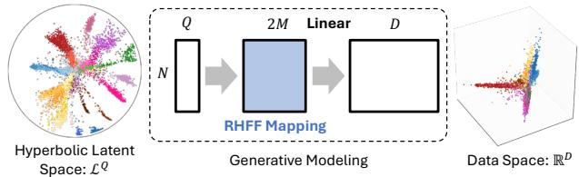  
Figure 1: Overview of our method. Q-dimensional latent variables in hyperbolic space $\mathcal { L } ^ { Q }$ are mapped by RHFF to explicit 2M-dimensional closed-form features (Equation (8)). Then, the observations follow a Bayesian linear model whose marginal likelihood is evaluated exactly in $\mathcal { O } ( N M ^ { 2 } { + } M ^ { 3 } )$ time without inducing inputs.

GP-LVM [15, 38] is a lower bound of the likelihood whose tightness depends on auxiliary variables optimized jointly with the latents, an interaction known to destabilize training [19, 23]. Indeed, the existing hyperbolic GP-LVM fixes its inducing inputs rather than optimizing them [42]. The third dificulty stems from the geometry itself: Riemannian updates of the latent variables accumulate floating-point error that grows with distance from the origin, destabilizing training regardless of the model [21, 26, 43].

We make the hyperbolic GP-LVM practical through a latent variable model built on a single choice of representation: Random Helgason–Fourier Features (RHFF; Figure 1). RHFF approximates hyperbolic kernels, including the Matérn family, by an explicit inner product of 2M-dimensional features derived from the Helgason– Fourier transform [8]. This choice resolves each difficulty in turn. First, the features are closed-form expressions in terms of Busemann functions, eliminating numerical kernel evaluation and reducing computational cost. Second, by modeling the observations as generated from RHFF projections of the latents, our objective eliminates the need for variational bounds and inducing inputs [6, 19], and stabilizes the optimization at $\mathcal { O } ( N M ^ { 2 } + \bar { M } ^ { 3 } )$ time complexity. Third, we reparameterize the latents as unconstrained Euclidean variables and optimize them by natural gradient descent, eliminating projection and retraction errors and thereby reducing the accumulation of floating-point errors.

Theoretically, we prove a uniform bound on the error with which RHFF approximates the target hyperbolic kernel (Proposition 2). The same analysis reveals that the approximation error grows exponentially with the latent dimension Q and the diameter R of the latent domain, a practical limit that we verify empirically. We further show that HyLa [44], the existing hyperbolic random feature, is a special case of RHFF that implicitly fixes one particular spectrum.

Empirically, RHFF embeds hierarchical structure faithfully. On a synthetic tree, its distance correlation with the true tree metric reaches 0.843, versus 0.749 for its Euclidean counterpart and 0.824 for the strongest hyperbolic baseline. On eight real-world datasets, including single-cell atlases of up to 292k cells, RHFF-LVM (heat) attains the best mean rank on global-structure metrics at $Q = 2 \ : ( 2 . 5 5 \ : \mathrm { v s } . \ : 3 . 3 5 $ for PCA, a strong linear reference for distance preservation). The choice of spectral density further controls the balance between global and local structure: with the heavy-tailed Matérn spectrum $( \nu = 0 . 5 )$ , RHFF achieves the best combined rank under equal weighting of the two criteria (4.08). Moreover, it fits $N = 5 \times 1 0 ^ { 5 }$ points in 505 seconds, whereas existing hyperbolic latent variable models become infeasible beyond $1 0 ^ { 4 } – 2 \times 1 0 ^ { 4 }$ points.

## 2 RELATED WORK

Gaussian process latent variable models. The GP-LVM [16, 38, 15] with a distance-based kernel matches the covariance induced by the kernel on latent distances to that of the observations—a mechanism known as dissimilarity preservation [16, 17]. In Euclidean space, random-feature LVMs [6, 19] improve robustness precisely because no auxiliary variables are optimized jointly with the latents. We extend this line of work to hyperbolic space. However, translation invariance is lost, and Bochner’s theorem no longer applies, which requires the Helgason–Fourier machinery, Busemann-based features, and a covering analysis on the product space (§ 6). The optimization further requires a retraction-free pullback formulation (§ 5).

Hyperbolic dimensionality reduction. Hyperbolic neighbor embeddings [10, 35] optimize local objectives and leave global distances outside their guarantees. Hyperbolic VAEs [4, 24] are likelihood-based but parametric, so the latents inherit the encoder’s inductive bias rather than being fit per observation. Hyperbolic GP-LVMs [9, 42] are non-parametric and free of this constraint, but also rely on variational objectives whose joint optimization over auxiliary variables and latents is unstable. We instead maximize an exact likelihood with an approximate kernel, which stabilizes latent-variable optimization. Stress-based hyperbolic MDS [33] targets global distances but requires a reliable precomputed distance matrix. HoroPCA [3] and Co-SNE [7] address dimensionality reduction within hyperbolic space, whereas we embed Euclidean observations into hyperbolic space.

Hyperbolic kernels and random features. The spectral theory of kernels on non-compact symmetric spaces [1] provides the spectral densities from which we sample. Our contribution is to turn these densities into explicit finite-dimensional features with a uniform approximation guarantee. HyLa [44] is closest to RHFF, but it draws its frequencies from a normal distribution, whereas RHFF admits any spectrum, including those of the heat and Matérn kernels. HyLa is thus a special case of our construction (§ 4.2).

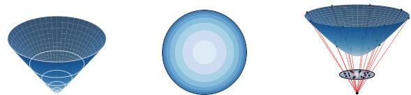  
(a) Lorentz model (b) Poincaré ball (c) Difeomorphism  
Figure 2: Two hyperbolic models (Q = 2) and the difeomorphism between them.

Numerical stability of hyperbolic learning. The numerical fragility of hyperbolic training is well documented. Optimization instabilities in the Poincaré ball motivated the move to the Lorentz model [26]. Floating-point error grows without bound with distance from the origin [43], and the precision inherently required by hyperbolic representations has been characterized [33]. Proposed remedies include tiling-based and multi-component float representations [43, 45] and Euclidean parameterizations of hyperbolic space [21]. Our formulation follows the latter insight and additionally equips the parameterization with a closed-form pullback natural gradient (§ 5).

## 3 BACKGROUND

## 3.1 Hyperbolic Space

We adopt the Lorentz model $\mathcal { L } ^ { \boldsymbol { Q } } = ( \mathbb { H } ^ { \boldsymbol { Q } } , \mathbf { G } _ { l } )$ [2] (Figure 2a), the upper sheet of a Q-dimensional hyperboloid equipped with the metric induced by ${ \bf G } _ { l } = $ $\operatorname { d i a g } ( - 1 , \overset { \cdot } { 1 } , \overset { \cdot } { \dots } , 1 ) \in \mathbb { R } ^ { ( Q + 1 ) \times ( Q + 1 ) }$ . A point is a vector $\mathbf { x } = [ x _ { t } , \mathbf { x } _ { s } ^ { \top } ] ^ { \top } \mathrm { ~ w i t h ~ } x _ { t } = \sqrt { 1 + \| \mathbf { x } _ { s } \| _ { 2 } ^ { 2 } } .$ The Lorentz inner product is $\langle { \bf x } , { \bf x } ^ { \prime } \rangle \_ { } \stackrel { \cdot } { = } - x _ { t } x _ { t } ^ { \prime } + \bar { { \bf x } } _ { s } ^ { \top } { \bf x } _ { s } ^ { \prime }$ , and the geodesic distance is $d _ { \mathcal { L } } ( \mathbf { x } , \mathbf { x } ^ { \prime } ) = \cosh ^ { - 1 } ( - \langle \mathbf { x } , \mathbf { x } ^ { \prime } \rangle _ { \mathcal { L } } )$ The Lorentz model confines the manifold constraint to the single coordinate $x _ { t } .$ , simplifying numerical implementation. For visualization, we project onto the Poincaré ball (Figure 2b) via the difeomorphism $\mathbf { x } \mapsto \mathbf { x } _ { s } / ( 1 + x _ { t } )$ (Figure 2c).

## 3.2 Random Fourier Features

Bochner’s theorem [31] represents any continuous positive-definite stationary kernel, normalized so that $k ( \mathbf { x } , \mathbf { x } ) = 1$ , by its spectral density p(ω):

$$
\begin{array} { r } { k ( \mathbf { x } , \mathbf { x } ^ { \prime } ) = \displaystyle \int _ { \mathbb { R } ^ { Q } } p ( \omega ) e ^ { i \omega ^ { \top } ( \mathbf { x } - \mathbf { x } ^ { \prime } ) } d \omega . } \end{array}\tag{1}
$$

RFF [30] draws $\omega _ { 1 } , \ldots , \omega _ { M }$ i.i.d. from $p ( \omega )$ and approximates this integral by $k ( { \bf x } , { \bf x } ^ { \prime } ) \approx \dot { \psi } ( { \bf x } ) ^ { \top } \psi ( { \bf x } ^ { \prime } )$ where $\begin{array} { r } { \psi ( { \bf x } ) ~ = ~ \frac { 1 } { \sqrt { M } } [ \bar { \psi } _ { \omega _ { 1 } } ( { \bf x } ) ^ { \top } , \dots , \bar { \psi _ { \omega _ { M } } } ( { \bf x } ) ^ { \top } ] ^ { \top } } \end{array}$ stacks $\psi _ { \omega _ { j } } ( \mathbf { x } ) \ = \ [ \cos ( \tilde { \omega } _ { j } ^ { \top } \mathbf { x } ) , \sin ( \omega _ { j } ^ { \top } \mathbf { x } ) ] ^ { \top }$ turning the kernel method into a linear model with feature matrix $\Psi = [ \psi ( \mathbf { x } _ { 1 } ) , \dots , \psi ( \mathbf { x } _ { N } ) ] ^ { \top }$ and reducing the cost from $\mathcal { O } ( N ^ { 3 } ) \mathrm { ~ t o ~ } \mathcal { O } ( N M ^ { 2 } + M ^ { 3 } )$ . Extending this construction to hyperbolic space requires (i) a spectral representation of the hyperbolic kernels that replaces Equation (1) and admits sampling from its density (§ 3.3), and (ii) a decomposition of the integrand into an inner product of factors depending on x and $\mathbf { x } ^ { \prime }$ separately (§ 4.2).

## 3.3 Helgason–Fourier Transform

Helgason’s harmonic analysis [8] generalizes the Fourier transform to non-compact symmetric spaces. A hyperbolic isotropic kernel $k ( \mathbf { x } , \mathbf { x } ^ { \prime } ) = k ( d _ { \mathcal { L } } ( \mathbf { x } , \mathbf { x } ^ { \prime } ) ) \triangleq k ( r ) \ [ 1 ]$ is analyzed via the spherical transform [8, p. 39]:

$$
\tilde { k } ( \lambda ) = \int _ { 0 } ^ { \infty } k ( r ) \phi _ { \lambda } ( r ) \sinh ^ { Q - 1 } ( r ) d r ,\tag{2}
$$

where $\lambda ~ \in ~ \mathbb { R } _ { + } , ~ \rho ~ = ~ ( Q ~ - ~ 1 ) / 2 .$ and $\phi _ { \lambda } ( \boldsymbol { r } ) \ =$ ${ } _ { 2 } F _ { 1 } ( \rho + i \lambda , \rho - i \lambda ; Q / 2 ; - \sinh ^ { 2 } ( r / 2 ) )$ is the elementary spherical function. Here ${ } _ { 2 } F _ { 1 }$ is the Gauss hypergeometric function, defined by $ _ { 2 } F _ { 1 } ( a , b ; c ; z ) \ =$ $\begin{array} { r } { \sum _ { n \geq 0 } ( a ) _ { n } ( b ) _ { n } z ^ { n } / ( ( c ) _ { n } n ! ) } \end{array}$ for $| z | < 1$ and by analytic continuation elsewhere, with $( a ) _ { n }$ the rising factorial. By the Plancherel theorem [8, Ch. IV, Thm. 7.5], the kernel is recovered as

$$
k ( r ) = \int _ { 0 } ^ { \infty } \phi _ { \lambda } ( r ) \tilde { k } ( \lambda ) | c ( \lambda ) | ^ { - 2 } d \lambda ,\tag{3}
$$

where $c ( \lambda )$ is the Harish–Chandra c-function, whose explicit form is given in [8, Ch. IV, Thm. 6.14]; where $\begin{array} { r } { | \hat { c ( \lambda ) } | ^ { - 2 } \propto \kappa _ { Q } ( \bar { \lambda ) } \prod _ { i } ( \lambda ^ { 2 } + \bar { j } ^ { 2 } ) } \end{array}$ with $j \in \{ 0 , 1 , \ldots , \rho - 1 \}$ and $\kappa _ { Q } \equiv 1$ for odd $Q .$ and $j \in \{ \frac { 1 } { 2 } , \frac { 3 } { 2 } , . . . , \rho - 1 \}$ and $\kappa _ { Q } ( \lambda ) \stackrel {  } { = } \lambda \operatorname { t a n h } ( \pi \lambda )$ for even $Q$

Relation to the Euclidean Fourier transform. The weight $\tilde { k } ( \lambda ) | c ( \lambda ) | ^ { - 2 }$ plays the role of the spectral density $p ( \omega )$ , and $\phi _ { \lambda } ( \boldsymbol r )$ that of the complex exponential $e ^ { i \omega ^ { \intercal } ( { \bf x } - { \bf x } ^ { \prime } ) } ;$ ; the factor $| c ( \lambda ) | ^ { - 2 }$ compensates for the exponential volume growth of hyperbolic space. Since $\phi _ { \lambda } ( 0 ) = 1$ , evaluating Equation (3) at $r = 0$ shows that the weight $\tilde { k } ( \lambda ) \breve { | } c ( \lambda ) \bar { | } ^ { - 2 }$ integrates to $k ( 0 )$ over λ. For a kernel normalized as $k ( 0 ) = 1$ , it thus defines a valid density $p ( \lambda ) \propto \tilde { k } ( \lambda ) | c ( \lambda ) | ^ { - 2 }$ on $\mathbb { R } _ { + }$ , so sampling $\lambda \sim p ( \lambda )$ yields a Monte Carlo approximation of Equation (3). The decomposition of $\phi _ { \lambda } ( \boldsymbol r )$ into factors depending on x and $\mathbf { x } ^ { \prime }$ is derived in § 4.2.

(b) M = 1 (c) M = 10 (d) M = 120

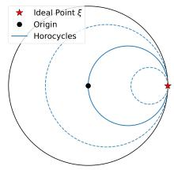

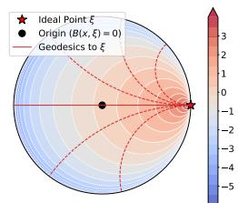  
(a) Horosphere.  
(b) Busemann function.  
Figure 3: The horosphere and Busemann function.

## 4 RANDOM HELGASON-FOURIER FEATURES

This section derives the closed-form RHFF map in Equations (4) and $( 8 ) ;$ readers interested mainly in the model may skip to § 5.

## 4.1 Busemann Function

The building block of our features is the Busemann function. In hyperbolic geometry, directions are represented by ideal points $\xi \in \partial \mathcal { L } ^ { Q }$ on the boundary at infinity, identified with light-cone vectors satisfying $\langle \pmb { \xi } , \pmb { \xi } \rangle _ { \mathcal { L } } = 0$ and $\xi _ { t } = 1$ . The Busemann function associated with ξ is defined as

$$
B ( \mathbf { x } , \pmb { \xi } ) = - \log \left( - \langle \mathbf { x } , \pmb { \xi } \rangle \mathcal { L } \right) .\tag{4}
$$

Its level sets are horospheres (Figure 3a). The value $B ( { \bf x } , \pmb { \xi } )$ measures the signed distance from x toward the ideal point ξ (Figure 3b), providing an analogue of the Euclidean inner product $\omega ^ { \top } \mathbf { x }$

## 4.2 Randomized Spherical Function

To apply the RFF construction to Equation (3), we must decompose the elementary spherical function into factors depending on x and $\mathbf { x } ^ { \prime }$ separately. For this purpose, we employ the following integral representation of the spherical function [8, Ch. IV, Lemma 4.4], which holds for any $\mathbf { x } , \mathbf { x } ^ { \prime } \in \mathcal { L } ^ { Q }$ with $r = d _ { \mathcal { L } } ( \mathbf { x } , \mathbf { x } ^ { \prime } )$

$$
\phi _ { \lambda } ( r ) = \int _ { \partial \mathcal { L } ^ { Q } } e ^ { ( \rho + i \lambda ) B ( \mathbf { x } , \pmb { \xi } ) } e ^ { ( \rho - i \lambda ) B ( \mathbf { x } ^ { \prime } , \pmb { \xi } ) } d \pmb { \xi } ,\tag{5}
$$

where $d \pmb { \xi }$ denotes the uniform probability measure on the boundary $\partial \mathcal { L } ^ { Q } \cong \mathbb { S } ^ { Q - 1 }$ . Leveraging this plane-wave representation, we establish the following proposition:

Proposition 1. $\begin{array} { r l r l r } { L e t } & { { } \quad } & { \psi _ { \lambda , \pm } ( \mathbf { x } ) } & { { } \quad } & { = } & { { } } \end{array}$ $\left[ e ^ { \rho B ( \mathbf { x } , \pmb { \xi } ) } \cos \left( \lambda B ( \mathbf { x } , \pmb { \xi } ) \right) , e ^ { \rho B ( \mathbf { x } , \pmb { \xi } ) } \sin \left( \lambda B ( \mathbf { x } , \pmb { \xi } ) \right) \right] ^ { \intercal }$ be the feature map associated with a frequency $\lambda \in \mathbb { R } _ { + }$ and an ideal direction $\xi ~ \in ~ \partial \mathcal { L } ^ { Q }$ Then, for any $\mathbf { x } , \mathbf { x } ^ { \prime } \in \mathcal { L } ^ { Q }$ with $r = d _ { \mathcal { L } } ( \mathbf { x } , \mathbf { x } ^ { \prime } )$

$$
\phi _ { \lambda } ( \boldsymbol { r } ) = \int _ { \partial \mathcal { L } ^ { Q } } \psi _ { \lambda , \pm } ( \mathbf { x } ) ^ { \top } \psi _ { \lambda , \pm } ( \mathbf { x } ^ { \prime } ) d \pmb { \xi } .\tag{6}
$$

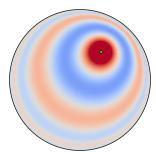

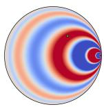  
(a) ϕλ(r)

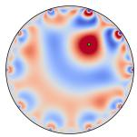

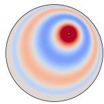  
Figure 4: The elementary spherical function $\phi _ { \lambda } ( r )$ viewed as a function of x with the origin o as the reference point, and its approximation with several plane waves $\psi _ { \lambda , \pmb { \xi } } ( \mathbf { x } )$

## Proof. The proof is provided in $\ S \ \mathrm { A } .$

Figure 4 illustrates Proposition 1. The elementary spherical function is a continuous superposition of plane waves emanating from the ideal points. Geometrically, averaging over all ideal directions how the two points sit relative to the horospheres reconstructs their distance r. Substituting the decomposition of Equation (6) into Equation (3) and applying Monte Carlo sampling yields

$$
\begin{array} { c } { { \displaystyle k ( \boldsymbol { r } ) = \int _ { 0 } ^ { \infty } \int _ { \partial \mathcal { L } ^ { Q } } \psi _ { \lambda , \pm } ( \mathbf { x } ) ^ { \top } \psi _ { \lambda , \pm } ( \mathbf { x } ^ { \prime } ) \tilde { k } ( \lambda ) | c ( \lambda ) | ^ { - 2 } d \xi d \lambda } } \\ { { \displaystyle ~ \approx \frac { 1 } { M } \sum _ { j = 1 } ^ { M } \psi _ { \lambda _ { j } , \pm _ { j } } ( \mathbf { x } ) ^ { \top } \psi _ { \lambda _ { j } , \pm _ { j } } ( \mathbf { x } ^ { \prime } ) , } } \end{array}\tag{}
$$

where the 2-dimensional random feature for the j-th sample is defined as

$$
\begin{array} { r } { \psi _ { \lambda _ { j } , \pmb { \xi } _ { j } } ( \mathbf { x } ) = e ^ { \rho B ( \mathbf { x } , \pmb { \xi } _ { j } ) } \left[ \overset { \mathrm { c o s } \big ( \lambda _ { j } B ( \mathbf { x } , \pmb { \xi } _ { j } ) \big ) } { \mathrm { s i n } \big ( \lambda _ { j } B ( \mathbf { x } , \pmb { \xi } _ { j } ) \big ) } \right] . } \end{array}\tag{8}
$$

We refer to these features collectively as Random Helgason–Fourier Features (RHFF). Here, $\xi _ { j }$ are sampled i.i.d. uniformly from the boundary $\mathbb { S } ^ { Q - 1 }$ and $\lambda _ { j } i . l . i . d .$ from the density $p ( \lambda )$ defined in § 3.3. Stacking these over j into $\begin{array} { r l } { \psi ( \mathbf { x } ) } & { { } = } \end{array}$ $\begin{array} { r } { \frac { 1 } { \sqrt { M } } \left[ \psi _ { \lambda _ { 1 } , \pmb { \xi } _ { 1 } } ( \mathbf { x } ) ^ { \top } , \ldots , \psi _ { \lambda _ { M } , \pmb { \xi } _ { M } } ( \mathbf { x } ) ^ { \top } \right] ^ { \top } \in \mathbb { R } ^ { 2 M } } \end{array}$ yields the feature map used in $\ S \ 5 . \ \{ \lambda _ { j } , \pmb { \xi } _ { j } \} _ { j = 1 } ^ { M }$ are sampled once and kept fixed thereafter, unlike inducing inputs which are optimized jointly with the latents.

Because RHFF samples directly from $p ( \lambda )$ , any isotropic kernel with a known spherical transform can be specified directly in the frequency domain [1]. For instance, the heat kernel has spherical transform

$$
\tilde { k } _ { t } ( \lambda ) \propto \exp \left( - t ( \lambda ^ { 2 } + \rho ^ { 2 } ) \right) ,\tag{9}
$$

where t denotes the length-scale hyperparameter. To mitigate its rapid spectral decay, the Matérn family [1] is also widely used, characterized by

$$
\tilde { k } _ { \nu \kappa } ( \lambda ) \propto \left( \lambda ^ { 2 } + \rho ^ { 2 } + \frac { 2 \nu } { \kappa ^ { 2 } } \right) ^ { - \left( \nu + \frac { Q } { 2 } \right) } ,\tag{10}
$$

where ν and κ are hyperparameters controlling the smoothness and length-scale, respectively.

Connection to HyLa [44]. Sampling $\lambda \sim \mathcal { N } ( 0 , s ^ { 2 } )$ and randomizing the phase of Equation (8) recovers the feature map of HyLa [44], which is therefore the instance of RHFF that implicitly specifies

$$
\tilde { k } _ { \mathrm { H y L a } } ( \lambda ) \propto e ^ { - \lambda ^ { 2 } / ( 2 s ^ { 2 } ) } | c ( \lambda ) | ^ { 2 } .\tag{11}
$$

This difers from the heat spectrum of Equation (9) by the inverse of the Plancherel weight and therefore over-weights low frequencies. The proof is given in $\ S \mathrm { ~ B ~ }$ which additionally shows that RHFF Rao–Blackwellizes HyLa.

## 5 RHFF-LVM

Having constructed the features, we now build the latent variable model (RHFF-LVM) on them. § 5.1 places a Bayesian linear model on the RHFF representation, and § 5.2 optimizes the latents by natural gradient descent on unconstrained Euclidean coordinates, without Riemannian updates.

## 5.1 Objective Function

Let $\mathbf { Y } = [ \mathbf { y } _ { 1 } , \dots , \mathbf { y } _ { N } ] ^ { \top } \in \mathbb { R } ^ { N \times D }$ denote the N observed D-dimensional data points, and $\mathbf { X } = [ \mathbf { x } _ { 1 } , \ldots , \mathbf { x } _ { N } ] ^ { \top }$ the corresponding latent variables, where each $\mathbf { x } _ { n } \in \mathcal { L } ^ { Q }$ Dimensionality reduction then amounts to learning X from Y. We model the observations as generated by a Bayesian linear model on the RHFF representation, $\mathbf { Y } = \boldsymbol { \Psi } \mathbf { W } + \mathbf { E }$ , where the weights $\mathbf { W } \in \bar { \mathbb { R } } ^ { 2 M \times D }$ have $\mathrm { i . i . d . } \mathcal { N } ( 0 , 1 )$ entries and the noise E has i.i.d. $\mathcal { N } ( 0 , \beta ^ { - 1 } )$ entries [6, 16]. Marginalizing W, we optimize the latent variables and $\beta$ by minimizing the negative log-marginal likelihood (up to constants):

$$
\ell ( { \mathbf { X } } , \beta ) = \frac { D } { 2 } \log \vert { \mathbf { C } } \vert + \frac { 1 } { 2 } \mathrm { t r } \left( { \mathbf { C } } ^ { - 1 } { \mathbf { Y } } { \mathbf { Y } } ^ { \top } \right) ,\tag{12}
$$

where $\mathbf { C } = \Psi \Psi ^ { \top } + \beta ^ { - 1 } \mathbf { I }$ is the covariance matrix and $\Psi \in \mathbb { R } ^ { N \times 2 M }$ is the feature matrix whose n-th row is $\psi ( \mathbf { x } _ { n } ) ^ { \top }$ . We further add a latent prior that penalizes the squared geodesic distance to the origin, $\begin{array} { r } { \frac { \gamma } { D } \sum _ { n = 1 } ^ { N } d _ { \mathcal { L } } ( \mathbf { o } , \bar { \mathbf { x } } _ { n } ) ^ { 2 } } \end{array}$ with $\gamma = 0 . 5$ , and minimize the resulting MAP objective. Beyond regularization, this prior encourages the latents to stay within the bounded domain in which the approximation guarantee of § 6 applies. The time complexity is reduced from $\mathcal { O } ( N ^ { 3 } )$ ) to $\mathcal { O } ( N M ^ { 2 } + M ^ { 3 } )$ via the Woodbury identity and the matrix determinant lemma (Equations (19) and (20)).

## 5.2 Optimization via Pullback Metric

In standard Riemannian gradient descent on the Lorentz manifold [26], numerical errors from tangentspace projections and retractions may violate the hyperboloid constraint $x _ { t } = \sqrt { 1 + \| \mathbf { x } _ { s } \| _ { 2 } ^ { 2 } }$ . We circumvent this by exploiting the fact that the objective in Equation (12) depends on each latent variable only through $\mathbf { x } _ { n } = \mathcal { P } ( \mathbf { x } _ { n , s } )$ , where $\mathcal { P } ( \mathbf { x } _ { s } ) = [ \sqrt { 1 + \| \mathbf { x } _ { s } \| _ { 2 } ^ { 2 } } , \mathbf { x } _ { s } ^ { \top } ] ^ { \top }$ lifts the spatial component $\mathbf { x } _ { s } ~ \in \mathbb { R } ^ { Q }$ onto the manifold. Since $\mathcal { P }$ is a global difeomorphism from $\mathbb { R } ^ { Q }$ onto $\mathcal { L } ^ { Q }$ , minimizing ℓ over the unconstrained variables $\{ \mathbf { x } _ { n , s } \} _ { n = 1 } ^ { N }$ is exactly equivalent to minimizing it over the manifold. The natural gradient can therefore be computed in the unconstrained space under the pullback metric of ${ \mathcal { P } } _ { : }$ , with no projections or retractions.

The pullback metric is available in closed form: the Jacobian of $\mathcal { P }$ is

$$
\frac { \partial \mathcal { P } ( \mathbf { x } _ { s } ) } { \partial \mathbf { x } _ { s } } = \left( \frac { \frac { \mathbf { x } _ { s } ^ { \top } } { \sqrt { 1 + \| \mathbf { x } _ { s } \| _ { 2 } ^ { 2 } } } } { \mathbf { I } } \right) \in \mathbb { R } ^ { ( Q + 1 ) \times Q } ,\tag{13}
$$

and the pullback metric $\begin{array} { r } { \mathbf { G } = \left( \frac { \partial \mathcal { P } ( \mathbf { x } _ { s } ) } { \partial \mathbf { x } _ { s } } \right) ^ { \top } \mathbf { G } _ { l } \left( \frac { \partial \mathcal { P } ( \mathbf { x } _ { s } ) } { \partial \mathbf { x } _ { s } } \right) } \end{array}$ simplifies to $\mathbf { G } = \mathbf { I } - ( 1 + \| \mathbf { x } _ { s } \| _ { 2 } ^ { 2 } ) ^ { - 1 } \mathbf { x } _ { s } \bar { \mathbf { x } } _ { s } ^ { \top }$ . Inverting G via the Sherman–Morrison formula yields the natural gradient with respect to this metric in terms of the Euclidean gradient $\nabla _ { \mathbf { x } _ { s } } ^ { E } \boldsymbol { \ell } \colon$

$$
\nabla _ { \mathbf { x } _ { s } } ^ { \mathcal { L } } \boldsymbol { \ell } = \left( \mathbf { I } + \mathbf { x } _ { s } \mathbf { x } _ { s } ^ { \top } \right) \nabla _ { \mathbf { x } _ { s } } ^ { E } \boldsymbol { \ell } .\tag{14}
$$

The latent variables are estimated by iterating $\mathbf { x } _ { s } \gets$ $\mathbf { x } _ { s } - \eta \nabla _ { \mathbf { x } _ { s } } ^ { \mathcal { L } } \boldsymbol { \ell } ,$ recovering the Lorentz point as $\mathcal { P } ( \mathbf { x } _ { s } )$ at each step; the step size η is set by backtracking line search, with gradient-norm clipping $( \ S \ G )$ . The Euclidean gradient computation is provided in § C, and details of the RHFF-LVM algorithm are in $\ S \ D$

## 6 UNIFORM BOUND ON THE RHFF ERROR

Finally, we analyze the approximation quality of RHFF, adapting the standard framework of prior work [30, 36] to the hyperbolic setting.

Proposition 2. Let X be a compact subset of $\begin{array} { l l l } { { \mathcal { L } ^ { Q } } } & { { ( Q } } & { { \geq } } \end{array} 2 )$ containing the origin, with radius R. Suppose $k ( { \bf x } , { \bf x } ^ { \prime } ) = k ( d _ { \mathcal { L } } ( { \bf x } , { \bf x } ^ { \prime } ) )$ is an isotropic kernel on $\mathcal { L } ^ { Q }$ with $k ( 0 ) \ = \ 1$ , diferentiable at $\begin{array} { r l r } { r } & { { } = } & { 0 , } \end{array}$ and let $\{ \lambda _ { j } , \pmb { \xi } _ { j } \} _ { j = 1 } ^ { M }$ be i.i.d. with $\lambda \sim$ $p ( \lambda )$ , ξ uniform on $\partial { \mathcal { L } } ^ { Q } .$ , and $\begin{array} { r l r } { \sigma _ { \lambda } ^ { 2 } } & { { } = } & { \mathbb { E } [ \lambda ^ { 2 } ] \mathrm { ~ \ < ~ } } \end{array}$ ∞. Let $\begin{array} { r } { \hat { k } ( \mathbf { x } , \mathbf { x } ^ { \prime } ) ~ = ~ \frac { 1 } { M } \sum _ { j = 1 } ^ { M } \psi _ { \lambda _ { j } , \pmb { \xi } _ { j } } ( \mathbf { x } ) ^ { \top } \psi _ { \lambda _ { j } , \pmb { \xi } _ { j } } ( \mathbf { x } ^ { \prime } ) ~ d e \mathrm { - } } \end{array}$ note the RHFF estimator, which satisfies $k ( \mathbf { x } , \mathbf { x } ^ { \prime } ) =$ $\mathbb { E } _ { \lambda , \pmb { \xi } } [ \psi _ { \lambda , \pmb { \xi } } ( \mathbf { x } ) ^ { \top } \psi _ { \lambda , \pmb { \xi } } ( \mathbf { x } ^ { \prime } ) ]$ on X . Then, for any $\epsilon > 0$ and $M \geq 1$ , the error $\hat { f } = \hat { k } - k$ satisfies

$$
\begin{array} { r l } & { \operatorname* { P r } \left( \underset { { \bf x } , { \bf x } ^ { \prime } \in \mathcal { X } } { \operatorname* { s u p } } | \hat { f } ( { \bf x } , { \bf x } ^ { \prime } ) | \geq \epsilon \right) } \\ & { \leq C e ^ { 2 ( Q - 1 ) R - \frac { M \epsilon ^ { 2 } } { 8 ( Q + 1 ) e ^ { 2 ( Q - 1 ) R } } } , } \end{array}\tag{15}
$$

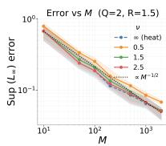  
(a) Basis size M.

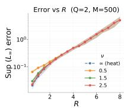  
(b) Radius R.

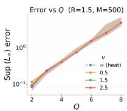  
(c) Dimension $Q .$  
Figure 5: Approximation error of RHFF relative to the exact kernel [1] over a geodesic ball of radius R (median and interquartile range over 20 random feature draws).

where C, which depends on ϵ but not on $M ,$ is given $b y$

$$
C = \frac { 1 6 ( \rho ^ { 2 } + \sigma _ { \lambda } ^ { 2 } ) } { \epsilon ^ { 2 } } + 2 Q ^ { 2 } \left( R + \frac { 1 } { 4 } \right) ^ { 2 } \coth ^ { 2 Q } \left( \frac { 1 } { 4 } \right) .
$$

Proof. The proof combines a covering argument on $\mathcal { X } \times \mathcal { X }$ (necessary since isotropic kernels on $\mathcal { L } ^ { Q }$ are not translation invariant), Lipschitz bounds for the Busemann features, hyperbolic volume comparison, and Hoefding’s inequality; details are in $\ S \mathrm { ~ E ~ }$ □

Discussion. The exponent in Equation (15) scales linearly with M, so the probability of a large error decays exponentially as $M  \infty$ . In contrast, the bound deteriorates exponentially with the radius R and the dimension $Q ,$ reflecting the exponential volume growth of hyperbolic balls. The M required for a target accuracy scales exponentially with both $Q$ and $R { \mathrm { - a } }$ curse of dimensionality and space that delineates the practical limits of hyperbolic random features.

Figure 5 empirically corroborates both trends in the same uniform norm as the bound. The error decays at the Monte Carlo rate $M ^ { - 1 / 2 }$ (Figure 5a), and at a fixed M grows sharply with R and exponentially with Q (Figures 5b and 5c), milder than but qualitatively matching the worst-case rate. Heavier-tailed spectra are consistently harder to approximate. In practice, for the heat and Matérn spectra we sample λ by rejection sampling from $p ( \lambda )$ restricted to a bounded range, which also restores the finiteness of $\sigma _ { \lambda } ^ { 2 }$ for the Matérn family at small ν. The discarded tail probability is negligible except for Matérn $\nu { = } 0 . 5 ,$ , which we quantify in $\ S \mathrm { ~ G ~ }$

## 7 EXPERIMENTS

## 7.1 Experimental Setup

As Euclidean baselines, we use PCA, UMAP [20], and the sparse variational Bayesian GP-LVM (BGP-LVM) [38]. As hyperbolic baselines, we use Poincaré Map [10], the Bayesian hyperbolic GP-LVM (BHGP-LVM) [42], and accelerated hyperbolic t-SNE (Ht-SNE) [35], of which BHGP-LVM and Ht-SNE run at

Table 1: Local and global embedding quality at $Q = 2$ loc denotes kNN recall, and glo denotes Shepard goodness, the Spearman correlation of the pairwise distances. Values are ×100. tree corr is the Spearman correlation with the true tree path-length (geodesic) distance. bold denotes the best per column, and shaded denotes the best RHFF-LVM variant.

<table><tr><td rowspan="2">Method</td><td colspan="2">Toy-tree N=1.0k</td><td rowspan="2">tree corr</td></tr><tr><td>loc</td><td>glo</td></tr><tr><td>PCA</td><td>14.9 ±0.0</td><td>79.7 ±0.0</td><td>77.2 ±0.0</td></tr><tr><td>UMAP [20]</td><td>69.0 ±0.4</td><td>58.7 ±3.9</td><td>58.4 ±3.4</td></tr><tr><td>BGP-LVM [38]</td><td>71.5 ±0.3</td><td> $7 5 . 8 \pm 1 . 5$ </td><td> $7 5 . 5 \pm 1 . 3$ </td></tr><tr><td>RFF-LVM [6]</td><td>72.2 ±0.7</td><td> $7 4 . 9 \pm 1 . 6$ </td><td> $7 4 . 9 \pm 1 . 4$ </td></tr><tr><td>Poincaré Map [10]</td><td>69.4±0.4</td><td> $8 3 . 6 \pm 0 . 8$ </td><td> $8 2 . 4 \pm 0 . 7$ </td></tr><tr><td>BHGP-LVM [42]</td><td> $1 . 9 \pm 0 . 1$ </td><td> $5 1 . 4 \pm 3 . 0$ </td><td> $5 1 . 8 \pm 2 . 8$ </td></tr><tr><td>Ht-SNE [35]</td><td>54.3 ±3.0</td><td> $5 0 . 4 \pm 9 . 7$ </td><td> $5 1 . 5 \pm 8 . 8$ </td></tr><tr><td>RHFF-LVM (HyLa) [44]</td><td> $7 4 . 3 \pm 0 . 6$ </td><td> $8 2 . 8 \pm 0 . 9$ </td><td> $8 3 . 4 \pm 0 . 8$ </td></tr><tr><td>RHFF-LVM  $( \nu = 0 . 5 )$ </td><td> $7 1 . 8 \pm 1 . 3$ </td><td> $7 4 . 6 \pm 1 . 7$ </td><td> $7 4 . 5 \pm 1 . 6$ </td></tr><tr><td>RHFF-LVM  $( \nu = 1 . 5 )$ </td><td> $6 7 . 7 \pm 2 . 0$ </td><td> $7 4 . 9 \pm 3 . 2$ </td><td> $7 5 . 1 \pm 2 . 7$ </td></tr><tr><td>RHFF-LVM  $( \nu = 2 . 5 )$ </td><td> $6 9 . 8 \pm 5 . 9$ </td><td> $7 9 . 8 \pm 3 . 6 $ </td><td> $8 0 . 3 \pm 3 . 3$ </td></tr><tr><td>RHFF-LVM (heat)</td><td> ${ \bf 7 5 . 0 \pm 0 . 9 }$  </td><td> ${ \bf 8 3 . 7 \pm 1 . 2 }$ </td><td>—  ${ \bf 8 4 . 3 \pm 1 . 1 }$  1</td></tr></table>

$Q = 2 .$ As an ablation, RFF-LVM [6] replaces our RHFF with Gaussian random features [30], keeping the model and optimizer identical. Since the Gaussian kernel is the Euclidean heat kernel, comparing RFF-LVM with RHFF-LVM (heat) isolates the efect of the geometry. We evaluate RHFF $( M = 5 0 0 )$ with five spectra: the HyLa spectrum [44], the heat kernel $( t = 1 . 0 )$ , and the Matérn family with $\nu = 0 . 5 ,$ , 1.5, 2.5, $( \kappa = 2 . 0 )$ . We report the correlation between observed and embedded pairwise distances [5] (glo; Spearman in § 7.2, Pearson in $\ S \ 7 . 4 )$ , and the kNN recall (loc), the fraction of each point’s $k = 1 0$ ambient neighbors recovered. PCA is equivalent to classical MDS and is thus the linear optimum for global distance preservation, serving as the reference point for glo. Both metrics are reported $\times 1 0 0$ , averaged over five seeds that vary the latent initialization and the feature draw.

## 7.2 Synthetic Binary Trees (SBT)

We first isolate the efect of each design choice on a synthetic binary tree dataset, a standard benchmark for hyperbolic generative models [4, 24, 42]. Every node of a complete binary tree of depth 6 is represented by its indicator vector $( D = 6 3 )$ . For each node, we generate 16 samples by scaling each path entry by cos θ and its sibling entry by sin θ, with $\theta \sim U [ 0 , \pi / 4 )$ $( N = ( 2 ^ { 6 } - 1 ) \times 1 6 = 1 , 0 0 8 )$ . In addition to glo and loc, we report tree corr, the Spearman correlation between embedded geodesic distances and true path lengths, which measures hierarchy preservation directly.

Comparison with Euclidean methods. Table 1 reports the results. RHFF-LVM (heat) improves over its Euclidean counterpart RFF-LVM on every metric, most strongly on the ground-truth one (tree corr: 84.3 vs. 74.9; glo: 83.7 vs. 74.9; loc: 75.0 vs. 72.2). More broadly, no Euclidean method exceeds the tree correlation of 77.2 attained by PCA.

Comparison with hyperbolic methods. Poincaré Map is the strongest external baseline here. RHFF-LVM (heat) leads on two of the three metrics— on loc (75.0 vs. 69.4) and on tree corr (84.3 vs. 82.4)— while the two are indistinguishable on glo (83.7 vs. 83.6). Poincaré Map embeds proximities precomputed from a neighborhood graph, which remain faithful on this mildly perturbed tree but degrade on noisy, highdimensional real data (§ 7.4). BHGP-LVM consistently collapses to degenerate embeddings. Ht-SNE exhibits by far the largest variance across seeds (glo ±9.7). On this dataset, the heat spectrum dominates among the RHFF-LVM variants across all three metrics, though its margin over the HyLa spectrum is within one standard deviation. The two orderings of glo and tree corr almost coincide (Table 1), supporting its use as a proxy for hierarchy preservation on the real datasets, where the true tree is unavailable.

## 7.3 Scalability Analysis

We grow the SBT dataset by increasing only the number of samples per node, so that N alone varies, from 63 to 500,031. Figure 6 shows the results. BHGP-LVM does not scale beyond N ≈ 104 (618 s), limited by its variational inference, and Poincaré Map beyond $N \approx 2 \times 1 0 ^ { 4 }$ (295 s), where its dense $\mathcal { O } ( N ^ { 2 } )$ afinity matrix already occupies 25.6 GB. RHFF-LVM $( \nu = 0 . 5 )$ scales near-linearly, consistent with its $\mathcal { O } ( N M ^ { 2 } + M ^ { 3 } )$ complexity, and fits half a million points in 505 seconds. Ht-SNE also reaches $N = 5 \times 1 0 ^ { 5 }$ (741 s) with smaller memory usage (3.8 GB vs. 16.5 GB for RHFF-LVM). It is, however, a neighbor embedding restricted to $Q = 2 ,$ and its global scores collapse on every dataset (§ 7.4).

## 7.4 Real-World Hierarchical Data

We next test whether these findings generalize to eight real-world datasets. Seven are single-cell atlases spanning two orders of magnitude in size (2.7k– 292k cells), annotated with either diferentiation trees (Paul [28], Plass [29], C. elegans [27], Zebrafish [40], MouseDev [14]) or deep cell-type taxonomies (Tasic [37], Zeisel [46]). MNIST [18] serves as a non-hierarchical benchmark. Preprocessing follows a common pipeline, except for Paul and Plass, which we use as distributed by [10], and Tasic, which follows [11] (details in § F). For glo we use the Pearson correlation, as the Spearman correlation [5] is prohibitively expensive at this scale.

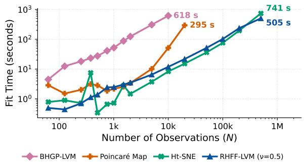  
Figure 6: Fit time versus N on the SBT scaling benchmark (log–log, 100 iterations for all methods). Endpoints mark where each method exceeds the time or memory budget.

Global structure at scale. Table 2 reports the results at $Q = 2$ (results for $Q \in \{ 3 , 5 \}$ with std. and all embedding visualizations are in § I). On the global metric, RHFF-LVM (heat) attains the best mean rank among all methods (2.55, ahead of PCA at 3.35), and the best score outright on C. elegans (78.8 vs. 71.0 for PCA). PCA is strong globally but ranks last locally (9.00), while UMAP shows the mirror image (loc: 1.12, glo: 7.83). On MNIST, the negative control, the hyperbolic advantage disappears as expected, and the Euclidean BGP-LVM leads (67.0). Moreover, RHFF-LVM (heat) surpasses RHFF-LVM (HyLa) for glo, indicating the benefit of sampling from the spectrum properly weighted by the Plancherel factor $| c ( \lambda ) | ^ { - 2 }$

Efect of the geometry. Since RFF-LVM difers from RHFF-LVM (heat) only in the geometry of the latent space, any diference is attributable to the geometry alone. Hyperbolic latents improve the global metric on seven of the eight datasets, the exception being Paul (69.3 vs. 64.2). Unlike on the synthetic tree, the gain now comes at the expense of loc, a loss that the choice of spectrum recovers: RHFF-LVM $( \nu = 0 . 5 )$ exceeds the loc of RFF-LVM on all eight datasets (e.g., 3.5 vs. 1.7 on Zeisel).

The spectrum traces the local–global trade-of. Within RHFF-LVM, the two metrics order the spectra in exactly opposite ways. The mean glo rank improves monotonically with smoothness $( 5 . 7 0  $ $4 . 7 3 \ :  \ : 3 . 7 5 \ :  \ : 2 . 5 5$ from $\nu = 0 . 5$ to heat), while the mean loc rank improves monotonically with tail weight $( 7 . 6 5  5 . 9 2  4 . 1 5  2 . 4 5$ from heat to $\nu = 0 . 5 )$ , placing $\nu = 0 . 5$ second only to UMAP locally. The spectrum controls how strongly nearby pairs are weighted, while the objective remains the same marginal likelihood throughout. Under equal weighting of the two metrics, RHFF-LVM (ν = 0.5) attains the best combined rank (4.08). Moreover, RHFF-LVM $( \nu = 0 . 5 )$ holds the best combined rank at every dimension (3.78 averaged over Q). The results for varying dimensions are given in Table 5.

Table 2: Local and global embedding quality at $Q = 2$ (seed-wise ranks averaged over datasets and seeds; per-seed deviations in Table 5). loc denotes kNN recall $( k = 1 0 )$ , and glo denotes the Pearson correlation between the pairwise distances in the observed and embedding spaces. Values are ×100. The last three columns give the dataset-averaged mean rank on the loc / glo / both metrics (lower is better), computed over the methods available on all datasets; - marks runs exceeding the time or memory budget. bold = best per column, shaded = best RHFF-LVM variant.
<table><tr><td></td><td colspan="2">Paul N=2.7k</td><td colspan="2">Plass N=21.6k</td><td colspan="2"> $\operatorname { T a s i c } _ { N = 2 3 . 8 k }$ </td><td colspan="2">C. elegans N=54.6k</td><td colspan="2">MNIST N=60.0k</td><td colspan="2">Zebrafish N=71.2k</td><td colspan="2"> $\begin{array} { c } { { { \mathrm { Z e i s e l } } } } \\ { { N = 1 6 0 . 8 k } } \end{array}$ </td><td colspan="2">MouseDev N=292.5k</td><td colspan="3">Mean rank ↓</td></tr><tr><td>Method</td><td>loc</td><td>glo</td><td>loc</td><td>glo</td><td>loc</td><td>glo</td><td>loc</td><td>glo</td><td>loc</td><td>glo</td><td>loc</td><td>glo</td><td>loc</td><td>glo</td><td>loc</td><td>glo</td><td>loc</td><td>glo</td><td>both</td></tr><tr><td>PCA</td><td>1.5</td><td>27.9</td><td>1.1</td><td>65.9</td><td>1.1</td><td>88.1</td><td>1.9</td><td>71.0</td><td>0.8</td><td>52.7</td><td>0.9</td><td>92.3</td><td>0.4</td><td>77.2</td><td>0.5</td><td>94.5</td><td>9.00</td><td>3.35</td><td>6.18</td></tr><tr><td>UMAP [20]</td><td>5.3</td><td>12.4</td><td>13.3</td><td>67.2</td><td>14.3</td><td>49.1</td><td>22.4</td><td>60.6</td><td>11.7</td><td>35.7</td><td>13.2</td><td>79.3</td><td>11.6</td><td>53.1</td><td>8.3</td><td>63.4</td><td>1.12</td><td>7.83</td><td>4.47</td></tr><tr><td>BGP-LVM [38]</td><td>2.8</td><td>71.8</td><td>3.3</td><td>72.4</td><td>4.8</td><td>73.3</td><td>2.5</td><td>47.8</td><td>0.9</td><td>67.0</td><td>0.2</td><td>10.5</td><td>=</td><td></td><td>=</td><td></td><td></td><td></td><td></td></tr><tr><td>RFF-LVM [6]</td><td>2.8</td><td>69.3</td><td>9.1</td><td>85.1</td><td>6.7</td><td>73.8</td><td>6.2</td><td>74.4</td><td>3.3</td><td>41.6</td><td>3.0</td><td>84.6</td><td>1.7</td><td>72.5</td><td>0.9</td><td>86.2</td><td>4.30</td><td>4.93</td><td>4.61</td></tr><tr><td>Poincaré Map [10]</td><td>4.1</td><td>13.5</td><td>10.9</td><td>78.8</td><td>13.9</td><td>47.6</td><td>=</td><td></td><td></td><td></td><td></td><td></td><td>=</td><td></td><td>1</td><td>=</td><td></td><td></td><td></td></tr><tr><td>BHGP-LVM [42]</td><td>2.5</td><td>23.2</td><td>3.0</td><td>73.9</td><td>3.2</td><td>56.9</td><td></td><td></td><td></td><td></td><td></td><td></td><td>=</td><td></td><td></td><td></td><td></td><td></td><td></td></tr><tr><td>Ht-SNE [35]</td><td>5.9</td><td>27.4</td><td>4.7</td><td>17.0</td><td>2.7</td><td>14.7</td><td>6.8</td><td>44.6</td><td>8.1</td><td>21.7</td><td>4.5</td><td>36.5</td><td>2.3</td><td>36.0</td><td>3.6</td><td>21.7</td><td>3.77</td><td>8.85</td><td>6.31</td></tr><tr><td>RHFF-LVM (HyLa) [44]</td><td>2.1</td><td>64.1</td><td>6.2</td><td>90.6</td><td>4.6</td><td>85.3</td><td>4.9</td><td>77.9</td><td>2.9</td><td>44.2</td><td>2.5</td><td>89.8</td><td>1.4</td><td>75.1</td><td>0.8</td><td>89.8</td><td>6.62</td><td>3.33</td><td>4.97</td></tr><tr><td>RHFF-LVM (ν = 0.5)</td><td>2.9</td><td>72.0</td><td>10.1</td><td>85.3</td><td>8.3</td><td>69.9</td><td>9.3</td><td>68.0</td><td>3.8</td><td>45.1</td><td>4.6</td><td>76.8</td><td>3.5</td><td>68.0</td><td>1.7</td><td>69.1</td><td>2.45</td><td>5.70</td><td>4.08</td></tr><tr><td>RHFF-LVM (ν = 1.5)</td><td>2.5</td><td>65.7</td><td>7.5</td><td>89.0</td><td>6.0</td><td>78.7</td><td>6.3</td><td>73.9</td><td>3.4</td><td>43.9</td><td>3.2</td><td>81.1</td><td>1.9</td><td>72.6</td><td>1.0</td><td>82.7</td><td>4.15</td><td>4.73</td><td>4.44</td></tr><tr><td>RHFF-LVM (ν = 2.5)</td><td>2.2 2.1</td><td>64.9</td><td>6.4</td><td>89.6</td><td>4.8</td><td>82.0</td><td>5.1</td><td>77.3</td><td>2.9</td><td>44.8</td><td>2.6</td><td>85.6</td><td>1.5</td><td>74.6</td><td>0.9</td><td>88.3</td><td>5.92</td><td>3.75</td><td>4.84</td></tr><tr><td>RHFF-LVM (heat)</td><td></td><td>64.2</td><td>5.6</td><td>90.1</td><td>4.2</td><td>87.9</td><td>4.7</td><td>78.8</td><td>2.8</td><td>45.3</td><td>2.4</td><td>90.9</td><td>1.3</td><td>76.4</td><td>0.8</td><td>91.1</td><td>7.65</td><td>2.55</td><td>5.10</td></tr></table>

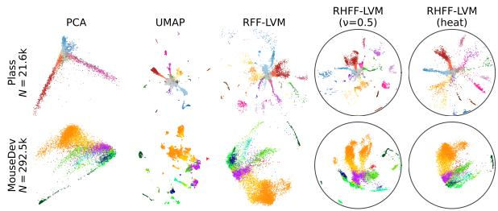  
Figure 7: Embeddings at Q=2 on Plass (21.6k) and MouseDev (292k), colored by cell type. Hyperbolic methods (RHFF-LVM) are shown on the Poincaré ball, Euclidean methods (PCA, UMAP, RFF-LVM) directly.

Qualitative embeddings. Figure 7 makes these trends visible on a mid-size lineage atlas (Plass, 21.6k) and the largest one (MouseDev, 292k). PCA flattens the lineage and overlaps its branches, whereas UMAP tears it into disconnected islands, mirroring the global and local extremes seen in Table 2. RFF-LVM collapses the branches toward the center, whereas switching only the latent space to hyperbolic (RHFF-LVM) unfolds the hierarchy radially. Within RHFF-LVM, the spectrum sets the operating point: ν=0.5 preserves compact, well-separated local clusters, whereas heat emphasizes the continuous global branching.

Statistical analysis. Since several margins in Table 2 are small, we assess their statistical significance. We run significance tests on the glo for three contrasts against RHFF-LVM (heat): PCA, which trails by only a small margin; RFF-LVM, as a geometry ablation; and

RHFF-LVM (HyLa), which isolates the efect of the Plancherel weighting $| c ( \lambda ) | ^ { - 2 }$ (Table 4). Against PCA, the eight datasets split 3–5 in PCA’s favor in head-tohead wins, yet our three wins are large (up to +36, all on the tree-structured atlases) while PCA’s five are small $\left( \mathrm { a l l } \leq 7 . 4 \right)$ . Against RFF-LVM and RHFF-LVM (HyLa), RHFF-LVM (heat) improves the global metric on seven of the eight datasets (Wilcoxon signed-rank test across datasets: $p = 0 . 1 1$ and $p = 0 . 0 2 ,$ , respectively). For the geometry ablation, every within-dataset gap is significant, the sole exception being Paul. Finally, sweeping the spectrum from $\nu { = } 0 . 5$ to heat moves the local and global metrics monotonically in opposite directions in trend (Page trend test, $p \approx 9 \times 1 0 ^ { - 1 2 }$ for loc and $p \approx 3 \times 1 0 ^ { - 4 }$ for glo), quantifying the local–global trade-of.

## 8 CONCLUSION

We introduced Random Helgason–Fourier Features, hyperbolic random features whose spectral density is explicitly characterized, and built on them the first hyperbolic non-parametric latent variable model that scales to hundreds of thousands of points. The RHFF approximation admits a uniform error bound depending on the latent dimension and domain radius. Empirically, the model attains the best mean rank on global-structure metrics at $\mathrm { Q } = 2 .$ , and the best combined rank at every latent dimension.

Limitations. The approximation error grows exponentially with Q and the domain diameter, restricting RHFF to the low-dimensional, bounded regime. This is where hyperbolic geometry is most useful, but it is a genuine limit. Peak memory is dominated by the $N \times 2 M$ feature matrix, and mini-batch training is left

to future work.

## AI USE STATEMENT

In this work, we used generative AI tools to assist in proving the mathematical claims, including suggesting key steps of the proofs; to translate parts of the manuscript into English; and, partially, to implement the methods: the core implementation of the proposed method was first written by the authors, and generative AI tools were then used to refactor it and to implement experiment and data-preprocessing scripts under author-specified designs and pipelines. We have not used generative AI tools to generate data sets, develop the theoretical models or conceptual frameworks, formulate the mathematical claims, propose or refine hypotheses, design the methodology or experiments, or interpret the results, and the remaining tasks requiring disclosure (dataset cleaning and reformatting, and qualitative data analysis) are not applicable to this work. Additionally, we used generative AI tools to draft parts of the appendices describing the experimental setup and to edit the manuscript for readability. We have reviewed all AI-assisted work: all mathematical claims were formulated by the authors and the final proofs were constructed and verified line by line by the authors based on the AI suggestions; AI-assisted code was reviewed and tested by the authors; and all translations and edits were checked against the intended content. We take responsibility for the final content of this work, including text, claims, or artifacts produced with the aid of generative AI.

## ACKNOWLEDGEMENT

This study was supported in part by JSPS KAK-ENHI Grant Numbers JP24K02942, JP24KJ0324, JP25H01494, JP26K23861, and JP26K02989.

## REFERENCES

[1] Iskander Azangulov, Andrei Smolensky, Alexander Terenin, and Viacheslav Borovitskiy. Stationary kernels and Gaussian processes on Lie groups and their homogeneous spaces II: non-compact symmetric spaces. Journal of Machine Learning Research, 25(281):1–51, 2024.

[2] James W Cannon, William J Floyd, Richard Kenyon, and Walter R Parry. Hyperbolic geometry. Flavors of Geometry, 31(2):59–115, 1997.

[3] Ines Chami, Albert Gu, Dat P Nguyen, and Christopher Ré. HoroPCA: Hyperbolic dimensionality reduction via horospherical projections. In Proceedings of the International Conference on Machine Learning, pages 1419–1429. PMLR, 2021.

[4] Seunghyuk Cho, Juyong Lee, Jaesik Park, and Dongwoo Kim. A rotated hyperbolic wrapped normal distribution for hierarchical representation learning. Advances in Neural Information Processing Systems, 35:17831–17843, 2022.

[5] Mateus Espadoto, Rafael M Martins, Andreas Kerren, Nina ST Hirata, and Alexandru C Telea. Toward a quantitative survey of dimension reduction techniques. IEEE Transactions on Visualization and Computer Graphics, 27(3):2153–2173, 2019.

[6] Gregory Gundersen, Michael Zhang, and Barbara Engelhardt. Latent variable modeling with random features. In International Conference on Artificial Intelligence and Statistics, pages 1333–1341. PMLR, 2021.

[7] Yunhui Guo, Haoran Guo, and Stella X Yu. Co-SNE: Dimensionality reduction and visualization for hyperbolic data. In Proceedings of the IEEE/CVF Conference on Computer Vision and Pattern Recognition, pages 21–30, 2022.

[8] Sigurdur Helgason. Groups and geometric analysis: integral geometry, invariant diferential operators, and spherical functions, volume 83. American Mathematical Society, 2022.

[9] Noémie Jaquier, Leonel Rozo, Miguel González-Duque, Viacheslav Borovitskiy, and Tamim Asfour. Bringing motion taxonomies to continuous domains via GPLVM on hyperbolic manifolds. In Proceedings of the International Conference on Machine Learning, pages 21373–21409, 2024.

[10] Anna Klimovskaia, David Lopez-Paz, Léon Bottou, and Maximilian Nickel. Poincaré maps for analyzing complex hierarchies in single-cell data. Nature Communications, 11(1):2966, 2020.

[11] Dmitry Kobak and Philipp Berens. The art of using t-SNE for single-cell transcriptomics. Nature Communications, 10(1):5416, 2019.

[12] Joseph B Kruskal. Multidimensional scaling by optimizing goodness of fit to a nonmetric hypothesis. Psychometrika, 29(1):1–27, 1964.

[13] Noël Kury, Dmitry Kobak, and Sebastian Damrich. DREAMS: Preserving both local and global structure in dimensionality reduction. Transactions on Machine Learning Research, 2026.

[14] Gioele La Manno, Kimberly Siletti, Alessandro Furlan, Daniel Gyllborg, Elin Vinsland, Alejandro Mossi Albiach, Christofer Mattsson Langseth, Irina Khven, Alex R Lederer, Lisa M Dratva, et al. Molecular architecture of the developing mouse brain. Nature, 596(7870):92–96, 2021.

[15] Vidhi Lalchand, Aditya Ravuri, and Neil D Lawrence. Generalised GPLVM with stochastic

variational inference. In International Conference on Artificial Intelligence and Statistics, pages 7841– 7864. PMLR, 2022.

[16] Neil Lawrence. Probabilistic non-linear principal component analysis with Gaussian process latent variable models. Journal of Machine Learning Research, 6(11), 2005.

[17] Neil D Lawrence and Joaquin Quinonero-Candela. Local distance preservation in the GP-LVM through back constraints. In Proceedings of the International Conference on Machine Learning, pages 513–520, 2006.

[18] Yann LeCun, Léon Bottou, Yoshua Bengio, and Patrick Hafner. Gradient-based learning applied to document recognition. Proceedings of the IEEE, 86(11):2278–2324, 1998.

[19] Ying Li, Zhidi Lin, Feng Yin, and Michael Minyi Zhang. Preventing model collapse in Gaussian process latent variable models. In Proceedings of the International Conference on Machine Learning, 2024.

[20] Leland McInnes, John Healy, and James Melville. UMAP: Uniform manifold approximation and projection for dimension reduction. arXiv preprint arXiv:1802.03426, 2018.

[21] Gal Mishne, Zhengchao Wan, Yusu Wang, and Sheng Yang. The numerical stability of hyperbolic representation learning. In Proceedings of the International Conference on Machine Learning, pages 24925–24949. PMLR, 2023.

[22] Kevin R Moon, David Van Dijk, Zheng Wang, Scott Gigante, Daniel B Burkhardt, William S Chen, Kristina Yim, Antonia van den Elzen, Matthew J Hirn, Ronald R Coifman, et al. Visualizing structure and transitions in high-dimensional biological data. Nature Biotechnology, 37(12):1482– 1492, 2019.

[23] Pablo Moreno-Muñoz, Cilie Feldager, and Søren Hauberg. Revisiting active sets for Gaussian process decoders. Advances in Neural Information Processing Systems, 35:6603–6614, 2022.

[24] Yoshihiro Nagano, Shoichiro Yamaguchi, Yasuhiro Fujita, and Masanori Koyama. A wrapped normal distribution on hyperbolic space for gradient-based learning. In Proceedings of the International Conference on Machine Learning, pages 4693–4702, 2019.

[25] Maximillian Nickel and Douwe Kiela. Poincaré embeddings for learning hierarchical representations. Advances in Neural Information Processing Systems, 30, 2017.

[26] Maximillian Nickel and Douwe Kiela. Learning continuous hierarchies in the Lorentz model of hyperbolic geometry. In Proceedings of the International Conference on Machine Learning, pages 3779–3788, 2018.

[27] Jonathan S Packer, Qin Zhu, Chau Huynh, Priya Sivaramakrishnan, Elicia Preston, Hannah Dueck, Derek Stefanik, Kai Tan, Cole Trapnell, Junhyong Kim, et al. A lineage-resolved molecular atlas of C. elegans embryogenesis at single-cell resolution. Science, 365(6459):eaax1971, 2019.

[28] Franziska Paul, Ya’ara Arkin, Amir Giladi, Diego Adhemar Jaitin, Ephraim Kenigsberg, Hadas Keren-Shaul, Deborah Winter, David Lara-Astiaso, Meital Gury, Assaf Weiner, et al. Transcriptional heterogeneity and lineage commitment in myeloid progenitors. Cell, 163(7):1663–1677, 2015.

[29] Mireya Plass, Jordi Solana, F Alexander Wolf, Salah Ayoub, Aristotelis Misios, Petar Glažar, Benedikt Obermayer, Fabian J Theis, Christine Kocks, and Nikolaus Rajewsky. Cell type atlas and lineage tree of a whole complex animal by single-cell transcriptomics. Science, 360(6391), 2018.

[30] Ali Rahimi and Benjamin Recht. Random features for large-scale kernel machines. Advances in Neural Information Processing Systems, 20:1–8, 2007.

[31] Carl Edward Rasmussen. Gaussian processes in machine learning. In Summer School on Machine Learning, pages 63–71. Springer, 2003.

[32] Naruya Saitou and Masatoshi Nei. The neighborjoining method: a new method for reconstructing phylogenetic trees. Molecular biology and evolution, 4(4):406–425, 1987.

[33] Frederic Sala, Chris De Sa, Albert Gu, and Christopher Ré. Representation tradeofs for hyperbolic embeddings. In Proceedings of the International Conference on Machine Learning, pages 4460–4469, 2018.

[34] Rik Sarkar. Low distortion Delaunay embedding of trees in hyperbolic plane. In Proceedings of the International Symposium on Graph Drawing, pages 355–366, 2011.

[35] Martin Skrodzki, Hunter van Gefen, Nicolas F Chaves-de Plaza, Thomas Höllt, Elmar Eisemann, and Klaus Hildebrandt. Accelerating hyperbolic t-SNE. IEEE Transactions on Visualization and Computer Graphics, 30(7):4403–4415, 2024.

[36] Danica J Sutherland and Jef Schneider. On the error of random Fourier features. In Proceedings of the Thirty-First Conference on Uncertainty in Artificial Intelligence, pages 862–871, 2015.

[37] Bosiljka Tasic, Zizhen Yao, Lucas T Graybuck, Kimberly A Smith, Thuc Nghi Nguyen, Darren Bertagnolli, Jef Goldy, Emma Garren, Michael N Economo, Sarada Viswanathan, et al. Shared and distinct transcriptomic cell types across neocortical areas. Nature, 563(7729):72–78, 2018.

[38] Michalis Titsias and Neil D Lawrence. Bayesian Gaussian process latent variable model. In Proceedings of the International Conference on Artificial Intelligence and Statistics, pages 844–851, 2010.

[39] Laurens Van der Maaten and Geofrey Hinton. Visualizing data using t-SNE. Journal of Machine Learning Research, 9(11):2579–2605, 2008.

[40] Daniel E Wagner, Caleb Weinreb, Zach M Collins, James A Briggs, Sean G Megason, and Allon M Klein. Single-cell mapping of gene expression landscapes and lineage in the zebrafish embryo. Science, 360(6392):981–987, 2018.

[41] Yingfan Wang, Haiyang Huang, Cynthia Rudin, and Yaron Shaposhnik. Understanding how dimension reduction tools work: an empirical approach to deciphering t-SNE, UMAP, TriMAP, and PaCMAP for data visualization. Journal of Machine Learning Research, 22(201):1–73, 2021.

[42] Koshi Watanabe, Keisuke Maeda, Takahiro Ogawa, and Miki Haseyama. Hyperboloid GPLVM for discovering continuous hierarchies via nonparametric estimation. In Proceedings of the International Conference on Artificial Intelligence and Statistics, pages 1783–1791, 2025.

[43] Tao Yu and Christopher De Sa. Numerically accurate hyperbolic embeddings using tiling-based models. Advances in Neural Information Processing Systems, 32, 2019.

[44] Tao Yu and Christopher De Sa. Random Laplacian features for learning with hyperbolic space. In Proceedings of the International Conference on Learning Representations, pages 1–23, 2023.

[45] Tao Yu and Christopher M De Sa. Representing hyperbolic space accurately using multi-component floats. Advances in Neural Information Processing Systems, 34:15570–15581, 2021.

[46] Amit Zeisel, Hannah Hochgerner, Peter Lönnerberg, Anna Johnsson, Fatima Memic, Job Van Der Zwan, Martin Häring, Emelie Braun, Lars E Borm, Gioele La Manno, et al. Molecular architecture of the mouse nervous system. Cell, 174(4):999–1014, 2018.

## A PROOF OF PROPOSITION 1

Starting from the Harish-Chandra integral representation of the elementary spherical function, we have:

$$
\begin{array} { l } { \displaystyle \phi _ { \lambda } ( \boldsymbol { r } ) = \int _ { \partial \mathcal { L } ^ { Q } } \exp \Big \{ ( i \lambda + \rho ) B ( \mathbf { x } , \pmb { \xi } ) \Big \} \exp \Big \{ ( - i \lambda + \rho ) B ( \mathbf { x } ^ { \prime } , \pmb { \xi } ) \Big \} d \pmb { \xi } } \\ { \displaystyle \quad = \int _ { \partial \mathcal { L } ^ { Q } } \exp \Big \{ \rho B ( \mathbf { x } , \pmb { \xi } ) + \rho B ( \mathbf { x } ^ { \prime } , \pmb { \xi } ) \Big \} \exp \Big \{ i \lambda B ( \mathbf { x } , \pmb { \xi } ) - i \lambda B ( \mathbf { x } ^ { \prime } , \pmb { \xi } ) \Big \} d \pmb { \xi } . } \end{array}
$$

Since the elementary spherical function $\phi _ { \lambda } ( \boldsymbol r )$ is real-valued, we can express the complex exponential through its real part:

$$
\phi _ { \lambda } ( r ) = \int _ { \partial \mathcal { L } ^ { Q } } \exp \Big \{ \rho B ( \mathbf { x } , \pmb { \xi } ) + \rho B ( \mathbf { x } ^ { \prime } , \pmb { \xi } ) \Big \} \cos \Big \{ \lambda B ( \mathbf { x } , \pmb { \xi } ) - \lambda B ( \mathbf { x } ^ { \prime } , \pmb { \xi } ) \Big \} d \xi .
$$

Applying the trigonometric identity cos $( A - B ) = \cos A$ cos B + sin A sin B, we obtain:

$$
\begin{array} { l } { { \displaystyle { \phi _ { \lambda } ( { \boldsymbol r } ) = \int _ { \partial \mathcal { L } ^ { Q } } \exp \left\{ \rho B ( \mathbf { x } , { \boldsymbol \xi } ) + \rho B ( \mathbf { x } ^ { \prime } , { \boldsymbol \xi } ) \right\} \Big \{ \cos \lambda B ( \mathbf { x } , { \boldsymbol \xi } ) \cos \lambda B ( \mathbf { x } ^ { \prime } , { \boldsymbol \xi } ) } } \ ~ } \\ { { \displaystyle ~ + \sin \lambda B ( \mathbf { x } , { \boldsymbol \xi } ) \sin \lambda B ( \mathbf { x } ^ { \prime } , { \boldsymbol \xi } ) \Big \} d \xi . } \ ~ } \end{array}
$$

Finally, by defining the feature map as $\psi _ { \lambda , \xi } ( \mathbf { x } ) = [ \exp \rho B ( \mathbf { x } , \pmb { \xi } ) \cos \lambda B ( \mathbf { x } , \pmb { \xi } ) , \exp \rho B ( \mathbf { x } , \pmb { \xi } ) \sin \lambda B ( \mathbf { x } , \pmb { \xi } ) ] ^ { \top }$ , the integral can be rewritten as the inner product of these features:

$$
\phi _ { \lambda } ( \boldsymbol { r } ) = \int _ { \partial \mathcal { L } ^ { Q } } \psi _ { \lambda , \pm } ( \mathbf { x } ) ^ { \top } \psi _ { \lambda , \pm } ( \mathbf { x } ^ { \prime } ) d \pmb { \xi } .
$$

## B CONNECTION TO HYLA

The key novelty over HyLa [44] is the explicit characterization of $p ( \lambda )$ [1]. Exposing the density allows any isotropic kernel with a known spherical transform to be specified directly in the frequency domain, as in Equations (9) and (10). This relationship can be made exact.

Corollary 1 (RHFF recovers HyLa). Let $\eta _ { \lambda , \pmb { \xi } , b } ( \mathbf { x } ) = \sqrt { 2 } e ^ { \rho B ( \mathbf { x } , \pmb { \xi } ) } \cos ( \lambda B ( \mathbf { x } , \pmb { \xi } ) + b )$ with $b \sim \mathrm { U n i f } [ 0 , 2 \pi )$ , which under the identification of Lemma 1 (stated below) is the HyLa feature of $\ \vert 4 4 \vert$ up to normalization. Then, for all $\mathbf { x } , \mathbf { x } ^ { \prime } \in \mathcal { L } ^ { Q }$

$$
\begin{array} { r } { \mathbb { E } _ { b } [ \eta _ { \lambda , \pm , b } ( \mathbf { x } ) \eta _ { \lambda , \pm , b } ( \mathbf { x } ^ { \prime } ) ] = \psi _ { \lambda , \pm } ( \mathbf { x } ) ^ { \top } \psi _ { \lambda , \pm } ( \mathbf { x } ^ { \prime } ) = g _ { \lambda , \pm } ( \mathbf { x } , \mathbf { x } ^ { \prime } ) , } \end{array}
$$

and with $\lambda _ { j } \sim { \mathcal { N } } ( 0 , s ^ { 2 } ) , \xi _ { j }$ uniform on $\partial \mathcal { L } ^ { Q }$ , and $b _ { j }$ uniform, $\begin{array} { r } { \frac { 1 } { M } \sum _ { j } \eta _ { j } ( \mathbf { x } ) \eta _ { j } ( \mathbf { x } ^ { \prime } ) } \end{array}$ is an unbiased estimator of $k _ { s } ( r ) = \mathbb { E } _ { \lambda \sim \mathcal { N } ( 0 , s ^ { 2 } ) } [ \phi _ { | \lambda | } ( r ) ]$ , the kernel approximated by HyLa. Hence HyLa is the instance of RHFF obtained by (a) the Gaussian choice $p ( \lambda ) = \mathcal { N } ( 0 , s ^ { 2 } )$ and $( b )$ replacing the paired feature of Equation (8) by its phase-randomized counterpart.

The remainder of this section proves Corollary 1. We first fix the dictionary between our notation and that of [44]: their dimension n is our Q, their $\scriptstyle { \frac { n - 1 } { 2 } }$ is our $\rho ,$ their feature count D is our M, and their boundary direction $\omega \in \partial B ^ { n }$ corresponds to our ideal point $\pmb { \xi } = [ 1 , \pmb { \omega } ^ { \top } ] ^ { \top } \in \partial \mathcal { L } ^ { Q }$ . The following lemma identifies the arguments of the two feature maps.

Lemma 1 (Identification of the feature arguments). Let $\mathbf { x } \in \mathcal { L } ^ { Q }$ and let $\mathbf { z } = \mathbf { x } _ { s } / ( 1 + x _ { t } ) \in B ^ { Q }$ be its image under the difeomorphism of Section 3. Identify $\pmb { \xi } = [ \hat { 1 } , \pmb { \omega } ^ { \top } ] ^ { \top } \in \partial \mathcal { L } ^ { Q }$ with $\omega \in \mathbb { S } ^ { Q - 1 } = \partial B ^ { Q }$ . Then the Busemann function of Equation (4) equals the signed horocycle distance $\langle \omega , \mathbf { z } \rangle _ { H }$ of [44]:

$$
B ( \mathbf { x } , \pmb { \xi } ) = \log \left( \frac { 1 - \| \mathbf { z } \| _ { 2 } ^ { 2 } } { \| \mathbf { z } - \omega \| _ { 2 } ^ { 2 } } \right) = \langle \pmb { \omega } , \mathbf { z } \rangle _ { H } .
$$

Proof. The inverse of the difeomorphism is $x _ { t } = ( 1 + \| \mathbf { z } \| _ { 2 } ^ { 2 } ) / ( 1 - \| \mathbf { z } \| _ { 2 } ^ { 2 } )$ and $\mathbf { x } _ { s } = 2 \mathbf { z } / ( 1 - \| \mathbf { z } \| _ { 2 } ^ { 2 } )$ . Using $\| \omega \| _ { 2 } = 1$

$$
- \langle \mathbf { x } , \pmb { \xi } \rangle _ { \mathcal { L } } = x _ { t } - \mathbf { x } _ { s } ^ { \top } \pmb { \omega } = \frac { 1 + \Vert \mathbf { z } \Vert _ { 2 } ^ { 2 } - 2 \mathbf { z } ^ { \top } \pmb { \omega } } { 1 - \Vert \mathbf { z } \Vert _ { 2 } ^ { 2 } } = \frac { \Vert \mathbf { z } - \pmb { \omega } \Vert _ { 2 } ^ { 2 } } { 1 - \Vert \mathbf { z } \Vert _ { 2 } ^ { 2 } } ,
$$

and taking − log(·) of both sides yields the claim.

Under Lemma 1, the HyLa eigenfunction (Equation (1) of [44]) reads Hy $\mathrm { L a } _ { \lambda , b , \pm } ( \mathbf { x } ) = e ^ { \rho B ( \mathbf { x } , \pmb { \xi } ) } \cos ( \lambda B ( \mathbf { x } , \pmb { \xi } ) + b )$ so that $\eta _ { \lambda , \pm , b } = \sqrt { 2 } \operatorname { H y L a } _ { \lambda , b , \pm } .$ 1

Proof of Corollary 1. By the product-to-sum identity, with $B = B ( \mathbf { x } , \pmb { \xi } )$ and $B ^ { \prime } = B ( { \bf x } ^ { \prime } , \pmb { \xi } )$

$$
2 \cos ( \lambda B + b ) \cos ( \lambda B ^ { \prime } + b ) = \cos \bigl ( \lambda ( B - B ^ { \prime } ) \bigr ) + \cos \bigl ( \lambda ( B + B ^ { \prime } ) + 2 b \bigr ) .
$$

The second term integrates to zero over $b \sim \mathrm { U n i f } [ 0 , 2 \pi )$ , hence

$$
\begin{array} { r l } & { \mathbb { E } _ { b } \big [ \eta _ { \lambda , \pm , b } ( \mathbf { x } ) \eta _ { \lambda , \pm , b } ( \mathbf { x } ^ { \prime } ) \big ] = e ^ { \rho ( B + B ^ { \prime } ) } \cos \bigl ( \lambda ( B - B ^ { \prime } ) \bigr ) = g _ { \lambda , \xi } ( \mathbf { x } , \mathbf { x } ^ { \prime } ) , } \end{array}
$$

and the identity $\psi _ { \lambda , \xi } ( \mathbf { x } ) ^ { \top } \psi _ { \lambda , \xi } ( \mathbf { x } ^ { \prime } ) = e ^ { \rho ( B + B ^ { \prime } ) } \cos ( \lambda ( B - B ^ { \prime } ) ) = g _ { \lambda , \xi } ( \mathbf { x } , \mathbf { x } ^ { \prime } )$ is the trigonometric expansion of Section A. For the second statement, the tower property gives

$$
\begin{array} { r } { \mathbb { E } _ { \lambda , \xi , b } [ \eta ( \mathbf { x } ) \eta ( \mathbf { x } ^ { \prime } ) ] = \mathbb { E } _ { \lambda } [ \mathbb { E } _ { \xi } [ g _ { \lambda , \xi } ( \mathbf { x } , \mathbf { x } ^ { \prime } ) ] ] = \mathbb { E } _ { \lambda \sim \mathcal { N } ( 0 , s ^ { 2 } ) } \left[ \phi _ { | \lambda | } ( r ) \right] = k _ { s } ( r ) , } \end{array}
$$

where the middle equality is Proposition 1 and $r = d _ { \mathcal { L } } ( { \bf x } , { \bf x } ^ { \prime } )$ ; the restriction to $| \lambda |$ is immaterial since $\phi _ { \lambda } = \phi _ { - \lambda }$ so sampling λ from ${ \mathcal { N } } ( 0 , s ^ { 2 } )$ on R is equivalent to sampling $| \lambda |$ from the corresponding half-normal density on $\mathbb { R } _ { + }$ , matching the convention of Section 3. That $k _ { s }$ is the kernel approximated by HyLa is Equation (2) of [44] combined with Lemma 1. □

Remark 1 (RHFF Rao–Blackwellizes $_ \mathrm { H y L a ) }$ . The first display of Corollary 1 states that the RHFF per-sample estimator $g _ { \lambda _ { j } , \pmb { \xi } _ { j } }$ is the conditional expectation of the HyLa per-sample estimator given $( \lambda _ { j } , \pmb { \xi } _ { j } )$ . By the Rao– Blackwell theorem, every entry of the RHFF Gram matrix has variance no larger than that of the HyLa Gram matrix built from the same M samples $\{ \lambda _ { j } , \pmb { \xi } _ { j } \} _ { j = 1 } ^ { M }$ . The two Gram matrices coincide after marginalizing the phases $\{ b _ { j } \}$ , not pathwise. Note the feature-dimension accounting: M samples yield 2M RHFF coordinates but M HyLa coordinates, so the comparison at equal sample count favors RHFF in dimension, while the comparison at equal dimension (M RHFF samples versus 2M HyLa samples) mirrors the Euclidean analysis of the two random-feature variants in $\left. \left/ { \mathcal { 3 6 } } \right. \right.$

Remark 2 (The spectrum implicit in HyLa’s Gaussian sampling). Inverting $p ( \lambda ) \propto \tilde { k } ( \lambda ) | c ( \lambda ) | ^ { - 2 }$ , the Gaussian sampling of Corollary 1 implicitly specifies the spherical transform

$$
\tilde { k } _ { \mathrm { H y L a } } ( \lambda ) \propto e ^ { - \lambda ^ { 2 } / ( 2 s ^ { 2 } ) } | c ( \lambda ) | ^ { 2 } ,
$$

which difers from the heat spectrum of Equation (9) by the inverse of the Plancherel weight. Relative to the heat kernel with $t = 1 / ( 2 s ^ { 2 } )$ , HyLa thus over-weights low frequencies—for $Q = 2 , | c ( \lambda ) | ^ { 2 } \propto ( \lambda \operatorname { t a n h } ( \pi \lambda ) ) ^ { - 1 }$ diverges as $\lambda  0$ and the discrepancy grows with $Q _ { i }$ , since $| c ( \lambda ) | ^ { - 2 }$ behaves as a polynomial of degree $Q - 1$ for large $\lambda . ^ { \mathrm { ~ 2 ~ } }$ Exact agreement with RHFF (heat), in the sense of equal expected Gram matrices, therefore requires sampling λ from $p ( \lambda ) \propto e ^ { - t \lambda ^ { 2 } } | c ( \lambda ) | ^ { - 2 }$ rather than from a plain Gaussian. This makes precise the sense in which the Gaussian choice of [44] “corresponds closely to a heat kernel”: it matches the Gaussian factor of the heat spectrum while omitting the Plancherel measure, and exposing $p ( \lambda )$ is exactly what restores the correspondence.

## C GRADIENT COMPUTATION

The Euclidean gradient with respect to $\mathbf { x } _ { s }$ is derived using the chain rule. First, letting $\mathbf { K } = \Psi \boldsymbol { \Psi } ^ { \top }$ , the derivative with respect to the random feature matrix Ψ is obtained as follows:

$$
{ \frac { \partial \ell } { \partial \Psi } } = D ( \mathbf { K } + \beta ^ { - 1 } \mathbf { I } ) ^ { - 1 } \Psi - ( \mathbf { K } + \beta ^ { - 1 } \mathbf { I } ) ^ { - 1 } \mathbf { Y } \mathbf { Y } ^ { \top } ( \mathbf { K } + \beta ^ { - 1 } \mathbf { I } ) ^ { - 1 } \Psi .\tag{16}
$$

To obtain the gradient with respect to the spatial components, we simply need to compute the derivative of the elements of Ψ, which reduces to evaluating $\frac { \partial \psi _ { \lambda _ { j } , \pmb { \xi } _ { j } } ( \mathbf { x } ) } { \partial \mathbf { x } _ { s } }$ . For notational simplicity, we diferentiate the complex representation of the random feature, denoted by $\dot { \psi } _ { \lambda _ { j } , \pmb { \xi } _ { j } } ( \mathbf { x } )$ :

$$
\acute { \psi } _ { \lambda j , \pmb { \xi } _ { j } } ( \mathbf { x } ) = \frac { 1 } { \sqrt { M } } \exp \left( ( \rho + i \lambda _ { j } ) B ( \mathbf { x } , \pmb { \xi } _ { j } ) \right) , \quad B ( \mathbf { x } , \pmb { \xi } _ { j } ) = - \log ( x _ { t } - \mathbf { x } _ { s } ^ { \top } \pmb { \xi } _ { j } ^ { \prime } ) .\tag{17}
$$

Algorithm 1 RHFF-LVM: hyperbolic latent-variable dimensionality reduction   
Require: data $\mathbf { Y } \in \mathbb { R } ^ { N \times D }$ , features M, latent dim Q, kernel hyperparameters, epochs $T ,$ prior weight γ, patience   
P   
Output: latents $\mathbf { X } \in ( \mathcal { L } ^ { Q } ) ^ { N }$ and their Poincaré-ball coordinates $\left\{ \mathbf { p } _ { n } \right\}$ for visualization   
1: ψ ← ConstructRHFF(M, Q, kernel) ▷ Alg. 2   
2: initialize $\mathbf { x } _ { n , s } \sim \mathrm { U n i f } ( 0 , 1 \dot { 0 } ^ { - 3 } ) ^ { Q }$ and center $\begin{array} { r } { { \bf x } _ { n , s } - = \frac { 1 } { N } \sum _ { m } { \bf x } _ { m , s } } \end{array}$ ▷ latents near the origin o   
3: $: \beta  \beta _ { 0 } ; \ \eta  \eta _ { 0 } ; \ \ell _ { \mathrm { L O O } } ^ { \star }  \infty ; \ c  0$   
4: for $\tau = 1$ to $T$ do   
5: $\operatorname { \bf ( X } _ { s } , \beta , \eta )  \mathrm { N A T U R A L G R A D I E N T S T E P } ( \mathbf { X } _ { s } , \beta , \eta , \mathbf { Y } , \psi , \gamma )$ $\triangleright \ A l g .$ 3   
6: $\begin{array} { r } { \ell _ { \mathrm { L O O } } \gets \sum _ { n } \log p ( \mathbf { y } _ { n } \mid \mathbf { Y } _ { - n } ) } \end{array}$ ▷ closed-form GP leave-one-out log predictive likelihood   
7: if $\ell _ { \mathrm { L O O } } > \ell _ { \mathrm { L O O } } ^ { \star }$ then   
8: $\ell _ { \mathrm { L O O } } ^ { \star }  \bar { \ell } _ { \mathrm { L O O } } ; ~ \mathbf { X } _ { s } ^ { \star }  \mathbf { X } _ { s } ; ~ c  0$   
9: else   
10: $\ L \ | \ c  c + 1 ; \ \mathbf { i f } c \geq P$ then break ▷ early stopping on a plateau   
11: $\mathbf { x } _ { n } \gets \mathcal { P } ( \mathbf { x } _ { n , s } ^ { \star } )$ for all n ▷ best-LOO latents, lifted to the Lorentz model   
12: $\mathbf { p } _ { n } \gets \mathbf { x } _ { n , s } / ( 1 + x _ { n , t } )$ for all n ▷ difeomorphism $\mathcal { L } ^ { Q } $ Poincaré ball for visualization   
13: return $\mathbf X = \{ \mathbf x _ { n } \} , \mathbf \Sigma \{ \mathbf p _ { n } \}$

Applying the chain rule yields the following derivatives:

$$
\begin{array} { r l } & { \displaystyle \frac { \partial \bar { \psi } _ { \lambda _ { j } , \xi _ { j } } ( \mathbf { x } ) } { \partial \mathbf { x } _ { s } } = ( \rho + i \lambda _ { j } ) \bar { \psi } _ { \lambda _ { j } , \xi _ { j } } ( \mathbf { x } ) \frac { \partial B ( \mathbf { x } , \mathbf { \xi } _ { j } ) } { \partial \mathbf { x } _ { s } } , } \\ & { \displaystyle \frac { \partial B ( \mathbf { x } , \mathbf { \xi } _ { j } ) } { \partial \mathbf { x } _ { s } } = \frac { 1 } { x _ { t } - \mathbf { x } _ { s } ^ { \top } \xi _ { j } ^ { \prime } } \cdot \frac { \partial } { \partial \mathbf { x } _ { s } } \left( \mathbf { x } _ { s } ^ { \top } \xi _ { j } ^ { \prime } - x _ { t } \right) = \frac { 1 } { x _ { t } - \mathbf { x } _ { s } ^ { \top } \xi _ { j } ^ { \prime } } \left( \xi _ { j } ^ { \prime } - \frac { \mathbf { x } _ { s } } { x _ { t } } \right) . } \end{array}
$$

Substituting the latter into the former, we obtain:

$$
\frac { \partial \bar { \psi } _ { \lambda _ { j } , \pmb { \xi } _ { j } } ( \mathbf { x } ) } { \partial \mathbf { x } _ { s } } = ( \rho + i \lambda _ { j } ) \frac { \bar { \psi } _ { \lambda _ { j } , \pmb { \xi } _ { j } } ( \mathbf { x } ) } { x _ { t } - \mathbf { x } _ { s } ^ { \top } \pmb { \xi } _ { j } ^ { \prime } } \left( \pmb { \xi } _ { j } ^ { \prime } - \frac { \mathbf { x } _ { s } } { x _ { t } } \right) .\tag{18}
$$

Finally, by extracting the real and imaginary parts of this result, the Euclidean gradient with respect to the spatial components can be eficiently evaluated. For eficient computation of the gradients, we apply the following matrix lemma:

$$
| \Psi \Psi ^ { \top } + \beta ^ { - 1 } \mathbf { I } | = \beta ^ { - N } | \mathbf { I } + \beta \Psi ^ { \top } \Psi | ,\tag{19}
$$

$$
( \Psi \Psi ^ { \top } + \beta ^ { - 1 } \mathbf { I } ) ^ { - 1 } = \beta \mathbf { I } - \beta ^ { 2 } \Psi ( \mathbf { I } + \beta \Psi ^ { \top } \Psi ) ^ { - 1 } \Psi ^ { \top } .\tag{20}
$$

## D ALGORITHM

In this section, we describe the proposed RHFF-LVM algorithm in detail. RHFF-LVM consists of three main steps: construction of the RHFF feature map, initialization of the latent variables, and update of the latent variables by natural gradient descent.

We first give an overview of RHFF-LVM in Algorithm 1. The algorithm takes as input the data Y to be reduced in dimension, the number of features M, the latent dimension $Q ,$ and the kernel hyperparameters, together with the optimization parameters: the number of epochs $T ,$ the weight of the prior, and the number of consecutive non-improving iterations $P$ after which the algorithm terminates. The output is the corresponding latent variables in hyperbolic space. The algorithm terminates when either (i) the maximum number of epochs is reached, or (ii) no improvement is observed for $P$ consecutive iterations, where improvement at each iteration is measured by the leave-one-out predictive likelihood.

Next, Algorithm 2 details the construction of the RHFF feature map. Constructing the RHFF feature map requires sampling its parameters. The direction $\boldsymbol { \xi }$ only needs to be drawn from the uniform distribution on the sphere. RHFF obtains $\boldsymbol { \xi }$ by normalizing a sample drawn from a standard normal distribution. Sampling λ is more involved than sampling $\xi ,$ as it must be drawn from an unnormalized density. Nevertheless, since λ is a one-dimensional random variable, there is no need for the sophisticated sampling methods required in high-dimensional settings. In this work, we restrict the domain of λ and sample it by simple rejection sampling.

Algorithm 2 ConstructRHFF: sample and fix the feature map   
Require: number of features M, latent dimension Q, kernel type and hyperparameters $( \nu , \kappa$ for Matérn; t for   
heat)   
Output: feature map $\psi ( \cdot ) \in \mathbb { R } ^ { 2 M }$ with frozen $\{ \lambda _ { j } , \pmb { \xi } _ { j } \} _ { j = 1 } ^ { M }$   
1: $\rho \gets ( Q - 1 ) / 2$   
2: define the (unnormalized) spectral density from the hyperparameters,   
$p ( \lambda ) \propto \tilde { k } ( \lambda ) | c ( \lambda ) | ^ { - 2 } , \quad \tilde { k } ( \lambda ) = \left\{ \begin{array} { l l } { \exp \big ( - t ( \lambda ^ { 2 } + \rho ^ { 2 } ) \big ) } \\ { \big ( \lambda ^ { 2 } + \rho ^ { 2 } + \frac { 2 \nu } { \kappa ^ { 2 } } \big ) ^ { - ( \nu + Q / 2 ) } } \end{array} \right.$ (heat)   
(Matérn)   
$\triangleright \vert c ( \lambda ) \vert ^ { - 2 }$ is the Plancherel measure   
3: $\lambda _ { \operatorname* { m a x } } \gets 5 0 \sqrt { 2 \nu } / \kappa$ (Matérn) or $5 / \sqrt { t } + 1 0$ (heat); $\bar { p }  1 . 0 5$ max $\lambda { \in } ( 0 , \lambda _ { \operatorname* { m a x } } ] p ( \lambda )$ ▷ rejection envelope   
4: for $j = 1$ to M do   
5: draw $\mathbf { g } \sim { \mathcal { N } } ( \mathbf { 0 } , \mathbf { I } _ { Q } ) ; \quad \pmb { \xi } _ { j }  \mathbf { g } / \| \mathbf { g } \| _ { 2 }$ ▷ ideal direction, uniform on $\mathbb { S } ^ { Q - 1 }$   
6: repeat ▷ rejection sampling of $\mathbf { \ } \lambda _ { j } \sim p ( \boldsymbol { \lambda } )$   
7: draw $\lambda \sim \mathrm { U n i f } ( 0 , \lambda _ { \operatorname* { m a x } } ) , \ u \sim \mathrm { U n i f } ( 0 , \bar { p } )$   
8: until $u \leq p ( \lambda )$   
9: $\lambda _ { j }  \lambda$   
10: return the map, with Busemann function $B ( \mathbf { x } , \pmb { \xi } ) = - \log \big ( - \langle \mathbf { x } , \pmb { \xi } \rangle _ { \mathcal { L } } \big )$   
$\begin{array} { r } { \psi ( { \bf x } ) = \frac { 1 } { \sqrt { M } } \left[ \psi _ { \lambda _ { 1 } , \xi _ { 1 } } ( { \bf x } ) ^ { \top } , \ldots , \psi _ { \lambda _ { M } , \xi _ { M } } ( { \bf x } ) ^ { \top } \right] ^ { \top } , \psi _ { \lambda _ { j } , \xi _ { j } } ( { \bf x } ) = e ^ { \rho B } \left[ \cos ( \lambda _ { j } B ) \right] } \end{array}$   
$\triangleright \{ \lambda _ { j } , \xi _ { j } \}$ sampled once and kept fixed

Finally, Algorithm 3 shows a single update step of the gradient-based optimization. The objective of the proposed method is the log posterior density, namely the log-likelihood plus a term given by the sum of squared distances of the latent variables from the origin. This objective is evaluated after applying the Woodbury identity, which reduces the computational cost to the order of the number of features M. From the resulting objective value and its gradient with respect to $\mathbf { x } _ { s } ,$ we compute the update direction in hyperbolic space via the pullback metric, and move along this direction by a step size η determined by backtracking line search. Likewise, the precision parameter $\beta$ is optimized jointly in log space. Combining these algorithms, RHFF-LVM learns latent variables in hyperbolic space.

## E PROOF OF PROPOSITION 2

Let $\mathcal { X } \subset \mathcal { L } ^ { Q }$ be a compact subset of the Q-dimensional Lorentz model $\left( Q \ge 2 \right)$ that contains the origin and has a radius R. This assumption restricts the inputs to a bounded region within the manifold. We define the kernel and its estimator as follows:

k(x, x′) = Eλ∼p(λ),ξ∼p(ξ) [gλ,ξ(x, x′)] ,   
M   
ˆk(x, x′) = 1 X gλj,ξj (x, x′),   
j=1   
gλ,ξ(x, x′) = exp (ρB(x, ξ) + ρB(x′, ξ)) cos (λB(x, ξ) − λB(x′, ξ)) .

The explicit form of $g _ { \lambda , \pmb { \xi } } ( \mathbf { x } , \mathbf { x } ^ { \prime } )$ follows from the derivation of the randomized features in Section A. Let $\hat { f } ( \mathbf { x } , \mathbf { x } ^ { \prime } ) =$ $\hat { k } ( \mathbf { x } , \mathbf { x } ^ { \prime } ) - k ( \mathbf { x } , \mathbf { x } ^ { \prime } )$ denote the approximation error. In the remainder of this proof, we establish a uniform error bound on this function over X.

Algorithm 3 NaturalGradientStep: one batched line-search update of all latents   
Require: spatial latents $\mathbf { X } _ { s } \in \mathbb { R } ^ { N \times Q }$ , noise precision $\beta ,$ trial step $\eta ,$ data $\mathbf { Y } ,$ feature map $\psi ,$ prior weight γ, clip   
τ   
Output: updated $\mathbf { X } _ { s } , \boldsymbol { \beta } , \eta$   
1: function $\mathrm { O B J } ( \mathbf { X } _ { s } , \beta )$   
2: $\mathbf { x } _ { n } \gets \mathcal { P } ( \mathbf { x } _ { n , s } ) = [ \sqrt { 1 + \| \mathbf { x } _ { n , s } \| _ { 2 } ^ { 2 } } , \mathbf { x } _ { n , s } ^ { \top } ] ^ { \top }$ for all n ▷ lift to $\mathcal { L } ^ { Q }$   
3: $\Psi  [ \psi ( \mathbf { x } _ { 1 } ) , \ldots , \psi ( \mathbf { x } _ { N } ) ] ^ { \top } ; ~ \mathbf { C } = \Psi \Psi ^ { \top } + \beta ^ { - 1 } \mathbf { I }$   
4: return $\begin{array} { r } { \dot { \ell } = \frac { D } { 2 } \log \left| \mathbf { C } \right| + \frac { 1 } { 2 } \mathrm { t r } ( \mathbf { C } ^ { - 1 } \mathbf { Y } \mathbf { Y } ^ { \top } ) + \frac { \gamma } { D } \sum _ { n } } \end{array}$ arccosh $\mathsf { \Omega } _ { \mathsf { l } } ( x _ { n , t } ) ^ { 2 } \circ | \mathbf { C } | , \mathbf { C } ^ { - 1 }$ via det.-lemma / Woodbury:   
$\mathcal { O } ( N M ^ { 2 } { + } M ^ { 5 } )$   
5: compute Euclidean gradients $\nabla _ { \mathbf { X } _ { s } } ^ { E } \ell$ and $\partial _ { \beta } \ell$ at $( \mathbf { X } _ { s } , \beta )$ ▷ batched over all N latents   
6: for $n = 1$ to N do ▷ natural gradient under the pullback metric   
7: $\mathbf { d } _ { n } \gets \bigl ( \mathbf { I } + \mathbf { x } _ { n , s } \mathbf { x } _ { n , s } ^ { \top } \bigr ) \nabla _ { \mathbf { x } _ { n , s } } ^ { E } \ell$   
8: $\mathbf { \bar { D } } \gets [ \mathbf { d } _ { 1 } , \dots , \mathbf { d } _ { N } ] ^ { \top } ; ~ \mathbf { D } \gets \mathbf { D } \cdot \operatorname* { m i n } \big ( 1 , \tau / \| \mathbf { D } \| \big )$ ▷ gradient-norm clipping   
9: $\ell _ { 0 } \gets \mathrm { O B J } ( \mathbf { X } _ { s } , \beta )$   
10: repeat ▷ backtracking line search on $( \mathbf { X } _ { s } , \beta )$   
11: $\mathbf { X } _ { s } ^ { \prime }  \mathbf { X } _ { s } - \eta \mathbf { D } ; \beta ^ { \prime }  \beta \cdot \exp ( - \eta \partial _ { \log \beta } \ell )$   
12: if $\mathrm { O B J } ( \mathbf { X } _ { s } ^ { \prime } , \beta ^ { \prime } ) < \ell _ { 0 }$ then   
13: $\begin{array} { r } { \mathbf { X } _ { s } , \boldsymbol { \beta } \gets \mathbf { X } _ { s } ^ { \prime } , \boldsymbol { \beta } ^ { \prime } ; \quad \eta \gets \operatorname* { m i n } ( 1 . 1 \eta , 5 \eta _ { 0 } ) } \end{array}$ ▷ accept, grow   
14: break   
15: else   
16: $\eta  \eta / 2$ ▷ reject, shrink   
17: until $\eta < \eta _ { \mathrm { m i n } }$   
18: return $\mathbf { X } _ { s } , \boldsymbol { \beta } , \eta$

## E.1 Construction of the spatial r-net

First, we construct an r-net over the input domain of the error function. Since the kernels targeted by conventiona Random Fourier Features are stationary, the error function depends only on the diference $\hat { f } ( { \bf x } - { \bf x } ^ { \prime } )$ , requiring an r-net only to cover X. However, since translation invariance does not hold in hyperbolic spaces, we must construct an r-net to cover the product space $\mathcal { X } \times \mathcal { X }$ with hyperbolic balls of radius r.

## E.1.1 Definition of the metric

To this end, we define a metric on the product space $\mathcal { X } \times \mathcal { X }$ . Specifically, we endow the product space with the following $\ell _ { 1 } { \mathrm { - t y } }$ pe metric.

Definition 1. Let $\mathbf { x } , \mathbf { x } ^ { \prime } , \mathbf { z } , \mathbf { z } ^ { \prime } \in \mathcal { X }$ . The $\ell _ { 1 } { - } t y p e$ metric between two points $( { \bf x } , { \bf x } ^ { \prime } )$ and $( \mathbf { z } , \mathbf { z } ^ { \prime } )$ in the product space $\mathcal { X } \times \mathcal { X }$ is defined as:

$$
d _ { \Pi } ( ( { \bf x } , { \bf x } ^ { \prime } ) , ( { \bf z } , { \bf z } ^ { \prime } ) ) = d _ { \mathcal { L } } ( { \bf x } , { \bf z } ) + d _ { \mathcal { L } } ( { \bf x } ^ { \prime } , { \bf z } ^ { \prime } )
$$

Furthermore, the open ball of radius $r > 0$ centered at $( { \bf x } , { \bf x } ^ { \prime } )$ with respect to $d _ { \Pi }$ is denoted by $B _ { \Pi } ( ( { \bf x } , { \bf x } ^ { \prime } ) , r )$ and defined by:

$$
{ \mathcal B } _ { \Pi } ( ( { \bf x } , { \bf x } ^ { \prime } ) , r ) = \{ ( { \bf z } , { \bf z } ^ { \prime } ) \in \mathcal { X } \times \mathcal { X } | d _ { \Pi } ( ( { \bf x } , { \bf x } ^ { \prime } ) , ( { \bf z } , { \bf z } ^ { \prime } ) ) < r \} .
$$

Next, we determine the Lipschitz constant of the error function $\hat { f } ( { \bf x } , { \bf x } ^ { \prime } )$ . First, let $L _ { \hat { f } }$ denote the Lipschitz constant of $\hat { f }$ with respect to a single variable, which satisfies:

$$
\begin{array} { r } { | \hat { f } ( \mathbf { x } , \mathbf { x } ^ { \prime } ) - \hat { f } ( \mathbf { z } , \mathbf { x } ^ { \prime } ) | \leq L _ { \hat { f } } d _ { \mathcal { L } } ( \mathbf { x } , \mathbf { z } ) . } \end{array}
$$

By exploiting the symmetry of $\hat { f }$ and the triangle inequality, we bound the diference for both variables as follows:

$$
\begin{array} { r l } & { | \hat { f } ( \mathbf x , \mathbf x ^ { \prime } ) - \hat { f } ( \mathbf z , \mathbf z ^ { \prime } ) | = | \hat { f } ( \mathbf x , \mathbf x ^ { \prime } ) - \hat { f } ( \mathbf z , \mathbf x ^ { \prime } ) + \hat { f } ( \mathbf z , \mathbf x ^ { \prime } ) - \hat { f } ( \mathbf z , \mathbf z ^ { \prime } ) | } \\ & { \qquad \leq | \hat { f } ( \mathbf x , \mathbf x ^ { \prime } ) - \hat { f } ( \mathbf z , \mathbf x ^ { \prime } ) | + | \hat { f } ( \mathbf z , \mathbf x ^ { \prime } ) - \hat { f } ( \mathbf z , \mathbf z ^ { \prime } ) | } \\ & { \qquad \leq L _ { \hat { f } } d _ { \mathcal { L } } ( \mathbf x , \mathbf z ) + L _ { \hat { f } } d _ { \mathcal { L } } ( \mathbf x ^ { \prime } , \mathbf z ^ { \prime } ) } \\ & { \qquad = L _ { \hat { f } } d _ { \Pi } ( ( \mathbf x , \mathbf x ^ { \prime } ) , ( \mathbf z , \mathbf z ^ { \prime } ) ) . } \end{array}
$$

This demonstrates that the Lipschitz constant of $\hat { f }$ on the $\ell _ { 1 } { \mathrm { - t y p e } }$ product space coincides with $L _ { \hat { f } }$ . Consequently, in the subsequent evaluations, we bound the Lipschitz constant using the upper bound of the Riemannian gradient norm $\left\| \nabla _ { \mathbf x } \hat { f } ( \mathbf x , \mathbf x ^ { \prime } ) \right\| _ { c }$ with respect to a single variable.

## E.1.2 Upper bound of the covering number in the product space $\mathcal { X } \times \mathcal { X }$

Using the metric defined above, we derive an upper bound on the covering number $N ,$ which denotes the minimum number of balls $B _ { \Pi } ( ( { \bf x } , { \bf x } ^ { \prime } ) , r )$ required to cover the product space $\mathcal { X } \times \mathcal { X } .$ . For the $\ell _ { 1 } { \mathrm { - t y p e } }$ metric $d _ { \Pi } ,$ the product space can be covered by the Cartesian product of $r / 2 .$ -nets covering X. Following the volume comparison theorem in hyperbolic spaces, the covering number T required to cover the product space $\mathcal { X } \times \mathcal { X }$ can be bounded as stated in the following lemma.

Lemma 2. Let $d _ { \Pi }$ be the $\ell _ { 1 } { - } t y p e$ metric on the product space $\mathcal { X } \times \mathcal { X }$ as defined in Definition 1. The covering number T of the product space at scale r is bounded by:

$$
T \leq Q ^ { 2 } \left( R + \frac { r } { 4 } \right) ^ { 2 } \coth ^ { 2 Q } \left( \frac { r } { 4 } \right) \exp \left( 2 ( Q - 1 ) R \right) .
$$

Proof. First, the volume of a ball with radius $\rho$ in the Q-dimensional Lorentz model $\mathcal { L } ^ { Q }$ is expressed as:

$$
V _ { \mathcal { L } } ( \rho ) = \omega _ { Q } \int _ { 0 } ^ { \rho } \sinh ^ { Q - 1 } ( t ) d t ,
$$

where $\omega _ { Q } \ = \ 2 \pi ^ { \frac { Q } { 2 } } / \Gamma ( \frac { Q } { 2 } )$ denotes the surface area of the unit (Q − 1)-sphere. According to the standard volume argument, an upper bound on the covering number of radius r required to cover a set X is given by $V _ { \mathcal { L } } ( R + r / 2 ) / V _ { \mathcal { L } } ( r / 2 )$ . In the product space $\mathcal { X } \times \mathcal { X }$ equipped with the $\ell _ { 1 } { \mathrm { - t y p e } }$ metric, covering the domain with a ball of radius r is equivalent to covering each individual space with radius $r / 2$ . Consequently, the upper bound on the covering number T is obtained by squaring the covering bound for a single space:

$$
T \leq \left\{ \frac { V _ { \mathcal { L } } ( R + \frac { r } { 4 } ) } { V _ { \mathcal { L } } ( \frac { r } { 4 } ) } \right\} ^ { 2 } .
$$

Note that the volume argument constructs an r-net by initially packing balls with half the target radius and subsequently doubling their radius. Therefore, the bound is evaluated using half the required radius for the packing argument.

To estimate the covering number, we establish upper and lower bounds for the volume $V _ { \cal { L } } ( \rho )$ . First, since sinh(t) is monotonically increasing, the inequality sinh $\displaystyle \mathop { ( t ) } \leq \sinh \bigl ( \rho \bigr )$ holds for all $t \in [ 0 , \rho ]$ . Applying this property, we obtain:

$$
V _ { \mathcal { L } } ( \rho ) \leq \omega _ { \cal Q } \int _ { 0 } ^ { \rho } \sinh ^ { { \cal Q } - 1 } ( \rho ) d t = \omega _ { \cal Q } \rho \sinh ^ { { \cal Q } - 1 } ( \rho ) .
$$

Next, to derive the lower bound, we proceed as follows. Recalling that $\begin{array} { r } { \frac { d } { d t } \sinh ^ { Q } ( t ) = Q \sinh ^ { Q - 1 } ( t ) } \end{array}$ cosh(t) and that cosh(t) is monotonically increasing for $t \geq 0$ , the integral can be bounded as follows:

$$
\begin{array} { r l r } {  { V _ { \mathcal { L } } ( \rho ) = \omega _ { Q } \int _ { 0 } ^ { \rho } \sinh ^ { Q - 1 } ( t ) d t \ge \omega _ { Q } \int _ { 0 } ^ { \rho } \sinh ^ { Q - 1 } ( t ) \frac { \cosh ( t ) } { \cosh ( \rho ) } d t } } \\ & { } & { = \frac { \omega _ { Q } } { \cosh ( \rho ) } \int _ { 0 } ^ { \rho } \sinh ^ { Q - 1 } ( t ) \cosh ( t ) d t } \\ & { } & { = \frac { \omega _ { Q } } { Q \cosh ( \rho ) } \sinh ^ { Q } ( \rho ) . ~ } \end{array}
$$

Consequently, the volume $V _ { \cal { L } } ( \rho )$ is bounded as follows:

$$
\frac { \omega _ { Q } } { Q \cosh ( \rho ) } \sinh ^ { Q } ( \rho ) \leq V _ { \mathcal { L } } ( \rho ) \leq \omega _ { Q } \rho \sinh ^ { Q - 1 } ( \rho ) .\tag{21}
$$

Using these results, the upper bound for the volume ratio is computed as:

$$
\begin{array} { r l r } {  { \frac { V _ { \mathcal { L } } ( R + \frac { r } { 4 } ) } { V _ { \mathcal { L } } ( \frac { r } { 4 } ) } \le \frac { \omega _ { Q } ( R + \frac { r } { 4 } ) \sinh ^ { Q - 1 } ( R + \frac { r } { 4 } ) } { \frac { \omega _ { Q } } { Q \cosh ( \frac { r } { 4 } ) } \sinh ^ { Q } ( \frac { r } { 4 } ) } } } \\ & { } & { = Q ( R + \frac { r } { 4 } ) \coth ( \frac { r } { 4 } ) \{ \frac { \sinh ( R + \frac { r } { 4 } ) } { \sinh ( \frac { r } { 4 } ) } \} ^ { Q - 1 } . } \end{array}
$$

By applying the identity cot $\begin{array} { r } { \mathbf { \sigma } _ { 1 } ( t ) = \frac { \cosh ( t ) } { \sinh ( t ) } \geq 1 } \end{array}$ for $t \geq 0$ and the addition formula for sinh, we obtain:

$$
\begin{array} { r l } & { \frac { \sinh \bigl ( R + \frac { r } { 4 } \bigr ) } { \sinh \bigl ( \frac { r } { 4 } \bigr ) } = \frac { \sinh \bigl ( R \bigr ) \cosh \bigl ( \frac { r } { 4 } \bigr ) + \cosh \bigl ( R \bigr ) \sinh \bigl ( \frac { r } { 4 } \bigr ) } { \sinh \bigl ( \frac { r } { 4 } \bigr ) } } \\ & { \qquad = \sinh ( R ) \coth \left( \frac { r } { 4 } \right) + \cosh ( R ) } \\ & { \qquad \leq \bigl ( \sinh \bigl ( R \bigr ) + \cosh ( R ) \bigr ) \coth \left( \frac { r } { 4 } \right) } \\ & { \qquad = \coth \left( \frac { r } { 4 } \right) \exp ( R ) . } \end{array}
$$

Substituting this inequality back into the volume ratio yields:

$$
{ \frac { V _ { \mathcal { L } } ( R + { \frac { r } { 4 } } ) } { V _ { \mathcal { L } } ( { \frac { r } { 4 } } ) } } \leq Q \left( R + { \frac { r } { 4 } } \right) \coth ^ { Q } \left( { \frac { r } { 4 } } \right) \exp \left( ( Q - 1 ) R \right) .
$$

Finally, squaring this result provides the following upper bound on the covering number $T \colon$

$$
T \leq \left( \frac { V _ { \mathcal { L } } ( R + \frac { r } { 4 } ) } { V _ { \mathcal { L } } ( \frac { r } { 4 } ) } \right) ^ { 2 } \leq Q ^ { 2 } \left( R + \frac { r } { 4 } \right) ^ { 2 } \coth ^ { 2 Q } \left( \frac { r } { 4 } \right) \exp \left( 2 ( Q - 1 ) R \right) .
$$

## E.1.3 Decomposition of the Error Function via an r-net

In what follows, let $\left( \mathbf { u } _ { t } , \mathbf { v } _ { t } \right)$ for $t = 1 , \dots , T$ denote the centers of the balls in the r-net constructed above. We proceed to bound the supremum of the error function using these centers. Specifically, an application of the triangle inequality yields the following proposition:

Proposition 3. For any $\epsilon > 0$ , if $\begin{array} { r } { L _ { \hat { f } } \le \frac { \epsilon } { 2 r } } \end{array}$ and $\begin{array} { r } { | \hat { f } ( \mathbf { u } _ { t } , \mathbf { v } _ { t } ) | \leq \frac { \epsilon } { 2 } } \end{array}$ for all $t = 1 , \dots , T$ , then $\begin{array} { r } { \operatorname* { s u p } _ { ( \mathbf { x } , \mathbf { x } ^ { \prime } ) \in \mathcal { X } \times \mathcal { X } } | \hat { f } ( \mathbf { x } , \mathbf { x } ^ { \prime } ) | \leq } \end{array}$ ϵ.

Proof. For any arbitrary point $( \mathbf { x } , \mathbf { x } ^ { \prime } ) \in \mathcal { X } \times \mathcal { X }$ , there exists a center $\left( \mathbf { u } _ { t } , \mathbf { v } _ { t } \right)$ in the r-net such that $( \mathbf { x } , \mathbf { x } ^ { \prime } ) \in$ $B _ { \Pi } ( ( \mathbf { u } _ { t } , \mathbf { v } _ { t } ) , r )$ . Applying the triangle inequality, we obtain:

$$
\begin{array} { r l } & { | \hat { f } ( \mathbf { x } , \mathbf { x } ^ { \prime } ) | = | \hat { f } ( \mathbf { x } , \mathbf { x } ^ { \prime } ) - \hat { f } ( \mathbf { u } _ { t } , \mathbf { v } _ { t } ) + \hat { f } ( \mathbf { u } _ { t } , \mathbf { v } _ { t } ) | } \\ & { \qquad \leq | \hat { f } ( \mathbf { x } , \mathbf { x } ^ { \prime } ) - \hat { f } ( \mathbf { u } _ { t } , \mathbf { v } _ { t } ) | + | \hat { f } ( \mathbf { u } _ { t } , \mathbf { v } _ { t } ) | . } \end{array}
$$

By the definition of the Lipschitz constant $L _ { \hat { f } }$ with respect to the $\ell _ { 1 } { \mathrm { - t y p e } }$ metric $d _ { \Pi }$ , we have:

$$
\begin{array} { r l } & { | \hat { f } ( \mathbf { x } , \mathbf { x } ^ { \prime } ) - \hat { f } ( \mathbf { u } _ { t } , \mathbf { v } _ { t } ) | \leq L _ { \hat { f } } d _ { \Pi } ( ( \mathbf { x } , \mathbf { x } ^ { \prime } ) , ( \mathbf { u } _ { t } , \mathbf { v } _ { t } ) ) } \\ & { \qquad < L _ { \hat { f } } r . } \end{array}
$$

Combining this with the given assumptions yields:

$$
| \hat { f } ( \mathbf { x } , \mathbf { x } ^ { \prime } ) | \leq L _ { \hat { f } } r + \frac { \epsilon } { 2 } \leq \epsilon .
$$

Based on Proposition 3, bounding the uniform approximation error over $\mathcal { X } \times \mathcal { X }$ reduces to probabilistically bounding two distinct terms: (i) the Lipschitz constant $L _ { \hat { f } }$ , which governs the smoothness of the error function with respect to the $\ell _ { 1 } { \mathrm { - t y p e } }$ metric, and (ii) the error magnitude $\left| \hat { f } ( \mathbf { u } _ { t } , \mathbf { v } _ { t } ) \right|$ at the centers of the $r { \mathrm { - n e t } }$ . In the subsequent sections, we evaluate these bounds independently and combine them via a union bound to establish the final uniform error guarantee.

## E.2 Bounding the Lipschitz Constant

## E.2.1 Boundedness of the Busemann Function

First, we establish a bound on the Busemann function over the compact set $x ,$ a result that is instrumental for the subsequent proofs. The following lemma provides this upper bound.

Lemma 3. Let $\mathcal { X } \subset \mathcal { L } ^ { Q }$ be a compact subset with radius R containing the origin. For any $\mathbf { x } \in \mathcal { X }$ and an ideal point $\pmb { \xi } \in \partial \mathcal { L } ^ { Q }$ , the magnitude of the Busemann function $B ( { \bf x } , \pmb { \xi } )$ is bounded by:

$$
| B ( \mathbf { x } , \pmb { \xi } ) | \leq R .
$$

Proof. Since $\mathcal { X }$ contains the origin o and has a radius $R ,$ we have $d _ { \mathcal { L } } ( \mathbf { o } , \mathbf { x } ) \leq R$ for any $\mathbf { x } \in \mathcal { X }$ . Recall that the Busemann function is defined using a unit-speed geodesic $\gamma ( a )$ directed toward the ideal point $\boldsymbol { \xi }$ as $a  \infty \mathrm { : }$

$$
B ( \mathbf { x } , \pmb { \xi } ) = \operatorname* { l i m } _ { a  \infty } ( a - d _ { \mathcal { L } } ( \mathbf { x } , \gamma ( a ) ) ) = - \log ( - \langle \mathbf { x } , \pmb { \xi } \rangle _ { \mathcal { L } } ) .
$$

In the Lorentz model, the origin is represented as $\mathbf { o } = [ 1 , 0 , \ldots , 0 ] ^ { \top } \in \mathbb { R } ^ { Q + 1 }$ , and an ideal point $\boldsymbol { \xi }$ on the boundary is represented as $\pmb { \xi } = [ 1 , ( \pmb { \xi } ^ { \prime } ) ^ { \top } ] ^ { \top }$ for some $\pmb { \xi } ^ { \prime } \in \mathbb { S } ^ { Q - 1 }$ . Consequently, $\langle \mathbf { o } , \pmb { \xi } \rangle _ { \mathcal { L } } = - 1$ , which implies $B ( \mathbf { o } , { \pmb \xi } ) = 0$ Applying the triangle inequality to the geodesic distance yields:

$$
\begin{array} { l } { \displaystyle | B ( \mathbf { x } , \pmb { \xi } ) | = | B ( \mathbf { x } , \pmb { \xi } ) - B ( \mathbf { o } , \pmb { \xi } ) | } \\ { \displaystyle = \Big | \operatorname* { l i m } _ { a  \infty } ( d _ { \mathcal { L } } ( \mathbf { x } , \gamma ( a ) ) - d _ { \mathcal { L } } ( \mathbf { o } , \gamma ( a ) ) ) \Big | } \\ { \displaystyle \leq d _ { \mathcal { L } } ( \mathbf { x } , \mathbf { o } ) \leq R . } \end{array}
$$

Next, we bound the gradient of the Busemann function $\nabla _ { \mathbf x } B ( \mathbf x , \pmb \xi )$

Lemma 4. Let $\mathcal { X } \subset \mathcal { L } ^ { Q }$ be a compact subset. For any $\mathbf { x } \in \mathcal { X }$ and ideal point $\pmb { \xi } \in \partial \mathcal { L } ^ { Q }$ , the Busemann function $B ( { \bf x } , \pmb { \xi } )$ is 1-Lipschitz with respect to $\mathbf { x } ,$ , and its gradient with respect to a single variable satisfies:

$$
\| \nabla _ { \mathbf { x } } B ( \mathbf { x } , { \pmb \xi } ) \| _ { L } \leq 1 .
$$

Proof. By the definition of the Busemann function and the triangle inequality, for any $\mathbf { x } , \mathbf { x } ^ { \prime } \in \mathcal { X }$ , we have:

$$
| B ( \mathbf { x } , \pmb { \xi } ) - B ( \mathbf { x } ^ { \prime } , \pmb { \xi } ) | = | \operatorname* { l i m } _ { a  \infty } ( d _ { \mathcal { L } } ( \mathbf { x } , \gamma ( a ) ) - d _ { \mathcal { L } } ( \mathbf { x } ^ { \prime } , \gamma ( a ) ) ) | \leq d _ { \mathcal { L } } ( \mathbf { x } , \mathbf { x } ^ { \prime } ) .
$$

This establishes that $B ( \cdot , \pmb \xi )$ is 1-Lipschitz on X. Consequently, the Riemannian norm of its gradient is bounded by its Lipschitz constant, yielding $\| \nabla _ { \mathbf { x } } B ( \mathbf { x } , \pmb { \xi } ) \| _ { \mathcal { L } } \leq 1$ □

## E.2.2 Justification for the Interchange of Diferentiation and Integration

Next, to compute the gradient of the error function, we verify that the conditions for interchanging integration and diferentiation are satisfied for the kernel function $k ( \mathbf { x } , \mathbf { x } ^ { \prime } )$ . We first recall the Leibniz integral rule:

Theorem 1 (Leibniz Integral Rule). Let X be an open subset of R and Ω be a measure space. Suppose a function $f : X \times \Omega  \mathbb { R }$ satisfies the following conditions:

$f ( x , \omega )$ is a Lebesgue integrable function of ω for each $x \in X$

• For almost all $\omega \in \Omega$ , the partial derivative $\textstyle { \frac { \partial f } { \partial x } }$ exists for all $x \in X$

• There exists an integrable function $\Theta : \Omega \to \mathbb { R }$ such that $\begin{array} { r } { \left| \frac { \partial f } { \partial x } ( x , \omega ) \right| \le \Theta ( \omega ) } \end{array}$ for all $x \in X$

Then, for all $x \in X$ , the following equality holds:

$$
{ \frac { d } { d x } } \left( \int _ { \Omega } f ( x , \omega ) d \omega \right) = \int _ { \Omega } { \frac { \partial } { \partial x } } f ( x , \omega ) d \omega .
$$

Applying this theorem to each component of the gradient vector yields the following proposition:

Proposition 4. Assume that the random variable $\lambda \geq 0$ has a finite second moment, $i . e . , \mathbb { E } [ \lambda ^ { 2 } ] < \infty$ . For any $( \mathbf { x } , \mathbf { x } ^ { \prime } ) \in \mathcal { X } \times \mathcal { X }$ , the gradient of the kernel satisfies:

$$
\nabla _ { \mathbf x } k ( \mathbf x , \mathbf x ^ { \prime } ) = \mathbb { E } _ { \lambda , \pmb { \xi } } [ \nabla _ { \mathbf x } g _ { \lambda , \pmb \xi } ( \mathbf x , \mathbf x ^ { \prime } ) ] .
$$

Proof. We first establish the existence of an integrable majorant for each component of the gradient of the integrand $g _ { \lambda , \pmb { \xi } } ( \mathbf { x } , \mathbf { x } ^ { \prime } )$ , satisfying the third condition of the Leibniz integral rule. The function $g _ { \lambda , \pmb { \xi } } ( \mathbf { x } , \mathbf { x } ^ { \prime } )$ is given by:

$$
g _ { \lambda , \xi } ( \mathbf { x } , \mathbf { x } ^ { \prime } ) = \exp \left( \rho B ( \mathbf { x } , \pmb { \xi } ) + \rho B ( \mathbf { x } ^ { \prime } , \pmb { \xi } ) \right) \cos \left( \lambda B ( \mathbf { x } , \pmb { \xi } ) - \lambda B ( \mathbf { x } ^ { \prime } , \pmb { \xi } ) \right) .
$$

Diferentiating this expression with respect to x yields:

$$
\begin{array} { r l } & { \nabla _ { \mathbf x } g _ { \lambda , \xi } ( \mathbf x , \mathbf x ^ { \prime } ) = \exp \left( \rho B ( \mathbf x , \xi ) + \rho B ( \mathbf x ^ { \prime } , \xi ) \right) } \\ & { \qquad \times \left[ \rho \cos \left( \lambda B ( \mathbf x , \xi ) - \lambda B ( \mathbf x ^ { \prime } , \xi ) \right) - \lambda \sin \left( \lambda B ( \mathbf x , \xi ) - \lambda B ( \mathbf x ^ { \prime } , \xi ) \right) \right] \nabla _ { \mathbf x } B ( \mathbf x , \xi ) . } \end{array}
$$

For the exponential term, Lemma 3 ensures that exp $( \rho B ( \mathbf { x } , \pmb { \xi } ) + \rho B ( \mathbf { x } ^ { \prime } , \pmb { \xi } ) ) \leq \exp ( 2 \rho R ) = \exp ( ( Q - 1 ) R )$ , since $\rho = ( Q - 1 ) / 2$ . Furthermore, the magnitude of the oscillatory factor is bounded by $\sqrt { \rho ^ { 2 } + \lambda ^ { 2 } }$ via the trigonometric identity for linear combinations of sine and cosine:

$$
| \rho \cos \left( \lambda B ( \mathbf { x } , \pmb { \xi } ) - \lambda B ( \mathbf { x } ^ { \prime } , \pmb { \xi } ) \right) - \lambda \sin \left( \lambda B ( \mathbf { x } , \pmb { \xi } ) - \lambda B ( \mathbf { x } ^ { \prime } , \pmb { \xi } ) \right) | \leq \sqrt { \rho ^ { 2 } + \lambda ^ { 2 } } .
$$

By Lemma 4, we also have $\| \nabla _ { \mathbf { x } } B ( \mathbf { x } , \pmb { \xi } ) \| _ { \mathcal { L } } \leq 1$ . Combining these bounds, the Riemannian norm of the gradient $\nabla _ { \mathbf { x } } g _ { \lambda , \pm } ( \mathbf { x } , \mathbf { x } ^ { \prime } )$ satisfies:

$$
\| \nabla _ { \mathbf { x } } g _ { \lambda , \pmb { \xi } } ( \mathbf { x } , \mathbf { x } ^ { \prime } ) \| _ { \mathcal { L } } \leq \sqrt { \rho ^ { 2 } + \lambda ^ { 2 } } \exp \left( ( Q - 1 ) R \right) .\tag{22}
$$

Since the absolute value of each gradient component is bounded by the vector’s norm, defining $\Theta ( \lambda ) =$ ${ \sqrt { \rho ^ { 2 } + \lambda ^ { 2 } } } \exp { ( ( Q - 1 ) R ) }$ yields a valid majorant independent of $\mathbf { x } \in \mathcal { X }$ . Using the inequality ${ \sqrt { \rho ^ { 2 } + \lambda ^ { 2 } } } \leq \rho + \lambda$ and the finite first moment of λ (which follows from the assumption $\mathbb { E } [ \lambda ^ { 2 } ] < \infty )$ , we deduce that E $[ \Theta ( \lambda ) ] < \infty$ This establishes the existence of an integrable majorant, satisfying the third condition of the Leibniz integral rule.

Next, we verify the integrability and diferentiability required to apply the Leibniz integral rule. As established earlier, $g _ { \lambda , \pmb \xi } ( \mathbf x , \mathbf x ^ { \prime } )$ is a bounded function on the compact set X for any fixed $\mathbf { x } ^ { \prime } .$ . Since the integration is taken over a probability measure, the function is trivially Lebesgue integrable. Furthermore, because hyperbolic spaces are smooth Riemannian manifolds and the Busemann function $B ( { \bf x } , \pmb { \xi } )$ is diferentiable with respect to x, the partial derivatives of $g _ { \lambda , \pmb { \xi } } ( \mathbf { x } , \mathbf { x } ^ { \prime } )$ with respect to x exist for al $\mathbf { x } \in \mathcal { X }$

Consequently, all conditions of the Leibniz integral rule are satisfied for each component of the gradient. Thus, for any $\mathbf { x } \in \mathcal { X }$ , we have:

$$
\nabla _ { \mathbf x } k ( \mathbf x , \mathbf x ^ { \prime } ) = \nabla _ { \mathbf x } \mathbb { E } _ { \lambda , \xi } \left[ g _ { \lambda , \xi } ( \mathbf x , \mathbf x ^ { \prime } ) \right] = \mathbb { E } _ { \lambda , \xi } \left[ \nabla _ { \mathbf x } g _ { \lambda , \xi } ( \mathbf x , \mathbf x ^ { \prime } ) \right] .
$$

Proposition 4 establishes the exchangeability between the gradient operator and the expectation operator for the kernel function $k ( \mathbf { x } , \mathbf { x } ^ { \prime } )$ , provided that λ has a finite second moment.

## E.2.3 Deterministic Upper Bound for the Gradient Norm

Using the results established above, we now derive a deterministic upper bound for the squared Lipschitz constant. As demonstrated in Section E.1, the Lipschitz constant of the bivariate function $\hat { f } ( { \bf x } , { \bf x } ^ { \prime } )$ coincides with that of a single variable. Consequently, we evaluate $L _ { \hat { f } }$ by bounding the squared Riemannian gradient norm $\left\| \nabla _ { \mathbf x } \hat { f } ( \mathbf x , \mathbf x ^ { \prime } ) \right\| _ { c } ^ { 2 }$

First, leveraging Proposition 4 and the triangle inequality along with the identity $( a + b ) ^ { 2 } \leq 2 a ^ { 2 } + 2 b ^ { 2 }$ , we bound the squared Riemannian norm of the gradient of the error function as follows:

$$
\begin{array} { r l } { \Big \| \nabla _ { \mathbf x } \hat { f } ( \mathbf x , \mathbf x ^ { \prime } ) \Big \| _ { \mathcal L } ^ { 2 } = \Big \| \nabla _ { \mathbf x } \hat { k } ( \mathbf x , \mathbf x ^ { \prime } ) - \nabla _ { \mathbf x } k ( \mathbf x , \mathbf x ^ { \prime } ) \Big \| _ { \mathcal L } ^ { 2 } } & { } \\ { \leq \Big ( \Big \| \nabla _ { \mathbf x } \hat { k } ( \mathbf x , \mathbf x ^ { \prime } ) \Big \| _ { \mathcal L } + \| \nabla _ { \mathbf x } k ( \mathbf x , \mathbf x ^ { \prime } ) \| _ { \mathcal L } \Big ) ^ { 2 } } & { } \\ { \leq 2 \Big \| \nabla _ { \mathbf x } \hat { k } ( \mathbf x , \mathbf x ^ { \prime } ) \Big \| _ { \mathcal L } ^ { 2 } + 2 \left\| \nabla _ { \mathbf x } k ( \mathbf x , \mathbf x ^ { \prime } ) \right\| _ { \mathcal L } ^ { 2 } . } \end{array}
$$

To evaluate these two terms, we utilize the upper bound $\| \nabla _ { \mathbf { x } } g _ { \lambda , \pmb { \xi } } ( \mathbf { x } , \mathbf { x } ^ { \prime } ) \| _ { \mathcal { L } } ^ { 2 } \leq ( \rho ^ { 2 } + \lambda ^ { 2 } ) \exp \left( 2 ( Q - 1 ) R \right)$ derived in Eq. (22).

For the first term (the estimator), applying Jensen’s inequality for finite sums yields:

$$
\begin{array} { r l } { \displaystyle \left\| \nabla _ { x } \hat { k } ( \mathbf x , \mathbf x ^ { \prime } ) \right\| _ { \mathcal L } ^ { 2 } = \displaystyle \left\| \frac { 1 } { M } \sum _ { j = 1 } ^ { M } \nabla _ { x } g _ { \lambda _ { j } , \xi _ { j } } ( \mathbf x , \mathbf x ^ { \prime } ) \right\| _ { \mathcal L } ^ { 2 } } & { } \\ { \displaystyle } & { \leq \frac { 1 } { M } \sum _ { j = 1 } ^ { M } \left\| \nabla _ { x } g _ { \lambda _ { j } , \xi _ { j } } ( \mathbf x , \mathbf x ^ { \prime } ) \right\| _ { \mathcal L } ^ { 2 } } \\ & { \leq \displaystyle \frac { 1 } { M } \sum _ { j = 1 } ^ { M } ( \rho ^ { 2 } + \lambda _ { j } ^ { 2 } ) \exp \left( 2 ( Q - 1 ) R \right) } \\ & { = \displaystyle \left( \rho ^ { 2 } + \frac { 1 } { M } \sum _ { j = 1 } ^ { M } \lambda _ { j } ^ { 2 } \right) \exp \left( 2 ( Q - 1 ) R \right) . } \end{array}
$$

Similarly, for the second term (the true kernel), we apply Jensen’s inequality for expectations to obtain a similar bound:

$$
\begin{array} { r l } & { \| \nabla _ { \mathbf x } k ( \mathbf x , \mathbf x ^ { \prime } ) \| _ { \mathcal L } ^ { 2 } = \| \nabla _ { \mathbf x } \mathbb E _ { \lambda , \xi } \left[ g _ { \lambda , \xi } ( \mathbf x , \mathbf x ^ { \prime } ) \right] \| _ { \mathcal L } ^ { 2 } } \\ & { \quad \quad \quad = \| \mathbb E _ { \lambda , \xi } \left[ \nabla _ { \mathbf x } g _ { \lambda , \xi } ( \mathbf x , \mathbf x ^ { \prime } ) \right] \| _ { \mathcal L } ^ { 2 } } \\ & { \quad \quad \quad \leq \mathbb E _ { \lambda , \xi } \left[ \| \nabla _ { \mathbf x } g _ { \lambda , \xi } ( \mathbf x , \mathbf x ^ { \prime } ) \| _ { \mathcal L } ^ { 2 } \right] } \\ & { \quad \quad \quad \leq \left( \rho ^ { 2 } + \mathbb E [ \lambda ^ { 2 } ] \right) \exp \left( 2 ( Q - 1 ) R \right) . } \end{array}
$$

Combining these bounds, we arrive at the following upper bound on the squared gradient norm of the error function:

$$
\left\| \nabla _ { \mathbf x } \hat { f } ( \mathbf x , \mathbf x ^ { \prime } ) \right\| _ { \mathcal L } ^ { 2 } \leq 2 \left( 2 \rho ^ { 2 } + \frac { 1 } { M } \sum _ { j = 1 } ^ { M } \lambda _ { j } ^ { 2 } + \mathbb E [ \lambda ^ { 2 } ] \right) \exp \left( 2 ( Q - 1 ) R \right) .\tag{23}
$$

## E.2.4 Probabilistic Bound via Markov’s Inequality

Finally, we apply Markov’s inequality to derive a probabilistic bound on the Lipschitz constant. To this end, we take the expectation of the previous inequality with respect to the random features. Since the samples $\lambda _ { j }$ are i.i.d., we have E $\begin{array} { r } { \left[ \frac { 1 } { M } \sum _ { j = 1 } ^ { M } \lambda _ { j } ^ { 2 } \right] = \mathbb { E } [ \lambda ^ { 2 } ] } \end{array}$ , which yields the following bound on the expected squared Lipschitz constant:

$$
\begin{array} { r l } & { \mathbb { E } \left[ L _ { \hat { f } } ^ { 2 } \right] \leq 2 \left( 2 \rho ^ { 2 } + \mathbb { E } [ \lambda ^ { 2 } ] + \mathbb { E } [ \lambda ^ { 2 } ] \right) \exp \left( 2 ( Q - 1 ) R \right) } \\ & { \quad \quad = 4 ( \rho ^ { 2 } + \mathbb { E } [ \lambda ^ { 2 } ] ) \exp \left( 2 ( Q - 1 ) R \right) . } \end{array}
$$

Denoting the second moment of λ by $\sigma _ { \lambda } ^ { 2 } = \mathbb { E } [ \lambda ^ { 2 } ]$ , we obtain the following proposition regarding the probabilistic upper bound on $L _ { \hat { f } }$

Proposition 5. For any $\epsilon > 0$ , assuming the second moment $\sigma _ { \lambda } ^ { 2 } = \mathbb { E } [ \lambda ^ { 2 } ]$ is finite, the Lipschitz constant $L _ { \hat { f } }$ of the approximation error satisfies the following probabilistic bound:

$$
\operatorname* { P r } \left( L _ { \hat { f } } \geq \frac { \epsilon } { 2 r } \right) = \operatorname* { P r } \left( L _ { \hat { f } } ^ { 2 } \geq \frac { \epsilon ^ { 2 } } { 4 r ^ { 2 } } \right) \leq \frac { 1 6 r ^ { 2 } ( \rho ^ { 2 } + \sigma _ { \lambda } ^ { 2 } ) } { \epsilon ^ { 2 } } \exp \left( 2 ( Q - 1 ) R \right) .
$$

## E.3 Bounding the Error at the r-net Centers

Next, we bound the approximation error at the centers $\left( \mathbf { u } _ { t } , \mathbf { v } _ { t } \right)$ of the r-net. To this end, we first establish a deterministic upper bound on the estimator $\hat { k } ( \mathbf { x } , \mathbf { x } ^ { \prime } )$

Lemma 5. For any $( \mathbf { x } , \mathbf { x } ^ { \prime } ) \in \mathcal { X } \times \mathcal { X }$ , the magnitude of the kernel estimator $\hat { k } ( \mathbf { x } , \mathbf { x } ^ { \prime } )$ is bounded by:

$$
\begin{array} { r } { | \hat { k } ( \mathbf { x } , \mathbf { x } ^ { \prime } ) | \leq \exp \left( ( Q - 1 ) R \right) . } \end{array}
$$

Proof. By Lemma 3, we have $| B ( \mathbf { x } , \pmb { \xi } ) | \leq R$ for any $\mathbf { x } \in \mathcal { X }$ and ideal point $\xi .$ . Applying the triangle inequality to the estimator yields:

$$
\begin{array} { r l } & { \displaystyle \hat { k } ( \mathbf { x } , \mathbf { x } ^ { \prime } ) | = \left| \frac { 1 } { M } \sum _ { j = 1 } ^ { M } g _ { \lambda _ { j } , \boldsymbol { \xi } _ { j } } ( \mathbf { x } , \mathbf { x } ^ { \prime } ) \right| } \\ & { \quad \quad \quad \quad \leq \displaystyle \frac { 1 } { M } \sum _ { j = 1 } ^ { M } \exp \left( \rho B ( \mathbf { x } , \boldsymbol { \xi } _ { j } ) + \rho B ( \mathbf { x } ^ { \prime } , \boldsymbol { \xi } _ { j } ) \right) \cos \left( \lambda _ { j } B ( \mathbf { x } , \boldsymbol { \xi } _ { j } ) - \lambda _ { j } B ( \mathbf { x } ^ { \prime } , \boldsymbol { \xi } _ { j } ) \right) } \\ & { \quad \quad \quad \quad \leq \displaystyle \frac { 1 } { M } \sum _ { j = 1 } ^ { M } \exp \left( 2 \rho R \right) \cdot 1 } \\ & { \quad \quad \quad = \exp \left( ( Q - 1 ) R \right) . } \end{array}
$$

## E.3.1 Probabilistic Bound via the Union Bound

Since $\hat { k } ( \mathbf { x } , \mathbf { x } ^ { \prime } )$ is an unbiased estimator of the true kernel, the approximation error $\hat { f } ( \mathbf x , \mathbf x ^ { \prime } ) = \hat { k } ( \mathbf x , \mathbf x ^ { \prime } ) - k ( \mathbf x , \mathbf x ^ { \prime } )$ satisfies $\mathbb { E } [ \hat { f } ( \mathbf { x } , \mathbf { x } ^ { \prime } ) ] = 0$ . Given the boundedness of the estimator established in Lemma $5 ,$ we apply Hoefding’s inequality to $\hat { f } ( { \bf x } , { \bf x } ^ { \prime } )$ , yielding the following proposition:

Proposition 6. For any $\epsilon > 0$ and any fixed point $( \mathbf { x } , \mathbf { x } ^ { \prime } ) \in \mathcal { X } \times \mathcal { X }$ , the approximation error is probabilistically bounded $b y .$

$$
\operatorname* { P r } \left( | { \hat { f } } ( \mathbf x , \mathbf x ^ { \prime } ) | \geq { \frac { \epsilon } { 2 } } \right) \leq 2 \exp \left( - { \frac { M \epsilon ^ { 2 } } { 8 \exp \left( 2 ( Q - 1 ) R \right) } } \right) .
$$

Furthermore, applying the union bound over all $T$ centers of the r-net, the probability that the error exceeds $\epsilon / 2$ at one or more centers $\left( \mathbf { u } _ { t } , \mathbf { v } _ { t } \right)$ is bounded by:

$$
\operatorname* { P r } \left( \bigcup _ { t = 1 } ^ { T } \left\{ | \hat { f } ( \mathbf { u } _ { t } , \mathbf { v } _ { t } ) | \geq \frac { \epsilon } { 2 } \right\} \right) \leq 2 T \exp \left( - \frac { M \epsilon ^ { 2 } } { 8 \exp \left( 2 ( Q - 1 ) R \right) } \right) .
$$

## E.4 Synthesis of the Uniform Error Bound

By synthesizing the probabilistic bounds derived above, we now establish the final uniform bound for the approximation error. Recall from Proposition 3 that the uniform error exceeding ϵ implies the union of two events: (i) the error at one or more centers of the r-net exceeds $\epsilon / 2 ,$ or (ii) the Lipschitz constant $L _ { \hat { f } }$ exceeds $\epsilon / ( 2 r )$ . Consequently, applying the union bound and substituting the upper bound for the covering number $T$ , we obtain the following intermediate inequality for any covering radius $r > 0$

$$
\operatorname* { P r } \left( \operatorname* { s u p } _ { ( \mathbf { x } , \mathbf { x } ^ { \prime } ) \in \mathcal { X } \times \mathcal { X } } | \hat { f } ( \mathbf { x } , \mathbf { x } ^ { \prime } ) | \geq \epsilon \right) \leq \left[ \kappa _ { 1 } r ^ { 2 } + 2 Q ^ { 2 } \left( R + \frac { r } { 4 } \right) ^ { 2 } \coth ^ { 2 Q } \left( \frac { r } { 4 } \right) \exp ( - M \kappa _ { 2 } ) \right] \exp \left( 2 ( Q - 1 ) R \right) ,\tag{24}
$$

where $\begin{array} { r } { \kappa _ { 1 } = \frac { 1 6 ( \rho ^ { 2 } + \sigma _ { \lambda } ^ { 2 } ) } { \epsilon ^ { 2 } } } \end{array}$ and $\begin{array} { r } { \kappa _ { 2 } = \frac { \epsilon ^ { 2 } } { 8 \exp \left( 2 \left( Q - 1 \right) R \right) } } \end{array}$

Next, we set the covering radius r as a function of the number of features M, denoted by $r _ { M } .$

$$
r _ { M } = \exp \left( - \frac { M \kappa _ { 2 } } { 2 ( Q + 1 ) } \right) .
$$

By definition, $r _ { M } > 0 .$ , ensuring a valid covering radius. Furthermore, since $\kappa _ { 2 } > 0$ and $M \geq 1$ , we have $r _ { M } \leq 1$ which trivially implies $\begin{array} { r } { R + \frac { r _ { M } } { 4 } \le R + \frac { 1 } { 4 } } \end{array}$ . Additionally, since the function x 7→ x coth(x) is monotonically increasing for $x > 0 .$ , the condition $r _ { M } \leq 1$ yields $\frac { r _ { M } } { 4 }$ coth $\textstyle \left( { \frac { r _ { M } } { 4 } } \right) \leq { \frac { 1 } { 4 } }$ coth $\left( { \frac { 1 } { 4 } } \right)$ . This allows us to upper-bound the hyperbolic cotangent term as:

$$
\coth \left( \frac { r _ { M } } { 4 } \right) \leq \frac { \coth ( 1 / 4 ) } { r _ { M } } .
$$

Substituting these inequalities into the right-hand side of Eq. (24), the upper bound becomes:

$$
\begin{array} { l } { { \displaystyle \left[ \kappa _ { 1 } r _ { M } ^ { 2 } + 2 Q ^ { 2 } \left( R + \frac { r _ { M } } { 4 } \right) ^ { 2 } \coth ^ { 2 Q } \left( \frac { r _ { M } } { 4 } \right) \exp ( - M \kappa _ { 2 } ) \right] \exp \left( 2 ( Q - 1 ) R \right) } }  \\ { { \le \displaystyle \left[ \kappa _ { 1 } r _ { M } ^ { 2 } + 2 Q ^ { 2 } \left( R + \frac { 1 } { 4 } \right) ^ { 2 } \coth ^ { 2 Q } \left( \frac { 1 } { 4 } \right) r _ { M } ^ { - 2 Q } \exp ( - M \kappa _ { 2 } ) \right] \exp \left( 2 ( Q - 1 ) R \right) . } } \end{array}
$$

For the first term inside the brackets, we have $\begin{array} { r } { \kappa _ { 1 } r _ { M } ^ { 2 } = \kappa _ { 1 } \exp \left( - \frac { M \kappa _ { 2 } } { Q + 1 } \right) } \end{array}$ . The second term can be rearranged as follows:

$$
\begin{array} { l } { { \displaystyle 2 Q ^ { 2 } \left( R + \frac { 1 } { 4 } \right) ^ { 2 } \coth ^ { 2 Q } \left( \frac { 1 } { 4 } \right) r _ { M } ^ { - 2 Q } \exp ( - M \kappa _ { 2 } ) } } \\ { { \displaystyle = 2 Q ^ { 2 } \left( R + \frac { 1 } { 4 } \right) ^ { 2 } \coth ^ { 2 Q } \left( \frac { 1 } { 4 } \right) \exp \left( \frac { M Q \kappa _ { 2 } } { Q + 1 } - M \kappa _ { 2 } \right) } } \\ { { \displaystyle = 2 Q ^ { 2 } \left( R + \frac { 1 } { 4 } \right) ^ { 2 } \coth ^ { 2 Q } \left( \frac { 1 } { 4 } \right) \exp \left( - \frac { M \kappa _ { 2 } } { Q + 1 } \right) . } } \end{array}
$$

Thus, a common decay factor $\begin{array} { r } { \exp \left( - \frac { M \kappa _ { 2 } } { Q + 1 } \right) } \end{array}$ can be factored out from both terms, yielding:

$$
\left[ \kappa _ { 1 } + 2 Q ^ { 2 } \left( R + \frac { 1 } { 4 } \right) ^ { 2 } \coth ^ { 2 Q } \left( \frac { 1 } { 4 } \right) \right] \exp \left( 2 ( Q - 1 ) R - \frac { M \kappa _ { 2 } } { Q + 1 } \right) .
$$

Substituting the definitions of $\kappa _ { 1 }$ and $\kappa _ { 2 } .$ , and defining the constant term within the brackets as $C ,$ we arrive at the desired inequality, which completes the proof.

## F DATASET DETAILS

Table 3 summarizes the statistics of all datasets. Below we describe their provenance and preprocessing, which follows two pipelines depending on the distribution form of the source data.

Table 3: Dataset statistics. D is the input dimensionality after preprocessing; class sizes are the minimum / median / maximum number of points per annotated type.
<table><tr><td>Dataset</td><td>N</td><td>Types</td><td>D</td><td>Class size (min/med/max)</td><td>Category</td></tr><tr><td>toytree</td><td>1,008</td><td>6</td><td>63</td><td>16 96</td><td>synthetic control</td></tr><tr><td>Paul [28]</td><td>2,730</td><td>20</td><td>1,000</td><td>512 1/ 138 373</td><td>scRNA-seq</td></tr><tr><td>Plass [29]</td><td>21,612</td><td>51</td><td>50</td><td>13 / 202 2 / 6,343</td><td>scRNA-seq</td></tr><tr><td>Tasic [37]</td><td>23,822</td><td>133</td><td>3,000</td><td>4 / 115 /1,404</td><td>scRNA-seq</td></tr><tr><td>C. elegans [27]</td><td>54,649</td><td>36</td><td>50</td><td>25 / 349 / 17,520</td><td>scRNA-seq</td></tr><tr><td>MNIST [18]</td><td>60,000</td><td>10</td><td>784</td><td> $5 { , } 4 2 1 ~ / ~ 5 { , } 9 3 6 ~ / ~ 6 { , } 7 4 2$ </td><td>image control</td></tr><tr><td>Zebrafish [40]</td><td>71,203</td><td>63</td><td>50</td><td> $\dot { 8 } / 4 1 6 / 7 , 0 0 1$ </td><td>scRNA-seq</td></tr><tr><td>Zeisel [46]</td><td>160,796</td><td>265</td><td>50</td><td> $7 / 1 6 7 / 1 0 \mathrm { , 0 1 1 }$ </td><td>scRNA-seq</td></tr><tr><td>MouseDev [14]</td><td>292,495</td><td>24</td><td>50</td><td>107  $/ \ 3 , 9 3 5 \ / \ 1 1 1 , 0 6 3$ </td><td>scRNA-seq</td></tr></table>

Atlases processed by our pipeline. C. elegans [27], Zebrafish [40], Zeisel [46], and MouseDev [14] are ingested from their public releases and processed by a common pipeline: removal of unlabeled cells; count-per-10,000 (CP10k) normalization followed by $\log ( 1 + x )$ , keeping sparsity; selection of the top 2,000 highly variable genes; z-scoring with clipping $\mathrm { a t } \pm 1 0 ;$ and projection to 50 principal components (fixed random state). No subsampling was applied: the pipeline subsamples only above $\mathrm { 5 \times 1 0 ^ { 5 } }$ cells, a threshold none of the datasets reaches. MouseDev denotes the developing mouse nervous system atlas of [14], labeled at the Class level (24 types).

Atlases used in externally preprocessed form. Paul [28] and Plass [29] are used exactly as distributed in the Poincaré Maps repository [10] (CC BY-NC 4.0), which in turn derives them from accessions GSE72857 and GSE103633. Using the preprocessing distributed by [10] also ensures that Poincaré Map is evaluated on its own preprocessing. Tasic [37] is preprocessed following [11] with their published pipeline: exon counts of the VISp and ALM areas (Allen Institute), quality-controlled cells and the 133 cluster labels of the original publication, selection of $3 { , } 0 0 0$ variable genes, counts-per-million normalization, $\log _ { 2 } ( 1 + x )$ , and mean-centering. Unlike [11], we do not apply their final 50-PC reduction and use the 3,000-dimensional matrix directly.

Controls. The toytree dataset consists of noisy copies of the ancestor-path indicator vectors of a complete binary tree with heap numbering (depth 6 (63 nodes) 16 samples per node, $N = 1 { , } 0 0 8 ;$ labels are the 6 depth levels). MNIST [18] uses the raw $2 8 \times 2 8$ pixel intensities $( D = 7 8 4 )$ without any preprocessing and serves as a non-hierarchical negative control.

## G DETAILED EXPERIMENTAL SETUP

Frequency sampling and truncation. For the heat and Matérn spectra, we sample λ by rejection sampling with a uniform proposal on $[ 0 , \lambda _ { \operatorname* { m a x } } ]$ , which truncates $p ( \lambda )$ at $\lambda _ { \mathrm { m a x } } ~ ( 5 / \sqrt { t } + 1 0$ for heat; $5 0 \sqrt { 2 \nu } / \kappa$ for Matérn); RHFF $\mathrm { ( H y L a ) }$ samples directly from a half-normal and involves no truncation. The discarded tail probability, computed by numerical integration of $p ( \lambda )$ , is below $4 \times 1 0 ^ { - 4 }$ for all spectra except Matérn $\nu { = } 0 . 5$ , where it is 3.0%, $5 . 7 \%$ , and 12.9% at $Q = 2 , 3 ,$ , and $5 ,$ , respectively. The $\nu { = } 0 . 5$ variant therefore realizes a slightly lighter-tailed spectrum than the nominal Matérn. Our claims rest on the ordering of tail weights across the evaluated spectra rather than on the nominal $\nu ,$ and this ordering is preserved under the truncation, so the local–global trends at $Q = 2$ are unafected. The weakening of the local trend at $Q = 5 \ ( \ S \ \mathrm { H } )$ , however, may be partly confounded by the larger truncation at that dimension.

Optimization. RHFF-LVM and RFF-LVM minimize the MAP objective, i.e., Equation (12) plus a latent prior that regularizes the squared geodesic distance to the origin $( \gamma = 0 . 5 ;$ a Gaussian prior for the Euclidean RFF-LVM). The latents are initialized near the origin $( { \bf Z } \sim \mathrm { U n i f } \ [ 0 , 1 0 ^ { - 3 } ] ^ { N \times Q }$ , mean-centered) and optimized jointly with the noise precision $\beta$ (initialized at $1 0 ^ { 3 }$ , updated in log space) by gradient descent with backtracking line search: the step size starts at 0.01 and is multiplied by 1.1 on acceptance (capped at $5 \times$ the initial value) and by 0.5 on rejection; gradients are clipped to norm 10. Training runs for at most 500 epochs with early stopping on the leave-one-out log predictive likelihood (patience 20); the best-LOO embedding is returned. All mode computations use double precision.

Kernel hyperparameters. Spectral shape parameters are fixed throughout: $\kappa = 2 , \nu \in \{ 0 . 5 , 1 . 5 , 2 . 5 \}$ for Matérn, t = 1 for heat, s = 1 for the HyLa spectrum, and lengthscale ℓ = 1 for the Euclidean RFF; only the latents and $\beta$ are learned. We use $M = 5 0 0$ features (2M = 1000 dimensions), chosen from the plateau of the approximation error in Figure 5.

Metrics. glo is the Pearson correlation between all $N ( N { - } 1 ) / 2$ pairwise distances in the observed and embedding spaces, computed exactly in double precision by blockwise streaming (block size 8192); no pair subsampling is used. loc is the kNN recall $( k = 1 0 )$ , computed exactly over all $N$ points using the ambient neighbors of the preprocessed data and the geodesic (hyperbolic) or Euclidean neighbors of the embedding. Mean ranks average per-dataset ranks (ties receive average rank) over the methods available on all datasets; the combined rank averages the loc and glo ranks per dataset before averaging over datasets.

Baselines. PCA (scikit-learn); UMAP (n\_neighbors=15, min\_dist=0.1, 500 epochs); RFF-LVM (identical engine to RHFF-LVM, Euclidean latent, $\gamma = 0 . 5 )$ ; Poincaré Map (k = 15, RiemannianSGD, up to 1,000 epochs with loss-plateau early stopping); BHGP-LVM (50 inducing points, Q = 2 only, 500 iterations); BGP-LVM (GPy, 50 inducing points, 500 iterations); Ht-SNE (Barnes–Hut, Q = 2 only, 1,000 iterations). All stochastic methods share the same five seeds.

Scaling protocol. All methods run 100 iterations; fit\_time is wall-clock time including basis generation, with CUDA synchronization; peak memory is the maximum of host-RSS growth and GPU pool bytes. The time budget equals the largest fit time of RHFF-LVM; a method is stopped when it exceeds this budget or its projected host memory exceeds the limit. Experiments run on a single NVIDIA RTX A6000 (48 GB).

## H STATISTICAL PROTOCOL AND DETAILED RESULTS

In this section, we run statistical tests to validate the main claims of § 7. We focus on three comparisons, all against RHFF-LVM (heat) on the global metric (glo): PCA (the strongest baseline), RFF-LVM (a geometry ablation), and RHFF-LVM (HyLa), an ablation of the Plancherel weighting $| c ( \lambda ) | ^ { - 2 }$ . We further test the monotonicity of the local–global (loc–glo) trade-of as the smoothness ν varies.

Protocol. We compare methods across the eight real datasets, treating each dataset as one paired observation (the mean over five seeds) and analyzing loc (kNN recall with k = 10) and glo (Pearson correlation between observed and embedded pairwise distances) separately. Within each dataset, we use a paired t-test over the five seeds. Across datasets, we use the Wilcoxon signed-rank test and report Cohen’s $d _ { z }$ as the efect size. For the ordered (monotone) spectrum hypothesis, we use Page’s trend test. All numbers are at $Q = 2$ unless stated otherwise and are summarized per dataset in Table 4.

Against PCA. On the global metric, the per-dataset diference is significant within every dataset, but its sign is dataset-dependent. RHFF-LVM (heat) wins on the strongly tree-structured atlases by a large margin (Paul +36, Plass +24, C. elegans +8) and loses by a small one on the less hierarchical datasets (≤ 7.4, the non-hierarchical MNIST being the largest). The wins and losses therefore cancel in the across-dataset test (3–5 in PCA’s favor, $p = 0 . 7 4 , d _ { z } = 0 . 4 5 )$

Geometry (vs. RFF-LVM). Fixing the model and replacing only the Euclidean latent space with the hyperbolic one improves global fidelity on $7 / 8$ datasets, the sole exception being Paul. The efect is consistent in direction and large in magnitude $( d _ { z } = 0 . 9 0 )$ but does not reach significance at n = 8 (Wilcoxon $p = 0 . 1 1 )$ .

Frequency weighting (vs. HyLa). RHFF-LVM (HyLa) replaces the Plancherel weight $| c ( \lambda ) | ^ { - 2 }$ with a plain half-Gaussian over the frequency, so the comparison isolates the efect of the Plancherel weighting. At $Q = 2$ the weighting improves global fidelity (RHFF-LVM (heat) above RHFF-LVM (HyLa) on $7 / 8$ datasets, $p = 0 . 0 2 )$ , while RHFF-LVM (HyLa) attains a consistently, if slightly, higher loc $( 8 / 8 , p < 0 . 0 1 )$ . As discussed in the main text, this reflects the frequency-domain global–local trade-of: both the heat kernel and RHFF-LVM (HyLa), which targets a heat-like spectrum, are geared toward preserving global structure, and doing so correctly requires the Plancherel weight. Tuning $\nu$ is therefore a more principled way to move along the trade-of than switching to the HyLa spectrum.

Spectrum monotonicity. Sweeping the spectrum from ν=0.5 through $\nu { = } 1 . 5$ and $\nu { = } 2 . 5$ to the heat kernel moves the two metrics monotonically in opposite directions. The loc metric decreases (Page trend $p \approx 9 \times 1 0 ^ { - 1 2 }$ ; strictly monotone on all eight datasets) and glo increases (Page trend $p \approx 3 \times 1 0 ^ { - 4 } ;$ strictly monotone on six datasets, with Paul reversed and the non-hierarchical MNIST non-monotone). The local trend weakens at $Q = 5$ $( { \mathrm { P a g e ~ } } p \approx 0 . 3 4 )$ , consistent with the trade-of softening in higher dimensions.

Table 4: Significance test at $Q = 2 ,$ per dataset. $L e f t { \mathrm { : } }$ global fidelity (distance correlation, ×100) of RHFF-LVM (heat) and its gap ∆ to PCA, to the same-model Euclidean RFF-LVM, and to RHFF-LVM $\mathrm { ( H y L a ) }$ (which drops the c-function frequency weight); bold ∆ = significant over the five seeds $\left( p < 0 . 0 5 \right)$ ; +green/−red by sign. Right: whether each metric is strictly monotone as the spectrum sweeps ν=0.5→heat $( \uparrow / \downarrow =$ monotone in the expected direction, $\times = \mathrm { n o t } )$ . Pooled rows: across-dataset wins–losses, Wilcoxon $p ,$ and #strictly-monotone datasets (Page’s-test p).
<table><tr><td colspan="2"></td><td colspan="4">Global fidelity (×100)</td><td colspan="2">Spectrum  $\nu 0 . 5 \mathrm { \ - } \mathrm { \ - } \mathrm { \textmu } \mathrm { e a t }$ </td></tr><tr><td>Dataset</td><td>Type</td><td>heat</td><td> $\Delta _ { \mathrm { P C A } }$ </td><td> $\Delta _ { \mathrm { R F F } }$ </td><td> $\Delta _ { \mathrm { H y L a } }$ </td><td> $\mathrm { g l o }$ </td><td>loc</td></tr><tr><td>Paul</td><td>tree</td><td>64.2</td><td>+36.3</td><td>-5.1</td><td>+0.1</td><td>X</td><td></td></tr><tr><td>Plass</td><td>tree</td><td>90.1</td><td>+24.2</td><td>+5.0</td><td>-0.5</td><td>↑</td><td></td></tr><tr><td>C. elegans</td><td>tree</td><td>78.8</td><td>+7.8</td><td>+4.5</td><td>+1.0</td><td>个</td><td>↓</td></tr><tr><td>Zebrafish</td><td>tree</td><td>90.9</td><td>-1.4</td><td>+6.3</td><td>+1.1</td><td>↑</td><td>↓</td></tr><tr><td>MouseDev</td><td>tree</td><td>91.1</td><td>-3.3</td><td>+5.0</td><td>+1.3</td><td>↑</td><td>↓</td></tr><tr><td>Tasic</td><td>taxonomy</td><td>87.9</td><td>-0.2</td><td>+14.2</td><td>+2.7</td><td>↑</td><td>↓</td></tr><tr><td>Zeisel</td><td>taxonomy</td><td>76.4</td><td>-0.8</td><td>+3.9</td><td>+1.3</td><td>↑</td><td>→</td></tr><tr><td>MNIST</td><td>non-hier.</td><td>45.3</td><td>-7.4</td><td>+3.7</td><td>+1.1</td><td>X</td><td>X</td></tr><tr><td colspan="2">Pooled: W-L / #mono p (Wilcoxon / Page)</td><td></td><td>3-5 0.74</td><td>7-1 0.11</td><td>7-1 0.02</td><td> $6 / 8$   $3 \times 1 0 ^ { - 4 }$ </td><td> $8 / 8$   $9 \times { \dot { 1 } } 0 ^ { - 1 2 }$ </td></tr></table>

## I ADDITIONAL RESULTS

Table 5 reports the full results at $Q \in \{ 2 , 3 , 5 \}$ and their dimension-average; Figure 8 shows the corresponding embeddings. Ranks within each block are computed over the methods available on all datasets, so they difer from contrasts restricted to fewer methods.

Dimension dependence of the global metric. On glo, RHFF-LVM (heat) leads all methods at $Q = 2$ (2.55 vs. 3.35 for PCA) but cedes the top position to PCA from $Q = 3$ onward (3.18 vs. 2.48 at $Q = 3 ; 3 . 4 0$ vs. 2.45 at $Q = 5 )$ . This crossover is consistent with the low-dimensional nature of the hyperbolic advantage [34]: as Q grows, Euclidean space regains enough capacity that the linear optimum becomes hard to beat on raw distance preservation, while the hyperbolic approximation error simultaneously grows with Q (Proposition 2). The hyperbolic advantage is thus largest exactly where dimensionality reduction is hardest—at $Q = 2 { \it \Delta }$ , the regime that motivates this work.

The trade-of softens, and $\nu = 0 . 5$ takes the lead everywhere. The local–global tension relaxes with dimension on both ends. The heat spectrum recovers local structure as Q grows (its local rank improving from 7.65 at $Q = 2$ to 5.11 at $Q = 5 )$ , and $\mathrm { U M A P _ { S } } ^ { \prime }$ local dominance fades $( 1 . 1 2  1 . 0 0  3 . 1 0 )$ , overtaken at $Q = 5$ by RHFF-LVM $\left( \nu = 0 . 5 \right) \ ( 1 . 6 0 )$ , which attains the best raw loc on four of the eight datasets. As a result, RHFF-LVM $( \nu = 0 . 5 )$ holds the best combined rank at every dimension (4.08, 3.90, and 3.59 at $Q = 2 , 3 , 5 ;$ 3.78 on the dimension-average), and its combined rank improves monotonically with $Q .$ . The heavy-tailed spectrum thus ofers the most robust default when both criteria matter, while the heat spectrum remains the choice when global fidelity alone is the target.

Where each baseline fails. The full table also clarifies the failure modes summarized in the main text. PCA is bimodal: first or near-first on glo at every dimension, last on loc at every dimension (8.00–9.00). UMAP mirrors this at $Q = 2 \AA { - } 3$ but loses its local edge at $Q = 5 ,$ , where its glo remains poor (6.95). BGP-LVM and the hyperbolic baselines are truncated by scale: BGP-LVM covers six datasets at best, Poincaré Map three, and BHGP-LVM and Ht-SNE only the $Q = 2$ setting, which is why they are excluded from the rank comparison. Among RHFF-LVM variants, the interpolation is orderly at every dimension: $\nu = 1 . 5$ and $\nu = 2 . 5$ sit between the two extremes on both metrics, confirming that the spectrum acts as a single, monotone control knob independently of $Q$

mbedding quality for every latent dimension and their average. locdenoteskNN recall, andglodenot nal and embedding pairwise distances. Values are×100. The last three columns of each block give t est RHFF-LVM var glo/ both metrics (lower is better). bold= best per column within
<table><tr><td rowspan=1 colspan=1></td><td rowspan=1 colspan=2>PaulN=2.7k</td><td rowspan=1 colspan=2>PlassN=21.6k</td><td rowspan=1 colspan=5>TasicN=23.8k</td><td rowspan=1 colspan=2>C. elegansN=54.6k</td><td rowspan=1 colspan=2>MNISTN=60.0k</td><td rowspan=1 colspan=2>ZebrafishN=71.2k</td><td rowspan=1 colspan=2>ZeiselN=160.8k</td><td rowspan=1 colspan=2>MouseDevN=292.5k</td><td rowspan=1 colspan=3>Mean rank ↓</td></tr><tr><td rowspan=1 colspan=1>Method</td><td rowspan=1 colspan=2>loc     glo</td><td rowspan=1 colspan=2>loc      glo</td><td rowspan=1 colspan=5>loc     glo</td><td rowspan=1 colspan=2>loc      glo</td><td rowspan=1 colspan=2>loc     glo</td><td rowspan=1 colspan=2>loc      glo</td><td rowspan=1 colspan=2>loc     glo</td><td rowspan=1 colspan=2>loc     glo</td><td rowspan=1 colspan=3>loc  glo both</td></tr><tr><td rowspan=1 colspan=1>Latent dimension Q = 2</td><td rowspan=1 colspan=2></td><td rowspan=1 colspan=2></td><td rowspan=1 colspan=5></td><td rowspan=1 colspan=2></td><td rowspan=1 colspan=2></td><td rowspan=1 colspan=2></td><td rowspan=1 colspan=2></td><td rowspan=1 colspan=2></td><td rowspan=1 colspan=3></td></tr><tr><td rowspan=1 colspan=1>PCA</td><td rowspan=1 colspan=2>1.5 ±0.0 27.9 ±0.0</td><td rowspan=1 colspan=2>1.1 ±0.0  65.9 ±0.0</td><td rowspan=1 colspan=5>1.1 ±0.0 88.1 ±0.0</td><td rowspan=1 colspan=2>1.9 ±0.0 71.0 ±0.0</td><td rowspan=1 colspan=2>0.8±0.0  52.7 ±0.0</td><td rowspan=1 colspan=2>0.9 ±0.0 92.3 ±0.0</td><td rowspan=1 colspan=2>0.4 ±0.0 77.2 ±0.0</td><td rowspan=1 colspan=2>0.5 ±0.0 94.5 ±0.0</td><td rowspan=1 colspan=3>9.00 3.35 6.18</td></tr><tr><td rowspan=1 colspan=1>UMAP [20]BGP-LVM [38]</td><td rowspan=1 colspan=2>5.3 ±0.0 12.4 ±0.271.8 ±0.6</td><td rowspan=1 colspan=2>13.3±0.1 67.2 ±0.83.3 ±2.4  72.4 ±15.2</td><td rowspan=1 colspan=5>14.3±0.1 49.1 ±2.34.8 ±1.7  73.3 ±9.6</td><td rowspan=1 colspan=1>22.4 ±0.12.5 ±0.2</td><td rowspan=1 colspan=1>60.6 ±1.147.8 ±0.5</td><td rowspan=1 colspan=1>11.7±0.10.9±0.0</td><td rowspan=1 colspan=1>35.7 ±1.067.0 ±0.0</td><td rowspan=1 colspan=2>13.2 ±0.1 79.3 ±1.10.2 ±0.1  10.5 ±3.1</td><td rowspan=1 colspan=2>11.6 ±0.1 53.1 ±1.4</td><td rowspan=1 colspan=2>8.3 ±0.1  63.4 ±1.5</td><td rowspan=1 colspan=2>1.127.83</td><td rowspan=1 colspan=1>4.47</td></tr><tr><td rowspan=1 colspan=1>RFF-LVM [6]</td><td rowspan=1 colspan=2>2.8 ±0.0 69.3 ±0.9</td><td rowspan=1 colspan=2>9.1 ±0.1  85.1 ±0.4</td><td rowspan=1 colspan=5>6.7 ±0.2  73.8 ±1.2</td><td rowspan=1 colspan=1>6.2 ±0.1</td><td rowspan=1 colspan=1>74.4 ±1.9</td><td rowspan=1 colspan=1>3.3±0.2</td><td rowspan=1 colspan=1>41.6 ±0.9</td><td rowspan=1 colspan=2>3.0 ±0.1  84.6 ±0.2</td><td rowspan=1 colspan=1>1.7 ±0.0</td><td rowspan=1 colspan=1>72.5 ±1.6</td><td rowspan=1 colspan=1>0.9±0.0</td><td rowspan=1 colspan=1>86.2 ±0.7</td><td rowspan=1 colspan=1>4.30</td><td rowspan=1 colspan=1>4.93</td><td rowspan=1 colspan=1>4.61</td></tr><tr><td rowspan=1 colspan=1>Poincaré Map [10]</td><td rowspan=1 colspan=2>4.1 ±0.1 13.5 ±0.2</td><td rowspan=1 colspan=2>10.9 ±0.4  78.8 ±1.6</td><td rowspan=1 colspan=5>13.9 ±0.1  47.6 ±1.5</td><td rowspan=1 colspan=1></td><td rowspan=1 colspan=1></td><td rowspan=1 colspan=1></td><td rowspan=1 colspan=1></td><td rowspan=1 colspan=1></td><td rowspan=1 colspan=1></td><td rowspan=1 colspan=1></td><td rowspan=1 colspan=1></td><td rowspan=1 colspan=1></td><td rowspan=1 colspan=1></td><td rowspan=1 colspan=1></td><td rowspan=1 colspan=1></td><td rowspan=1 colspan=1></td></tr><tr><td rowspan=1 colspan=1>Ht-SNE [35]</td><td rowspan=1 colspan=1>5.9 ±0.2</td><td rowspan=1 colspan=1>27.4 ±1.1</td><td rowspan=1 colspan=2>4.7±0.3  17.0 ±5.7</td><td rowspan=1 colspan=5>2.7 ±0.3  14.7 ±6.6</td><td rowspan=1 colspan=1>6.8 ±0.9</td><td rowspan=1 colspan=1>44.6 ±5.5</td><td rowspan=1 colspan=1>8.1 ±1.2</td><td rowspan=1 colspan=1>21.7 ±7.9</td><td rowspan=1 colspan=1>4.5 ±0.4</td><td rowspan=1 colspan=1>36.5 ±6.2</td><td rowspan=1 colspan=1>2.3 ±0.4</td><td rowspan=1 colspan=1>36.0±4.6</td><td rowspan=1 colspan=1>3.6 ±0.2</td><td rowspan=1 colspan=1>21.7 ±7.6</td><td rowspan=1 colspan=2>3.77 8.85</td><td rowspan=1 colspan=1>6.31</td></tr><tr><td rowspan=1 colspan=1>RHFF-LVM (HyLa) [44]</td><td rowspan=1 colspan=1>2.1 ±0.0</td><td rowspan=1 colspan=1>64.1 ±0.6</td><td rowspan=1 colspan=1>6.2±0.6</td><td rowspan=1 colspan=1>90.6 ±1.0</td><td rowspan=1 colspan=5>4.6 ±0.2  85.3 ±1.0</td><td rowspan=1 colspan=1>4.9 ±0.2</td><td rowspan=1 colspan=1>77.9±0.3</td><td rowspan=1 colspan=1>2.9 ±0.1</td><td rowspan=1 colspan=1>44.2 ±0.8</td><td rowspan=1 colspan=1>2.5 ±0.1</td><td rowspan=1 colspan=1>89.8 ±0.4</td><td rowspan=1 colspan=1>1.4 ±0.0</td><td rowspan=1 colspan=1>75.1 ±0.8</td><td rowspan=1 colspan=1>0.8 ±0.0</td><td rowspan=1 colspan=1>89.8 ±0.6</td><td rowspan=1 colspan=2>6.62 3.33</td><td rowspan=1 colspan=1>4.97</td></tr><tr><td rowspan=1 colspan=1>RHFF-LVM (ν = 0.5)</td><td rowspan=1 colspan=1>2.9 ±0.1</td><td rowspan=1 colspan=1>72.0 ±0.5</td><td rowspan=1 colspan=1>10.1 ±0.4</td><td rowspan=1 colspan=1>85.3 ±1.1</td><td rowspan=1 colspan=2>8.3 ±0.4</td><td rowspan=1 colspan=3>69.9 ±3.9</td><td rowspan=1 colspan=1>9.3 ±0.4</td><td rowspan=1 colspan=1>68.0 ±2.1</td><td rowspan=1 colspan=1>3.8 ±0.2</td><td rowspan=1 colspan=1>45.1 ±3.7</td><td rowspan=1 colspan=1>4.6 ±0.2</td><td rowspan=1 colspan=1>76.8 ±1.2</td><td rowspan=1 colspan=1>3.5 ±0.2</td><td rowspan=1 colspan=1>68.0±2.1</td><td rowspan=1 colspan=1>1.7 ±0.1</td><td rowspan=1 colspan=1>69.1 ±1.6</td><td rowspan=1 colspan=2>2.45 5.70</td><td rowspan=1 colspan=1>4.08</td></tr><tr><td rowspan=1 colspan=1>RHFF-LVM (ν = 1.5)</td><td rowspan=1 colspan=1>2.5 ±0.2</td><td rowspan=1 colspan=1>65.7 ±0.9</td><td rowspan=1 colspan=1>7.5 ±0.2</td><td rowspan=1 colspan=1>89.0 ±0.4</td><td rowspan=1 colspan=2>6.0 ±0.3</td><td rowspan=1 colspan=3>78.7 ±2.4</td><td rowspan=1 colspan=1>6.3 ±0.4</td><td rowspan=1 colspan=1>73.9 ±2.0</td><td rowspan=1 colspan=1>3.4 ±0.0</td><td rowspan=1 colspan=1>43.9 ±2.0</td><td rowspan=1 colspan=1>3.2 ±0.2</td><td rowspan=1 colspan=1>81.1 ±3.5</td><td rowspan=1 colspan=1>1.9 ±0.1</td><td rowspan=1 colspan=1>72.6 ±1.5</td><td rowspan=1 colspan=1>1.0 ±0.1</td><td rowspan=1 colspan=1>82.7 ±1.3</td><td rowspan=1 colspan=2>4.15 4.73</td><td rowspan=1 colspan=1>4.44</td></tr><tr><td rowspan=1 colspan=1>RHFF-LVM (ν = 2.5)</td><td rowspan=1 colspan=1>2.2 ±0.1</td><td rowspan=1 colspan=1>64.9 ±2.1</td><td rowspan=1 colspan=1>6.4±0.5</td><td rowspan=1 colspan=1>89.6 ±1.8</td><td rowspan=1 colspan=2>4.8 ±0.3</td><td rowspan=1 colspan=3>82.0 ±1.0</td><td rowspan=1 colspan=1>5.1 ±0.2</td><td rowspan=1 colspan=1>77.3 ±1.2</td><td rowspan=1 colspan=1>2.9 ±0.1</td><td rowspan=1 colspan=1>44.8 ±4.4</td><td rowspan=1 colspan=1>2.6 ±0.1</td><td rowspan=1 colspan=1>85.6 ±5.2</td><td rowspan=1 colspan=1>1.5 ±0.2</td><td rowspan=1 colspan=1>74.6 ±2.5</td><td rowspan=1 colspan=1>0.9±0.0</td><td rowspan=1 colspan=1>88.3±2.8</td><td rowspan=1 colspan=2>5.92 3.75</td><td rowspan=1 colspan=1>4.84</td></tr><tr><td rowspan=1 colspan=1>RHFF-LVM (heat)</td><td rowspan=1 colspan=1>2.1 ±0.0</td><td rowspan=1 colspan=1>64.2 ±0.4</td><td rowspan=1 colspan=1>5.6 ±0.4</td><td rowspan=1 colspan=1>90.1 ±0.8</td><td rowspan=1 colspan=2>4.2 ±0.2</td><td rowspan=1 colspan=3>87.9 ±0.6</td><td rowspan=1 colspan=1>4.7 ±0.0</td><td rowspan=1 colspan=1>78.8 ±0.3</td><td rowspan=1 colspan=1>2.8 ±0.0</td><td rowspan=1 colspan=1>45.3 ±3.1</td><td rowspan=1 colspan=1>2.4 ±0.0</td><td rowspan=1 colspan=1>90.9 ±0.2</td><td rowspan=1 colspan=1>1.3 ±0.0</td><td rowspan=1 colspan=1>76.4±0.3</td><td rowspan=1 colspan=1>0.8±0.0</td><td rowspan=1 colspan=1>91.1 ±0.4</td><td rowspan=1 colspan=2>7.652.55</td><td rowspan=1 colspan=1>5.10</td></tr><tr><td rowspan=1 colspan=1>Latent dimension Q = 3</td><td rowspan=1 colspan=2></td><td rowspan=1 colspan=2></td><td rowspan=1 colspan=5></td><td rowspan=1 colspan=1></td><td rowspan=1 colspan=1></td><td rowspan=1 colspan=1></td><td rowspan=1 colspan=1></td><td rowspan=1 colspan=1></td><td rowspan=1 colspan=1></td><td rowspan=1 colspan=2></td><td rowspan=1 colspan=2></td><td rowspan=1 colspan=2></td><td rowspan=1 colspan=1></td></tr><tr><td rowspan=1 colspan=1>PCA</td><td rowspan=1 colspan=1>2.0 ±0.0</td><td rowspan=1 colspan=1>42.3 ±0.0</td><td rowspan=1 colspan=1>2.2 ±0.0</td><td rowspan=1 colspan=1>84.0 ±0.0</td><td rowspan=1 colspan=2>2.5 ±0.0</td><td rowspan=1 colspan=3>90.7 ±0.0</td><td rowspan=1 colspan=1>6.0 ±0.0</td><td rowspan=1 colspan=1>88.4±0.0</td><td rowspan=1 colspan=1>2.6 ±0.0</td><td rowspan=1 colspan=1>64.4 ±0.0</td><td rowspan=1 colspan=1>2.6 ±0.0</td><td rowspan=1 colspan=1>95.6 ±0.0</td><td rowspan=1 colspan=1>1.9 ±0.0</td><td rowspan=1 colspan=1>89.9 ±0.0</td><td rowspan=1 colspan=1>1.3 ±0.0</td><td rowspan=1 colspan=1>96.3 ±0.0</td><td rowspan=1 colspan=2>8.002.48</td><td rowspan=1 colspan=1>5.24</td></tr><tr><td rowspan=1 colspan=1>UMAP [20]</td><td rowspan=1 colspan=1>6.6 ±0.1</td><td rowspan=1 colspan=1>12.1 ±0.3</td><td rowspan=1 colspan=1>16.4 ±0.1</td><td rowspan=1 colspan=1>68.9 ±0.3</td><td rowspan=1 colspan=2>16.6 ±0.1</td><td rowspan=1 colspan=3>46.5 ±2.5</td><td rowspan=1 colspan=1>29.0 ±0.0</td><td rowspan=1 colspan=1>66.4 ±0.3</td><td rowspan=1 colspan=1>23.0 ±0.1</td><td rowspan=1 colspan=1>36.2 ±0.2</td><td rowspan=1 colspan=1>20.4 ±0.2</td><td rowspan=1 colspan=1>80.9±0.9</td><td rowspan=1 colspan=1>17.2 ±0.0</td><td rowspan=1 colspan=1>66.1 ±1.9</td><td rowspan=1 colspan=1>14.3±0.0</td><td rowspan=1 colspan=1>63.6 ±2.5</td><td rowspan=1 colspan=3>1.00 7.62 4.31</td></tr><tr><td rowspan=1 colspan=1>BGP-LVM [38]RFF-LVM [6]</td><td rowspan=1 colspan=1>3.4 ±0.03.3 ±0.1</td><td rowspan=1 colspan=1>74.5 ±0.277.9 ±0.1</td><td rowspan=1 colspan=1>8.9±0.215.0 ±0.1</td><td rowspan=1 colspan=1>86.5 ±0.785.6 ±0.9</td><td rowspan=1 colspan=2>6.5 ±2.512.8 ±0.2</td><td rowspan=1 colspan=3>71.9±10.670.1 ±0.8</td><td rowspan=1 colspan=1>6.9 ±1.017.1 ±0.1</td><td rowspan=1 colspan=1>55.0 ±1.581.4 ±0.4</td><td rowspan=1 colspan=1>4.9±1.09.8±0.3</td><td rowspan=1 colspan=1>67.9 ±3.254.3 ±0.9</td><td rowspan=1 colspan=1>1.9 ±0.88.3 ±0.1</td><td rowspan=1 colspan=1>43.6 ±3.285.2 ±1.4</td><td rowspan=1 colspan=1>5.7 ±0.1</td><td rowspan=1 colspan=1>78.9 ±0.6</td><td rowspan=1 colspan=1>2.9 ±0.0</td><td rowspan=1 colspan=1>83.5 ±0.5</td><td rowspan=1 colspan=1>3.92</td><td rowspan=1 colspan=1>4.67</td><td rowspan=1 colspan=1>4.30</td></tr><tr><td rowspan=1 colspan=1>Poincaré Map [10]</td><td rowspan=1 colspan=1>5.2 ±0.1</td><td rowspan=1 colspan=1>14.3 ±0.0</td><td rowspan=1 colspan=1>15.4 ±0.3</td><td rowspan=1 colspan=1>83.7 ±0.9</td><td rowspan=1 colspan=2>19.1 ±0.0</td><td rowspan=1 colspan=3>42.3 ±1.5</td><td rowspan=1 colspan=1></td><td rowspan=1 colspan=1></td><td rowspan=1 colspan=1></td><td rowspan=1 colspan=1></td><td rowspan=3 colspan=1></td><td rowspan=3 colspan=1></td><td rowspan=3 colspan=1></td><td rowspan=3 colspan=1></td><td rowspan=3 colspan=1></td><td rowspan=3 colspan=1></td><td rowspan=3 colspan=1></td><td rowspan=3 colspan=1></td><td rowspan=3 colspan=1></td></tr><tr><td rowspan=1 colspan=1>BHGP-LVM [42]</td><td></td><td></td><td></td><td></td><td></td><td></td><td></td><td></td><td></td><td></td><td></td><td></td><td></td></tr><tr><td rowspan=1 colspan=1>Ht-SNE [35]</td><td rowspan=1 colspan=1></td><td rowspan=1 colspan=1></td><td rowspan=1 colspan=1></td><td rowspan=1 colspan=1></td><td rowspan=1 colspan=2></td><td rowspan=1 colspan=3></td><td rowspan=1 colspan=1></td><td rowspan=1 colspan=1></td><td rowspan=1 colspan=1></td><td rowspan=1 colspan=1></td></tr><tr><td rowspan=1 colspan=1>RHFF-LVM (HyLa) [44]</td><td rowspan=1 colspan=1>2.9 ±0.1</td><td rowspan=1 colspan=1>71.8 ±0.3</td><td rowspan=1 colspan=1>12.0 ±0.2</td><td rowspan=1 colspan=1>93.4 ±0.3</td><td rowspan=1 colspan=2>9.4 ±0.2</td><td rowspan=1 colspan=3>80.6 ±0.6</td><td rowspan=1 colspan=1>14.1 ±0.3</td><td rowspan=1 colspan=1>85.5 ±0.3</td><td rowspan=1 colspan=1>9.3 ±0.2</td><td rowspan=1 colspan=1>54.8 ±0.9</td><td rowspan=1 colspan=1>6.6 ±0.1</td><td rowspan=1 colspan=1>89.3±0.6</td><td rowspan=1 colspan=1>4.9 ±0.1</td><td rowspan=1 colspan=1>83.5±0.4</td><td rowspan=1 colspan=1>2.6±0.0</td><td rowspan=1 colspan=1>87.1 ±0.5</td><td rowspan=1 colspan=1>6.72</td><td rowspan=1 colspan=1>2.72</td><td rowspan=1 colspan=1>4.72</td></tr><tr><td rowspan=1 colspan=1>RHFF-LVM (ν = 0.5)</td><td rowspan=1 colspan=1>3.8 ±0.1</td><td rowspan=1 colspan=1>83.8 ±0.6</td><td rowspan=1 colspan=1>15.5 ±0.2</td><td rowspan=1 colspan=1>87.4 ±0.6</td><td rowspan=1 colspan=2>14.4 ±0.6</td><td rowspan=1 colspan=3>71.9 ±0.9</td><td rowspan=1 colspan=1>21.0±1.1</td><td rowspan=1 colspan=1>72.7 ±2.6</td><td rowspan=1 colspan=1>11.7 ±0.3</td><td rowspan=1 colspan=1>53.8 ±1.5</td><td rowspan=1 colspan=1>12.4 ±0.4</td><td rowspan=1 colspan=1>74.7 ±2.6</td><td rowspan=1 colspan=1>9.5 ±0.6</td><td rowspan=1 colspan=1>65.7 ±1.4</td><td rowspan=1 colspan=1>5.3 ±0.3</td><td rowspan=1 colspan=1>59.6 ±1.5</td><td rowspan=1 colspan=1>2.00</td><td rowspan=1 colspan=1>5.80</td><td rowspan=1 colspan=1>3.90</td></tr><tr><td rowspan=1 colspan=1>RHFF-LVM (ν = 1.5)</td><td rowspan=1 colspan=1>3.1 ±0.1</td><td rowspan=1 colspan=1>76.9 ±1.1</td><td rowspan=1 colspan=1>14.1 ±0.3</td><td rowspan=1 colspan=1>91.0 ±0.1</td><td rowspan=1 colspan=2>12.6 ±0.3</td><td rowspan=1 colspan=3>71.8 ±2.0</td><td rowspan=1 colspan=1>17.2 ±0.6</td><td rowspan=1 colspan=1>79.5 ±1.2</td><td rowspan=1 colspan=1>10.1 ±0.4</td><td rowspan=1 colspan=1>52.3 ±2.1</td><td rowspan=1 colspan=1>9.5 ±0.5</td><td rowspan=1 colspan=1>79.4 ±2.1</td><td rowspan=1 colspan=1>7.0 ±0.2</td><td rowspan=1 colspan=1>74.9 ±2.0</td><td rowspan=1 colspan=1>3.6 ±0.1</td><td rowspan=1 colspan=1>71.6 ±2.7</td><td rowspan=1 colspan=1>3.48</td><td rowspan=1 colspan=1>5.38</td><td rowspan=1 colspan=1>4.42</td></tr><tr><td rowspan=1 colspan=1>RHFF-LVM (ν = 2.5)</td><td rowspan=1 colspan=1>3.1 ±0.1</td><td rowspan=1 colspan=1>73.7 ±0.5</td><td rowspan=1 colspan=1>13.2 ±0.3</td><td rowspan=1 colspan=1>91.7 ±0.4</td><td rowspan=1 colspan=2>11.1 ±0.1</td><td rowspan=1 colspan=3>74.9 ±1.5</td><td rowspan=1 colspan=1>15.8±0.2</td><td rowspan=1 colspan=1>82.5 ±0.8</td><td rowspan=1 colspan=1>9.9±0.4</td><td rowspan=1 colspan=1>52.9 ±2.8</td><td rowspan=1 colspan=1>7.8 ±0.2</td><td rowspan=1 colspan=1>86.6 ±1.0</td><td rowspan=1 colspan=1>5.7 ±0.2</td><td rowspan=1 colspan=1>79.6 ±0.8</td><td rowspan=1 colspan=1>3.0±0.1</td><td rowspan=1 colspan=1>82.9 ±0.8</td><td rowspan=1 colspan=1>4.62</td><td rowspan=1 colspan=1>4.15</td><td rowspan=1 colspan=1>4.39</td></tr><tr><td rowspan=1 colspan=1>RHFF-LVM (heat)</td><td rowspan=1 colspan=1>3.0 ±0.1</td><td rowspan=1 colspan=1>72.3 ±0.4</td><td rowspan=1 colspan=1>12.3 ±0.2</td><td rowspan=1 colspan=1>93.1 ±0.3</td><td rowspan=1 colspan=2>9.5 ±0.1</td><td rowspan=1 colspan=3>79.7 ±0.6</td><td rowspan=1 colspan=1>14.1 ±0.1</td><td rowspan=1 colspan=1>85.2±0.2</td><td rowspan=1 colspan=1>9.5 ±0.2</td><td rowspan=1 colspan=1>54.0 ±1.0</td><td rowspan=1 colspan=1>6.6 ±0.1</td><td rowspan=1 colspan=1>89.3 ±0.3</td><td rowspan=1 colspan=1>4.9 ±0.0</td><td rowspan=1 colspan=1>83.2±0.3</td><td rowspan=1 colspan=1>2.6 ±0.0</td><td rowspan=1 colspan=1>86.7 ±0.2</td><td rowspan=1 colspan=2>6.25 3.18</td><td rowspan=1 colspan=1>4.71</td></tr><tr><td rowspan=1 colspan=1>Latent dimension Q = 5</td><td rowspan=1 colspan=1></td><td rowspan=1 colspan=1></td><td rowspan=1 colspan=1></td><td rowspan=1 colspan=1></td><td rowspan=1 colspan=2></td><td rowspan=1 colspan=3></td><td rowspan=1 colspan=1></td><td rowspan=1 colspan=1></td><td rowspan=1 colspan=1></td><td rowspan=1 colspan=1></td><td rowspan=1 colspan=1></td><td rowspan=1 colspan=1></td><td rowspan=1 colspan=1></td><td rowspan=1 colspan=1></td><td rowspan=1 colspan=1></td><td rowspan=1 colspan=1></td><td rowspan=1 colspan=2></td><td rowspan=1 colspan=1></td></tr><tr><td rowspan=1 colspan=1>PCA</td><td rowspan=1 colspan=1>2.6 ±0.0</td><td rowspan=1 colspan=1>48.1 ±0.0</td><td rowspan=1 colspan=1>4.5 ±0.0</td><td rowspan=1 colspan=1>86.7 ±0.0</td><td rowspan=1 colspan=2>6.2 ±0.0</td><td rowspan=1 colspan=3>91.2 ±0.0</td><td rowspan=1 colspan=1>12.7±0.0</td><td rowspan=1 colspan=1>93.4 ±0.0</td><td rowspan=1 colspan=1>10.7 ±0.0</td><td rowspan=1 colspan=1>78.0 ±0.0</td><td rowspan=1 colspan=1>7.0 ±0.0</td><td rowspan=1 colspan=1>97.1 ±0.0</td><td rowspan=1 colspan=1>6.3 ±0.0</td><td rowspan=1 colspan=1>93.7 ±0.0</td><td rowspan=1 colspan=1>4.7 ±0.0</td><td rowspan=1 colspan=1>98.1 ±0.0</td><td rowspan=1 colspan=1>8.00</td><td rowspan=1 colspan=1>2.45</td><td rowspan=1 colspan=1>5.22</td></tr><tr><td rowspan=1 colspan=1>BGP-LVM [38]</td><td rowspan=1 colspan=1>3.8 ±0.0</td><td rowspan=1 colspan=1>76.2 ±0.3</td><td rowspan=1 colspan=1>14.4 ±0.6</td><td rowspan=1 colspan=1>90.2 ±0.3</td><td rowspan=1 colspan=2>9.3 ±0.4</td><td rowspan=1 colspan=3>75.8 ±4.3</td><td rowspan=1 colspan=1>12.1 ±0.8</td><td rowspan=1 colspan=1>54.6 ±0.4</td><td rowspan=1 colspan=1>18.9 ±1.1</td><td rowspan=1 colspan=1>68.8 ±3.1</td><td rowspan=1 colspan=1>9.5 ±0.8</td><td rowspan=1 colspan=1>53.4 ±1.3</td><td rowspan=1 colspan=1></td><td rowspan=1 colspan=1></td><td rowspan=1 colspan=1></td><td rowspan=1 colspan=1></td><td rowspan=1 colspan=1></td><td rowspan=1 colspan=1></td><td rowspan=1 colspan=1></td></tr><tr><td rowspan=1 colspan=1>RFF-LVM [6]</td><td rowspan=1 colspan=1>4.2 ±0.2</td><td rowspan=1 colspan=1>83.1 ±0.2</td><td rowspan=1 colspan=1>19.7 ±0.1</td><td rowspan=1 colspan=1>86.7 ±0.4</td><td rowspan=1 colspan=2>20.4 ±0.2</td><td rowspan=1 colspan=3>65.4 ±1.0</td><td rowspan=1 colspan=1>33.9±0.3</td><td rowspan=1 colspan=1>77.3 ±0.7</td><td rowspan=1 colspan=1>25.6 ±0.3</td><td rowspan=1 colspan=1>60.4 ±0.5</td><td rowspan=1 colspan=1>21.9 ±0.2</td><td rowspan=1 colspan=1>80.3 ±0.5</td><td rowspan=1 colspan=1>15.8 ±0.1</td><td rowspan=1 colspan=1>76.7 ±0.4</td><td rowspan=1 colspan=1>9.6±0.2</td><td rowspan=1 colspan=1>74.8 ±1.2</td><td rowspan=1 colspan=1>4.03</td><td rowspan=1 colspan=1>4.72</td><td rowspan=1 colspan=1>4.38</td></tr><tr><td rowspan=1 colspan=1>Poincaré Map [10]</td><td rowspan=1 colspan=1>7.0 ±0.2</td><td rowspan=1 colspan=1>15.5 ±0.0</td><td rowspan=1 colspan=1>19.5 ±0.1</td><td rowspan=1 colspan=1>84.8 ±0.5</td><td rowspan=1 colspan=2>25.4 ±0.1</td><td rowspan=1 colspan=3>45.3 ±3.6</td><td rowspan=1 colspan=1></td><td rowspan=1 colspan=1></td><td rowspan=6 colspan=1></td><td rowspan=6 colspan=1></td><td rowspan=6 colspan=1></td><td></td><td></td><td></td><td></td><td></td><td></td><td></td><td></td></tr><tr><td></td><td></td><td></td><td></td><td></td><td></td><td></td><td></td><td></td><td></td><td></td><td></td><td rowspan=5 colspan=1></td><td rowspan=5 colspan=1></td><td></td><td></td><td></td><td></td><td></td><td></td></tr><tr><td></td><td></td><td></td><td></td><td></td><td></td><td></td><td></td><td></td><td></td><td></td><td></td><td rowspan=4 colspan=1></td><td rowspan=4 colspan=1></td><td rowspan=4 colspan=1></td><td rowspan=4 colspan=1></td><td rowspan=4 colspan=1></td><td rowspan=4 colspan=1></td></tr><tr><td rowspan=3 colspan=1>BHGP-LVM [42]Ht-SNE [35]</td><td></td><td></td><td></td><td></td><td></td><td></td><td></td><td></td><td></td><td></td><td></td></tr><tr><td rowspan=2 colspan=1></td><td></td><td></td><td></td><td></td><td></td><td></td><td></td><td></td><td></td><td></td></tr><tr><td rowspan=1 colspan=1></td><td rowspan=1 colspan=1></td><td rowspan=1 colspan=1></td><td rowspan=1 colspan=2></td><td rowspan=1 colspan=3></td><td rowspan=1 colspan=1></td><td rowspan=1 colspan=1></td></tr><tr><td rowspan=1 colspan=1>RHFF-LVM (HyLa) [44]</td><td rowspan=1 colspan=1>3.5 ±0.1</td><td rowspan=1 colspan=1>79.7 ±0.3</td><td rowspan=1 colspan=1>18.4 ±0.1</td><td rowspan=1 colspan=1>90.3 ±0.4</td><td rowspan=1 colspan=2>19.2 ±0.2</td><td rowspan=1 colspan=3>68.4 ±0.6</td><td rowspan=1 colspan=1>32.2±0.2</td><td rowspan=1 colspan=1>80.8 ±0.4</td><td rowspan=1 colspan=1>26.2 ±0.2</td><td rowspan=1 colspan=1>62.3 ±0.0</td><td rowspan=1 colspan=1>19.5 ±0.3</td><td rowspan=1 colspan=1>82.0 ±0.5</td><td rowspan=1 colspan=1>14.8 ±0.1</td><td rowspan=1 colspan=1>79.6 ±0.3</td><td rowspan=1 colspan=1>9.0±0.1</td><td rowspan=1 colspan=1>77.5 ±0.8</td><td rowspan=1 colspan=1>6.14</td><td rowspan=1 colspan=1>2.70</td><td rowspan=1 colspan=1>4.42</td></tr><tr><td rowspan=1 colspan=1>RHFF-LVM (ν = 0.5)</td><td rowspan=1 colspan=1>5.4 ±0.1</td><td rowspan=1 colspan=1>87.9 ±0.1</td><td rowspan=1 colspan=1>20.5 ±0.2</td><td rowspan=1 colspan=1>88.3 ±0.4</td><td rowspan=1 colspan=2>21.9 ±0.2</td><td rowspan=1 colspan=3>69.0 ±1.0</td><td rowspan=1 colspan=1>35.4 ±0.3</td><td rowspan=1 colspan=1>69.2 ±1.2</td><td rowspan=1 colspan=1>26.7 ±0.9</td><td rowspan=1 colspan=1>59.8 ±0.3</td><td rowspan=1 colspan=1>24.3 ±0.3</td><td rowspan=1 colspan=1>74.7 ±1.1</td><td rowspan=1 colspan=1>19.8 ±0.1</td><td rowspan=1 colspan=1>65.9±1.3</td><td rowspan=1 colspan=1>14.2 ±0.7</td><td rowspan=1 colspan=1>54.7 ±1.6</td><td rowspan=1 colspan=1>1.60</td><td rowspan=1 colspan=1>5.58</td><td rowspan=1 colspan=1>3.59</td></tr><tr><td rowspan=1 colspan=1>RHFF-LVM (ν = 1.5)</td><td rowspan=1 colspan=1>4.5 ±0.1</td><td rowspan=1 colspan=1>85.0 ±0.3</td><td rowspan=1 colspan=1>18.4 ±0.5</td><td rowspan=1 colspan=1>90.1 ±1.5</td><td rowspan=1 colspan=2>20.2 ±0.6</td><td rowspan=1 colspan=3>67.6 ±2.2</td><td rowspan=3 colspan=1>31.5 ±2.734.4±0.5</td><td rowspan=3 colspan=1>73.2 ±3.073.2 ±0.9</td><td rowspan=3 colspan=1>24.4 ±1.325.8 ±0.5</td><td rowspan=3 colspan=1>60.7 ±1.061.1 ±0.7</td><td></td><td rowspan=1 colspan=1>73.6 ±2.0</td><td rowspan=1 colspan=1>17.9 ±0.6</td><td rowspan=1 colspan=1>67.0 ±1.5</td><td rowspan=1 colspan=1>12.5 ±0.5</td><td rowspan=1 colspan=1>59.7 ±3.2</td><td></td><td></td><td></td></tr><tr><td rowspan=2 colspan=1>RHFF-LVM (ν = 2.5)</td><td rowspan=2 colspan=1>4.0 ±0.1</td><td rowspan=2 colspan=1>83.3 ±0.3</td><td rowspan=2 colspan=1>18.8 ±0.1</td><td rowspan=2 colspan=1>88.4 ±0.7</td><td rowspan=2 colspan=2>20.4 ±0.3</td><td rowspan=2 colspan=3>66.9 ±1.3</td><td rowspan=2 colspan=1>23.3 ±0.2</td><td rowspan=2 colspan=1>76.7 ±1.4</td><td rowspan=2 colspan=1>17.8 ±0.4</td><td rowspan=2 colspan=1>69.6 ±1.7</td><td rowspan=2 colspan=1>11.0 ±0.5</td><td rowspan=2 colspan=1>66.9 ±2.0</td><td></td><td></td><td></td></tr><tr><td rowspan=1 colspan=1>4.303.72</td><td rowspan=1 colspan=1>5.254.95</td><td rowspan=1 colspan=1>4.784.34</td></tr><tr><td rowspan=1 colspan=1>RHFF-LVM (heat)</td><td rowspan=1 colspan=1>3.5 ±0.0</td><td rowspan=1 colspan=1>80.3 ±0.2</td><td rowspan=1 colspan=1>18.6 ±0.1</td><td rowspan=1 colspan=1>90.8 ±0.7</td><td rowspan=1 colspan=2>20.1 ±0.2</td><td rowspan=1 colspan=3>66.9±0.7</td><td rowspan=1 colspan=1>32.9±0.2</td><td rowspan=1 colspan=1>79.3 ±0.2</td><td rowspan=1 colspan=1>26.5 ±0.2</td><td rowspan=1 colspan=1>62.0 ±0.2</td><td rowspan=1 colspan=1>20.3 ±0.3</td><td rowspan=1 colspan=1>81.0 ±0.2</td><td rowspan=1 colspan=1>15.3±0.2</td><td rowspan=1 colspan=1>78.5 ±0.4</td><td rowspan=1 colspan=1>9.3±0.1</td><td rowspan=1 colspan=1>75.6 ±1.0</td><td rowspan=1 colspan=1>5.11</td><td rowspan=1 colspan=1>3.40</td><td rowspan=1 colspan=1>4.26</td></tr><tr><td rowspan=1 colspan=1>Dimension-average</td><td rowspan=1 colspan=1></td><td rowspan=1 colspan=1></td><td rowspan=1 colspan=1></td><td rowspan=1 colspan=1></td><td rowspan=1 colspan=2></td><td rowspan=1 colspan=3></td><td rowspan=1 colspan=1></td><td rowspan=1 colspan=1></td><td rowspan=1 colspan=1></td><td rowspan=1 colspan=1></td><td rowspan=1 colspan=1></td><td rowspan=1 colspan=1></td><td rowspan=1 colspan=1></td><td rowspan=1 colspan=1></td><td rowspan=1 colspan=1></td><td rowspan=1 colspan=1></td><td rowspan=1 colspan=2></td><td rowspan=1 colspan=1></td></tr><tr><td rowspan=1 colspan=1>PCA</td><td rowspan=1 colspan=1>2.0 ±0.0</td><td rowspan=1 colspan=1>39.4 ±0.0</td><td rowspan=1 colspan=1>2.6±0.0</td><td rowspan=1 colspan=1>78.9 ±0.0</td><td rowspan=1 colspan=2>3.2 ±0.0</td><td rowspan=1 colspan=3></td><td rowspan=1 colspan=1>6.8 ±0.0</td><td rowspan=1 colspan=1>84.3 ±0.0</td><td rowspan=1 colspan=1>4.7 ±0.0</td><td rowspan=1 colspan=1>65.1 ±0.0</td><td rowspan=1 colspan=1>3.5 ±0.0</td><td rowspan=1 colspan=1></td><td rowspan=1 colspan=1>2.9 ±0.0</td><td rowspan=1 colspan=1></td><td rowspan=1 colspan=1>2.1 ±0.0</td><td rowspan=1 colspan=1>96.3±0.0</td><td rowspan=1 colspan=1>8.00</td><td rowspan=1 colspan=1>2.75</td><td rowspan=1 colspan=1>5.38</td></tr><tr><td rowspan=1 colspan=1>UMAP [20]</td><td rowspan=1 colspan=1></td><td rowspan=1 colspan=1>12.2 ±0.1</td><td rowspan=1 colspan=1>16.1 ±0.0</td><td rowspan=1 colspan=1></td><td rowspan=1 colspan=2>16.2 ±0.1</td><td rowspan=1 colspan=3>90.0±0.046.5 ±1.0</td><td rowspan=1 colspan=1>27.4 ±0.0</td><td rowspan=1 colspan=1>65.0 ±0.4</td><td rowspan=1 colspan=1>21.2±0.0</td><td rowspan=1 colspan=1>37.6±0.3</td><td rowspan=1 colspan=1>19.3 ±0.1</td><td rowspan=1 colspan=1>95.0±0.079.6 ±0.2</td><td rowspan=1 colspan=1>16.1 ±0.0</td><td rowspan=1 colspan=1>86.9 ±0.063.3±0.7</td><td rowspan=1 colspan=1>13.7±0.0</td><td rowspan=1 colspan=1>64.8 ±1.1</td><td rowspan=1 colspan=1>1.70</td><td rowspan=4 colspan=1>7.434.78</td><td rowspan=1 colspan=1>4.56</td></tr><tr><td rowspan=3 colspan=1>BGP-LVM [38]RFF-LVM [6]</td><td rowspan=1 colspan=1>6.8 ± 0.0</td><td rowspan=3 colspan=1>74.2 ±0.176.8 ±0.2</td><td rowspan=3 colspan=1>8.9±0.814.6 ±0.0</td><td rowspan=3 colspan=1>83.0 ±4.885.8 ±0.2</td><td rowspan=1 colspan=2></td><td rowspan=1 colspan=3></td><td></td><td></td><td></td><td></td><td></td><td></td><td></td><td></td><td></td><td></td><td></td><td></td></tr><tr><td rowspan=2 colspan=1>3.4 ±0.0</td><td rowspan=2 colspan=2>13.3 ±0.1</td><td rowspan=2 colspan=1></td><td rowspan=2 colspan=3>69.8 ±0.4</td><td></td><td></td><td></td><td></td><td></td><td></td><td></td><td></td><td></td><td></td><td></td><td></td></tr><tr><td rowspan=1 colspan=1>7.2 ±0.519.1±0.1</td><td rowspan=1 colspan=1>52.5 ±0.477.7 ±0.7</td><td rowspan=1 colspan=1>8.2±0.612.9 ±0.1</td><td rowspan=1 colspan=1>67.9 ±1.552.1 ±0.5</td><td rowspan=1 colspan=1>3.9 ±0.411.1 ±0.1</td><td rowspan=1 colspan=1>35.8 ±1.583.4 ±0.4</td><td rowspan=1 colspan=2>7.7±0.0  76.1 ±0.4</td><td rowspan=1 colspan=1>4.5±0.1</td><td rowspan=1 colspan=1>81.5 ±0.6</td><td rowspan=1 colspan=1>3.85</td><td rowspan=1 colspan=1>4.31</td></tr><tr><td rowspan=3 colspan=1>PoincaréMap [10]BHGP-LVM [42]</td><td rowspan=1 colspan=1></td><td rowspan=1 colspan=1></td><td rowspan=1 colspan=1></td><td></td><td></td><td></td><td></td><td></td><td></td><td></td><td></td><td></td><td></td><td></td><td></td><td></td><td></td><td></td><td></td><td></td><td></td><td></td></tr><tr><td rowspan=2 colspan=1>5.4 ±0.1</td><td rowspan=2 colspan=1>14.4 ±0.123.2 ±2.4</td><td rowspan=2 colspan=2>15.3 ±0.2 82.5 ±0.6</td><td rowspan=2 colspan=2>19.4 ±0.1</td><td rowspan=2 colspan=2>56.9±13.6</td><td></td><td></td><td></td><td></td><td></td><td></td><td></td><td></td><td></td><td></td><td></td><td></td><td></td><td></td></tr><tr><td rowspan=1 colspan=2>45.1 ±0.6</td><td rowspan=1 colspan=1></td><td rowspan=1 colspan=1></td><td rowspan=1 colspan=1></td><td rowspan=1 colspan=1></td><td rowspan=1 colspan=1></td><td rowspan=1 colspan=1></td><td rowspan=1 colspan=2></td><td rowspan=1 colspan=1></td><td rowspan=2 colspan=1></td><td rowspan=2 colspan=1></td><td rowspan=2 colspan=1></td><td rowspan=3 colspan=1>4.58</td></tr><tr><td rowspan=1 colspan=1>Ht-SNE [35]</td><td rowspan=1 colspan=1>5.9 ±0.2</td><td rowspan=1 colspan=1>27.4 ±0.9</td><td rowspan=1 colspan=2>4.7 ±0.3  17.0 ±5.1</td><td rowspan=1 colspan=2></td><td rowspan=1 colspan=3></td><td rowspan=2 colspan=1>6.8 ±0.817.0±0.1</td><td rowspan=2 colspan=1>44.6 ±4.981.4 ±0.2</td><td rowspan=2 colspan=1>8.1 ±1.112.8 ±0.1</td><td rowspan=2 colspan=1>21.7 ±7.153.8 ±0.4</td><td rowspan=2 colspan=1>4.5 ±0.49.5 ±0.1</td><td rowspan=2 colspan=1>36.5 ±5.587.0 ±0.3</td><td rowspan=1 colspan=2></td><td rowspan=1 colspan=1></td></tr><tr><td rowspan=1 colspan=1>RHFF-LVM (HyLa) [44]</td><td rowspan=1 colspan=2>2.9 ±0.0 71.9 ±0.2</td><td rowspan=1 colspan=2>12.2 ±0.2 91.4 ±0.3</td><td rowspan=1 colspan=5>11.1 ±0.1 78.1 ±0.5</td><td rowspan=1 colspan=2>7.0±0.0  79.4±0.4</td><td rowspan=1 colspan=1>4.1 ±0.0</td><td rowspan=1 colspan=1>84.8 ±0.2</td><td rowspan=1 colspan=2>6.25 2.92</td></tr><tr><td rowspan=1 colspan=1></td><td rowspan=1 colspan=2></td><td rowspan=1 colspan=2></td><td rowspan=1 colspan=5></td><td rowspan=1 colspan=1></td><td rowspan=1 colspan=1></td><td rowspan=1 colspan=1></td><td rowspan=1 colspan=1></td><td rowspan=1 colspan=1></td><td rowspan=1 colspan=1></td><td rowspan=1 colspan=2></td><td rowspan=1 colspan=1></td><td></td><td></td><td></td><td></td></tr><tr><td rowspan=3 colspan=1>RHFF-LVM (ν = 1.5)</td><td rowspan=3 colspan=2>3.4 ±0.1 75.9 ±0.3</td><td rowspan=3 colspan=2>13.3 ±0.2 90.0 ±0.5</td><td></td><td></td><td></td><td></td><td></td><td></td><td></td><td></td><td></td><td></td><td></td><td></td><td></td><td></td><td></td><td></td><td></td><td></td></tr><tr><td></td><td></td><td></td><td></td><td></td><td></td><td></td><td></td><td></td><td></td><td></td><td></td><td></td><td></td><td rowspan=2 colspan=1>61.1 ±0.771.3 ±0.4</td><td rowspan=2 colspan=2>1.87 5.693.74 5.12</td><td rowspan=2 colspan=1>3.784.43</td></tr><tr><td rowspan=1 colspan=5>12.9 ±0.2 72.7 ±1.5</td><td rowspan=1 colspan=1>18.3±0.7</td><td rowspan=1 colspan=1>75.5 ±0.5</td><td rowspan=1 colspan=1>12.7 ±0.5</td><td rowspan=1 colspan=1>52.3 ±1.1</td><td rowspan=1 colspan=1>11.4 ±0.6</td><td rowspan=1 colspan=1>78.0 ±1.8</td><td rowspan=1 colspan=2>8.9 ±0.2 71.5±1.1</td><td rowspan=1 colspan=1>5.7 ±0.2</td></tr><tr><td rowspan=3 colspan=1>RHFF-LVM (ν = 2.5)RHFF-LVM (heat)</td><td rowspan=1 colspan=2></td><td rowspan=1 colspan=2></td><td rowspan=1 colspan=5></td><td rowspan=1 colspan=1></td><td rowspan=1 colspan=1>15.010.0</td><td rowspan=1 colspan=1></td><td rowspan=3 colspan=1>52.9 ±1.853.8 ±0.8</td><td rowspan=1 colspan=1></td><td rowspan=3 colspan=1>83.0 ±1.187.1 ±0.2</td><td rowspan=3 colspan=2>8.4 ±0.2 74.6 ±0.87.2 ±0.1  79.3 ±0.2</td><td rowspan=1 colspan=1></td><td></td><td></td><td></td><td></td></tr><tr><td rowspan=2 colspan=2>2.9 ±0.0 72.2 ±0.1</td><td rowspan=2 colspan=2>12.2 ±0.2 91.3 ±0.3</td><td rowspan=2 colspan=5>11.3 ±0.1 78.2 ±0.5</td><td rowspan=2 colspan=1>17.2±0.1</td><td rowspan=2 colspan=1>81.1 ±0.1</td><td rowspan=2 colspan=1>12.9 ±0.1</td><td rowspan=2 colspan=1>9.7 ±0.1</td><td rowspan=2 colspan=1>4.9±0.24.2±0.0</td><td></td><td></td><td></td><td></td></tr><tr><td rowspan=1 colspan=1>79.4 ±1.484.5 ±0.3</td><td rowspan=1 colspan=2>4.51 4.286.09 3.04</td><td rowspan=1 colspan=1>4.404.56</td></tr></table>

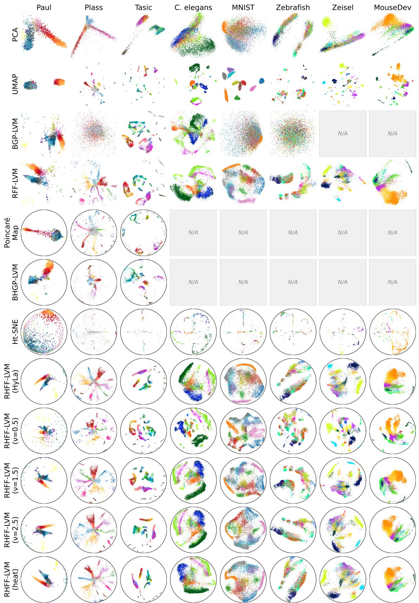  
Figure 8: Embedding visualizations at Q = 2 for all methods (rows) and datasets (columns), colored by cell type. Hyperbolic methods are shown on the Poincaré ball, Euclidean methods directly; N/A marks method–dataset pairs that exceeded the time or memory budget or are unsupported.