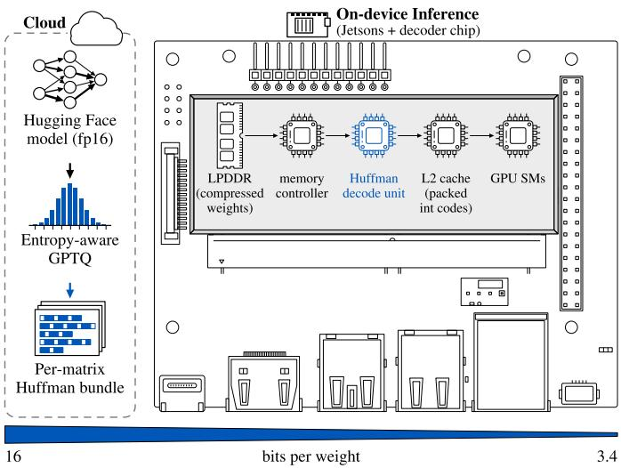
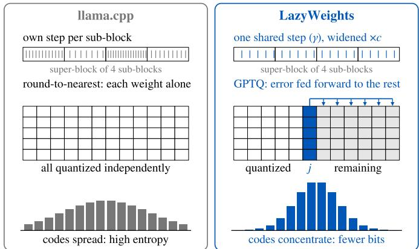
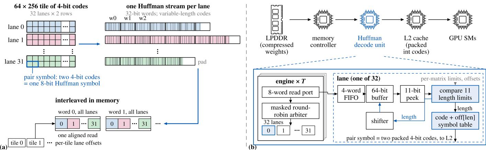
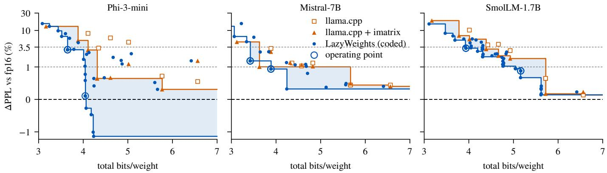
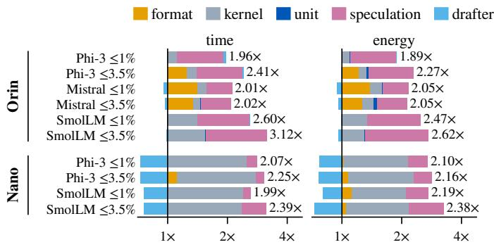
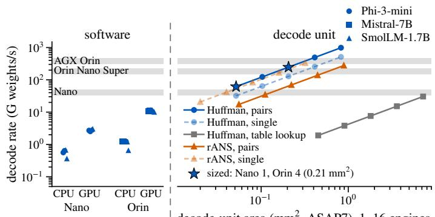

# LazyWeights: Decode-on-Demand Edge LLMs

Arnab Sanyal † Gourav Datta ‡ Sandeep P. Chinchali †

† The University of Texas at Austin

Abstract—Memory decides which LLMs an edge device runs, and how fast: capacity on a 4 GB Jetson Nano, bandwidth on an 8 GB Jetson Orin Nano Super. Deployed formats (GPTQ, AWQ, llama.cpp’s K- and I-quants) spend equal bits on every integer code of a matrix, although the codes are far from uniform. LazyWeights keeps these formats but tunes GPTQ so the codes compress, Hufman-codes them losslessly in interleaved lanes, and decodes them on demand in a small unit between DRAM and L2, so GPU kernels run unchanged and DRAM moves only coded bytes. At 1% and 3.5% perplexity budgets, coded Phi-3-mini, Mistral-7B and SmolLM-1.7B are 5.7–31.4% smaller than the best llama.cpp format. A bit-exact 0.21 mm2 ASIC decoder unit (1 GHz, 7 nm) cuts Orin latency and energy per token by up to 36% and 38% (54% and 44% with prompt-lookup speculation). On the Nano, LazyWeights needs 58–64% less time and 53–57% less energy per token than CPU llama.cpp, and runs a streamed Mistral-7B 6.6× faster at 3.89 bits per weight. A Hufman decoder beats an rANS decoder in rate and area at equal throughput; the ASIC decoder unit runs bit-exact on a Zynq UltraScale+ FPGA (AMD ZCU102).1

Index Terms—AI and Machine Learning, Architecture & System Design, Embedded Systems and IoT

## I. Introduction

Generating a token reads every weight of a large language model (LLM) once, so on an edge device the weight footprint decides whether a model fits and how fast it runs: a 7B model needs 14 GB in 16-bit floats, more than most edge modules have, and even at 4 bits each token moves gigabytes through a phone-class memory system. llama.cpp [1] has made posttraining quantization the default, with GGUF files ofering fixed-width integer formats with per-block scales from 8 down to about 3 bits per weight.

These formats and the quantizers that target them (GPTQ [2], AWQ [3], the llama.cpp K- and I-quants) share an unstated commitment: every code of a matrix costs the same number of bits. This wastes bits twice. Weights are bell-shaped, so a 4-bit alphabet’s inner codes dominate and its entropy sits well below 4 bits [4], [5]; and many code assignments reach the same quality, so a quantizer that knows its codes will be entropy-coded can pick ones that compress.

Lossless weight coding, from Deep Compression [6] to recent work on 16-bit LLM weights [7]–[10] or a quantizer’s integers [11], [12], takes the quantizer as given and mostly decodes in software. A coded 4-bit model is worth having only if it beats the next-smaller fixed-width format at equal quality, a comparison rarely made, and only if its codes can be expanded at DRAM rate every token: software decoders fall 15–20× short of that on an Orin Nano Super, making a token 2.5–3.2× slower than the same codes at fixed width.

LazyWeights removes the commitment end to end (Fig. 1). It shapes the codes inside the deployed format, codes them with a Hufman layout built for parallel decoding, and decodes them in a small unit between DRAM and L2, where bytes are counted. The GPU still reads fixed-width codes, so its kernels are untouched, the decoded weights are bit-identical to a valid GGUF file, and quality is the quantizer’s alone. On the bandwidth-bound Orin, fewer bytes then mean faster, cheaper tokens; on the instruction- and capacity-bound Nano, the unit ‡ Case Western Reserve University

  
Fig. 1. LazyWeights overview: entropy-aware quantization and a per-matrix Hufman bundle in the cloud; on the device, a decode unit between the memory controller and L2 restores fixed-width codes. Without the unit, the GPU kernels decode in software inside GEMV (32 lanes) as the reference. Bottom: bits per weight.

removes software decoding and the coded size decides whether Mistral-7B runs at all (Table I).

Our contributions:

• Entropy-aware quantization in standard formats: GPTQ with shared sub-block steps and a wider step, emit- ting valid GGUF 5.7–31.4% smaller than the best llama.cpp format at ≤1% and ≤3.5% ∆PPL.

• A parallel-decodable Hufman bundle: a length-limited canonical code per matrix, 32 interleaved lane streams per tile, pair symbols for 4-bit codes; within 1.2–2.1% of the zeroth-order entropy, all overheads included.

• A Hufman decode unit between DRAM and L2:

0.05 mm2 per 32-lane engine at 1 GHz (ASAP7), sized from the bandwidth, bit-exact, prototyped on an AMD ZCU102; never larger than rANS in rate, smaller in area at equal throughput.

• End-to-end evaluation in two edge regimes: latency and energy per token on a Jetson Orin Nano Super and a Jetson Nano, greedy and with prompt-lookup speculation, against llama.cpp, from measured time, energy and DRAM energy per byte and synthesized decoder power.

## II. Related Work

Weight quantization. GPTQ [2] quantizes column by col-umn, feeding each column’s Hessian-weighted error into the rest; AWQ [3] rescales salient channels. Both target fixedwidth formats, like llama.cpp’s [1] K- and I-quants (op- tionally with an importance matrix), which edge models ship in and which are our baseline. AQLM [13], QuIP# [14] and QTIP [15] reach lower rates at equal quality with vector and trellis codebooks but need their own formats and kernels; we keep the deployed scalar format and code its integers.

Entropy-constrained quantization. ECSQ adds a rate term to the distortion; Choi et al. [16] applied Hessian-weighted

TABLE I  
Edge platforms. DRAM use: weight bytes per token over time per token, as a fraction of bandwidth, for our fixed-width kernels.
<table><tr><td colspan="2">Jetson Orin Nano Super</td><td>Jetson Nano</td></tr><tr><td>Memory / bandwidth</td><td>8 GB, 102 GB/s</td><td>4 GB, 22.5 GB/s (meas.)</td></tr><tr><td>GPU</td><td>Ampere, 1024 cores</td><td>Maxwell, 128 cores</td></tr><tr><td>int8 dp4a / toolchain</td><td>yes / CUDA 12.6</td><td>no / CÚDA 10.2</td></tr><tr><td>DRAM use, packed</td><td>40–64%</td><td>34-35%</td></tr><tr><td>Mistral-7B fits</td><td>yes</td><td>no (streamed, §IV-E)</td></tr><tr><td>Bound by Compression buys</td><td>memory bandwidth latency, energy</td><td>instructions + capacity ability to run; the unit buys latency, energy</td></tr></table>

ECSQ to network weights. Inside GPTQ, structural changes to the grid matter far more than this term (§VII).

Lossless coding of weights. Deep Compression [6] Hufman-coded the cluster indices of pruned CNNs; Deep- CABAC [17] arithmetic-codes weights for storage and transmission. For LLMs, ZipNN [8] compresses model files for storage and transfer, DFloat11 [7] entropy-codes BF16 exponents and decodes them in a GPU kernel, ZipServ [9] fuses a fixed-length bitmap encoding of BF16 into the Tensor-Core GEMM, and Huf-LLM [10] Hufman-codes 16-bit weights end to end; all keep roughly 70% of the BF16 size, around 11 bits per weight, well above what edge devices deploy. EntroLLM [11] codes tensor-level 8- and 4-bit integers and decodes them in parallel on a Jetson’s CPU.

Entropy decoders in hardware. Hufman decoding runs in FPGA Deflate cores [18] and in parallel on GPUs [19]; ANS/rANS [20] reaches arithmetic-coding rates but has a multiply in its state recurrence. APack [21] places an arithmetic decoder next to a DNN accelerator’s memory controller; we place a Hufman unit there in a GPU memory hierarchy, size it from the bandwidth, and compare it with rANS at equal throughput.

Low-bit runtimes. BitLLM [22] speeds up fixed-width lowbit decoding on mobile GPUs (KV-cache layouts, packing, deferred type conversion); it cuts compute per code, we cut bytes per code, so the two compose.

Where we sit. LazyWeights is, to our knowledge, the first design to code the deployed integer format rather than merely store it: it shapes the codes inside llama.cpp’s formats, keeps files valid GGUF, decodes in hardware where DRAM trafic is counted, and compares against the best fixed- width format at equal perplexity, the comparison that decides whether coding is worth its decoder. Any quantizer that emits integer codes in a fixed format can feed the bundle and the unit.

## III. Background

## A. Decoding is memory-limited

Each token runs one GEMV per weight matrix, two FLOPs per weight, far below what an edge GPU sustains per byte of bandwidth. With S the weight bytes read per pass, $\beta$ the DRAM bandwidth, $t _ { \mathrm { a r i t h } }$ the arithmetic time, and $\bar { S } _ { \mathrm { s t } }$ the bytes streamed from storage at $\beta _ { \mathrm { s t } }$ when memory cannot hold ${ \dot { S } } ,$ a weight pass takes

$$
t \approx \mathrm { m a x } \biggl ( { \frac { S } { \beta } } , \ t _ { \mathrm { a r i t h } } \biggr ) + { \frac { S _ { \mathrm { s t } } } { \beta _ { \mathrm { s t } } } } .\tag{1}
$$

Fewer bytes are faster only while $S / \beta$ dominates; when the model does not fit, the storage term does.

On the Orin Nano Super, our fixed-width kernels match or beat llama.cpp on the same GGUF and use 40–64% of the bandwidth (Table I), so time tracks bytes, and a unit that makes coded bytes the only bytes read turns compression into latency and energy. On the Nano, time tracks fp32 arithmetic and fewer bytes save little time; but software Hufman decoding is 54– 69% of a token, which the unit removes, and Mistral-7B does not fit, which puts the storage term of (1) in charge.

  
Both: same blocks, scales and 4-bit alphabet, so the file loads in unmodified llama.cpp  
Fig. 2. Code selection (histograms illustrative). LazyWeights keeps the format but shares one step per super-block (γ) and widens it (c), so the codes concentrate; GPTQ feeds each column’s error to the remaining columns, so the coarser grid keeps its quality.

## B. The entropy of quantized codes

A fixed-width format stores each code at its alphabet’s width; an entropy coder stores it near the code entropy $H ( q )$ For weights of density $p ( w )$ quantized with step $\Delta .$ , at high resolution

$$
H ( q ) \approx h ( w ) - \log _ { 2 } \Delta , \qquad h ( w ) = - \int p ( w ) \log _ { 2 } p ( w ) d w ,\tag{2}
$$

so scaling the step by c saves about $\log _ { 2 } c$ bits per weight: 0.32 at ×1.25, 0.58 at ×1.5. At 4 bits, far from that regime, the measured saving is smaller (0.19–0.20 b/w at ×1.25 on Phi-3, 0.46 at ×1.5 on Mistral), but the lever is the same. Conversely, a quantizer that spreads codes evenly, as min-max fitting per sub-block does, pushes $H ( q )$ toward the full width: the coder’s saving is decided by the quantizer.

## IV. The LazyWeights Design

## A. Problem statement

Let F be llama.cpp’s formats (blocks, scales, code alphabet; e.g. IQ4 XS, Q5 K, Q6 K) and θ the quantizer settings. With $b ( { \bar { f } } , { \overline { { \theta } } } )$ the coded bits per weight, counting scales, code tables, lane ofsets and embeddings, and $\Delta \mathrm { P P L } ( { \bf \bar { f } } , \theta )$ the WikiText-2 perplexity increase over fp16, we seek for a budget ε

$$
( f ^ { * } , \theta ^ { \star } ) = \arg \operatorname* { m i n } _ { f \in \mathcal { F } , \theta } \ b ( f , \theta ) \quad \mathrm { s . t . } \quad \Delta \mathrm { P P L } ( f , \theta ) \leq \varepsilon ,\tag{3}
$$

against the budget baseline, the smallest llama.cpp file (with or without importance matrix) within the same budget. $\varepsilon ~ = ~ 1 \%$ is near-lossless, the traditional role of 8 bits; 3.5% is a small, usable loss within which every model has a llama.cpp point. Perplexity selects; downstream tasks confirm. The output must decode losslessly to valid GGUF of format $f ,$ so quality is the quantizer’s alone, measured once before coding.

## B. Entropy-aware quantization inside standard formats

LazyWeights keeps each format’s blocks, scales and al-phabet, so files load in unmodified llama.cpp, and changes how codes are chosen (Fig. 2).

Shared sub-block steps (γ). llama.cpp fits each subblock of a 256-weight super-block to its own range, spreading its codes over the whole alphabet: right for fixed width, wrong for a coder. We bound each sub-block’s range from below by $\gamma$ times the largest in its super-block: $\gamma = 0$ is llama.cpp’s fit; at $\gamma = 1$ the super-block shares one step and its codes concentrate where its weights do.

Step scale (c). By (2), a wider step lowers the entropy: we scale the fitted step by $c \in \{ 1 , 1 . 2 5 , 1 . 5 \}$ }, chosen per point, and let GPTQ absorb the error.

GPTQ error feedback [2] makes the coarser grid afordable; round-to-nearest (RTN) does not (§VII). Weight w in column j takes

$$
q ^ { * } = \arg \operatorname* { m i n } _ { \boldsymbol { q } } ~ h _ { j j } ^ { - 1 } ( w - \hat { w } _ { \boldsymbol { q } } ) ^ { 2 } + \lambda \ell ( \boldsymbol { q } ) ,\tag{4}
$$

with Hessian term $h _ { j j } ^ { - 1 }$ , reconstruction $\hat { w } _ { q }$ and code length $\ell ( q ) ;$ ; all points use $\lambda = 0 .$ , as the ECSQ rate term [16] does not pay (§VII). Calibration: 128 sequences of 512 tokens from C4. Settings difer per point $( \mathrm { e . g . \gamma } \overset { \cdot } { = } 1 , c = 1 . 5$ for Mistral-7B $\leq 3 . 5 \% ; \gamma = 0 , c \doteq 1 . \hat { 2 } 5$ for $\mathrm { P h i } { - } 3 \leq 1 \% )$ , hence the search (3) rather than a fixed recipe.

## C. A lossless Hufman bundle built for parallel decoding

Hufman decoding is sequential: a code’s start is known only once the previous code is decoded. The bundle (Fig. 3a) breaks this. Each matrix has one canonical code, length-limited to 11 bits so an 11-bit window always resolves a code. Each 64×256 tile is 32 lane streams of two rows, decoded in parallel without waiting for each other. The lanes’ 32-bit words are interleaved, so the words needed next are adjacent and a GPU warp or the unit’s read port fetches them in wide, aligned reads; per-tile lane ofsets let any tile start independently. In 4-bit formats two codes form one 8-bit pair symbol, two weights per decode step.

## D. A Hufman decode unit between DRAM and L2

Decoding in the GPU kernels spends instructions on bit manipulation, costing more time than the bytes save; expand- ing weights back into DRAM saves storage, not bandwidth. LazyWeights decodes between the memory controller and L2 (Fig. 3b): DRAM holds and moves only coded weights, L2 receives fixed-width codes, and the kernel is unchanged, so the first term of (1) follows the coded size.

Lane. A request side feeds the lane’s stream through a 4- entry prefetch FIFO into a 64-bit bit bufer. The next 11 bits are compared against 11 per-length limits at once; the thermometer result gives the length, the symbol is the code plus a per-length ofset, and the bufer shifts. A lane emits one pair symbol (two weights) per cycle; the per-matrix limit and ofset tables are broadcast by the engine.

Engine. 32 lanes share an 8-word read port through a masked round-robin arbiter, decoding 31.9 symbols per cycle (0.2% stall), i.e. 60–64 weights per cycle for pair-coded formats.

Sizing and clock. To keep pace with DRAM, the unit must decode

$$
\theta ^ { * } = \frac { 8 \beta } { b _ { c } }\tag{5}
$$

TABLE II  
Runtime optimizations, before → after.
<table><tr><td>Change</td><td>Measured on</td><td>Effect</td></tr><tr><td>Speculative attention,</td><td>SmolLM 8-token pass, depth 400</td><td>44.4 → 31.2 ms</td></tr><tr><td>GGUF-width twins</td><td>Phi-3 8-token pass, depth 900</td><td> $7 7 . 5 \to 5 2 . 5 \mathrm { m s }$ </td></tr><tr><td>Nano kernels</td><td>SmolLM ≤1% twin, greedy token</td><td>474 → 152 ms</td></tr><tr><td></td><td>SmolLM ≤3.5%</td><td>282 → 134 ms</td></tr><tr><td>Ordered reduction</td><td>Phi-3</td><td>585 → 261 ms</td></tr><tr><td></td><td>Nano, 2-token coded pass</td><td>418 → 301 ms</td></tr><tr><td>CUDA graphs</td><td>Orin pass (485–645 kernels) per greedy token</td><td>−1.9–3.5 ms (7–12%) -6-11%</td></tr></table>

weights per second $( b _ { c } )$ coded bits per weight), 151–229 G weights/s at 102 GB/s. At 1 GHz, close to the Orin’s 1.02 GHz GPU clock (MAXN SUPER), four engines (0.206 mm2) cover $\theta ^ { * }$ for five of six points; Smol $. \mathbf { M } \leq 1 \%$ , whose 5- and 6-bit codes decode singly (32 weights per cycle per engine), needs five $( 0 . 2 5 8 \mathrm { m m } ^ { 2 } ) .$ . Lower clocks need proportionally more engines; the Nano needs 1–2. The lane’s compare-and- shift recurrence closes 1 GHz without the repair the arbiter needs, while a 2048-entry lookup table per lane is 9× larger and misses it (Table V).

Verification. A C model reproduces every coded matrix of 17 bundles with zero mismatches; Verilator co-simulation of the SystemVerilog RTL is bit- and cycle-exact against it on 29/29 matrices in 5 configurations; and N engines against a bandwidth-capped DRAM model with read latencies up to 1024 cycles are bit-exact on all 6 points at 95–96% of $\theta ^ { * }$ Synthesis: Yosys/ABC, OpenROAD, OpenSTA, ASAP7 RVT TT, logic synthesis (pre-layout).

FPGA prototype. We map four engines onto an AMD ZCU102: a Zynq UltraScale+ XCZU9EG MPSoC (speed grade −2; 274k LUTs, 548k flip-flops, 32.1 Mb of block RAM, 2,520 DSP slices) with a quad-core 1.2 GHz Arm Cortex-A53 running Linux, 4 GB of 64-bit DDR4 on the processor side and 512 MB of 16-bit DDR4 on the fabric side. The Arm cores write each matrix’s bundle in chunks into block RAM over AXI and start the engines together; every lane’s output (CRC-32) and every chunk’s cycle, stall and word counts are checked against the C model.

## E. Runtime

Our runtime runs both the twin – the same codes without entropy coding, as the GPU sees them behind the unit – and the coded bundle, decoded inside the GEMV kernels as the software reference. A fixed-order reduction across tile columns, in the int8 and fp32 kernels, makes the two bit- identical, so losslessness is tested end to end: identical logits on both devices, and speculation (up to 8 tokens per pass) token-identical to greedy.

Speculation. Attention reads each key and value once for all draft tokens of a head, with per-query arithmetic independent of the draft length, and Q5 K/Q6 K twins keep the GGUF width (nibbles plus a high-bit plane), not bytes (Table II).

Nano kernels. The instruction-bound Nano needs few instructions per weight. A 32-bit fetch yields four (5/6-bit) or eight (4-bit) fixed-width codes; Q5 K/Q6 K codes are rebuilt from their nibble and high-bit planes by byte permutes, one sub-block per fetch. Byte permutes also replace integer-to-float conversion (a code placed under the exponent of $2 ^ { 2 3 }$ , recovered by one subtraction) and table lookup (the 16 IQ4 XS grid values, biased to unsigned bytes); the multiply-add order is unchanged. The ordered reduction replaces Maxwell’s slow global atomics.

  
Fig. 3. (a) Bundle layout: a 64×256 tile of 4-bit codes is 32 lanes of two rows; each lane is one Hufman stream of 32-bit words (code boundaries illustrative); the lanes’ words are interleaved, so one ali ned read fetches the next word of ever lane, and er-tile lane ofsets let an tile start inde endentl ; two 4-bit codes form one 8-bit pair symbol. (b) Decode unit between the memory controller and L2 (as in Fig. 1): T engines of 32 lanes sharing an 8-word read port through a masked round-robin arbiter; a lane compares an 11-bit peek against per-length limits (no 2048-entry table), adds the length’s ofset to index the symbol table, and shifts its bufer by the length.

CUDA graphs. Each kernel launch idles the GPU for about 4 µs. We replay each pass shape (1–8 tokens) as a CUDA graph, with the position read from device memory, with bit- identical logits on all 14 bundles; llama.cpp already uses graphs on the Orin.

Streaming on a 4 GB device. The Nano has 3.6 GB free at idle; CUDA takes about 200 MB, and we keep 384 MiB free because an out-of-memory kill takes down system ser- vices. Tegra device memory is pinned host memory and counts against that floor, so at most 2.56 GB of weights stay resident, while the Mistral-7B bundles are 3.2–3.6 GB. The rest is streamed every pass in forward order: stored pre- interleaved in the device layout (4096-byte aligned) and read with O DIRECT by a loader thread into two pinned staging bufers, overlapping I/O and compute. Streamed tokens equal resident ones.

## V. Experimental Setup

Models and quality. Phi-3-mini-4k-instruct, Mistral-7B-Instruct-v0.2, SmolLM-1.7B-Instruct. WikiText-2 perplexity (all tokens, 512-token chunks); HellaSwag, ARC-easy, PIQA (0-shot); GSM8K (8-shot chain of thought, flexible extraction: the last number in the answer).

Baselines. On the Orin the budget baseline uses llama.cpp’s CUDA kernels. The Nano is frozen at CUDA 10.2 and gcc 7.5 (its last JetPack): current llama.cpp no longer builds its CUDA backend there, and releases that do predate the I-quants (IQ4 XS, IQ3 M) several baselines use, so the Nano baseline is current llama.cpp cross-compiled for the 4-core CPU, the best llama.cpp available. Our runtime builds for sm 53 with fp32 activations. The fixedwidth twin isolates the unit’s share with identical kernels; other runtimes (MLC-LLM, TensorRT-LLM) alter only the kernel share.

Latency and energy. 128 new tokens for each of 6 prompts (32 for streamed Mistral-7B on the Nano); energy integrated from the module input rail, idle included; Orin clocks pinned (MAXN SUPER). Every runtime runs greedy (one weight pass per token) and with prompt-lookup speculation: drafts of up to 7 tokens from an n-gram table of the prompt and accepted text, with no drafter model, verified in one pass, yielding 1.7–2.4 tokens per pass (0.41–0.58 passes per token). Each runtime uses its own drafter (llama.cpp’s; ours, n=3);

our runtime also ran llama.cpp’s (ported), isolating the drafter’s share (Fig. 5a).

End-to-end model with the unit. Time with the unit is the twin’s, measured in the same run and mode $( t _ { \mathrm { h w } } = t _ { \mathrm { t w i n } } ) \colon$ conservative, since fewer DRAM b tes could also shorten the token; the bandwidth-bound end scales $t _ { \mathrm { t w i n } }$ by the coded-to- fixed byte ratio. Energy is

$$
E _ { \mathrm { h w } } = E _ { \mathrm { t w i n } } - k \left( e _ { \mathrm { D R A M } } \Delta S - E _ { \mathrm { d e c , p a s s } } \right) ,\tag{6}
$$

with k weight passes per token (1 greedy, measured under speculation) and $\Delta S$ the bytes saved per pass. eDRAM, the input-power slope of a streaming DRAM read minus the same read from L2, is 90.5 pJ/byte on the Orin and 34.9 pJ/byte on the Nano; $E _ { \mathrm { d e c } }$ uses synthesized engine power (§VI-D), bounded by clock-gated vs. always-on engines with a 2× margin.

## VI. Results

## A. Memory at equal quality

Every coded model is 5.7–31.4% smaller than the best llama.cpp format within its budget, most for Mistral-7B ≤1% (Table III, Fig. 4). Hufman coding alone gives 6.2– 20.7% (coded vs twin); the quantizer gives the rest, letting a coded file in a wider format undercut a narrower llama.cpp format at equal quality. HellaSwag, ARC-easy and PIQA are at most 1.5 points below the baseline, GSM8K at most 3.2 (Mistral ≤3.5%).

## B. Latency and energy on the Orin Nano Super

With the unit, every greedy point beats the budget baseline by 10–36% in time (up to 44% bandwidth-bound) and 9–38% in energy (Table III); the decoder costs 3–13 mJ per token against 5–61 mJ of DRAM energy saved, and with always-on engines at 2× power energy still drops 6–36% greedy and 17– 42% with speculation. Without the unit, coding would slow the Orin down (§I, Fig. 5b).

Speculation composes with the unit: it cuts passes per token, the unit cuts bytes per pass. Against llama.cpp with speculation, every point is 29–54% faster (up to 57% bandwidth-bound) at 21–44% less energy. One change at a time (Fig. 5a), speculation is the largest step on the Orin (1.3– 2.0×), the format gives 1.3–1.4× where it changes the file, and the drafter is within 5%: ours accepts more tokens per pass (1.96 vs 1.63 on Mistral), but larger passes cost more.

TABLE III  
Operating points (the released GGUF files) and per-token cost on the Orin Nano Super. Upper row: the L L A M A.C P P budget baseline (its format). b/w: all overheads; ∆PPL vs fp16; GSM8K: flexible extraction; Savin $\begin{array} { r } { \dot { \mathbf { \eta } } = 1 - b _ { \mathrm { o u r e s } } / b _ { \mathrm { L L A M A . C P P } } . } \end{array}$ . Orin: ms / mJ per token, each runtime with its own drafter; LAZYWEIGHTS with the unit at the measured twin time; ∆t: bandwidth-bound / conservative; ∆E: (6), clock-gated decoder.
<table><tr><td></td><td></td><td></td><td></td><td></td><td colspan="4">Task accuracy</td><td></td><td colspan="3">Orin, greedy</td><td colspan="3">Orin, speculation</td></tr><tr><td>Model</td><td>Budget</td><td>Format</td><td>b/w</td><td>∆PPL</td><td>HellaSwag</td><td>ARC-e</td><td>PIQA</td><td>GSM8K</td><td>Saving</td><td>ms / mJ</td><td>∆t</td><td>∆E</td><td>ms / mJ</td><td>∆t</td><td>∆E</td></tr><tr><td>Phi-3-mini</td><td>≤1%</td><td>IQ4_XS+im</td><td>4.311</td><td>+0.65%</td><td>.783</td><td>.807</td><td>.798</td><td>.785</td><td></td><td>35.0 / 691</td><td></td><td></td><td>27.4  /  495</td><td></td><td></td></tr><tr><td></td><td></td><td>LazyWeights</td><td>4.046</td><td>+0.11%</td><td>.778</td><td>.803</td><td>.789</td><td>.773</td><td>6.2%</td><td>31.4 / 627</td><td>-15/-10%</td><td>-9%</td><td>17.9 / 366</td><td>-39/-35% -26%</td><td></td></tr><tr><td></td><td>≤3.5%</td><td>Q3 K M+im</td><td>4.108</td><td>+2.91%</td><td>.776</td><td>.786</td><td>.799</td><td>.779</td><td></td><td>44.0 / 840</td><td></td><td></td><td>27.6 / 512</td><td></td><td></td></tr><tr><td>Mistral-7B</td><td></td><td>LazyWeights</td><td>3.649</td><td>+2.97%</td><td>.774</td><td>.811</td><td>.796</td><td>.770</td><td>11.2%</td><td>31.4 / 616</td><td>-37/-29%</td><td>-27%</td><td>18.3 / 370</td><td>-42/-34% -28%</td><td></td></tr><tr><td></td><td>≤1%</td><td>Q5_K_M</td><td>5.668</td><td>+0.44%</td><td>.842</td><td>.716</td><td>.768</td><td>.425</td><td></td><td>83.3 /  1784</td><td></td><td></td><td>61.6 / 1276</td><td></td><td></td></tr><tr><td></td><td></td><td>LazyWeights</td><td>3.886</td><td>+0.94%</td><td>.840</td><td>.720</td><td>.770</td><td>.402</td><td>31.4%</td><td>53.0 / 1107</td><td>-41/-36%</td><td>-38%</td><td>41.5 / 871</td><td>-37/-33% -32%</td><td></td></tr><tr><td></td><td>≤3.5%</td><td>IQ3 M+im</td><td>3.628</td><td>+1.01%</td><td>.838</td><td>.722</td><td>.779</td><td>.400</td><td></td><td>77.7 /  1611</td><td></td><td></td><td>71.6 / 1397</td><td></td><td></td></tr><tr><td></td><td></td><td>LazyWeights</td><td>3.422</td><td>+1.46%</td><td>.838</td><td>.719</td><td>.782</td><td>.368</td><td>5.7%</td><td>52.9 /  1068</td><td>-44/-32%</td><td>-34%</td><td>38.5 /  786</td><td>-56/-46% -44%</td><td></td></tr><tr><td>SmolLM-1.7B</td><td>≤1%</td><td>Q5_K_M</td><td>5.721</td><td>+0.65%</td><td>.607</td><td>.633</td><td>.737</td><td>.064</td><td></td><td>26.4 / 481</td><td></td><td></td><td>14.3 /  246</td><td></td><td></td></tr><tr><td></td><td></td><td>LazyWeights</td><td>5.162</td><td>+0.88%</td><td>.607</td><td>.630</td><td>.739</td><td>.067</td><td>9.8%</td><td>18.6 / 356</td><td>-33/-29%</td><td>-26%</td><td>10.1 / 194</td><td>-33/-29% -21%</td><td></td></tr><tr><td></td><td>≤3.5%</td><td>IQ4_XS+im</td><td>4.388</td><td>+3.09%</td><td>.605</td><td>.625</td><td>.732</td><td>.055</td><td></td><td>23.7 / 375</td><td></td><td></td><td>16.5 / 254</td><td></td><td></td></tr><tr><td></td><td></td><td>LazyWeights</td><td>3.934</td><td>+3.27%</td><td>.601</td><td>.610</td><td>.736</td><td>.055</td><td>10.3%</td><td>15.3 /  287</td><td>-40/-36%</td><td>-23%</td><td>7.6 / 143</td><td>-57/-54%</td><td>-44%</td></tr></table>

  
Fig. 4. Rate–quality frontiers. Dots: coded models, including llama.cpp’s imatrix codes behind our Hufman stage; lines: lowest ∆PPL reachable at or below a rate; shading: where coding wins; rings: released operating points; dashed: the 1% and 3.5% budgets and fp16. Axis linear below 1%.

TABLE IV  
Jetson Nano, per token (ms / J; Mistral: s / J). CPU: L LAMA.C P P with the budget baseline or our GGUF. GPU: our runtime, decoding in software or with the unit (twin time). Mistral streams from USB 3 at a 2560 MB resident budget; its twin is no proxy for the unit (§VIII).
<table><tr><td></td><td></td><td colspan="2">CPU (1lama.cpp)</td><td colspan="2">GPU (LazyWeights runtime)</td></tr><tr><td>Model</td><td>Budget</td><td>Baseline</td><td>LazyWeights GGUF</td><td>Software</td><td>+ unit</td></tr><tr><td>Greedy</td><td></td><td></td><td></td><td></td><td></td></tr><tr><td>Phi-3</td><td>≤1%</td><td>657  /  4.48</td><td>654 / 4.40</td><td>591  / 4.24</td><td>261  / 2.05</td></tr><tr><td></td><td>≤3.5%</td><td>736 / 4.80</td><td>663  / 4.45</td><td>590  / 4.46</td><td>263  / 2.08</td></tr><tr><td>SmolLM</td><td>≤1%</td><td>366 /  2.47</td><td>364 /  2.21</td><td>484 /  3.22</td><td>152 / 1.17</td></tr><tr><td></td><td>≤3.5%</td><td>317 / 2.12</td><td>317 /  2.03</td><td>289 / 2.10</td><td>134 / 0.97</td></tr><tr><td>Mistral</td><td>≤1%</td><td>22.6 / 71.2</td><td>18.0 / 58.3</td><td>3.40 /  15.8</td><td>n/a</td></tr><tr><td></td><td>≤3.5%</td><td>1.93 /  12.7</td><td>15.1 / 49.0</td><td>2.08 /  12.0</td><td>n/a</td></tr><tr><td colspan="6">Prompt-lookup speculation</td></tr><tr><td>Phi-3</td><td>≤1%</td><td>840 / 5.60</td><td>865 / 5.74</td><td>423 / 2.94</td><td>244 / 1.71</td></tr><tr><td></td><td>≤3.5%</td><td>956 / 6.23</td><td>864 /  5.74</td><td>415 / 3.05</td><td>239 /  1.69</td></tr><tr><td>SmolLM</td><td>≤1%</td><td>475 / 3.10</td><td>437  / 2.66</td><td>286 /  1.84</td><td>141  / 0.91</td></tr><tr><td></td><td>≤3.5%</td><td>419 / 2.73</td><td>469 / 2.94</td><td>170 / 1.17</td><td>101  / 0.65</td></tr><tr><td>Mistral</td><td>≤1%</td><td>16.7  / 56.6</td><td>13.3 / 46.1</td><td>2.30 / 11.3</td><td>n/a</td></tr><tr><td></td><td>&lt;3.5%</td><td>2.90 /  19.1</td><td>11.5 / 40.2</td><td>1.49 / 8.85</td><td>n/a</td></tr></table>

## C. The Jetson Nano

For resident models (Table IV), LazyWeights with the unit takes 58–64% less time and 53–57% less energy per token than llama.cpp on the CPU, greedy, and 70–76% less time and 69–76% less energy with speculation in both. Most of this comes from the GPU kernels (Fig. 5a, bottom), as Table I predicts, but the unit matters: software decoding is 2.2–3.2× slower than the twin and beats the CPU only on Phi-3 and SmolLM ≤3.5% (by 9–20%), not on SmolLM ≤1%, whose 5/6-bit codes decode singl . With the Nano’s low DRAM energy per byte, energy with the unit is within ±0.03 J of the measured twin energy. Speculation helps our

GPU runtime (SmolLM ≤3.5% twin −25%; Phi-3 only −7 to −9%, as an 8-token pass costs 3.6× a 1-token pass) and hurts llama.cpp on the instruction-bound CPU by 28–32%.

Mistral-7B, streamed. Here the coded size decides: at ≤1%, LazyWeights is 6.6× faster than llama.cpp at 4.5× less energy, even decoding in software. At ≤3.5%, llama.cpp wins greedy time narrowly at more energy and LazyWeights wins with speculation, because llama.cpp’s memory-mapped IQ3 M file (3.28 GB) stays in the reclaimable page cache, which does not count against our floor. A slightl larger file gets almost no hits, since every token scans the weights in the same order: our IQ4 XS GGUF (3.91 GB) takes 15.1 s. Our bundle (3.18 GB) is smaller still, but the cache cannot hold its streamed matrices beside our pinned resident weights and the kernel’s 464 MB CMA reservation, hence O DIRECT. A pass costs about 1.0 s of compute plus the streamed bytes, and about the same for 1 or 8 tokens, so accepted tokens per pass set speculation’s gain; a USB 3 stick (317 MB/s) instead of the SD card (70 MB/s) cuts our software-decoding token time 2.1–2.7×.

## D. Decoder cost, and Hufman versus rANS

A small unit clears the software wall (Fig. 5b; Table V). Hufman outperforms rANS on both axes. Rate: rANS   
is never smaller (0.0 to +1.0% more bits): Hufman is already   
within 1.2–2.1% of entropy, and rANS pays 32 bits of state   
plus padding per lane stream. Hardware: at equal throughput   
(2 G weights/s), rANS needs 4.0× the area with pair symbols   
(270 MHz) or 1.15× with single codes (645 MHz), as its one-  
cycle recurrence holds a symbol search, a table select and   
a 13×20-bit multiply against Hufman’s compare and shift.

  
(a)

  
(b)  
Fi . 5. (a) Factors from the llama.cpp baseline ( reed ) to LazyWeights + unit with our drafter one chan e er ste on a lo scale (ste s below 1× extend left; unit time conservative; product at bar end); top: Orin; bottom: Nano, resident points, where our drafter is a loss (0.73–0.76×). (b) Decode rate. Left: software decoders on the coded operating points; Mistral-7B is streamed on the Nano. Right: area vs rate for 1, 2, 4, 8 and 16 engines of 32 lanes (ASAP7 RVT TT, pre-layout) at the clock each closes; rANS engines share the Hufman arbiter; stars: the sized units. Bands: the rate DRAM delivers, $\theta ^ { * } = \dot { 8 } \beta / b _ { c }$ over the o eratin oints AGX Orin (not tested) at its 204.8 GB/s s ecification.

TABLE V  
Decoder blocks, logic synthesis (pre-layout): ASAP7 RVT TT at 1 GHz, Nangate45 at 500 MHz.
<table><tr><td></td><td colspan="3">ASAP7</td><td colspan="3">Nangate45</td></tr><tr><td>Block</td><td> $\mu \mathrm { { m } ^ { 2 } }$ </td><td>mW</td><td>slack</td><td>µm2</td><td>mW</td><td>slack</td></tr><tr><td>Comparator lane</td><td>1,566</td><td>3.59</td><td>+117ps</td><td>23,462</td><td>25.2</td><td>+0.5 ns</td></tr><tr><td>Table lane (2048 entries)</td><td>14,076</td><td>94.4</td><td>-31 ns</td><td></td><td></td><td></td></tr><tr><td>Arbiter, 32 lanes</td><td>1,443</td><td>0.83</td><td>met†</td><td>18,639 4.25 +1.5 ns</td><td></td><td></td></tr><tr><td>Arbiter, 64 lanes</td><td>9,174</td><td></td><td>-0.29 ns</td><td></td><td></td><td>一</td></tr><tr><td>Engine</td><td>51,550</td><td>115.7</td><td></td><td>1</td><td>1</td><td>一</td></tr></table>

†after OpenROAD repair. Power: co-simulation activity for the comparator lane, default otherwise. Shaded: Engine = 32 comparator lanes + arbiter.

TABLE VI  
Ablations at the operating-point settings (b/w, ∆PPL).
<table><tr><td>Model</td><td>Budget</td><td>Full</td><td>γ=0</td><td>RTN</td></tr><tr><td>Phi-3</td><td></td><td>≤3.5% 3.649, +2.97 4.046, +0.11</td><td></td><td>3.646, +12.07</td></tr><tr><td>Mistral</td><td>≤1%</td><td>3.886, +0.94 4.241, +0.32</td><td></td><td>3.886, -0.04</td></tr><tr><td>SmolLM</td><td>≤1%</td><td>3.5% 3.422, +1.46 3.837, +2.61</td><td>5.162, +0.88 5.621, +0.31</td><td>3.422, +2.78 5.162, +0.57</td></tr><tr><td></td><td></td><td>≤3.5% 3.934, +3.27 4.321, +2.24</td><td></td><td>3.934, +6.14</td></tr><tr><td></td><td></td><td></td><td></td><td></td></tr></table>

Interleaving several rANS states per lane would relax its recurrence; we did not evaluate it.

## E. FPGA prototype

On the ZCU102, four engines close timing at 112.5 MHz (WNS +0.06 ns; the decode-to-arbiter loop caps the design near 115 MHz) using 183.0k LUTs (67%), 37.2k flip-flops, 464 BRAM36 (51%, mostly payload copies) and no DSPs: 46k LUTs and 116 BRAM36 per engine. All 29 matrices (2,723 chunks, 484M weights) decode bit-exact, with cycle, stall and word counts equal to the C model on every chunk. Each engine sustains 31.8 weights per cycle, 14.3 G weights/s for four; the fabric (VCCINT) draws 0.88 W idle plus 3.7 W at full rate, 0.26 nJ per weight.

## VII. Ablations

Quantizer (Table VI). Shared sub-block steps carry most of the saving: with γ = 0 (llama.cpp’s fit), ∆PPL is lower but every point costs 9–12% more bits. GPTQ feedback rescues the coarse points, which reach up to +12.1% with RTN at the same bits, but not the fine ones, where RTN is better. The step scale is non-monotone in quality (Mistral $\times 1 . 2 5 + 2 . 5 7 \% , \times 1 . \dot { 5 }$ +1.46%, ×1.75 +15.5%), hence the per-model search. $\lambda > 0$ saves at most 1.2% of the bits and usually raises perplexity; int8 vs fp32 activations move perplexity by −0.07 to +0.18%.

Decoder. Comparator vs table lookup: Fig. 5b. An 8-word read port with cross-stream prefetch reaches 31.9 symbols per cycle; pair symbols cost −0.2 to +0.8% in size but double an engine’s rate; 99% of the rate needs latency/4 FIFO words per lane (SRAM: +0.014 mm2 per engine); wider engines (64 lanes: arbiter 6.4×, misses 1 GHz; Table V) only rescale the engine count.

Run-to-run variance. Five more repeats of every measured Orin row of Table III, clocks pinned, vary by at most 0.6% in time and energy per token (median 0.1%), and every ∆t and ∆E stays within 1.7 points of the table.

## VIII. Limitations and Conclusion

The unit’s latency and energy are projections from measured device numbers and pre-layout synthesis, not a fabricated SoC; the FPGA shows bit- and cycle-exact decoding, but at FPGA clocks, not 1 GHz. For streamed Mistral-7B the twin is no proxy for the unit: it streams the fixed-width bytes (1.05 GB per token at a 2560 MB budget vs 0.68/0.26 GB coded at ≤1%/≤3.5%), leaves less than our memory floor free, and at a 2048 MB budget from the SD card was 1.2–1.8× slower than software decoding. We therefore do not report the unit’s streaming time; reading its coded bytes alone takes 2.2/0.8 s per token from USB. We did not evaluate Llama-3 or Qwen3, which quantize worse [23], or long contexts, where the uncoded fp16 KV cache dilutes the saving (Mistral-7B at 4K tokens: 0.54 GB per pass vs 3.5 GB of weights).

The fixed width of edge LLM formats is a commitment, not a necessity: the codes are far from uniform, the quan- tizer can make them less so at no quality cost, and an entropy coder removes the diference if the decoder sits where bytes are counted. Shaped and Hufman-coded, models in llama.cpp’s formats are 5.7–31.4% smaller at equal perplexity; a 0.2 mm2 unit between DRAM and L2 turns this into faster, cheaper tokens on a bandwidth-bound Orin Nano Super, with or without speculation, and lets a capacity-bound Nano run a 7B model that otherwise does not fit. Coding the KV cache, newer model families, and a layout next to a real memory controller are independent next steps.

## Acknowledgment

We thank Radu Marculescu for lending us the AMD ZCU102 board, and Gefen Cooper for his help in setting it up.

## References

[1] G. Gerganov et al., “llama.cpp,” https://github.com/ggml-org/llama.cpp.

[2] E. Frantar, S. Ashkboos, T. Hoefler, and D. Alistarh, “GPTQ: Accurate Post-Training Quantization for Generative Pre-trained Transformers,” CoRR, vol. abs/2210.17323, 2022. [Online]. Available: https://doi.org/ 10.48550/arXiv.2210.17323

[3] J. Lin, J. Tang, H. Tang, S. Yang, W.-M. Chen, W.-C. Wang, G. Xiao, X. Dang, C. Gan, and S. Han, “AWQ: Activation-aware Weight Quantization for On-Device LLM Compression and Acceleration,” in Proceedings of Machine Learning and Systems, P. Gibbons, G. Pekhimenko, and C. D. Sa, Eds., vol. 6, 2024, pp. 87–100. [Online]. Available: https://proceedings.mlsys.org/paper files/paper/ 2024/file/42a452cbafa9dd64e9ba4aa95cc1ef21-Paper-Conference.pdf

[4] Z. Allen-Zhu and Y. Li, “Physics of Language Models: Part 3.3, Knowledge Capacity Scaling Laws,” in The Thirteenth International Conference on Learning Representations, 2025. [Online]. Available: https://openreview.net/forum?id=FxNNiUgtfa

[5] J. X. Morris, C. Sitawarin, C. Guo, N. Kokhlikyan, G. E. Suh, A. M. Rush, K. Chaudhuri, and S. Mahloujifar, “How much can language models memorize?” in Forty-third International Conference on Machine Learning, 2026. [Online]. Available: https: //openreview.net/forum?id=bA6BgSbaUi

[6] S. Han, H. Mao, and W. J. Dally, “Deep compression: Compressing deep neural network with pruning, trained quantization and hufman coding,” in 4th International Conference on Learning Representations, ICLR 2016, San Juan, Puerto Rico, May 2-4, 2016, Conference Track Proceedings, Y. Bengio and Y. LeCun, Eds., 2016. [Online]. Available: https://doi.org/10.48550/arXiv.1510.00149

[7] T. Zhang, M. Hariri, S. Zhong, V. Chaudhary, Y. Sui, X. Hu, and A. Shrivastava, “70% Size, 100% Accuracy: Lossless LLM Compression for Eficient GPU Inference via Dynamic-Length Float (DFloat11),” in The Thirty-ninth Annual Conference on Neural Information Processing Systems, 2025. [Online]. Available: https://openreview.net/forum?id=xdNAVP7TGy

[8] M. Hershcovitch, A. Wood, L. Choshen, G. Girmonsky, R. Leibovitz, O. Ozeri, I. Ennmouri, M. Malka, P. Chin, S. Sundararaman, and D. Harnik, “ZipNN: Lossless Compression for AI Models,” in 2025 IEEE 18th International Conference on Cloud Computing (CLOUD), 2025, pp. 186–198. [Online]. Available: https://doi.org/10. 1109/CLOUD67622 2025 00028

[9] R. Fan, X. Yu, X. Pan, Z. Li, W. Luo, Q. Wang, W. Wang, and X. Chu, “ZipServ: Fast and Memory-Eficient LLM Inference with Hardware-Aware Lossless Compression,” in Proceedings of the 31st ACM International Conference on Architectural Support for Programming Languages and Operating Systems, Volume 2, ser. ASPLOS ’26. New York, NY, USA: Association for Computing Machinery, 2026, p. 2264–2280. [Online]. Available: https://doi.org/10. 1145/3779212.3790250

[10] P. Yubeaton, T. Mahmoud, S. Naga, P. Taheri, T. Xia, A. George, Y. Khalil, S. Q. Zhang, S. Joshi, C. Hegde, and S. Garg, “Huf-LLM: End-to-End Lossless Compression for Eficient LLM Inference,” 2025. [Online]. Available: https://arxiv.org/abs/2502.00922

[11] A. Sanyal, G. Datta, P. Mukherjee, S. P. Chinchali, and M. Orshansky, “EntroLLM: Entropy Encoded Weight Compression for Eficient Large Language Model Inference on Edge Devices,” in ICASSP 2026 - 2026 IEEE International Conference on Acoustics, Speech and Signal Processing (ICASSP), 2026, pp. 19 742–19 746. [Online]. Available: https://doi.org/10.1109/ICASSP55912.2026.11464777

[12] A. Sanyal, S. P. Chinchali, and G. Datta, “EntroMCU: A Hardware-Algorithm Vision for LLM Inference on Microcontrollers,” in 2026 IEEE Computer Society Annual Symposium on VLSI (ISVLSI), 2026. [Online]. Available: https://doi.org/10.26153/tsw/64855

[13] V. Egiazarian, A. Panferov, D. Kuznedelev, E. Frantar, A. Babenko, and D. Alistarh, “Extreme Compression of Large Language Models via Additive Quantization,” in Proceedings of the 41st International Conference on Machine Learning, ser. Proceedings of Machine Learning Research, R. Salakhutdinov, Z. Kolter, K. Heller, A. Weller, N. Oliver, J. Scarlett, and F. Berkenkamp, Eds., vol. 235. PMLR, 21–27 Jul 2024, pp. 12 284–12 303. [Online]. Available: https: //proceedings.mlr.press/v235/egiazarian24a.html

[14] A. Tsen , J. Chee, Q. Sun, V. Kuleshov, and C. D. Sa, “QuIP#: Even Better LLM Quantization with Hadamard Incoherence and Lattice Codebooks,” in Forty-first International Conference on Machine Learning, 2024. [Online]. Available: https://openreview.net/forum?id= 9BrydUVcoe

[15] A. Tseng, Q. Sun, D. Hou, and C. D. Sa, “QTIP: Quantization with Trellises and Incoherence Processin ,” in The Thirty-eighth Annual Conference on Neural Information Processing Systems, 2024. [Online]. Available: https://openreview.net/forum?id=7sdkLVuYCU

[16] Y. Choi, M. El-Khamy, and J. Lee, “Towards the Limit of Network Quantization,” in 5th International Conference on Learning Representations, ICLR 2017, Toulon, France, April 24-26, 2017, Conference Track Proceedings. OpenReview.net, 2017. [Online]. Available: https://openreview.net/forum?id=rJ8uNptgl

[17] S. Wiedemann, H. Kirchhofer, S. Matlage, P. Haase, A. Marban, T. Marinc, D. Neumann, T. Nguyen, H. Schwarz, T. Wiegand, D. Marpe,ˇ and W. Samek, “DeepCABAC: A Universal Compression Algorithm for Deep Neural Networks,” IEEE Journal of Selected Topics in Signal Processing, vol. 14, no. 4, pp. 700–714, 2020. [Online]. Available: https://doi.org/10.1109/JSTSP.2020.2969554

[18] M. Ledwon, B. F. Cockburn, and J. Han, “High-Throughput FPGA-Based Hardware Accelerators for Deflate Compression and Decompression Using High-Level Synthesis,” IEEE Access, vol. 8, pp. 62 207–62 217, 2020. [Online]. Available: https://doi.org/10.1109/ ACCESS.2020.2984191

[19] A. Weißenberger and B. Schmidt, “Massively Parallel Hufman Decoding on GPUs,” in Proceedings of the 47th International Conference on Parallel Processing, ser. ICPP ’18. New York, NY, USA: Association for Computing Machinery, 2018. [Online]. Available: https://doi.org/10.1145/3225058.3225076

[20] J. Duda, “Asymmetric numeral systems: entropy coding combining speed of Hufman coding with compression rate of arithmetic coding,” 2014. [Online]. Available: https://arxiv.org/abs/1311.2540

[21] A. D. Lascorz, M. Mahmoud, and A. Moshovos, “APack: Of-Chip, Lossless Data Compression for Eficient Deep Learning Inference,” CoRR, vol. abs/2201.08830, 2022. [Online]. Available: https://doi.org/10.48550/arXiv.2201.08830

[22] H. Zheng, Z. Shu, K. Zhu, M. Qin, X. Ma, G. Agrawal, and W. Niu, “BitLLM: Eficient Low-Bit, Conversion-Hiding LLM Decoding on Mobile GPUs,” in Proceedings of the 32nd ACM International Conference on Architectural Support for Programming Languages and Operating Systems, Volume 1, ser. ASPLOS ’27. New York, NY, USA: Association for Computing Machinery, 2027, p. 120–135. [Online]. Available: https://doi.org/10.1145/3845814.3850028

[23] W. Huang, X. Zheng, X. Ma, H. Qin, C. Lv, H. Chen, J. Luo, X. Qi, X. Liu, and M. Magno, “An empirical study of LLaMA3 quantization: from LLMs to MLLMs,” Visual Intelligence, vol. 2, no. 1, p. 36, Dec 2024. [Online]. Available: https://doi.org/10.1007/s44267-024-00070-x