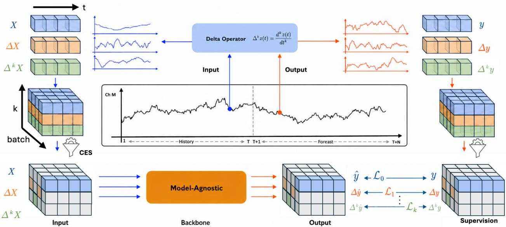
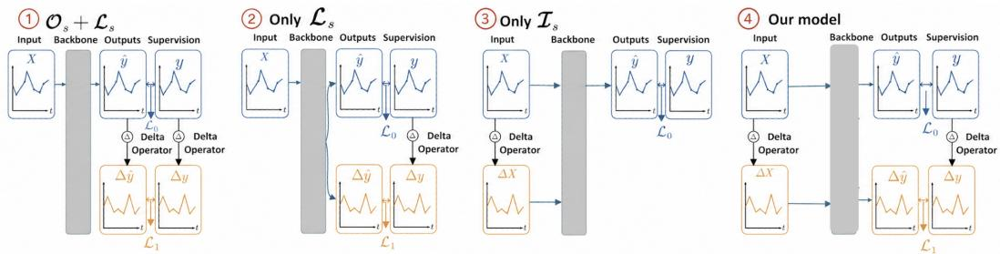
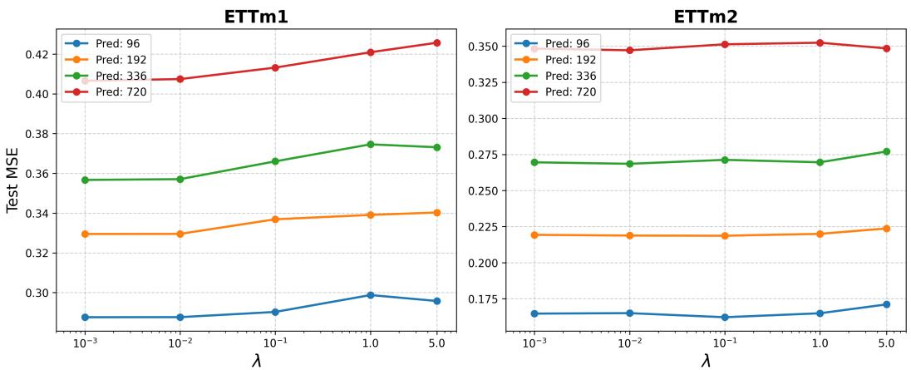

# Learning Temporal Dynamics with Derivative Representations for Time Series Forecasting

Shujie Duan1, Jia Hong Puah1, Haocheng Wu1, Yifei Mao1, Hongting Zhou1, Chenxuan Li1, Zitao Fang1, Yang Lu2, Sim Kuan Goh1∗

1School of Artificial Intelligence and Robotics, Xiamen University Malaysia, 43900 Sepang, Selangor, Malaysia 2Department of Computer Science and Technology, School of Informatics, Xiamen University, Xiamen 361005, Fujian, China AIT2209069@xmu.edu.my, MEG2311003@xmu.edu.my AIT2409044@xmu.edu.my, DSC2409024@xmu.edu.my AIT2309094@xmu.edu.my, AIT2309070@xmu.edu.my AIT2209071@xmu.edu.my, luyang@xmu.edu.cn simkuan.goh@xmu.edu.my

## Abstract

Time series forecasting aims to predict the future evolution of complex systems by learning their underlying dynamics from past observations. Despite recent advances in deep learning, Transformers in particular still struggle to capture the temporal evolution of system dynamics. Existing approaches have been largely driven by architectural innovation, with comparatively little attention paid to training strategies that explicitly exploit the temporal structure governing system dynamics. In this work, we introduce DeltaTSF, a dynamics-aware forecasting framework based on discrete derivative representations of time series. Specifically, DeltaTSF jointly learns the series and their discrete temporal derivatives across both input and forecast horizons within a unified, model-agnostic framework. By coupling these representations over time, the model is encouraged to maintain temporal consistency, a property we show to induce a form of discrete Taylor consistency during training. This formulation enables the model to better reflect the underlying system dynamics, resulting in more stable and physically coherent forecasts. Notably, DeltaTSF does not require explicit derivative computation and introduces no additional computational overhead at inference time. Extensive experiments across diverse benchmarks and backbone architectures demonstrate that DeltaTSF consistently improves forecasting performance and yields more dynamically coherent predictions than strong SOTA methods. These results highlight the effectiveness of enforcing dynamic coherence through derivative representations as a modelagnostic paradigm that operates alongside and complements architectural design. Source code will be made publicly available upon acceptance.

## 1 Introduction

Time series forecasting underlies a wide range of real-world applications, including climate modeling [1, 2], traffic [3], energy planning [4], and finance[5], with the goal of inferring latent temporal dynamics from historical observations to accurately predict future trajectories. While deep learning models have been demonstrating outstanding performance in computer vision and natural language processing tasks, they have just started to show initial promising results when applied to time serie forecasting [6, 7, 8, 9], and substantial challenges remain. These challenges arise from intrinsic characteristics of time series data, including non-stationarity, uncertainty, low signal-to-noise ratios, unobserved external factors, and the presence of unforeseen future events, leaving significant room for further investigation.

To address these challenges, a variety of research have been explored across multiple aspects summarized in Table 1, including time-series representations, model architectures (predominantly Transformer-based methods [10, 11]) and its variants and backbone substitutions with other architec tures, and training paradigms [12]. Moreover, several studies explore approaches beyond task-specific models, including time-series foundation models pretrained on large-scale and heterogeneous temporal data [13], as well as multi-modal large language models with time-series understanding and forecasting capabilities [14]. Despite these significant efforts, learning effective and transferable representations for time series data remains challenging. Empirical studies have reported contradictory findings; for example, ongoing debates question whether transformer-based architectures, despite their dominance in large language models, are inherently suitable for time series forecasting or require substantial modification to meet practical performance expectations [15, 10]. Notably, a few studies have shown that even simple multi-layer perceptron models can outperform transformer-based models tailored for time series tasks [16, 17, 18]. This observation suggests that while architectural design plays an important role, other overlooked factors are equally crucial for effective time-series representation learning. Consequently, several recent works have shifted attention to model-agnostic training paradigm [12] that complements architectural design.

Time series data consist of measurements of observable states from complex systems, which evolution is governed by underlying temporal dynamics. However, many existing forecasting methods primarily emphasize point-wise prediction accuracy at individual time steps [11, 19, 20], often overlooking the intrinsic dynamics. A line of research explicitly models dynamical state transitions, such as structured state-space models and related dynamical approaches, that do not leverage transformer architecture [21, 22]. While these methods provide clearer theoretical grounding, their practical performance on real-world forecasting datasets remains under active investigation to challenge current state-of-the-art. Nevertheless, their findings highlight the importance of capturing the dynamics of real-world systems for interpretability. Hence, we address this gap by developing a dynamics-aware training framework that implicitly encourages the learning of temporally aligned and dynamically consistent representations, and can be readily integrated into existing methods.

In this work, we study derivative representations of time series that explicitly characterise how temporal variations evolve across both input and output horizons, and propose DeltaTSF, a dynamics-aware forecasting framework that systematically exploits these representations for forecasting. Specifically, DeltaTSF jointly models series and their temporal derivatives within a shared architecture, coupling their predictions across time to enforce temporally structural alignment. We show that this coupling implicitly induces a discrete Taylor consistency across the forecast horizon during back-propagation. At inference time, DeltaTSF requires no derivative computation and produces forecasts that better respect the underlying temporal dynamics of the data. Extensive experiments across multiple forecasting benchmark datasets demonstrated that DeltaTSF consistently improves forecasting accuracy while yielding more dynamically coherent predictions than strong baselines.

Our contributions are summarized as follows:

• We propose a simple yet effective training paradigm, DeltaTSF, which learns temporally and dynamically consistent representations by coupling time series with their derivatives across both input and output horizons, which is generally applicable to any neural architecture.

• We show that the training process of DeltaTSF implicitly enforces a discrete Taylor consistency across the forecast horizon during backpropagation, enabling dynamically coherent forecasts, at negligible training overhead and zero additional inference cost.

• We conduct extensive experiments on multiple benchmark datasets and demonstrate that the proposed framework consistently improves performance when integrated into various stateof-the-art baselines. Further analysis of the training procedure and its variants highlights a promising direction for future development of dynamics-aware forecasters.

Table 1: A taxonomy of recent time-series forecasting methods organized by representation space, time-series characteristics, and Transformer intervention dimensions.
<table><tr><td rowspan="2">Method</td><td colspan="4">Time Series Representation</td><td colspan="3">Transformer Intervention Dimensions</td></tr><tr><td>Raw (Sequential)</td><td>Decomposition (Trend/Seasonal)</td><td>Spectral (Periodic)</td><td>Derivative (Rate of Change)</td><td>Backbone Substitution</td><td>Architectural Design</td><td>Training Paradigm</td></tr><tr><td>DLinear [10]</td><td></td><td>√</td><td></td><td></td><td>Linear</td><td></td><td></td></tr><tr><td>PatchTST [11]</td><td></td><td></td><td></td><td></td><td></td><td>√</td><td></td></tr><tr><td>TimesNet [23]</td><td></td><td></td><td>L</td><td></td><td>CNN</td><td>√</td><td></td></tr><tr><td>TimeMixer [24]</td><td></td><td></td><td></td><td></td><td>MLP</td><td></td><td></td></tr><tr><td>iTransformer [19]</td><td>√</td><td></td><td></td><td></td><td></td><td>√</td><td></td></tr><tr><td>PatchMLP [25]</td><td></td><td></td><td></td><td></td><td>MLP</td><td></td><td></td></tr><tr><td>TimeBase [20]</td><td>V</td><td></td><td>√</td><td></td><td>Linear</td><td>√</td><td></td></tr><tr><td>PSLoss [12]</td><td></td><td></td><td></td><td></td><td>Agnostic</td><td></td><td></td></tr><tr><td>PhaseFormer [26]</td><td></td><td></td><td></td><td></td><td></td><td>L</td><td></td></tr><tr><td>DeltaTST (Ours)</td><td>V</td><td></td><td></td><td></td><td>Agnostic</td><td></td><td></td></tr></table>

## 2 Related Work

Modeling long-range temporal dependencies for forecasting remains challenging and has attracted increasing interest from the deep learning community seeking to extend its success to time series data. Convolutional Neural Networks (CNNs) [27, 28], which rely on translational invariance and local kernels, struggle to capture long-range dependencies across historical and forecast horizons. Recurrent Neural Networks (RNNs) [29] and variants such as LSTM [30] model temporal dependencies through recurrent states, but often suffer from vanishing gradients. Hybrid CNN-RNN architectures [31, 32] combine the strengths of both models to mitigate these limitations with some successes. More recently, structured state-space models (SSMs) [33] have provided a unifying theoretical framework for CNNs and RNNs, enabling stable modeling of long-range dependencies. In parallel, alternative frameworks such as Neural Differential Equations (NDEs) [34] incorporate ordinary or partial differential equations (ODEs/PDEs) into neural models to enforce temporal continuity and capture differential dynamics across variables and time. Despite the theoretical grounding, their practical performance on real-world time series remains underexplored, with unstable training and inference [35, 36], scaling behavior not well understood [37, 38] and suboptimal hardware utilization limiting training efficiency [39] to challenge current state-of-the-art. Nevertheless, these findings highlight the importance of continuous dynamics and temporal consistency in real-world systems.

Following the success of large language models, transformer architectures [40] have been extensively studied and adapted for time series forecasting. While transformers excel in natural language processing, where tokens encode rich semantic information, time series inputs consist of numerical values that often provide only partial observations of complex systems. To address this limitation, various approaches introduce sparse attention mechanisms [41] or condense information through patching and embedding strategies [11]. Specialized transformer architectures have also been proposed to model cross-variate dependencies [19, 42, 43]. However, several studies report that ignoring cross-variate dependencies entirely can yield comparable performance [11, 20], highlighting ongoing uncertainty regarding architectural design choices. In parallel, there is growing interest in time series foundation models (FMs) [44, 13], which are pretrained on large-scale and heterogeneous temporal data and subsequently fine-tuned for downstream tasks. Although these models demonstrate promising initial results, limited performance scaling has been observed with increasing model size and dataset scale. Furthermore, there is ongoing debate regarding whether transformer-based models offer consistent advantages over simpler multi-layer perceptron (MLP) approaches [45, 15, 10].

Beyond architectural advances, another line of research focuses on training paradigms. The recent rise of diffusion models (DM) [46] has also introduced probabilistic perspectives to time series forecasting. These probabilistic models learn the distribution of future sequences conditioned on partial observations, enabling applications such as time series forecasting [47], imputation [48], and data completion [49]. However, DMs rely on iterative denoising processes, which result in high computational cost and slow inference. A few works introduce auxilatary loss functions for decompositional forecasting [50], patch-wise structural similarity [12], and self-supervised contrastive learning [51]. Nonetheless, most of the aforementioned methods primarily emphasize point-wise forecasting accuracy at individual time steps, or global fidelity in the spectral domain, while largely overlooking the preservation of underlying temporal dynamics and cross-horizon consistency. Consequently, it remains unclear how temporal dynamics can be systematically and effectively incorporated into training frameworks for time-series representation learning.

  
Figure 1: Overview of our DeltaTSF, a model-agnostic training paradigm for existing forecasting backbones without modifying their architectures. DeltaTSF jointly models series and their temporal derivatives within a shared architecture, coupling their predictions across time to enforce temporally structural alignment.

## 3 Method

Our DeltaTSF is illustrated in Figure 1, outlining how derivative representations are learned.

## 3.1 Problem Setup and Notation

We consider the multivariate time-series forecasting problem. Let $\{ { \bf x } _ { t } \} _ { t = 1 } ^ { T }$ with $\mathbf { x } _ { t } \in \mathbb { R } ^ { M }$ denote an observed history window of length $T ,$ and let $\left\{ \mathbf { y } _ { t } \right\} _ { t = T + 1 } ^ { \bar { T } + H }$ with $\mathbf { y } _ { t } \in \mathbb { R } ^ { M }$ denote the future horizon of length H to be predicted. For compactness, we stack the observations as

$$
\mathbf { x } = [ \mathbf { x } _ { 1 } , \dots , \mathbf { x } _ { T } ] \in \mathbb { R } ^ { T \times M } ,\tag{1}
$$

$$
\mathbf { y } = [ \mathbf { y } _ { T + 1 } , \dots , \mathbf { y } _ { T + H } ] \in \mathbb { R } ^ { H \times M } .\tag{2}
$$

The goal is to learn a forecasting function $f _ { \theta }$

$$
\mathbf { y } = f _ { \boldsymbol { \theta } } ( \mathbf { x } ) : \mathbb { R } ^ { T \times M }  \mathbb { R } ^ { H \times M } ,\tag{3}
$$

which maps the historical observations $\mathbf { x } _ { \mathrm { 1 : } T }$ to future predictions $\mathbf { y } _ { T + 1 : T + H }$ . Here, θ denotes the learnable parameters of a deep forecasting model. The backbone $f _ { \theta }$ can be instantiated by any off-the-shelf forecaster, such as Transformer-based PatchTST or MLP-based architectures.

## 3.2 Temporal & Dynamical Structure of Time Series.

Multivariate time series can be viewed as discrete observations of an underlying continuous-time dynamical process. Let $\mathbf { z } ( t ) \in \mathbb { R } ^ { M }$ denote a continuous-time signal evolving over $t \in \mathbb { R }$ . In practice, we observe ${ \bf z } ( t )$ at uniformly sampled time points $t _ { k } = k \Delta t$ , yielding a discrete sequence $\mathbf { z } _ { k } ^ { \star } \in \mathbb { R } ^ { M }$

In the forecasting setting, the observed history corresponds to $\mathbf { x } _ { t } = \mathbf { z } _ { t }$ for $t = 1 , \dots , T$ , while the future horizon corresponds to $\mathbf { y } _ { t } = \mathbf { z } _ { t }$ for $t = { \overset { \cdot } { T } } + 1 , \cdot \cdot \cdot , T + H$

The temporal dynamics of ${ \bf z } ( t )$ are characterized by its time derivatives. The first-order derivative

$$
\dot { { \mathbf z } } ( t ) = \frac { d { \mathbf z } ( t ) } { d t }\tag{4}
$$

captures instantaneous velocity or trend, while the second-order derivative

$$
\ddot { \mathbf { z } } ( t ) = \frac { d ^ { 2 } \mathbf { z } ( t ) } { d t ^ { 2 } }\tag{5}
$$

encodes acceleration and curvature, providing a compact description of the underlying dynamics.

Since only discrete samples are available, these continuous-time derivatives must be approximated numerically. Using finite differences with sampling interval $\Delta t$ , the first-order derivative at time index t is approximated by

$$
\dot { { \bf z } } ( t ) \approx \frac { { { \bf z } _ { t } } - { { \bf z } _ { t - 1 } } } { \Delta t } , \qquad t \ge 2 ,\tag{6}
$$

and the second-order derivative by

$$
\ddot { { \bf z } } ( t ) \approx \frac { { \bf z } _ { t } - 2 { \bf z } _ { t - 1 } + { \bf z } _ { t - 2 } } { ( \Delta t ) ^ { 2 } } , \qquad t \geq 3 .\tag{7}
$$

These approximations are applied element-wise across the M variables and hold for both $\mathbf { x } _ { \mathrm { 1 : } T }$ and yT +1:T +H.

More generally, the k-th order forward finite difference of a sequence $\mathbf { v } = [ \mathbf { v } _ { 1 } , \dots , \mathbf { v } _ { L } ] \in \mathbb { R } ^ { L \times M }$ can be expressed as a linear operator:

$$
\mathbf { v } ^ { ( k ) } = \Delta ^ { k } \mathbf { v } = \mathbf { D } _ { k } \mathbf { v } ,\tag{8}
$$

$$
\mathbf { D } _ { k } \in \mathbb { R } ^ { ( L - k ) \times L } , \quad k = 1 , 2 , \dots , L - 1 ,\tag{9}
$$

where $\mathbf { D } _ { k }$ is the k-th order difference matrix constructed recursively as

$$
\mathbf { D } _ { 1 } = \left[ \begin{array} { c c c c c } { - 1 } & { 1 } & { 0 } & { \cdots } & { 0 } \\ { 0 } & { - 1 } & { 1 } & { \cdots } & { 0 } \\ { \vdots } & { } & { \ddots } & { \ddots } & { \vdots } \\ { 0 } & { \cdots } & { 0 } & { - 1 } & { 1 } \end{array} \right] , \qquad \mathbf { D } _ { k } = \mathbf { D } _ { 1 } \mathbf { D } _ { k - 1 } .\tag{10}
$$

This formulation provides a compact, linear-algebraic representation of first-, second-, and higherorder temporal differences. To maintain consistent input lengths across all orders, we apply padding (i.e., postpending zeros) so that $\mathbf { x } ^ { ( k ) } \in \mathbb { R } ^ { T \times M }$ for all $k ,$ enabling them to be processed by the same backbone $f _ { \theta }$ without architectural modifications.

## 3.3 Forecasting as Trajectory Consistency

Under this formulation, forecasting the future horizon $\mathbf { y } _ { T + 1 : T + H }$ can be interpreted as enforcing consistency of a latent continuous trajectory ${ \bf z } ( t )$ beyond the last observed time point $t _ { T }$ . A local Taylor expansion around $t _ { T }$ gives

$$
\mathbf { z } ( t _ { T } + \tau ) \approx \mathbf { z } ( t _ { T } ) + \tau \dot { \mathbf { z } } ( t _ { T } ) + \frac { \tau ^ { 2 } } { 2 } \ddot { \mathbf { z } } ( t _ { T } ) + \mathcal { O } ( \tau ^ { 3 } ) ,\tag{11}
$$

which shows that accurate long-horizon prediction depends not only on the current state $\mathbf { x } _ { T }$ but also on its temporal derivatives.

In discrete time, the derivative terms in Eq. (11) are approximated using finite differences computed from $\mathbf { x } _ { \mathrm { 1 : } T }$ and $\mathbf { y } _ { T + 1 : T + H }$ . These discrete operators act as practical surrogates for velocity and acceleration, enabling derivative-aware supervision while remaining fully data-driven.

Training loss. The overall objective is defined as a weighted sum of mean-squared errors across multiple derivative orders:

$$
\mathcal { L } ( \theta ) = \sum _ { k = 0 } ^ { K } \mathcal { L } _ { k } ( \theta ) = \sum _ { k = 0 } ^ { K } \lambda _ { k } \mathbb { E } _ { ( \mathbf { x } , \mathbf { y } ) \sim \mathcal { D } } \left[ \left\| f _ { \theta } \left( \mathbf { x } ^ { ( k ) } \right) - \mathbf { y } ^ { ( k ) } \right\| _ { 2 } ^ { 2 } \right] ,\tag{12}
$$

where $\| \cdot \| _ { 2 } ^ { 2 }$ denotes the squared Frobenius norm over the prediction horizon and variables.

The case $k = 0$ corresponds to the standard mean-squared error on future values. Setting $K = 1$ augments the objective with an auxiliary loss on the first-order temporal differences, thereby enforcing gradient coupling between predictions and targets. Further setting $K = 2$ additionally introduces a second-order difference loss, which imposes curvature coupling and encourages consistency in temporal acceleration.

## 3.4 Shared parameterization $f _ { \theta }$ across temporal derivative orders.

Although $\mathbf { x } , \Delta \mathbf { x } , \Delta ^ { 2 } \mathbf { x } , \dots$ . emphasize different temporal derivative components, they are all derived from the same underlying latent process ${ \bf x } ( t )$ sampled over time. Jointly modeling these quantities with a shared backbone implicitly constrains the learned representation to be consistent with a single dynamical system. From an optimization perspective, this induces gradient coupling across multiple temporal orders, biasing the solution toward predictors whose outputs agree simultaneously at the level of values (state), first-order changes (trend), and second-order changes (curvature). Such coupling serves as a structural regularizer that promotes temporal coherence and dynamical consistency.

Importantly, this joint training also encourages an approximate commutativity between the forecasting operator and temporal differencing across multiple orders. Ideally, for a consistent predictor $f _ { \theta } { } _ { ; }$ applying a k-th order finite difference after forecasting should yield results similar to forecasting on k-th order differenced inputs, i.e.,

$$
\Delta ^ { k } \big ( f _ { \theta } ( { \bf x } ) \big ) \ \approx \ f _ { \theta } ( \Delta ^ { k } { \bf x } ) , \qquad k = 1 , 2 , \ldots , K ,\tag{13}
$$

where K is the highest order of differences included in training. By enforcing supervision on both sides of Eq. (13) through shared parameters, the model is encouraged to learn representations for which prediction and temporal differencing approximately commute at multiple temporal scales. This reduces inconsistency across orders, mitigates error accumulation in multi-step forecasting, and improves long-horizon stability in practice. We show in Appendix A.1 our training framework implicitly induces Taylor Consistency.

## 3.5 Compute-Equivalent Sampling (CES)

To address the increasing training cost that scales with $K ,$ , we introduce a Compute-Equivalent Sampling (CES) strategy. Instead of concatenating K additional derivative series for each training sample, each series is assigned a probability of $\bar { 1 / ( K + 1 ) }$ to be replaced by one of its first K-th order derivatives, or to remain unchanged. This stochastic selection preserves the overall batch size and reduces the computational overhead by a factor of $1 / ( K + 1 )$ , resulting in training complexity comparable to baseline methods, as illustrated in Figure 1. Empirically, ablating CES from DeltaTSF leads to only negligible performance degradation, demonstrating that CES achieves substantial computational savings while largely preserving the effectiveness, shown in Table 4b.

## 4 Experiments

## 4.1 Experimental Setup

Datasets. We conduct experiments on seven real-world multivariate time series benchmarks, including ETT (ETTh1, ETTh2, ETTm1, ETTm2) [41], Weather [41], and Electricity (ECL) [52]. Following standard practice in long-term forecasting, we adopt the official data preprocessing procedures and train/validation/test splits provided by prior works [11, 19]. Detailed dataset descriptions are provided in Appendix C.1.

Table 2: Average long-term multivariate forecasting accuracies on six datasets with the input length set to 720. Our method DeltaTSF is applied to various forecating backbones. Full results are provided in Appendix Table 9.
<table><tr><td rowspan="3">Dataset</td><td colspan="4">PatchTST</td><td colspan="4">iTransformer</td><td colspan="4">TimeMixer</td><td colspan="4">TimesNet</td></tr><tr><td colspan="2">ori</td><td colspan="2">+delta</td><td colspan="2">ori</td><td colspan="2">+delta</td><td colspan="2">ori</td><td colspan="2">+delta</td><td colspan="2">ori</td><td colspan="2">+delta</td></tr><tr><td>MSE</td><td>MAE</td><td>MSE</td><td>MAE</td><td>MSE</td><td>MAE</td><td>MSE</td><td>MAE</td><td>MSE</td><td>MAE</td><td>MSE</td><td>MAE</td><td>MSE</td><td>MAE</td><td>MSE</td><td>MAE</td></tr><tr><td>ETTh1</td><td>0.420</td><td>0.440</td><td>0.396</td><td>0.421</td><td>0.454</td><td>0.467</td><td>0.423</td><td>0.446</td><td>0.454</td><td>0.474</td><td>0.421</td><td>0.440</td><td>0.504</td><td>0.499</td><td>0.444</td><td>0.469</td></tr><tr><td>ETTh2</td><td>0.344</td><td>0.391</td><td>0.321</td><td>0.376</td><td>0.392</td><td>0.422</td><td>0.373</td><td>0.409</td><td>0.379</td><td>0.426</td><td>0.349</td><td>0.395</td><td>0.433</td><td>0.455</td><td>0.396</td><td>0.414</td></tr><tr><td>ETTm1</td><td>0.355</td><td>0.385</td><td>0.345</td><td>0.383</td><td>0.371</td><td>0.401</td><td>0.367</td><td>0.398</td><td>0.381</td><td>0.414</td><td>0.360</td><td>0.387</td><td>0.408</td><td>0.425</td><td>0.372</td><td>0.396</td></tr><tr><td>ETTm2</td><td>0.251</td><td>0.319</td><td>0.250</td><td>0.314</td><td>0.279</td><td>0.338</td><td>0.268</td><td>0.328</td><td>0.283</td><td>0.347</td><td>0.274</td><td>0.320</td><td>0.300</td><td>0.354</td><td>0.275</td><td>0.332</td></tr><tr><td>Weather</td><td>0.224</td><td>0.264</td><td>0.221</td><td>0.262</td><td>0.233</td><td>0.273</td><td>0.242</td><td>0.278</td><td>0.238</td><td>0.281</td><td>0.234</td><td>0.275</td><td>0.254</td><td>0.293</td><td>0.244</td><td>0.285</td></tr><tr><td>Electricity</td><td>0.169</td><td>0.266</td><td>0.158</td><td>0.253</td><td>0.166</td><td>0.264</td><td>0.160</td><td>0.257</td><td>0.168</td><td>0.264</td><td>0.161</td><td>0.255</td><td>0.238</td><td>0.334</td><td>0.206</td><td>0.305</td></tr></table>

Baselines To evaluate the effectiveness and generality of the proposed method, we compare DeltaTSF with a diverse set of representative state-of-the-art time series forecasting baselines spanning different modeling paradigms. Specifically, our comparison includes Transformer-based models (PatchTST [11], iTransformer [19], and PhaseFormer [26]), backbone-substitution methods based on linear, CNN, and MLP-style designs (DLinear [10], TimesNet [23], TimeMixer [24], PatchMLP [25], and TimeBase [20]), as well as a model-agnostic training-loss baseline (Patch-wise Loss [12]). Together, these baselines cover diverse design principles, including patch-wise temporal modeling, variable-wise attention, decomposition-based forecasting, periodic/spectral modeling, multiscale mixing, temporal basis representations, and output-side structural supervision. All baseline results are obtained using official implementations or original settings whenever available, with careful tuning to ensure fair comparison. Detailed descriptions of the baseline models are provided in Appendix B.

Implementation Details. We use the official implementations of all baselines and keep their back bone architectures unchanged, so the model size remains identical to the original backbones. When integrating the proposed method, we only tune the derivative loss weight, with minor optimization adjustments applied only when necessary for stable training. All experiments are implemented in Py-Torch and conducted on NVIDIA RTX 4090 GPUs. Additional details are provided in Appendix C.2.

## 4.2 Main Results

As shown in Table 2, DeltaTSF consistently improves forecasting performance across multiple benchmark datasets and backbone models. The gains are observed across heterogeneous model families, including Transformer-based and MLP-style architectures, indicating that the proposed derivative-based dynamic coherence acts as a model-agnostic enhancement. These results support the effectiveness of DeltaTSF as a simple yet effective training paradigm that complements existing forecasting models.

In Table 3, we present the average performance of our proposed DeltaTSF (built on the PatchTST backbone) and compare it with several strong baselines across multiple forecasting horizons. Our method enables a standard backbone such as PatchTST to achieve superior forecasting accuracy compared to recent specialized architectures, including PhaseFormer, attributed to the proposed dynamic-aware training process that explicitly enforces consistent derivative representations. This highlights the effectiveness of DeltaTSF in enhancing existing models without architectural modifica tions. Additional experiments and analyses reported in Appendix D.

## 4.3 Ablation Study

To gain deeper insight into the performance of DeltaTSF, we conduct comprehensive ablation studies to disentangle the effects of individual design components, with a particular focus on how temporal derivative information is integrated into the forecasting pipeline. These experiments are designed to identify which components are essential for effective and stable learning of temporal dynamics.

Table 3: Average long-term multivariate forecasting results on six datasets.Here the input sequence length fixed to 720 for all methods. In each row, the best and second-best results for each metric are highlighted in red and blue, respectively. Full results are provided in Appendix Table 10
<table><tr><td rowspan="2">Dataset</td><td colspan="2">DeltaTSF</td><td colspan="2">PhaseFormer</td><td colspan="2">PatchTST</td><td colspan="2">iTransformer</td><td colspan="2">TimeBase</td><td colspan="2">PatchMLP</td><td colspan="2">DLinear</td></tr><tr><td>MSE</td><td>MAE</td><td>MSE</td><td>MAE</td><td>MSE</td><td>MAE</td><td>MSE</td><td>MAE</td><td>MSE</td><td>MAE</td><td>MSE</td><td>MAE</td><td>MSE</td><td>MAE</td></tr><tr><td>ETTh1</td><td>0.396</td><td>0.421</td><td>0.403</td><td>0.415</td><td>0.420</td><td>0.440</td><td>0.454</td><td>0.467</td><td>0.404</td><td>0.416</td><td>0.483</td><td>0.485</td><td>0.437</td><td>0.448</td></tr><tr><td>ETTh2</td><td>0.321</td><td>0.376</td><td>0.347</td><td>0.389</td><td>0.344</td><td>0.391</td><td>0.392</td><td>0.422</td><td>0.356</td><td>0.401</td><td>0.392</td><td>0.427</td><td>0.481</td><td>0.471</td></tr><tr><td>ETTm1</td><td>0.345</td><td>0.383</td><td>0.347</td><td>0.374</td><td>0.355</td><td>0.385</td><td>0.371</td><td>0.401</td><td>0.357</td><td>0.381</td><td>0.372</td><td>0.396</td><td>0.361</td><td>0.383</td></tr><tr><td>ETTm2</td><td>0.250</td><td>0.314</td><td>0.251</td><td>0.314</td><td>0.251</td><td>0.319</td><td>0.279</td><td>0.338</td><td>0.251</td><td>0.314</td><td>0.279</td><td>0.333</td><td>0.271</td><td>0.337</td></tr><tr><td>Weather</td><td>0.221</td><td>0.262</td><td>0.223</td><td>0.261</td><td>0.224</td><td>0.264</td><td>0.233</td><td>0.273</td><td>0.227</td><td>0.263</td><td>0.230</td><td>0.270</td><td>0.243</td><td>0.299</td></tr><tr><td>Electricity</td><td>0.158</td><td>0.253</td><td>0.161</td><td>0.250</td><td>0.169</td><td>0.266</td><td>0.166</td><td>0.264</td><td>0.167</td><td>0.258</td><td>0.178</td><td>0.280</td><td>0.169</td><td>0.272</td></tr></table>

  
Figure 2: Illustration of the ablation studies in Section 4.3, showing various approach to incorporate derivative representations into the forecasting backbone.

## 4.3.1 When and Where to Model Temporal Derivatives

To answer the questions, we study the impact of incorporating derivative representations into the forecasting backbone in various ways, by introducing temporal derivative information at different stages, including the input, output, loss function, and their combinations, shown in Figure 2.

To empirically validate these design choices, we construct a set of controlled variants that systematically introduce temporal derivative representations at different stages of the forecasting pipeline, including the input stage $( \mathbf { I } _ { S } )$ , output stage $( \mathbf { 0 } _ { S } )$ , and auxiliary loss stage $( \mathbf { L } _ { S } )$ , as well as their combinations. All variants share the same backbone architecture, optimization strategy, and training protocol, ensuring that any performance differences can be attributed solely to how and where derivative information is incorporated.

Output-stage Derivative Supervision with Auxiliary Loss $( \mathbf { O } _ { S } { + } \mathbf { L } _ { S } )$ This variant introduces explicit prediction of both future values and derivatives at the output stage, with supervision applied to both via an auxiliary consistency loss. While this enforces derivative alignment at the prediction level, it does not incorporate derivative information into the input representation. As shown in Table 4a, this design improves over the baseline but remains inferior DeltaTSF, suggesting that modeling derivatives only at the output stage is insufficient for capturing coherent temporal dynamics.

Auxiliary Loss Only $( \mathbf { L } _ { S } ) .$ In this setting, temporal derivatives are computed post hoc from predicted values and used solely as an auxiliary regularization term. This corresponds to enforcing derivative consistency only at the objective level, without affecting either representation learning or prediction structure. The marginal improvements reported in Table 4a indicate that post hoc constraints alone provide weak supervision for learning temporally coherent representations.

Input-stage Derivative Incorporation Only $( \mathbf { I } _ { S } )$ . This variant augments the input sequence with derivative features while predicting only future values. Although this provides additional local dynamical context at the representation level, it does not explicitly constrain higher-order temporal structure in the prediction space. As shown in Table 4a, input-only incorporation is insufficient to consistently recover the benefits of full derivative modeling, highlighting the limitation of restricting temporal dynamics to the input stage.

(a) Different ways of incorporating derivatives. Full results are presented in Appendix Table 7.
<table><tr><td>Setting</td><td colspan="2">ETTh1-AVG</td><td colspan="2">ETTh2-AVG</td></tr><tr><td></td><td>MSE</td><td>MAE</td><td>MSE</td><td>MAE</td></tr><tr><td> $\mathcal { O } _ { S } { + } \mathcal { L } _ { S }$ </td><td>0.422</td><td>0.441</td><td>0.332</td><td>0.382</td></tr><tr><td>Only  $\mathcal { L } _ { S }$ </td><td>0.408</td><td>0.431</td><td>0.327</td><td>0.381</td></tr><tr><td>Only T_{S</td><td>0.411</td><td>0.433</td><td>0.332</td><td>0.384</td></tr><tr><td>Ours  $( \mathcal { T } _ { S } + \mathcal { O } _ { S } + \mathcal { L } _ { S } )$ </td><td>0.396</td><td>0.421</td><td>0.322</td><td>0.375</td></tr></table>

(b) Ablation of CES (MSE / MAE).
<table><tr><td>Dataset</td><td>DeltaTSF</td><td>wo CES</td></tr><tr><td>ETTh1</td><td>0.396 / 0.421</td><td>0.396 / 0.421</td></tr><tr><td>ETTh2</td><td>0.321 / 0.376</td><td>0.322 / 0.375</td></tr><tr><td>ETTm2</td><td>0.250 / 0.314</td><td>0.248 / 0.310</td></tr><tr><td>Weather</td><td>0.221 / 0.262</td><td>0.219 / 0.261</td></tr></table>

Table 4: Ablation studies on derivative integration and CES.

Table 5: Impact of higher-order temporal differences in DeltaTSF with PatchTST as the backbone on ETTh1.
<table><tr><td>Horizon</td><td>PatchTST (MSE/MAE)</td><td>+K=1 (MSE/MAE)</td><td>+K=2 (MSE/MAE)</td><td>+K=3 (MSE/MAE)</td><td>+K=4 (MSE/MAE)</td></tr><tr><td>96</td><td>0.377 / 0.408</td><td>0.362 / 0.395</td><td>0.364 / 0.397</td><td>0.366 / 0.398</td><td>0.367 / 0.400</td></tr><tr><td>192</td><td>0.413 / 0.431</td><td>0.396 / 0.416</td><td>0.396 / 0.418</td><td>0.397 / 0.418</td><td>0.398 / 0.419</td></tr><tr><td>336</td><td>0.436 / 0.446</td><td>0.405 / 0.424</td><td>0.406 / 0.426</td><td>0.409 / 0.429</td><td>0.406 / 0.429</td></tr><tr><td>720</td><td>0.455 / 0.475</td><td>0.420 / 0.448</td><td>0.422 / 0.450</td><td>0.427 / 0.453</td><td>0.425 / 0.453</td></tr><tr><td>AVG</td><td>0.420 / 0.440</td><td>0.396 / 0.421</td><td>0.397 / 0.423</td><td>0.400 / 0.425</td><td>0.399 / 0.425</td></tr></table>

Joint Input, Output, and Loss $\mathbf { ( I _ { \boldsymbol { S } } { + } O _ { \boldsymbol { S } } { + } L _ { \boldsymbol { S } } ) }$ . DeltaTSF integrates temporal derivatives across all stages of the pipeline, jointly grounding input representations, constraining outputs, and enforcing consistency through auxiliary objectives. This design effectively establishes a multi-stage discrete temporal consistency mechanism over the forecast horizon. As shown in Table 4a, this unified formulation consistently achieves the best performance across datasets, demonstrating that coherent temporal dynamics emerge only when derivative information is incorporated holistically across all stages rather than in isolation.

## 4.3.2 Impact of CES

The CES strategy ensures the same training cost as the original time-series backbone. As shown in Table 4b, CES achieves performance comparable to the full-data setting, with a negligible performance degradation on the order of 10−3, while reducing computational cost by at least 50%.

## 4.3.3 Impact of Higher Taylor Order

As shown in Table 5, introducing first-order temporal derivatives in DeltaTSF consistently improves forecasting performance over the PatchTST backbone across all horizons, reducing the average error from 0.420/0.440 to 0.396/0.421. We further extend the method by incorporating higher-order differences for $K = 2 , 3 , 4$ . In high-order finite differences, the noise components of the time series start to affect the signals, yet our method does not exhibit signs of overfitting or training divergence. This demonstrates that higher-order derivatives may introduce useful or noisy information depending on the dataset; however, they do not degrade the performance or stability of our method generally.

## 5 Conclusion

In this work, we study time series forecasting from a dynamical perspective by modeling temporal evolution through derivatives. We propose DeltaTSF, a dynamics-aware forecasting framework that jointly learns numerical values and their multi-order temporal derivatives within a unified architecture. By supervising predictions across both value and derivative spaces, DeltaTSF enforces cross-horizon temporal consistency during training, effectively constraining future trajectories to respect locally valid dynamical behavior. This training formulation implicitly induces a discrete Taylor-style regularization, coupling predictions at different horizons through their estimated temporal derivatives. As a result, the model is encouraged to produce forecasts that are not only accurate at individual time steps but also coherent with the underlying temporal dynamics of the data. Importantly, these constraints are realized entirely during training, requiring no explicit derivative computation or additional overhead at inference time. Comprehensive experiments on multiple benchmark datasets demonstrate that incorporating dynamic supervision leads to consistent improvements in forecasting accuracy, stability, and long-horizon coherence. The empirical results suggest that multiorder temporal dynamics provide complementary inductive biases beyond value-only supervision, improving the structural consistency of predicted trajectories.

## 6 Limitation

While this work presents a simple yet effective approach to improving existing forecasting backbones without requiring architectural modifications, it is intended to be complementary to ongoing research in architectural design. Although consistent improvements are observed across benchmarks, there remains non-trivial room for further performance gains in terms of MAE and MSE. Moreover, the results highlight the effectiveness of incorporating derivative representations for modeling temporal dynamics, suggesting that future work could explore dedicated architectural designs, particularly within Transformer-based frameworks, that more explicitly exploit such representations. While the proposed method introduces no additional training or inference cost at the model level, the data loading pipeline requires computation of derivatives, which may introduce additional preprocessing overhead. Future work may explore optimized data loader implementations or efficient parallelization strategies to further reduce this small overhead.

## References

[1] Remi Lam, Alvaro Sanchez-Gonzalez, Matthew Willson, Peter Wirnsberger, Meire Fortunato, Ferran Alet, Suman Ravuri, Timo Ewalds, Zach Eaton-Rosen, Weihua Hu, Alexander Merose, Stephan Hoyer, George Holland, Oriol Vinyals, Jacklynn Stott, Alexander Pritzel, Shakir Mohamed, and Peter Battaglia. Learning skillful medium-range global weather forecasting. Science, 382(6677):1416–1421, 2023.

[2] Haixu Wu, Hang Zhou, Mingsheng Long, and Jianmin Wang. Interpretable weather forecasting for worldwide stations with a unified deep model. Nature Machine Intelligence, 5(6):602–611, 2023.

[3] Razvan-Gabriel Cirstea, Bin Yang, Chenjuan Guo, Tung Kieu, and Shirui Pan. Towards spatio-temporal aware traffic time series forecasting. In 2022 IEEE 38th International Conference on Data Engineering (ICDE), pages 2900–2913. IEEE, 2022.

[4] Artur Trindade. ElectricityLoadDiagrams20112014. UCI Machine Learning Repository, 2015. DOI: https://doi.org/10.24432/C58C86.

[5] Hongbin Huang, Minghua Chen, and Xiao Qiao. Generative learning for financial time series with irregular and scale-invariant patterns. In The Twelfth International Conference on Learning Representations, 2024.

[6] Yanru Sun, Zongxia Xie, Emadeldeen Eldele, Dongyue Chen, Qinghua Hu, and Min Wu. Learning pattern-specific experts for time series forecasting under patch-level distribution shift. arXiv preprint arXiv:2410.09836, 2024.

[7] Chengqing Yu, Fei Wang, Zezhi Shao, Tangwen Qian, Zhao Zhang, Wei Wei, and Yongjun Xu. Ginar: An end-to-end multivariate time series forecasting model suitable for variable missing. In Proceedings of the 30th ACM SIGKDD conference on knowledge discovery and data mining, pages 3989–4000, 2024.

[8] Xiangfei Qiu, Xingjian Wu, Yan Lin, Chenjuan Guo, Jilin Hu, and Bin Yang. Duet: Dual clustering enhanced multivariate time series forecasting. In Proceedings of the 31st ACM SIGKDD Conference on Knowledge Discovery and Data Mining V. 1, pages 1185–1196, 2025.

[9] Yanru Sun, Zongxia Xie, Haoyu Xing, Hualong Yu, and Qinghua Hu. Ppgf: Probability pattern-guided time series forecasting. IEEE Transactions on Neural Networks and Learning Systems, 2025.

[10] Ailing Zeng, Muxi Chen, Lei Zhang, and Qiang Xu. Are transformers effective for time series forecasting? In Proceedings of the AAAI conference on artificial intelligence, volume 37, pages 11121–11128, 2023.

[11] Yuqi Nie, Nam H. Nguyen, Phanwadee Sinthong, and Jayant Kalagnanam. A time series is worth 64 words: Long-term forecasting with transformers, 2023.

[12] Dilfira Kudrat, Zongxia Xie, Yanru Sun, Tianyu Jia, and Qinghua Hu. Patch-wise structural loss for time series forecasting. In Forty-second International Conference on Machine Learning, 2025.

[13] Abdul Fatir Ansari, Lorenzo Stella, Caner Turkmen, Xiyuan Zhang, Pedro Mercado, Huibin Shen, Oleksandr Shchur, Syama Sundar Rangapuram, Sebastian Pineda Arango, Shubham Kapoor, et al. Chronos: Learning the language of time series. arXiv preprint arXiv:2403.07815, 2024.

[14] Siru Zhong, Weilin Ruan, Ming Jin, Huan Li, Qingsong Wen, and Yuxuan Liang. Time-vlm: Exploring multimodal vision-language models for augmented time series forecasting. arXiv preprint arXiv:2502.04395, 2025.

[15] Yekun Ke, Yingyu Liang, Zhenmei Shi, Zhao Song, and Chiwun Yang. Curse of attention: A kernel-based perspective for why transformers fail to generalize on time series forecasting and beyond. arXiv preprint arXiv:2412.06061, 2024.

[16] Zida Liang, Jiayi Zhu, and Weiqiang Sun. Why attention fails: The degeneration of transformers into mlps in time series forecasting. arXiv preprint arXiv:2509.20942, 2025.

[17] Vijay Ekambaram, Arindam Jati, Nam Nguyen, Phanwadee Sinthong, and Jayant Kalagnanam. Tsmixer: Lightweight mlp-mixer model for multivariate time series forecasting. In Proceedings ofthe 29th ACM SIGKDD conference on knowledge discovery and data mining, pages 459–469, 2023.

[18] Jongseon Kim, Hyungjoon Kim, HyunGi Kim, Dongjun Lee, and Sungroh Yoon. A comprehensive survey of deep learning for time series forecasting: architectural diversity and open challenges. Artificial Intelligence Review, 58(7):1–95, 2025.

[19] Yong Liu, Tengge Hu, Haoran Zhang, Haixu Wu, Shiyu Wang, Lintao Ma, and Mingsheng Long. itransformer: Inverted transformers are effective for time series forecasting. arXiv preprint arXiv:2310.06625, 2023.

[20] Qihe Huang, Zhengyang Zhou, Kuo Yang, Zhongchao Yi, Xu Wang, Wu Jiang, and Yang Wang. Timebase: The power of minimalism in long-term time series forecasting. In Forty-second International Conference on Machine Learning, 2025.

[21] Yuxin Chang, Alex James Boyd, Cao Xiao, Taha Kass-Hout, Parminder Bhatia, Padhraic Smyth, and Andrew Warrington. Deep continuous-time state-space models for marked event sequences. In The Thirty-ninth Annual Conference on Neural Information Processing Systems, 2025.

[22] Jiaxi Hu, Disen Lan, Ziyu Zhou, Qingsong Wen, and Yuxuan Liang. Time-ssm: Simplifying and unifying state space models for time series forecasting. arXiv preprint arXiv:2405.16312, 2024.

[23] Haixu Wu, Tengge Hu, Yong Liu, Hang Zhou, Jianmin Wang, and Mingsheng Long. Timesnet: Temporal 2d-variation modeling for general time series analysis. arXiv preprint arXiv:2210.02186, 2022.

[24] Shiyu Wang, Haixu Wu, Xiaoming Shi, Tengge Hu, Huakun Luo, Lintao Ma, James Y Zhang, and Jun Zhou. Timemixer: Decomposable multiscale mixing for time series forecasting. arXiv preprint arXiv:2405.14616, 2024.

[25] Peiwang Tang and Weitai Zhang. Unlocking the power of patch: Patch-based mlp for long-term time series forecasting. In Proceedings of the AAAI conference on artificial intelligence, volume 39, pages 12640–12648, 2025.

[26] Raqib Khan, Anshul Negi, Ashutosh Kulkarni, Shruti S Phutke, Santosh Kumar Vipparthi, and Subrahmanyam Murala. Phaseformer: Phase-based attention mechanism for underwater image restoration and beyond. In Proceedings ofthe Winter Conference on Applications ofComputer Vision, pages 9600–9611, 2025.

[27] Wentian Zhao, Yanyun Gao, Tingxiang Ji, Xili Wan, Feng Ye, and Guangwei Bai. Deep temporal convolutional networks for short-term traffic flow forecasting. Ieee Access, 7:114496–114507, 2019.

[28] Shumin Deng, Ningyu Zhang, Wen Zhang, Jiaoyan Chen, Jeff Z Pan, and Huajun Chen. Knowledge-driven stock trend prediction and explanation via temporal convolutional network. In Companion proceedings of the 2019 world wide web conference, pages 678–685, 2019.

[29] David Salinas, Valentin Flunkert, Jan Gasthaus, and Tim Januschowski. Deepar: Probabilistic forecasting with autoregressive recurrent networks. International journal offorecasting, 36(3):1181–1191, 2020.

[30] Maximilian Beck, Korbinian Pöppel, Markus Spanring, Andreas Auer, Oleksandra Prudnikova, Michael Kopp, Günter Klambauer, Johannes Brandstetter, and Sepp Hochreiter. xlstm: Extended long short-term memory. Advances in Neural Information Processing Systems, 37:107547–107603, 2024.

[31] Ioannis E Livieris, Emmanuel Pintelas, and Panagiotis Pintelas. A cnn–lstm model for gold price time-serie forecasting. Neural computing and applications, 32(23):17351–17360, 2020.

[32] Harya Widiputra, Adele Mailangkay, and Elliana Gautama. Multivariate cnn-lstm model for multiple parallel financial time-series prediction. Complexity, 2021(1):9903518, 2021.

[33] Albert Gu, Karan Goel, and Christopher Re. Efficiently modeling long sequences with structured state spaces. In International Conference on Learning Representations, 2021.

[34] Ricky TQ Chen, Yulia Rubanova, Jesse Bettencourt, and David K Duvenaud. Neural ordinary differential equations. Advances in neural information processing systems, 31, 2018.

[35] C Rackauckas, Y Ma, J Martensen, C Warner, K Zubov, R Supekar, D Skinner, A Ramadhan, and A Edelman. Universal differential equations for scientific machine learning. 2020.

[36] Junteng Jia and Austin R Benson. Neural jump stochastic differential equations. Advances in Neural Information Processing Systems, 32, 2019.

[37] Leena Chennuru Vankadara, Jin Xu, Moritz Haas, and Volkan Cevher. On feature learning in structured state space models. In The Thirty-eighth Annual Conference on Neural Information Processing Systems, 2024.

[38] Patrick Kidger. On Neural Differential Equations. PhD thesis, University of Oxford, 2021.

[39] Albert Gu and Tri Dao. Mamba: Linear-time sequence modeling with selective state spaces. In First conference on language modeling, 2024.

[40] Ashish Vaswani, Noam Shazeer, Niki Parmar, Jakob Uszkoreit, Llion Jones, Aidan N Gomez, Łukasz Kaiser, and Illia Polosukhin. Attention is all you need. Advances in neural information processing systems, 30, 2017.

[41] Haoyi Zhou, Shanghang Zhang, Jieqi Peng, Shuai Zhang, Jianxin Li, Hui Xiong, and Wancai Zhang. Informer: Beyond efficient transformer for long sequence time-series forecasting. In Proceedings of the AAAI conference on artificial intelligence, volume 35, pages 11106–11115, 2021.

[42] Yunhao Zhang and Junchi Yan. Crossformer: Transformer utilizing cross-dimension dependency for multivariate time series forecasting. In The eleventh international conference on learning representations, 2023.

[43] Zhenwei Zhang, Linghang Meng, and Yuantao Gu. Sageformer: Series-aware framework for long-term multivariate time-series forecasting. IEEE Internet ofThings Journal, 11(10):18435–18448, 2024.

[44] Kashif Rasul, Arjun Ashok, Andrew Robert Williams, Arian Khorasani, George Adamopoulos, Rishika Bhagwatkar, Marin Biloš, Hena Ghonia, Nadhir Hassen, Anderson Schneider, et al. Lag-llama: Towards foundation models for time series forecasting. In R0-FoMo: Robustness of Few-shot and Zero-shot Learning in Large Foundation Models, 2023.

[45] Shashank Yadav and Vignesh Subbian. When attention fails: Pitfalls of attention-based model interpretabil ity for high-dimensional clinical time-series. In Conference on Health, Inference, and Learning, pages 289–305. PMLR, 2025.

[46] Jonathan Ho, Ajay Jain, and Pieter Abbeel. Denoising diffusion probabilistic models. Advances in neural information processing systems, 33:6840–6851, 2020.

[47] Marcel Kollovieh, Abdul Fatir Ansari, Michael Bohlke-Schneider, Jasper Zschiegner, Hao Wang, and Yuyang Bernie Wang. Predict, refine, synthesize: Self-guiding diffusion models for probabilistic time series forecasting. Advances in Neural Information Processing Systems, 36:28341–28364, 2023.

[48] Yusuke Tashiro, Jiaming Song, Yang Song, and Stefano Ermon. Csdi: Conditional score-based diffusion models for probabilistic time series imputation. Advances in neural information processing systems, 34:24804–24816, 2021.

[49] Juan Miguel Lopez Alcaraz and Nils Strodthoff. Diffusion-based time series imputation and forecasting with structured state space models. arXiv preprint arXiv:2208.09399, 2022.

[50] Xiangfei Qiu, Xingjian Wu, Hanyin Cheng, Xvyuan Liu, Chenjuan Guo, Jilin Hu, and Bin Yang. Dbloss: Decomposition-based loss function for time series forecasting. In The Thirty-ninth Annual Conference on Neural Information Processing Systems, 2025.

[51] Junwoo Park, Daehoon Gwak, Jaegul Choo, and Edward Choi. Self-supervised contrastive forecasting. CoRR, 2024.

[52] Shiyang Li, Xiaoyong Jin, Yao Xuan, Xiyou Zhou, Wenhu Chen, Yu-Xiang Wang, and Xifeng Yan. Enhancing the locality and breaking the memory bottleneck of transformer on time series forecasting. Advances in neural information processing systems, 32, 2019.

[53] Taesung Kim, Jinhee Kim, Yunwon Tae, Cheonbok Park, Jang-Ho Choi, and Jaegul Choo. Reversible instance normalization for accurate time-series forecasting against distribution shift. In International conference on learning representations, 2021.

[54] Hongyi Zhang, Moustapha Cisse, Yann N Dauphin, and David Lopez-Paz. mixup: Beyond empirical risk minimization. In International Conference on Learning Representations, 2018.

## A Analysis of DeltaTSF

## A.1 Taylor Consistency Induced by Our Training Framework

Let us consider a local Taylor expansion of the future horizon at each predicted step t, starting from the last observed step T up to the horizon $T + H - 1$

$$
{ \mathbf { y } } _ { t + \tau } \approx { \mathbf { y } } _ { t } + \tau { \dot { \mathbf { y } } } _ { t } + \frac { \tau ^ { 2 } } { 2 } \ddot { \mathbf { y } } _ { t } + \dot { \mathbf { \eta } } \cdot \dot { \mathbf { \eta } } + \frac { \tau ^ { K } } { K ! } { \mathbf { y } } _ { t } ^ { ( K ) } , \qquad t = T , \dots , T + H - 1 , \tau = 1 , \dots , T + H - t ,\tag{14}
$$

where ${ \bf y } _ { t } ^ { ( k ) }$ denotes the k-th order discrete derivative at step t.

Our multi-order derivative loss

$$
\mathcal { L } ( \theta ) = \sum _ { k = 0 } ^ { K } \lambda _ { k } \operatorname { \mathbb { E } } _ { ( \mathbf { x } , \mathbf { y } ) \sim \mathcal { D } } \left[ \big | \big | f _ { \theta } ( \mathbf { x } ^ { ( k ) } ) - \mathbf { y } ^ { ( k ) } \big | \big | _ { 2 } ^ { 2 } \right]\tag{15}
$$

enforces that the predictor $f _ { \theta }$ matches both the values $( k = 0 )$ and the first-, second-, ..., K-th order discrete derivatives $( k = 1 , \ldots , K )$ of the target sequence. By jointly training on multiple derivative orders, our framework enforces an approximate commutativity:

$$
{ \Delta } ^ { k } { \big ( } f _ { \theta } ( \mathbf { x } ) { \big ) } \approx f _ { \theta } ( { \Delta } ^ { k } \mathbf { x } ) , \qquad k = 1 , \ldots , K ,\tag{16}
$$

which ensures that the derivatives of predicted sequences are consistent with the derivatives computed from the predictions themselves.

Taylor consistency. Substituting finite-difference approximations for $\mathbf { y } _ { t } ^ { ( k ) }$ and ignoring higherorder terms, we have

$$
f _ { \theta } ( \mathbf { x } ) _ { t } \approx \mathbf { x } _ { t } + \Delta t ( \Delta \mathbf { y } ) _ { t } + \frac { ( \Delta t ) ^ { 2 } } { 2 } \left( \Delta ^ { 2 } \mathbf { y } \right) _ { t } + \cdot \cdot \cdot + \frac { ( \Delta t ) ^ { K } } { K ! } \left( \Delta ^ { K } \mathbf { y } \right) _ { t } , \qquad t = T , \cdot \cdot . . , T + H - 1 .\tag{17}
$$

This corresponds directly to a truncated discrete-time Taylor expansion.

Thus, our training framework guarantees that the predictions are consistent not only in value but also in trend, curvature, and higher-order temporal changes at every predicted timestep:

$$
f _ { \theta } ( \mathbf { x } ) _ { t + \tau } \approx \mathbf { y } _ { t } + \sum _ { k = 1 } ^ { K } { \frac { \tau ^ { k } } { k ! } } ( \Delta ^ { k } \mathbf { y } ) _ { t } , \qquad t = T , \dots , T + H - 1 , \ \tau = 1 , \dots , T + H - t .\tag{18}
$$

We refer to this property as Taylor consistency: the model respects the underlying temporal dynamics of the latent trajectory across multiple derivative orders, yielding predictions that are dynamically coherent and stable over long horizons.

## B Baseline Models

We adopt a representative set of recent time-series forecasting methods that cover diverse representation spaces and intervention dimensions, including Transformer backbone redesign, non-Transformer backbone substitution, and model-agnostic training-paradigm improvement. Specifically, our comparison set includes Transformer-based models (PatchTST, iTransformer, and PhaseFormer), backbone-substitution methods based on linear, CNN, and MLP-style architectures (DLinear, Times-Net, TimeMixer, PatchMLP, and TimeBase), as well as a model-agnostic training-loss method (Patch-wise Loss). This selection enables a structured comparison between architectural innovation and training-strategy improvement in long-term time-series forecasting.

• PatchTST [11]: It segments the input time series into temporal patches and applies a Transformer along the temporal dimension, providing a strong patch-based Transformer baseline for long-horizon forecasting.

• DLinear [10]: It decomposes the input series into trend and seasonal components and performs forecasting using lightweight linear layers, serving as a strong decompositionbased linear baseline.

• TimesNet [23]: It reshapes one-dimensional time series into two-dimensional representations across multiple periods and employs convolutional operations to capture both intraperiod and inter-period temporal dependencies.

• TimeMixer [24]: It decomposes time series into multiple temporal scales and mixes the resulting multi-scale representations through MLP-style operations, offering an efficient decomposition-based alternative to Transformer backbones.

• iTransformer [19]: It inverts the standard tokenization strategy by treating variates as tokens and applies Transformer layers along the channel dimension to explicitly model inter-variable dependencies.

• PatchMLP [25]: It replaces the Transformer backbone in patch-based forecasting with an MLP architecture, highlighting the effectiveness of patch representations beyond selfattention.

• TimeBase [20]: It extracts a small set of core temporal basis components and performs segment-level forecasting using an ultra-lightweight linear design, achieving high efficiency with substantially reduced model complexity.

• Patch-wise Structural Loss (PSloss) [12]: Unlike the backbone models above, Patch-wise Loss is a model-agnostic training objective rather than a standalone forecasting architecture. It partitions the prediction and target series into adaptive patches and introduces patch-level structural supervision by jointly matching correlation, variance, and mean, in addition to conventional point-wise loss.

• PhaseFormer [26]: It introduces a phase-based representation for time-series forecasting and redesigns the Transformer architecture to better capture periodic and phase-aware temporal structures.

## C Experiment Details

In this section, we provide detailed descriptions of the datasets, implementation details, and experimental environments to ensure the reproducibility of our results.

## C.1 Datasets Description

We extensively evaluate the proposed DeltaTSF on six widely used real-world benchmarks for longterm time series forecasting, covering energy, traffic, and weather domains. These include ETTh1, ETTh2, ETTm1, ETTm2, Weather, and Electricity.

The detailed descriptions of each dataset are as follows:

• Weather [41]: This dataset contains local climatological data recorded every 10 minutes for the year 2020 in Germany, consisting of 21 meteorological indicators.

• ECL (Electricity) [52]: It consists of hourly electricity consumption data from 321 clients between 2012 and 2014.

• ETT (Electricity Transformer Temperature) [41]: The ETT dataset collects data from electricity transformers, including two hourly-level datasets (ETTh1, ETTh2) and two 15-minute-level datasets (ETTm1, ETTm2). Each dataset contains 7 distinct variables, including oil temperature and power load features.

Data Preprocessing and Splitting We strictly follow the standard protocol utilized in PatchTST [11]. Splitting: All datasets are split into training, validation, and testing sets in chronological order. The split ratio is set to 6:2:2 for the ETT datasets and 7:1:2 for the Weather, Electricity, and Traffic datasets. To handle non-stationarity and distribution shifts, we employ Reversible Instance Normalization (RevIN) [53] within the model architecture, ensuring the preservation of the original data statistics during inference.

## C.2 Implementation Details

Model Configuration. For all datasets, the input (look-back) window length is fixed to $L = 7 2 0$ The forecasting horizon H is selected from {96, 192, 336, 720}. Unless otherwise specified, the same model configuration is used across all experimental settings.

Optimization and Hyperparameters. All models are optimized using the Adam optimizer with an initial learning rate of $1 ^ { ^ { - } } \times 1 0 ^ { - 4 }$ . The batch size is set to 32 by default and increased to 128 when permitted by GPU memory constraints. No additional learning rate scheduling is applied unless explicitly stated.

Training Protocol. Models are trained for a maximum of 100 epochs. To prevent overfitting, early stopping is employed based on validation loss, with training terminated if no improvement is observed for 5 consecutive epochs. The model parameters corresponding to the best validation performance are retained for evaluation.

Model Configuration. For all datasets, the input seq-len is fixed to $L = 7 2 0$ . The forecasting horizon H is selected from {96, 192, 336, 720}. Unless otherwise specified, DeltaTSF uses PatchTST as its backbone throughout this paper. For Tables 9 and 10, the results of the other baseline models are directly taken from the original PhaseFormer and TimeBase papers.

Hardware and Software. All experiments are implemented in PyTorch and conducted on a workstation equipped with eight NVIDIA RTX 4090 GPUs.

## C.3 Evaluation Metrics

We evaluate forecasting performance using Mean Squared Error (MSE) and Mean Absolute Error (MAE) over the prediction horizon. Let $\mathbf { y } _ { = } ^ { = } [ \mathbf { y } _ { \neq + 1 , \cdot } , \cdot \cdot , \mathbf { y } _ { T + H } ] \in \mathbb { R } ^ { H \times M }$ denote the ground-truth future values, and $\hat { \mathbf { y } } = [ \hat { \mathbf { y } } _ { T + 1 } , \hdots , \hat { \mathbf { y } } _ { T + H } ] \in \mathbb { R } ^ { \tilde { H } \times \tilde { M } }$ denote the corresponding predictions produced by the forecasting model $f _ { \theta } .$

The evaluation metrics are defined as

$$
\mathrm { M S E } = \frac { 1 } { H M } \sum _ { t = T + 1 } ^ { T + H } \left. \mathbf { y } _ { t } - \hat { \mathbf { y } } _ { t } \right. _ { 2 } ^ { 2 } ,\tag{19}
$$

$$
\mathrm { M A E } = \frac { 1 } { H M } \sum _ { t = T + 1 } ^ { T + H } \| \mathbf { y } _ { t } - \hat { \mathbf { y } } _ { t } \| _ { 1 } ,\tag{20}
$$

where $\| \cdot \| _ { 2 }$ and $\| \cdot \| _ { 1 }$ denote the $\ell _ { 2 }$ and $\ell _ { 1 }$ norms, respectively. Both metrics are averaged over all prediction horizons and variates.

  
Figure 3: Sensitivity of forecasting performance to the hyperparameter λ on the ETTm1 and ETTm2 dataset across different prediction horizons.

## D Additional Results

## D.1 Sensitivity to the Derivative Loss Weight

Figure 3 shows the sensitivity of DeltaTSF to the derivative loss weight λ on ETTm1 and ETTm2 under four prediction horizons. We evaluate a shared candidate set

$$
\lambda \in \{ 1 0 ^ { - 3 } , 1 0 ^ { - 2 } , 1 0 ^ { - 1 } , 1 , 5 \} ,
$$

and all λ values reported in our experiments are selected from this set. In particular, for each dataset and prediction horizon, we choose λ from the same candidate pool based on validation performance, without introducing dataset-specific search spaces. As shown in the figure, DeltaTSF is generally stable across a broad range of λ, while excessively large values may slightly degrade performance, especially on longer horizons. Overall, relatively small to moderate weights consistently provide strong results, indicating that the proposed derivative-based regularization is effective without requiring delicate hyperparameter tuning.

## D.2 Comparison with Patch-wise Structure Loss

As shown in Table 6, we compare DeltaTSF with a representative work, PSLoss [12], which improves forecasting performance without modifying the backbone architecture. We follow the same experimental setting as in [12] for a fair comparison. The results show that DeltaTSF achieves competitive performance with this strong baseline, indicating that it can reach a high level among this class of enhancement methods without introducing additional training cost, while requiring less prior knowledge of spectral- or decomposition-based representations of time series compared to PSLoss.

## D.3 Comparison with Data Augmentation.

We further examine whether the performance gains of the proposed method can be attributed to data augmentation effects by comparing DeltaTSF with Mixup [54], a widely adopted sample-level augmentation strategy. As reported in Table 8, Mixup provides only limited improvements over the vanilla PatchTST across datasets and generally underperforms DeltaTSF. This comparison indicates that the observed gains are not merely due to increased data diversity. Unlike Mixup, which constructs synthetic samples via linear interpolation, DeltaTSF explicitly models temporal change patterns and incorporates them as direct prediction targets, providing structured supervision that more effectively guides representation learning.

Table 6: Comparison of PatchTST, PatchTST+PS, and DeltaTSF on ETTh1, ETTh2, and Weather. The results of PatchTST and PatchTST+PS are taken from the Patchwise-Loss paper, and our DeltaTSF results are obtained under the same experimental setting for a fair comparison (input length 336).
<table><tr><td rowspan="2">Dataset</td><td rowspan="2">Horizon</td><td colspan="2">PatchTST</td><td colspan="2">PatchTST+PS</td><td colspan="2">DeltaTSF</td></tr><tr><td>MSE</td><td>MAE</td><td>MSE</td><td>MAE</td><td>MSE</td><td>MAE</td></tr><tr><td rowspan="5">ETTh1</td><td>96</td><td>0.375</td><td>0.400</td><td>0.368</td><td>0.394</td><td>0.369</td><td>0.393</td></tr><tr><td>192</td><td>0.414</td><td>0.421</td><td>0.407</td><td>0.415</td><td>0.405</td><td>0.413</td></tr><tr><td>336</td><td>0.432</td><td>0.436</td><td>0.420</td><td>0.426</td><td>0.415</td><td>0.422</td></tr><tr><td>720</td><td>0.450</td><td>0.466</td><td>0.425</td><td>0.449</td><td>0.423</td><td>0.447</td></tr><tr><td>Avg</td><td>0.418</td><td>0.431</td><td>0.405</td><td>0.421</td><td>0.403</td><td>0.419</td></tr><tr><td rowspan="5">ETTh2</td><td>96</td><td>0.274</td><td>0.336</td><td>0.272</td><td>0.332</td><td>0.274</td><td>0.333</td></tr><tr><td>192</td><td>0.339</td><td>0.380</td><td>0.336</td><td>0.375</td><td>0.337</td><td>0.374</td></tr><tr><td>336</td><td>0.331</td><td>0.380</td><td>0.324</td><td>0.377</td><td>0.320</td><td>0.374</td></tr><tr><td>720</td><td>0.378</td><td>0.421</td><td>0.376</td><td>0.417</td><td>0.368</td><td>0.412</td></tr><tr><td>Avg</td><td>0.331</td><td>0.379</td><td>0.327</td><td>0.375</td><td>0.325</td><td>0.373</td></tr><tr><td rowspan="5">Weather</td><td>96</td><td>0.151</td><td>0.198</td><td>0.149</td><td>0.190</td><td>0.150</td><td>0.196</td></tr><tr><td>192</td><td>0.196</td><td>0.242</td><td>0.193</td><td>0.235</td><td>0.194</td><td>0.239</td></tr><tr><td>336</td><td>0.248</td><td>0.282</td><td>0.245</td><td>0.276</td><td>0.247</td><td>0.280</td></tr><tr><td>720</td><td>0.319</td><td>0.335</td><td>0.318</td><td>0.330</td><td>0.319</td><td>0.332</td></tr><tr><td>Avg</td><td>0.228</td><td>0.264</td><td>0.226</td><td>0.258</td><td>0.228</td><td>0.262</td></tr></table>

Table 7: Ablation study on injecting temporal difference information at different stages (lower is better).
<table><tr><td rowspan="2">Dataset</td><td rowspan="2">Length</td><td colspan="2"> ${ \mathrm { O } } _ { S } { + } { \mathrm { L } } _ { S }$ </td><td colspan="2"> ${ \mathrm { O n l y ~ I } } _ { S }$ </td><td colspan="2"> ${ \mathrm { O n l y } } \mathrm { L } _ { S }$ </td><td colspan="2">Ours  $( \mathrm { I } _ { S } { + } \mathrm { O } _ { S } { + } \mathrm { L } _ { S } )$ </td></tr><tr><td>MSE</td><td>MAE</td><td>MSE</td><td>MAE</td><td>MSE</td><td>MAE</td><td>MSE</td><td>MAE</td></tr><tr><td rowspan="5">ETTh1</td><td>96</td><td>0.377</td><td>0.409</td><td>0.370</td><td>0.403</td><td>0.367</td><td>0.401</td><td>0.362</td><td>0.395</td></tr><tr><td>192</td><td>0.414</td><td>0.432</td><td>0.407</td><td>0.426</td><td>0.402</td><td>0.422</td><td>0.396</td><td>0.416</td></tr><tr><td>336</td><td>0.429</td><td>0.443</td><td>0.417</td><td>0.434</td><td>0.414</td><td>0.432</td><td>0.405</td><td>0.424</td></tr><tr><td>720</td><td>0.466</td><td>0.480</td><td>0.450</td><td>0.468</td><td>0.447</td><td>0.467</td><td>0.420</td><td>0.448</td></tr><tr><td>AVG</td><td>0.422</td><td>0.441</td><td>0.411</td><td>0.433</td><td>0.408</td><td>0.431</td><td>0.396</td><td>0.421</td></tr><tr><td rowspan="5">ETTh2</td><td>96</td><td>0.274</td><td>0.337</td><td>0.274</td><td>0.338</td><td>0.272</td><td>0.336</td><td>0.269</td><td>0.333</td></tr><tr><td>192</td><td>0.339</td><td>0.380</td><td>0.340</td><td>0.382</td><td>0.335</td><td>0.379</td><td>0.330</td><td>0.375</td></tr><tr><td>336</td><td>0.329</td><td>0.384</td><td>0.328</td><td>0.385</td><td>0.324</td><td>0.383</td><td>0.316</td><td>0.377</td></tr><tr><td>720</td><td>0.384</td><td>0.427</td><td>0.386</td><td>0.429</td><td>0.378</td><td>0.425</td><td>0.368</td><td>0.417</td></tr><tr><td>AVG</td><td>0.332</td><td>0.382</td><td>0.332</td><td>0.384</td><td>0.327</td><td>0.381</td><td>0.321</td><td>0.376</td></tr><tr><td rowspan="5">ETTm1</td><td>96</td><td>0.296</td><td>0.352</td><td>0.299</td><td>0.348</td><td>0.299</td><td>0.348</td><td>0.299</td><td>0.352</td></tr><tr><td>192</td><td>0.371</td><td>0.372</td><td>0.332</td><td>0.369</td><td>0.332</td><td>0.369</td><td>0.327</td><td>0.370</td></tr><tr><td>336</td><td>0.358</td><td>0.392</td><td>0.360</td><td>0.387</td><td>0.360</td><td>0.387</td><td>0.354</td><td>0.390</td></tr><tr><td>720</td><td>0.413</td><td>0.419</td><td>0.406</td><td>0.413</td><td>0.406</td><td>0.413</td><td>0.401</td><td>0.418</td></tr><tr><td>AVG</td><td>0.360</td><td>0.384</td><td>0.349</td><td>0.379</td><td>0.349</td><td>0.354</td><td>0.345</td><td>0.383</td></tr></table>

Table 8: Comparative analysis of PatchTST with +MixUp and +Delta. Results are reported in terms of MSE / MAE (lower is better).
<table><tr><td rowspan="2">DATASET</td><td rowspan="2">HORIZON</td><td colspan="2">PATCHTST</td><td colspan="2">+MIxUP</td><td colspan="2">+Delta</td></tr><tr><td>MSE</td><td>MAE</td><td>MSE</td><td>MAE</td><td>MSE</td><td>MAE</td></tr><tr><td rowspan="5">ETTH1</td><td>96</td><td>0.377</td><td>0.408</td><td>0.375</td><td>0.407</td><td>0.362</td><td>0.395</td></tr><tr><td>192</td><td>0.413</td><td>0.431</td><td>0.414</td><td>0.432</td><td>0.396</td><td>0.416</td></tr><tr><td>336</td><td>0.436</td><td>0.446</td><td>0.426</td><td>0.441</td><td>0.405</td><td>0.424</td></tr><tr><td>720</td><td>0.455</td><td>0.475</td><td>0.448</td><td>0.469</td><td>0.420</td><td>0.448</td></tr><tr><td>AVG</td><td>0.420</td><td>0.440</td><td>0.416</td><td>0.437</td><td>0.396</td><td>0.421</td></tr><tr><td rowspan="5">ETTH2</td><td>96</td><td>0.276</td><td>0.339</td><td>0.274</td><td>0.337</td><td>0.269</td><td>0.333</td></tr><tr><td>192</td><td>0.342</td><td>0.385</td><td>0.339</td><td>0.379</td><td>0.330</td><td>0.375</td></tr><tr><td>336</td><td>0.364</td><td>0.405</td><td>0.330</td><td>0.384</td><td>0.316</td><td>0.377</td></tr><tr><td>720</td><td>0.395</td><td>0.434</td><td>0.383</td><td>0.426</td><td>0.368</td><td>0.417</td></tr><tr><td>AVG</td><td>0.344</td><td>0.391</td><td>0.332</td><td>0.382</td><td>0.321</td><td>0.376</td></tr><tr><td rowspan="5">ETTM1</td><td>96</td><td>0.298</td><td>0.352</td><td>0.295</td><td>0.347</td><td>0.299</td><td>0.352</td></tr><tr><td>192</td><td>0.335</td><td>0.373</td><td>0.333</td><td>0.370</td><td>0.327</td><td>0.370</td></tr><tr><td>336</td><td>0.366</td><td>0.394</td><td>0.364</td><td>0.390</td><td>0.354</td><td>0.390</td></tr><tr><td>720</td><td>0.420</td><td>0.421</td><td>0.414</td><td>0.418</td><td>0.401</td><td>0.418</td></tr><tr><td>AVG</td><td>0.355</td><td>0.385</td><td>0.352</td><td>0.381</td><td>0.345</td><td>0.383</td></tr></table>

Table 9: Long-term multivariate forecasting results. The table reports MSE and MAE for different forecasting lengths $T \in \{ 9 6 , 1 9 2 , 3 3 6 , 7 2 \bar { 0 } \}$ . The input sequence length is fixed to 720 for all methods. Better results under the +delta setting are highlighted in bold. The results of the baseline models are directly obtained from PhaseFormer [26] and TimeBase [20].
<table><tr><td rowspan="3">Dataset</td><td colspan="4">PatchTST</td><td colspan="4">iTransformer</td><td colspan="4">TimeMixer</td><td colspan="4">TimesNet</td></tr><tr><td>ori</td><td></td><td colspan="2">+Delta</td><td></td><td>ori</td><td colspan="2">+Delta</td><td>ori</td><td colspan="2"></td><td colspan="2">+Delta</td><td colspan="2">ori</td><td colspan="2">+Delta</td></tr><tr><td>MSE</td><td>MAE</td><td>MSE</td><td>MAE</td><td>MSE</td><td>MAE</td><td>MSE</td><td>MAE</td><td>MSE</td><td></td><td>MAE</td><td>MSE MAE</td><td></td><td>MSE</td><td>MAE</td><td>MSE MAE</td></tr><tr><td>ETTh1-96</td><td>0.377</td><td>0.408</td><td>0.362</td><td>0.395</td><td>0.389</td><td>0.421</td><td>0.373</td><td>0.406</td><td>0.410</td><td>0.441</td><td>0.391</td><td>0.420</td><td>0.437</td><td>0.454</td><td>0.401</td><td>0.433</td></tr><tr><td>ETTh1-192</td><td>0.413</td><td>0.431</td><td>0.396</td><td>0.416</td><td>0.424</td><td>0.446</td><td>0.409</td><td>0.431</td><td>0.448</td><td>0.465</td><td>0.415</td><td>0.431</td><td>0.454</td><td>0.469</td><td>0.425</td><td>0.453</td></tr><tr><td>ETTh1-336</td><td>0.436</td><td>0.446</td><td>0.405</td><td>0.424</td><td>0.456</td><td>0.469</td><td>0.423</td><td>0.440</td><td>0.482</td><td>0.490</td><td>0.426</td><td>0.440</td><td>0.494</td><td>0.494</td><td>0.466</td><td>0.487</td></tr><tr><td>ETTh1-720</td><td>0.455</td><td>0.475</td><td>0.420</td><td>0.448</td><td>0.545</td><td>0.532</td><td>0.486</td><td>0.505</td><td>0.475</td><td>0.500</td><td>0.450</td><td>0.468</td><td>0.632</td><td>0.578</td><td>0.485</td><td>0.502</td></tr><tr><td>ETTh1-AVG</td><td>0.420</td><td>0.440</td><td>0.396</td><td>0.421</td><td>0.454</td><td>0.467</td><td>0.423</td><td>0.446</td><td>0.454</td><td>0.474</td><td>0.421</td><td>0.440</td><td>0.504</td><td>0.499</td><td>0.444</td><td>0.469</td></tr><tr><td>ETTh2-96</td><td>0.276</td><td>0.339</td><td>0.269</td><td>0.333</td><td>0.305</td><td>0.361</td><td>0.285</td><td>0.345</td><td>0.315</td><td>0.380</td><td>0.297</td><td>0.356</td><td>0.349</td><td>0.403</td><td>0.315</td><td>0.358</td></tr><tr><td>ETTh2-192</td><td>0.342</td><td>0.385</td><td>0.330</td><td>0.375</td><td>0.405</td><td>0.421</td><td>0.389</td><td>0.411</td><td>0.383</td><td>0.415</td><td>0.360</td><td>0.395</td><td>0.500</td><td>0.488</td><td>0.388</td><td>0.400</td></tr><tr><td>ETTh2-336</td><td>0.364</td><td>0.405</td><td>0.316</td><td>0.377</td><td>0.411</td><td>0.436</td><td>0.407</td><td>0.432</td><td>0.385</td><td>0.438</td><td>0.340</td><td>0.394</td><td>0.445</td><td>0.465</td><td>0.442</td><td>0.446</td></tr><tr><td>ETTh2-720</td><td>0.395</td><td>0.434</td><td>0.368</td><td>0.417</td><td>0.448</td><td>0.470</td><td>0.410</td><td>0.448</td><td>0.432</td><td>0.471</td><td>0.397</td><td>0.436</td><td>0.438</td><td>0.465</td><td>0.439</td><td>0.452</td></tr><tr><td>ETTh2-AVG</td><td>0.344</td><td>0.391</td><td>0.321</td><td>0.376</td><td>0.392</td><td>0.422</td><td>0.373</td><td>0.409</td><td>0.379</td><td>0.426</td><td>0.349</td><td>0.395</td><td>0.433</td><td>0.455</td><td>0.396</td><td>0.414</td></tr><tr><td>ETTm1-96</td><td>0.298</td><td>0.352</td><td>0.299</td><td>0.352</td><td>0.315</td><td>0.369</td><td>0.310</td><td>0.363</td><td>0.332</td><td>0.384</td><td>0.306</td><td>0.358</td><td>0.359</td><td>0.391</td><td>0.313</td><td>0.362</td></tr><tr><td>ETTm1-192</td><td>0.335</td><td>0.373</td><td>0.327</td><td>0.370</td><td>0.349</td><td>0.388</td><td>0.349</td><td>0.389</td><td>0.355</td><td>0.398</td><td>0.340</td><td>0.374</td><td>0.368</td><td>0.398</td><td>0.346</td><td>0.383</td></tr><tr><td>ETTm1-336</td><td>0.366</td><td>0.394</td><td>0.354</td><td>0.390</td><td>0.381</td><td>0.409</td><td>0.378</td><td>0.406</td><td>0.386</td><td>0.416</td><td>0.366</td><td>0.389</td><td>0.429</td><td>0.438</td><td>0.378</td><td>0.400</td></tr><tr><td>ETTm1-720</td><td>0.420</td><td>0.421</td><td>0.401</td><td>0.418</td><td>0.437</td><td>0.439</td><td>0.431</td><td>0.434</td><td>0.452</td><td>0.457</td><td>0.426</td><td>0.425</td><td>0.477</td><td>0.474</td><td>0.449</td><td>0.440</td></tr><tr><td>ETTm1-AVG</td><td>0.355</td><td>0.385</td><td>0.345</td><td>0.383</td><td>0.371</td><td>0.401</td><td>0.367</td><td>0.398</td><td>0.381</td><td>0.414</td><td>0.360</td><td>0.387</td><td>0.408</td><td>0.425</td><td>0.372</td><td>0.396</td></tr><tr><td>ETTm2-96</td><td>0.165</td><td>0.260</td><td>0.163</td><td>0.253</td><td>0.179</td><td>0.274</td><td>0.174</td><td>0.265</td><td>0.192</td><td>0.285</td><td>0.173</td><td>0.256</td><td>0.200</td><td>0.288</td><td></td><td>0.274</td></tr><tr><td>ETTm2-192</td><td>0.219</td><td>0.298</td><td>0.221</td><td>0.297</td><td>0.239</td><td>0.314</td><td>0.240</td><td>0.308</td><td>0.253</td><td>0.329</td><td>0.237</td><td>0.297</td><td>0.274</td><td>0.337</td><td>0.181 0.250</td><td>0.316</td></tr><tr><td>ETTm2-336</td><td>0.268</td><td>0.333</td><td>0.269</td><td>0.327</td><td>0.309</td><td>0.356</td><td>0.293</td><td>0.347</td><td>0.307</td><td>0.362</td><td>0.294</td><td>0.335</td><td>0.340</td><td>0.382</td><td>0.289</td><td>0.340</td></tr><tr><td>ETTm2-720</td><td>0.352</td><td>0.386</td><td>0.347</td><td>0.378</td><td>0.387</td><td>0.407</td><td>0.364</td><td>0.391</td><td>0.380</td><td>0.412</td><td>0.390</td><td>0.393</td><td>0.384</td><td>0.407</td><td>0.380</td><td>0.399</td></tr><tr><td>ETTm2-AVG</td><td>0.251</td><td>0.319</td><td>0.250</td><td>0.314</td><td>0.279</td><td>0.338</td><td>0.268</td><td>0.328</td><td>0.283</td><td>0.347</td><td>0.274</td><td>0.320</td><td>0.300</td><td>0.354</td><td>0.275</td><td>0.332</td></tr><tr><td></td><td></td><td></td><td></td><td></td><td></td><td></td><td></td><td></td><td></td><td></td><td></td><td></td><td></td><td></td><td></td><td></td></tr><tr><td>Weather-96 Weather-192</td><td>0.149</td><td>0.199</td><td>0.146</td><td>0.197</td><td>0.159</td><td>0.212</td><td>0.166</td><td>0.221 0.256</td><td>0.163 0.201</td><td>0.223 0.254</td><td>0.153 0.199</td><td>0.208 0.249</td><td>0.176 0.219</td><td>0.234 0.270</td><td>0.176 0.220</td><td>0.233 0.271</td></tr><tr><td>Weather-336</td><td>0.193 0.240</td><td>0.243 0.281</td><td>0.191 0.241</td><td>0.242 0.280</td><td>0.203 0.253</td><td>0.252 0.291</td><td>0.227 0.254</td></table>

Table 10: Long-term multivariate forecasting results on six datasets. The table reports MSE and MAE for forecasting horizons $H \in \{ 9 6 , 1 9 2 , 3 3 6 , 7 2 0 \}$ . The input sequence length is fixed to 720 for all methods. In each row, the best and second-best results for each metric are highlighted in red and blue, respectively. In case of ties, priority is given to the earlier model in the table. The results of the other baseline models are directly obtained from PhaseFormer [26] and TimeBase [20].
<table><tr><td rowspan="2">Dataset</td><td rowspan="2">H</td><td colspan="2">DeltaTSF</td><td colspan="2">PhaseFormer</td><td colspan="2">PatchTST</td><td colspan="2">iTransformer</td><td colspan="2">TimeBase</td><td colspan="2">PatchMLP</td><td colspan="2">DLinear</td></tr><tr><td>MSE</td><td>MAE</td><td>MSE</td><td>MAE</td><td>MSE</td><td>MAE</td><td>MSE</td><td>MAE</td><td>MSE</td><td>MAE</td><td>MSE</td><td>MAE</td><td>MSE</td><td>MAE</td></tr><tr><td rowspan="5">ETTh1</td><td>96</td><td>0.362</td><td>0.395</td><td>0.359</td><td>0.382</td><td>0.377</td><td>0.408</td><td>0.389</td><td>0.421</td><td>0.365</td><td>0.387</td><td>0.417</td><td>0.440</td><td>0.378</td><td>0.402</td></tr><tr><td>192</td><td>0.396</td><td>0.416</td><td>0.397</td><td>0.404</td><td>0.413</td><td>0.431</td><td>0.424</td><td>0.446</td><td>0.403</td><td>0.409</td><td>0.454</td><td>0.465</td><td>0.415</td><td>0.425</td></tr><tr><td>336</td><td>0.405</td><td>0.424</td><td>0.425</td><td>0.424</td><td>0.436</td><td>0.446</td><td>0.456</td><td>0.469</td><td>0.409</td><td>0.419</td><td>0.514</td><td>0.503</td><td>0.449</td><td>0.449</td></tr><tr><td>720</td><td>0.420</td><td>0.448</td><td>0.431</td><td>0.450</td><td>0.455</td><td>0.475</td><td>0.545</td><td>0.532</td><td>0.440</td><td>0.448</td><td>0.548</td><td>0.531</td><td>0.507</td><td>0.517</td></tr><tr><td>AVG</td><td>0.396</td><td>0.421</td><td>0.403</td><td>0.415</td><td>0.420</td><td>0.440</td><td>0.454</td><td>0.467</td><td>0.404</td><td>0.416</td><td>0.483</td><td>0.485</td><td>0.437</td><td>0.448</td></tr><tr><td rowspan="5">ETTh2</td><td>96</td><td>0.269</td><td>0.333</td><td>0.275</td><td>0.338</td><td>0.276</td><td>0.339</td><td>0.305</td><td>0.361</td><td>0.292</td><td>0.350</td><td>0.324</td><td>0.382</td><td>0.294</td><td>0.360</td></tr><tr><td>192</td><td>0.330</td><td>0.375</td><td>0.341</td><td>0.376</td><td>0.342</td><td>0.385</td><td>0.405</td><td>0.421</td><td>0.339</td><td>0.387</td><td>0.381</td><td>0.418</td><td>0.412</td><td>0.437</td></tr><tr><td>336</td><td>0.316</td><td>0.377</td><td>0.369</td><td>0.405</td><td>0.364</td><td>0.405</td><td>0.411</td><td>0.436</td><td>0.394</td><td>0.420</td><td>0.408</td><td>0.440</td><td>0.471</td><td>0.478</td></tr><tr><td>720</td><td>0.368</td><td>0.417</td><td>0.402</td><td>0.436</td><td>0.395</td><td>0.434</td><td>0.448</td><td>0.470</td><td>0.400</td><td>0.448</td><td>0.454</td><td>0.469</td><td>0.748</td><td>0.609</td></tr><tr><td>AVG</td><td>0.321</td><td>0.376</td><td>0.347</td><td>0.389</td><td>0.344</td><td>0.391</td><td>0.392</td><td>0.422</td><td>0.356</td><td>0.401</td><td>0.392</td><td>0.427</td><td>0.481</td><td>0.471</td></tr><tr><td rowspan="5">ETTm1</td><td>96</td><td>0.299</td><td>0.352</td><td>0.293</td><td>0.344</td><td>0.298</td><td>0.352</td><td>0.315</td><td>0.369</td><td>0.311</td><td>0.351</td><td>0.319</td><td>0.367</td><td>0.314</td><td>0.350</td></tr><tr><td>192</td><td>0.327</td><td>0.370</td><td>0.323</td><td>0.361</td><td>0.335</td><td>0.373</td><td>0.349</td><td>0.388</td><td>0.338</td><td>0.371</td><td>0.353</td><td>0.385</td><td>0.347</td><td>0.381</td></tr><tr><td>336</td><td>0.354</td><td>0.390</td><td>0.358</td><td>0.381</td><td>0.366</td><td>0.394</td><td>0.381</td><td>0.409</td><td>0.364</td><td>0.386</td><td>0.381</td><td>0.401</td><td>0.367</td><td>0.387</td></tr><tr><td>720</td><td>0.401</td><td>0.418</td><td>0.412</td><td>0.410</td><td>0.420</td><td>0.421</td><td>0.437</td><td>0.439</td><td>0.413</td><td>0.414</td><td>0.436</td><td>0.432</td><td>0.415</td><td>0.415</td></tr><tr><td>AVG</td><td>0.345</td><td>0.383</td><td>0.347</td><td>0.374</td><td>0.355</td><td>0.385</td><td>0.371</td><td>0.401</td><td>0.357</td><td>0.381</td><td>0.372</td><td>0.396</td><td>0.361</td><td>0.383</td></tr><tr><td rowspan="5">ETTm2</td><td>96</td><td>0.163</td><td>0.253</td><td>0.163</td><td>0.256</td><td>0.165</td><td>0.260</td><td>0.179</td><td>0.274</td><td>0.162</td><td>0.256</td><td>0.186</td><td>0.272</td><td>0.163</td><td>0.257</td></tr><tr><td>192</td><td>0.221</td><td>0.297</td><td>0.219</td><td>0.293</td><td>0.219</td><td>0.298</td><td>0.239</td><td>0.314</td><td>0.218</td><td>0.293</td><td>0.250</td><td>0.315</td><td>0.223</td><td>0.304</td></tr><tr><td>336</td><td>0.269</td><td>0.327</td><td>0.269</td><td>0.326</td><td>0.268</td><td>0.333</td><td>0.309</td><td>0.356</td><td>0.270</td><td>0.328</td><td>0.298</td><td>0.347</td><td>0.291</td><td>0.355</td></tr><tr><td>720</td><td>0.347</td><td>0.378</td><td>0.351</td><td>0.379</td><td>0.352</td><td>0.386</td><td>0.387</td><td>0.407</td><td>0.352</td><td>0.380</td><td>0.380</td><td>0.398</td><td>0.407</td><td>0.433</td></tr><tr><td>AVG</td><td>0.250</td><td>0.314</td><td>0.251</td><td>0.314</td><td>0.251</td><td>0.319</td><td>0.279</td><td>0.338</td><td>0.251</td><td>0.314</td><td>0.279</td><td>0.333</td><td>0.271</td><td>0.337</td></tr><tr><td rowspan="5">Weather</td><td>96</td><td>0.146</td><td>0.197</td><td>0.148</td><td>0.195</td><td>0.149</td><td>0.199</td><td>0.159</td><td>0.212</td><td>0.146</td><td>0.198</td><td>0.152</td><td>0.205</td><td>0.174</td><td>0.242</td></tr><tr><td>192</td><td>0.191</td><td>0.242</td><td></td><td>0.237</td><td></td><td></td><td></td><td>0.252</td><td></td><td></td><td>0.197</td><td></td><td></td><td></td></tr><tr><td>336</td><td>0.241</td><td>0.280</td><td>0.193 0.242</td><td>0.278</td><td>0.193 0.240</td><td>0.243 0.281</td><td>0.203 0.253</td><td>0.291</td><td>0.185 0.263</td><td>0.241 0.281</td><td>0.248</td><td>0.247 0.287</td><td>0.215 0.262</td><td>0.277 0.319</td></tr><tr><td>720</td><td>0.305</td><td>0.328</td><td>0.309</td><td>0.332</td><td>0.312</td><td>0.334</td><td>0.317</td><td>0.337</td><td>0.314</td><td>0.331</td><td>0.324</td><td>0.340</td><td>0.319</td><td>0.359</td></tr><tr><td>AVG</td><td>0.221</td><td>0.262</td><td>0.223</td><td>0.261</td><td>0.224</td><td>0.264</td><td>0.233</td><td>0.273</td><td>0.227</td><td>0.263</td><td>0.230</td><td>0.270</td><td>0.243</td><td>0.299</td></table>