# MANIFOLD ATTRACTING FLOW MATCHING:PHYSICS-CONSTRAINED SAMPLING VIA CONTINUOUSGEOMETRIC DYNAMICS

Guanyu Chen1,\*, Jinchen Wang2,\*, Shengze Xu3, Xingyu Ren1 Tieyong Zeng3, Antonios Armaou4, Dong Ni1,†

1Zhejiang University 2University of California, Los Angeles 3The Chinese University of Hong Kong 4Pennsylvania State University

## ABSTRACT

Generating scientific data under previously unseen equality constraints requires satisfying the prescribed constraints without destroying the physical structure learned from data. Existing inference-time approaches often enforce physical constraints by repeatedly correcting predicted endpoints, but such discrete corrections can distort learned generative structure and introduce unstable feedback. In this work, we propose Manifold Attracting Flow Matching (MAFM), which continuously evolves a persistent anchor through an ODE whose dynamics drive it analytically toward the constraint manifold. Specifically, its geometric correction preserves model-guided tangent motion while prescribing the normal motion to contract constraint violations toward the manifold. This construction separates model tracking from constraint attraction and provides theoretical guarantees for residual contraction and local feedback stabilization. Experiments across geometric and partial differential equation benchmarks demonstrate improved generation quality over variant constraint-guided baselines while maintaining low constraint residuals. MAFM provides a flexible framework for coordinating learned physical structure and explicit constraints through controllable sampling dynamics, without retraining the underlying generative model.

## 1 INTRODUCTION

Generative models have become an increasingly important tool for producing diverse and realistic samples across scientific and engineering domains. Yet in many applications, realism alone is not sufficient: we need to generate samples that satisfy what the task actually asks for. Crucially, many of these requirements are hard rather than preferential—a sample that violates them may be plausible under the learned data distribution, but still invalid for downstream use. For example, PDE reconstruction from sparse observations requires generated solution fields to agree with prescribed measurements or boundary values (Huang et al., 2024; Shysheya et al., 2024); controllable image generation may require specified regions or pixels to obey a prescribed spatial or color pattern (Endo, 2024; Shum et al., 2025); and safety-critical decision making requires states or actions to remain within prescribed safety limits rather than merely reducing violations on average (Ames et al., 2017; Shi et al., 2023; Hu et al., 2025). These examples highlight a common need: generating diverse samples while satisfying specific constraints exactly.

A particularly important setting arises when such constraints are specified only after training. A generative model may be trained once on a broad data distribution, but subsequently queried with new observations, boundary values, geometric specifications, or control targets (Wei et al., 2024; Feng et al., 2025). Collecting a dedicated dataset or retraining a conditional model for every new request would substantially limit the reuse of the learned generative prior. We therefore study inferencetime constrained generation: an unconditional model learns the data distribution independently of downstream constraints, while an analytic equality constraint is supplied only to the sampler at inference time. Our goal is to generate a diverse set of feasible samples that obey the governing physical laws and, for PDE tasks, lie on the solution manifold learned by the model.

Existing approaches incorporate physical information at different stages. Physics-informed training and constrained fine-tuning modify the learning objective to account for known physical requirements (Bastek et al., 2025; Tauberschmidt et al., 2026). Inference-time methods instead reuse a pretrained model: DiffusionPDE guides generation using residual gradients (Huang et al., 2024), while ECI alternates endpoint extrapolation, physical correction, and interpolation (Cheng et al., 2025). Physics-Constrained Flow Matching (PCFM) corrects predicted flow endpoints and re-interpolates with the original source to enforce sampling-time constraints (Utkarsh et al., 2026). Despite these advances, satisfying the prescribed constraint is only one requirement: constraint enforcement should not drive generated samples away from the manifold learned from data. We therefore ask whether a sampler can satisfy a prescribed hard constraint while preserving fidelity to the learned data manifold. Accordingly, we evaluate two complementary objectives: constraint satisfaction and data-manifold fidelity. We report distributional statistics as supplementary comparisons against specified reference ensembles.

We introduce Manifold Attracting Flow Matching (MAFM), an inference-time method for imposing new equality constraints on a pretrained generative model without retraining. The key idea is persistent-anchor dynamics. Instead of injecting constraint guidance directly into the transient sampling state $x _ { t } ,$ , as in gradient-guidance or projection-based methods, MAFM guides constrained generation through the continuous geometric evolution of a persistent anchor, whose dynamics analytically converge to the constraint manifold. Learned endpoint predictions and constraint feedback are jointly accumulated in this anchor, which serves as the evolving candidate solution ultimately returned by the method. Its dynamics separate the assimilation of constraint-compatible model information from attraction toward the constraint manifold, allowing learned structure to be preserved while feasibility is controlled at an independently prescribed rate. We characterize the resulting constraint-residual dynamics under explicit assumptions and analyze how endpoint-prediction and adjoint-estimation errors propagate through the anchor trajectory.

We evaluate MAFM across five scientific-computing benchmarks involving Poisson, Burgers, reaction–diffusion (RD), Euler, and Navier–Stokes (NS) systems. Together, these tasks test constraints arising from partial observations, conservation laws, prescribed physical quantities, and recovery of feasible samples while retaining learned data structure. On all five PDE benchmarks reported in Table 1, MAFM meets the prescribed constraint tolerance and achieves lower samplelevel relative $L _ { 2 }$ error than the baselines that meet the same tolerance. So our contributions can be summarized as follows:

• We introduce a persistent-anchor sampling paradigm for imposing new equality constraints at inference time with a frozen flow model. The persistent anchor provides a shared endpoint representation that continuously integrates learned guidance from the pretrained flow with constraint feedback, directing both toward the eventual output.

• We characterize the constraint-residual dynamics induced by the persistent-anchor updates, establish conditions for convergence toward feasibility, and analyze how endpoint-prediction and adjointestimation errors affect the anchor trajectory.

• We evaluate MAFM across scientific-computing benchmarks involving partial observations, conservation laws, and prescribed physical quantities, demonstrating that hard constraints can be satisfied to numerical tolerance while preserving fidelity to the learned data support.

## 2 RELATED WORK

Generative modeling for physical systems. Continuous normalizing flows and flow matching provide flexible generative models for high-dimensional physical states (Chen et al., 2018; Papamakarios et al., 2021; Lipman et al., 2022), with minibatch optimal transport often used to simplify conditional transport paths (Tong et al., 2023). When the underlying geometry is known, Riemannian score models and flow matching can construct dynamics directly on the prescribed manifold (De Bortoli et al., 2022; Chen & Lipman, 2024). In contrast, our setting learns the data support from ambient samples and introduces a separate analytic constraint only at inference time.

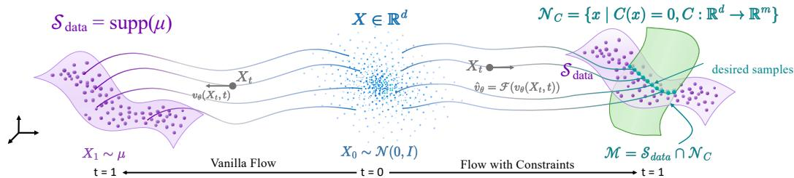  
Figure 1: Constrained sampling on a learned data support. The broad data support (purple) meets the supplied constraint set (green) at the desired feasible intersection. The illustration denotes the data distribution by $\mu = p _ { \mathrm { d a t a } } .$ , its support by $S _ { \mathrm { d a t a } } = S$ , and the constraint set by $\mathcal { N } _ { \mathscr { C } } = \mathcal { N }$

Physical information has been incorporated either during training or during sampling. Residual-based objectives and physics-constrained fine-tuning bias the learned model toward known physical require ments (Raissi et al., 2019; Bastek et al., 2025; Jacobsen et al., 2025; Baldan et al., 2026; Tauberschmidt et al., 2026). Inference-time approaches instead reuse a pretrained model: DiffusionPDE applies residual-gradient guidance (Huang et al., 2024), ECI alternates endpoint extrapolation with hard correction and interpolation (Cheng et al., 2025), and PCFM repeatedly corrects predicted endpoints before re-interpolation (Utkarsh et al., 2026). PnP-Flow (Martin et al., 2025) also uses reinterpolation, alternating data fidelity and denoising for inverse problems. Lagrangian Dual Flows (Kurtz & Davydov, 2026) evolves a constraint dual variable with the sample. D-Flow (Ben-Hamu et al., 2024) differentiates through the full generation ODE to optimize the source noise. FunDPS (Yao et al., 2026) uses gradients through a denoised estimate in function-space posterior sampling, a guidance operation tested on our FM backbone by the full-gradient baseline. However, constraint satisfaction alone does not ensure that these corrections preserve the physical relationships learned from data. While operating at inference time with a frozen flow model, MAFM maintains a persistent endpoint anchor across sampling steps, using learned endpoint guidance and constraint feedback to update a common candidate for the final output rather than attaching constraint control only to transient sampling states.

Geometric motivation and constraint stabilization. Stiff and fast–slow dynamical systems naturally separate rapid attraction toward a lower-dimensional set from slower evolution along it (Wanner & Hairer, 1996; Fenichel, 1979). Classical constrained integration similarly uses algebraic multipliers to enforce or stabilize equality constraints (Gear, 1988; Ascher & Petzold, 1993), with related ideas appearing in neural differential-algebraic models (Boesen et al., 2025; Diamond & Lill, 2025). These perspectives motivate the separation used in MAFM: learned endpoint information primarily guides motion compatible with the feasible geometry, while multiplier-based feedback independently controls contraction of the known constraint residual. We use this viewpoint as algorithmic motivation; our analysis establishes residual dynamics for the prescribed constraint and does not assume persistence of the unknown learned data support.

## 3 MANIFOLD ATTRACTING FLOW MATCHING

We first formulate inference-time constrained generation as sampling where a learned data support meets a new equality constraint. We then derive persistent-anchor dynamics that combine frozenmodel endpoint guidance with multiplier-based constraint control. Finally, we give a discrete sampler and analyze residual contraction, adjoint guidance, and finite-step error.

## 3.1 PROBLEM FORMULATION

Let $\mathcal { X } = \mathbb { R } ^ { d }$ be the space of complete physical objects. We write the source and data endpoints as $x _ { 0 } \sim p _ { 0 } = \mathcal { N } ( 0 , I _ { d } ) , x _ { 1 } \sim p _ { \mathrm { d a t a } }$ , and denote the data support by $\begin{array} { r } { S = \operatorname { s u p p } ( p _ { \mathrm { d a t a } } ) } \end{array}$ . At generation time, an equality constraint specifies

$$
{ \mathcal { C } } : { \mathcal { X } } \to \mathbb { R } ^ { m } , \qquad { \mathcal { N } } = \{ x \in { \mathcal { X } } : { \mathcal { C } } ( x ) = 0 \} ,\tag{1}
$$

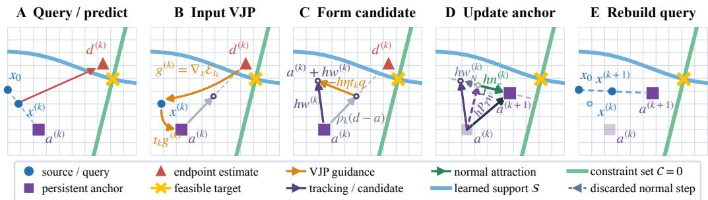  
Figure 2: One MAFM sampling step, illustrated with an affine constraint and an exact, unregularized solve. (A) Predict the physical endpoint. (B) Compute optional input guidance. (C) Combine it with endpoint tracking to form the candidate velocity. (D) The anchor update retains the candidate’s tangential component and replaces its normal component to shrink the anchor residual. (E) The fixed source and updated anchor give the next model query $x ^ { ( k + 1 ) } = ( 1 - t _ { k + 1 } ) x _ { 0 } + t _ { k + 1 } a ^ { ( k + 1 ) }$ . At t = 1, the query equals the final anchor.

The feasible intersection is $\mathcal { M } = \mathcal { S } \cap \mathcal { N } \neq \emptyset$ as is shown in Figure 1. We use $\mu _ { q }$ for a desired control distribution whose support is contained in $\mathcal { M }$ , without prescribing probability weights on the intersection. The frozen unconditional model learns relationships in the broad data distribution; test-time constraints enter only the sampler. This assumption places the requested constraint within the physical range represented by the data. It allows the finite training set to contain no exactly feasible sample. We assess the generated output through two complementary objectives,

$$
\mathfrak { e } _ { \mathrm { c o n } } ( x ) = \Vert \mathcal { C } ( x ) \Vert , \qquad \mathfrak { e } _ { \mathrm { s u p p } } ( x ) = \mathrm { d i s t } ( x , \mathcal { S } ) .\tag{2}
$$

The unknown support makes the second objective difficult to compute directly. Geometry, PDE residuals, and independent rollouts test specified relationships in the data; distribution statistics provide auxiliary coverage diagnostics. An additional choice of probability weights and its corresponding evaluation appear in Appendix A.1.

Global and local constraints. For a differentiable constraint, define the row-oriented Jacobian $J _ { \mathcal { C } } ( a ) = \partial \mathcal { C } ( a ) / \partial a \in \mathbb { R } ^ { m \times d }$ . The product $J _ { \mathit { C } } ( a ) u$ gives the residual rate induced by a physical velocity u, while $J _ { C } ( \boldsymbol { a } ) ^ { \top } \lambda$ gives a physical-space normal correction. Here $\lambda \in \mathbb { R } ^ { m }$ contains one Lagrange multiplier per scalar constraint. A global constraint has a correction distributed broadly over the physical object, as for mass or energy. A local observation constraint has a correction supported at selected sensors, windows, or channels, as in $\mathcal { C } ( x ) = H x - y$ . Even a single integral constraint can induce a correction across the entire field. For sparse observations, we use optional input guidance through the frozen model to carry constraint information to unobserved coordinates.

Frozen endpoint model. Let $( x _ { 0 } , x _ { 1 } ) \sim \pi _ { \ l }$ , with marginals $p _ { 0 }$ and $p _ { \mathrm { d a t a } } ;$ the coupling π need not be independent. Vanilla flow matching uses the complete-space training interpolation

$$
\begin{array} { r } { x _ { t } ^ { \mathrm { t r a i n } } = ( 1 - t ) x _ { 0 } + t x _ { 1 } , \qquad t \in [ 0 , 1 ] , } \end{array}\tag{3}
$$

whose target velocity is $x _ { 1 } - x _ { 0 } .$ . The frozen model defines the Vanilla flow $\dot { x } _ { t } ^ { \mathrm { F M } } = v _ { \theta } ( x _ { t } ^ { \mathrm { F M } } , t )$ from $x _ { t = 0 } ^ { \mathrm { F M } } = x _ { 0 }$ (Lipman et al., 2022). We extract endpoint information through

$$
D _ { \theta } ( x , t ) = x + ( 1 - t ) v _ { \theta } ( x , t ) ,\tag{4}
$$

an endpoint-extrapolation form also used in PCFM (Utkarsh et al., 2026). Under finite second moments, for the population-optimal regression field $v ^ { * } ( x , t ) = \mathbb { E } [ x _ { 1 } - x _ { 0 } \mid x _ { t } ^ { \mathrm { t r a i n } } = x ]$

$$
D ^ { \ast } ( x , t ) = x + ( 1 - t ) v ^ { \ast } ( x , t ) = \mathbb { E } [ x _ { 1 } \mid x _ { t } ^ { \mathrm { t r a i n } } = x ]\tag{5}
$$

on the training path almost everywhere. Thus $D _ { \theta }$ is a learned data-endpoint estimate used repeatedly by the anchor dynamics. Its proof, parameterization, and query-region conditions are given in Appendix A.2.

## 3.2 GUIDED MANIFOLD ATTRACTING DYNAMICS

We construct the sampling dynamics from a persistent endpoint anchor, optional guidance through the frozen model, and a multiplier that controls the anchor’s constraint residual.

Query and persistent anchor. The new constraint concerns the final physical object. For each fixed source $x _ { 0 }$ , MAFM maintains a network query $x _ { t }$ and a persistent endpoint anchor $a _ { t }$ , both in $x ,$ with

$$
x _ { t } = ( 1 - t ) x _ { 0 } + t a _ { t } .\tag{6}
$$

The query starts at ${ \boldsymbol { x } } _ { t = 0 } = { \boldsymbol { x } } _ { 0 }$ and is rebuilt after every anchor update. $\mathbf { A } \mathbf { t } \ t = 1$ the two states coincide, so the generated output is $x _ { 1 } ^ { \mathrm { g e n } } : = x _ { t = 1 } = a _ { 1 }$ . Here $x _ { 1 }$ without a superscript remains the data endpoint in $\operatorname { E q . } \left( 3 \right)$ . Repeated predictions from the frozen endpoint model guide this anchor, while the correction below controls its constraint residual.

Endpoint-guided candidate. For local observations, direct normal correction acts on the measured coordinates. The frozen endpoint model can also carry their mismatch to other coordinates through its input sensitivity. To obtain this additional guidance, define

$$
\mathcal { E } _ { t } ( x ) = \frac { 1 } { 2 } \| \mathcal { C } ( D _ { \theta } ( x , t ) ) \| ^ { 2 } ,\tag{7}
$$

This energy measures the constraint mismatch of the predicted endpoint; the normal correction below acts on the anchor residual $\mathcal { C } ( a _ { t } )$ . When this option is active, the input adjoint at $x _ { t }$ is

$$
\begin{array} { r } { g _ { t } = \nabla _ { x } \mathcal { E } _ { t } ( x _ { t } ) = J _ { D _ { \theta } } ( x _ { t } , t ) ^ { \top } J _ { \mathcal { C } } ( D _ { \theta } ( x _ { t } , t ) ) ^ { \top } \mathcal { C } ( D _ { \theta } ( x _ { t } , t ) ) . } \end{array}\tag{8}
$$

The query relation in Eq. (6) has anchor derivative $t I _ { d }$ . Its chain rule therefore gives

$$
\nabla _ { a } \mathcal { E } _ { t } ( ( 1 - t ) x _ { 0 } + t a ) | _ { a = a _ { t } } = t g _ { t } .\tag{9}
$$

The Jacobian transposes transfer the predicted endpoint’s residual to the complete query; Eq. (9) then transfers it to the anchor. The model parameters remain frozen. Here $J _ { D _ { \theta } } ( x _ { t } , t )$ is the Jacobian of the endpoint predictor with respect to $x _ { t }$ at fixed t. In Eq. (8), we use a vector–Jacobian product (VJP), a standard operation in reverse-mode automatic differentiation, to apply $J _ { D _ { \theta } } ( x _ { t } , t ) ^ { \top }$ without explicitly forming the model Jacobian.

Let $\gamma ( t ) , \eta ( t ) \geq 0$ be the tracking and guidance rates. For $\gamma ( t ) > 0$ , the optional adjoint can be expressed as an endpoint displacement. Set $\beta ( t ) = \eta ( t ) / \gamma ( t )$ and define

$$
\widetilde { D } _ { \theta } ( x _ { t } , t ) = D _ { \theta } ( x _ { t } , t ) - \beta ( t ) t g _ { t } .\tag{10}
$$

The factor t follows from Eq. (9). For all nonnegative rates, the candidate velocity is defined by

$$
w _ { t } = \underbrace { \gamma ( t ) [ D _ { \theta } ( x _ { t } , t ) - a _ { t } ] } _ { \mathrm { e n d p o i n t t r a c k i n g } } - \underbrace { \eta ( t ) t g _ { t } } _ { \mathrm { e n d p o i n t - c o n s t r a i n t g u i d a n c e } } .\tag{11}
$$

When $\gamma ( t ) > 0$ , this equals $\gamma ( t ) [ \widetilde { D } _ { \theta } ( x _ { t } , t ) - a _ { t } ]$ ; the virtual endpoint is an equivalent interpretation, not an additional state. $\mathrm { A t } \gamma ( t ) = 0 , \mathrm { E q . } ( 1 1 )$ still gives $w _ { t } = - \eta ( t ) t g _ { t }$ t. Setting $\eta \equiv 0$ skips the input VJP and retains finite-rate endpoint tracking. For a full-row-rank affine constraint and an exact, unregularized solve, we recover the PCFM projection and reinterpolation step when $\eta = 0$ the tangential tracking weight reaches its full-replacement limit $\rho _ { k } = 1$ , and the normal correction satisfies $h \kappa _ { k } = 1$ . Appendix A.5 gives the two recurrences. The Poisson experiment uses a fixed channel-scaled adjoint direction, specified in Appendix B.2; the multiplier construction is unchanged.

Constraint-compatible anchor dynamics. Let $G ( a ) = J _ { \mathcal { C } } ( a ) J _ { \mathcal { C } } ( a ) ^ { \top }$ . An algebraic multiplier corrects the combined candidate velocity at the anchor, giving the unified dynamics

$$
( G ( a _ { t } ) + \delta I _ { m } ) \lambda _ { t } = - \left[ J _ { \mathcal { C } } ( a _ { t } ) w _ { t } + \kappa ( t ) \mathcal { C } ( a _ { t } ) \right] ,\tag{12}
$$

$$
\dot { \boldsymbol { a } } _ { t } = \boldsymbol { w } _ { t } + \boldsymbol { J } _ { \mathcal { C } } ( \boldsymbol { a } _ { t } ) ^ { \top } \boldsymbol { \lambda } _ { t } .\tag{13}
$$

The rate $\kappa ( t ) \geq 0$ controls how quickly the anchor residual decays. Its time integral sets the cumulative contraction. $\delta \geq 0$ regularizes the Gram solve. For full-row-rank $J _ { \mathcal { C } }$ , define $P _ { T } ( a ) =$ $I _ { d } - J _ { \mathcal { C } } ( a ) ^ { \top } G ( a ) ^ { - 1 } J _ { \mathcal { C } } ( a )$ . With an exact unregularized solve $( \delta = 0 )$ , the dynamics become

$$
\boxed { \dot { a } _ { t } = P _ { T } ( a _ { t } ) w _ { t } - J _ { \mathcal { C } } ( a _ { t } ) ^ { \top } G ( a _ { t } ) ^ { - 1 } \kappa ( t ) \mathcal { C } ( a _ { t } ) } .\tag{14}
$$

Algorithm 1 Unified persistent-anchor MAFM sampling.   
Require: source x0, frozen $D _ { \theta } ,$ constraint C, steps N, schedules γ, η, κ, ridge δ   
1: $\stackrel { \cdot } { h }  1 / N ; \ x ^ { ( 0 ) }  x _ { 0 } ; \ d ^ { ( 0 ) }  D _ { \theta } ( x _ { 0 } , 0 ) ; \ \stackrel { \cdot } { a } ^ { ( 0 ) }  d ^ { ( 0 ) }$   
2: for $k \stackrel { \cdot } { = } 0 , \ldots , N - 1$ do   
3: $t _ { k } \gets k h ; J ^ { ( k ) } \gets J _ { \mathcal { C } } \big ( a ^ { ( k ) } \big )$   
4: if $k > 0$ then   
5: ${ d ^ { ( k ) } \gets D _ { \theta } ( x ^ { ( k ) } , t _ { k } ) }$   
6: end if   
7: $q ^ { ( k ) } \gets 0$   
8: if $\eta ( t _ { k } ) t _ { k } > 0$ then   
9: $\dot { q } ^ { ( k ) } \gets \mathrm { c l i p } _ { k } \big ( \nabla _ { x } \mathcal { E } _ { t _ { k } } ( x ^ { ( k ) } ) \big )$ ▷ one input VJP   
10: end if   
11: $\overline { { w ^ { ( k ) } } }  ( \rho _ { k } / h ) ( d ^ { ( k ) } - a ^ { ( k ) } ) - \eta ( t _ { k } ) t _ { k } q ^ { ( k ) }$ ▷ tracking and guidance   
12: solve $\big ( J ^ { ( \dot { k } ) } ( J ^ { ( \dot { k } ) } ) ^ { \top } + \delta I _ { m } \big ) \mathring \lambda ^ { ( k ) } \overset { \cdot \cdot } { = } - \big [ J ^ { ( k ) } w ^ { ( k ) } + \kappa ( t _ { k } ) \mathcal { C } ( a ^ { ( k ) } ) \big ]$ ▷ normal attraction   
13: $a ^ { ( k + 1 ) } \gets a ^ { ( k ) } + h \big [ w ^ { ( k ) } + ( J ^ { ( k ) } ) ^ { \top } \lambda ^ { ( k ) } \big ]$ ▷ advance persistent anchor   
14: $x ^ { ( k + 1 ) } \gets ( 1 - t _ { k + 1 } \bar { ) } x _ { 0 } + t _ { k + 1 } a ^ { ( k + 1 ) }$ ▷ rebuild model query   
15: end for   
16: return $x ^ { ( N ) } = a ^ { ( N ) }$

The first term retains the candidate’s constraint-neutral component:

$$
P _ { T } ( a _ { t } ) w _ { t } = \gamma ( t ) P _ { T } ( a _ { t } ) [ D _ { \theta } ( x _ { t } , t ) - a _ { t } ] - \eta ( t ) t P _ { T } ( a _ { t } ) g _ { t } .
$$

Thus the adjoint changes tangential motion only after projection; $- \eta ( t ) t g _ { t }$ need not itself be tangent. The second term replaces the candidate’s normal component with the prescribed residual attraction. For $\delta > 0$ , the multiplier still retains the tangential component but relaxes the exact normal replacement. The constrained-velocity interpretation and regularization effect are derived in Appendix A.3.

## 3.3 PROPERTIES AND SAMPLING ALGORITHM

We first identify the exact continuous residual dynamics and the adjoint’s instantaneous effect on constraint-neutral motion, then give the finite-step sampler and its residual bound.

Proposition 1 (Exact residual contraction). Suppose $\mathcal { C } \in C ^ { 1 } , J _ { \mathcal { C } } ( a _ { t } )$ has full row rank along an existing solution, κ is integrable, and Eq. (12) is solved exactly with $\delta = 0$ . Then

$$
\frac { \mathrm { d } } { \mathrm { d } t } \mathcal { C } ( a _ { t } ) = - \kappa ( t ) \mathcal { C } ( a _ { t } ) , \qquad \mathcal { C } ( a _ { t } ) = e ^ { - \int _ { 0 } ^ { t } \kappa ( r ) \mathrm { d } r } \mathcal { C } ( a _ { 0 } ) .\tag{15}
$$

In this exact setting, the multiplier fixes the residual rate independently of the candidate velocity: κ controls normal attraction, while γ and η control tangent motion. Appendix A.6 proves this result and derives the additional algebraic terms caused by a ridge or an inexact multiplier solve.

Proposition 2 (Instantaneous projected-adjoint effect). Fix a source $x _ { 0 } ,$ anchor a, and time t, and evaluate $g _ { t }$ at the common query $x = ( 1 - t ) x _ { 0 } + t a$ . Suppose $J _ { C } ( a )$ has full row rank and the multiplier is solved exactly with $\delta \ : = \ : 0 .$ . Let $V _ { \eta } ( a , t ; x _ { 0 } )$ be the corrected anchor velocity from Eqs. (11)–(13), and let $V _ { 0 } ( a , t ; x _ { 0 } )$ use the same state and schedules with $\eta ( t ) = 0 .$ . Then

$$
V _ { \eta } - V _ { 0 } = - \eta ( t ) t P _ { T } ( a ) g _ { t } , \qquad J _ { \mathcal { C } } ( a ) ( V _ { \eta } - V _ { 0 } ) = 0 .\tag{16}
$$

For $t > 0$ and $\eta ( t ) > 0 ,$ , the adjoint has no instantaneous effect if and only if $P _ { T } ( a ) g _ { t } \ = \ 0$ equivalently $g _ { t } \in \mathrm { r a n g e } ( J _ { \mathcal { C } } ( a ) ^ { \top } )$

Together, Propositions 1 and 2 separate the two roles of the correction: the multiplier prescribes residual contraction, while the input adjoint can steer constraint-neutral motion through its tangent projection. For sparse observations, the endpoint model’s learned cross-coordinate sensitivity can carry information from measured to unmeasured coordinates through this correction. Appendix A.4 gives the sparse-observation specialization, and the Poisson ablation in Section 4.5 examines the adjoint’s effect.

Under local common-query-region and Lipschitz assumptions, endpoint and input-adjoint errors yield a pathwise anchor perturbation bound, stated and proved in Appendix A.9.

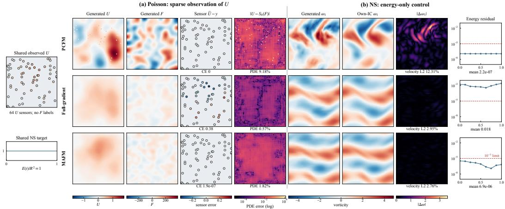  
Figure 3: Representative Poisson and fixed-energy controlled-NS outputs under shared conditions.

Discrete sampler. Algorithm 1 discretizes the anchor dynamics with $h = 1 / N , t _ { k } = k h$ , and relaxed tracking weight $\rho _ { k } = 1 - e ^ { - \gamma ( t _ { k } ) h }$ . Its optional $\mathrm { c l i p } _ { k }$ is the identity by default; Appendix B.1 gives the clipped variant. The query is rebuilt from the updated anchor as in Eq. (6). Appendix D.4 gives the computational complexity and measured sampling times.

Proposition 3 (Finite-step residual control). Consider Algorithm 1 with h > 0, δ = 0,full-row-rank $J ^ { ( k ) }$ , and an exact multiplier solve. Set $u ^ { ( k ) } = w ^ { ( k ) } + ( \check { J ^ { ( k ) } } ) ^ { \top } \lambda ^ { ( k ) } , c ^ { ( k ) } = \mathcal { C } ( a ^ { ( k ) } )$ , and $\kappa _ { k } = \kappa ( t _ { k } )$ Suppose $\mathcal { C } \in C ^ { 1 }$ and $J _ { \mathcal { C } }$ is $L _ { J }$ -Lipschitz in operator norm along the step segment. Then

$$
\begin{array} { r } { c ^ { ( k + 1 ) } = ( 1 - h \kappa _ { k } ) c ^ { ( k ) } + R ^ { ( k ) } , \qquad \| R ^ { ( k ) } \| \leq \frac { 1 } { 2 } L _ { J } h ^ { 2 } \| u ^ { ( k ) } \| ^ { 2 } . } \end{array}\tag{17}
$$

The proof and the accumulated bound, including regularization and inexact linear solves, are in Appendix A.8. Under constant $\kappa > 0 , 0 < h \kappa \leq 1$ , bounded step velocities, and exact unregularized solves, the curvature contribution to the residual bound is $O ( h )$

## 4 EXPERIMENTS

We evaluate MAFM on six physical-space generation problems spanning geometric constraints, partial observations, conservation laws, and prescribed physical quantities. The experiments test whether hard constraints can be enforced at inference time while preserving the physical structure learned by the pretrained flow model. We first introduce the common experimental setup and evaluation protocol, and then present benchmark results and additional analyses.

## 4.1 EXPERIMENTAL SETTING AND EVALUATION

Benchmarks. We evaluate MAFM on six physical-space generation tasks: sphere support recovery, partially observed Poisson fields, mass-constrained Burgers and reaction–diffusion trajectories, energy-conditioned Euler flows, and controlled Navier–Stokes (NS) flows. All methods generate the complete physical state. Table 3 in Appendix C distinguishes the physical structure learned from data from the constraints supplied at inference.

Baselines and metrics. We compare vanilla FM with and without terminal projection, PCFM (Utkarsh et al., 2026), ECI (Cheng et al., 2025), stop-gradient guidance (Huang et al., 2024), full-gradient endpoint guidance (Yao et al., 2026), CCFM (Liang et al., 2025), D-Flow (Ben-Hamu et al., 2024), PnP-Flow (Martin et al., 2025), and LDF (Kurtz & Davydov, 2026). We evaluate two primary objectives: constraint satisfaction and fidelity to the learned physical structure. Constraint satisfaction is measured by the corresponding constraint error, while physical fidelity is evaluated using PDE relative $L _ { 2 }$ error. For time-dependent PDEs, IC RelL2 compares each sample with an independent rollout initialized from its generated initial field. If the training distribution has a density in the ambient space, it assigns zero probability to the feasible manifold defined by a regular equality constraint. Distributional metrics are reported as ancillary diagnostics. Field SWD results appear in Appendix D.5. Appendix C gives feasibility thresholds and reference construction. Appendix D provides sample counts and full results.

Table 1: Physical consistency under supplied constraints. (a) Poisson, (b) Burgers and reaction– diffusion, and (c) Euler and controlled NS.
<table><tr><td></td><td colspan="3">(a) Partial observation</td><td colspan="6">(b) Conservation</td></tr><tr><td></td><td colspan="3">Poisson, 64 sensors (n = 1,024)</td><td colspan="3">Burgers (n = 768)</td><td colspan="3">Reaction-diffusion (n = 384)</td></tr><tr><td>Method</td><td>Feas.</td><td>CE↓</td><td>PDE RelL2↓</td><td>Feas.</td><td>CE↓</td><td>IC RelL2↓</td><td>Feas.</td><td>CE↓</td><td>IC RelL2↓</td></tr><tr><td>Vanilla FM</td><td>No</td><td>1.40</td><td>1.13%</td><td>No</td><td>3.57e-1</td><td>1.13%</td><td>No</td><td>5.50e-2</td><td>1.31%</td></tr><tr><td>FM + projection</td><td>Yes</td><td>0</td><td>22.7%</td><td>Yes</td><td>5.49e-8</td><td>27.0%</td><td>Yes</td><td>5.84e-8</td><td>10.4%</td></tr><tr><td>PCFM-Base</td><td>Yes</td><td>0</td><td>11.5%</td><td>Yes</td><td>5.39e-8</td><td>7.61%</td><td>Yes</td><td>5.89e-8</td><td>3.03%</td></tr><tr><td>PCFM-Relaxed</td><td>Yes</td><td>0</td><td>10.3%</td><td>No</td><td>3.17e-6</td><td>7.61%</td><td>No</td><td>3.72e-4</td><td>2.46%</td></tr><tr><td>ECI*</td><td>Yes</td><td>0</td><td>11.5%</td><td>Yes</td><td>5.40e-8</td><td>7.54%</td><td>Yes</td><td>5.86e-8</td><td>2.96%</td></tr><tr><td>Stop-grad.</td><td>Yes</td><td>3.29e-9</td><td>5.55%</td><td>Yes</td><td>5.38e-8</td><td>1.03%</td><td>Yes</td><td>5.92e-8</td><td>6.04%</td></tr><tr><td>Full-grad. (DPDE)</td><td>No</td><td>0.610</td><td>1.05%</td><td>No</td><td>2.63e-2</td><td>17.2%</td><td>No</td><td>1.70e-3</td><td>1.56%</td></tr><tr><td>CCFM (n = 2)</td><td>Yes</td><td>0</td><td>22.78%</td><td>Yes</td><td>5.39e-8</td><td>5.73%</td><td>Yes</td><td>5.96e-8</td><td>6.83%</td></tr><tr><td>D-Flow</td><td>No</td><td>0.555</td><td>1.03%</td><td>No</td><td>0.995</td><td>39.01%</td><td>No</td><td>0.0317</td><td>3.45%</td></tr><tr><td>PnP-Flow</td><td>No</td><td>0.538</td><td>1.22%</td><td>No</td><td>1.49e-3</td><td>0.71%</td><td>No</td><td>2.21e-3</td><td>0.98%</td></tr><tr><td>LDF (198 NFE)</td><td>No</td><td>3.84e-2</td><td>14.96%</td><td>No</td><td>7.22e-3</td><td>4.54%</td><td>No</td><td>2.69e-3</td><td>21.81%</td></tr><tr><td>MAFM</td><td>Yes</td><td>1.72e-7</td><td>1.70%</td><td>Yes</td><td>4.22e-8</td><td>0.965%</td><td>Yes</td><td>1.13e-7</td><td>2.74%</td></tr><tr><td>+ projection</td><td>Yes</td><td>0</td><td>1.70%</td><td>Yes</td><td>5.32e-8</td><td>0.965%</td><td>Yes</td><td>6.77e-8</td><td>2.74%</td></tr></table>

(c) Energy-only held-out tests (512 samples per system)
<table><tr><td></td><td colspan="5">Euler</td><td colspan="5">Controlled NS</td></tr><tr><td>Method</td><td>Feas.</td><td>E↓</td><td>IC RelL2↓</td><td>Div.↓</td><td>Mean↓</td><td>Feas.</td><td>E↓</td><td>IC RelL2↓</td><td>Div.↓</td><td>Mean↓</td></tr><tr><td>Vanilla FM</td><td>No</td><td>1.85e-2</td><td>3.68%</td><td>0.0635</td><td>0.0131</td><td>No</td><td>1.80e-2</td><td>3.46%</td><td>0.0624</td><td>0.0111</td></tr><tr><td>Terminal projection</td><td>Yes</td><td>2.29e-7</td><td>3.62%</td><td>0.0636</td><td>0.0131</td><td>Yes</td><td>2.32e-7</td><td>3.40%</td><td>0.0624</td><td>0.0113</td></tr><tr><td>PCFM</td><td>No</td><td>1.84e-3</td><td>13.6%</td><td>0.229</td><td>0.0297</td><td>No</td><td>1.81e-3</td><td>12.3%</td><td>0.212</td><td>0.0301</td></tr><tr><td>+ projection</td><td>Yes</td><td>2.34e-7</td><td>13.6%</td><td>0.2287</td><td>0.0298</td><td>Yes</td><td>2.44e-7</td><td>12.3%</td><td>0.2124</td><td>0.0302</td></tr><tr><td>ECI</td><td>Yes</td><td>2.12e-7</td><td>13.6%</td><td>0.232</td><td>0.0276</td><td>Yes</td><td>2.21e-7</td><td>12.3%</td><td>0.213</td><td>0.0301</td></tr><tr><td>Stop-grad. guidance</td><td>No</td><td>2.13e-2</td><td>8.64%</td><td>0.112</td><td>0.0214</td><td>No</td><td>1.97e-2</td><td>3.47%</td><td>0.0494</td><td>0.00893</td></tr><tr><td>Fuli-grad. (DPDE)</td><td>No</td><td>1.60e-2</td><td>3.42%</td><td>0.0604</td><td>0.0106</td><td>No</td><td>1.78e-2</td><td>2.95%</td><td>0.0515</td><td>0.00729</td></tr><tr><td>CCFM (n = 2)</td><td>Yes</td><td>2.33e-7</td><td>3.68%</td><td>0.0650</td><td>0.0130</td><td>Yes</td><td>2.35e-7</td><td>3.48%</td><td>0.0640</td><td>0.0106</td></tr><tr><td>D-Flow</td><td>No</td><td>7.51e-3</td><td>3.54%</td><td>0.0626</td><td>0.0108</td><td>No</td><td>7.48e-3</td><td>3.27%</td><td>0.0599</td><td>0.00941</td></tr><tr><td>PnP-Flow</td><td>No</td><td>0.0581</td><td>11.33%</td><td>0.203</td><td>0.0300</td><td>No</td><td>0.0554</td><td>10.25%</td><td>0.189</td><td>0.0274</td></tr><tr><td>LDF (198 NFE)</td><td>No</td><td>5.85e-4</td><td>7.13%</td><td>0.165</td><td>0.0219</td><td>No</td><td>5.35e-4</td><td>5.86%</td><td>0.152</td><td>0.0184</td></tr><tr><td>MAFM</td><td>Yes</td><td>6.84e-6</td><td>2.94%</td><td>0.0483</td><td>0.0108</td><td>Yes</td><td>6.89e-6</td><td>2.76%</td><td>0.0474</td><td>0.00881</td></tr><tr><td>+ projection</td><td>Yes</td><td>2.37e-7</td><td>2.94%</td><td>0.0483</td><td>0.0108</td><td>Yes</td><td>2.43e-7</td><td>2.76%</td><td>0.0474</td><td>0.00881</td></tr></table>

Implementation. Within each benchmark, samplers share the frozen flow network, paired starting sources, supplied conditions, and evaluation set. Experiments were conducted on a workstation equipped with eight NVIDIA GeForce RTX 4090 GPUs. Appendix C details the implementation and hyperparameters. Appendix D.11 describes D-Flow, PnP-Flow, and LDF. Appendix D.4 reports inference costs.

## 4.2 GEOMETRIC AND PARTIALLY OBSERVED CONSTRAINTS

Learned support under a linear constraint. On sphere–plane, z = 0 defines the plane and the learned unit-sphere structure selects its circular intersection. Terminal projection satisfies z = 0 but achieves only 6.47% joint coverage. MAFM attains mean $| z | = 3 . 3 7 \times \mathrm { \bar { 1 0 ^ { - 6 } } }$ , radial $W _ { 1 } = 0 . 0 0 4 9 3$ and the highest joint coverage (73.0%). Appendix D reports full diagnostics and threshold sensitivity.

Joint fields under partial observation. The Poisson condition observes sparse values of U, but the model must generate a coupled pair $( U , F )$ . Figure 3(a) shows why sensor agreement is insufficient: PCFM matches the observations yet leaves $U { - } \bar { F }$ inconsistency, while full-gradient guidance reduces the PDE discrepancy but misses the observation condition. Across 1,024 samples with 64 sensors, MAFM is feasible and lowers the best feasible PDE RelL2 from 5.55% to 1.70% (Table 1a). Terminal projection reaches zero observation error but has 22.7% PDE RelL2. This pattern is consistent with input guidance carrying observation information to unobserved coordinates while normal correction

Table 2: Core-mechanism ablations.
<table><tr><td></td><td>(a) Poisson (n = 1,024)</td><td colspan="6">(b) Conservation</td></tr><tr><td></td><td></td><td colspan="3">Burgers (n = 768)</td><td colspan="3">Reaction-diffusion (n = 384)</td></tr><tr><td>Variant</td><td>PDE RelL2↓</td><td>Feas.</td><td>CE↓</td><td>IC RelL2↓</td><td>Feas.</td><td>CE↓</td><td>IC RelL2↓</td></tr><tr><td>Full MAFM</td><td>1.70%</td><td>Yes</td><td>4.22e-8</td><td>0.965%</td><td>Yes</td><td>1.13e-7</td><td>2.74%</td></tr><tr><td>w/o adjoint</td><td>38.0%</td><td></td><td></td><td></td><td></td><td></td><td></td></tr><tr><td>Reset anchor</td><td></td><td>No</td><td>9.00e-3</td><td>9.44%</td><td>No</td><td>4.41e-2</td><td>6.14%</td></tr><tr><td>w/o support</td><td>29.0%</td><td>Yes</td><td>1.18e-7</td><td>2.70%</td><td>Yes</td><td>1.15e-7</td><td>10.6%</td></tr><tr><td>w/o normal</td><td></td><td>No</td><td>0.270</td><td>1.29%</td><td>No</td><td>3.19e-2</td><td>2.19%</td></tr></table>

enforces the sensor constraints. With 256 sensors, MAFM gives the lowest feasible PDE error (2.25%;   
Appendix D).

## 4.3 CONSERVATION WITH DYNAMICAL CONSISTENCY

Burgers fixes the spatial mean throughout 65 frames, and reaction–diffusion fixes total two-species mass. Neither condition determines how the field evolves. We evaluate physical consistency by computing the relative $L _ { 2 }$ error against an independent PDE rollout initialized from each generated trajectory’s initial field. Table 1b shows that terminal projection meets the mass condition yet yields own-IC errors of 27.0% and 10.4%. MAFM attains numerical feasibility with own-IC errors of 0.965% and 2.74%, respectively, compared with the next feasible errors of 1.03% and 2.96%.

The ECI∗ row is operator-equivalent to PCFM-Base on Poisson; it uses the fixed ECI-2 configuration on Burgers and the registered ECI configuration on reaction–diffusion. All evaluated variants appear in the appendix.

## 4.4 ENERGY-CONDITIONED PRIOR RECOVERY

The Euler and controlled-NS samplers receive only a kinetic-energy target; divergence, spatial mean, and time evolution are not supplied as conditions. We assess them separately to ask whether the samples still resemble the physical flows learned from data. For each case, we use 512 paired sources and set the framewise kinetic-energy target to the training energy. In the full comparison (Table 1c), MAFM has the lowest own-IC, divergence, and mean errors among distinct energy-feasible methods on both systems. Own-IC error falls from 3.62% to 2.94% on Euler and from 3.40% to 2.76% on controlled NS relative to the strongest feasible alternatives. Figure 3(b) shows one controlled-NS sample per method: generated and own-IC vorticity, their absolute difference, and the energy residual over time. The velocity relative $L _ { 2 }$ and mean energy error values shown in the panels summarize the full held-out set.

The figure exposes two distinct failure modes. PCFM-Base nearly eliminates energy error, but its sampled flow departs from its own-IC rollout. Full-gradient guidance produces a closer rollout but misses the energy band. MAFM keeps the energy residual within that band while preserving a closer rollout. In this setting, the one-mix ECI update is equivalent to PCFM-Base.

Shifted energy targets. We test Euler and controlled NS at 0.8 and 1.2 times the training energy. MAFM exceeds the energy tolerance before projection. With the shared terminal projection, it meets the tolerance and achieves the lowest relative $L _ { 2 }$ error among feasible methods in all four settings (Appendix D.8).

## 4.5 CORE-MECHANISM ABLATIONS

Table 2 compares targeted changes to frozen models with matched sources, conditions, $\mathrm { N F E } = 1 0 0 .$ and the main feasibility criteria; no variant is retrained or tuned. Dashes mark task–variant pairs that were not evaluated. Setting $\eta = 0$ removes the input adjoint, and setting $\gamma = 0$ removes endpoint tracking. Both ablations retain normal attraction. All three Poisson variants meet the observation tolerance with the same CE $( 1 . 7 2 \times 1 0 ^ { - 7 } )$ . The PDE relative $L _ { 2 }$ error rises from 1.70% to 29.0% without endpoint tracking and to 38.0% without the input adjoint. The latter result is consistent with the role of adjoint guidance in joint $U { - } F$ consistency in Corollary 4. Removing support tracking remains feasible yet increases own-IC error from 0.965% to 2.70% on Burgers and from 2.74% to 10.6% on reaction–diffusion. Resetting the anchor degrades both feasibility and dynamics, while removing normal correction makes both systems infeasible.

What the anchor history contributes. For the affine mass constraint, the tangential update blends the previous anchor with the latest endpoint prediction, carrying information from earlier predictions into later steps. To test the contribution of this history on Burgers, we replace the anchor’s tangential component at every step with that of the latest prediction and keep the normal update fixed. The paired per-step mass residuals differ by at most $3 . 5 8 \times 1 0 ^ { - 7 }$ , while the relative $L _ { 2 }$ rollout error rises from 0.965% to 7.68%. At comparable mass feasibility, this result shows that retaining tangential history helps preserve the Burgers trajectory dynamics. Appendices A.5 and D.6 give the recurrence and the full experimental protocol.

## 5 CONCLUSION

We study inference-time sampling from the intersection of a learned data support and an equality constraint supplied only at generation time. MAFM addresses this problem through the continuous evolution of a persistent physical anchor driven by a frozen endpoint model. Successive endpoint predictions are incorporated through finite-rate tracking, while a geometric correction separates model-guided tangent motion from normal constraint attraction. Under full-rank Jacobians and exact unregularized multiplier solves, the resulting dynamics yield a prescribed residual-contraction law, while the persistent-anchor relaxation admits a local feedback-stabilization analysis.

Across six benchmarks, MAFM achieves numerical feasibility while maintaining strong consistency with the physical structure learned by the frozen model. The ablations further support the complementary roles of persistent tracking, tangent guidance, and normal correction. While MAFM provides explicit control over constraint-residual dynamics, specifying and matching a particular probability law on the feasible intersection remains a separate problem. Extending the framework toward distributionally controlled constrained sampling and broader physical regimes is an important direction for future work.

## REPRODUCIBILITY STATEMENT

The main paper provides the target definition, assumptions, sampler equations, pseudocode, and key experimental results, while Appendix A presents the theoretical derivations and proofs. Appendix C describes the experimental protocols, including physical tensors, constraints, and evaluation metrics. Appendix D provides the complete result tables and projection audits. We also record code and input hashes, logs, checkpoints, generated samples, and evaluation outputs, and clearly distinguish the single training seed from the number of generated samples. Negative or mixed outcomes are reported alongside improvements. Together, these materials provide the information and implementation needed for independent verification and reproduction of our reported results.

## ETHICS STATEMENT

The work uses procedurally generated geometric and physical data and involves no personal data or human participants. A relevant downstream risk is treating a small declared residual as certification that a sample follows the correct physical distribution or governing dynamics. We therefore evaluate these properties separately and recommend independent verification for scientific or safety-critical use.

## AI USE STATEMENT

Generative AI tools assisted with language editing, translation, manuscript organization, LaTeX assembly, implementation of supplementary comparison scripts, and interpretation of archived results. The authors take responsibility for the final manuscript and its scientific claims.

## DATA, CONFLICTS, AND FUNDING

All experiments use synthetic data described in the paper and appendix. The authors declare no competing interests and no external funding that creates a conflict of interest.

## REFERENCES

Aaron D. Ames, Xiangru Xu, Jessy W. Grizzle, and Paulo Tabuada. Control barrier function based quadratic programs for safety critical systems. IEEE Transactions on Automatic Control, 62 (8):3861–3876, August 2017. ISSN 1558-2523. doi: 10.1109/tac.2016.2638961. URL http: //dx.doi.org/10.1109/TAC.2016.2638961.

Uri M Ascher and Linda R Petzold. Stability of computational methods for constrained dynamics systems. SIAM Journal on Scientific Computing, 14(1):95–120, 1993.

Giacomo Baldan, Qiang Liu, Alberto Guardone, and Nils Thuerey. Physics vs distributions: Pareto optimal flow matching with physics constraints. In International Conference on Learning Representations, volume 2026, pp. 101215–101243, 2026.

Jan-Hendrik Bastek, WaiChing Sun, and Dennis Kochmann. Physics-informed diffusion models. In International Conference on Learning Representations, volume 2025, pp. 3360–3385, 2025.

Heli Ben-Hamu, Omri Puny, Itai Gat, Brian Karrer, Uriel Singer, and Yaron Lipman. D-flow: Differentiating through flows for controlled generation, 2024. URL https://arxiv.org/ abs/2402.14017.

Tue Boesen, Eldad Haber, and Uri M Ascher. Neural daes: Constrained neural networks. SIAM Journal on Scientific Computing, 47(2):C291–C312, 2025.

Ricky TQ Chen and Yaron Lipman. Flow matching on general geometries. In International Conference on Learning Representations, volume 2024, pp. 47922–47945, 2024.

Ricky TQ Chen, Yulia Rubanova, Jesse Bettencourt, and David K Duvenaud. Neural ordinary differential equations. Advances in neural information processing systems, 31, 2018.

Chaoran Cheng, Boran Han, Danielle Maddix, Abdul Fatir Ansari, Andrew Stuart, Michael W Mahoney, and Bernie Wang. Gradient-free generation for hard-constrained systems. In International Conference on Learning Representations, volume 2025, pp. 100510–100539, 2025.

Valentin De Bortoli, Emile Mathieu, Michael Hutchinson, James Thornton, Yee Whye Teh, and Arnaud Doucet. Riemannian score-based generative modelling. Advances in neural information processing systems, 35:2406–2422, 2022.

Justin S Diamond and Markus A Lill. Neural shake: geometric constraints in neural differential equations: J. diamond, m. lill. Journal ofCheminformatics, 17(1):115, 2025.

Yuki Endo. Masked-attention diffusion guidance for spatially controlling text-to-image generation: Y. endo. The visual computer, 40(9):6033–6045, 2024.

Ruiqi Feng, Chenglei Yu, Wenhao Deng, Peiyan Hu, and Tailin Wu. On the guidance of flow matching. arXiv preprint arXiv:2502.02150, 2025.

Neil Fenichel. Geometric singular perturbation theory for ordinary differential equations. Journal of Differential Equations, 31(1):53–98, 1979. ISSN 0022-0396. doi: https://doi.org/ 10.1016/0022-0396(79)90152-9. URL https://www.sciencedirect.com/science/ article/pii/0022039679901529.

Charles William Gear. Differential-algebraic equation index transformations. SIAM Journal on Scientific and Statistical Computing, 9(1):39–47, 1988.

Peiyan Hu, Xiaowei Qian, Wenhao Deng, Rui Wang, Haodong Feng, Ruiqi Feng, Tao Zhang, Long Wei, Yue Wang, Zhi-Ming Ma, et al. From uncertain to safe: Conformal adaptation of diffusion models for safe pde control. arXiv preprint arXiv:2502.02205, 2025.

Jiahe Huang, Guandao Yang, Zichen Wang, and Jeong Joon Park. Diffusionpde: Generative pdesolving under partial observation. Advances in Neural Information Processing Systems, 37: 130291–130323, 2024.

Christian Jacobsen, Yilin Zhuang, and Karthik Duraisamy. Cocogen: Physically consistent and conditioned score-based generative models for forward and inverse problems. SIAM Journal on Scientific Computing, 47(2):C399–C425, 2025.

Vince Kurtz and Alexander Davydov. Constrained flow matching via lagrangian dual flows, 2026. URL https://arxiv.org/abs/2607.04513.

Jinhao Liang, Yixuan Sun, Anirban Samaddar, Sandeep Madireddy, and Ferdinando Fioretto. Chanceconstrained flow matching for high-fidelity constraint-aware generation, 2025. URL https: //arxiv.org/abs/2509.25157.

Yaron Lipman, Ricky TQ Chen, Heli Ben-Hamu, Maximilian Nickel, and Matt Le. Flow matching for generative modeling. arXiv preprint arXiv:2210.02747, 2022.

Segol ´ ene Martin, Anne Gagneux, Paul Hagemann, and Gabriele Steidl. Pnp-flow: Plug-and-play im-\` age restoration with flow matching, 2025. URL https://arxiv.org/abs/2410.02423.

George Papamakarios, Eric Nalisnick, Danilo Jimenez Rezende, Shakir Mohamed, and Balaji Lakshminarayanan. Normalizing flows for probabilistic modeling and inference. Journal of Machine Learning Research, 22(57):1–64, 2021.

Maziar Raissi, Paris Perdikaris, and George E Karniadakis. Physics-informed neural networks: A deep learning framework for solving forward and inverse problems involving nonlinear partial differential equations. Journal ofComputational physics, 378:686–707, 2019.

Ming Shi, Yingbin Liang, and Ness Shroff. A near-optimal algorithm for safe reinforcement learning under instantaneous hard constraints. In International Conference on Machine Learning, pp. 31243–31268. PMLR, 2023.

Ka Chun Shum, Binh-Son Hua, Duc Thanh Nguyen, and Sai-Kit Yeung. Color alignment in diffusion. In 2025 IEEE/CVF Conference on Computer Vision and Pattern Recognition (CVPR), pp. 28446– 28455. IEEE, 2025.

Aliaksandra Shysheya, Cristiana Diaconu, Federico Bergamin, Paris Perdikaris, Jose M Hern´ andez-´ Lobato, Richard E Turner, and Emile Mathieu. On conditional diffusion models for pde simulations. Advances in Neural Information Processing Systems, 37:23246–23300, 2024.

Jan Tauberschmidt, Sophie Fellenz, Sebastian Vollmer, and Andrew Duncan. Physics-constrained finetuning of flow-matching models for generation and inverse problems. In International Conference on Learning Representations, volume 2026, pp. 143992–144037, 2026.

Alexander Tong, Kilian Fatras, Nikolay Malkin, Guillaume Huguet, Yanlei Zhang, Jarrid Rector-Brooks, Guy Wolf, and Yoshua Bengio. Improving and generalizing flow-based generative models with minibatch optimal transport. arXiv preprint arXiv:2302.00482, 2023.

Utkarsh Utkarsh, Pengfei Cai, Alan Edelman, Rafael Gomez-Bombarelli, and Christopher Rackauckas. Physics-constrained flow matching: Sampling generative models with hard constraints. Advances in Neural Information Processing Systems, 38:160217–160252, 2026.

Gerhard Wanner and Ernst Hairer. Solving ordinary differential equations II, volume 375. Springer Berlin Heidelberg New York, 1996.

Long Wei, Peiyan Hu, Ruiqi Feng, Haodong Feng, Yixuan Du, Tao Zhang, Rui Wang, Yue Wang, Zhi-Ming Ma, and Tailin Wu. Diffphycon: A generative approach to control complex physical systems. Advances in Neural Information Processing Systems, 37:4090–4147, 2024.

Jiachen Yao, Abbas Mammadov, Julius Berner, Gavin Kerrigan, Jong Chul Ye, Kamyar Azizzadenesheli, and Anima Anandkumar. Guided diffusion sampling on function spaces with applications to pdes, 2026. URL https://arxiv.org/abs/2505.17004.

## APPENDIX CONTENTS

A. Proofs and derivations 14   
B. Additional algorithmic details 19   
C. Experimental protocols 20   
D. Supplementary results and diagnostics 23   
E. Numerical and applicability boundaries 39

Cases in Appendix C: sphere–plane, Poisson, Burgers, reaction–diffusion, Euler, and controlled NS.

## A PROOFS AND DERIVATIONS

## A.1 TARGET-MEASURE GEOMETRY

The main text specifies the support of $\mu _ { q }$ through $\mathcal { M } = \mathcal { S } \cap \mathcal { N }$ . A distributional target requires an additional choice of weights on that intersection. For a measurable set $B ,$ one such choice is $p _ { \mathrm { d a t a } } ( B \mid \mathcal { N } )$ when $p _ { \mathrm { d a t a } } ( \bar { \mathcal { N } } ) > 0$ . For a zero-probability constraint event, fix the residual norm and normalization and, when the denominator is positive and the weak limit exists, define the tubular conditional law

$$
\nu _ { \varepsilon } ( B ) = \frac { p _ { \mathrm { d a t a } } ( B \cap \{ x : \| { \mathcal C } ( x ) \| \leq \varepsilon \} ) } { p _ { \mathrm { d a t a } } ( \{ x : \| { \mathcal C } ( x ) \| \leq \varepsilon \} ) } , \qquad \nu = \operatorname* { l i m } _ { \varepsilon \downarrow 0 } \nu _ { \varepsilon } .\tag{18}
$$

Suppose $s$ is a smooth $d _ { S } .$ -dimensional manifold with $d _ { S } \geq m , { \mathcal { C } } | _ { S }$ has full row rank near $\mathcal { M } .$ , and $p _ { \mathrm { d a t a } }$ has density $p _ { S }$ with respect to $\mathcal { H } ^ { d _ { S } }$ . Subject to the regularity and integrability conditions for the normalized limit, the coarea formula gives

$$
\mathrm { d } \nu ( x ) \propto \frac { p _ { S } ( x ) } { \sqrt { \operatorname* { d e t } ( J _ { S } ( x ) J _ { S } ( x ) ^ { \top } ) } } \mathrm { d } \mathcal { H } ^ { d _ { S } - m } ( x ) , \qquad x \in \mathcal { M } ,\tag{19}
$$

where $J _ { \cal { S } }$ is the Jacobian of $\mathcal { C }$ in an orthonormal tangent basis of $T _ { x } S$ . The tube law depends on the chosen residual units and norm; reparameterizing the same zero set may change its limiting weights.

Let $\nu _ { \mathrm { M A F M } } ^ { * } = \mathrm { L a w } ( a _ { 1 } ^ { * } )$ be the terminal law of the ideal anchor dynamics and $\widehat { a } ^ { ( N ) }$ a numerical output. When these laws and ν have finite second moments, the Wasserstein triangle inequality gives

$$
\begin{array} { r l } & { W _ { 2 } ( \mathrm { L a w } ( \widehat { a } ^ { ( N ) } ) , \nu ) \leq W _ { 2 } ( \mathrm { L a w } ( \widehat { a } ^ { ( N ) } ) , \nu _ { \mathrm { M A F M } } ^ { * } ) } \\ & { \qquad + W _ { 2 } ( \nu _ { \mathrm { M A F M } } ^ { * } , \nu ) . } \end{array}\tag{20}
$$

The first term can reflect model and numerical errors; separating it further requires assumptions linking their coupled effects. The second term is the structural difference between ideal anchor dynamics and the additionally specified target law.

## A.2 ENDPOINT ESTIMATION AND QUERY-REGION CONDITIONS

Conditional mean and regression error. For the linear bridge in $\operatorname { E q . } \left( 3 \right)$ , the population flow field is $v ^ { * } ( x , t ) = \mathbb { E } [ x _ { 1 } - x _ { 0 } \mid \bar { x _ { t } ^ { \mathrm { t r a i n } } } = x ]$ ]. The pointwise identity $x _ { t } ^ { \mathrm { t r a i n } } + ( 1 - t ) ( x _ { 1 } - x _ { 0 } ) = x _ { 1 }$ implies, after conditioning on $x _ { t } ^ { \mathrm { { t r a i n } } } = x .$

$$
x + ( 1 - t ) v ^ { * } ( x , t ) = \mathbb { E } [ x _ { 1 } \mid x _ { t } ^ { \mathrm { t r a i n } } = x ] .\tag{21}
$$

The conditional expectation is also the $L ^ { 2 } .$ -optimal endpoint predictor. For finite second moments, its orthogonality decomposition is

$$
\begin{array} { r l } & { \mathbb { E } _ { \pi } \| D _ { \theta } ( x _ { t } ^ { \mathrm { t r a i n } } , t ) - x _ { 1 } \| ^ { 2 } = \mathbb { E } _ { \pi } \| D _ { \theta } ( x _ { t } ^ { \mathrm { t r a i n } } , t ) - D ^ { * } ( x _ { t } ^ { \mathrm { t r a i n } } , t ) \| ^ { 2 } } \\ & { \qquad + \mathbb { E } _ { \pi } \| x _ { 1 } - D ^ { * } ( x _ { t } ^ { \mathrm { t r a i n } } , t ) \| ^ { 2 } . } \end{array}\tag{22}
$$

The second term quantifies uncertainty about a paired endpoint even for an optimal predictor. Under an independent coupling at $t = 0 , D ^ { \ast } ( x _ { 0 } , 0 ) \stackrel { \cdot } { = } \mathbb { E } [ x _ { 1 } ]$ , which can fall between data modes.

Endpoint extrapolation and ODE integration. Let $\chi _ { r }$ solve the frozen Vanilla ODE from $\chi _ { t } = x$ Its terminal state and the endpoint extrapolation are

$$
\chi _ { 1 } = x + \int _ { t } ^ { 1 } v _ { \theta } ( \chi _ { r } , r ) \mathrm { d } r , \qquad D _ { \theta } ( x , t ) = x + ( 1 - t ) v _ { \theta } ( x , t ) .\tag{23}
$$

If the velocity along this trajectory is differentiable with $\| \mathrm { d } v _ { \theta } ( \chi _ { r } , r ) / \mathrm { d } r \| \leq A$ for $r \in [ t , 1 ]$ , then

$$
\begin{array} { r } { \| \chi _ { 1 } - D _ { \theta } ( x , t ) \| \le \frac { 1 } { 2 } A ( 1 - t ) ^ { 2 } . } \end{array}\tag{24}
$$

This local extrapolation bound depends on the stated trajectory regularity. PCFM also uses endpoint extrapolation (Utkarsh et al., 2026); the persistent MAFM anchor incorporates successive predictions across changing queries.

Parameterization and source law. For $t < 1$ , a directly trained endpoint predictor induces the velocity $v _ { \theta } ( x , t ) = [ D _ { \theta } ( x , t ) - x ] / ( 1 - t )$ . The two parameterizations have corresponding population optima under the linear path, while their cross-time finite-model losses carry different $( 1 - t ) ^ { 2 }$ weights. The conditional-mean identity requires finite moments and the linear path, rather than a standard-Gaussian source. More general flow matching permits other source laws (Tong et al., 2023). MAFM draws $x _ { 0 }$ from the source distribution used to train the frozen Vanilla model; task-specific Gaussian covariances are recorded with their training and sampling protocols.

Query region. For a fixed $x _ { 0 } ,$ , let $\boldsymbol { A } _ { t }$ contain the compared anchor paths and define $\Omega _ { t } = \{ ( 1 -$ $t ) x _ { 0 } + t a : a \in \mathcal { A } _ { t } \}$ . The stability result uses endpoint and adjoint error bounds on this common query region. These are local model assumptions: endpoint regression on the training path alone does not supply uniform error or Jacobian bounds over every later query.

## A.3 LAGRANGE-MULTIPLIER CORRECTION

At a fixed anchor and time, write $J = J _ { \mathit { C } } ( a )$ and $c = \mathcal { C } ( a )$ , and let $w = w _ { t }$ be the candidate in Eq. (11). The base specialization sets $\eta = 0$ . Under full row rank, the exact unregularized velocity is the unique solution of

$$
\operatorname* { m i n } _ { u \in \mathbb { R } ^ { d } } \frac { 1 } { 2 } \| u - w \| ^ { 2 } \quad \mathrm { s u b j e c t t o } \quad J u = - \kappa c .\tag{25}
$$

For the Lagrangian $\begin{array} { r } { \mathcal { L } ( u , \lambda ) ~ = ~ \frac { 1 } { 2 } \| u - w \| ^ { 2 } - \lambda ^ { \top } ( J u + \kappa c ) } \end{array}$ , stationarity gives $u = w + J ^ { \top } \lambda$ Substituting into the constraint gives $J J ^ { \top } \lambda = - ( J w + \kappa c )$ , which yields the main-text multiplier system in Eq. (12). The correction lies in range $( J ^ { \top } )$ and retains the tangent component of the candidate velocity.

For $\delta > 0$ , the regularized system instead minimizes

$$
\begin{array} { l } { \displaystyle \frac 1 2 \| u - w \| ^ { 2 } + \frac 1 { 2 \delta } \| J u + \kappa c \| ^ { 2 } . } \end{array}\tag{26}
$$

Stationarity is $u - w + \delta ^ { - 1 } J ^ { \top } ( J u + \kappa c ) = 0$ . Setting $\lambda = - \delta ^ { - 1 } ( J u + \kappa c )$ gives $( J J ^ { \top } + \delta I _ { m } ) \lambda =$ $- ( J w + \dot { \kappa } c )$ and $u = w + J ^ { \top } \lambda$ . Regularization therefore implements a quadratic penalty on the prescribed residual rate.

Base-specialization endpoint filtering. Let $V _ { D } ( a , t ; x _ { 0 } )$ denote the exact unregularized base-MAFM velocity using endpoint field D. At the same anchor, source, and time,

$$
V _ { D + e } ( a , t ; x _ { 0 } ) - V _ { D } ( a , t ; x _ { 0 } ) = \gamma ( t ) { \cal P } _ { T } ( a ) e ( x , t ) , \qquad x = ( 1 - t ) x _ { 0 } + t a .\tag{27}
$$

For the pointwise perturbation in Eq. (27), the two velocities share $a , t , x _ { 0 }$ , and hence $J , P _ { T }$ , and $\mathcal C ( a )$ . Subtracting their base-specialization forms in Eq. (14) leaves $\gamma ( t ) P _ { T } ( a ) e ( x , t )$ . In particular, errors in range ${ \check { J } } _ { { \mathcal { C } } } ( a ) ^ { \top } )$ have no instantaneous effect on the velocity. With regularization $\delta > 0 , P _ { T }$ is replaced by $\begin{array} { r } { \dot { A } _ { \delta } = \dot { I } _ { d } - J ^ { \top } ( G + \delta I _ { m } ) ^ { - 1 } J \colon } \end{array}$ normal errors are attenuated rather than eliminated. Its tangent eigenvalues are one and its normal eigenvalues are $\delta / ( \sigma _ { i } ( J ) ^ { 2 } + \delta )$ , so $\| A _ { \delta } \| \le 1$

## A.4 PROJECTED-ADJOINT EFFECT AND SPARSE OBSERVATIONS

ProofofProposition 2. At the fixed anchor and time in the proposition, write $J = J _ { \mathcal { C } } ( a ) , G = J J ^ { \top }$ and $\bar { P _ { T } } = \bar { I _ { d } } - J ^ { \top } G ^ { - 1 } J$ . The candidate velocities with and without the adjoint satisfy

$$
w _ { t } ^ { ( \eta ) } = \gamma ( t ) [ D _ { \theta } ( x , t ) - a ] - \eta ( t ) t g _ { t } , \qquad w _ { t } ^ { ( 0 ) } = \gamma ( t ) [ D _ { \theta } ( x , t ) - a ] .\tag{28}
$$

Equation (14) gives $V _ { \eta } = P _ { T } w _ { t } ^ { ( \eta ) } - J ^ { \top } G ^ { - 1 } \kappa ( t ) \mathcal { C } ( a )$ and the same expression with $w _ { t } ^ { ( 0 ) }$ for $V _ { 0 }$ Subtracting cancels the normal attraction term and yields $V _ { \eta } - V _ { 0 } = - \dot { \eta ( t ) } t P _ { T } g _ { t }$ . Since $\lceil J P _ { T } = 0$ this difference induces no first-order residual change. Moreover, $P _ { T }$ is the orthogonal projector onto ker $J ,$ with ker $P _ { T } = \mathrm { r a n g e } ( J ^ { \top } )$ . For $t > 0$ and $\bar { \eta ( t ) } > 0$ , the velocity difference therefore vanishes exactly when $g _ { t } \in \mathrm { r a n g e } ( J ^ { \top } )$ . □

Corollary 4 (Sparse-observation pullback). After reordering coordinates, let $\mathcal { C } ( z ) = H z - y$ with $H = \left[ I _ { m } \left( \right) \right]$ , partition the physical query as $\boldsymbol { x } = \left( \boldsymbol { x } _ { O } , \boldsymbol { x } _ { U } \right)$ . Write $D _ { O } ( x , t ) = H D _ { \theta } ( x , t )$ . Then

$$
P _ { T } g _ { t } = \left[ { 0 } \atop { J _ { D _ { O } , x _ { U } } ( x _ { t } , t ) ^ { \top } \left[ D _ { O } ( x _ { t } , t ) - y \right] } \right] .\tag{29}
$$

Thus the adjoint can affect unobserved coordinates through the sensitivity ofthe predicted observed endpoint to those coordinates.

Proof. Here H $H ^ { \top } = I _ { m }$ and $P _ { T } = I _ { d } - H ^ { \top } H = \mathrm { d i a g } ( 0 , I _ { d - m } )$ . The input adjoint is $g _ { t } =$ $J _ { D _ { O } } ( x _ { t } , t ) ^ { \top } [ D _ { O } ( x _ { t } , t ) - y ]$ . Partitioning this gradient into its $x _ { O }$ and $x _ { U }$ blocks and applying $P _ { T }$ gives Eq. (29). □

For the Poisson state $\boldsymbol { x } = ( U , \boldsymbol { F } ) , \boldsymbol { x } _ { U }$ in this corollary contains both unobserved $U$ coordinates and the forcing field $F . \ \mathbf { A }$ nonzero $J _ { D _ { O } , x _ { F } } ^ { \top } [ D _ { O } - y ]$ provides a model-mediated route from an observed-U residual to a tangent update of $F$ . The ablation in Section 4.5 is consistent with this mechanism; the identity alone does not guarantee improved joint consistency.

Scope and diagnostics. At a common anchor, let $J = J _ { \mathcal { C } } ( a ) , G = J J ^ { \top }$ , and $A _ { \delta } = I _ { d } - J ^ { \top } ( G +$ $\delta \bar { I _ { m } _ { } } \bar { ) } ^ { - 1 } J$ . For an exact regularized multiplier solve with $\delta > 0$ , the same fixed-state comparison gives

$$
V _ { \eta , \delta } - V _ { 0 , \delta } = - \eta ( t ) t A _ { \delta } g _ { t } , \qquad J ( V _ { \eta , \delta } - V _ { 0 , \delta } ) = - \eta ( t ) t \delta ( G + \delta I _ { m } ) ^ { - 1 } J g _ { t } .\tag{30}
$$

Thus regularization does not fully remove the adjoint’s normal component. For a finite step with nonlinear ${ \mathcal { C } } ,$ , curvature can also make the next-step residuals differ, as in Eq. (17).

The per-unit-η instantaneous speed is $A _ { t } = t \| P _ { T } ( a _ { t } ) g _ { t } \|$ . A relative diagnostic, when the base tracking speed is appreciable, is

$$
R _ { t } = \frac { \eta ( t ) A _ { t } } { \gamma ( t ) \| P _ { T } ( a _ { t } ) [ D _ { \theta } ( x _ { t } , t ) - a _ { t } ] \| + \varepsilon } , \qquad \varepsilon > 0 .\tag{31}
$$

The denominator uses base tracking rather than the guided $P _ { T } w _ { t }$ . Neither score establishes that guidance is beneficial. In the discrete sampler, the realized tangent displacement also includes $h ;$ this quantity should be logged when assessing adjoint activity.

## A.5 HISTORY WEIGHTS FOR AFFINE CONSTRAINTS

For $\mathcal { C } ( a ) = H a - y$ with full-row-rank H, the constant tangent projector $P _ { T } = I _ { d } - H ^ { \top } ( H H ^ { \top } ) ^ { - 1 } H$ satisfies $P _ { T } H ^ { \top } = 0$ . Applying it to Algorithm 1 removes the multiplier correction. For the base specialization $\eta = 0$ , an exact unregularized update gives

$$
\begin{array} { r l } & { P _ { T } a ^ { ( k + 1 ) } = ( 1 - \rho _ { k } ) P _ { T } a ^ { ( k ) } + \rho _ { k } P _ { T } d ^ { ( k ) } , } \\ & { \quad c ^ { ( k + 1 ) } = ( 1 - h \kappa _ { k } ) c ^ { ( k ) } , } \end{array} \quad \begin{array} { r l } & { c ^ { ( k ) } = \mathscr { C } ( a ^ { ( k ) } ) , \quad \kappa _ { k } = \kappa ( t _ { k } ) . } \end{array}\tag{32}
$$

The tangential identity holds for any multiplier values, including regularized or inexact solves. For the normal identity, the exact unregularized solve gives $\boldsymbol { H } ( \boldsymbol { w } ^ { ( k ) } + \boldsymbol { H } ^ { \top } \lambda ^ { ( k ) } ) = - \kappa _ { k } c ^ { ( k ) }$ ; affinity then gives the stated recurrence. Writing $u ^ { ( k ) } = P _ { T } a ^ { ( k ) }$ and $d _ { T } ^ { ( k ) } = P _ { T } d ^ { ( k ) }$ , repeated substitution gives

$$
u ^ { ( N ) } = \left[ \prod _ { j = 0 } ^ { N - 1 } ( 1 - \rho _ { j } ) \right] u ^ { ( 0 ) } + \sum _ { i = 0 } ^ { N - 1 } \left[ \rho _ { i } \prod _ { j = i + 1 } ^ { N - 1 } ( 1 - \rho _ { j } ) \right] d _ { T } ^ { ( i ) } .\tag{33}
$$

Empty products equal one. For $\gamma ( t _ { k } ) \geq 0$ , all weights are nonnegative and sum to one. The initialstate weight is $\begin{array} { r } { \exp [ - h \sum _ { j = 0 } ^ { N - 1 } \gamma ( t _ { j } ) ] } \end{array}$ . This makes the role of the attraction schedule explicit: it determines how much past information remains in the tangential anchor. The endpoint estimates themselves depend on evolving queries. Active adjoint guidance adds $- h \eta ( t _ { k } ) \hat { t _ { k } } P _ { T } q ^ { ( k ) }$ to the tangent recurrence, with $q ^ { ( k ) }$ as in Algorithm 1; the normal recurrence remains the one in Eq. (32).

Relation to relaxed endpoint projection. For an affine equality, let $\hat { d } ^ { ( k ) } = \Pi _ { \mathcal { N } } ( d ^ { ( k ) } )$ denote the orthogonal projection of the current endpoint prediction. A damped projection moves the prediction partway toward $\hat { d } ^ { ( k ) }$ , giving $z = ( 1 - \alpha ) d ^ { ( k ) } + \alpha \hat { d } ^ { ( k ) }$ with $0 \leq \alpha \leq 1$ . Its residual is $\mathcal { C } ( z ) = ( 1 - \alpha ) \mathcal { C } ( d ^ { ( k ) } )$ , and its tangential component is $P _ { T } z = P _ { T } d ^ { ( k ) }$ . The damping controls how much of the current prediction’s residual is removed.

A relaxed iteration on the anchor blends the previous anchor with the projected prediction, $a ^ { ( k + 1 ) } =$ $( 1 - \alpha ) a ^ { ( k ) } + \alpha \hat { d } ^ { ( k ) }$ . Since $\mathcal { C } ( \hat { d } ^ { ( k ) } ) = 0$ and $P _ { T } \hat { d } ^ { ( k ) } = P _ { T } d ^ { ( k ) }$ , this gives

$$
P _ { T } a ^ { ( k + 1 ) } = ( 1 - \alpha ) P _ { T } a ^ { ( k ) } + \alpha P _ { T } d ^ { ( k ) } , \qquad c ^ { ( k + 1 ) } = ( 1 - \alpha ) c ^ { ( k ) } .
$$

Here the same weight controls how much new tangential information enters the anchor and how much of its residual is removed. In the exact, unregularized MAFM step with $\eta = 0$ in Eq. (32), these fractions are $\rho _ { k }$ and $h \kappa _ { k }$ and can be set independently. For instance, $0 < \rho _ { k } < 1$ and $h \kappa _ { k } = 1$ retain part of the previous tangential anchor while removing the full affine residual in that step.

The affine recurrence also makes the PCFM connection in the main text explicit. $\mathrm { I f } \eta = 0 , \rho _ { k } = 1$ and $h \kappa _ { k } = 1$ with an exact, unregularized solve, the next anchor has tangential component $P _ { T } d ^ { ( k ) }$ and satisfies $H a ^ { ( k + 1 ) } = y$ Thus $a ^ { ( k + 1 ) } = P _ { T } d ^ { ( k ) } + H ^ { \dagger } y = d ^ { ( k ) } \stackrel { \smile } { - } H ^ { \dagger } ( H d ^ { ( k ) } - y )$ , where $H ^ { \dagger } = H ^ { \top } ( H H ^ { \top } ) ^ { - 1 }$ . This is the orthogonal endpoint projection for an affine equality. Interpolation with the same fixed source then gives the corresponding PCFM query update.

## A.6 PROOF OF PROPOSITION 1

By the chain rule and Eq. (13),

$$
{ \frac { \mathrm { d } } { \mathrm { d } t } } { \mathcal { C } } ( a _ { t } ) = J _ { { \mathcal { C } } } ( a _ { t } ) { \dot { a } } _ { t }\tag{34}
$$

$$
= J _ { \mathcal { C } } ( a _ { t } ) w _ { t } + G ( a _ { t } ) \lambda _ { t } .\tag{35}
$$

With $\delta = 0$ and the exact multiplier solution, $G ( a _ { t } ) \lambda _ { t } = - [ J _ { \mathcal { C } } ( a _ { t } ) w _ { t } + \kappa ( t ) \mathcal { C } ( a _ { t } ) ]$ . Substitution yields $\begin{array} { r } { \frac { \mathrm { d } } { \mathrm { d } t } \mathcal { C } ( a _ { t } ) = - \kappa ( t ) \mathcal { C } ( a _ { t } ) } \end{array}$ . Solving this linear vector ODE gives Eq. (15).

For $\delta > 0 .$ , use $\lambda = - ( G + \delta I _ { m } ) ^ { - 1 } ( J _ { \mathcal { C } } w + \kappa \mathcal { C } )$ and $I _ { m } - G ( G + \delta I _ { m } ) ^ { - 1 } = \delta ( G + \delta I _ { m } ) ^ { - 1 }$ to obtain

$$
\frac { \mathrm { d } } { \mathrm { d } t } \mathcal { C } ( a _ { t } ) = \delta ( G + \delta I _ { m } ) ^ { - 1 } J _ { \mathcal { C } } w _ { t } - \kappa ( t ) G ( G + \delta I _ { m } ) ^ { - 1 } \mathcal { C } ( a _ { t } ) .\tag{36}
$$

If the numerical multiplier leaves algebraic residual $r _ { \lambda } = ( G + \delta I _ { m } ) \widehat { \lambda } + J _ { \mathcal { C } } w + \kappa \mathcal { C }$ , then $G ( G +$ $\delta I _ { m } ) ^ { - 1 } r _ { \lambda }$ adds a further forcing term to the residual dynamics.

## A.7 BASE-SPECIALIZATION LOCAL FEEDBACK STABILITY

To isolate anchor memory, fix a source $x _ { 0 } ,$ time t¯, and affine constraint $H a = y$ . Write $a = p + a _ { \perp }$ with $p \in T =$ ker H and $\dot { \boldsymbol { a } } _ { \perp } = \boldsymbol { H } ^ { \top } ( \boldsymbol { H } \boldsymbol { H } ^ { \top } ) ^ { - 1 } \boldsymbol { y }$ , and define $F ( p ) = P _ { T } D _ { \theta } ( ( 1 - \bar { t } ) x _ { 0 } + \bar { t } ( p + a _ { \perp } ) , \bar { t } )$ Direct replacement uses $p ^ { + } = F ( p )$ , while the relaxed persistent anchor uses $p ^ { + } = ( 1 - \rho ) p + \rho F ( p )$

Proposition 5 (Local feedback stabilization). Suppose $F : T  T$ is continuously differentiable near a fixed point $p ^ { * }$ , and let $K = \mathrm { D } F ( p ^ { * } )$ . For $0 < \rho \leq 1 _ { \cdot }$ , the relaxed update has linearization $M _ { \rho } = \stackrel { \cdot } { ( } 1 - \stackrel { \cdot } { \rho } ) I _ { T } + \rho K$ , with eigenvalues

$$
\Lambda _ { \rho } ( \zeta ) = 1 - \rho + \rho \zeta , \qquad \zeta \in \mathrm { s p e c } ( K ) .\tag{37}
$$

The fixed point is locally asymptotically stable $i f \operatorname* { m a x } _ { \zeta \in \mathrm { s p e c } ( K ) } | \Lambda _ { \rho } ( \zeta ) | < 1$ . In particular, a real mode $\zeta < - 1$ is damped when $0 < \rho < 2 / ( 1 - \zeta )$

Proof. Fix $\bar { t } , x _ { 0 }$ , and the feasible affine slice as in the proposition. For $a = p + a _ { \perp }$ , orthogonal projection of an endpoint onto $H a \mathrm { ~ = ~ } y$ is $a _ { \perp } + P _ { T } D _ { \theta } ( ( 1 - \bar { t } ) x _ { 0 } + \bar { t } a , \bar { t } )$ . Thus its tangential direct-replacement map is $F$ , and the frozen-time MAFM map is $H _ { \rho } ( p ) = ( 1 - \rho ) p + \rho F ( p )$ . For $\rho > 0 , H _ { \rho } ( p ) = p$ if and only if $F ( p ) = p$ . Differentiating at $p ^ { * }$ gives $\mathrm { D } H _ { \rho } ( p ^ { * } ) = ( 1 - \rho ) I _ { T } + \rho K$ When the endpoint estimator is differentiable at the associated query $x ^ { * } , K \bar { } = \bar { t } P _ { T } J _ { D _ { \theta } } ( x ^ { * } , \bar { t } ) | _ { T }$ . The spectral mapping identity for this affine polynomial in K gives Eq. (37).

If every eigenvalue of $M _ { \rho }$ has modulus less than one, there is an equivalent norm on $T$ whose induced matrix norm satisfies $\| \dot { M } _ { \rho } \| _ { * } < 1$ . Continuity of $\mathrm Ḋ H Ḍ _ { \rho }$ then makes $H _ { \rho }$ a contraction in a sufficiently small ball around $p ^ { * }$ in this norm. Its iterates converge to $p ^ { * }$ from this ball, proving local asymptotic stability. The spectral condition does not require a symmetric $K$ ; for nonnormal matrices it need not imply contraction at every step in the Euclidean norm.

For a possibly complex eigenvalue $\zeta ,$

$$
| 1 - \rho + \rho \zeta | ^ { 2 } = 1 + 2 \rho ( \mathrm { R e } \zeta - 1 ) + \rho ^ { 2 } | 1 - \zeta | ^ { 2 } .\tag{38}
$$

Hence a mode is strictly damped exactly when Re $\zeta < 1$ and $0 < \rho < 2 ( 1 - \mathrm { R e } \zeta ) / | 1 - \zeta | ^ { 2 }$ , subject also to $\rho \leq 1$ for the relaxed update considered here. This must hold for every mode to obtain the proposition’s stability result. For real $\zeta < - 1$ the condition reduces to $0 < \rho \overset { \cdot } { < } 2 / ( 1 - \zeta )$ , whereas direct replacement has amplification factor ζ and is unstable in that direction. For $0 < \zeta < 1$ , the relaxed factor lies between ζ and one, so relaxation slows convergence in this mode. Real $\zeta > 1$ remains unstable for every $\rho > 0$ □

The scalar example $\zeta = - 2 , \rho = 1 / 2$ illustrates this spectral mechanism. The proposition concerns a fixed-time local map; the sampler uses a changing time and query, for which a uniform stability analysis would require additional bounds on the sequence of linearizations.

## A.8 FINITE-STEP RESIDUAL CONTROL AND ACCUMULATED ERROR

Proof of Proposition 3. For $a ^ { ( k + 1 ) } = a ^ { ( k ) } + h u ^ { ( k ) }$ , the fundamental theorem of calculus gives $c ^ { ( k + \bar { 1 } ) } = c ^ { ( \bar { k } ) } + h J ^ { ( k ) } u ^ { ( k ) } + R ^ { ( k ) }$ , where

$$
R ^ { ( k ) } = h \int _ { 0 } ^ { 1 } [ J _ { \mathcal { C } } ( \boldsymbol { a } ^ { ( k ) } + r h \boldsymbol { u } ^ { ( k ) } ) - J ^ { ( k ) } ] \boldsymbol { u } ^ { ( k ) } \mathrm { d } r , \quad \| R ^ { ( k ) } \| \le \frac { 1 } { 2 } L _ { J } h ^ { 2 } \| \boldsymbol { u } ^ { ( k ) } \| ^ { 2 } .\tag{39}
$$

The exact unregularized solve gives $J ^ { ( k ) } u ^ { ( k ) } = - \kappa _ { k } c ^ { ( k ) }$ , proving Eq. (17). For an affine constraint the Jacobian is constant, so $R ^ { \bar { ( } k ) } = 0$ . The factor $1 - h \kappa _ { k }$ has magnitude less than one precisely when $0 < h \kappa _ { k } < 2$ , and is nonnegative when $0 \leq h \kappa _ { k } \leq 1$ □

For a full-row-rank affine constraint $\mathcal { C } ( a ) = H a - y$ , exact unregularized normal correction can also be written as a split step:

$$
\begin{array} { r l } & { a ^ { ( k + 1 ) } = a ^ { ( k ) } + \rho _ { k } P _ { T } ( d ^ { ( k ) } - a ^ { ( k ) } ) } \\ & { \qquad - h \eta ( t _ { k } ) t _ { k } P _ { T } q ^ { ( k ) } } \\ & { \qquad - \alpha _ { k } H ^ { \top } ( H H ^ { \top } ) ^ { - 1 } \mathcal { C } ( a ^ { ( k ) } ) . } \end{array}\tag{40}
$$

Since $H P _ { T } = 0$ , this step has the exact affine residual law

$$
H a ^ { ( k + 1 ) } - y = ( 1 - \alpha _ { k } ) ( H a ^ { ( k ) } - y ) .\tag{41}
$$

The explicit Euler update in Algorithm 1 uses $\alpha _ { k } = h \kappa _ { k }$ . With frozen $\kappa _ { k } .$ , the alternatives $\alpha _ { k } =$ $1 - e ^ { - \hat { h } \kappa _ { k } }$ and $\alpha _ { k } = 1$ give exponential residual decay and one-step affine feasibility, respectively. The split form also applies when $\rho _ { k } = 0$

For a regularized or inexact solve, let $G ^ { ( k ) } = J ^ { ( k ) } ( J ^ { ( k ) } ) ^ { \top }$ and define the algebraic residual $r _ { \lambda } ^ { ( k ) } = $ $( G ^ { ( k ) } + \delta I _ { m } ) \widehat { \lambda } ^ { ( k ) } + J ^ { ( k ) } w ^ { ( k ) } + \kappa _ { k } c ^ { ( k ) }$ . With $u ^ { ( k ) } = w ^ { ( k ) } + ( J ^ { ( k ) } ) ^ { \top } \widehat { \lambda } ^ { ( k ) }$ , direct substitution gives

$$
\begin{array} { r } { c ^ { ( k + 1 ) } = ( 1 - h \kappa _ { k } ) c ^ { ( k ) } + h e ^ { ( k ) } + R ^ { ( k ) } , } \end{array}\tag{42}
$$

$$
e ^ { ( k ) } = \delta ( G ^ { ( k ) } + \delta I _ { m } ) ^ { - 1 } ( J ^ { ( k ) } w ^ { ( k ) } + \kappa _ { k } c ^ { ( k ) } )
$$

$$
+ G ^ { ( k ) } ( G ^ { ( k ) } + \delta I _ { m } ) ^ { - 1 } r _ { \lambda } ^ { ( k ) } .\tag{43}
$$

(44)

Here the inverse exists for $\delta > 0$ , or for $\delta = 0$ with full-row-rank $J ^ { ( k ) }$ . The two terms in $e ^ { ( k ) }$ separate regularization from linear-solve error. If the smallest eigenvalue of $G ^ { ( k ) }$ is $\ell _ { k } > 0$ , then $\| e ^ { ( k ) } \| \le [ \delta / ( \ell _ { k } + \delta ) ] \| J ^ { ( k ) } w ^ { ( k ) } + \kappa _ { k } c ^ { ( k ) } \| + \| r _ { \lambda } ^ { ( k ) } \|$

Set $q _ { k } = \left| 1 - h \kappa _ { k } \right|$ and $\begin{array} { r } { f _ { k } = h \| e ^ { ( k ) } \| + \frac { 1 } { 2 } L _ { J } h ^ { 2 } \| u ^ { ( k ) } \| ^ { 2 } } \end{array}$ , using a common Lipschitz bound over the step segments. Iteration yields

$$
\| c ^ { ( N ) } \| \leq \left( \prod _ { k = 0 } ^ { N - 1 } q _ { k } \right) \| c ^ { ( 0 ) } \| + \sum _ { i = 0 } ^ { N - 1 } f _ { i } \prod _ { j = i + 1 } ^ { N - 1 } q _ { j } .\tag{45}
$$

In particular, for constant $\kappa > 0 , 0 < h \kappa \leq 1 , \| u ^ { ( k ) } \| \leq U$ , and $\| e ^ { ( k ) } \| \leq \varepsilon _ { \epsilon }$ , this becomes

$$
\| c ^ { ( N ) } \| \le ( 1 - h \kappa ) ^ { N } \| c ^ { ( 0 ) } \| + \frac { \varepsilon _ { e } + \frac 1 2 L _ { J } h U ^ { 2 } } \kappa [ 1 - ( 1 - h \kappa ) ^ { N } ] .\tag{46}
$$

Under these uniform bounds, the estimate quantifies both the contraction of the initial residual and the accumulated effects of curvature and numerical corrections for the explicit anchor step in Algorithm 1.

## A.9 ENDPOINT STABILITY ON A COMMON QUERY REGION

Proposition 6 (Local model-perturbation bound). Let $a _ { t } ^ { * }$ use a reference endpointfield $D ^ { * }$ and its input adjoint $g ^ { * }$ , and let $a _ { t } ^ { \theta }$ use $D _ { \theta }$ and $g ^ { \theta } .$ . Couple the paths through the same source, constraint, and schedules, with $\delta = 0$ , exact multiplier solves, andfull-row-rank $J _ { \mathcal { C } }$ along a common trajectory neighborhood. Suppose the anchor vector field has an integrable $L ( t )$ -Lipschitz bound there and, at a common state in $\dot { \Omega } _ { t } , \lVert D _ { \theta } - D ^ { * } \rVert \leq \varepsilon _ { D } ( \dot { t } )$ and $\lVert g ^ { \theta } - g ^ { * } \rVert \leq \varepsilon _ { g } ( t )$ , withfinite error integrals. Then

$$
\| a _ { t } ^ { \theta } - a _ { t } ^ { * } \| \leq e ^ { \int _ { 0 } ^ { t } L ( q ) \mathrm { d } q } \left[ \| a _ { 0 } ^ { \theta } - a _ { 0 } ^ { * } \| + \int _ { 0 } ^ { t } \left( \gamma ( r ) \varepsilon _ { D } ( r ) + \eta ( r ) r \varepsilon _ { g } ( r ) \right) \mathrm { d } r \right] .\tag{47}
$$

Proof. Let $V _ { D , g } ( a , t ; x _ { 0 } )$ denote the exact unregularized anchor vector field after inserting Eq. (6). At a common anchor,

$$
\begin{array} { r } { \| V _ { D _ { \theta } , g ^ { \theta } } ( a , t ; x _ { 0 } ) - V _ { D ^ { * } , g ^ { * } } ( a , t ; x _ { 0 } ) \| \leq \gamma ( t ) \varepsilon _ { D } ( t ) + \eta ( t ) t \varepsilon _ { g } ( t ) , } \end{array}\tag{48}
$$

because the orthogonal projector $P _ { T } ( a )$ has norm at most one. Comparing the two paths and using the anchor-Lipschitz bound gives

$$
\| V _ { D _ { \theta } , g ^ { \theta } } ( a _ { t } ^ { \theta } , t ; x _ { 0 } ) - V _ { D ^ { * } , g ^ { * } } ( a _ { t } ^ { * } , t ; x _ { 0 } ) \| \le L ( t ) \| a _ { t } ^ { \theta } - a _ { t } ^ { * } \| + \gamma ( t ) \varepsilon _ { D } ( t ) + \eta ( t ) t \varepsilon _ { g } ( t ) .\tag{49}
$$

Gronwall’s inequality gives Eq. (47).¨

For exact unregularized solves, Eq. (27) also permits replacing $\varepsilon _ { D } ( t )$ in the trajectory bound by a uniform bound on $\lVert P _ { T } ( a ) [ D _ { \theta } ( x , t ) ^ { - } - D ^ { * } ( x , t ) ] \rVert$ over the same queried region. For $\eta \equiv 0$ , the adjointerror term vanishes. If the query region extends beyond the training-path support, the reference field $D ^ { * }$ requires a specified extension with the assumed regularity. The optional target-law comparison in Eq. (20) addresses a separate question from this pathwise model-perturbation bound.

## B ADDITIONAL ALGORITHMIC DETAILS

## B.1 OPTIONAL ADJOINT-STEP CLIPPING

The default clip in Algorithm 1 is the identity. For full-row-rank $J _ { C } ( a ^ { ( k ) } )$ , an optional radius $\tau _ { k }$ and norm $\| \cdot \| .$ define

$$
\mathrm { c l i p } _ { k } ( v ) = \operatorname* { m i n } \left\{ 1 , \frac { \tau _ { k } } { h \eta ( t _ { k } ) t _ { k } \| P _ { T } ( a ^ { ( k ) } ) v \| _ { \star } + \varepsilon } \right\} v , \qquad \varepsilon > 0 .\tag{50}
$$

Taking $\tau _ { k } = \infty$ recovers the default. A finite radius bounds the projected adjoint displacement in $\| \cdot \| _ { \star }$ ; the VJP is skipped when $\eta ( t _ { k } ) t _ { k } = 0$

## B.2 POISSON ADJOINT SCALING

The main text uses the ordinary residual norm and input gradient. The reported partially observed Poisson sampler uses fixed channel scales $s _ { U } , s _ { F } > 0$ from the training data. With m observed U entries and $\mathcal { C } ( z ) = H z - y$ , its endpoint energy and physical guidance direction are

$$
\mathscr { E } _ { t } ^ { \mathrm { P } } ( x ) = \frac { \| H D _ { \theta } ( x , t ) - y \| ^ { 2 } } { 2 m s _ { U } ^ { 2 } } , \qquad g _ { t } ^ { \mathrm { P } } = \bigl ( s _ { U } ^ { 2 } [ \nabla _ { x } \mathscr { E } _ { t } ^ { \mathrm { P } } ] _ { U } , s _ { F } ^ { 2 } [ \nabla _ { x } \mathscr { E } _ { t } ^ { \mathrm { P } } ] _ { F } \bigr ) .\tag{51}
$$

Its discrete adjoint step uses $q ^ { ( k ) } = \mathrm { c l i p } _ { k } ( g _ { t _ { k } } ^ { \mathrm { P } } )$ , with the reported per-step guidance coefficient corresponding to $h \eta ( t _ { k } )$ in the split update of Eq. (40). The channel factors adjust the relative U and $F ^ { ' }$ motion; they are part of this numerical specialization, not needed for the core dynamics. The multiplier still enforces the unscaled observation equation $H a = y$ . The projected-adjoint identity remains valid with $g _ { t } ^ { \mathrm { P } }$ substituted for $g _ { t }$ . The Poisson clipping norm is the root mean square of componentwise $v / s$ , where s equals $s _ { U }$ or $s _ { F }$ by channel; its radius is the configured trust factor times the norm of the tangent tracking displacement $P _ { T } ( a ^ { ( k ) } ) ( d ^ { ( k ) } - a ^ { ( k ) } )$

## B.3 HOW THE ANCHOR CORRECTION REACHES THE NEXT QUERY

In Fig. 2, the frozen endpoint model takes the current query $x ^ { ( k ) }$ and predicts $d ^ { ( k ) }$ . The sampler keeps $a ^ { ( k ) }$ across steps as its current candidate for the physical endpoint. The multiplier acts on this anchor. For a full-row-rank constraint Jacobian $J _ { k }$ at the anchor and an exact unregularized solve, its velocity correction is $- J _ { k } ^ { \dagger } [ J _ { k } w ^ { ( k ) } + \kappa ( t _ { k } ) \mathcal { C } ( a ^ { ( k ) } ) ]$ , where $J _ { k } ^ { \dagger } = J _ { k } ^ { \top } ( J _ { k } J _ { k } ^ { \top } ) ^ { - 1 }$ . The input $\mathrm { V J P }$ in Eq. (8) instead differentiates the loss of the predicted endpoint through the frozen model to build the candidate velocity.

For an affine constraint, the tangential update preserves the current constraint value and the normal update contracts its residual. For example, if a Burgers frame has mean 0.8 and the target is 0.9, a normal step that halves the residual moves the mean to 0.85. The tangential update can use the new endpoint prediction to change the waveform while preserving the frame mean. At fixed $x _ { 0 }$ and $t _ { k + 1 }$ an anchor displacement $\Delta a$ changes the next query by $t _ { k + 1 } \Delta a$ . Intermediate queries can therefore remain outside the feasible set. $\mathbf { A } \mathbf { t } \ t = 1$ the query is the final anchor and has the same constraint residual.

## C EXPERIMENTAL PROTOCOLS

This section specifies the physical data, equality conditions, and evaluation for the six examples in Section 4. In every case, the unconditional model and each constrained sampler act on the same complete physical object. The numerical PDE solvers generate reference data and measure physical consistency; they do not supply an unobserved field to the sampler. Table 3 separates structure learned from training data from information explicitly supplied at inference. Here $\tau$ denotes physical time, while t denotes the flow or sampling time. The notation $\langle f \rangle _ { \Omega }$ means the spatial average, evaluated as the corresponding grid average, and $\xi$ denotes the Burgers spatial coordinate. The Euler and controlled-NS entries describe their fixed-energy, energy-only tests.

Shared comparison and metrics. Methods within a case use the same frozen unconditional model, paired Gaussian sources, prescribed conditions, and nominal number of function evaluations (NFE). A constraint error (CE) measures the residual of the condition supplied at sampling. It is distinct from a physical-consistency error: for PDE trajectories, we evolve each generated initial state with an independent numerical solver and compare its later frames with the generated trajectory (own-IC relative $L _ { 2 } ) ;$ for Poisson, we solve from the generated $F$ and compare with the generated U. Distributional and paired-truth diagnostics are reported separately. The Poisson protocol requires both mean and $\boldsymbol { \mathrm { q 9 9 } }$ observation CE below $1 0 ^ { - 6 }$ . For concise comparisons, we mark mass CE below $1 0 ^ { - 6 }$ and fixed-energy error below $1 0 ^ { - 5 }$ as numerically feasible; these two bands are reporting conventions. The sphere’s $1 0 ^ { - 3 }$ plane tolerance belongs only to its joint-support diagnostic, not to a universal feasibility rule. Once a method reaches the applicable numerical band, the physical and distributional metrics distinguish its samples.

Table 3: Equations, learned structure, and supplied conditions for the six benchmarks.
<table><tr><td></td><td>Benchmark Equation or data distribution Structure learned from</td><td>data</td><td>Explicit inference-time condition</td><td>Constraint type</td></tr><tr><td>Sphere- plane</td><td> $X \sim \mathrm { U n i f } ( \mathbb { S } ^ { 2 } )$ </td><td>Uniform unit-sphere distribution,  $\| { \dot { X } } \| _ { 2 } = 1 .$ </td><td>Plane  $X _ { 3 } = 0 ;$  the desired support is the intersection circle.</td><td>Affine, single- coordinate algebraic</td></tr><tr><td>Poisson</td><td> $- \Delta U = F ,$   $U | _ { \partial \Omega } = 0$ </td><td>Joint  $( U , F )$  samples satisfy the discrete Poisson equation and homogeneous boundary conditions.</td><td> $H _ { U } U = y _ { \mathrm { o b s } } ;$  observed, with no direct linear observations of  $F .$ </td><td>only U is Sparse, local observations</td></tr><tr><td>Burgers</td><td> $\partial _ { \tau } u + \partial _ { \xi } ( u ^ { 2 } / 2 )$   $= 0 . 0 1 \partial _ { \xi \xi } u$ </td><td>Periodic viscous dynamics and their trajectory statistics.</td><td>Prescribed spatial mean Framewise  $\langle u ( \tau ) \rangle _ { \Omega } = \bar { \mu } _ { \star }$  at every frame.</td><td>global linear integral</td></tr><tr><td>Reaction- diffusion</td><td> $\partial _ { \tau } U = 0 . 1 \Delta U + \mathscr { R } ,$   $\partial _ { \tau } V = 1 0 \Delta V - \mathcal { R }$ </td><td>No-flux nonlinear dynamics, positive concentration support, and trajectory statistics.</td><td>Prescribed total mass  $\langle U ( \tau ) + V ( \tau ) \rangle _ { \Omega } = \mu _ { \star }$  at every frame.</td><td>Framewise global linear integral</td></tr><tr><td>Euler</td><td> $\partial _ { \tau } { \pmb u } +$   $( { \pmb u } \cdot \nabla ) { \pmb u } + \nabla p = 0$ </td><td>Incompressible, zero-mean velocity trajectories generated by incompressibility and Euler dynamics.</td><td>Prescribed kinetic energy at every frame; zero mean are left to the</td><td>Global nonlinear quadratic</td></tr><tr><td>Controlled NS</td><td> $\partial _ { \tau } \pmb { u } = - \mathsf { P } [ ( \pmb { u } \cdot \nabla ) \pmb { u } ]$   $+ \nu \Delta { } u + \beta _ { \mathrm { N S } } ( \tau ) { } u$ </td><td>Incompressible, zero-mean velocity trajectories generated by incompressibility and controlled NS dynamics. zero mean are left to the</td><td>learned prior. Prescribed kinetic energy at every frame; learned prior.</td><td>Global nonlinear quadratic</td></tr></table>

## C.1 SPHERE–PLANE INTERSECTION

The training law and the inference-time plane condition are

$$
X \sim \operatorname { U n i f } ( \mathbb { S } ^ { 2 } ) \subset \mathbb { R } ^ { 3 } , \qquad X _ { 3 } = 0 .\tag{52}
$$

We draw a standard Gaussian vector and normalize it to unit length, then train an unconditional velocity MLP on full Cartesian three-vectors with a Gaussian source and linear flow-matching bridge. The width-192, depth-three MLP uses velocity MSE, batch size 512, and 100,000 optimizer updates for its frozen checkpoint. It receives no sphere equation or plane condition. At inference the only supplied condition is the plane equation above; its intersection with the learned support is the unit circle in that plane. There is no physical-time evolution or boundary condition in this algebraic example. The paired 10,000-sample comparison uses 100 NFE and independent uniform-circle references. We report plane residual, radial and angular distribution diagnostics, sliced Wasserstein distance (SWD), and joint support coverage over several tolerances. The radius is an evaluation diagnostic, not an additional constraint given to the sampler.

## C.2 PARTIALLY OBSERVED POISSON EQUATION

On $\Omega = ( 0 , 1 ) ^ { 2 }$ , the data satisfy

$$
\begin{array} { r } { - \Delta U = F \quad \mathrm { i n } \Omega , } \\ { U = 0 \quad \mathrm { o n } \partial \Omega . } \end{array}\tag{53}
$$

Each physical state is the joint pair $( U , F )$ on the $6 4 \times 6 4$ interior grid $( h = 1 / 6 5 ) ;$ boundary nodes are fixed rather than generated. To draw $F .$ , independent grid Gaussian noise is smoothed by a reflected Gaussian kernel of width three grid cells, scaled to spatial RMS about 20, and given an independent Gaussian constant offset with standard deviation 5. A float64 five-point Dirichlet solve supplies U. The joint physical-field network predicts both channels and minimizes a channel-scaled full-field endpoint MSE. It uses 8,192 training and 1,024 validation pairs; the width-32, depth-three joint U-Net trains with batch size 32. The final 40,000-update AdamW run selects its checkpoint by validation loss. Fixed channel scales balance the two physical units and do not change the generated state space.

At inference, the supplied observation equation is

$$
H _ { U } U = y _ { \mathrm { o b s } } ,\tag{54}
$$

which selects either 64 or 256 distinct interior U values; $F$ is never observed. Two fixed sensor layouts are evaluated for each count, with 64 independently generated conditions and eight paired draws per condition, at 100 NFE. The held-out pair is used only to form observations and evaluation targets. Observation CE is normalized by the truth-U RMS; PDE consistency is $\| \widehat { U } - S _ { h } ( \widehat { F } ) \| _ { 2 } / \| S _ { h } ( \widehat { F } ) \| _ { 2 }$ where $S _ { h }$ is the same discrete boundary-value solver. Errors against the unobserved U and $F$ are supplementary paired-truth diagnostics, not conditional-distribution distances. The Poisson-specific adjoint scaling and tangent-step radius are defined in Appendix B.2.

## C.3 PERIODIC VISCOUS BURGERS EQUATION

We solve

$$
\partial _ { \tau } u + \partial _ { \xi } \bigg ( \frac { u ^ { 2 } } { 2 } \bigg ) = 0 . 0 1 \partial _ { \xi \xi } u\tag{55}
$$

on $\xi \in [ 0 , 1 )$ with periodic boundary conditions, recording 65 frames over $\tau \in [ 0 , 1 ]$ on 512 grid points. Each initial field is $u _ { 0 } = m + A g \colon m \sim \mathrm { U n i f } [ 0 . 3 , 1 . 3 ] , A \sim \mathrm { U n i f } [ 0 . { \dot { 3 } } , 0 . { \dot { 8 } } ]$ , and g is a zero-mean, unit-RMS smooth periodic Gaussian field built from sine and cosine frequencies 1–8 with amplitude proportional to $( 1 + k ^ { 2 } ) ^ { - 1 }$ . A float64 Cole–Hopf solve generates the physical trajectories. Its Fourier calculations are numerical solver operations; the jointly trained endpoint network sees complete [65, 1, 512] trajectories. Training uses 4,096 trajectories and 512 validation trajectories. A joint circular-convolution U-Net mixes all frames as channels and uses a full-trajectory endpoint MSE with batch size 32. The reported model is the selected 52,000-update checkpoint after the registered time-allocation continuation.

The inference condition prescribes the spatial mean $m _ { \star }$ of every generated frame. Held-out tests use $m _ { \star } \in \{ 0 . 5 5 , 0 . 9 0 , 1 . 0 5 \}$ , with 256 independent sources at each value and 100 NFE. For each raw generated initial field, an independent Burgers solve produces the own-IC future reference. We compare the remaining 64 frames by relative $L _ { 2 } ;$ mean-subtracted fluctuation error and distributional statistics check whether a low error merely reflects correct means. Mean CE is the framewise RMS deviation from $m _ { \star } ,$ normalized by $| m _ { \star } |$

At each prescribed mean we independently generate 256 reference initial fields with that mean and solve Burgers. Field SWD compares the generated and reference full trajectories separately at each mean, using the same 64 fixed slicing directions. The aggregate is the average over the three means. This reference ensemble is separate from the solver rollout initialized from each generated sample.

## C.4 MASS-CONSERVING REACTION–DIFFUSION SYSTEM

On $\Omega = [ 0 , 1 0 ] ^ { 2 }$ with no-flux boundaries, the two concentrations obey

$$
\begin{array} { c c } { \displaystyle { \partial _ { \tau } U = 0 . 1 \Delta U + \mathcal { R } ( U , V ) , } } & { \displaystyle { \partial _ { \tau } V = 1 0 \Delta V - \mathcal { R } ( U , V ) , } } \\ { \displaystyle { \mathcal { R } ( U , V ) = \left( 0 . 0 6 7 + \frac { U ^ { 2 } } { 1 + U ^ { 2 } } \right) V - U . } } & { } \end{array}\tag{56}
$$

The opposite reaction signs and no-flux boundary conserve the spatial mean of $U + V$ . Initial states are positive: a smooth random total concentration is normalized to a mass drawn uniformly from [2, 2.5], then split into the two species by a smooth random fraction with one to three reflected Gaussian bumps. A conservative cell-centered Neumann solver uses diffusion substeps and Runge–Kutta reaction steps to produce 33 frames over $\tau \in [ 0 , 4 0 ]$ on a native 64 × 64 grid. The joint endpoint U-Net learns complete [33, 2, 64, 64] trajectories from 4,096 training examples, with 512 validation examples and 60,000 optimizer updates. Its width is 48, its batch size is eight, and full-field endpoint MSE trains both species and all frames together; validation loss selects the frozen checkpoint.

The sampler is told only the desired total mass at every frame. The held-out values are 2.15, 2.25, and 2.35, each with 128 paired sources at 100 NFE. CE is the framewise residual of the mean of

$U + V ;$ an independent rollout from each generated first frame gives own-IC relative $L _ { 2 }$ over the remaining 32 frames. Species-wise errors, distributional distances, and the fraction of negative generated concentrations are supplementary checks. Negative values are counted on the raw output rather than clipped.

## C.5 TWO-DIMENSIONAL EULER FLOW

The data solve

$$
\begin{array} { r } { \partial _ { \tau } \pmb { u } + ( \pmb { u } \cdot \nabla ) \pmb { u } + \nabla p = 0 , } \\ { \nabla \cdot \pmb { u } = 0 } \end{array}\tag{57}
$$

on the periodic torus $[ 0 , 2 \pi ) ^ { 2 }$ . Smooth random velocity fields combine randomly phased lowfrequency patterns and smoothed noise; they are projected to zero-mean, divergence-free fields and normalized to the common kinetic-energy level before numerical rollout. The resulting training objects are nine complete two-component velocity frames on a $4 9 \times 4 9$ grid over $\tau \in [ 0 , 1 ]$ . A physical-field endpoint network learns their joint distribution using full-field MSE and an auxiliary full-field spectral error. It has width 48, four spectral blocks, and 12 modes per spatial direction; these features are internal computations, not generated states. Training has 4,096 histories, 1,024 validation histories, batch size 16, and 48,000 updates.

The energy-only inference test supplies the target kinetic energy at every frame; divergence-free and zero-mean structure must still come from the learned law. Guidance strengths for the original fixed-energy comparisons were selected on a disjoint 64-sample validation set. On 512 held-out paired sources, we measure energy error, divergence, spatial mean, field and feature distribution distances, and own-IC rollout error from each generated first frame. In Table 1(c), the forward budget is 100 per sample for most methods. Stop-gradient guidance uses 199, LDF uses 198, and D-Flow uses 4,100 including recomputation (Appendix D.11). Before the reference solve, the generated first frame is projected to a divergence-free, zero-mean field and normalized to the specified energy. The rollout error compares the reference with the unmodified generated future frames. For energy CE, we take the maximum relative energy deviation over frames for each sample and then average over samples. The separate joint-oracle comparison supplies divergence and zero mean as additional conditions and is reported in Table 9; it does not enter the energy-only ranking.

## C.6 ENERGY-CONTROLLED NAVIER–STOKES FLOW

The controlled system uses the same periodic domain, grid, nine-frame horizon, and initial-field family as Euler, with

$$
\partial _ { \tau } u = - \mathsf { P } [ ( u \cdot \nabla ) u ] + 0 . 0 2 \Delta u + \beta _ { \mathrm { N S } } ( \tau ) u , \qquad \beta _ { \mathrm { N S } } ( \tau ) = - \frac { \langle u , - \mathsf { P } [ ( u \cdot \nabla ) u ] + 0 . 0 2 \Delta u \rangle } { \langle u , u \rangle } .\tag{58}
$$

Here P is the divergence-free, zero-mean Leray projection; the feedback offsets instantaneous energy change. The solver constructs complete Cartesian velocity histories, and the same physical-field architecture and training sizes as Euler learn them jointly. At inference, only framewise energy is imposed. The fixed-energy 512-sample held-out comparison uses the same forward budgets and constraint, distributional, and own-IC diagnostics as Euler. The controlled-NS reference additionally bandlimits the initial field. The original fixed-energy tests use the training energy; Appendix D.8 reports the separate shifted-target controls.

## D SUPPLEMENTARY RESULTS AND DIAGNOSTICS

The tables below give the extended metrics behind the compact main-text comparison. They include the 256-sensor Poisson setting, matched-model ablations, and the separate three-constraint flow comparison. The subsequent diagnostics and sample panels clarify particular behaviors without changing the evaluation conditions in Appendix C.

Main-figure visualization protocol. In Figure $3 ( \mathrm { a } )$ , circles mark the shared observed sites; the columns show generated fields, sensor mismatch, and $| \widehat { U } - S _ { h } ( \widehat { F } ) |$ . The numerical solver $S _ { h }$ is used only for evaluation, and no hidden paired field is supplied as a visual target. The illustrated

PCFM row uses PCFM-Relaxed in the Poisson panel and PCFM-Base in the controlled-NS panel, the registered variants for those tasks. Fields and residual maps show individual samples; the tables report full evaluation sets.

## D.1 EXTENDED METRIC TABLES

Table $\phi \mathrm { { s } }$ plane indicator uses the $1 0 ^ { - 3 }$ tolerance inside Joint coverage. In Table 5, CE is the mean observation residual and PDE is the relative discrepancy between the generated U and the numerical solution from its generated $F ;$ two fixed sensor layouts contribute to each density. In the Burgers table CE is the mean-trajectory mass residual. Burgers and reaction–diffusion relative $L _ { 2 }$ entries are percentages, including their fluctuation and q95 columns

Table 4: Complete sphere–plane results (10,000 samples).
<table><tr><td>Method</td><td>mean |z|</td><td> $q 9 9 \left| z \right|$ </td><td>Radial W1</td><td>SWD</td><td>MMD²</td><td>Joint</td></tr><tr><td>Vanilla FM</td><td>0.5009</td><td>0.2877</td><td>0.2158</td><td>0.1281</td><td>0.05516</td><td>0.06%</td></tr><tr><td>Terminal projection</td><td>0</td><td>0</td><td>0.2158</td><td>0.1078</td><td>0.03237</td><td>6.47%</td></tr><tr><td>PCFM-Base</td><td>0</td><td>0</td><td>0.006273</td><td>0.009357</td><td>0.000559</td><td>56.57%</td></tr><tr><td>PCFM-Relaxed</td><td>2.103e-5</td><td>1.358e-5</td><td>0.006328</td><td>0.009551</td><td>0.000562</td><td>56.08%</td></tr><tr><td>ECI (operator-equivalent)</td><td>0</td><td>0</td><td>0.006273</td><td>0.009357</td><td>0.000559</td><td>56.57%</td></tr><tr><td>Stop-grad. guidance</td><td>0</td><td>0</td><td>0.006310</td><td>0.01885</td><td>0.000768</td><td>57.35%</td></tr><tr><td>Fuli-grad. guidance</td><td>2.521e-6</td><td>2.122e-6</td><td>0.003888</td><td>0.02417</td><td>0.000930</td><td>70.52%</td></tr><tr><td>MAFM</td><td>3.372e-6</td><td>2.866e-6</td><td>0.004929</td><td>0.009568</td><td>0.000534</td><td>72.97%</td></tr><tr><td>MAFM + projection</td><td>0</td><td>0</td><td>0.004929</td><td>0.009568</td><td>0.000534</td><td>72.97%</td></tr></table>

Table 5: Complete Poisson results at two sensor densities.
<table><tr><td></td><td colspan="2">64 sensors</td><td colspan="2">256 sensors</td></tr><tr><td>Method</td><td>CE</td><td>PDE RelL2</td><td>CE</td><td>PDE RelL2</td></tr><tr><td>Vanilla FM</td><td>1.395</td><td>1.128%</td><td>1.425</td><td>1.128%</td></tr><tr><td>Terminal projection</td><td>0</td><td>22.73%</td><td>0</td><td>46.31%</td></tr><tr><td>PCFM-Base</td><td>0</td><td>11.51%</td><td>0</td><td>18.05%</td></tr><tr><td>PCFM-Relaxed</td><td>0</td><td>10.33%</td><td>0</td><td>16.07%</td></tr><tr><td>ECI</td><td>0</td><td>11.51%</td><td>0</td><td>18.05%</td></tr><tr><td>ECI-2</td><td>0</td><td>11.50%</td><td>0</td><td>18.14%</td></tr><tr><td>ECI-4</td><td>0</td><td>11.50%</td><td>0</td><td>18.19%</td></tr><tr><td>Stop-grad. guidance</td><td>3.291e-9</td><td>5.554%</td><td>1.350e-9</td><td>5.636%</td></tr><tr><td>Fuli-grad. guidance</td><td>0.610</td><td>1.050%</td><td>0.371</td><td>0.974%</td></tr><tr><td>MAFM</td><td>1.721e-7</td><td>1.705%</td><td>1.751e-7</td><td>2.252%</td></tr><tr><td>MAFM + projection</td><td>0</td><td>1.705%</td><td>0</td><td>2.252%</td></tr></table>

Table 6: Complete periodic Burgers results (768 independent samples). CE is the mean-trajectory mass error. RelL2 and fluctuation RelL2 are percentages. Relative std. error is the $L _ { 2 }$ norm of the difference between the generated and reference pointwise standard-deviation fields, divided by the $L _ { 2 }$ norm of the reference field.
<table><tr><td>Method</td><td>RelL2</td><td>CE</td><td>Fluct. RelL2</td><td>Field SWD</td><td>Relative std. error</td></tr><tr><td>Vanilla FM</td><td>1.134%</td><td>3.565e-1</td><td>3.163%</td><td>0.2695</td><td>0.2323</td></tr><tr><td>Terminal projection</td><td>26.97%</td><td>5.490e-8</td><td>74.48%</td><td>0.07782</td><td>0.0883</td></tr><tr><td>PCFM-Base</td><td>7.610%</td><td>5.392e-8</td><td>13.48%</td><td>0.1776</td><td>0.5160</td></tr><tr><td>PCFM-Relaxed</td><td>7.610%</td><td>3.169e-6</td><td>13.47%</td><td>0.1777</td><td>0.5163</td></tr><tr><td>ECI (operator-equivalent)</td><td>7.610%</td><td>5.392e-8</td><td>13.48%</td><td>0.1776</td><td>0.5160</td></tr><tr><td>ECI-2</td><td>7.537%</td><td>5.397e-8</td><td>13.38%</td><td>0.1766</td><td>0.5125</td></tr><tr><td>ECI-4</td><td>7.890%</td><td>5.396e-8</td><td>13.93%</td><td>0.1834</td><td>0.5333</td></tr><tr><td>ECI-5 (resampled)</td><td>2.708%</td><td>5.370e-8</td><td>6.965%</td><td>0.06150</td><td>0.1347</td></tr><tr><td>Stop-grad. guidance</td><td>1.030%</td><td>5.382e-8</td><td>16.80%</td><td>0.2876</td><td>0.8484</td></tr><tr><td>Fuli-grad. guidance</td><td>17.18%</td><td>2.634e-2</td><td>23.78%</td><td>0.2901</td><td>0.8569</td></tr><tr><td>MAFM</td><td>0.9648%</td><td>4.216e-8</td><td>4.828%</td><td>0.1574</td><td>0.4556</td></tr><tr><td>MAFM + projection</td><td>0.9648%</td><td>5.320e-8</td><td>4.828%</td><td>0.1574</td><td>0.4556</td></tr></table>

Table 7: Complete mass-conserving reaction–diffusion results (384 independent samples). RelL2 and q95 RelL2 are percentages.
<table><tr><td>Method</td><td>Field SWD</td><td>RelL2</td><td>CE</td><td> $\mathbf { q } 9 5$  RelL2</td><td>Negative fraction</td></tr><tr><td>Vanilla FM</td><td>0.09650</td><td>1.312%</td><td>5.501e-2</td><td>5.201%</td><td>4.48e-6</td></tr><tr><td>Terminal projection</td><td>0.08529</td><td>10.39%</td><td>5.837e-8</td><td>41.51%</td><td>8.75e-5</td></tr><tr><td>PCFM-Base</td><td>0.1303</td><td>3.030%</td><td>5.894e-8</td><td>10.26%</td><td>1.79e-3</td></tr><tr><td>PCFM-Relaxed</td><td>0.1157</td><td>2.458%</td><td>3.720e-4</td><td>8.482%</td><td>1.37e-3</td></tr><tr><td>ECI</td><td>0.1246</td><td>2.962%</td><td>5.855e-8</td><td>10.18%</td><td>1.78e-3</td></tr><tr><td>Stop-grad. guidance</td><td>0.1220</td><td>6.040%</td><td>5.922e-8</td><td>23.45%</td><td>1.53e-6</td></tr><tr><td>Fuli-grad. guidance</td><td>0.06375</td><td>1.563%</td><td>1.695e-3</td><td>5.878%</td><td>4.88e-6</td></tr><tr><td>MAFM</td><td>0.06659</td><td>2.740%</td><td>1.134e-7</td><td>11.07%</td><td>2.33e-4</td></tr><tr><td>MAFM + projection</td><td>0.06659</td><td>2.740%</td><td>6.773e-8</td><td>11.07%</td><td>2.33e-4</td></tr></table>

<table><tr><td>Task</td><td>Variant</td><td>CE</td><td>Physical RelL2</td><td>Field SWD</td><td>∆ RelL2</td><td>Paired 95% CI</td></tr><tr><td>Poisson</td><td>Full MAFM</td><td>1.721e-7</td><td>0.01705</td><td></td><td></td><td></td></tr><tr><td></td><td>w/o adjoint</td><td>1.721e-7</td><td>0.3803</td><td></td><td>0.3632</td><td>[0.3521, 0.3751]</td></tr><tr><td></td><td>w/o support</td><td>1.721e-7</td><td>0.2899</td><td></td><td>0.2728</td><td>[0.2534, 0.2937]</td></tr><tr><td>Burgers</td><td>Full MAFM</td><td>4.216e-8</td><td>0.009648</td><td>0.1574</td><td></td><td></td></tr><tr><td></td><td>Reset anchor</td><td>0.008997</td><td>0.09437</td><td>0.1767</td><td>0.08473</td><td>[0.07948, 0.09028]</td></tr><tr><td></td><td>w/o support</td><td>1.181e-7</td><td>0.02703</td><td>0.3135</td><td>0.01738</td><td>[0.01652, 0.01828]</td></tr><tr><td></td><td>w/o normal</td><td>0.2698</td><td>0.01286</td><td>0.2750</td><td>0.003207</td><td>[0.002873, 0.003559]</td></tr><tr><td>Reaction-diffusion</td><td>Full MAFM</td><td>1.134e-7</td><td>0.02740</td><td>0.06659</td><td>一</td><td></td></tr><tr><td></td><td>Reset anchor</td><td>0.04413</td><td>0.06145</td><td>0.2110</td><td>0.03405</td><td>[0.02654, 0.04189]</td></tr><tr><td></td><td>w/o support</td><td>1.147e-7</td><td>0.1058</td><td>0.2102</td><td>0.07839</td><td>[0.07624, 0.08044]</td></tr><tr><td></td><td>w/o normal</td><td>0.03186</td><td>0.02190</td><td>0.09998</td><td>-0.005500</td><td>[-0.007283, -0.003750]</td></tr></table>

Table 8: Core-ablation aggregates with paired confidence intervals.

The tables report values to at most four significant digits. Table 5 adds the 256-sensor comparison. Table 8 reports 10,000-resample paired intervals; Poisson resamples conditions while retaining layouts and draws, and the dynamical tasks resample sample IDs within each prescribed-mass stratum. Its ∆ column is ablation minus Full MAFM: Poisson uses PDE-consistency relative $L _ { 2 } ,$ , while the dynamical cases use own-IC relative $L _ { 2 } .$ . Field SWD was not part of this Poisson ablation comparison.

## D.2 THREE-CONSTRAINT ORACLE COMPARISON

Table 1(c) reports the 512-sample energy-only comparison, including D-Flow and PnP-Flow. Their protocols and extended results are in Appendix D.11. The corresponding joint-oracle comparison below supplies energy, divergence, and zero mean simultaneously. It records projection behavior and the effect of additional analytic information.

## D.3 ADDITIONAL DIAGNOSTICS

Matched ablations. The variants in Table 8 share each case’s frozen checkpoint, paired sources, conditions, and 100 NFE. Each own-IC reference is solved from the initial condition produced by that variant. This isolates the inference mechanism from changes in model training or reference selection.

Terminal projection. An optional final projection sharpens numerical feasibility without explaining the consistency advantage: sphere SWD and the Burgers and reaction–diffusion own-IC errors barely change. In the 512-sample flow tests, mean energy error falls from about $6 . 9 \times 1 0 ^ { - 6 }$ to about $2 . 4 \times 1 0 ^ { - 7 }$ for both Euler and controlled NS, while own-IC error and field SWD are effectively unchanged.

Sphere threshold sensitivity. Figure 4 compares radial $W _ { 1 }$ , mean plane residual, and field SWD on separate axes. Full-gradient guidance attains a smaller radial $W _ { 1 }$ than MAFM and a higher field SWD. Terminal projection reduces MAFM’s mean plane residual to zero, with the same reported radial $W _ { 1 }$ and field SWD. MAFM has the highest joint coverage at the strict 0.0025 and 0.005 support tolerances; conclusions at looser thresholds are reported as sensitivity analysis rather than universal support claims.

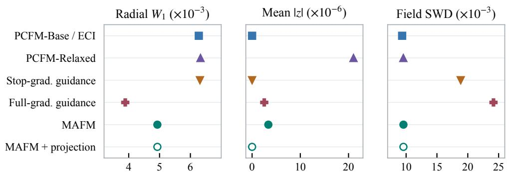

Table 9: Three-constraint oracle comparison for Euler and controlled NS (64 samples each).
<table><tr><td>Case</td><td>Method</td><td>Feature SWD</td><td>Field SWD</td><td>RelL2</td><td>Div.</td><td>Mean</td><td>Energy</td></tr><tr><td>Euler</td><td>Vanilla FM</td><td>0.152</td><td>0.0662</td><td>0.0368</td><td>0.0635</td><td>0.0131</td><td>0.0186</td></tr><tr><td></td><td>Terminal projection</td><td>0.152</td><td>0.0663</td><td>0.0332</td><td> $1 . 4 5 \times 1 0 ^ { - 6 }$ </td><td> $2 . 8 6 \times 1 0 ^ { - 8 }$ </td><td> $4 . 7 8 \times 1 0 ^ { - 7 }$ </td></tr><tr><td></td><td>PCFM-Base</td><td>0.424</td><td>0.115</td><td>0.125</td><td> $1 . 4 8 \times 1 0 ^ { - 6 }$ </td><td> $1 . 6 5 \times 1 0 ^ { - 8 }$ </td><td> $4 . 7 7 \times 1 0 ^ { - 7 }$ </td></tr><tr><td></td><td>PCFM-Relaxed</td><td>0.427</td><td>0.116</td><td>0.124</td><td> $0 . 0 0 7 6 6$ </td><td> $9 . 6 5 \times { { 1 0 } ^ { - 4 } }$ </td><td>0.00182</td></tr><tr><td></td><td>ECI (operator-equivalent)</td><td>0.424</td><td>0.115</td><td>0.125</td><td> $1 . 4 8 \times 1 0 ^ { - 6 }$ </td><td> $1 . 6 5 \times 1 0 ^ { - 8 }$ </td><td> $\begin{array} { c } { 4 . 7 7 \times 1 0 ^ { - 7 } } \\ { 0 . 0 2 6 2 } \\ { 0 . 0 1 6 0 } \end{array}$ </td></tr><tr><td></td><td>Stop-grad. guidance</td><td>0.427</td><td>0.0985</td><td>0.0429</td><td>0.0598</td><td>0.0161</td><td></td></tr><tr><td></td><td>Full-grad. guidance</td><td>0.184</td><td>0.0667</td><td>0.0341</td><td>0.0602</td><td>0.0106</td><td></td></tr><tr><td></td><td>MAFM</td><td>0.157</td><td>0.0676</td><td>0.0320</td><td> $1 . 6 2 \times 1 0 ^ { - 6 }$ </td><td> $1 . 8 6 \times 1 0 ^ { - 7 }$ </td><td> $7 . 1 5 \times 1 0 ^ { - 6 }$ </td></tr><tr><td></td><td>MAFM + projection</td><td>0.157</td><td>0.0676</td><td>0.0320</td><td> $1 . 4 4 \times { { 1 0 } ^ { - 6 } }$ </td><td> $2 . 2 2 \times { { 1 0 } ^ { - 8 } }$ </td><td> $4 . 7 8 \times 1 0 ^ { - 7 }$ </td></tr><tr><td>NS</td><td>Vanilla FM</td><td>0.0690</td><td>0.0495</td><td>0.0346</td><td> $0 . 0 6 2 4$ </td><td>0.0111</td><td>0.0181</td></tr><tr><td></td><td>Terminal projection</td><td>0.0634</td><td>0.0495</td><td>0.0309</td><td> $1 . 4 5 \times { { 1 0 } ^ { - 6 } }$ </td><td> $2 . 2 2 \times { { 1 0 } ^ { - 8 } }$ </td><td> $4 . 7 7 \times 1 0 ^ { - 7 }$ </td></tr><tr><td></td><td>PCFM-Base</td><td>0.375</td><td>0.0943</td><td>0.112</td><td> $1 . 4 7 \times 1 0 ^ { - 6 }$ </td><td> $1 . 7 9 \times 1 0 ^ { - 8 }$ </td><td> $4 . 7 3 \times 1 0 ^ { - 7 }$ </td></tr><tr><td></td><td>PCFM-Relaxed</td><td>0.387</td><td>0.0947</td><td>0.112</td><td>0.00707</td><td> $9 . 6 1 \times 1 0 ^ { - 4 }$ </td><td>0.00179</td></tr><tr><td></td><td>ECI (operator-equivalent)</td><td>0.375</td><td>0.0943</td><td>0.112</td><td> $1 . 4 7 \times 1 0 ^ { - 6 }$ </td><td> $1 . 7 9 \times 1 0 ^ { - 8 }$ </td><td> $4 . 7 3 \times 1 0 ^ { - 7 }$ </td></tr><tr><td></td><td>Stop-grad. guidance</td><td>0.405</td><td>0.0797</td><td>0.0355</td><td>0.0486</td><td>0.00878</td><td>0.0201</td></tr><tr><td></td><td>Full-grad. guidance</td><td>0.252</td><td>0.0622</td><td>0.0289</td><td>0.0504</td><td>0.00692</td><td>0.0173</td></tr><tr><td></td><td>MAFM</td><td>0.0961</td><td>0.0506</td><td>0.0294</td><td> $1 . 6 2 \times 1 0 ^ { - 6 }$ </td><td> $1 . 8 9 \times 1 0 ^ { - 7 }$ </td><td> $7 . 1 8 \times 1 0 ^ { - 6 }$ </td></tr><tr><td></td><td>MAFM + projection</td><td>0.0961</td><td>0.0506</td><td>0.0294</td><td> $1 . 4 4 \times 1 0 ^ { - 6 }$ </td><td> $2 . 1 4 \times 1 0 ^ { - 8 }$ </td><td> $4 . 6 6 \times 1 0 ^ { - 7 }$ </td></tr></table>

Figure 4: Sphere–plane diagnostics. Each column has its own scale. Lower values are better on all three metrics.  
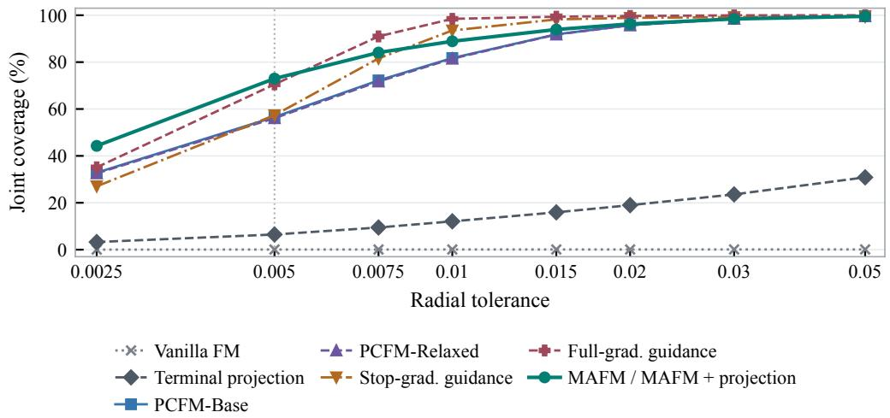  
Figure 5: Sphere–plane joint coverage at varying radial tolerances and fixed plane tolerance $| z | \leq$ $1 0 ^ { - 3 }$ . The MAFM curves with and without terminal projection coincide at all reported tolerances.

Burgers uncertainty. The independent-sample bootstrap preserves MAFM’s advantage in own-IC rollout error. The analysis also exposes a remaining failure mode: generated fluctuation amplitude is slightly contracted even when the mean trajectory is exact.

Reaction–diffusion nonnegativity. Nonnegativity is not supplied to any sampler. MAFM’s negative-value fraction is $2 . 3 3 \times 1 0 ^ { - 4 }$ : better than PCFM variants but worse than Vanilla and stop-gradient guidance. This auxiliary diagnostic does not reverse the primary ranking and remains a target for future work.

PCFM normalization. Changing the relaxed-PCFM normalization can improve selected distribution distances, but the same changes can worsen feasibility and own-IC rollout error. The paper therefore reports the official Eq. 6 arm and labels operator-equivalent duplicates instead of counting them as independent evidence.

## D.4 INFERENCE-TIME COMPUTATIONAL COST

Reusing the initial endpoint prediction gives N model forward calls for N steps in Algorithm 1. Each step that uses input adjoint guidance adds one vector–Jacobian product (VJP). Storing the anchor and interpolating it with the fixed source cost $O ( d )$ memory and work, respectively.

We focus on $m \ll d ,$ with m scalar constraints and physical dimension d. The MAFM multiplier solve uses the Jacobian at the anchor and the right-hand side in Eq. (12). The Gauss–Newton projection in PCFM (Utkarsh et al., 2026) uses the Jacobian and residual at the predicted endpoint. Given the Jacobian, each dense correction takes $O ( d m ^ { 2 } )$ to form the Gram matrix and $O ( m ^ { 3 } )$ to factor and solve the $m \times m$ system. A gridwise PDE constraint can make m comparable to d, bringing the generic dense cost to $\dot { O ( d ^ { 3 } ) }$ . The cost of obtaining the Jacobian is separate. Sensor selection in Poisson gives a diagonal Gram matrix. The mass and energy experiments instead use framewise mean and radial corrections, respectively. In the main tests, we impose the task-specific constraints and evaluate PDE consistency with an independent solver.

All samplers in a given case reuse the same frozen physical-field model, so the comparisons below concern inference rather than repeated model training. Table 10 transcribes recorded remote sampling times for two representative tasks: one fixed 64-sensor Poisson layout with 64 conditions and eight draws per condition, and the 384-sample reaction–diffusion test over three prescribed masses. The timers cover sample generation and transfer to host memory, but exclude independent PDE-reference solves and metric aggregation. Time units are stated per row because the two tasks use different physical states and batch protocols; their absolute times should not be compared across tasks.

<table><tr><td>Case</td><td>Sampler</td><td>NFE</td><td>Input VJPs</td><td>Sampling time</td><td>CE</td><td>Physical RelL2</td></tr><tr><td rowspan="3">Poisson (64 sensors)</td><td>Vanilla FM</td><td>100</td><td>0</td><td>6.615 s/512</td><td>1.366</td><td>1.128%</td></tr><tr><td>PCFM-Relaxed</td><td>100</td><td>0</td><td>15.77 s/512</td><td>0</td><td>10.26%</td></tr><tr><td>MAFM</td><td>100</td><td>100</td><td>17.88 s/512</td><td>1.696e-7</td><td>1.710%</td></tr><tr><td rowspan="4">Reaction-diffusion</td><td>PCFM-Base</td><td>100</td><td>0</td><td>0.04249 s/sample</td><td>5.894e-8</td><td>3.030%</td></tr><tr><td>ECI</td><td>100</td><td>0</td><td>0.04361 s/sample</td><td>5.855e-8</td><td>2.962%</td></tr><tr><td>MAFM</td><td>100</td><td>0</td><td>0.04375 s/sample</td><td>1.134e-7</td><td>2.740%</td></tr><tr><td>Full-grad. guidance</td><td>100</td><td>100</td><td>0.08584 s/sample</td><td>1.695e-3</td><td>1.563%</td></tr></table>

Table 10: Recorded inference cost and physical consistency for two frozen-model evaluations. Poisson values use one fixed 64-sensor layout (512 samples); reaction–diffusion values cover 384 samples. CE is the supplied-constraint error. Lower physical RelL2 is preferable among numerically feasible methods.

The recorded Poisson implementation executes 100 input VJPs, including the first call where the guidance coefficient is zero. MAFM uses 100 forward calls and takes 17.88 seconds for the 512 outputs, compared with 15.77 seconds for PCFM-Relaxed. Both satisfy the observation tolerance, while MAFM reduces PDE RelL2 from 10.26% to 1.710%. The unguided Vanilla sampler is faster, but its observation CE is far outside the feasible band.

Paired Poisson timing. In a separate ablation on two 64-sensor layouts, both variants use the same frozen model and paired inputs, with 512 samples per layout. With the input adjoint off, MAFM uses 100 forward calls and zero input VJPs and takes 5.23 s per layout on average. With it on, MAFM uses 100 forward calls and 100 input VJPs and takes 14.04 s. The timing difference includes the full input-adjoint update.

On reaction–diffusion, base MAFM needs no input VJP and takes 0.04375 seconds per sample, close to ECI’s 0.04361 and PCFM-Base’s 0.04249, while reducing feasible own-IC RelL2 to 2.740% from 2.962% and 3.030%, respectively.

These two evaluations show that MAFM can improve feasible physical consistency with limited additional sampling time relative to constrained baselines. The gain is especially pronounced on Poisson, where the adjoint also increases cost. The records do not establish a uniform runtime or memory advantage across all six tasks.

In a separate energy-only archive with 512 samples per case on an RTX 4090, base MAFM took 7.25 and 7.28 seconds on Euler and controlled NS. PCFM-Base took 6.72 and 6.73 seconds, respectively. Both samplers use 100 forward calls and no input VJPs in these tests. PCFM projects each predicted endpoint radially, while MAFM tracks the endpoint tangentially and contracts the radial deviation of the persistent anchor. The recorded times cover that batch and exclude PDE-reference evaluation.

## D.5 FIELD SWD AND MATCHED CCFM COMPARISONS

Field SWD. We flatten each full trajectory in the generated and reference ensembles and project both onto the same fixed directions. For direction $j ,$ let $g _ { ( i ) j }$ and $r _ { ( i ) j }$ be the sorted projections of the generated and reference fields. For equal ensemble sizes n and $L$ directions, the reported distance is

$$
\mathrm { F i e l d ~ S W D } = \left[ \frac { 1 } { n L } \sum _ { j = 1 } ^ { L } \sum _ { i = 1 } ^ { n } \left( g _ { ( i ) j } - r _ { ( i ) j } \right) ^ { 2 } \right] ^ { 1 / 2 } .
$$

This diagnostic measures agreement with the chosen reference ensemble along the evaluated directions. It is defined even when the reference law is singular. The constraint specifies the feasible set and the reference sampling protocol specifies how to sample on it. For Burgers and reaction– diffusion (Table 13), the reference trajectories are generated independently at each prescribed mass (Appendices C.3 and C.4). For fixed-energy Euler and controlled NS (Table 14), we use held-out trajectories at the training energy. Own-IC relative $L _ { 2 }$ uses a separate solver reference for each generated trajectory.

Tables 13 and 14 retain the Field SWD values from the conservation and energy-only comparisons. On Burgers, resampled ECI has mean Field SWD 0.06150 and own-IC 2.708%, compared with 0.1574 and 0.965% for MAFM. The sphere–plane diagnostics in Appendix D retain the distinct radial and full-field comparisons.

We adapt CCFM’s Gaussian projection to each frame’s mass equality by imposing two one-sided marginal chance constraints. At candidate time $s = ( k + 1 ) / 1 0 0$ , the two schedules use $p = ( s / 2 ) ^ { n }$ for $n = 1 , 2$ . With 512 independent standard Gaussian source entries per frame, we clamp the candidate frame mean to a band centered at $s m _ { \star }$ with half-width $- ( 1 - s ) \Phi ^ { - 1 } ( p ) / \sqrt { 5 1 2 } .$ , where Φ is the standard normal CDF. The band reduces to exact mass at $s = 1$ . Each method uses the same frozen model and 768 paired sources (256 per mass) at 100 forward evaluations. This is a Burgers mass-equality adaptation of CCFM. Its published NS setup supplies an initial condition and a global conservation constraint.

Table 11: Burgers CCFM comparison by target mass. Own-IC is relative $L _ { 2 }$ in percent. The last three rows average the three prescribed masses.
<table><tr><td>Mass</td><td>Sampler</td><td>CE</td><td>Own-IC (%)</td><td>Field SWD</td></tr><tr><td>0.55</td><td>CCFM (n = 1)</td><td> $5 . 3 1 6 \times 1 0 ^ { - 8 }$ </td><td>5.394</td><td>0.06016</td></tr><tr><td></td><td>CCFM (n = 2)</td><td> $5 . 3 5 7 \times 1 0 ^ { - 8 }$ </td><td>7.563</td><td>0.06381</td></tr><tr><td></td><td>MAFM</td><td> $2 . 6 6 1 \times 1 0 ^ { - 8 }$ </td><td>1.092</td><td>0.16484</td></tr><tr><td>0.90</td><td>CCFM (n = 1)</td><td> $4 . 0 4 3 \times 1 0 ^ { - 8 }$ </td><td>3.365</td><td>0.05831</td></tr><tr><td></td><td>CCFM (n = 2)</td><td> $4 . 0 2 0 \times 1 0 ^ { - 8 }$ </td><td>4.848</td><td>0.05910</td></tr><tr><td></td><td>MAFM</td><td> $4 . 8 5 3 \times 1 0 ^ { - 8 }$ </td><td>0.829</td><td>0.14856</td></tr><tr><td>1.05</td><td>CCFM (n = 1)</td><td> $6 . 8 0 9 \times 1 0 ^ { - 8 }$ </td><td>3.491</td><td>0.07068</td></tr><tr><td></td><td>CCFM (n = 2)</td><td> $6 . 8 0 3 \times 1 0 ^ { - 8 }$ </td><td>4.776</td><td>0.07377</td></tr><tr><td></td><td>MAFM</td><td> $5 . 1 3 3 \times 1 0 ^ { - 8 }$ </td><td>0.973</td><td>0.15871</td></tr><tr><td>Mean</td><td>CCFM (n = 1)</td><td> $5 . 3 9 \times 1 0 ^ { - 8 }$ </td><td>4.083</td><td>0.06305</td></tr><tr><td></td><td>CCFM (n = 2)</td><td> $5 . 3 9 \times 1 0 ^ { - 8 }$ </td><td>5.729</td><td>0.06556</td></tr><tr><td></td><td>MAFM</td><td> $4 . 2 2 \times 1 0 ^ { - 8 }$ </td><td>0.965</td><td>0.15737</td></tr></table>

Table 12 extends the comparison to the other PDE benchmarks using their original frozen models, paired sources and 100 forward calls. Reaction–diffusion uses the affine total-mass condition, and Poisson uses affine sensor selection. For Euler and controlled NS, we linearize the framewise energy equality at the predicted endpoint and use the variance along that affine constraint under the original Gaussian source. Each CCFM run applies an exact terminal projection for its supplied constraint. Table 1 reports the common $n = 2$ schedule across tasks.

Table 12: CCFM schedule comparison across the PDE benchmarks. The relative $L _ { 2 }$ errors use own-initial-condition rollouts for time-dependent PDEs and an independent solve from the generated source for Poisson.
<table><tr><td></td><td colspan="2"> $n = 1$ </td><td colspan="2"> $n = 2$ </td></tr><tr><td>Benchmark</td><td>CE</td><td>Relative  $L _ { 2 }$ </td><td>CE</td><td>Relative  $L _ { 2 }$ </td></tr><tr><td>Controlled NS</td><td>2.35e-7</td><td>4.05%</td><td>2.35e-7</td><td>3.48%</td></tr><tr><td>Euler</td><td>2.39e-7</td><td>4.20%</td><td>2.33e-7</td><td>3.68%</td></tr><tr><td>Burgers</td><td>5.39e-8</td><td>4.08%</td><td>5.39e-8</td><td>5.73%</td></tr><tr><td>Reaction-diffusion</td><td>5.92e-8</td><td>6.49%</td><td>5.96e-8</td><td>6.83%</td></tr><tr><td>Poisson (64 sensors)</td><td>0</td><td>22.74%</td><td>0</td><td>22.78%</td></tr><tr><td>Poisson (256 sensors)</td><td>0</td><td>45.45%</td><td>0</td><td>46.47%</td></tr></table>

Table 13: Field SWD for the conservation rows in Table 1b.
<table><tr><td>Method</td><td>Burgers</td><td>Reaction-diffusion</td></tr><tr><td>Vanilla FM</td><td>0.270</td><td>0.0965</td></tr><tr><td>FM + projection</td><td>0.0778</td><td>0.0853</td></tr><tr><td>PCFM-Base</td><td>0.178</td><td>0.130</td></tr><tr><td>PCFM-Relaxed</td><td>0.178</td><td>0.116</td></tr><tr><td>ECI*</td><td>0.177</td><td>0.125</td></tr><tr><td>Stop-grad.</td><td>0.288</td><td>0.122</td></tr><tr><td>Full-grad. (DPDE)</td><td>0.290</td><td>0.0637</td></tr><tr><td>MAFM</td><td>0.157</td><td>0.0666</td></tr><tr><td>MAFM + projection</td><td>0.157</td><td>0.0666</td></tr></table>

Table 14: Field SWD for the original submission’s fixed-energy comparisons.
<table><tr><td>Method</td><td>Euler</td><td>Controlled NS</td></tr><tr><td>Vanilla FM</td><td>0.0662</td><td>0.0495</td></tr><tr><td>Terminal projection</td><td>0.0662</td><td>0.0495</td></tr><tr><td>PCFM-Base</td><td>0.114</td><td>0.0945</td></tr><tr><td>PCFM-Relaxed</td><td>0.115</td><td>0.0948</td></tr><tr><td>ECI†</td><td>0.114</td><td>0.0945</td></tr><tr><td>Stop-grad. guidance</td><td>0.118</td><td>0.0792</td></tr><tr><td>Full-grad. (DPDE)</td><td>0.0667</td><td>0.0630</td></tr><tr><td>MAFM</td><td>0.0712</td><td>0.0533</td></tr><tr><td>MAFM + projection</td><td>0.0712</td><td>0.0533</td></tr></table>

## D.6 BURGERS TANGENTIAL HISTORY CONTROL

The two arms share the frozen model, 768 paired sources, initial anchor, normal contraction and 100 forward calls. The intervention sets $\rho _ { k } = 1$ for the tangential update while retaining the affine normal update. The maximum difference between paired per-step mass residuals is $3 . 5 8 \times 1 0 ^ { - 7 }$ . CE is $4 . 2 2 \times 1 0 ^ { - 8 }$ with finite tracking and $4 . 8 6 \times 1 0 ^ { - 8 }$ with full replacement. Own-IC is 0.965% and 7.68%, respectively, with a paired difference of 6.72 percentage points (95% interval [6.36, 7.08], from 10,000 paired bootstrap draws stratified by mass). Field SWD is 0.1574 and 0.1776. The original reset in Table 2 also changes feasibility. Setting $\rho _ { k } = 1$ in Eq. (32) sets the weight of the previous tangential anchor to zero at that step. In the reported affine implementation, both arms use the same exponential normal substep, which contracts the same initial mass residual by the same factor at each step. This accounts for the comparable mass enforcement in Section 4.5.

## D.7 PCFM PROJECTION AND MIXING CONTROLS

Each case uses the same 512 paired sources as Table 1c and the same frozen model. PCFM-Relaxed uses Eq. 6-style refinement with 20 inner steps and penalty weight 1. The added terminal projection acts on the exact replayed trajectories. The two-mix controls use 50 steps and two forward calls per step. In the noise-refresh arm, the reinterpolation source is redrawn from the original prior every fifth call. Both mixing arms use the same energy-only terminal projection. The 95% paired intervals for refreshed minus fixed own-IC are [−0.25, 0.48] percentage points on Euler and [−0.20, 0.38] on controlled NS. The official PCFM operator equivalence check is limited to the Poisson sparse-selector setting, where the stepwise and whole-sampler tests gave zero maximum absolute difference.

The ECI row in Table 1(c) reuses the one-mix update equivalent to PCFM-Base in this setting. Terminal projection of vanilla starts from trajectories whose own-IC errors are already close to their post-projection values. PCFM corrects intermediate predictions, which also affect later model queries. The observed rollout gap persists under both mixing schedules and with comparable final energy errors. These controls do not separately identify the effects of per-step correction strength and projection schedule.

The constraint error in Appendix J of PCFM (Utkarsh et al., 2026) is the $\ell _ { 2 }$ norm of a prescribed residual, averaged over samples. The PCFM ensemble metrics compare generated and reference sets. Here own-IC relative $L _ { 2 }$ compares each generated trajectory with an independent PDE rollout initialized from its own generated first frame, prepared as in Appendices C.5 and C.6. A trajectory can therefore have small energy CE and a large rollout error.

The initial-frame RMS correction from the generated field to the solver input is 0.03755 and 0.03509 for PCFM-Base on Euler and controlled NS, versus 0.01103 and 0.01076 for terminal projection of vanilla. These are diagnostics of the generated first frame, and the own-IC comparison uses the unmodified future frames.

Table 15: Fixed-energy control runs. Own-IC is relative $L _ { 2 }$ in percent.
<table><tr><td>Case</td><td>Sampler</td><td>Energy CE</td><td>Own-IC (%)</td><td>Divergence</td><td>Field SWD</td></tr><tr><td>Euler</td><td>PCFM-Relaxed replay</td><td> $1 . 8 4 \times 1 0 ^ { - 3 }$ </td><td>13.56</td><td>0.2285</td><td>0.11503</td></tr><tr><td></td><td>+ terminal projection</td><td> $2 . 3 4 \times 1 0 ^ { - 7 }$ </td><td>13.56</td><td>0.2287</td><td>0.11506</td></tr><tr><td></td><td>Two mix, fixed source</td><td> $1 . 4 7 \times 1 0 ^ { - 7 }$ </td><td>13.41</td><td>0.2266</td><td>0.11407</td></tr><tr><td></td><td>Two mix, refreshed source</td><td> $1 . 5 0 \times 1 0 ^ { - 7 }$ </td><td>13.51</td><td>0.2303</td><td>0.09906</td></tr><tr><td>Controlled NS</td><td>PCFM-Relaxed replay</td><td> $1 . 8 1 \times 1 0 ^ { - 3 }$ </td><td>12.29</td><td>0.2123</td><td>0.09479</td></tr><tr><td></td><td>+ terminal projection</td><td> $2 . 4 4 \times 1 0 ^ { - 7 }$ </td><td>12.29</td><td>0.2124</td><td>0.09485</td></tr><tr><td></td><td>Two mix, fixed source</td><td> $1 . 5 2 \times 1 0 ^ { - 7 }$ </td><td>12.13</td><td>0.2086</td><td>0.09376</td></tr><tr><td></td><td>Two mix, refreshed source</td><td> $1 . 4 7 \times 1 0 ^ { - 7 }$ </td><td>12.21</td><td>0.2168</td><td>0.09892</td></tr></table>

## D.8 SHIFTED ENERGY TARGETS

We use 128 paired sources per case and target, the original frozen checkpoints, and the fixed trainingenergy baseline settings. We adjust independent held-out initial fields to each target and evolve them with the original solver for ensemble evaluation. Own-IC uses a separate solver rollout from each generated sample’s initial field prepared at the target energy. For PCFM-Relaxed and MAFM, Table 16 gives the same generated outputs before and after a shared framewise radial projection. On the shifted PCFM outputs, the radial solution agrees with the official Newton–Schur terminal solver to within $9 \times 1 0 ^ { - 1 6 }$ in float64. The table evaluates the common float32 radial projection for both methods.

Table 16: Full comparisons at shifted energy targets (128 paired samples per target). Energy feasibility uses mean $\mathrm { C E } \leq 1 \bar { 0 } ^ { - 5 }$ . The two stop-gradient rows report their actual forward counts. All other rows use 100 forwards, including those that reuse a parent sampler and add a terminal projection.
<table><tr><td>Euler</td><td colspan="3">0.8× training energy</td><td colspan="3">1.2× training energy</td></tr><tr><td>Method</td><td colspan="3"></td><td colspan="3">IC RelL2</td></tr><tr><td></td><td>Energy CE</td><td>IC RelL2</td><td>Div. RMS</td><td>Energy CE</td><td></td><td>Div. RMS</td></tr><tr><td>Vanilla FM</td><td>2.56e-1</td><td>12.49%</td><td>0.0621</td><td>1.75e-1</td><td>9.93%</td><td>0.0621</td></tr><tr><td>Vanilla + projection</td><td>2.07e-7</td><td>4.01%</td><td>0.0556</td><td>2.32e-7</td><td>4.60%</td><td>0.0682</td></tr><tr><td>PCFM-Base / ECI-1</td><td>2.10e-7</td><td>11.44%</td><td>0.1810</td><td>2.21e-7</td><td>19.79%</td><td>0.3544</td></tr><tr><td>PCFM-Relaxed (pre-proj.)</td><td>1.94e-3</td><td>11.75%</td><td>0.1884</td><td>3.56e-3</td><td>20.44%</td><td>0.3642</td></tr><tr><td>+ terminal projection</td><td>2.23e-7</td><td>11.76%</td><td>0.1885</td><td>2.24e-7</td><td>20.44%</td><td>0.3642 0.3460</td></tr><tr><td>ECI-2 (fixed source)</td><td>2.16e-7</td><td>11.33%</td><td>0.1777 0.1933</td><td>1.97e-7 2.01e-7</td><td>19.36%</td><td>0.3333</td></tr><tr><td>ECI-2 (refreshed source)</td><td>2.09e-7</td><td>11.84% 5.82%</td><td>0.0677</td><td>1.28e-1</td><td>18.24% 13.36%</td><td>0.2080</td></tr><tr><td>Stop-grad. (199 calls)</td><td>3.14e-2</td><td>5.33%</td><td>0.0603</td><td>1.30e-1</td><td>12.54%</td><td>0.1904</td></tr><tr><td>Stop-grad. (99 calls)</td><td>3.19e-2 2.45e-1</td><td>12.01%</td><td>0.0659</td><td>1.69e-1</td><td>9.57%</td><td>0.0596</td></tr><tr><td>Fuli-gradient guidance</td><td>2.05e-7</td><td>4.70%</td><td>0.0646</td><td>2.38e-7</td><td>5.41%</td><td>0.1102</td></tr><tr><td>CCFM (n = 1)</td><td>2.10e-7</td><td>4.01%</td><td>0.0565</td><td>2.27e-7</td><td>4.82%</td><td>0.1027</td></tr><tr><td>CCFM (n = 2) MAFM (pre-proj.)</td><td>1.93e-5</td><td>2.96%</td><td>0.0400</td><td>1.26e-5</td><td>3.60%</td><td>0.0666</td></tr><tr><td>+ terminal projection</td><td>2.11e-7</td><td>2.96%</td><td>0.0400</td><td>2.24e-7</td><td>3.60%</td><td>0.0666</td></tr><tr><td></td><td></td><td></td><td></td><td></td><td></td><td></td></tr></table>

<table><tr><td>Contromed Ns</td><td colspan="3">0.8× training energy</td><td colspan="3">1.2× training energy</td></tr><tr><td>Method</td><td>Energy CE</td><td>IC RelL2</td><td>Div. RMS</td><td>Energy CE</td><td>IC RelL2</td><td>Div. RMS</td></tr><tr><td>Vanilla FM</td><td>2.56e-1</td><td>12.40%</td><td>0.0622</td><td>1.77e-1</td><td>9.86%</td><td>0.0622</td></tr><tr><td>Vanilla + projection</td><td>2.10e-7</td><td>3.92%</td><td>0.0558</td><td>2.38e-7</td><td>4.37%</td><td>0.0683</td></tr><tr><td>PCFM-Base / ECI-1</td><td>2.11e-7</td><td>11.11%</td><td>0.1872</td><td>2.23e-7</td><td>12.61%</td><td>0.2613</td></tr><tr><td>PCFM-Relaxed (pre-proj.)</td><td>2.33e-3</td><td>11.37%</td><td>0.1879</td><td>1.04e-2</td><td>14.01%</td><td>0.2923</td></tr><tr><td>+ terminal projection</td><td>2.20e-7</td><td>11.38%</td><td>0.1881</td><td>1.99e-7</td><td>13.98%</td><td>0.2913</td></tr><tr><td>ECI-2 (fixed source)</td><td>2.11e-7</td><td>11.04%</td><td>0.1844</td><td>1.91e-7</td><td>12.22%</td><td>0.2530</td></tr><tr><td>ECI-2 (refreshed source)</td><td>2.03e-7</td><td>11.20%</td><td>0.1915</td><td>1.96e-7</td><td>11.67%</td><td>0.2479</td></tr><tr><td>Stop-grad. (199 calls)</td><td>1.62e-1</td><td>8.59%</td><td>0.0752</td><td>1.66e-1</td><td>9.00%</td><td>0.0799</td></tr><tr><td>Stop-grad. (99 calls)</td><td>1.61e-1</td><td>8.39%</td><td>0.0659</td><td>1.63e-1</td><td>8.61%</td><td>0.0575</td></tr><tr><td>Full-gradient guidance</td><td>1.77e-1</td><td>9.09%</td><td>0.1127</td><td>1.62e-1</td><td>8.84%</td><td>0.0562</td></tr><tr><td>CCFM (n = 1)</td><td>2.08e-7</td><td>4.56%</td><td>0.0657</td><td>2.25e-7</td><td>4.89%</td><td>0.1072</td></tr><tr><td>CCFM (n = 2)</td><td>2.04e-7</td><td>3.99%</td><td>0.0587</td><td>2.14e-7</td><td>4.25%</td><td>0.1017</td></tr><tr><td>MAFM (pre-proj.)</td><td>2.07e-5</td><td>2.87%</td><td>0.0399</td><td>1.44e-5</td><td>3.45%</td><td>0.0685</td></tr><tr><td>+ terminal projection</td><td>2.10e-7</td><td>2.87%</td><td>0.0399</td><td>2.12e-7</td><td>3.45%</td><td>0.0685</td></tr></table>

For a compact comparison with one setting per baseline, we select the ECI and CCFM settings by their equally weighted mean relative $L _ { 2 }$ errors across the four 0.8× and 1.2× system–target pairs in Table 16. For ECI, two mixes with source refresh give 13.23%, compared with 13.49% for two mixes with fixed source and 13.74% for one mix. For CCFM, $n = 2$ gives 4.27% and $n = 1$ gives 4.89%. Across the four settings, MAFM’s mean energy error ranges from $1 . 2 6 \times 1 0 ^ { - 5 } ~ \mathrm { t o } ~ 2 . 0 7 \times \mathrm { \bar { 1 } 0 ^ { - 5 } }$ before projection and from $\bar { 2 } . 1 0 \times 1 0 ^ { - 7 } \mathrm { t o } 2 . 2 4 \times \bar { 1 0 } ^ { - 7 }$ after the shared projection. The projected row has the lowest relative $L _ { 2 }$ error among feasible methods in all four settings, as reported in Section 4.4.

Doubled energy. Table 17 compares five methods at twice the training energy with 128 paired sources per system and 100 forward calls per sample. We retain the ECI and CCFM configurations selected at the two moderate shifts. With the shared terminal projection, MAFM meets the energy tolerance and has the lowest relative $L _ { 2 }$ among the feasible methods shown. Its rollout errors increase to 9.85% on Euler and 10.01% on controlled NS. Doubling kinetic energy requires increasing the velocity norm by about 41%. The result is consistent with less accurate endpoint guidance under a larger shift, even though terminal projection still enforces the energy target.

Table 17: Comparisons at twice the training energy, with 128 paired samples per system and 100 forward calls per sample. Bold marks the lowest CE and the lowest relative $L _ { 2 }$ among methods meeting the energy tolerance (mean $\mathrm { C E } \leq 1 0 ^ { - 5 } )$
<table><tr><td></td><td colspan="3">Euler</td><td colspan="3">Controlled NS</td></tr><tr><td>Method</td><td>Energy CE</td><td>Rel.  $L _ { 2 }$ </td><td>Div. RMSE</td><td>Energy CE</td><td>Rel.  $L _ { 2 }$ </td><td>Div. RMSE</td></tr><tr><td>PCFM-Relaxed + terminal projection</td><td>2.20e-7</td><td>37.92%</td><td>0.805</td><td>1.96e-7</td><td>25.20%</td><td>0.745</td></tr><tr><td>ECI-2 (refreshed source)</td><td>1.68e-7</td><td>35.03%</td><td>0.785</td><td>1.74e-7</td><td>25.56%</td><td>0.731</td></tr><tr><td>Full-gradient guidance</td><td>5.00e-1</td><td>30.72%</td><td>0.061</td><td>4.92e-1</td><td>30.53%</td><td>0.066</td></tr><tr><td>CCFM  $( n = 2 )$ </td><td>2.20e-7</td><td>22.96%</td><td>0.655</td><td>2.12e-7</td><td>19.25%</td><td>0.646</td></tr><tr><td>MAFM + terminal projection</td><td>1.86e-7</td><td>9.85%</td><td>0.210</td><td>1.94e-7</td><td>10.01%</td><td>0.222</td></tr></table>

## D.9 NORMAL-CONTRACTION SCHEDULES

In the ideal dynamics, $\begin{array} { r } { \int _ { 0 } ^ { 1 } \kappa ( t ) } \end{array}$ dt sets the cumulative log contraction of the constraint residual. The discrete normal budgets for sphere–plane, Poisson, Burgers and reaction–diffusion are $\log ( 1 0 ^ { 4 } )$ $\log ( 1 0 ^ { 8 } )$ , 32 and $\log ( 1 0 ^ { 6 } )$ ), respectively. For Euler and controlled NS the budget is log $( 1 0 ^ { 5 } )$ , applied to the framewise radius deviation during the radial substep after tangential tracking. With a constant budget K over N equal steps, the exponential normal substep multiplies the relevant residual or radius deviation by $\mathrm { e x p } ( - \bar { K ^ { \prime } } N )$ at each step. For Burgers, $K = 3 2$ over 100 steps gives a per-step factor of $\exp ( - 3 2 / 1 0 0 ) \simeq 0 . 7 2 6$ . The rate $\kappa ( t )$ sets how quickly feasibility is approached. Rapid attraction relative to tangential motion can require smaller steps in explicit integration.

## D.10 QUALITATIVE SAMPLES

These panels illustrate individual outputs from the six cases. The sphere panel checks recovery of the circular intersection from a supplied plane and a learned sphere prior; the radius was never imposed during sampling. The Poisson U and F panels show corresponding joint-field samples. The trajectory and vorticity panels show selected outputs rather than the full evaluation set, so quantitative conclusions follow from Figure 4, Table 4, and the threshold sensitivity in Figure 5.

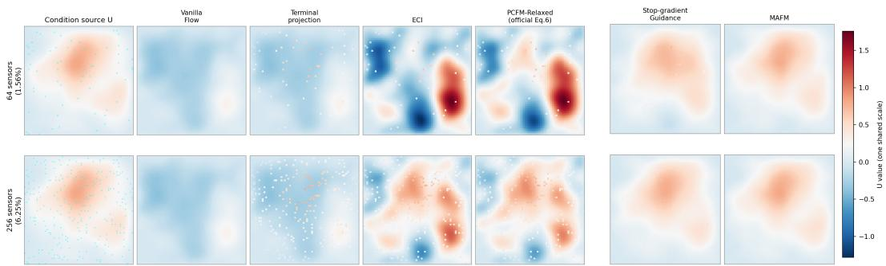  
Figure 7: Poisson generated solution fields U under partial observations. One representative ECI column is shown; the ECI-2 and ECI-4 variants remain in Table 5.

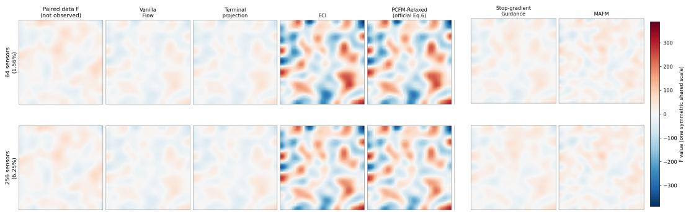  
Figure 8: Poisson source fields F paired with Figure 7, with the same representative ECI column.

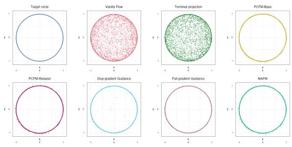  
Figure 6: Sphere–plane samples.

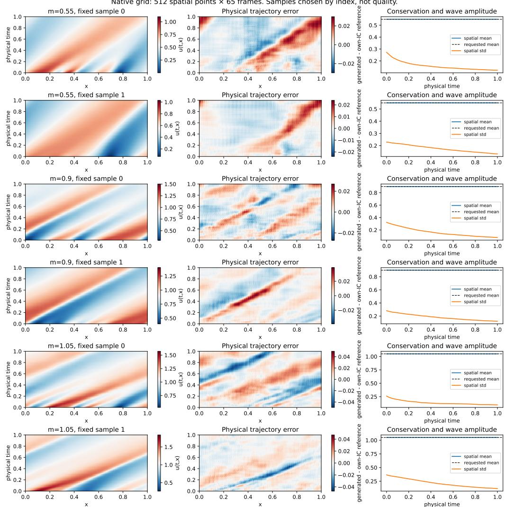  
Figure 9: Periodic Burgers samples.

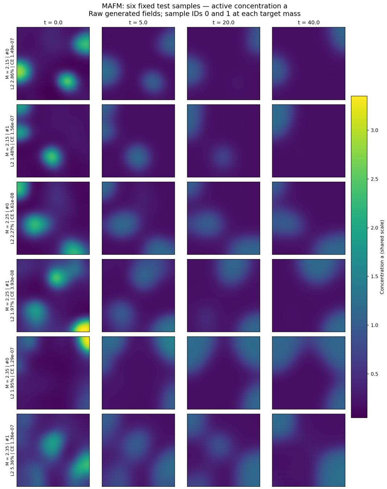  
Figure 10: Reaction–diffusion samples.

EULER held-out physical fields (N=49)  
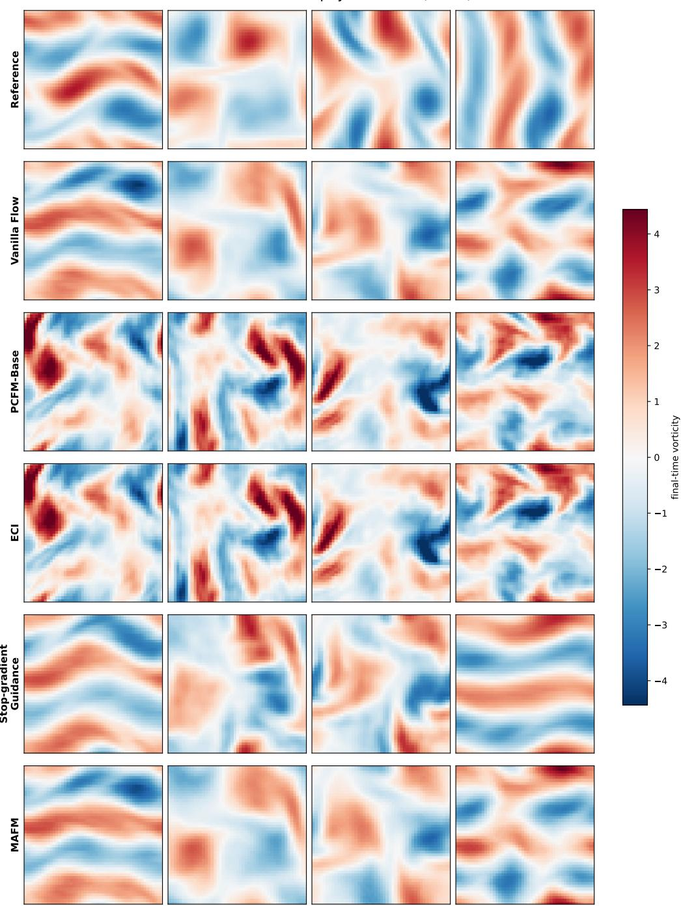  
Figure 11: Euler vorticity samples at fixed energy.

NS held-out physical fields (N=49)  
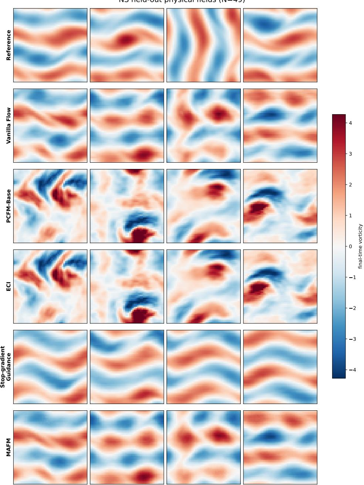  
Figure 12: Controlled-NS vorticity samples at fixed energy.

## D.11 ADDITIONAL INFERENCE-TIME BASELINES

Table 18 compares D-Flow (Ben-Hamu et al., 2024), PnP-Flow (Martin et al., 2025), and Lagrangian Dual Flows (LDF) (Kurtz & Davydov, 2026) with CCFM and MAFM on the same frozen checkpoints, paired test inputs, and prescribed constraints. The two energy tests use 512 samples each. Burger and reaction–diffusion use 768 and 384 samples, respectively, with equal weight for each of three target masses. Each Poisson sensor density uses two layouts with 512 samples per layout.

The data-fidelity terms use the supplied mass or sensor equality, or the target per-frame velocity radius for the energy equality. D-Flow optimizes the source noise through the full 100-step generation ODE using L-BFGS with a 20-iteration budget and a learning rate of 0.1. It uses 4,100 model forward evaluations (including recomputation) and 2,000 input VJPs per sample. PnP-Flow alternates a data-fidelity step, interpolation with fresh prior noise, and a frozen endpoint prediction. Its fidelity step size is $( 1 - t ) ^ { \alpha }$ , with α selected on a separate development set. It uses 100 forward evaluations and no input VJPs. We evaluate both methods’ raw outputs. LDF evolves the sample and equality multipliers with the explicit midpoint method at the authors’ default stepsize of 0.01. We read the last saved sample before t = 1 after 198 forward evaluations, with terminal projection disabled. We select the residual weight on independent development inputs for each task. CCFM uses $p ( s ) = ( s / 2 ) ^ { 2 }$ CCFM and both MAFM rows use 100 forward evaluations. The projected MAFM row applies a terminal projection to the same samples as the preceding row.

On Euler and controlled NS, MAFM gives the lowest relative $L _ { 2 }$ and divergence RMSE among the methods in this table. D-Flow or PnP-Flow give lower relative $L _ { 2 }$ on some other tasks with larger constraint errors. Both miss the prescribed numerical feasibility thresholds in these comparisons. MAFM gives lower constraint and PDE errors than LDF across all six settings. Our full-gradient endpoint baseline tests the guidance operation shared by FunDPS (Yao et al., 2026) and DiffusionPDE (Huang et al., 2024), namely differentiating a loss on a denoised prediction back to the current state. DiffusionPDE also evaluates an explicit PDE residual in its guidance loss.

Table 18: Supplemental comparisons on five PDE benchmarks. CE is the supplied-constraint error. Rel. $L _ { 2 }$ is the own-initial-condition rollout error for time-dependent PDEs and the error against an independent solve from the generated source for Poisson. Div. RMSE measures deviation from zero divergence. Bold denotes the lowest value in each column at the displayed precision.
<table><tr><td></td><td colspan="3">Euler</td><td colspan="3">Controlled NS</td></tr><tr><td>Method</td><td>Energy CE</td><td>Rel.  $L _ { 2 }$ </td><td>Div. RMSE</td><td>Energy CE</td><td>Rel.  $L _ { 2 }$ </td><td>Div. RMSE</td></tr><tr><td>CCFM (n = 2)</td><td>2.33e-7</td><td>3.68%</td><td>0.06499</td><td>2.35e-7</td><td>3.48%</td><td>0.06402</td></tr><tr><td>D-Flow</td><td>0.00751</td><td>3.54%</td><td>0.06256</td><td>0.00748</td><td>3.27%</td><td>0.05994</td></tr><tr><td>PnP-Flow</td><td>0.0581</td><td>11.33%</td><td>0.20279</td><td>0.0554</td><td>10.25%</td><td>0.18868</td></tr><tr><td>LDF (198 NFE)</td><td>5.85e-4</td><td>7.13%</td><td>0.16506</td><td>5.35e-4</td><td>5.86%</td><td>0.15182</td></tr><tr><td>MAFM</td><td>6.84e-6</td><td>2.94%</td><td>0.04829</td><td>6.89e-6</td><td>2.76%</td><td>0.04736</td></tr><tr><td>MAFM + terminal projection</td><td>2.37e-7</td><td>2.94%</td><td>0.04829</td><td>2.43e-7</td><td>2.76%</td><td>0.04736</td></tr></table>

<table><tr><td></td><td colspan="2">Burgers</td><td colspan="2">Reaction-diffusion</td><td colspan="2">Poisson (64)</td><td colspan="2">Poisson (256)</td></tr><tr><td>Method</td><td>Mass CE</td><td>Rel.  $L _ { 2 }$ </td><td>Mass CE</td><td>Rel.  $L _ { 2 }$ </td><td>Obs. CE</td><td>Rel.  $L _ { 2 }$ </td><td>Obs. CE</td><td>Rel.  $L _ { 2 }$ </td></tr><tr><td>CCFM (n = 2)</td><td>5.39e-8</td><td>5.73%</td><td>5.96e-8</td><td>6.83%</td><td>0</td><td>22.78%</td><td>0</td><td>46.47%</td></tr><tr><td>D-Flow</td><td>0.995</td><td>39.01%</td><td>0.0317</td><td>3.45%</td><td>0.555</td><td>1.03%</td><td>0.567</td><td>1.04%</td></tr><tr><td>PnP-Flow</td><td>0.00149</td><td>0.71%</td><td>0.00221</td><td>0.98%</td><td>0.538</td><td>1.22%</td><td>0.234</td><td>1.00%</td></tr><tr><td>LDF (198 NFE)</td><td>7.22e-3</td><td>4.54%</td><td>2.69e-3</td><td>21.81%</td><td>3.84e-2</td><td>14.96%</td><td>6.65e-2</td><td>17.53%</td></tr><tr><td>MAFM</td><td>4.22e-8</td><td>0.965%</td><td>1.13e-7</td><td>2.74%</td><td>1.72e-7</td><td>1.70%</td><td>1.75e-7</td><td>2.25%</td></tr><tr><td>MAFM + terminal projection</td><td>5.32e-8</td><td>0.965%</td><td>6.77e-8</td><td>2.74%</td><td>0</td><td>1.70%</td><td>0</td><td>2.25%</td></tr></table>

## E SCOPE AND PRACTICAL LIMITATIONS

The residual-contraction law describes ideal continuous dynamics with a full-rank constraint Jacobian and exact multiplier solves. In a numerical sampler, Gram regularization, solve error, and time discretization can alter that law. A finite attraction budget $\begin{array} { r } { \int _ { 0 } ^ { 1 } \kappa ( t ) \mathrm { d } t } \end{array}$ also gives a finite reduction unless the sampler starts feasible or applies an exact normal step. Thus a small measured constraint error supports numerical feasibility, while matching a separately prescribed law on the feasible intersection remains a distinct question (Eq. (20)).

The quality of the guidance depends on the frozen endpoint model. Its conditional-mean prediction may average modes or become less reliable away from the training distribution; the $\eta > 0$ adjoint is useful when the predicted-endpoint residual and input sensitivity convey a stable correction (Appendix A.4). Each active adjoint step adds one input VJP, so its benefit must be read together with the sampling-time comparison in Table 10. The model parameters remain frozen.

The empirical evidence is limited to one training seed per task. The main Euler and controlled-NS comparisons use the training energy. Appendix D.8 tests the same checkpoints at 0.8, 1.2, and 2 times the training energy. The shared terminal projection brings MAFM within the reported energy tolerance at the two moderate shifts. At twice the training energy, projected MAFM still meets the tolerance, but the PDE relative $L _ { 2 }$ errors rise to 9.85% on Euler and 10.01% on controlled NS. These results cover the three tested targets and one checkpoint per system. The Burgers samples show mild fluctuation-amplitude contraction, and reaction–diffusion samples retain a small negative-value tail. These observations define the scope of the present results and motivate broader seed and condition studies.