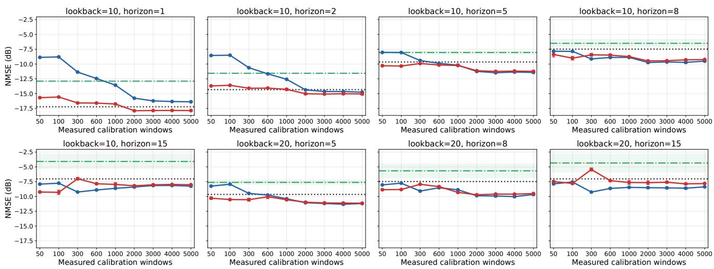
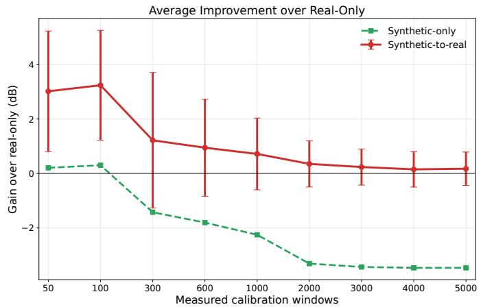
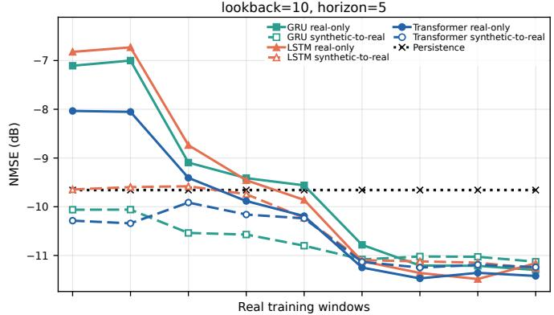
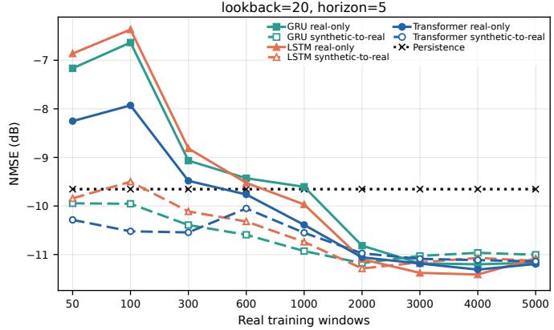
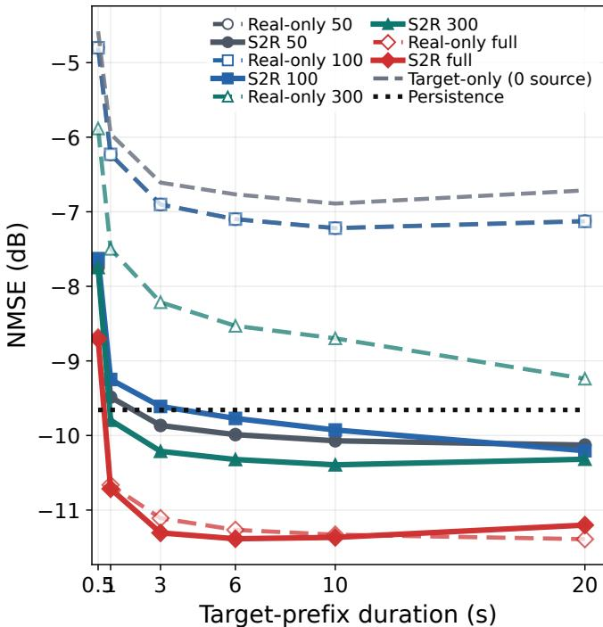

This is the author’s accepted version of a paper presented at the 2026 IEEE 104th Vehicular Technology Conference (VTC2026-Fall). © 2026 IEEE. Personal use of this material is permitted. Permission from IEEE must be obtained for all other uses, in any current or future media, including reprinting/republishing this material for advertising or promotional purposes, creating new collective works, for resale or redistribution to servers or lists, or reuse of any copyrighted component of this work in other works.

# Measurement-Calibrated Synthetic Pretraining for Rapid Adaptation of UAV Channel Predictors

Qiuheng Zhou∗, Wei Jiang∗, Donglin Wang†, Hans D. Schotten∗†

∗ Intelligent Networks, German Research Center for Artificial Intelligence (DFKI GmbH), Kaiserslautern, Germany Email: {qiuheng.zhou, wei.jiang, hans dieter.schotten}@dfki.de

† Institute for Wireless Communication and Navigation, RPTU Kaiserslautern-Landau, Kaiserslautern, Germany Email: {donglin.wang, schotten}@rptu.de

Abstract—Unmanned aerial vehicle (UAV) links can change faster than route-specific channel data can be collected, so a channel predictor must often be adapted from only a short targetflight calibration segment. This paper studies measurementcalibrated synthetic pretraining as an offline source prior for rapid adaptation of channel state information (CSI) predictors. The synthetic source is calibrated to flight-only power evolution, temporal shape variation, frequency selectivity, and phase disturbance, and is then combined with measured source-flight fine-tuning before target-flight adaptation. Under chronological held-out flight splits, synthetic-to-real (S2R) fine-tuning reduces the measured-data budget needed to reach useful prediction in the low-data regime. For 50 ms-ahead prediction, it crosses a latestchannel-estimate persistence baseline with 50 measured training windows, roughly 0.5 s of 10 ms-spaced supervised windows, whereas training from scratch requires 600 windows. A targetprefix adaptation study further shows that a lightweight gated recurrent unit predictor can reuse the pretrained source prior with one prediction-layer update epoch, positioning measurementcalibrated synthetic pretraining as a reusable prior for scarce target-flight measurements.

Index Terms—UAV, channel prediction, synthetic data, pre-[ training, CSI, measurement-calibrated learning

## I. INTRODUCTION

Future sixth-generation (6G) systems are expected to support mobile, aerial, and mission-dependent links whose radio conditions change with platform motion and deployment context [1]. For unmanned aerial vehicle (UAV) communications, this makes channel prediction attractive for proactive schedul ing and link adaptation. In practice, however, a predictor often has to be commissioned before a long route-specific measurement campaign is available. Hardware-inclusive channel state information (CSI) acquisition is expensive, weatherand mission-sensitive, and difficult to repeat under controlled conditions [2], [3]. The operational question is not only whether a learned predictor can perform well with abundant measured training data, but how quickly it can adapt after a short measured calibration segment.

This shifts the emphasis from final accuracy with abundant route-specific training to calibration efficiency. A simple persistence predictor can already be strong for slowly varying magnitude CSI; synthetic data is valuable only if it reduces the measured-data or update budget needed to cross that notraining reference. We therefore focus on the low-data commissioning phase, where a calibrated prior may help before a target-flight model has enough measurements or update time to learn the channel structure directly.

Prior channel-prediction work has shown that recurrent and attention-based models can exploit temporal channel structure when the training and test conditions are sufficiently aligned [4]–[7]. The harder case is realistic transfer: generic fading traces may reproduce broad channel trends while missing the power dynamics, phase disturbance, temporal smoothness, and local irregularity created by receiver-side artifacts and measurement conditions [3], [8]. Such priors matter only when their statistics are tied to measurementrelevant channel behavior and when their value is assessed under limited real-data adaptation.

We study a measured-flight adaptation setting between pure measurement benchmarking and unconstrained synthetic augmentation. Recent work has explored generative adversarial network (GAN)-based or generative channel modeling for unknown or measured channels [9], [10], and more recent channel-extrapolation studies have discussed generative models as a mechanism for richer CSI synthesis and transfer [11]. In contrast, we use a controllable synthetic source whose power evolution, phase disturbance, and temporal-frequency consistency are tied to measured flight statistics.

The evaluation asks whether this calibrated source reduces the measured adaptation budget. A source-pool study first compares real-only, synthetic-only, and synthetic-to-real (S2R) fine-tuning under strict held-out splits and explicit measureddata budgets. The rapid-adaptation study then treats the trained source models as cached priors and compares real-only and S2R source priors under the same short target-flight update budget.

The contributions are threefold. First, we formulate a measurement-calibrated synthetic pretraining pipeline for realistic UAV CSI prediction. Second, we evaluate it as a rapid adaptation problem using chronological held-out flight splits, explicit measured-data budgets, cached source-prior targetprefix adaptation, and a persistence break-even reference. Third, we identify the operating regime in which calibrated pretraining reduces the measured-data and update budget, while separating this effect from zero-real-adaptation transfer and high-data saturation.

## II. SYSTEM MODEL

Our prediction task is built on hardware-inclusive UAVto-ground CSI measurements collected from a realistic dynamic flight workflow introduced in our prior measurement study [3]. The acquisition pipeline builds on the open-source OpenAirInterface ecosystem [12], whose relevance to nonterrestrial experimentation has also been demonstrated in satellite-oriented fifth-generation (5G) non-terrestrial network (NTN) studies [13]. Each frame is paired with synchronized telemetry, which is used here to select flight-only, uninterrupted intervals. The present study uses the measured channel tensor after frequency-domain band stitching, retaining a 574- dimensional magnitude target per 10 ms time step.

We adopt a strict train-test separation within a related measured-flight family. The measured calibration pool consists of separate missions with different motion phases, while a disjoint held-out flight is reserved for evaluation. Flight height is held fixed as a control variable so that the comparison is not dominated by path-loss offsets; the model must still transfer across route realizations and speed profiles rather than memorize a single flight trace. In the intended use case, the budget-limited measured pool represents the short calibration data available before a predictor is commissioned for a related UAV operating condition.

Let $\mathbf { H } _ { t } \in \mathbb { C } ^ { K }$ denote the measured frequency-domain CSI vector at time index t after frame synchronization and channel estimation. Band stitching selects the active subcarrier set K and maps each frame to

$$
\mathbf { x } _ { t } = | \mathbf { H } _ { t } [ { \boldsymbol { K } } ] | \in \mathbb { R } ^ { F } , \quad F = 5 7 4 .\tag{1}
$$

The measured windows also carry a known radio-frame slot identifier. We encode it as a one-hot timing state $\mathbf { q } _ { t } \in \{ 0 , 1 \} ^ { Q }$ with $Q = 1 0$ , and use $\mathbf u _ { t } = [ \mathbf x _ { t } , \mathbf q _ { t } ]$ as the conditioned input when slot metadata are present. Slot indices are deterministic radio-frame positions, not future channel observations; using prediction-time slot states therefore does not reveal future CSI. Synthetic windows without measured slot metadata use zero timing channels. For a lookback length L and prediction horizon $H ,$ the input and target windows are

$$
\mathbf { U } _ { t } = [ \mathbf { u } _ { t - L + 1 } , \ldots , \mathbf { u } _ { t } ] , \quad \mathbf { Y } _ { t } = [ \mathbf { x } _ { t + 1 } , \ldots , \mathbf { x } _ { t + H } ] ,\tag{2}
$$

and the predictor is a parameterized sequence model conditioned on the known prediction-time slot states $\begin{array} { r l } { \mathbf { Q } _ { t } ^ { + } } & { { } = \mathbf { \Lambda } } \end{array}$ $[ \mathbf { q } _ { t + 1 } , \dots , \mathbf { q } _ { t + H } ]$

$$
\displaystyle \boldsymbol { f } _ { \theta } : \mathbb { R } ^ { L \times ( F + Q ) } \times \mathbb { R } ^ { H \times Q } \to \mathbb { R } ^ { H \times F } .\tag{3}
$$

For any dataset $\mathcal { D }$ of input-target windows, the training objec tive is

$$
\mathcal { L } _ { \mathcal { D } } ( \pmb { \theta } ) = \frac { 1 } { | \mathcal { D } | } \sum _ { ( \mathbf { U } , \mathbf { Q } ^ { + } , \mathbf { Y } ) \in \mathcal { D } } \| \mathbf { Y } - f _ { \pmb { \theta } } ( \mathbf { U } , \mathbf { Q } ^ { + } ) \| _ { 2 } ^ { 2 } .\tag{4}
$$

The reported metric is normalized mean squared error (NMSE) at the requested prediction horizon on the held-out real test set:

$$
\mathrm { N M S E } _ { H } = 1 0 \log _ { 1 0 } \frac { \sum \left. \mathbf { x } _ { t + H } - \hat { \mathbf { x } } _ { t + H } \right. _ { 2 } ^ { 2 } } { \sum \left. \mathbf { x } _ { t + H } \right. _ { 2 } ^ { 2 } } .\tag{5}
$$

## III. RAPID-ADAPTATION FRAMEWORK

## A. Training Routes and Target-Prefix Adaptation

Let $\mathcal { D } _ { R } ^ { \mathrm { c a l } }$ be the measured calibration pool and $\mathcal { D } _ { R } ^ { \mathrm { t e } }$ the held-out real test set. For a calibration budget $c ,$ the available measured training set is $\mathcal { D } _ { R } ^ { c } \subset \mathcal { D } _ { R } ^ { \mathrm { c a l } }$ with $\begin{array} { r } { | \mathcal { D } _ { R } ^ { c } | = c . } \end{array}$ Let $\mathcal { D } _ { S }$ denote the measurement-calibrated synthetic dataset defined below.

For the main source-pool evaluation, the three training strategies differ only in how the final predictor parameters are obtained. Let Train $( \pmb { \theta } ^ { ( 0 ) } , \mathcal { D } )$ denote the early-stopped optimizer output after training on $\mathcal { D }$ from initialization $\mathbf { \bar { \theta } } ^ { ( 0 ) }$ and let $\pmb { \theta } _ { 0 }$ be the random initialization. The resulting parameter choices are

$$
\begin{array} { r l } { r e a l - o n l y : } & { { } \pmb { \theta } _ { R } ^ { c } = \operatorname { T r a i n } ( \pmb { \theta } _ { 0 } , \mathcal { D } _ { R } ^ { c } ) , } \end{array}
$$

$$
\begin{array} { r } { s y n t h e t i c - o n l y : \quad \pmb { \theta } _ { S } = \operatorname { T r a i n } ( \pmb { \theta } _ { 0 } , \mathcal { D } _ { S } ) , } \end{array}\tag{6}
$$

$$
\begin{array} { r l } { S 2 R : } & { { } \pmb { \theta } _ { S  R } ^ { c } = \operatorname { T r a i n } ( \pmb { \theta } _ { S } , \mathcal { D } _ { R } ^ { c } ) . } \end{array}\tag{7}
$$

(8)

All training strategies are evaluated on $\mathcal { D } _ { R } ^ { \mathrm { t e } }$ . Thus, real-only uses the budget-limited measured set from scratch, syntheticonly tests zero-real-adaptation transfer, and S2R fine-tuning uses the same measured budget as real-only but starts from the calibrated synthetic predictor.

For the target-prefix adaptation check, we separate sourceside prior construction from target-side updates. Let $\mathcal { D } _ { R } ^ { \mathrm { s r c } }$ denote the measured source-flight pool, $\bar { \mathcal { D } } _ { R } ^ { \mathrm { t p } , c }$ the first c windows of the target flight, and $\mathcal { D } _ { R } ^ { \mathrm { s u f } }$ the later target-flight suffix. The real-only source prior and the S2R source prior are

$$
\pmb { \theta } _ { R } ^ { \mathrm { s r c } } = \operatorname { T r a i n } ( \pmb { \theta } _ { 0 } , \mathcal { D } _ { R } ^ { \mathrm { s r c } } ) ,\tag{9}
$$

$$
\pmb { \theta } _ { S  R } ^ { \mathrm { s r c } } = \mathrm { T r a i n } ( \pmb { \theta } _ { S } , \mathcal { D } _ { R } ^ { \mathrm { s r c } } ) .\tag{10}
$$

Both are then adapted on the same target prefix:

$$
\theta _ { \mathrm { a d a p t } } ^ { c , e } = \mathrm { U p d a t e } _ { e } ( \theta ^ { \mathrm { p r i o r } } , \mathcal { D } _ { R } ^ { \mathrm { t p } , c } ) ,\tag{11}
$$

where e is the number of target-prefix update epochs. We evaluate the adapted model on $\mathcal { D } _ { R } ^ { \mathrm { s u f } }$ . In the prediction-layer adaptation case, $\mathrm { U p d a t e } _ { e } ( \cdot )$ optimizes only the final prediction layer while freezing the recurrent backbone.

## B. Evaluation Protocol

The core predictor evaluation covers six sequence settings, extending prior channel-prediction benchmarks that compare recurrent and attention-based temporal models [4], [5], [7]:

$$
\begin{array} { r } { ( \mathrm { l o o k b a c k , h o r i z o n } ) \in \{ ( 1 0 , 1 ) , ( 1 0 , 2 ) , ( 1 0 , 5 ) , } \\ { ( 1 0 , 8 ) , ( 1 0 , 1 5 ) , ( 2 0 , 5 ) \} . } \end{array}
$$

Because frames are spaced by 10 ms, lookback values of 10 and 20 correspond to 100 and 200 ms of observed CSI history, while horizons of 1, 2, 5, 8, and 15 correspond to 10, 20, 50, 80, and 150 ms-ahead prediction. These settings let us compare both horizon growth at fixed lookback and lookback variation at fixed horizon. For each setting, we evaluate three training strategies: real-only, synthetic-only, and S2R fine-tuning.

We limit the amount of available measured training data to emulate short calibration campaigns. The calibration budgets are

$$
c \in \{ 5 0 , 1 0 0 , 3 0 0 , 6 0 0 , 1 0 0 0 , 2 0 0 0 , 3 0 0 0 , 4 0 0 0 , 5 0 0 0 \}
$$

sequence windows. With a 10 ms frame spacing and unit window stride, c supervised windows correspond to roughly 0.01c seconds of window-start coverage, in addition to the lookback context and future labels required by the first usable window. The 50- and 100-window budgets represent the scarce-data regime, while 2000–5000 windows expose highdata saturation. The measured budgets are applied only to the training split and allocated across the three measured calibration missions. For synthetic-only, the same budget axis is used only as a paired comparison index because no measured training samples are consumed.

To avoid overly optimistic evaluation, we use a chronological split protocol. Sequence windows are first ordered in time, then divided into train, validation, and test segments with an explicit boundary gap of lookback+horizon−1 windows. This removes direct overlap across split boundaries. The primary metric reported throughout the paper is NMSE at the requested prediction horizon on the held-out real test set, averaged over three random seeds.

In addition to the main source-pool calibration protocol, we run a focused target-prefix adaptation check. There, the measured fine-tuning budget is taken from the first few seconds of the target flight and evaluation is performed on the later target-flight suffix. The comparison starts from two cached offline priors: a real-only source prior trained only on measured source-flight windows, and an S2R prior obtained by synthetic pretraining followed by measured-source fine-tuning. Neither source prior is rebuilt when the target flight arrives; only the target-side prediction layer is updated from the observed prefix. This models a commissioning scenario in which a UAV collects a short prefix of target-flight CSI and then applies a lightweight update before subsequent channel prediction.

Table I summarizes the controlled data-source comparison. The measured training pool contains about 6071–6147 windows depending on the sequence setting, so 50 and 600 windows correspond to about 0.8% and 10% of the available measured pool. Within the Transformer evaluation, the three training strategies share the same architecture, evaluation split, and held-out target; only the training data source changes. The pretraining strategy adds offline training, not extra inference capacity. Persistence serves as the no-training reference based on the latest available channel-estimate magnitude. Shared synthetic-only and synthetic-pretrained checkpoints are reused across budgets for each seed and prediction setting.

## C. Measurement-Calibrated Synthetic Source

Here, “measurement-calibrated” means that synthetic CSI is constrained by observable statistics extracted from real flightonly measurements. The calibration targets are frame-power level and variability, lag-1 power smoothness, wrapped phaseincrement spread, and local temporal and adjacent-subcarrier magnitude consistency. These statistics keep the generator interpretable while grounding it in hardware-inclusive field behavior [10].

TABLE I  
EVALUATION PROTOCOL.
<table><tr><td>Item</td><td>Setting</td></tr><tr><td>Measured calibration pool</td><td>Three same-height source missions: 15 m/s phases 1– 2 and 20 m/s long route.</td></tr><tr><td>Held-out test</td><td>Disjoint same-height 10 m/s target flight.</td></tr><tr><td>Filtering</td><td>10 ms CSI; uninterrupted flight-only segments.</td></tr><tr><td>Representation</td><td>574-D band-stitched magnitude plus 10-D known</td></tr><tr><td>Window settings</td><td>timing condition. (L, H) = (10, 1), (10, 2), (10, 5), (10, 8),</td></tr><tr><td>Split</td><td>(10, 15), (20, 5). Chronological 60/20/20; boundary gap lookback +</td></tr><tr><td>Train pools</td><td>horizon - 1. Measured 6071–6147; synthetic 7156–7182 windows.</td></tr><tr><td>Calibration bud- gets</td><td>50, 100, 300, 600, 1000, 2000, 3000, 4000, 5000 train windows, i.e., about 0.8%–82% of the measured pool.</td></tr><tr><td>Main model</td><td>Slot-conditioned Transformer: 11.4M parameters, hid- den 512, 16 heads, 2+2 layers, feed-forward network</td></tr><tr><td>Controls</td><td>(FFN) 1024. Persistence baseline; shared synthetic-only and shared</td></tr><tr><td>Training</td><td>synthetic-pretrain checkpoints per seed. Batch 128, 3 seeds; 50 epochs for single-stage train- ing, or 50 synthetic-pretraining epochs followed by 20 measured-data fine-tuning epochs.</td></tr></table>

Synthetic sequences are produced by a generator $g _ { \phi }$ . Its parameters are selected by matching measured calibration statistics M:

$$
\phi ^ { * } = \arg \operatorname* { m i n } _ { \phi } \sum _ { m \in \mathcal { M } } w _ { m } \frac { | s _ { m } ( \mathcal { D } _ { S } ( \phi ) ) - s _ { m } ( \mathcal { D } _ { R } ^ { \mathrm { c a l } } ) | } { | s _ { m } ( \mathcal { D } _ { R } ^ { \mathrm { c a l } } ) | + \epsilon } ,\tag{12}
$$

where $s _ { m } ( \cdot )$ denotes a calibration statistic. The final synthetic training set is $\mathcal { D } _ { S } = \mathcal { D } _ { S } ( \phi ^ { * } )$ .

The generator is a controllable statistical backbone rather than a black-box generative model. Each synthetic bundle uses 12000 frames over the same 574 retained subcarriers used by the measured representation. The backbone contains four parts: a mission-level power envelope, a smooth frequency profile, a low-frequency temporal-shape field, and a phase random walk. Mathematically, for subcarrier k at time $t ,$

$$
\tilde { H } _ { t , k } = A _ { t } B _ { k } \exp ( \alpha S _ { t , k } ) \exp \left( j ( \Phi _ { t } + \Psi _ { k } ) \right) ,\tag{13}
$$

where $A _ { t }$ controls the frame-level power envelope, $B _ { k }$ defines the smooth frequency profile, $S _ { t , k }$ is a slowly varying temporal-shape field, and α controls its calibrated strength. The random walk $\Phi _ { t }$ captures local oscillator (LO) drift and residual Doppler, while $\Psi _ { k }$ captures frequency-dependent phase structure. The temporal-shape term is deliberately low frequency in time and subcarrier index: it injects measuredlike spectral deformation without giving the synthetic source access to any held-out target frames.

Table II reports calibration against measured calibrationflight statistics; the held-out flight is excluded. Power mean and variance are matched by construction, while phase-increment dispersion and local temporal and adjacentsubcarrier similarity serve as additional consistency checks. Synthetic sequences use zero timing channels where measured data provide slot-id metadata, so the synthetic source cannot access held-out timing labels.

TABLE II  
SYNTHETIC CALIBRATION QUALITY.
<table><tr><td>Metric</td><td>Target</td><td>Synthetic</td></tr><tr><td>Power mean [dB]</td><td>46.723</td><td>46.723</td></tr><tr><td>Power std [dB]</td><td>4.554</td><td>4.554</td></tr><tr><td>Power lag-1 corr.</td><td>0.958</td><td>0.979</td></tr><tr><td>Phase-inc. std [rad]</td><td>1.803</td><td>1.800</td></tr><tr><td>Temporal similarity mean</td><td>0.9870</td><td>0.9874</td></tr><tr><td>Temporal similarity std</td><td>0.0258</td><td>0.0264</td></tr><tr><td>Subcarrier similarity mean</td><td>0.9994</td><td>0.9987</td></tr><tr><td>Subcarrier similarity std</td><td>0.00075</td><td>0.00086</td></tr></table>

TABLE III  
MEASURED CALIBRATION BUDGET REQUIRED TO BEAT PERSISTENCE.
<table><tr><td>Setting  $( L , \bar { H } )$ </td><td>Persistence NMSE [dB]</td><td>Real-only  $\mathrm { w i n d o w s ~ ( p o o l ) }$ </td><td>S2R  $\mathrm { w i n d o w s ~ ( p o o l ) }$ </td></tr><tr><td>(10, 1)</td><td>-17.22</td><td> $\overline { { > 5 0 0 0 ~ ( > 8 1 \% ) } }$ </td><td> $2 0 0 0 \ ( { \sim } 3 3 \% )$ </td></tr><tr><td>(10, 2)</td><td>-14.33</td><td> $20 0 0 \ ( \sim 3 3 \% )$ </td><td> $20 0 0 \ ( \sim 3 3 \% )$ </td></tr><tr><td>(10, 5)</td><td>-9.66</td><td> $6 0 0 ~ ( \sim 1 0 \% )$ </td><td> $5 0 ~ ( \sim 0 . 8 \% )$ </td></tr><tr><td>(10, 8)</td><td>-7.48</td><td> $5 0 ~ ( \sim 0 . 8 \% )$ </td><td> $5 0 ~ ( \sim 0 . 8 \% )$ </td></tr><tr><td>(10, 15)</td><td>-7.03</td><td> $5 0 ~ ( \sim 0 . 8 \% )$ </td><td>50 (~0.8%)</td></tr><tr><td>(20, 5)</td><td>-9.65</td><td> $6 0 0 ~ ( \sim 1 0 \% )$ </td><td> $5 0 ~ ( \sim 0 . 8 \% )$ </td></tr></table>

## IV. RESULTS AND DISCUSSION

We organize the results around the measured calibration budget and update effort required on a related held-out flight. Fig. 1 first uses the Transformer as a high-capacity reference to isolate the data-source effect before target-prefix adaptation. The overview includes the six core protocol settings and two additional long-lookback settings, (20, 8) and (20, 15), to visualize how the trend extends beyond the aggregate grid. Across the six core settings and nine measured budgets, S2R fine-tuning most consistently improves the scarce-data regime and crosses persistence more often than real-only. The key question is whether this advantage appears before high-data saturation.

The persistence baseline repeats the last observed channelestimate magnitude vector across the requested horizon. This is a demanding reference for magnitude CSI because the channel contains a slowly varying component. Table III reports the first measured budget at which each learned strategy crosses it.

The break-even budgets show where synthetic pretraining changes the operating point. At horizon 5, i.e., 50 ms-ahead prediction, S2R fine-tuning beats persistence with 50 measured windows, about 0.5 s and 0.8% of the measured calibration pool, whereas training from scratch requires 600 windows, about 6 s and 10%. For (10, 8) and (10, 15), both learned strategies already beat persistence at 50 windows, while (10, 1) and (10, 2) remain harder because persistence is strongest. The result is horizon-dependent calibration acceleration rather than blanket superiority over every short-horizon reference.

Fig. 2 shows the same trend averaged across the six core settings. S2R fine-tuning improves over real-only by 3.02 dB at 50 windows and 3.24 dB at 100 windows, corresponding to only 0.8%–1.6% of the measured calibration pool. The margin then declines to 1.22, 0.95, 0.72, and 0.35 dB at 300, 600, 1000, and 2000 windows, and remains small at 3000– 5000 windows. In contrast, synthetic-only does not consistently cross persistence and is therefore useful as a pretraining source, not as a deployable predictor.

The budget curves reveal a saturation regime: once enough measured calibration data are available, the real-only model learns much of the target structure directly and the marginal value of the synthetic prior decreases. The additional (20, 8) and (20, 15) settings in Fig. 1 also show that longer lookback does not by itself guarantee stronger transfer at longer horizons.

A focused predictor-family control then checks whether the effect is tied to the Transformer. Fig. 3 reports the two 50 msahead settings, (10, 5) and (20, 5), under the same sharedpretrain protocol, calibration budgets, seeds, and matched training parameters across trainable models. In this control, gated recurrent unit (GRU) has the largest average S2R gain over real-only at 1.07 dB, followed by long short-term memory (LSTM) at 0.85 dB and Transformer at 0.58 dB. The pattern therefore survives beyond a single predictor family.

Because GRU is both lightweight and the strongest focused control in Fig. 3, Fig. 4 uses it for source-prior target-prefix adaptation. The source priors are trained once on the source missions and then reused on a disjoint same-height target flight with different route and speed characteristics. To expose the value of synthetic pretraining when measured source data are also scarce, Fig. 4 varies the measured source windows used to build the offline prior. The x-axis varies the target-prefix duration observed after the target flight starts, while each curve label gives the source-prior route and measured source budget. Each learned curve uses one prediction-layer update epoch on the target prefix for the (10, 5) setting; the target-only curve corresponds to zero source windows.

Under this more deployment-like protocol, the 100 mshistory setting shows that a cached prior can be adapted from a short target prefix rather than learned from scratch. When the measured source budget is full, real-only and S2R priors nearly coincide. With only 50–300 measured source windows, however, S2R pretraining lowers the target-suffix NMSE by about 1.7–3.3 dB across the tested target-prefix durations. Since the target-side update is held fixed, this isolates the quality of the cached source prior; the gain comes from sourceside pretraining rather than from a larger deployed network.

Together, the main held-out-flight protocol and the targetprefix check show measurement-calibrated synthetic data acting as a short-calibration prior. In the source-pool evaluation, real-only and S2R use the same c measured windows; the latter adds only offline pretraining, so inference cost is unchanged within a fixed predictor family. In the target-prefix probe, both source priors are trained before the target flight, and S2R is most useful when measured source-flight data are limited rather than abundant.

The present scope is magnitude prediction under related flight conditions. Phase is used only to calibrate synthetic disturbance statistics, and the predictor-family control is focused on 50 ms-ahead settings rather than a full all-horizon architecture ranking.

  
Fig. 1. Multiseed NMSE on the held-out flight under the shared-pretrain protocol. The overview combines the six core settings with (20, 8) and (20, 15). Error bars show three-seed standard deviations; synthetic-only is repeated along the budget axis only for visual comparison.

  
Fig. 2. Average improvement over real-only versus measured calibration budget over the six core settings.

## V. CONCLUSION

This study shows that measurement-calibrated synthetic pretraining can accelerate adaptation of dynamic UAV channel predictors. Under a strict held-out protocol, S2R fine-tuning improves the low-budget regime across the core Transformer grid and crosses persistence earlier than real-only in the 50 msahead settings. A target-prefix check further shows that a cached S2R GRU prior can be adapted with one predictionlayer update epoch, with the clearest advantage when the realonly source prior itself is built from only tens to hundreds of source-flight windows. Once thousands of measured windows are available, training from measured data can approach the pretrained strategy. The strongest use case is therefore scarce source and target adaptation, where synthetic pretraining reduces the measured windows, update effort, and trainable target-side parameters needed to reach a useful predictor.

  
Fig. 3. Focused predictor-family control for the two 50 ms-ahead settings. Color denotes predictor family, line style denotes training strategy, and the dotted black line denotes persistence.

Future work should make both calibration and adaptation policies more horizon-aware. Two directions follow directly from the present results: extending calibration beyond magnitude-only constraints toward richer complex-domain structure, and designing adaptive policy selection among persistence, real-only learning, and calibrated synthetic pretraining.

  
Fig. 4. Target-prefix adaptation with GRU on the held-out flight suffix for 100 ms of history and 50 ms-ahead prediction. The legend reports both sourceprior route, real-only or S2R, and measured source budget; target-only denotes zero source windows. All learned curves use one prediction-layer update epoch on the target prefix.

## ACKNOWLEDGMENT

This work of the authors was supported by the German Federal Ministry of Research, Technology, and Space (BMFTR) through the Open6GHub+ project (Grant no. 16KIS2402K) and the 3D-Net project (Grant no. 16KIS2719).

## REFERENCES

[1] W. Jiang, B. Han, M. A. Habibi, and H. D. Schotten, “The road towards 6G: A comprehensive survey,” IEEE Open J. Commun. Soc., vol. 2, pp. 334–366, 2021.

[2] K. Mao et al., “A survey on channel sounding technologies and measurements for UAV-assisted communications,” IEEE Trans. Instrum. Meas., vol. 73, pp. 1–24, 2024, art. no. 8004624.

[3] Q. Zhou, S. Melnyk, H. D. Schotten, R. Vilter, and N. Stuckert, “Empowering AI towards 6G: Realistic UAV channel data acquisition using open-source solutions,” in Proc. IEEE Veh. Technol. Conf. (VTC-Spring), 2026, to appear.

[4] W. Jiang and H. D. Schotten, “Deep learning for fading channel prediction,” IEEE Open J. Commun. Soc., vol. 1, pp. 320–332, 2020.

[5] H. Jiang, M. Cui, D. W. K. Ng, and L. Dai, “Accurate channel prediction based on transformer: Making mobility negligible,” IEEE J. Sel. Areas Commun., vol. 40, no. 9, pp. 2717–2732, 2022.

[6] O. Stenhammar, G. Fodor, and C. Fischione, “A comparison of neural networks for wireless channel prediction,” IEEE Wireless Commun., vol. 31, no. 3, pp. 235–241, 2024.

[7] Q. Zhou, S. Melnyk, D. Wang, and H. D. Schotten, “Evaluation of transformer empowered channel prediction for 5G and beyond communication,” in Proc. 2024 IEEE 100th Veh. Technol. Conf. (VTC2024-Fall), 2024, pp. 1–6.

[8] J. Joo, M. C. Park, D. S. Han, and V. Pejovic, “Deep learning-based channel prediction in realistic vehicular communications,” IEEE Access, vol. 7, pp. 27 846–27 858, 2019.

[9] H. Jiang, S. Bi, L. Dai, H. Wang, and J. Zhang, “Residual-aided end-toend learning of communication system without known channel,” IEEE Trans. Cogn. Commun. Netw., vol. 8, no. 2, pp. 631–641, Jun. 2022.

[10] F. Euchner, J. Sanzi, M. Henninger, and S. ten Brink, “GAN-based massive MIMO channel model trained on measured data,” in Proc. 2024 27th Int. Workshop on Smart Antennas (WSA), 2024, pp. 109–116.

[11] Y. Gao et al., “Enabling 6G through multi-domain channel extrapolation: Opportunities and challenges of generative artificial intelligence,” arXiv preprint arXiv:2509.01125, 2025.

[12] F. Kaltenberger, G. de Souza, R. Knopp, and H. Wang, “The OpenAir-Interface 5G new radio implementation: Current status and roadmap,” in Proc. WSA 2019; 23rd Int. ITG Workshop on Smart Antennas, 2019, pp. 1–5.

[13] F. Volk¨ et al., “5G non-terrestrial networks with OpenAirInterface: An experimental study over GEO satellites,” IEEE Access, vol. 12, pp. 155 098–155 109, 2024.