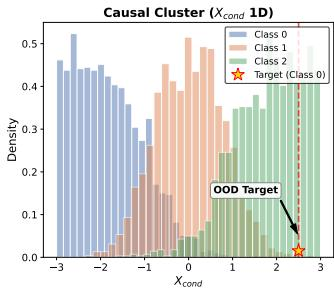
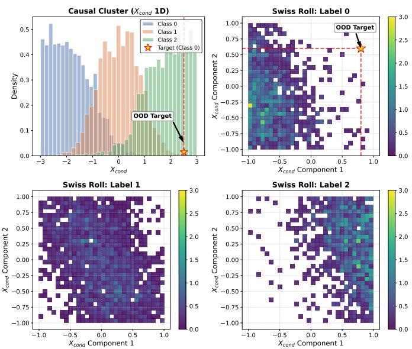
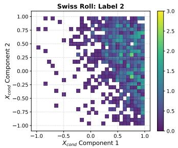
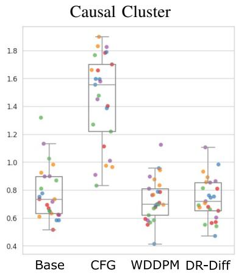
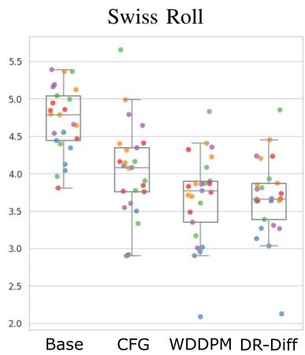
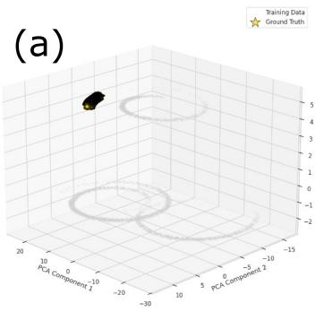
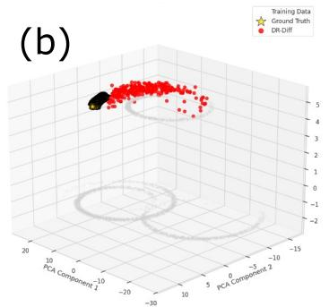
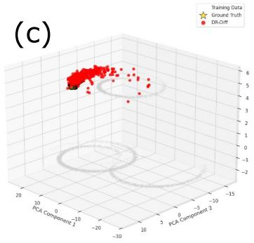
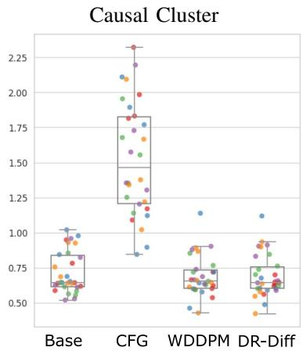
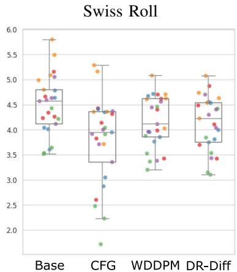

# Overcoming Spurious Correlations in Conditional Diffusion Models via Doubly Robust Target Correction

Eiichi Sakurai

Graduate School of Information Science and Technology,

The University of Tokyo,

Tokyo, Japan

Artificial Intelligence Research Center,

National Institute of Advanced Industrial Science and Technology,

Tokyo, Japan

e.sakurai@aist.go.jp

Kenji Yamanishi

Graduate School of Information Science and Technology ,

The University of Tokyo,

Tokyo, Japan

yamanishi@g.ecc.u-tokyo.ac.jp

Abstract—While conditional diffusion models have achieved remarkable success in generation tasks, they memorize spurious correlations within training data. This causes them to deviate from ideal target distributions. Minimizing a covariate shiftadjusted target risk can address this issue. However, retraining models from scratch for different distributions is computationally prohibitive. To overcome this limitation, we propose DR-Diff, a framework that efficiently fine-tunes pre-trained conditional diffusion models. Specifically, DR-Diff leverages a functional gradient approach to derive a pseudo-target. This pseudo-target captures the residual between the base model’s noise prediction and the ground-truth noise under the target distribution. Training the model to fit this pseudo-target enables efficient target adaptation. Theoretically, we prove that DR-Diff guarantees target risk reduction at the population level. It also achieves a pseudo-doubly robust property, providing resilience against density ratio estimation errors and base model misspecifications. Empirically, DR-Diff matches the noise prediction accuracy of models trained from scratch on synthetic datasets. Furthermore, it mitigates inter-group disparities in downstream classification tasks.

Index Terms—out of distribution, debiasing, Diffusion Model

## I. INTRODUCTION.

Diffusion models have demonstrated remarkable success in conditional generation, enabling high-fidelity synthesis of target variables y under conditions $( X _ { \mathrm { l a b e l } } , X _ { \mathrm { c o n d } } )$ consisting of a class label and auxiliary attributes [1], [2]. By iteratively denoising corrupted samples, these models effectively learn the observational conditional distribution $P ( y _ { 0 } | X _ { \mathrm { l a b e l } } , X _ { \mathrm { c o n d } } )$ thereby offering a flexible generative mechanism.

However, in real-world datasets, conditioning variables $X _ { \mathrm { l a b e l } }$ and $X _ { \mathrm { c o n d } }$ often exhibit strong spurious dependencies due to observational biases. Because standard conditional training minimizes the evidence lower bound over the empirical distribution, it memorizes these spurious correlations. This issue is particularly evident in out-of-distribution (OOD) regions, where specific combinations of $( X _ { \mathrm { l a b e l } } , X _ { \mathrm { c o n d } } )$ rarely appear, causing the generator to synthesize distorted samples. Overcoming these spurious correlations essentially requires adapting the model to a covariate-shifted target distribution.

To address this covariate shift toward a user-specified target distribution, methods like importance weighting [3], [4] and causal interventions [5], [6] have been explored. However, these approaches typically require retraining models from scratch for each target shift, making them computationally prohibitive. Bridging this distribution gap efficiently without retraining is our fundamental objective.

Although addressing this covariate shift is essential, retraining diffusion models from scratch for each target distribution is computationally prohibitive. To overcome this challenge, we propose DR-Diff, an efficient fine-tuning framework based on functional gradients.

Our main contributions are summarized as follows:

• Robust Diffusion Framework via Functional Gradients: By replacing the standard noise target with a derived pseudotarget that captures the residual between base model predictions and the true noise, our framework efficiently adapts base models into accurate noise prediction functions under the desired target distribution through fine-tuning.

• Theoretical Guarantees and Pseudo-DR Property: We theoretically demonstrate that, at the population level, our formulation guarantees a reduction in the expected noise prediction error given an appropriate step size η. Furthermore, we characterize the pseudo-Doubly Robust property of our pseudo-target, illustrating how it provides resilience against both density ratio estimation errors and base model misspecifications.

• Empirical Effectiveness for Covariate-Shift Adaptation: Evaluations on synthetic datasets demonstrate that our method achieves noise prediction performance comparable to models trained from scratch under the target distribution. Moreover, validations on real-world datasets (LSAC and Jigsaw) show that our method synthesizes target-aligned samples that improve the robustness of downstream classifiers against spurious correlations by reducing inter-group disparities (e.g., differences in False Positive Rates).

## II. RELATED WORKS.

## A. Standard Conditional Generation with Diffusion Models

Following the success of diffusion models [1], research on conditional generative models has significantly advanced. Initially, classifier-guided diffusion models [7] were developed, but CFG [2] has since emerged and become the standard, particularly in image generation. Concurrently, inpainting-based approaches have also been explored as a form of conditional generation, where unmasked regions serve as the condition for generating the image (e.g., RePaint [8], CoPaint [9]). However, because these methods approximate the joint data distribution between condition and output directly from training data, any spurious correlations present in the training data inevitably bias the generated outputs.

## B. Bias Mitigation in Generative Models.

To overcome such biases in the training data, there are two primary directions. The first integrates diffusion models with causal graphs that describe the data generation process, such as Diff-SCM [5],DSCM [6] and SPATIAL [10]. While causally rigorous, these methods require a fully specified causal graph, which is often intractable for complex or high-dimensional real-world datasets. The second approach addresses covariate shifts by modifying the training objective, using techniques like propensity-score weighting (e.g., Diff-PO [3], DIME [4]) or Bayesian perturbation (e.g. [11]). Although loss-level interventions avoid the need for explicit causal graphs, existing methods require retraining the entire diffusion model from scratch for every target distribution.

Our proposed framework, DR-Diff, aligns with this lossintervention approach but overcomes its prohibitive computational burden by learning the target noise prediction via residual fine-tuning from a pre-trained base model.

## III. PROPOSED METHOD.

## A. Problem Formulation and Structural Dependencies.

We consider a data-generating process with triples $( y _ { 0 }$ $X _ { \mathrm { l a b e l } } , X _ { \mathrm { c o n d } } )$ , where $y _ { 0 } \in \mathbb { R } ^ { d }$ is the generated output, $X _ { \mathrm { l a b e l } }$ is the primary condition (e.g., class label), and $X _ { \mathrm { c o n d } }$ represents auxiliary attributes. In practice, $X _ { \mathrm { l a b e l } }$ and $X _ { \mathrm { c o n d } }$ often exhibit complex structural dependencies rather than being independent. We assume the following underlying structure:

$$
X _ { \mathrm { c o n d } }  X _ { \mathrm { l a b e l } } , \quad X _ { \mathrm { c o n d } }  y _ { 0 } , \quad X _ { \mathrm { l a b e l } }  y _ { 0 } .
$$

Under this structure, standard conditional diffusion models learn the biased observational distribution

$P ( y _ { 0 } | X _ { \mathrm { l a b e l } } , X _ { \mathrm { c o n d } } )$ Our goal is debiased generation: estimating the debiased generative distribution by isolating the direct relationship of each condition to the output and removing the spurious coupling between $X _ { \mathrm { l a b e l } }$ and $X _ { \mathrm { c o n d } } .$ This ensures the model faithfully extrapolates the effect of the primary label even in rare, OOD scenarios.

To guarantee identifiability and establish a foundation for the Neyman orthogonality discussed later, we posit the following standard assumption.

Assumption 1 (Sufficiency of Observed Attributes). The auxiliary attributes $X _ { \mathrm { c o n d } }$ are sufficient to account for all structural biases between $X _ { \mathrm { l a b e l } }$ and $y _ { 0 } .$ . We assume that no unobserved factors jointly influence these variables, thus ensuring the validity of subsequent propensity estimation.

Assumption 2 (Compactness and Positivity). The joint condition space X of $X = ( X _ { \mathrm { l a b e l } } , X _ { \mathrm { c o n d } } )$ is assumed to be a compact domain (e.g., a finite product of compact intervals for continuous variables and finite discrete sets for categorical variables). Furthermore, for all $X \in { \mathcal { X } } .$ there exists a strictly positive probability of observing them jointly under the biased observational distribution: $P ( X _ { \mathrm { l a b e l } } \mid X _ { \mathrm { c o n d } } ) > 0$

## B. Preliminaries: Conditional Diffusion Models.

Diffusion models generate data by reversing a forward process that incrementally adds Gaussian noise to output y0 [1]. The state at time t can be expressed as $y _ { t } = \sqrt { \bar { \alpha } _ { t } } y _ { 0 } +$ $\sqrt { 1 - \bar { \alpha } _ { t } } \epsilon$ , where $\epsilon \sim \mathcal { N } ( 0 , I )$ and $\bar { \alpha } _ { t }$ follows a predefined noise schedule. Training typically simplifies the variational lower bound of the noise prediction task as follows:

$$
\mathcal { L } _ { \mathrm { s i m p l e } } = \mathbb { E } _ { t , y _ { 0 } , \epsilon } \left[ | | \epsilon - \epsilon _ { \theta } ( y _ { t } , t ) | | ^ { 2 } \right] ,
$$

where $\epsilon _ { \theta }$ is a neural network trained to estimate the added noise ϵ from $y _ { t }$ and $t \sim \mathcal { U } ( 1 , T )$

For conditional generation, let $X = ( X _ { \mathrm { l a b e l } } , X _ { \mathrm { c o n d } } )$ denote the combined conditioning vector. The denoising network is then conditioned on $X$ , formulated as $\epsilon _ { \theta } ( y _ { t } , t , X )$ . The objective is the expectation over the empirical distribution pemp:

$$
\mathcal { L } _ { \mathrm { c o n d } } = \mathbb { E } _ { X \sim p _ { \mathrm { e m p } } ( X ) , y _ { 0 } \sim p ( y _ { 0 } | X ) , t , \epsilon } \left[ | | \epsilon - \epsilon _ { \theta } ( y _ { t } , t , X ) | | ^ { 2 } \right] .
$$

The objective of the generative model is not to imitate the empirical distribution $p _ { \mathrm { e m p } } ( X )$ of the training data, but to perform accurate conditional generation under a target distribution $p _ { \mathrm { t a r g e t } } ( X ) = p ( X _ { \mathrm { l a b e l } } ) p ( X _ { \mathrm { c o n d } } )$ , representing a scenario where each condition can be controlled independently. To achieve this, the loss function must be defined as an expectation over $p _ { \mathrm { t a r g e t } } ( X )$ . However, we cannot directly evaluate this target loss from the training data due to the covariate shift. Therefore, how to indirectly optimize this $\mathcal { L } _ { \mathrm { t a r g e t } }$ using the available empirical distribution becomes the main challenge addressed in the subsequent sections.

## C. Weight-based Bias Correction and Its Limitations

The most straightforward approach to address the covariate shift between $p _ { \mathrm { e m p } } ( X )$ and $p _ { \mathrm { t a r g e t } } ( X )$ is to incorporate importance weighting into the loss function. Indeed, as a prior approach to mitigating spurious dependencies between conditioning variables in diffusion models, instance reweighting of the objective function has been proposed [3], [11]. Under this approach, the loss function is described as:

$$
\mathcal { L } _ { \mathrm { w e i g h t e d } } ( \epsilon _ { \theta } , w ) = \mathbb { E } _ { t , ( y _ { 0 } , X ) \sim P _ { \mathrm { e m p } } , \epsilon } \left[ w ( X ) | | \epsilon - \epsilon _ { \theta } | | ^ { 2 } \right] .
$$

For example, Diff-PO [3] defines the weight $w ( X )$ as the Inverse Probability Weight based on the relationship between conditioning variables and variables corresponding to confounders. In our generalized setting targeting arbitrary covariate shifts, the optimal weight function corresponds to the likelihood ratio $w _ { 0 } ( X ) = p _ { \mathrm { t a r g e t } } ( X ) / p _ { \mathrm { e m p } } ( X )$

As shown in Diff-PO, this weighted objective satisfies the Neyman orthogonality condition defined in [12]. We show that this property holds even under our generalized likelihood ratio $w ( X )$ .

Proposition 1. Under Assumptions 1 and 2, $\mathcal { L } _ { \mathrm { w e i g h t e d } } ( \epsilon _ { \theta } , w )$ satisfies Neyman Orthogonality with respect to the estimation errors w.

The proof is provided in Appendix A. Owing to this property, theoretically minimizing this objective allows the target model to learn at a sufficient convergence rate, even if the nuisance estimator $w ( X )$ contains initial biases.

However, this theoretical guarantee relies on the assumption that the true noise prediction is realizable within the given neural network model. For example, it is known that noise prediction is often difficult for standard diffusion models on data like the Swiss Roll, and it is expected that weighting alone would be insufficient for such data.

To achieve robust learning that can withstand such limitations, we propose an alternative Doubly Robust approach in the next section.

## D. Doubly Robust Diffusion (DR-Diff)

Minimizing $\mathcal { L } _ { \mathrm { w e i g h t e d } } ( \epsilon _ { \theta } , w _ { 0 } )$ theoretically yields the optimal noise predictor for a target distribution. However, retraining diffusion models from scratch is computationally prohibitive. With pre-trained models now widely available, fine-tuning them for the target distribution is far more desirable. To fulfill this need, we propose a novel framework that learns an optimal perturbation to a pre-trained base model. Specifically, we utilize the functional gradient of $\mathcal { L } _ { \mathrm { w e i g h t e d } } ( \epsilon _ { \theta } , w _ { 0 } )$ to derive a pseudo-target that directly guides model refinement.

Let $\hat { \epsilon } _ { \mathrm { b a s e } }$ be the base model to be updated. Since the weighted risk $\frac { 1 } { 2 } \mathcal { L } _ { \mathrm { w e i g h t e d } } ( \epsilon _ { \theta } , w _ { 0 } )$ is a functional with respect to the function $\epsilon _ { \theta } ,$ its functional gradient is defined by the directional derivative. For a small variation $s { \cdot } \delta \epsilon$ in the function space, the derivative is calculated as follows:

$$
\begin{array} { r l } & { \partial _ { s } \mathcal { L } _ { \mathrm { w e i g h t e d } } ( \hat { \epsilon } _ { \mathrm { b a s e } } + s \delta \epsilon , w _ { 0 } ) / 2 \mid _ { s = 0 } } \\ & { = \mathbb { E } _ { P _ { \mathrm { e m p } } , \epsilon , t } \left[ - w _ { 0 } ( X ) ( \epsilon - \hat { \epsilon } _ { \mathrm { b a s e } } ) ^ { T } \delta \epsilon \right] } \end{array}\tag{1}
$$

Therefore, the functional gradient $\delta \mathcal { L } ( y _ { t } , t , \boldsymbol { X } )$ at the base model $\hat { \epsilon } _ { \mathrm { b a s e } }$ is $- w _ { 0 } ( X ) ( \epsilon - \hat { \epsilon } _ { \mathrm { b a s e } } )$ . The operation of updating the function in the direction of this gradient with a step size $- \eta ,$ , namely $\hat { \epsilon } _ { \mathrm { b a s e } } - \eta \delta \mathcal { L } .$ , works to improve the evaluation of the base model under the target distribution.

Since the exact gradient calculation depends on the unobservable ground-truth noise ϵ, a direct functional addition for the update is intractable. Moreover, because the true density ratio $w _ { 0 } ( X )$ remains unknown, it is necessary to replace it with an empirical estimator ${ \hat { w } } ( X )$ . Therefore, starting from $\hat { \epsilon } _ { \mathrm { b a s e } } ,$ training $\epsilon _ { \theta }$ to predict the updated noise $\hat { \epsilon } _ { \mathrm { b a s e } } - \eta \delta \mathcal { L } ( \hat { \epsilon } _ { \mathrm { b a s e } } , \hat { w } ( X ) )$ is exactly equivalent to minimizing the squared error against a pseudo-target $\tilde { \epsilon } _ { \mathrm { D R } } .$ defined as follows:

$$
\tilde { \epsilon } _ { \mathrm { D R } } = \hat { \epsilon } _ { \mathrm { b a s e } } ( y _ { t } , t , X ) + \eta \hat { w } ( X ) \left( \epsilon - \hat { \epsilon } _ { \mathrm { b a s e } } ( y _ { t } , t , X ) \right) ,\tag{2}
$$

$$
\mathcal { L } _ { \mathrm { D R } } = \mathbb { E } _ { t , \epsilon , ( y _ { 0 } , X ) \sim P _ { \mathrm { e m p } } } \left[ | | \epsilon _ { \theta } ( y _ { t } , t , X ) - \tilde { \epsilon } _ { \mathrm { D R } } | | ^ { 2 } \right] .\tag{3}
$$

From this formulation, we show that learning this pseudotarget under an appropriate step size η decreases the loss under the target distribution $\mathcal { L } _ { \mathrm { w e i g h t e d } } ( \epsilon _ { \theta } , w _ { 0 } )$

Theorem 2 ( Guarantee of Target Risk Reduction). Let the updated function be defined as ϵDR $\mathbf { \chi } : = \mathbb { E } [ \tilde { \epsilon } _ { \mathrm { D R } } ~ | ~ y _ { t } , t , X ]$ . If the step size satisfies $\eta < 2 /$ max $\hat { w } ( X )$ , then the following inequality holds:

$$
\mathcal { L } _ { \mathrm { w e i g h t e d } } ( \hat { \epsilon } _ { \mathrm { b a s e } } , w _ { 0 } ) \geq \mathcal { L } _ { \mathrm { w e i g h t e d } } ( \epsilon _ { \mathrm { D R } } , w _ { 0 } ) .\tag{4}
$$

Proof. Let the true ideal function be $\epsilon ^ { * } = \mathbb { E } [ \epsilon \mid y _ { t } , t , X ]$ and set $\delta = \hat { w } ( X ) ( \epsilon ^ { * } - \hat { \epsilon } _ { \mathrm { b a s e } } )$ . The expected value of the updated function can be written as $\epsilon _ { \mathrm { D R } } ~ = ~ \hat { \epsilon } _ { \mathrm { b a s e } } + \eta \delta$ . Calculating the difference in the expected squared error under the target distribution before and after the update yields the following:

$$
\begin{array} { r l } & { ( \mathbb { E } _ { P _ { \mathrm { t a g e t } } , \epsilon , t } \left[ | | \epsilon - \epsilon _ { \mathrm { D R } } | | ^ { 2 } \right] - \mathbb { E } _ { P _ { \mathrm { t a g e t } } , \epsilon , t } \left[ | | \epsilon - \hat { \epsilon } _ { \mathrm { b a s e } } | | ^ { 2 } \right] ) / 2 } \\ & { = \mathbb { E } \left[ \left( - \eta \hat { w } ( X ) + \eta ^ { 2 } / 2 \hat { w } ^ { 2 } ( X ) \right) | | \epsilon ^ { * } - \hat { \epsilon } _ { \mathrm { b a s e } } | | ^ { 2 } \right] . } \end{array}
$$

Therefore, as long as $0 < \eta \hat { w } ( X ) < 2 .$ , the loss decreases.

This theorem demonstrates that the condition for loss reduction depends only on the maximum value of ${ \hat { w } } ( X )$ indicating that the estimation error of the density ratio model has minimal impact on this guarantee. Furthermore, as shown in the proof above, the expected value after the update is $\mathbb { E } [ \tilde { \epsilon } _ { \mathrm { D R } } ~ | ~ y _ { t } , t , X ] = \hat { \epsilon } _ { \mathrm { b a s e } } + \eta \hat { w } ( X ) ( \epsilon ^ { * } - \hat { \epsilon } _ { \mathrm { b a s e } } )$ . Thus, it is also possible to algebraically recover the true noise function $\epsilon ^ { * }$ from the optimized function $\mathbb { E } [ \tilde { \epsilon } _ { \mathrm { D R } } \mid y _ { t } , t , X ] ^ { \mathrm { ~ 1 ~ } }$

Lemma 3 (Recovery of the Target Denoising Function). Assuming $\hat { w } ( X ) > 0$ for all valid X and η $\neq 0 ,$ the true target denoising function $\epsilon ^ { * }$ can be algebraically recovered from the optimal model ϵDR as follows:

$$
\epsilon ^ { * } = \hat { \epsilon } _ { \mathrm { b a s e } } + \left( \epsilon _ { \mathrm { D R } } - \hat { \epsilon } _ { \mathrm { b a s e } } \right) / ( \eta \hat { w } ( X ) )\tag{5}
$$

## E. Connection to Doubly Robust Estimation

A Doubly Robust (DR) estimator, recognized in causal inference and off-policy evaluation, takes the following form:

## DR Estimator

When $\eta = 1$ , our proposed pseudo-target $\tilde { \epsilon } _ { \mathrm { D R } } = \hat { \epsilon } _ { \mathrm { b a s e } } +$ $\eta \hat { w } ( X ) ( \epsilon - \hat { \epsilon } _ { \mathrm { b a s e } } )$ shares this mathematical structure. Because this formulation is conditioned on each point $( y _ { t } , t , X )$ , DR-Diff exhibits a “pseudo-Doubly Robust” property from the following two perspectives:

1) Robustness to Density Ratio Estimation Error: Even if the density ratio model $\hat { w } ( X )$ is inaccurate, if the base model $\hat { \epsilon } _ { \mathrm { b a s e } }$ perfectly matches the true function $\epsilon ^ { * }$ , then $\tilde { \epsilon } _ { \mathrm { D R } } ~ = ~ \epsilon ^ { * }$ . Consequently, the error in ${ \hat { w } } ( X )$ does not adversely affect the noise prediction.

2) Robustness to Base Model Misspecification: Conversely, even if the base model $\hat { \epsilon } _ { \mathrm { b a s e } }$ is inaccurate, as long as the density ratio $\hat { w } ( X )$ is correctly estimated, the proper gradient direction toward $\epsilon ^ { * }$ at $\hat { \epsilon } _ { \mathrm { b a s e } }$ is obtained, guaranteeing a correct model update.

## F. Practical Algorithm and Nuisance Estimation

Building upon the theoretical debiasing properties shown in the previous sections, our practical training algorithm directly optimizes the DR-corrected target $\tilde { \epsilon } _ { \mathrm { D R } } .$ , as outlined in Algorithm 1. The nuisance functions required within this process are estimated as follows:

1) Estimation of Nuisance $\hat { w }$ via Cross-fitting.: The likelihood ratio wˆ(X) relies on the conditional distribution $\hat { P } ( X _ { \mathrm { l a b e l } } \mid X _ { \mathrm { c o n d } } )$ . Therefore, using predictions from a model trained on the entire dataset induces own-observation bias, which distorts the final estimator. To circumvent this problem, we employ K-fold cross-fitting [13]. The dataset is partitioned into K disjoint subsets, and for any data point in $D _ { i }$ , its density ratio wˆ is computed using a nuisance model trained on the complement $D \backslash D _ { i }$

2) Pre-training the Baseline $\hat { \epsilon } _ { \mathrm { b a s e } } .$ : To suppress the variance of the DR estimator, the baseline predictor $\hat { \epsilon } _ { \mathrm { b a s e } }$ requires highfidelity noise prediction capabilities. For this baseline, we can employ a conditional diffusion model pre-trained on the entire observed dataset, using either a standard empirical objective or a weighted objective. Since the prediction target here is randomly sampled noise ϵ, own-observation bias does not occur during the baseline prediction, allowing us to safely use the full dataset without K-fold cross-fitting.

## IV. EXPERIMENTS.

In this section, we empirically evaluate the proposed DR-Diff framework. First, using synthetic datasets, we verify its capability to generate data accurately even under severe OOD scenarios. Next, we demonstrate its practical utility in mitigating structural biases to train fair classifiers on realworld datasets.

## A. Validation on Synthetic Datasets.

1) Objective and Experimental Setup: To evaluate the generative capabilities, we designed two synthetic datasets featuring strong correlations among the generation conditions. We trained our models on these datasets and verified their ability to generate data in regions where observations are sparse due to these biases. The data generation mechanisms are as follows:

Algorithm 1 Proposed Method: DR-Diff   
Require: Observed dataset D, Pre-trained baseline predictor   
$\hat { \epsilon } _ { \mathrm { b a s e } } .$ , Density ratio estimator wˆ, step size η, learning rate   
$\gamma .$   
1: Initialize main model $\epsilon _ { \theta } \gets \hat { \epsilon } _ { \mathrm { b a s e } } .$   
2: repeat   
3: Sample $( y _ { 0 } , X ) \sim { \mathcal { D } } .$   
4: Sample $t \sim$ Uniform $( \{ 1 , \ldots , T \} )$   
5: Sample $\epsilon \sim \mathcal { N } ( 0 , \bf { I } )$   
6: Compute noisy output $y _ { t } = \sqrt { \bar { \alpha } _ { t } } y _ { 0 } + \sqrt { 1 - \bar { \alpha } _ { t } } \epsilon .$   
7: Compute baseline prediction $e = \hat { \epsilon } _ { \mathrm { b a s e } } ( y _ { t } , t , X ) .$   
8: Compute density ratio $w ~ = ~ \hat { w } ( X _ { \mathrm { l a b e l } } , X _ { \mathrm { c o n d } } ) ~ =$   
$\hat { P } ( X _ { \mathrm { l a b e l } } ) / \hat { P } ( X _ { \mathrm { l a b e l } } | X _ { \mathrm { c o n d } } ) .$   
9: Construct pseudo-target $\tilde { \epsilon } _ { \mathrm { D R } } = e + \eta \cdot w \cdot ( \epsilon - e ) .$   
10: Parameter update by gradient descent: $\theta  \theta -$   
$\gamma \nabla _ { \theta } \left\| \epsilon _ { \theta } ( y _ { t } , t , X ) - \tilde { \epsilon } _ { \mathrm { D R } } \right\| ^ { 2 } .$   
11: until convergence   
Ensure: Debiased main model $\epsilon _ { \theta } .$

1) Causal Cluster: A model where the generation center on $y _ { 0 } \in \mathbb { R } ^ { 2 }$ shifts depending on $X _ { \mathrm { l a b e l } }$ and $X _ { \mathrm { c o n d } }$

2) Swiss Roll (10D): A complex model where the progression and angular velocity of the spiral are determined by $X _ { \mathrm { l a b e l } }$ and $X _ { \mathrm { c o n d } } \in \mathbb { R } ^ { 2 }$ , which is then projected into a 10- dimensional space via a random matrix for observation.

Detailed formulations are provided in the Appendix B-A.

Using these generation mechanisms, we constructed datasets of 5,000 samples each. To evaluate model robustness, we generated data using five different random seeds and performed five independent training runs for each resulting dataset. For the evaluation of the trained models, we targeted specific OOD coordinates derived from the data generation mechanism, where the combination of $X _ { \mathrm { c o n d } }$ and $X _ { \mathrm { l a b e l } }$ is extremely rare (marked with stars in Fig. 1). To measure the generation fidelity quantitatively, we drew 300 samples from the true distribution and generated 300 empirical samples from each trained model at these specific points, subsequently calculating the Sliced Wasserstein Distance (SWD) between them.

2) Baselines: We compare our method against three baselines: (1) base, a standard conditional diffusion model trained on the empirical distribution without reweighting or guidance; (2) CFG, which applies Classifier-Free Guidance [2] $( \omega = 2 ,$ 10% condition dropout) to the Base model to balance fidelity and diversity; and (3) WDDPM, a Weighted Diffusion model optimized via $\mathcal { L } _ { \mathrm { w e i g h t } }$ using the exact same density ratio estimator $\hat { w } ( X )$ used in our DR-Diff.

3) Implementation Details: We adopted a Multi-Layer Perceptron (MLP) as the denoising neural network for the diffusion model. This is based on findings from tabular data generation models, such as TabDDPM [14] and TabSyn [15], which indicate that MLP architectures are sufficient for such tasks. To strongly condition the generation on X, we integrated FiLM blocks [16] into each MLP layer, which apply an affine transformation (scaling $\gamma$ and shifting β) using the encoded information of X.

  
Fig. 1. Spurious correlation and OOD targets in the evaluation datasets. (Top Left) The marginal distributions of $X _ { \mathrm { c o n d } }$ given each class label in the Causal Cluster dataset. The target condition for Class 0 (red star) falls into a zero-density region. (Top Right) The 2D density plot of $X _ { \mathrm { c o n d } }$ for Label 0 in the Swiss Roll dataset. The target condition (red star) is situated outside the observed high-density areas. (Bottom Row) The 2D density plots of $X _ { \mathrm { c o n d } }$ for Label 1 (left) and Label 2 (right) in the Swiss Roll dataset, illustrating the conditional distributions for the remaining classes. In both scenarios, the outof-distribution (OOD) targets serve as an evaluation of generation capabilities.

TABLE I  
QUANTITATIVE COMPARISON OF THE SWD ACROSS METHODS FOR OOD TARGETS. (VALUES REPORTED AS Q1 / MEDIAN / Q3).
<table><tr><td>Method</td><td>Causal Cluster</td><td>Swiss Roll</td></tr><tr><td>Base model</td><td>0.632 / 0.734 / 0.897</td><td> $4 . 4 4 2 \ : / \ : 4 . 7 8 5 \ : / \ : 5 . 0 4 1$ </td></tr><tr><td>CFG</td><td>1.219 / 1.555 /  1.700</td><td> $3 . 7 5 6 \mathrm { ~ / ~ } 4 . 0 8 0 \mathrm { ~ / ~ } 4 . 3 4 4$ </td></tr><tr><td>WDDPM</td><td>0.619 / 0.698 / 0.810</td><td> $3 . 3 4 9 \mathrm { ~ / ~ } 3 . 7 7 0 \mathrm { ~ / ~ } 3 . 8 9 8$ </td></tr><tr><td>DR-Diff(Ours)</td><td>0.651 / 0.719 / 0.854</td><td> $3 . 3 8 6 \mathrm { ~ / ~ } 3 . 6 6 1 \mathrm { ~ / ~ } 3 . 8 7 1$ </td></tr></table>

To estimate the weight $w ( X )$ , we utilized the LightGBM [17]. Furthermore, establishing our pseudo-DR target $\tilde { \epsilon } _ { \mathrm { D R } } =$ $\hat { \epsilon } _ { \mathrm { b a s e } } + \eta \hat { w } ( X ) ( \epsilon - \hat { \epsilon } _ { \mathrm { b a s e } } )$ requires a step size of $\eta \ : = \ : 1$ to match the optimal functional gradient direction. Theorem 2 mathematically dictates that the loss reduction is guaranteed only if $\eta \operatorname* { m a x } \hat { w } ( X ) < 2 .$ . Combining these two theoretical requirements necessitates a strict upper bound of $\operatorname* { m a x } \hat { w } ( X ) <$ 2. To satisfy this condition, we clipped the estimated weights during training such that max w ${ \mathfrak { d } } ( X ) = 1 . 9$ . Hyperparameters are detailed in Appendix C.

4) Evaluation Results: Fig. 2 and Table I summarize the SWD across all runs. When comparing the medians in the Causal Cluster dataset, the Base model already demonstrates good predictive performance at the initial stage, and both the proposed method and WDDPM maintain these results. Conversely, CFG exhibits a bias that pulls the generation toward high-density regions of the observed data as the conditioning strength increases. Consequently, it is heavily influenced by spurious correlations within the training data, which suggests a significant deterioration in predictive accuracy for OOD

  
Fig. 2. Quantitative comparison of SWD across methods for OOD targets. The vertical axis represents the Sliced Wasserstein Distance (SWD) between the true distribution and the empirical distribution obtained from each method under OOD target conditions. The color of each plotted point corresponds to results from models trained on datasets generated with the same seed value. Notably, the proposed method achieves high generation performance comparable to WDDPM through only additional training from the Base model.

targets.

Regarding the results for the Swiss Roll dataset, the SWD of the Base model is generally high because the underlying standard diffusion model fails to acquire feature representations in the OOD regions of the complex manifold structure. However, CFG, WDDPM, and the proposed method all significantly improve the SWD compared to the Base model. Notably, WDDPM and the proposed method outperform CFG, both demonstrating similarly high generation capabilities.

Furthermore, the overall SWD values tend to be larger for the Swiss Roll than for the Causal Cluster. This is likely due to the inherent difficulty of learning the non-linear roll structure of the Swiss Roll and extrapolating into unknown regions. Indeed, as shown in Fig. 3, which compares the data generated by a model with an SWD of 3.73 against one with an SWD of 2.12, there is substantial variance in the manifold extrapolation within the OOD region. This visually confirms the high uncertainty in generation for the target condition.

Computationally, as detailed in Appendix C, whereas baselines required 100?200 epochs of training from scratch, DR-Diff achieved these results with 40 epochs of additional training on the Base model, enabling efficient target adaptation

  
Fig. 3. Visualization of generated samples for the Swiss Roll dataset. To visualize the underlying data manifold structure, the original $\mathbb { R } ^ { 1 0 }$ space is projected down to 3 dimensions via PCA, upon which the generated points are plotted. (a) The light gray points denote the training data, while the stars represent the ground-truth points generated under the current OOD condition. (b) Generation results from a model yielding a slightly poor SWD of 3.7. (c) Generation results from a model achieving an SWD of 2.12. Both models successfully recover the global roll structure; however, it can be observed that the large SWD values stem from the high variance in estimating the angular velocity of the roll.

TABLE II  
QUANTITATIVE COMPARISON OF THE SWD ACROSS METHODS FOR OOD TARGETS UNDER THE ABLATION SETUP.
<table><tr><td>Method</td><td>Causal Cluster</td><td>Swiss Roll</td></tr><tr><td>Base model</td><td> $0 . 6 1 6 \mathrm { ~ / ~ } 0 . 6 4 5 \mathrm { ~ / ~ } 0 . 8 4 0$ </td><td> $4 . 1 1 6 \ : / \ : 4 . 5 7 0 \ : / \ : 4 . 7 9 6$ </td></tr><tr><td>CFG</td><td> $1 . 2 0 9 \mathrm { ~ / ~ } 1 . 4 6 6 \mathrm { ~ / ~ } 1 . 8 2 8$ </td><td> $3 . 3 5 5 / 3 . 9 4 7 / 4 . 3 5 7$ </td></tr><tr><td>WDDPM</td><td> $0 . 6 0 5 \mathrm { ~ / ~ } 0 . 6 5 8 \mathrm { ~ / ~ } 0 . 7 3 4$ </td><td> $3 . 8 5 3 / 4 . 1 1 3 / 4 . 6 1 6$ </td></tr><tr><td>DR-Diff(Ours)</td><td> $0 . 6 0 3 / 0 . 6 4 4 / 0 . 7 5 7$ </td><td> $3 . 7 4 9 \mid 4 . 2 2 5 \mid 4 . 5 3 9$ </td></tr></table>

without prohibitive retraining.

In conclusion, we demonstrated that for generating OOD targets, the proposed method achieves high performance equivalent to an approach trained from scratch using a specialized loss function (WDDPM), solely through additional training on an existing Base model. This is highly advantageous as it eliminates the influence of spurious correlations while keeping computational costs low.

## B. Ablation Study: Impact of Accurate Weight Estimation

Based on Theorem 2, the expected loss of the noise prediction error under the target distribution is guaranteed to decrease as long as the estimated weight satisfies w <ˆ 2. This implies that any weight estimation within this bounded range might suffice. To investigate whether accurately estimating W is strictly necessary in practice, we conduct an ablation study.

1) Setup and Results:: We simulate a flawed estimation scenario by intentionally destroying the structure of W. Specifically, we replace the accurately estimated weights with random values sampled from a uniform distribution within the theoretically safe bounded range, $W \sim U ( 0 , 1 . 9 )$ . Following the same procedure as in Section 4.1, we apply this setup to both the Causal Cluster and Swiss Roll datasets. The results are summarized in Fig. 4 and Table II.

Under the theoretical formulation of doubly robust estimators, if the base model $\epsilon _ { \mathrm { b a s e } }$ perfectly captures the true noise prediction, optimal generation is guaranteed regardless of the accuracy of the structural weight W. Indeed, in the Causal Cluster dataset, where $\epsilon _ { \mathrm { b a s e } }$ already estimates the distribution with high accuracy (as observed in Section 4.1), the model with randomly assigned weights successfully maintains performance comparable to the Base model. Conversely, in the Swiss Roll dataset, the initial estimation by $\mathrm { \epsilon _ { b a s e } }$ is suboptimal. In this scenario, although the random weight model still improves upon the Base model (due to the $\hat { w } \ < \ 2$ condition), its degree of improvement is lower than that of CFG and falls significantly short of the proposed method with accurately estimated weights.

C. Fairness via Mitigating Spurious Dependence on Real-World Data.

Through evaluations on synthetic data, we demonstrated that our proposed method achieves generation performance equivalent to the idealized WDDPM under the target distribution. Building on this, this section investigates its practical utility in real-world scenarios, evaluating whether data synthesized by our method can effectively mitigate structural biases to train fair downstream classifiers. Due to the substantial computational cost of training diffusion models on real-world datasets, we report the results on a single run.

1) Datasets and Preprocessing: We utilize two real-world datasets, LSAC and Jigsaw, which exhibit strong spurious correlations between sensitive attributes and target outcomes (details in Appendix B-B). The LSAC task predicts bar exam passage based on law school academic performance and demographic attributes (e.g., race). The Jigsaw task determines the toxicity of texts annotated for mentions of specific identity attributes (e.g., race or gender). Due to the high diversity and computational cost of directly handling text, we applied a Sentence Transformer (nomic-embed-text-v1.5) to compress the texts into 768-dimensional embedding vectors, enabling scalable and modality-agnostic generation.

2) Evaluation Protocol: For both datasets, we split the data into 80/20 train-test sets and trained a baseline MLP classifier on the training set (hereafter, the Original Model). Inheriting the empirical distribution, the Original Model typically exhibits significant False Positive Rate (FPR) disparities across specific attributes (e.g., race in LSAC) due to spurious correlations. We evaluate whether fine-tuning the Original Model on augmented data with a reduced learning rate can yield a fairer classifier. Models are evaluated by comparing the overall and subgroup-specific Accuracy, TPR, and FPR on the test set. Hyperparameters are detailed in Appendix C.

  
Fig. 4. Ablation study evaluating the impact of accurate weight estimation. The vertical axis shows the SWD between the true and empirical distributions for OOD targets. As an ablation, we present the results of replacing the properly estimated w with random weights w $\sim \mathit { U } ( 0 , 1 . 9 )$ It is observed that destroying the structure of w limits the improvement in generation quality, preventing it from surpassing the performance of CFG. This confirms that while bounded random weights are theoretically safe, accurately estimating w is critical for the optimal estimation of the noise prediction function.

3) Baselines and Proposed Method: To mitigate structural biases, we compare three approaches:

• Reweighing Method(RW): Adjusts sample weights during the MLP loss calculation using the Reweighing algorithm from the AI Fairness 360 (AIF360) package [18].

• Oversampling Method(OS): To focus on instances misclassified due to inherent biases, we first perform 5-fold cross-validation on the training set to identify misclassified data points. These points are simply duplicated by a factor of N (N = 4 in our experiments) and appended to the training data.

• Proposed Method(Ours): Targeting the same points identified above, we use our generative model to generate 2N new data points for each instance while retaining the original condition (e.g., sensitive attributes): N points with the original label, and N points with the inverted label (e.g., generating N “failed” and N “passed” instances for those misclassified in LSAC).

TABLE III  
PERFORMANCE METRICS OF THE CLASSIFIERS ON THE LSAC DATASET ACROSS RACIAL SUBGROUPS. ’GAP’ INDICATES THE ABSOLUTE DIFFERENCE BETWEEN GROUP 0 (WHITE) AND GROUP 1 (NON-WHITE) DEFINED BY THE RACE ATTRIBUTE.
<table><tr><td>Metric</td><td>Group</td><td>Original</td><td>OS</td><td>RW</td><td>Ours</td></tr><tr><td rowspan="4">Accuracy</td><td>All</td><td>0.911</td><td>0.902</td><td>0.902</td><td>0.907</td></tr><tr><td>Group0</td><td>0.921</td><td>0.910</td><td>0.922</td><td>0.916</td></tr><tr><td>Group1</td><td>0.755</td><td>0.777</td><td>0.592</td><td>0.777</td></tr><tr><td>Gap</td><td>0.166</td><td>0.133</td><td>0.330</td><td>0.139</td></tr><tr><td rowspan="4">FPR</td><td>All</td><td>0.763</td><td>0.559</td><td>0.883</td><td>0.635</td></tr><tr><td>Group0</td><td>0.897</td><td>0.638</td><td>0.845</td><td>0.749</td></tr><tr><td>Group1</td><td>0.385</td><td>0.333</td><td>0.990</td><td>0.313</td></tr><tr><td>Gap</td><td>0.511</td><td>0.305</td><td>0.145</td><td>0.437</td></tr><tr><td rowspan="4">TPR</td><td>All</td><td>0.984</td><td>0.952</td><td>0.987</td><td>0.966</td></tr><tr><td>Group0</td><td>0.990</td><td>0.956</td><td>0.987</td><td>0.972</td></tr><tr><td>Group1</td><td>0.854</td><td>0.854</td><td>1.000</td><td>0.839</td></tr><tr><td>Gap</td><td>0.136</td><td>0.102</td><td>0.013</td><td>0.132</td></tr></table>

TABLE IV

PERFORMANCE METRICS OF THE CLASSIFIERS ON THE JIGSAW DATASET(TARGET ATTRIBUTE: MENTIONS OF THE ’BLACK’ IDENTITY). GROUP 1REPRESENTS TEXTS CONTAINING MENTIONS OF THE IDENTITY, WHILEGROUP 0 REPRESENTS TEXTS WITHOUT. ’GAP’ INDICATES THEABSOLUTE DIFFERENCE BETWEEN THE SUBGROUPS.
<table><tr><td>Metric</td><td>Group</td><td>Original</td><td>OS</td><td>RW</td><td>Ours</td></tr><tr><td rowspan="4">Accuracy</td><td>All</td><td>0.910</td><td>0.905</td><td>0.908</td><td>0.908</td></tr><tr><td>Group0</td><td>0.915</td><td>0.911</td><td>0.914</td><td>0.913</td></tr><tr><td>Group1</td><td>0.758</td><td>0.753</td><td>0.742</td><td>0.762</td></tr><tr><td>Gap</td><td>0.158</td><td>0.158</td><td>0.173</td><td>0.152</td></tr><tr><td rowspan="4">FPR</td><td>All</td><td>0.029</td><td>0.043</td><td>0.029</td><td>0.030</td></tr><tr><td>Group0</td><td>0.027</td><td>0.039</td><td>0.029</td><td>0.028</td></tr><tr><td>Group1</td><td>0.108</td><td>0.158</td><td>0.031</td><td>0.074</td></tr><tr><td>Gap</td><td>0.082</td><td>0.119</td><td>0.003</td><td>0.046</td></tr><tr><td rowspan="4">TPR</td><td>All</td><td>0.430</td><td>0.499</td><td>0.413</td><td>0.417</td></tr><tr><td>Group0</td><td>0.426</td><td>0.492</td><td>0.432</td><td>0.419</td></tr><tr><td>Group1</td><td>0.465</td><td>0.558</td><td>0.247</td><td>0.403</td></tr><tr><td>Gap</td><td>0.039</td><td>0.066</td><td>0.185</td><td>0.015</td></tr></table>

4) Results: The evaluation results for LSAC are shown in Table III, and those for Jigsaw are shown in Tables IV and V. Although the Jigsaw dataset contains multiple attribute annotations, we present two representative cases due to space constraints: mentions of the “Black” identity, where the initial model exhibits significant disparities (Gap) in FPR/TPR (Table IV), and mentions of the “Male” identity, where the initial disparities are relatively small (Table V).

As shown in Tables III and IV, the Original exhibits large FPR gaps between subgroups. Our proposed method successfully reduces both the FPR for Group 1 and the overall FPR gap, while maintaining the smallest drop in overall accuracy among all compared methods. The RW method substantially reduces the FPR gap in all cases. However, this introduces notable performance trade-offs. In Table III, the overall FPR increases significantly. In Table IV, while RW reduces the FPR for Group 1, it simultaneously causes a substantial decrease in TPR, indicating a negative impact on the classifier’s overall utility. The OS method exhibits inconsistent behavior depending on the dataset, and in the Jigsaw task, it even worsens the FPR and its corresponding gap. Furthermore, as demonstrated in Table V, in scenarios where the baseline FPR gap is already small, OS degrades accuracy while increasing the FPR. In contrast, both our proposed method and RW function safely without undermining the performance of the original classifier.

TABLE V  
PERFORMANCE METRICS OF THE CLASSIFIERS ON THE JIGSAW DATASET(TARGET ATTRIBUTE: MENTIONS OF THE ’MALE’ IDENTITY). GROUP 1REPRESENTS TEXTS CONTAINING MENTIONS OF THE IDENTITY, WHILEGROUP 0 REPRESENTS TEXTS WITHOUT. ’GAP’ INDICATES THEABSOLUTE DIFFERENCE BETWEEN THE SUBGROUPS.
<table><tr><td>Metric</td><td>Group</td><td>Original</td><td>OS</td><td>RW</td><td>Ours</td></tr><tr><td rowspan="4">Accuracy</td><td>All</td><td>0.910</td><td>0.905</td><td>0.908</td><td>0.908</td></tr><tr><td>Group0</td><td>0.913</td><td>0.910</td><td>0.912</td><td>0.912</td></tr><tr><td>Group1</td><td>0.878</td><td>0.869</td><td>0.876</td><td>0.872</td></tr><tr><td>Gap</td><td>0.035</td><td>0.041</td><td>0.036</td><td>0.040</td></tr><tr><td rowspan="4">FPR</td><td>All</td><td>0.029</td><td>0.043</td><td>0.036</td><td>0.030</td></tr><tr><td>Group0</td><td>0.028</td><td>0.040</td><td>0.035</td><td>0.028</td></tr><tr><td>Group1</td><td>0.042</td><td>0.070</td><td>0.045</td><td>0.044</td></tr><tr><td>Gap</td><td>0.014</td><td>0.031</td><td>0.010</td><td>0.017</td></tr><tr><td rowspan="4">TPR</td><td>All</td><td>0.430</td><td>0.499</td><td>0.468</td><td>0.417</td></tr><tr><td>Group0</td><td>0.429</td><td>0.493</td><td>0.473</td><td>0.418</td></tr><tr><td>Group1</td><td>0.437</td><td>0.533</td><td>0.436</td><td>0.415</td></tr><tr><td>Gap</td><td>0.008</td><td>0.040</td><td>0.037</td><td>0.003</td></tr></table>

While this study focused on comparing DR-Diff with standard augmentation techniques (OS, RW), isolating the generative benefits by comparing with Base, CFG, and WDDPMbased augmentations remains an important future direction. However, since DR-Diff matches the distribution quality of WDDPM (as shown in Section IV-A), we theoretically anticipate it would yield a similar fairness-utility trade-off to WDDPM-based augmentation, but at a fraction of the computational cost.

Overall, these results show that augmenting misclassified instances with condition-retained, label-flipped data robustly improves the fairness-utility trade-off without sacrificing accuracy.

## V. CONCLUSION.

Conditional diffusion models memorize spurious correlations within training data. Consequently, they deviate from the ideal target distribution. To resolve this problem, minimizing a covariate shift-adjusted loss function (target risk) is effective. However, retraining models from scratch for every covariate shift is computationally inefficient.

To address this cost bottleneck, we proposed DR-Diff, which tackles this issue by fine-tuning existing base models. Specifically, we derive a pseudo-target based on the functional gradient of the target risk and train the noise prediction function to predict it. Theoretically, we demonstrated that the resulting noise prediction function is guaranteed to reduce the target risk at the population level (Theorem 2) and achieves pseudo-Double Robustness. The latter provides a degree of resilience against both estimation errors in the density ratio model and misspecifications of the base model.

Through numerical experiments on synthetic datasets, we confirmed that our method achieves noise prediction performance comparable to performing weighted optimization from scratch. Furthermore, by applying it to real-world datasets, we demonstrated its ability to significantly reduce inter-group disparities in downstream classifiers.

Our current evaluations primarily focus on tabular and embedding data. Nevertheless, this approach is fundamentally model-agnostic. Therefore, it holds great promise for future extensions to image and multimodal generation.

## APPENDIX A PROOFS OF PROPOSITION 1.

In this section, we provide the formal proof for Proposition 1. First, we show the definition of Neyman Orthogonality. We adopt the formulation and notation provided by [12].

For i.i.d. observed data $D ,$ let $\theta$ be the target parameter to be estimated and $L _ { D }$ be the loss function used for optimization. Here, $L _ { D }$ depends not only on θ but also on a nuisance parameter (function) $^ { g , }$ whose true function $g _ { 0 }$ is unknown. Neyman orthogonality refers to the condition where the crossderivative of $L _ { D }$ with respect to the directional derivatives of $g$ and θ vanishes at the truth. The rigorous definitions are as follows:

Definition 4 (Directional Derivative). Let $\mathcal { F }$ be a vector space of functions. For a functional $F : \mathcal { F }  \mathbb { R }$ , we define the derivative operator $D _ { f } F ( f ) [ h ] = \partial _ { t } F ( f + t h ) | _ { t = 0 }$ for a pair of functions $f , h \in \mathcal { F }$

Definition 5 (Neyman Orthogonal). We say $L _ { D }$ is Neyman orthogonal when the following holds:

$$
\forall \theta \in \Theta , \forall g \in \mathcal { G } , \quad D _ { g } D _ { \theta } L _ { D } ( \theta ^ { * } , g _ { 0 } ) [ \theta - \theta ^ { * } , g - g _ { 0 } ] = 0 .
$$

where $\theta ^ { * }$ and $g _ { 0 }$ represent the true parameter and function, respectively.

We prove that the weighted objective function $\mathcal { L } _ { \mathrm { w e i g h t e d } } ( \epsilon _ { \theta } , w )$ satisfies Neyman orthogonality according to Definition 5.

First, we verify the well-definedness of the directional derivatives. Since the space of noise prediction functions $\mathcal { F }$ and the space of weight functions W are both convex sets, the convex combinations $( 1 - t ) \epsilon _ { \theta } + t \epsilon _ { \theta } ^ { \prime }$ and $( 1 - t ) w + t w ^ { \prime }$ for arbitrary $\epsilon _ { \theta } , \epsilon _ { \theta } ^ { \prime } \in \mathcal { F }$ and w, $w ^ { \prime } \in \mathcal { W }$ belong to their respective spaces for $t \in [ 0 , 1 ]$ . Therefore, the directional derivatives are well-defined.

Let $\epsilon _ { \theta ^ { * } } : = \mathbb { E } [ \epsilon \ | \ y _ { t } , t , X ]$ be the true noise prediction function and $w ^ { * }$ be the true weight function. We denote their perturbations as $\Delta \epsilon : = \epsilon _ { \theta } - \epsilon _ { \theta ^ { * } }$ and $\Delta w : = w - w ^ { * }$ respectively. First, we compute the directional derivative of $\mathcal { L } _ { \mathrm { w e i g h t e d } }$ with respect to $\epsilon _ { \theta }$ evaluated at $\epsilon _ { \theta ^ { * } }$ :

$$
D _ { \epsilon _ { \theta } } \mathcal { L } _ { \mathrm { w e i g h t e d } } ( \epsilon _ { \theta ^ { * } } , w ) [ \Delta \epsilon ] = \frac { d } { d t } \mathbb { E } \big [ w ( X ) \| \epsilon - ( \epsilon _ { \theta ^ { * } } + t \Delta \epsilon ) \| ^ { 2 } \big ] \Bigg \vert _ { t = 0 }
$$

$$
= \mathbb { E } \left[ - 2 w ( X ) ( \epsilon - \epsilon _ { \theta ^ { * } } ) ^ { T } \Delta \epsilon \right] .\tag{6}
$$

Next, we compute the directional derivative of the obtained functional gradient with respect to w evaluated at $w ^ { * }$

$$
\begin{array} { r l } & { D _ { w } D _ { \epsilon _ { \theta } } \mathcal { L } _ { \mathrm { w e i g h t e d } } ( \epsilon _ { \theta ^ { * } } , w ^ { * } ) [ \Delta \epsilon , \Delta w ] } \\ & { \ = \frac { d } { d t } \mathbb { E } \left[ - 2 ( w ^ { * } ( X ) + t \Delta w ( X ) ) ( \epsilon - \epsilon _ { \theta ^ { * } } ) ^ { T } \Delta \epsilon \right] \bigg \rvert _ { t = 0 } } \\ & { \ = \mathbb { E } \left[ - 2 \Delta w ( X ) ( \epsilon - \epsilon _ { \theta ^ { * } } ) ^ { T } \Delta \epsilon \right] . } \end{array}\tag{7}
$$

Here, we apply the law of total expectation by conditioning on $( y _ { t } , t , X )$ . From the definition of the true noise prediction function, we have $\mathbb { E } [ \epsilon \mid y _ { t } , t , X ] = \epsilon _ { \theta ^ { * } }$ , which directly implies $\mathbb { E } [ \epsilon - \epsilon _ { \theta ^ { * } } \ | \ y _ { t } , t , X ] \stackrel { \cdot } { = } 0$ . Consequently, we obtain:

$$
\begin{array} { r l } & { D _ { w } D _ { \epsilon _ { \theta } } \mathcal { L } _ { \mathrm { w e i g h t e d } } ( \epsilon _ { \theta ^ { * } } , w ^ { * } ) [ \Delta \epsilon , \Delta w ] } \\ & { \ = \mathbb { E } _ { y _ { t } , t , X } \left[ - 2 \Delta w ( X ) \cdot \mathbb { E } [ \epsilon - \epsilon _ { \theta ^ { * } } \ | \ y _ { t } , t , X ] ^ { T } \Delta \epsilon \right] = 0 . } \end{array}
$$

Therefore, according to Definition 5, $\mathcal { L } _ { \mathrm { w e i g h t e d } } ( \epsilon _ { \theta } , w )$ satisfies Neyman orthogonality at $\epsilon _ { \theta ^ { \ast } }$ and $w ^ { * }$

## APPENDIX B DATASETS AND PREPROCESSING.

## A. Synthetic Data Generation.

## Causal Clusters:

We designed a synthetic dataset to evaluate the model’s ability to recover the conditional distribution $P ( y _ { 0 } | X _ { \mathrm { l a b e l } } , X _ { \mathrm { c o n d } } )$ under strong confounding. The generation process for N samples is defined as follows:

1) Exogenous Confounder $( X _ { \mathrm { c o n d } } ) \mathrm { : }$ The continuous conditioning variable is sampled from a uniform distribution: $X _ { c o n d , i } \sim \mathrm { U n i f o r m } ( - 3 , 3 )$

2) Causal Mechanism $X _ { \mathrm { c o n d } }  X _ { \mathrm { l a b e l } } \colon$ The discrete class label $X _ { l a b e l , i } \in \{ 0 , 1 , 2 \}$ is sampled according to probabilities derived from $X _ { \mathrm { c o n d } }$ -dependent logits:

$$
P ( X _ { l a b e l , i } = k | X _ { c o n d , i } ) = \frac { \mathrm { e x p } ( \mathrm { l o g i t } _ { i k } ) } { \sum _ { j = 0 } ^ { 2 } \mathrm { e x p } ( \mathrm { l o g i t } _ { i j } ) } .
$$

where the logits create non-linear class imbalances based on the value of the confounder: log $\mathrm { i t } _ { i 0 } = - 2 . 0 X _ { c o n d , i } .$ $\mathrm { l o g i t _ { \it i 1 } = - 0 . 5 X _ { c o n d , i } ^ { 2 } + 2 , \mathrm { l o g i t _ { \it i 2 } = 2 . 0 X _ { c o n d , i } . } }$

3) Outcome Generation $X _ { \mathrm { l a b e l } } , X _ { \mathrm { c o n d } }  y _ { 0 } \mathrm { { : } }$ The observed 2D target $y _ { 0 , i } ~ \in ~ \mathbb { R } ^ { 2 }$ is generated by shifting classspecific centroids $\mu _ { X _ { l a b e l , : } }$ with a non-linear function of the confounder: $y _ { 0 , i } = \mu _ { X _ { l a b e l , i } } + \mathrm { s h i f t } ( X _ { c o n d , i } ) +$ $\xi _ { i } , \quad \xi _ { i } ~ \sim ~ \mathcal { N } ( 0 , 0 . 4 ^ { 2 } \mathbf { I } )$ . The centroids are defined as $\mu _ { 0 } = ( - 3 , - 2 ) ^ { \top } , \mu _ { 1 } = ( 0 , 3 ) ^ { \top } , \mu _ { 2 } = ( 3 , - 2 ) ^ { \top }$ and the shift function is shif $\iota ( C ) = \left( C , \sin ( 2 C ) \right) ^ { - }$ ⊤.

## Swiss Roll (10D)):

We designed a synthetic dataset to evaluate the model’s ability to recover the conditional distribution $P ( y _ { 0 } | X _ { \mathrm { l a b e l } } , X _ { \mathrm { c o n d } } )$ under complex geometric confounding. The generation process for N samples is defined as follows:

1) Exogenous Confounder $( X _ { \mathrm { c o n d } } ) \colon$ The continuous conditioning vector is sampled uniformly from $\mathrm { ~ \bf ~ a ~ } \ d _ { c ^ { - } }$ dimensional hypercube: $X _ { c o n d , i } \sim \mathrm { U n i f o r m } ( - 1 , 1 ) ^ { d _ { c } }$

2) Causal Mechanism $X _ { \mathrm { c o n d } }  X _ { \mathrm { l a b e l } } \colon$ The discrete class label $X _ { l a b e l , i } \in \{ 0 , 1 , 2 \}$ is sampled according to probabilities derived from $X _ { \mathrm { c o n d } }$ -dependent logits:

$$
P ( X _ { l a b e l , i } = k | X _ { c o n d , i } ) = \frac { \mathrm { e x p } ( \mathrm { l o g i t } _ { i k } ) } { \sum _ { j = 0 } ^ { 2 } \mathrm { e x p } ( \mathrm { l o g i t } _ { i j } ) }
$$

where the logits create non-linear class distributions based on the aggregated confounding effect $\begin{array} { r l } { e _ { i } } & { { } = } \end{array}$ $\mathrm { c l i p } ( \sqrt { d _ { c } } X _ { c o n d , i } ^ { \top } \mathbf { w } , - \bar { 1 } . 0 , 1 . 0 )$ with a decaying weight vector $\mathbf { w } = [ 2 / 3 , 1 / 3 ] ^ { \top }$ (for $d _ { c } = 2 ) \colon \mathrm { l o g i t } _ { i 0 } = - 3 . 0 e _ { i }$ $\mathrm { l o g i t } _ { i 1 } = 3 . 0 ( 1 . 0 - | e _ { i } | ) , \mathrm { l o g i t } _ { i 2 } = 3 . 0 e _ { i }$

3) Outcome Generation $X _ { \mathrm { l a b e l } } , X _ { \mathrm { c o n d } } $ y : The observed high-dimensional target $y _ { 0 , i } \in \mathbb { R } ^ { d _ { x } }$ is generated by embedding a 6D latent representation $\mathbf { h } _ { i } = \mathop { \mathbf { \bar { \rho } } } _ { \mathrm { \perp } }  { \mathbf { v } } _ { i } ^ { \top } ,  { \mathbf { m } } _ { X _ { l a b e l , i } } ^ { \top } \Bigl ] ^ { \top }$ The 3D volumetric coordinates $\mathbf { v } _ { i } \in \mathbb { R } ^ { 3 }$ construct classconditional Swiss rolls:

$$
\mathbf { v } _ { i } = \left( \begin{array} { c } { \theta _ { i } \cos ( \omega _ { X _ { l a b e l , i } } \theta _ { i } ) + \Delta x _ { { X _ { l a b e l , i } } } } \\ { X _ { c o n d , i } ^ { ( d _ { c } ) } } \\ { \theta _ { i } \sin ( \omega _ { X _ { l a b e l , i } } \theta _ { i } ) + \Delta z _ { X _ { l a b e l , i } } } \end{array} \right) + \mathbf { n } _ { i } .
$$

Here, the angular progression $\theta _ { i }$ is determined by the mean of $X _ { c o n d , i }$ with added uniform noise drawn from Uniform $\left( - 0 . 0 5 , 0 . 0 5 \right)$ The parameters $\omega _ { k } \in \mathsf { \Omega }$ $\{ 1 . 0 , 1 . 5 , 0 . 7 \}$ and $( \Delta x _ { k } , \Delta z _ { k } )$ define the class-specific unrolling speed and spatial shifts, respectively. Volume is added via isotropic noise ${ \bf n } _ { i }$ sampled uniformly from a 3D ball. The margin vector $\mathbf { m } _ { k } \in \mathbb { R } ^ { 3 }$ enforces orthogonal class separability (5.0 at index $k , 0$ otherwise). Finally, hi is projected into the target space via a random orthogonal matrix $P \in \mathbb { R } ^ { 6 \times d _ { x } } \colon y _ { 0 , i } = P ^ { \top } \mathbf { h } _ { i }$

## B. Real-World Datasets

All datasets used in our experiments are publicly available. The stats of datasets are shown in Table. VI. LSAC is sourced from the Law School Admission Council National Longitudinal Bar Passage Study (https://www.kaggle. com/datasets/danofer/law-school-admissions-bar-passage).

Jigsaw is sourced from Jigsaw Unintended Bias in Toxicity Classification (https://www.kaggle.com/c/ jigsaw-unintended-bias-in-toxicity-classification). For the Jigsaw dataset, we preprocessed the data by extracting only the annotated records and selecting five specific annotation categories for our experiments.

## APPENDIX C MODEL CONFIGURATIONS

To ensure the full reproducibility of our experiments, we provide the detailed hyperparameters and architectural configurations used in our numerical experiments in Table VII.

In real-world datasets experiments, for the classification models, we employ a 3-layer MLP for both datasets, incorporating Batch Normalization, activation functions, and Dropout. Specifically, the LSAC model uses hidden dimensions of 128 and 64, LeakyReLU (negative slope 0.1), and a dropout rate of 0.2. The Jigsaw model uses hidden dimensions of 512 and 256, ReLU, and a dropout rate of 0.3. Both models output a 1-dimensional logit.

TABLE VI  
SUMMARY AND SPECIFICATION OF REAL-WORLD DATASETS
<table><tr><td>Dataset</td><td># Samp.</td><td># Feat.</td><td>Target  $\left( X _ { \mathrm { l a b e l } } \right)$ </td><td>Auxiliary Attributes  $( X _ { \mathrm { c o n d } } )$ </td></tr><tr><td>LSAC</td><td>21,791</td><td>12</td><td>Bar exam passage</td><td>Race, Gender, LSAT score, Undergraduate GPA, Family income level</td></tr><tr><td>Jigsaw</td><td>405,130</td><td>5</td><td>Toxicity of text</td><td>Mentioned demographic identities  $( \mathrm { e . g . }$  Black, White, Male, Female, LGBTQ)</td></tr></table>

TABLE VII

DETAILED HYPERPARAMETERS AND MODEL ARCHITECTURES
<table><tr><td rowspan="2">Hyperparameter / Setting</td><td colspan="2">Synthetic Dataset</td><td colspan="2">Real-World Datasets</td></tr><tr><td>Causal Cluster</td><td>Swiss Roll</td><td>LSAC</td><td>Jigsaw</td></tr><tr><td></td><td colspan="4">Model Architecture</td></tr><tr><td>Base Structure Input / Output Dimension Hidden Dimension</td><td colspan="4">FiLM-based 2-layer MLP  $\dim ( y _ { 0 } ) \to \dim ( y _ { 0 } )$ </td></tr><tr><td>Label Embedding Conditioning Embedding Core Network Activation</td><td>[128, 128]  $3 \mathrm { \ c l a s s e s }  1 2 8$   $\mathrm { d i m } ( X _ { \mathrm { c o n d } } )  1 2 8$ </td><td> $[ 2 5 6 , 2 5 6 ]$   $3 \mathrm { \ c l a s s e s }  2 5 6$   $\mathrm { d i m } ( X _ { \mathrm { c o n d } } )  2 5 6$ </td><td>[128, 128]  $2 \mathrm { c l a s s e s }  1 2 8$   $\mathrm { d i m } ( X _ { \mathrm { c o n d } } )  1 2 8$ </td><td>[2048, 2048] 2 classes → 2048  $\mathrm { d i m } ( X _ { \mathrm { c o n d } } )  2 0 4 8$ </td></tr><tr><td>Dropout Rate</td><td colspan="4">SiLU  $p = 0$ </td></tr><tr><td>Total Timesteps (T)</td><td colspan="4">Diffusion Process</td></tr><tr><td></td><td colspan="4">1000</td></tr><tr><td>Noise Schedule</td><td></td><td> $\mathrm { L i n e a r } ~ ( \beta _ { 1 } = 1 0 ^ { - 4 } , \beta _ { T } = 0 . 0 2 )$ </td><td></td><td></td></tr><tr><td>Sampler</td><td></td><td colspan="3">standard reverse process (1000 steps)</td></tr><tr><td>Optimizer</td><td>AdamW</td><td></td><td> $( \beta _ { 1 } = 0 . 9 , \beta _ { 2 } = 0 . 9 9 9 , \mathrm { { W e i g h t ~ D e c a y } = 0 . 0 1 ) }$ </td><td></td></tr><tr><td>Batch Size</td><td>64</td><td>64</td><td>64</td><td>512</td></tr><tr><td>Learning Rate (γ) (Base, DR-Diff)</td><td> $5 { \times } 1 0 ^ { - 5 } , 1 { \times } 1 0 ^ { - 5 }$ </td><td> $1 0 \times 1 0 ^ { - 5 } , 1 0 { \times } 1 0 ^ { - 5 }$ </td><td> $1 0 { \times } 1 0 ^ { - 7 } , 6 { \times } 1 0 ^ { - 7 }$ </td><td> $5 0 \times 1 0 ^ { - 5 } , 2 \times 1 0 ^ { - 5 }$ </td></tr><tr><td>Training Iterations (Base, DR-Diff)</td><td>100, 40</td><td></td><td>200, 40</td><td>10,2</td></tr><tr><td></td><td></td><td>200, 40</td><td></td><td></td></tr><tr><td></td><td colspan="4">Nuisance Estimator</td></tr><tr><td></td><td colspan="4"></td></tr><tr><td>Nuisance Model () Nuisance Input Features</td><td colspan="4">LightGBM</td></tr></table>

## REFERENCES

[1] J. Ho, A. Jain, and P. Abbeel, “Denoising diffusion probabilistic models,” in Proceedings of the 34th International Conference on Neural Information Processing Systems, 2020, pp. 6840–6851.

[2] J. Ho and T. Salimans, “Classifier-free diffusion guidance,” in NeurIPS 2021 Workshop on Deep Generative Models and Downstream Applications, 2021.

[3] Y. Ma, V. Melnychuk, J. Schweisthal, and S. Feuerriegel, “Diffpo: A causal diffusion model for learning distributions of potential outcomes,” in Advances in NeurIPS, vol. 37, 2024, pp. 43 663–43 692.

[4] Y. Ma, J. Schweisthal, H. Zhang, and S. Feuerriegel, “A diffusionbased method for learning the multi-outcome distribution of medical treatments,” in Proceedings of the 31st ACM SIGKDD V.2, 2025, pp. 2066–2077.

[5] P. Sanchez and S. A. Tsaftaris, “Diffusion causal models for counterfactual estimation,” in Proceedings of the First Conference on Causal Learning and Reasoning, vol. 177, 2022, pp. 647–668.

[6] F. De Sousa Ribeiro, T. Xia, M. Monteiro, N. Pawlowski, and B. Glocker, “High fidelity image counterfactuals with probabilistic causal models,” in Proceedings of the 40th ICML, vol. 202, 2023, pp. 7390–7425.

[7] P. Dhariwal and A. Nichol, “Diffusion models beat gans on image synthesis,” in Advances in NeurIPS, vol. 34, 2021, pp. 8780–8794.

[8] A. Lugmayr, M. Danelljan, A. Romero, F. Yu, R. Timofte, and L. Van Gool, “Repaint: Inpainting using denoising diffusion probabilistic models,” in 2022 IEEE/CVF CVPR, 2022, pp. 11 451–11 461.

[9] G. Zhang, J. Ji, Y. Zhang, M. Yu, T. Jaakkola, and S. Chang, “Towards coherent image inpainting using denoising diffusion implicit models,” in Proceedings of the 40th ICML, ser. Proceedings of Machine Learning Research, vol. 202, 2023, pp. 41 164–41 193.

[10] R. R. Rasal, A. Kori, F. De Sousa Ribeiro, T. Xia, and B. Glocker, “Diffusion counterfactual generation with semantic abduction,” in Proceedings of the 42nd ICML, vol. 267, 2025, pp. 51 201–51 228.

[11] Y. Luo, M. O. Khan, C. Wen, M. M. Afzal, T. F. Wuermeling, M. Shi, Y. Tian, Y. Fang, and M. Wang, “Fairdiffusion: Enhancing equity in latent diffusion models via fair bayesian perturbation,” Science Advances, vol. 11, no. 14, p. eads4593, 2025.

[12] D. J. Foster and V. Syrgkanis, “Orthogonal statistical learning,” The Annals of Statistics, vol. 51, no. 3, pp. 879–908, 2023.

[13] V. Chernozhukov, D. Chetverikov, M. Demirer, E. Duflo, C. Hansen, W. Newey, and J. Robins, “Double/debiased machine learning for treatment and structural parameters,” The Econometrics Journal, vol. 21, no. 1, pp. C1–C68, 2018.

[14] A. Kotelnikov, D. Baranchuk, I. Rubachev, and A. Babenko, “Tabddpm: modelling tabular data with diffusion models,” in Proceedings of the 40th ICML, 2023, pp. 17 564–17 579.

[15] H. Zhang, J. Zhang, Z. Shen, B. Srinivasan, X. Qin, C. Faloutsos, H. Rangwala, and G. Karypis, “Mixed-type tabular data synthesis with score-based diffusion in latent space,” in The Twelfth ICLR, 2024.

[16] E. Perez, F. Strub, H. de Vries, V. Dumoulin, and A. Courville, “Film: Visual reasoning with a general conditioning layer,” in Proceedings of the AAAI, vol. 32, 2018, pp. 3942–3951.

[17] G. Ke, Q. Meng, T. Finley, T. Wang, W. Chen, W. Ma, Q. Ye, and T.-Y. Liu, “Lightgbm: a highly efficient gradient boosting decision tree,” in Proceedings of the 31st NIPS, 2017, pp. 3149–3157.

[18] F. Kamiran and T. Calders, “Data preprocessing techniques for classification without discrimination,” Knowledge and Information Systems, vol. 33, no. 1, pp. 1–33, 2012.