# Rethinking Actions: Continuity-Aware Priors for World-Model Planning

Shaobo Yang1,∗ Zichen Ai1,∗ Ziyang Ma1,∗ Qian Yang2,∗ Bin Fang1,†

1Beijing University of Posts and Telecommunications 2Alibaba Group

{yangshaobo,aizichen,maziyang,fangbin1120}@bupt.edu.cn

chashi.yq@antgroup.com

∗Equal contribution. †Corresponding author.

Code: https://github.com/oliverstack-byte/LG-DKGP

(a) Previous Method  
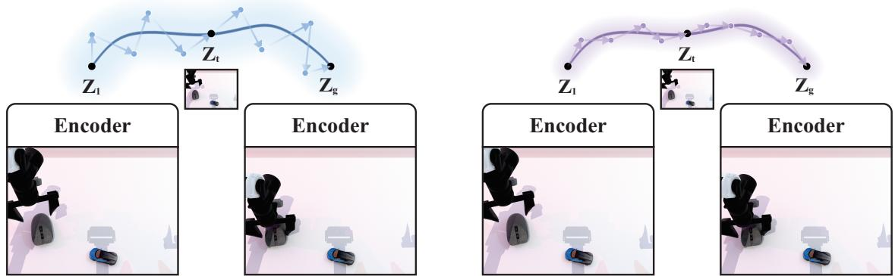  
(b) Ours  
Figure 1. Rethinking actions as demonstrated continuations. The schematic contrasts unconstrained proposals with an expert-informed action prior. A frozen visual model evaluates candidate continuations toward a goal; our contribution shapes the actions proposed to it.

## Abstract

Actions in expert demonstrations exhibit temporal structure. An ordered-versus-shuffled analysis across five environments confirms this dependence. We ask whether action proposals that better reflect expert continuity can improve visual world-model planning. Rather than imposing generic smoothness, we learn continuations from the temporal structure ofdemonstrated actions. Our locality-gated deep-kernel Gaussian-process prior, LG-DKGP, combines recent and longer-range executed action history, predicts a neural continuation, and learns a temporal Gaussianprocess (GP) residual. A training-derived exploration scale initializes search around the corrected mean; a frozen world model evaluates progress toward the goal. Training first fits the neural mean, then jointly optimizes the prior with the GP residual using expert future actions. The resulting planner achieves 87.07% macro success across five

simulated tasks spanning native and fragment-level goal attainment, compared with 71.03% for INTACT, 61.66% for PRISM, and 58.66% for LeWM. Component interventions and expert-relative action-structure comparisons support demonstration-informed continuations and reveal taskdependent effects ofvisual conditioning, history length, and planning horizon.

## 1. Introduction

Expert behavior is organized in time. A reaching command follows the direction of an ongoing reach; a manipulation command depends on the phase of contact. Neighboring expert actions usually carry information about the ongoing behavior. Treating a future action chunk as an unconstrained collection of vectors overlooks this structure.

We test this observation by comparing expert trajectories with within-episode permutations of the same actions.

Across five held-out cohorts, preserving the original order reduces adjacent standardized action changes. This motivates the question: Can proposals that better reflect the continuity structure ofexpert action sequences improve goal-directed world-model planning?

Visual world models provide a natural evaluation interface: roll candidate actions forward and compare the predicted latent state with a visual goal. Joint-embedding predictive architectures learn image and video features through embedding-space prediction [1, 2]. LeWorldModel (LeWM) learns such action-conditioned predictors from pixels [19]. PRISM guides imagination with a learned action prior [32], whereas INTACT learns an intent-to-action mapping for direct execution [29].

We introduce a locality-gated deep-kernel Gaussianprocess action prior, LG-DKGP. A history encoder dynamically combines recency-biased local attention and global attention over retained executed actions. The gate allows recent motion and older phase information to contribute according to context. A neural mean models nonlinear action continuations, and a temporal Gaussian-process learns residual structure across forecast positions. Search starts around their combined mean with an exploration scale derived from expert training action increments. The frozen world model remains responsible for evaluating goal attainment (Fig. 1).

The target is the continuity exhibited by experts. A constant command may have small variation yet be inappropriate for a moving expert reference. We therefore assess both control success and discrepancy from expert transition structure.

Our contributions are:

• A held-out action-order study that motivates expertrelative continuity as a design principle for world-model planning.

• A locality-gated neural/GP action prior that combines local and global action-history information with trainingderived search initialization.

• A five-task evaluation of control performance, component interventions, history/horizon sensitivity, and expertrelative transition structure.

## 2. Problem formulation and motivation

Given an observation $o _ { t }$ and visual goal $o _ { g }$ , a frozen encoder $E _ { \omega }$ produces latents $\mathbf { z } _ { t } , \mathbf { z } _ { g } \in \mathbb { R } ^ { d _ { z } }$ . A frozen predictor $F _ { \omega }$ rolls candidate actions forward. We seek a chunk of H actions, execute its first P actions, then reobserve and replan. Bold lowercase and uppercase symbols denote vectors and matrices; $\ell \in \{ 1 , \ldots , H \}$ is forecast lead, $j$ is action coordinate, and r is search iteration.

We standardize actions using training-set means and standard deviations, $\widetilde { \mathbf { a } } _ { t } ~ = ~ \left( \mathbf { a } _ { t } - { \pmb { \mu } } _ { a } \right) \bigotimes { \pmb { \sigma } } _ { a }$ , where $\oslash$ denotes element-wise division. The candidate sequence $\widetilde { \mathbf { a } } _ { t : t + H - 1 } \ \in \ \mathbb { R } ^ { H \times d }$ stacks future standardized actions as rows. The executed action history $\widetilde { \mathbf { a } } _ { t - L : t - 1 } \in \mathbb { R } ^ { L \times d }$ contains only commands before $t ,$ with left padding and a validity mask $x _ { t }$ . The prior conditions on the information tuple

Table 1. Expert actions have local temporal structure. Held-out successful episodes; 95% intervals use episode bootstrap. $\Delta _ { \mathrm { o r d } }$ is shuffled minus ordered adjacent difference.
<table><tr><td>Task</td><td>Episodes</td><td> $\bar { \delta } _ { 1 }$ </td><td> $\Delta _ { \mathrm { o r d } }$ </td><td>95% interval</td></tr><tr><td>PushT</td><td>1842</td><td>0.354</td><td>0.815</td><td>[0.805, 0.825]</td></tr><tr><td>Cube</td><td>973</td><td>0.360</td><td>0.866</td><td>[0.859, 0.873]</td></tr><tr><td>Caddy</td><td>1000</td><td>0.267</td><td>0.855</td><td>[0.850, 0.859]</td></tr><tr><td>Scene2</td><td>985</td><td>0.299</td><td>0.746</td><td>[0.742, 0.750]</td></tr><tr><td>RoboTwin</td><td>1000</td><td>0.020</td><td>0.514</td><td>[0.502, 0.526]</td></tr></table>

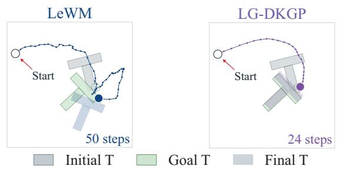  
Figure 2. Matched PushT executions. Both methods share the start and goal. LG-DKGP succeeds at step 24; LeWM fails within 50 steps. Lines follow the actual circular pusher, dots mark controlstep positions, and T shapes show initial, goal, and final object poses.

$$
\begin{array} { r } { \mathcal { C } _ { t } = \big ( \bar { \mathbf { z } } _ { t } , \bar { \mathbf { z } } _ { g } , \widetilde { \mathbf { a } } _ { t - L : t - 1 } , \chi _ { t } \big ) . } \end{array}\tag{1}
$$

Here the prior uses feature-wise standardized latents,

$$
\bar { \mathbf { z } } _ { v } = ( \mathbf { z } _ { v } - \pmb { \mu } _ { z } ) \oslash \pmb { \sigma } _ { z } , \quad v \in \{ t , g \} ,
$$

where $\pmb { \mu } _ { z }$ and $\pmb { \sigma } _ { z }$ are latent-feature means and standard deviations estimated from training data. The same fixed statistics standardize current and goal features at inference. Worldmodel prediction and planning scores use the original latents $\mathbf { z } _ { t }$ and $\mathbf { z } _ { g }$ . Expert future actions provide training supervision and offline evaluation references.

What continuity means here. Our empirical motivation is local temporal dependence in expert commands. For continuous coordinates, we compute an episode-mean RMS standardized adjacent action difference, $\bar { \delta } _ { 1 }$ . We then permute action vectors within each episode, retaining their values but changing their order. Table 1 reports shuffled-minusordered differences $\Delta _ { \mathrm { o r d } }$ . All five effects are positive, with episode-bootstrap intervals excluding zero. Gripper switches are excluded from this particular statistic and analyzed separately.

In Fig. 2, from the same start and goal, LeWM makes additional turns near the object and leaves its final pose misaligned, whereas LG-DKGP reaches the target pose with a coherent approach and push.

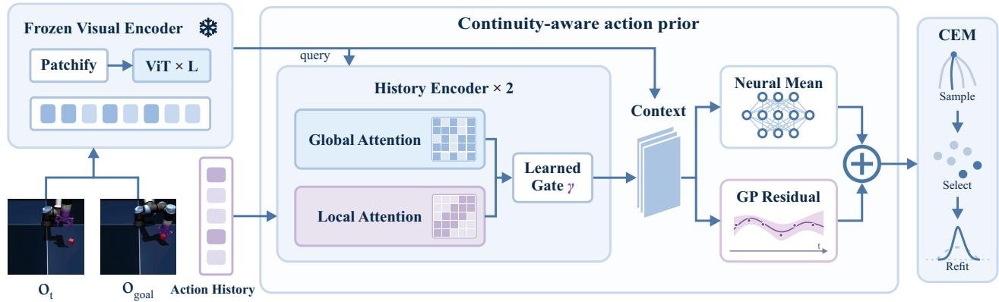  
Figure 3. Continuity-aware action prior and planning. Frozen visual features query a two-layer history encoder. Learned gating combines global and recency-biased local attention over executed actions. A neural mean and GP residual form the continuation mean supplied to CEM, which explores its neighborhood using the training-derived scalar scale.

We encode this local dependence using a mean-square continuous conditional action process: for a noise-free action process $\mathbf { g } ( \ell ; \mathcal { C } ) , \mathbb { E } \| \mathbf { g } ( \ell ; \mathcal { C } ) - \mathbf { g } ( \ell ^ { \prime } ; \mathcal { C } ) \| ^ { 2 } \to 0$ as $\ell ^ { \prime } \to \ell$ on a continuous-lead extension. Continuous means and covariance kernels supply this regularity. Agreement with the expert continuation is measured by transition-feature discrepancy and variation-profile error.

## 3. Continuity-aware action priors

Figure 3 summarizes LG-DKGP. The action prior constructs a plausible continuation; the world model evaluates its goaldirected utility. Current and goal features query the executedaction history, whose gated summary conditions the neural mean and GP residual. Their combined mean centers the candidate search before frozen-model evaluation and execution.

## 3.1. Locality-gated executed action history

Recent actions reveal the current motion trend, whereas older commands can help disambiguate its phase. We therefore combine local and global attention through a learned, context-dependent gate. Both branches use multi-head scaled dot-product attention [31]. Global attention ranges over all valid retained actions.

For the ith retained history action $\widetilde { \mathbf { a } } _ { i } ^ { \mathrm { h i s t } }$ , validity $\chi _ { i } .$ , and age $\rho _ { i }$ , set $\iota _ { i } = \chi _ { i } \chi _ { i - 1 }$ , with $\chi _ { 0 } = 0$ . Its token is

$$
\begin{array} { r } { \mathbf { e } _ { i } = \chi _ { i } [ \mathbf { W } _ { a } \mathbf { \widetilde { a } } _ { i } ^ { \mathrm { h i s t } } + \mathbf { W } _ { \Delta } \Delta \mathbf { \widetilde { a } } _ { i } ^ { \mathrm { h i s t } } + \mathbf { w } _ { \iota } \iota _ { i } + \mathrm { P E } ( \rho _ { i } ) ] . } \end{array}\tag{2}
$$

Here $\Delta \widetilde { \mathbf { a } } _ { i } ^ { \mathrm { h i s t } } = \widetilde { \mathbf { a } } _ { i } ^ { \mathrm { h i s t } } - \widetilde { \mathbf { a } } _ { i - 1 } ^ { \mathrm { h i s t } }$ only when both actions are valid, and is zero otherwise. Current/goal features initialize the attention query as $\mathbf { q } ^ { ( 0 ) } = \mathbf { W } _ { q } [ \bar { \mathbf { z } } _ { t } ; \bar { \mathbf { z } } _ { g } ; \bar { \mathbf { z } } _ { g } - \bar { \mathbf { z } } _ { t } ]$ . Semicolons indicate concatenation.

Let $\begin{array} { r } { \mathcal { V } = \{ i : \chi _ { i } = 1 \} \mathrm { ~ a n d ~ } \zeta _ { i } = \langle \mathbf { W } _ { Q } \mathbf { q } , \mathbf { W } _ { K } \mathbf { e } _ { i } \rangle / \sqrt { d _ { k } } . } \end{array}$ Each attention head computes

$$
\begin{array} { r l } & { \alpha _ { i } ^ { \mathrm { g l o b } } = \mathrm { s o f t m a x } _ { i \in \mathcal { V } } ( \zeta _ { i } ) , } \\ & { ~ \alpha _ { i } ^ { \mathrm { l o c } } = \mathrm { s o f t m a x } _ { i \in \mathcal { V } } ( \zeta _ { i } - \lambda ( \mathbf { q } ) \rho _ { i } ) , } \end{array}\tag{3}
$$

where $\lambda ( \mathbf { q } ) > 0$ is learned via softplus. The local branch softly favors recency while preserving access to older actions. Stack token rows as $\mathbf { E } ~ = ~ [ \mathbf { e } _ { 1 } , \ldots , \mathbf { e } _ { L } ] ^ { \top }$ , and let $\pmb { \alpha } ^ { b , ( s ) } \in \mathbb { R } ^ { 1 \times L }$ contain the attention weights of branch $b \in \{ \mathrm { l o c } , \mathrm { g l o b } \}$ and head $s ,$ with zero weights at masked positions. Value projection and aggregation are

$$
\begin{array} { r l } & { \mathbf { V } ^ { ( s ) } = \mathbf { E } ( \mathbf { W } _ { V } ^ { ( s ) } ) ^ { \top } , } \\ & { \mathbf { h } ^ { b } = \left[ \operatorname { C o n c a t } _ { s = 1 } ^ { N _ { h } } ( \alpha ^ { b , ( s ) } \mathbf { V } ^ { ( s ) } ) \right] ^ { \top } . } \end{array}\tag{4}
$$

Here $N _ { h } = 4 ;$ the head index is suppressed in the attentionweight equations above. The product $\alpha ^ { b , ( s ) } \mathbf { V } ^ { ( s ) }$ is the attention-weighted value summary of one head. Thus $\mathbf { h } ^ { \mathrm { l o c } }$ and $\mathbf { h } ^ { \mathrm { g l o b } }$ summarize the same executed action tokens using different temporal weighting. We fuse these summaries with a learned scalar gate:

$$
\begin{array} { r l } & { \gamma = \mathrm { s i g m o i d } ( g _ { \theta } [ \mathbf { q } ; \mathbf { h } ^ { \mathrm { l o c } } ; \mathbf { h } ^ { \mathrm { g l o b } } ] ) , } \\ & { \mathbf { h } = ( 1 - \gamma ) \mathbf { h } ^ { \mathrm { l o c } } + \gamma \mathbf { h } ^ { \mathrm { g l o b } } . } \end{array}\tag{5}
$$

Each layer adds its fused history contribution h to the query. For layer k, the update is

$$
\begin{array} { r } { \mathbf { u } ^ { ( k ) } = \mathrm { L N } ( \mathbf { q } ^ { ( k ) } + \mathbf { h } ^ { ( k ) } ) , \quad \quad } \\ { \mathbf { q } ^ { ( k + 1 ) } = \mathrm { L N } ( \mathbf { u } ^ { ( k ) } + \mathrm { F F N } ( \mathbf { u } ^ { ( k ) } ) ) . } \end{array}\tag{6}
$$

Two layers with width 128 produce the final historyconditioned context $\mathbf { h } _ { t } = \mathbf { q } ^ { ( 2 ) }$ ; empty history instead uses a learned fallback vector. History is capped at 32 actions. The neural context is $\mathbf { r } _ { t } = \left[ \bar { \mathbf { z } } _ { t } ; \bar { \mathbf { z } } _ { g } ; \mathbf { h } _ { t } \right]$

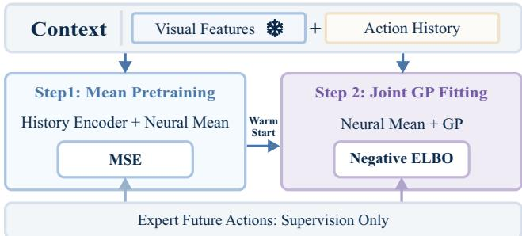  
Figure 4. Two-stage prior learning. A history encoder and neural mean are pretrained using expert future-action targets, then warmstart joint prior fitting with a GP residual. The second stage also updates the history encoder. The visual encoder remains frozen. Future expert actions supervise the losses and are unavailable as online conditioning inputs.

## 3.2. Neural mean with a temporal Gaussian-process (GP) residual

The neural head maps $[ \mathbf { r } _ { t } ; \mathrm { P E } ( \boldsymbol { \ell } ) ]$ to a mean action $\mathbf { m } _ { \theta } ( \ell ; \mathcal { C } _ { t } ) \in \mathbb { R } ^ { d }$ . A GP residual accounts for structure left by this nonlinear mean:

$$
\begin{array} { r } { \widetilde { a } _ { j } ( \ell ; \mathcal { C } _ { t } ) = m _ { \theta , j } ( \ell ; \mathcal { C } _ { t } ) + f _ { j } ( \mathbf { x } _ { t , \ell } ) + \epsilon _ { \ell , j } , } \end{array}\tag{7}
$$

with Gaussian likelihood noise $\epsilon _ { \ell , j }$ and independent $f _ { j } \sim$ $\mathcal { G P } ( 0 , k _ { j } )$ across action coordinates. Learned compact features form $\begin{array} { r l r } { \mathbf { x } _ { t , \ell } } & { = } & { [ \phi _ { \theta } ( \mathbf { r } _ { t } , \ell ) ; \psi _ { \theta } ( \mathbf { r } _ { t } ) ; \ell ] , } \end{array}$ , with 32- dimensional feature maps. The kernel combines query similarity with context-dependent temporal correlation:

$$
\begin{array} { r l } & { k _ { j } ( \mathbf { x } , \mathbf { x } ^ { \prime } ) = \sigma _ { f , j } ^ { 2 } k _ { \mathrm { R B F } } ( \phi , \phi ^ { \prime } ) } \\ & { ~ + \eta _ { j } k _ { \mathrm { R B F } } ( \psi , \psi ^ { \prime } ) k _ { \mathrm { M a t } \epsilon \mathrm { r n } 3 / 2 } ( \ell , \ell ^ { \prime } ) . } \end{array}\tag{8}
$$

This construction models dependence across forecast positions for a fixed context.

GP generalization can adapt to low intrinsic dimensional structure under regularity assumptions [34]. This motivates compact learned GP inputs [33], since high-dimensional inputs can impair kernel learning [8].

We use sparse variational inference with 128 inducing points per coordinate and $q _ { j } ( \mathbf { u } _ { j } ) = \mathcal { N } ( \mathbf { m } _ { u , j } , \mathbf { S } _ { u , j } )$ [30]. With $\mathbf { C } _ { t , j } = \mathbf { K } _ { X _ { t } Z _ { j } } \mathbf { K } _ { Z _ { j } Z _ { j } } ^ { - 1 }$ , the posterior mean across leads is

$$
\begin{array} { r l } & { \pmb { \mu } _ { t , j } = \mathbf { m } _ { \theta , t , j } + \mathbf { C } _ { t , j } \mathbf { m } _ { u , j } , } \\ & { \mathbf { M } _ { t } = [ \pmb { \mu } _ { t , 1 } , \ldots , \pmb { \mu } _ { t , d } ] . } \end{array}\tag{9}
$$

The supplement gives the predictive covariance and continuity identity.

## 3.3. Learning demonstrated continuations

Successful expert episodes supply training windows, with episode-disjoint fitting and validation. Let $\bar { \widetilde { a } } _ { n \ell j } ^ { \mathrm { e x p } }$ denote coordinate $j$ of the standardized expert future action at forecast

lead ℓ in training window n. We first pretrain the history encoder and neural mean:

$$
\mathcal { L } _ { \mathrm { M S E } } = \frac { 1 } { N _ { \mathrm { t r } } H d } \sum _ { n , \ell , j } [ m _ { \theta , j } ( \ell ; \mathcal { C } _ { n } ) - \widetilde { a } _ { n \ell j } ^ { \mathrm { e x p } } ] ^ { 2 } .\tag{10}
$$

These weights initialize joint prior training (Fig. 4). We maximize the variational evidence lower bound [15, 30]

$$
\begin{array} { r l } {  { \mathcal { L } _ { \mathrm { E L B O } } = \sum _ { n , \ell , j } \mathbb { E } _ { q _ { j } ( f _ { n \ell j } ) } \log p ( \widetilde { a } _ { n \ell j } ^ { \mathrm { e x p } } \ | \ m _ { \theta , j } ( \ell ; \mathcal { C } _ { n } ) + f _ { n \ell j } ) } \ ~ } \\ & { - \sum _ { j } \mathrm { K L } ( q _ { j } ( \mathbf { u } _ { j } ) \| p _ { j } ( \mathbf { u } _ { j } ) ) . } \end{array}
$$

The history encoder, neural mean, learned kernel features, and GP parameters remain trainable in the second stage. $E _ { \omega }$ and $F _ { \omega }$ stay frozen. Validation MSE selects the pretraining checkpoint; joint predictive NLL selects the GP-stage checkpoint.

## 3.4. Expert-scaled search around the prior

The mean supplies a continuation; search needs a scale for exploring its neighborhood. For environment e and trainingepisode adjacent pairs $\mathcal { P } _ { e }$ , define

$$
\begin{array} { r l } & { \widehat { v } _ { \Delta , e , j } = \displaystyle \frac { 1 } { | \mathcal { P } _ { e } | } \sum _ { ( \tau , t ) \in \mathcal { P } _ { e } } ( \widetilde { a } _ { \tau , t + 1 , j } - \widetilde { a } _ { \tau , t , j } ) ^ { 2 } , } \\ & { \sigma _ { \mathrm { e x p , e } } ^ { 2 } = \displaystyle \frac { 1 } { 2 d _ { e } } \sum _ { j = 1 } ^ { d _ { e } } \widehat { v } _ { \Delta , e , j } . } \end{array}\tag{12}
$$

All coordinates, including grippers, enter this training statistic. The factor $1 / 2$ matches the increment variance of independent Gaussian perturbations. The scale is estimated from training actions and fixed across evaluation seeds and planning calls. The initialization comparison in Table 3 informed this choice.

Let rvec $( \widetilde { \mathbf { a } } ) = \mathrm { v e c } ( \widetilde { \mathbf { a } } ^ { \top } )$ denote row-wise sequence vectorization. Search starts from

$$
\mathrm { r v e c } ( \widetilde { \mathbf { a } } _ { t : t + H - 1 } ) \sim \mathcal { N } ( \mathrm { r v e c } ( \mathbf { M } _ { t } ) , \sigma _ { \mathrm { e x p , e } } ^ { 2 } \mathbf { I } _ { H d } ) .\tag{13}
$$

CEM samples perturbations around this mean, scores candidates by

$$
J _ { t } ( \widetilde { \mathbf { a } } ) = \| F _ { \omega } ^ { ( H ) } ( \mathbf { z } _ { t } , \widetilde { \mathbf { a } } ) - \mathbf { z } _ { g } \| _ { 2 } ^ { 2 } ,\tag{14}
$$

and refits a diagonal Gaussian to the elites. We use 300 candidates, 30 iterations, and 30 elites: 9,000 candidate scores per call. The returned chunk is converted to environment units, and up to $P$ actions are executed. Fresh observations and the commands actually executed rebuild the next context, as in receding-horizon control [27].

Table 2. Main performance across five environments (%). Task cells are five-seed means ± sample SD; Macro is their unweighted mean. Caddy, Scene2, and RoboTwin use the fragment-level criteria described in the text. Bold numeric entries highlight the highest task mean. Five purple shades rank each column from higher (darker) to lower success (lighter).
<table><tr><td rowspan=1 colspan=12>Method                    PushT             Cube             Caddy            Scene2          RoboTwin       Macro</td></tr><tr><td rowspan=1 colspan=1>LeWM</td><td rowspan=1 colspan=7> $9 3 . 6 0 \pm 1 . 6 7$       $6 3 . 6 0 \pm 9 . 7 4$        $5 5 . 3 1 \pm 5 . 1 1$        $6 9 . 8 8 \pm 8 . 4 8$ </td><td rowspan=1 colspan=2> $1 0 . 9 1 \pm 2 . 5 3$ </td><td rowspan=1 colspan=2>58.66</td></tr><tr><td rowspan=1 colspan=1>iCEM</td><td rowspan=1 colspan=1> $9 6 . 4 0 \pm 2 . 6 1$ </td><td rowspan=1 colspan=1></td><td rowspan=1 colspan=1> $6 9 . 6 0 \pm 9 . 1 0$ </td><td rowspan=1 colspan=1></td><td rowspan=1 colspan=1> $5 4 . 4 2 \pm 4 . 5 7$ </td><td rowspan=1 colspan=1></td><td rowspan=1 colspan=1> $7 2 . 2 1 \pm 8 . 5 6$ </td><td rowspan=1 colspan=1></td><td rowspan=1 colspan=1> $4 . 0 3 \pm 3 . 8 3$ </td><td rowspan=1 colspan=2>59.33</td></tr><tr><td rowspan=1 colspan=1>INTACT</td><td rowspan=1 colspan=1> $6 4 . 4 0 \pm 5 . 5 5$ </td><td rowspan=1 colspan=1></td><td rowspan=1 colspan=1> $9 2 . 0 0 \pm 3 . 7 4$ </td><td rowspan=1 colspan=1></td><td rowspan=1 colspan=1> $8 0 . 9 7 \pm 3 . 9 5$ </td><td rowspan=1 colspan=1></td><td rowspan=1 colspan=1> ${ \bf 7 7 . 5 3 \pm 4 . 2 4 }$ </td><td rowspan=1 colspan=1></td><td rowspan=1 colspan=1> $4 0 . 2 6 \pm 8 . 8 5$ </td><td rowspan=1 colspan=1></td><td rowspan=1 colspan=1>71.03</td></tr><tr><td rowspan=1 colspan=1>PRISM</td><td rowspan=1 colspan=1> $9 4 . 0 0 \pm 2 . 4 5$ </td><td rowspan=1 colspan=1></td><td rowspan=1 colspan=1> $8 7 . 6 0 \pm 4 . 9 8$ </td><td rowspan=1 colspan=1></td><td rowspan=1 colspan=1> $5 6 . 7 8 \pm 4 . 0 7$ </td><td rowspan=1 colspan=1></td><td rowspan=1 colspan=1> $5 6 . 9 1 \pm 6 . 1 0$ </td><td rowspan=1 colspan=1></td><td rowspan=1 colspan=1> $1 3 . 0 1 \pm 5 . 4 1$ </td><td rowspan=1 colspan=1></td><td rowspan=1 colspan=1>61.66</td></tr><tr><td rowspan=1 colspan=1>LG-DKGP (Ours)</td><td rowspan=1 colspan=1> ${ \bf 9 7 . 6 0 \pm 0 . 8 9 }$ </td><td rowspan=1 colspan=1></td><td rowspan=1 colspan=1> ${ \bf 9 8 . 8 0 \pm 1 . 7 9 }$ </td><td rowspan=1 colspan=1></td><td rowspan=1 colspan=1> ${ \bf 8 3 . 3 2 \pm 2 . 0 5 }$ </td><td rowspan=1 colspan=1></td><td rowspan=1 colspan=1> $7 6 . 9 6 \pm 5 . 3 1$ </td><td rowspan=1 colspan=1></td><td rowspan=1 colspan=1> ${ \bf 7 8 . 6 6 \pm 4 . 9 4 }$ </td><td rowspan=1 colspan=1></td><td rowspan=1 colspan=1>87.07</td></tr></table>

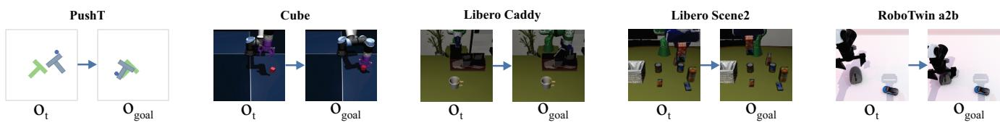  
Figure 5. Five evaluation environments. Current observations ot and goal observations $\mathbf { o } _ { g }$ illustrate the visual planning inputs for PushT, Cube, LIBERO Caddy, LIBERO Scene2, and RoboTwin.

## 4. Experiments

## 4.1. Tasks, baselines, and evaluation

Figure 5 shows example current and goal observations. We evaluate PushT, OGBench Cube [22], Caddy and Scene2 from LIBERO [18], and RoboTwin [4]. PushT and Cube use recorded native task-success predicates. Caddy and Scene2 measure attainment of a goal sampled from a demonstration fragment. RoboTwin uses the same local-goal-or-verifiednative-terminal predicate across methods. Macro gives equal weight to the five task-level rates.

The main table uses evaluation seeds 101, 202, 303, 404, and 505. Each task cell is the unweighted mean of seed success rates with sample standard deviation (SD). For successes $S _ { m , e , s }$ and eligible episodes $N _ { m , e , s } ,$

$$
\begin{array} { c } { { \bar { p } _ { m , e } = \displaystyle \frac { 1 } { 5 } \sum _ { s } \frac { 1 0 0 S _ { m , e , s } } { N _ { m , e , s } } , } } \\ { { p _ { m } ^ { \mathrm { m a c r o } } = \displaystyle \frac { 1 } { 5 } \sum _ { e } \bar { p } _ { m , e } . } } \end{array}\tag{15}
$$

We compare original LeWM planning, iCEM [23], PRISM’s released action-head approach [32], and INTACT, trained following its original task-specific one-epoch setting and executed directly [29]. The main setting uses $H = P = 2 5$ and a 50-step execution budget. Supplementary Secs. N– P provide data acquisition and preprocessing, architecture and optimization, task-specific exploration scales, baseline interfaces, and study parameters, including eligible query counts and checkpoint reuse.

## 4.2. Main performance

LG-DKGP achieves 87.07% macro success (Table 2), compared with 71.03% for INTACT, 61.66% for PRISM, and

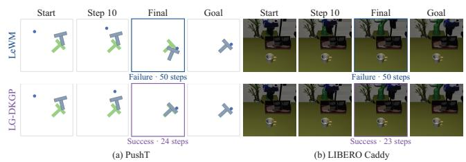  
Figure 6. Paired execution examples. PushT and Caddy use matched starts and goals for LeWM and LG-DKGP. Columns show step 10 and the recorded final state, with step counts indicated. LG-DKGP reaches the native PushT criterion and the Caddy fragment goal; LeWM fails within 50 steps.

58.66% for LeWM. The respective gaps are 16.04, 25.41, and 28.41 percentage points. Our method has the highest mean in four environments. Scene2 is an exception: INTACT reaches 77.53%, compared with 76.96% for LG-DKGP. PushT and Cube approach ceiling performance; the larger separations on Caddy and RoboTwin complement those near-ceiling tasks.

Figure 6 complements these aggregate rates with matched executions. The initial approach at step 10 is similar on PushT, but the final object alignment differs; on Caddy, the successful execution also brings the scene closer to the demonstrated goal configuration.

## 4.3. Which components matter?

Figure 7(a) isolates the contributions of conditioning, the GP residual, and gated attention. History only removes visual conditioning from the prior while retaining visual goal evaluation. Its macro success is 8.86 points below LG-DKGP, but it outperforms the full model on Caddy, Scene2, and RoboTwin: action history supplies strong structure, and visual conditioning has task-dependent value.

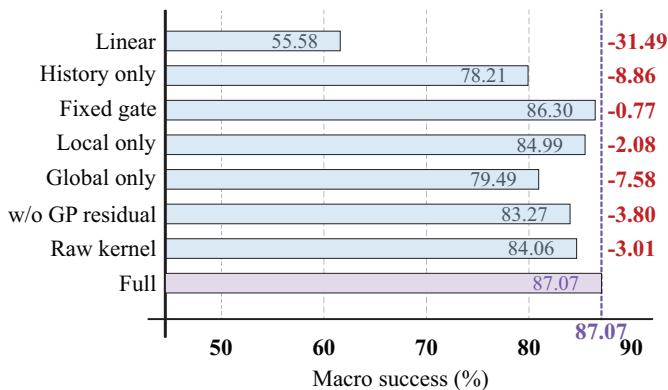  
(a) Method and component comparisons

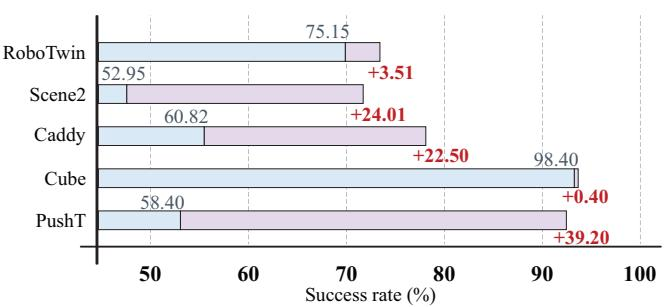  
(b) Prior execution versus search

Figure 7. Contributions of the learned prior and goal-directed search. (a) Macro success for prior families and component interventions; caps and signed annotations show differences from the full model (87.07%). (b) Per-task success from posterior-mean execution (blue) and the additional gain from CEM (light segments). Both use the full neural-plus-GP mean. Both displayed axes start at 50%. Complete task means, SDs, and component changes appear in Supplementary Tables S1 and S2.  
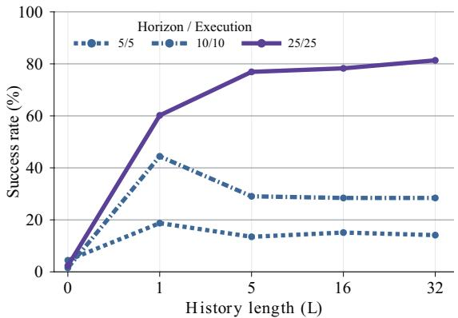  
(a) History length and planning schedule

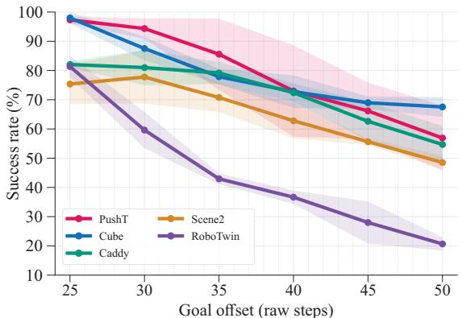  
(b) Goals beyond the forecast horizon  
Figure 8. Sensitivity to history, planning schedule, and goal offset. Means use seeds 101/202/303. (a) RoboTwin with $L \in$ $\{ 0 , 1 , 5 , 1 6 , 3 2 \}$ , equally spaced on the horizontal axis. Solid: $H / P = 2 5 / 2 5 ;$ distinct dashed lines: $5 / 5$ and 10/10. (b) Five-environmen goal-offset study with $H = P = 2 5$ , history capped at 32, and a 50-step budget. Offset 25 reuses existing results for these seeds; 30–50 use fixed execution. Complete means and SDs are in Supplementary Tables S3 and S4.

Removing the GP residual while retaining search reduces macro success by 3.80 points, chiefly through Cube’s 16.40- point decrease; Scene2 instead improves by 1.25 points. Inference-time fixed-gate, local-only, and global-only interventions reduce macro success by 0.77, 2.08, and 7.58 points, respectively, supporting adaptive fusion with a strong role for recent actions. Replacing learned GP features with raw inputs under the same kernel family reduces macro success by 3.01 points after separate fitting. Supplementary Table S1 gives all task means, SDs, and changes; Sec. P specifies the raw-kernel inputs and intervention settings.

## 4.4. History length and planning schedule

All 15 history/schedule configurations in Fig. 8(a) use the complete model and seeds 101/202/303, with 41/46/46 eligible fragments. The intervention masks executed actions visible to the prior without refitting its weights. $\mathrm { { A t } } ~ L = 0 .$ every history position is masked, but current and goal visual features remain available. $\mathrm { A t } \ L = 1$ , the latest action is present, but no valid adjacent-history difference can be computed.

With $H = P = 2 5$ , success increases from 2.35% at $L =$ 0 to 60.18% at L = 1, 76.92% at L = 5, and 81.35% at L = 32. With $H = P = 1 0$ , success peaks at 44.43% for $L = 1$ rather than increasing monotonically with history. The H = $P = 5$ schedule reaches at most 18.73%. Source-prefix actions initialize the restored scene and causal history before the 50-step budget. The schedules allow at most two, five, and ten planning calls, respectively. The schedules therefore jointly vary forecast horizon and replanning frequency.

Table 3. Search initialization with the same learned prior (%). Five-seed means. Fixed uses $0 . 3 ^ { 2 } \mathbf { I } ;$ Diag. uses expert-derived coordinatewise scales after subtracting the mean continuation’s increment energy; +Bounds additionally applies action bounds and a training-derived increment budget. Ours uses the expertderived isotropic scale without these bounds. Exact SDs are in Supplementary Table S9.
<table><tr><td>Task</td><td>Fixed</td><td>Diag.</td><td>+Bounds</td><td>LG-DKGP</td></tr><tr><td>PushT</td><td>97.60</td><td>97.60</td><td>97.60</td><td>97.60</td></tr><tr><td>Cube</td><td>99.20</td><td>98.80</td><td>98.80</td><td>98.80</td></tr><tr><td>Caddy</td><td>83.34</td><td>76.97</td><td>76.98</td><td>83.32</td></tr><tr><td>Scene2</td><td>75.56</td><td>69.44</td><td>72.98</td><td>76.96</td></tr><tr><td>RoboTwin</td><td>18.88</td><td>72.86</td><td>77.81</td><td>78.66</td></tr><tr><td>Macro</td><td>74.92</td><td>83.14</td><td>84.84</td><td>87.07</td></tr></table>

## 4.5. Prior execution versus goal-directed search

Mean only directly executes the final neural-plus-GP posterior mean. It is therefore different from w/o GP residual, which retains search around a neural-only center. Figure 7(b) shows gains from 58.40% to 97.60% on PushT, 60.82% to 83.32% on Caddy, 52.95% to 76.96% on Scene2, and 75.15% to 78.66% on RoboTwin. Cube is already at 98.40% without search and improves by 0.40 points. Plausible continuations and model-based goal selection play complementary roles. Mean-only controls use the archived history interfaces specified in Supplementary Table S2.

## 4.6. How should search be initialized?

Table 3 compares four initializations with the same fitted prior, world model, queries, and planning budget. Expert isotropic scaling improves macro success from 74.92% with fixed scaling to 87.07%. RoboTwin drives the largest gain, from 18.88% to 78.66%, using a much smaller proposal scale. PushT is unchanged, while Cube slightly favors the fixed scale. Diagonal calibration and increment bounds trail isotropic scaling overall, supporting expert-derived exploration without a hard increment envelope. Supplementary Table S9 gives SDs and the complete calibration and bounding rules.

## 4.7. Goals beyond the forecast horizon

Figure 8(b) pursues goals 25–50 demonstration steps ahead while keeping $H = P = 2 5$ . The 75 seed-level units at offsets 30–50 contain 3,358 eligible evaluations. Between offsets 30 and 50, success decreases from 94.35% to 56.90% on PushT, 87.53% to 67.53% on Cube, 81.00% to 54.69% on Caddy, 77.77% to 48.52% on Scene2, and 59.63% to 20.67% on RoboTwin. Offset counts demonstration steps, with eligibility recomputed for each goal query; the offset-25 reference retains its original cohort. The curves reveal task-dependent limits beyond the learned forecast horizon. Dynamic-prefix results are given in Supplementary Table S6.

Table 4. Paired expert-relative structure. Closer counts queries where LG-DKGP has lower $\mathbf { M M D } ^ { 2 }$ than LeWM. ∆ is LeWM minus LG-DKGP; intervals use 1,000 source-episode-cluster bootstrap resamples. Query counts include both successful and failed control episodes.
<table><tr><td>Task</td><td>Closer</td><td>(%)</td><td>∆</td><td>95% interval</td></tr><tr><td>PushT</td><td>209/250</td><td>83.6</td><td>0.0846</td><td>[0.0716, 0.0976]</td></tr><tr><td>Cube</td><td>225/250</td><td>90.0</td><td>0.2137</td><td>[0.1958,0.2314]</td></tr><tr><td>Caddy</td><td>221/222</td><td>99.5</td><td>0.3156</td><td>[0.2985, 0.3337]</td></tr><tr><td>Scene2</td><td>222/226</td><td>98.2</td><td>0.1480</td><td>[0.1359,0.1601]</td></tr><tr><td>RoboTwin</td><td>219/219</td><td>100.0</td><td>0.5178</td><td>[0.4966, 0.5350]</td></tr></table>

## 4.8. Do generated actions better match expert structure?

Figure 9 compares the complete prior with original LeWM on matched frozen scene/goal queries in five environments. Both retain their world-model checkpoints; evaluation fixes $H = P = 2 5$ , a 50-step budget, and five seeds. We record the first complete optimized 25-step plan before successdependent termination and compare it with the corresponding expert continuation.

For standardized continuous actions, define $\begin{array} { r } { \Delta _ { \tau } \widetilde { \mathbf { a } } _ { i } ^ { c } \ = } \end{array}$ $\widetilde { \mathbf { a } } _ { i + \tau } ^ { c } - \widetilde { \mathbf { a } } _ { i } ^ { c }$ and transition features

$$
\mathbf v _ { i } = [ \Delta _ { 1 } \widetilde { \mathbf a } _ { i } ^ { c } ; \Delta _ { 1 } \widetilde { \mathbf a } _ { i + 1 } ^ { c } ; \Delta _ { 2 } \widetilde { \mathbf a } _ { i } ^ { c } ; \Delta _ { 5 } \widetilde { \mathbf a } _ { i } ^ { c } ] , \quad i = 0 , \ldots , 1 9 .\tag{16}
$$

Gaussian-kernel $\mathbf { M M D } ^ { 2 } \left[ 1 1 \right]$ compares generated and expert feature sets, with bandwidth calibrated on expert training features. It retains signed changes and multi-step relations, rather than only variation magnitudes. A complementary profile error compares squared action differences at lags 1, 2, 3, 5, 10 against the expert profile (definition in the supplement). Gripper transitions are handled separately.

LG-DKGP reduces $\mathrm { { \bf M M D } ^ { 2 } }$ and profile error and increases mean success in all five aligned-query cohorts. Mean $\mathbf { M M D ^ { 2 } }$ reductions range from 0.0846 to 0.5178; all five sourceepisode-cluster bootstrap intervals exclude zero. Success gains range from 4.00 to 65.08 points. The Caddy, Scene2, and RoboTwin rates differ from Table 2 because this is a separate aligned-query study. The paired structure and control improvements support the use of expert-informed proposals.

Figure 10 connects this structure comparison to an individual execution. LG-DKGP follows the expert’s progression of object poses more closely and generally has smaller adjacent-increment errors than LeWM. Its lower transitionfeature $\mathbf { M M D ^ { 2 } }$ accompanies successful goal attainment.

## 4.9. Is expert alignment consistent across queries?

Table 4 examines expert alignment for individual scene/goal pairs. LG-DKGP is closer to the expert continuation on 83.6% of PushT queries, 90.0% of Cube queries, 99.5% of Caddy queries, 98.2% of Scene2 queries, and all 219

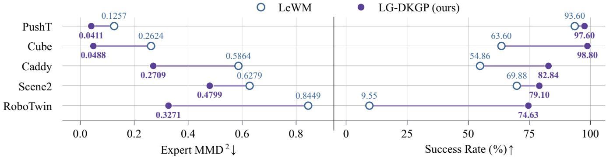  
Figure 9. Expert-relative action structure and control. Hollow and filled markers denote LeWM and LG-DKGP. Left: expert transitionfeature MMD2 (lower is better). Right: closed-loop success (higher is better). All eligible plans enter the structure comparison, including failures. Supplementary Table S5 gives exact counts, SDs, and profile errors.

<table><tr><td colspan="6">(a) Matched scene, start and goal</td></tr><tr><td>è</td><td>Start</td><td>Step 8</td><td>Step 16</td><td>Step 24</td><td>Goal</td></tr><tr><td>Exppet</td><td>文</td><td>文</td><td>文</td><td>x</td><td>x</td></tr><tr><td>LWMM</td><td>è 文</td><td>文</td><td>文</td><td>才</td><td>x</td></tr><tr><td>LGGP</td><td>● </td><td>文</td><td>ī</td><td>x</td><td>x</td></tr></table>

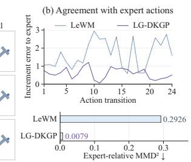  
Figure 10. Expert-relative structure on a matched PushT query. Left: expert, LeWM, and LG-DKGP executions at common control steps, with the same start and goal. Right: adjacent-increment error to the expert and MMD2 from the first complete optimized 25-step plans. Example MMD2 values are 0.2926 for LeWM and 0.0079 for LG-DKGP.

RoboTwin queries. Repeated source episodes remain within the same bootstrap cluster.

We evaluate half and twice the expert-calibrated bandwidth. LG-DKGP retains lower task-mean MMD2 than LeWM in every environment at both settings (Supplementary Table S10).

Metric stress tests. Two offline references test the metric: repeating the expert continuation’s first action for 25 steps and randomly permuting its 25 actions. The constant reference still obtains lower $\mathbf { M M D ^ { 2 } }$ than LG-DKGP on Caddy, Scene2, and RoboTwin (Supplementary Table S11), despite discarding the expert’s temporal evolution. This exposes a limitation of finite-sample transition-feature MMD as a standalone action-quality measure. Moreover, lower discrepancy does not consistently separate successful and failed plans within each planner. We therefore evaluate transition discrepancy together with expert variation profiles and closed-loop success.

## 5. Related work

Visual world models. I-JEPA, V-JEPA, and SALT learn predictive visual representations in embedding space [1, 2, 17]. DINO-WM builds planning dynamics on pretrained visual features [21, 38], whereas LeWM learns predictive features directly from pixels [19]. Latent control models combine prediction with planning or imagined behavior learning [12–14]; recent work extends decoder-free learning and offline planning [20, 28]. Geometric representations and closed-loop evaluation further develop visual planning [35, 36]. We retain a frozen LeWM evaluator and learn the expert-informed action continuations it scores.

Action representations and planning. Video-derived latent actions [3, 10], trajectory diffusion [16], action chunking [37], and diffusion policies [5] provide learned sequence representations. FLIP links flow-based proposals to visual prediction [9]; parallel gradient-based planning [24] and temporally correlated iCEM sampling [23] improve trajectory optimization. PRISM learns action distributions from frozen world-model features [32], while INTACT maps latent intent to directly executed actions [29]. LG-DKGP models continuations in executed-command coordinates, using expert temporal structure to guide both the proposal mean and exploration scale.

Gaussian-process priors. Deep kernel learning couples learned features with GP regression [33]. GP adaptation to low intrinsic data dimension [34] motivates compact kernel inputs, while sparse variational inference supports fitting many expert windows [15, 30]. Our temporal GP models residual dependence around a nonlinear neural continuation mean; continuous covariance kernels provide the process regularity described by standard GP theory [26].

## 6. Discussion and Limitations

LG-DKGP improves world-model planning through localitygated history, a neural/GP continuation mean, and expertderived exploration. The control and structure studies support proposals informed by expert temporal dependence.

Task-dependent conditioning. On RoboTwin, $H = P =$ 25 benefits from 32 history actions, whereas $H = P = 1 0$ peaks at one action. History-only proposals outperform visual-conditioned proposals on three tasks. Useful context therefore depends on both the task and execution schedule, motivating adaptive history and visual conditioning.

Forecast support. The prior learns 25-action continuations; farther goals require multiple chunks. Success decreases between goal offsets 30 and 50 in all five environments, exposing a limitation in long-range planning.

## References

[1] Mahmoud Assran, Quentin Duval, Ishan Misra, Piotr Bojanowski, Pascal Vincent, Michael Rabbat, Yann LeCun, and Nicolas Ballas. Self-supervised learning from images with a joint-embedding predictive architecture. In Proceedings of the IEEE/CVF Conference on Computer Vision and Pattern Recognition, pages 15619–15629, 2023. 2, 8

[2] Adrien Bardes, Quentin Garrido, Jean Ponce, Xinlei Chen, Michael Rabbat, Yann LeCun, Mido Assran, and Nicolas Ballas. Revisiting feature prediction for learning visual representations from video. Transactions on Machine Learning Research, 2024. 2, 8

[3] Jake Bruce, Michael D. Dennis, Ashley Edwards, Jack Parker-Holder, Yuge Shi, Edward Hughes, Matthew Lai, Aditi Mavalankar, Richie Steigerwald, Chris Apps, Yusuf Aytar, Sarah Maria Elisabeth Bechtle, Feryal Behbahani, Stephanie C. Y. Chan, Nicolas Heess, Lucy Gonzalez, Simon Osindero, Sherjil Ozair, Scott Reed, Jingwei Zhang, Konrad Zolna, Jeff Clune, Nando de Freitas, Satinder Singh, and Tim Rocktäschel. Genie: Generative interactive environments. In Proceedings ofthe International Conference on Machine Learning, pages 4603–4623, 2024. 8

[4] Tianxing Chen, Zanxin Chen, Baijun Chen, Zijian Cai, Yibin Liu, Zixuan Li, Qiwei Liang, Xianliang Lin, Yiheng Ge, Zhenyu Gu, Weiliang Deng, Yubin Guo, Tian Nian, Xuanbing Xie, Qiangyu Chen, Kailun Su, Tianling Xu, Guodong Liu, Mengkang Hu, Huan-Ang Gao, Kaixuan Wang, Zhixuan Liang, Yusen Qin, Xiaokang Yang, Ping Luo, and Yao Mu. RoboTwin 2.0: A scalable data generator and benchmark with strong domain randomization for robust bimanual robotic manipulation. In Proceedings of the 43rd International Conference on Machine Learning, pages 13673–13699, 2026. 5, 15

[5] Cheng Chi, Siyuan Feng, Yilun Du, Zhenjia Xu, Eric Cousineau, Benjamin CM Burchfiel, and Shuran Song. Diffu-

sion policy: Visuomotor policy learning via action diffusion. In Proceedings ofRobotics: Science and Systems, 2023. 8

[6] CLTRAY. SAGE manipulation datasets. Hugging Face dataset release, 2026. LIBERO Caddy, LIBERO Scene2, and RoboTwin A2B archives. Accessed November 11, 2026. 15

[7] Pieter-Tjerk de Boer, Dirk P. Kroese, Shie Mannor, and Reuven Y. Rubinstein. A tutorial on the cross-entropy method. Annals ofOperations Research, 134:19–67, 2005. 13

[8] Ian Delbridge, David Bindel, and Andrew Gordon Wilson. Randomly projected additive Gaussian processes for regression. In Proc. International Conference on Machine Learning, pages 2453–2463, 2020. 4

[9] Chongkai Gao, Haozhuo Zhang, Zhixuan Xu, Zhehao Cai, and Lin Shao. FLIP: Flow-centric generative planning as general-purpose manipulation world model. In International Conference on Learning Representations, pages 21927– 21948, 2025. 8

[10] Quentin Garrido, Tushar Nagarajan, Basile Terver, Nicolas Ballas, Yann LeCun, and Michael Rabbat. Learning latent action world models in the wild. In Proceedings of the International Conference on Machine Learning, pages 34113–34150, 2026. 8

[11] Arthur Gretton, Karsten M. Borgwardt, Malte J. Rasch, Bernhard Schölkopf, and Alexander Smola. A kernel two-sample test. Journal ofMachine Learning Research, 13(25):723–773, 2012. 7, 11

[12] Danijar Hafner, Timothy Lillicrap, Ian Fischer, Ruben Villegas, David Ha, Honglak Lee, and James Davidson. Learning latent dynamics for planning from pixels. In Proceedings of the International Conference on Machine Learning, pages 2555–2565, 2019. 8

[13] Danijar Hafner, Jurgis Pasukonis, Jimmy Ba, and Timothy Lillicrap. Mastering diverse control tasks through world models. Nature, 640(8059):647–653, 2025.

[14] Nick Hansen, Hao Su, and Xiaolong Wang. TD-MPC2: Scalable, robust world models for continuous control. In International Conference on Learning Representations, pages 47376–47405, 2024. 8

[15] James Hensman, Nicolò Fusi, and Neil D. Lawrence. Gaussian processes for big data. In Proceedings of the Twenty-Ninth Conference on Uncertainty in Artificial Intelligence, pages 282–290, 2013. 4, 8, 13, 18

[16] Michael Janner, Yilun Du, Joshua B. Tenenbaum, and Sergey Levine. Planning with diffusion for flexible behavior synthesis. In Proceedings ofthe 39th International Conference on Machine Learning, pages 9902–9915, 2022. 8

[17] Xianhang Li, Chen Huang, Chun-Liang Li, Eran Malach, Joshua Susskind, Vimal Thilak, and Etai Littwin. Rethinking JEPA: Compute-efficient video self-supervised learning with frozen teachers. In International Conference on Learning Representations, pages 142610–142633, 2026. 8

[18] Bo Liu, Yifeng Zhu, Chongkai Gao, Yihao Feng, Qiang Liu, Yuke Zhu, and Peter Stone. LIBERO: Benchmarking knowledge transfer for lifelong robot learning. In Advances in Neural Information Processing Systems, pages 44776–44791, 2023. 5, 15

[19] Lucas Maes, Quentin Le Lidec, Damien Scieur, Yann LeCun, and Randall Balestriero. LeWorldModel: Stable end-to-end joint-embedding predictive architecture from pixels. arXiv preprint arXiv:2603.19312, 2026. 2, 8, 15, 18

[20] Naoki Morihira, Amal Nahar, Kartik Bharadwaj, Yasuhiro Kato, Akinobu Hayashi, and Tatsuya Harada. R2-Dreamer: Redundancy-reduced world models without decoders or augmentation. In International Conference on Learning Representations, pages 132943–132962, 2026. 8

[21] Maxime Oquab, Timothée Darcet, Théo Moutakanni, Huy V. Vo, Marc Szafraniec, Vasil Khalidov, Pierre Fernandez, Daniel Haziza, Francisco Massa, Alaaeldin El-Nouby, Mido Assran, Nicolas Ballas, Wojciech Galuba, Russell Howes, Po-Yao Huang, Shang-Wen Li, Ishan Misra, Michael Rabbat, Vasu Sharma, Gabriel Synnaeve, Hu Xu, Hervé Jégou, Julien Mairal, Patrick Labatut, Armand Joulin, and Piotr Bojanowski. DINOv2: Learning robust visual features without supervision. Transactions on Machine Learning Research, 2024. 8

[22] Seohong Park, Kevin Frans, Benjamin Eysenbach, and Sergey Levine. OGBench: Benchmarking offline goal-conditioned RL. In International Conference on Learning Representations, pages 94937–94982, 2025. 5, 15

[23] Cristina Pinneri, Shambhuraj Sawant, Sebastian Blaes, Jan Achterhold, Joerg Stueckler, Michal Rolinek, and Georg Martius. Sample-efficient cross-entropy method for real-time planning. In Proceedings of the 2020 Conference on Robot Learning, pages 1049–1065, 2021. 5, 8, 18

[24] Michael Psenka, Michael Rabbat, Aditi S. Krishnapriyan, Yann LeCun, and Amir Bar. Parallel stochastic gradientbased planning for world models. In Proceedings of the International Conference on Machine Learning, pages 99906– 99930, 2026. 8

[25] quentinll. LeWM: Official checkpoints and datasets. Hugging Face collection, 2026. PushT and OGBench-Cube expert datasets. Accessed November 11, 2026. 15

[26] Carl Edward Rasmussen and Christopher K. I. Williams. Gaussian Processesfor Machine Learning. MIT Press, 2006. 8, 12, 13, 17

[27] James B. Rawlings, David Q. Mayne, and Moritz M. Diehl. Model Predictive Control: Theory, Computation, and Design. Nob Hill Publishing, 2 edition, 2026. 6th printing. 4, 13

[28] Uladzislau Sobal, Wancong Zhang, Kyunghyun Cho, Randall Balestriero, Tim G. J. Rudner, and Yann LeCun. Learning from reward-free offline data: A case for planning with latent dynamics models. In Advances in Neural Information Processing Systems, pages 43905–43941, 2025. 8

[29] Junhan Sun, Hao Zhao, and Guofeng Zhang. INTACT: Isomorphic intent-to-action learning for search-free world models. arXiv preprint arXiv:2607.26056, 2026. 2, 5, 8, 18

[30] Michalis Titsias. Variational learning of inducing variables in sparse gaussian processes. In Proc. International Conference on Artificial Intelligence and Statistics, pages 567–574, 2009. 4, 8, 13, 18

[31] Ashish Vaswani, Noam Shazeer, Niki Parmar, Jakob Uszkoreit, Llion Jones, Aidan N. Gomez, Łukasz Kaiser, and Illia Polosukhin. Attention is all you need. In Advances in Neural Information Processing Systems, 2017. 3, 13, 16

[32] Yuhai Wang, Jiawei Xia, Bowen Sun, Rongxuan Zhou, Xiao Hu, Yongliang Shi, Jing Du, and Yang Ye. PRISM: PRiorguided imagination sampling in world models. arXiv preprint arXiv:2606.07974v2, 2026. 2, 5, 8, 18

[33] Andrew Gordon Wilson, Zhiting Hu, Ruslan Salakhutdinov, and Eric P. Xing. Deep kernel learning. In Proc. International Conference on Artificial Intelligence and Statistics, pages 370–378, 2016. 4, 8

[34] Yun Yang and David B. Dunson. Bayesian manifold regression. The Annals ofStatistics, 44(2):876–905, 2016. 4, 8

[35] Jiahan Zhang, Muqing Jiang, Nanru Dai, Taiming Lu, Arda Uzunoglu, Shunchi Zhang, Yana Wei, Jiahao Wang, Vishal Patel, Paul Liang, Daniel Khashabi, Cheng Peng, Rama Chellappa, Tianmin Shu, Alan Yuille, Yilun Du, and Jieneng Chen. World-In-World: World models in a closed-loop world. In International Conference on Learning Representations, pages 55660–55699, 2026. 8

[36] Zeyu Zhang, Danning Li, Ian Reid, and Richard Hartley. GeoWorld: Geometric world models. In Proceedings of the IEEE/CVF Conference on Computer Vision and Pattern Recognition, pages 30952–30963, 2026. 8

[37] Tony Z. Zhao, Vikash Kumar, Sergey Levine, and Chelsea Finn. Learning fine-grained bimanual manipulation with lowcost hardware. In Proceedings of Robotics: Science and Systems, 2023. 8

[38] Gaoyue Zhou, Hengkai Pan, Yann LeCun, and Lerrel Pinto. DINO-WM: World models on pre-trained visual features enable zero-shot planning. In Proceedings ofthe International Conference on Machine Learning, pages 79115–79135, 2025. 8

# Supplementary Material

## A. Complete method and component results

The full model in Table S1 combines a locality-gated actionhistory representation, neural mean, GP mean residual, and expert-scaled candidate search. Fixed gate sets $\gamma = 0 . 2 5$ Local only sets $\gamma = 0$ , and Global only sets $\gamma = 1$ . These gate interventions are applied at inference using the retained full-model checkpoint, without refitting its parameters. The w/o GP residual variant removes the residual mean at the retained full-model checkpoint and still performs search. Raw kernel retains the RBF plus context-RBF × Matérn-3/2 family while replacing learned GP features with standardized raw inputs; the full construction is given in Sec. P.

## B. Posterior-mean execution and candidate search

Mean only in Table S2 directly executes the posterior mean. Caddy and Scene2 use zero-sampling posterior-mean controls. The PushT/Cube controls retain their original history interfaces; the searched main configuration specifies a fiveaction context limit.

## C. History length and horizon/execution schedule

The history intervention in Table S3 masks only past executed actions visible to the prior. At $L = 0 ,$ , all history slots are invalid and a learned fallback is used; visual current/goal conditioning remains. At $L = 1$ , one real action is available but no difference between two real history actions is available. Source-prefix commands restore the scene and initialize history before the 50-step control budget. Every search uses 300 candidates and 30 iterations, but the three schedules allow at most ten, five, and two planning calls, respectively.

## D. Complete fixed-execution goal-offset results

Table S4 reports per-seed mean success across goal offsets. Offset 25 includes 150 eligible episodes each on PushT and Cube, 134 on Caddy and Scene2, and 133 on RoboTwin. Offsets 30–50 contain 75 seed-level units and 3,358 eligible evaluations. Offsets count demonstration commands; eligibility is computed for each source-episode and goal query. The exploration scale and retained checkpoint remain fixed across offsets.

## E. Expert-relative structure and closed-loop control

Table S5 compares expert-relative structure and control using the first complete optimized action chunk before successdependent termination. Failed plans also enter the structure metrics. Each frozen scene/goal query supplies an aligned expert continuation for offline comparison. Training statistics standardize continuous action coordinates, with gripper transitions handled separately.

The transition feature concatenates signed increments at one-, two-, and five-step lags, including two consecutive one-step increments. The Gaussian-kernel $\mathbf { M M D ^ { 2 } }$ uses a bandwidth calibrated on expert training features [11]. For standardized continuous actions, a complementary variation profile is

$$
V _ { \widetilde { \mathbf { a } } } ( \tau ) = \frac { 1 } { ( H - \tau ) d _ { c } } \sum _ { i = 0 } ^ { H - \tau - 1 } \| \widetilde { \mathbf { a } } _ { i + \tau } ^ { c } - \widetilde { \mathbf { a } } _ { i } ^ { c } \| _ { 2 } ^ { 2 } .\tag{S1}
$$

Profile error averages absolute differences from the aligned expert profile over $\tau \in \{ 1 , 2 , 3 , 5 , 1 0 \}$

Source-episode-cluster bootstrap intervals preserve repeated source episodes within clusters. All five mean $\mathbf { M M D ^ { 2 } }$ reduction intervals exclude zero.

## F. Archived dynamic-prefix goal-offset evaluation

Table S6 reports the archived dynamic-prefix controller, which ranks each candidate by its minimum predicted goal error over endpoints at 5, 10, 15, 20, and 25 actions. An additional prediction of the selected plan chooses the execution prefix by the same criterion. Each call scores 9,000 candidates and performs one additional rollout of the selected plan to choose its execution prefix.

The complete grid contains 125 seed/offset units. PushT and Cube contain 180 and 222 eligible episodes per offset, totaling 2,010 across those two tasks. Native eligibility is recomputed from the recorded cohorts. Between offsets 30 and 50, PushT decreases from 94.77% to 52.16%, Caddy from 89.39% to 63.73%, and Scene2 from 80.26% to 55.53%. Cube decreases from 90.25% to 69.48% at offset 45, then reaches 72.13% at 50. RoboTwin decreases from 11.32% to 3.20%.

## G. Predictive uncertainty diagnostics

## G.1. Predictive interval coverage

We distinguish function covariance $\mathbf { K } _ { t } ^ { f }$ , observation-noise contribution $\Sigma _ { \epsilon }$ , and calibrated predictive covariance ${ \bf K } _ { t } ^ { \mathrm { p r e d } }$ Function covariance represents uncertainty in the fitted residual function. Predictive covariance adds likelihood noise and the fitted calibration scale. We report scalar coverage, which averages inclusion of individual coordinates, and trajectorybox coverage, which requires simultaneous inclusion of every future coordinate in its marginal interval.

Table S1. Complete method and component comparisons. Task results are five-seed means ± sample SD (%); Macro is the equal-task mean. Each adjacent ∆ column reports variant minus full-model success in percentage points; a dash marks the full-model reference. Five purple shades rank task means from darker (higher) to lighter (lower). History only and Linear are alternative prior families; gate and residual removals are checkpoint interventions; Raw kernel includes separate GP fitting.
<table><tr><td rowspan=1 colspan=13>PushT               Cube              Caddy             Scene2           RoboTwin        MacroVariant          Mean ± SD     ∆  $\mathbf { M e a n } \pm \mathbf { S D }$       ∆ $\mathbf { M e a n } \pm \mathbf { S D }$      ∆ Mean ± SD     Δ $\mathbf { M e a n } \pm \mathbf { S D }$      Δ Mean    ∆</td></tr><tr><td rowspan=1 colspan=1>LG-DKGP (Ours)</td><td rowspan=1 colspan=1>97.60±0.89</td><td rowspan=1 colspan=1></td><td rowspan=1 colspan=1>98.80±1.79</td><td rowspan=1 colspan=1></td><td rowspan=1 colspan=1>83.32±2.05</td><td rowspan=1 colspan=1></td><td rowspan=1 colspan=1>76.96±5.31</td><td rowspan=1 colspan=1></td><td rowspan=1 colspan=1>78.66±4.94</td><td rowspan=1 colspan=1></td><td rowspan=1 colspan=1>87.07</td><td rowspan=1 colspan=1></td></tr><tr><td rowspan=1 colspan=1>History only</td><td rowspan=1 colspan=1>69.60±11.87</td><td rowspan=1 colspan=1>-28.006</td><td rowspan=1 colspan=1>2.00±11.05</td><td rowspan=1 colspan=1>-36.80</td><td rowspan=1 colspan=1>90.01±4.05</td><td rowspan=1 colspan=1>+6.69</td><td rowspan=1 colspan=1>83.49±8.04</td><td rowspan=1 colspan=1>+6.538</td><td rowspan=1 colspan=1>5.94±3.51</td><td rowspan=1 colspan=1>+7.287</td><td rowspan=1 colspan=1>8.21</td><td rowspan=1 colspan=1>-8.86</td></tr><tr><td rowspan=1 colspan=1>Linear</td><td rowspan=1 colspan=1>96.80±1.10</td><td rowspan=1 colspan=1>-0.80</td><td rowspan=1 colspan=1>91.20±5.22</td><td rowspan=1 colspan=1>-7.605</td><td rowspan=1 colspan=1>2.67±5.76</td><td rowspan=1 colspan=1>-30.653</td><td rowspan=1 colspan=1>2.74±4.27</td><td rowspan=1 colspan=1>-44.22</td><td rowspan=1 colspan=1>4.51±4.46</td><td rowspan=1 colspan=1>-74.155</td><td rowspan=1 colspan=1>5.58</td><td rowspan=1 colspan=1>-31.49</td></tr><tr><td rowspan=1 colspan=1>w/o GP residual</td><td rowspan=1 colspan=1>97.20±1.10</td><td rowspan=1 colspan=1>-0.40</td><td rowspan=1 colspan=1>82.40±7.40</td><td rowspan=1 colspan=1>-16.408</td><td rowspan=1 colspan=1>1.52±2.41</td><td rowspan=1 colspan=1>-1.80</td><td rowspan=1 colspan=1>78.21±5.24</td><td rowspan=1 colspan=1>+1.25</td><td rowspan=1 colspan=1>77.00±7.02</td><td rowspan=1 colspan=1>-1.668</td><td rowspan=1 colspan=1>3.27</td><td rowspan=1 colspan=1>-3.80</td></tr><tr><td rowspan=1 colspan=1>Fixed gate</td><td rowspan=1 colspan=1>96.80±1.10</td><td rowspan=1 colspan=1>-0.80</td><td rowspan=1 colspan=1>98.40±1.67</td><td rowspan=1 colspan=1>-0.40</td><td rowspan=1 colspan=1>83.34±2.50</td><td rowspan=1 colspan=1>+0.02</td><td rowspan=1 colspan=1>78.68±3.09</td><td rowspan=1 colspan=1>+1.72</td><td rowspan=1 colspan=1>74.27±7.03</td><td rowspan=1 colspan=1>-4.39</td><td rowspan=1 colspan=1>86.30</td><td rowspan=1 colspan=1>-0.77</td></tr><tr><td></td><td rowspan=2 colspan=1>97.20±1.10</td><td rowspan=2 colspan=1>-0.40</td><td rowspan=2 colspan=1>98.40±1.67</td><td rowspan=2 colspan=1>-0.40</td><td rowspan=2 colspan=1>82.80±3.84</td><td rowspan=2 colspan=1>−0.527</td><td rowspan=2 colspan=1>6.96±5.31</td><td rowspan=2 colspan=1>+0.006</td><td rowspan=2 colspan=1>9.58±7.80</td><td rowspan=2 colspan=1>-9.088</td><td rowspan=2 colspan=1>4.99</td><td rowspan=2 colspan=1>-2.08</td></tr><tr><td rowspan=1 colspan=1>Local only</td></tr><tr><td rowspan=1 colspan=1>Global only</td><td rowspan=1 colspan=1>96.80±1.79</td><td rowspan=1 colspan=1>-0.80</td><td rowspan=1 colspan=1>97.60±2.61</td><td rowspan=1 colspan=1>-1.207</td><td rowspan=1 colspan=1>3.44±4.92</td><td rowspan=1 colspan=1>−9.886</td><td rowspan=1 colspan=1>0.07±8.31</td><td rowspan=1 colspan=1>-16.896</td><td rowspan=1 colspan=1>9.53±3.54</td><td rowspan=1 colspan=1>-9.137</td><td rowspan=1 colspan=1>9.49</td><td rowspan=1 colspan=1>-7.58</td></tr><tr><td rowspan=1 colspan=1>Raw kernel</td><td rowspan=1 colspan=1>97.20±1.10</td><td rowspan=1 colspan=1>-0.40</td><td rowspan=1 colspan=1>98.00±2.45</td><td rowspan=1 colspan=1>-0.80</td><td rowspan=1 colspan=1>84.72±2.55</td><td rowspan=1 colspan=1>+1.40</td><td rowspan=1 colspan=1>78.66±4.57</td><td rowspan=1 colspan=1>+1.706</td><td rowspan=1 colspan=1>1.74±5.29</td><td rowspan=1 colspan=1>-16.92</td><td rowspan=1 colspan=1>84.06</td><td rowspan=1 colspan=1>-3.01</td></tr></table>

Table S2. Direct posterior-mean execution versus search (%). Five-seed means ± sample SD; ∆ is CEM minus Mean only. Both centers include the neural mean and GP residual.
<table><tr><td>Task</td><td>Mean only</td><td>CEM</td><td> $\Delta$ </td></tr><tr><td>PushT</td><td> $5 8 . 4 0 \pm 7 . 8 0$ </td><td> $9 7 . 6 0 \pm 0 . 8 9$ </td><td> $+ 3 9 . 2 0 $ </td></tr><tr><td>Cube</td><td> $9 8 . 4 0 \pm 1 . 6 7$ </td><td> $9 8 . 8 0 \pm 1 . 7 9$ </td><td>+0.40</td></tr><tr><td>Caddy</td><td> $6 0 . 8 2 \pm 5 . 1 2$ </td><td> $8 3 . 3 2 \pm 2 . 0 5$ </td><td> $+ 2 2 . 5 0 $ </td></tr><tr><td>Scene2</td><td> $5 2 . 9 5 \pm 4 . 5 8$ </td><td> $7 6 . 9 6 \pm 5 . 3 1$ </td><td> $+ 2 4 . 0 1$ </td></tr><tr><td>RoboTwin</td><td> $7 5 . 1 5 \pm 7 . 2 6$ </td><td> $7 8 . 6 6 \pm 4 . 9 4$ </td><td> $+ 3 . 5 1$ </td></tr></table>

Table S3. Complete RoboTwin history study (%). Means ± sample SD over seeds 101/202/303, with 41/46/46 eligible fragments. All configurations use the full architecture and retained weights.
<table><tr><td>History L</td><td> $H / P = 5 / 5$ </td><td> $1 0 / 1 0$ </td><td> $2 5 / 2 5$ </td></tr><tr><td>0</td><td> $4 . 4 4 \pm 2 . 0 4$ </td><td> $1 . 5 4 \pm 1 . 3 4$ </td><td> $2 . 3 5 \pm 2 . 4 4$ </td></tr><tr><td>1</td><td> $1 8 . 7 3 \pm 2 . 6 1$ </td><td> $4 4 . 4 3 \pm 2 . 7 3$ </td><td> $6 0 . 1 8 \pm 1 . 2 9$ </td></tr><tr><td>5</td><td> $1 3 . 4 9 \pm 5 . 5 5$ </td><td> $2 9 . 0 6 \pm 6 . 5 3$ </td><td> $7 6 . 9 2 \pm 6 . 7 8$ </td></tr><tr><td>16</td><td> $1 5 . 1 1 \pm 7 . 8 0$ </td><td> $2 8 . 4 2 \pm 4 . 1 1$ </td><td> $7 8 . 2 8 \pm 5 . 7 6$ </td></tr><tr><td>32</td><td> $1 4 . 1 2 \pm 4 . 9 9$ </td><td> $2 8 . 4 2 \pm 4 . 1 1$ </td><td> $8 1 . 3 5 \pm 3 . 6 4$ </td></tr></table>

Table S7 shows raw scalar coverage from 3.28% on PushT to 35.58% on RoboTwin. After predictive calibration, scalar coverage is 88.83%, 93.03%, 95.49%, 96.33%, and 87.66% in task order. Trajectory-box coverage remains lower, ranging from 8.75% on Cube to 54.57% on RoboTwin. The underlying coverage exports contain 185,084, 170,275, 219,848, 201,421, and 123,500 windows in task order. These are overlapping prediction windows. The calibration cohort was excluded from parameter fitting but reused for early stopping and scale selection. We report coverage on this calibration cohort and normalize joint predictive NLL by scalar count.

## G.2. Does raw variance anticipate recorded failure?

The failure-prediction score is the mean of the first planning query’s raw function variances across forecast positions and action coordinates. A larger score predicts failure. Each trace supplies its recorded episode-level outcome.

The analysis covers the existing 4,668 structuralevaluation records, keeping environments and gate variants separate. Multiple seed/query records that originate from the same source episode are retained in the same bootstrap cluster. The intervals use 1,000 resampling attempts.

Table S8 gives the three inference gate interventions. For Fixed gate, the point estimates are 0.788, 0.354, 0.634, 0.591, and 0.625. Intervals are broad on the near-ceiling PushT and Cube cohorts, where failures are rare. Caddy, Scene2, and RoboTwin show modest positive discrimination for Fixed gate. The effect weakens or changes direction under other gates: Global only is near chance on Caddy and below chance in its Scene2 point estimate. Cube has the same recorded score/outcome association across all three inference gate variants.

The raw-kernel exports produce AUROC 0.500 with tied scores in every task; constant scores cannot rank failures.

## H. Model, continuity, and implementation details

Posterior covariance. Let $\mathbf { X } _ { t }$ contain lifted forecast inputs, $\mathbf { Z } _ { j }$ inducing inputs, and $\mathbf { C } _ { t , j } = \mathbf { K } _ { X _ { t } Z _ { j } } \mathbf { K } _ { Z _ { i } Z _ { i } } ^ { - 1 }$ . For the variational distribution $q _ { j } ( \mathbf { u } _ { j } )$ , the residual function covariance is [26]

$$
\mathbf { K } _ { t , j } ^ { f } = \mathbf { K } _ { X _ { t } X _ { t } } + \mathbf { C } _ { t , j } ( \mathbf { S } _ { u , j } - \mathbf { K } _ { Z _ { j } Z _ { j } } ) \mathbf { C } _ { t , j } ^ { \top } .\tag{S2}
$$

Gram matrices use the learned coordinate-specific kernel; numerical jitter is implicit. Observation covariance adds $\sigma _ { \epsilon , j } ^ { 2 } \mathbf { I } _ { H }$ . Coordinates are independent, and time-major packing assembles the full covariance, with noise ${ \mathbf { I } } _ { H } \otimes$ $\mathrm { d i a g } ( \sigma _ { \epsilon , 1 } ^ { 2 } , \dots , \sigma _ { \epsilon , d } ^ { 2 } )$ . The search distribution uses the expertscaled isotropic covariance defined by the main-paper search initialization.

Table S4. Fixed-execution goal-offset results (%). Fixed $H = P = 2 5 .$ , history capped at 32, and a 50-step control budget. Means ± sample SD use seeds 101/202/303. Offset 25 reuses existing results at those seeds; offsets 30–50 are the completed fixed-execution study.
<table><tr><td>Goal offset</td><td>PushT</td><td>Cube</td><td>Caddy</td><td>Scene2</td><td>RoboTwin</td></tr><tr><td>25</td><td> $9 7 . 3 3 \pm 1 . 1 5$ </td><td> $9 8 . 0 0 \pm 2 . 0 0$ </td><td> $8 2 . 0 5 \pm 1 . 0 2$ </td><td> $7 5 . 3 6 \pm 6 . 8 5$ </td><td> $8 1 . 3 5 \pm 3 . 6 4$ </td></tr><tr><td>30</td><td> $9 4 . 3 5 \pm 3 . 5 0$ </td><td> $8 7 . 5 3 \pm 4 . 0 0$ </td><td> $8 1 . 0 0 \pm 6 . 0 5$ </td><td> $7 7 . 7 7 \pm 9 . 0 6$ </td><td> $5 9 . 6 3 \pm 6 . 2 4$ </td></tr><tr><td>35</td><td> $8 5 . 5 8 \pm 1 2 . 1 7$ </td><td> $7 7 . 8 8 \pm 2 . 6 7$ </td><td> $7 9 . 1 4 \pm 3 . 7 6$ </td><td> $7 0 . 7 7 \pm 5 . 0 2$ </td><td> $4 2 . 9 4 \pm 1 . 8 4$ </td></tr><tr><td>40</td><td> $7 3 . 0 1 \pm 1 5 . 6 3$ </td><td> $7 2 . 7 7 \pm 5 . 6 0$ </td><td> $7 2 . 4 1 \pm 3 . 1 7$ </td><td> $6 2 . 8 0 \pm 6 . 0 6$ </td><td> $3 6 . 6 7 \pm 2 . 3 1$ </td></tr><tr><td>45</td><td> $6 6 . 1 8 \pm 9 . 6 9$ </td><td> $6 8 . 9 7 \pm 2 . 1 6$ </td><td> $6 2 . 6 2 \pm 6 . 5 6$ </td><td> $5 5 . 6 4 \pm 1 . 1 4$ </td><td> $2 8 . 0 0 \pm 7 . 2 1$ </td></tr><tr><td>50</td><td> $5 6 . 9 0 \pm 1 1 . 0 8$ </td><td> $6 7 . 5 3 \pm 3 . 3 9$ </td><td> $5 4 . 6 9 \pm 6 . 3 3$ </td><td> $4 8 . 5 2 \pm 2 . 3 5$ </td><td> $2 0 . 6 7 \pm 2 . 3 1$ </td></tr></table>

Table S5. Aligned-query expert-relative comparison. Five evaluation seeds, the full LG-DKGP prior and original LeWM, and matched frozen eligible scene/goal queries. Structure uses the first complete optimized 25-step plan. $\mathrm { { \bf M M D } ^ { 2 } }$ and profile error are averaged over eligible queries; success is the mean ± sample SD across seeds. Darker purple indicates the better method within each task (lower discrepancy or higher success).
<table><tr><td>Task</td><td>Method</td><td> $\mathrm { { \bf M M D } ^ { 2 } \downarrow }$ </td><td>Profile error ↓</td><td>Successes / eligible</td><td>Success (%)</td></tr><tr><td>PushT</td><td>LG-DKGP</td><td>0.0411</td><td>0.4082</td><td>244/250</td><td>_  $9 7 . 6 0 \pm 0 . 8 9$ </td></tr><tr><td>PushT</td><td>LeWM</td><td>0.1257</td><td>0.8461</td><td>234/250</td><td> $\overline { { 9 3 . 6 0 \pm 1 . 6 7 } }$ </td></tr><tr><td>Cube</td><td>LG-DKGP</td><td>0.0488</td><td>0.5357</td><td>247/250</td><td>_  $9 8 . 8 0 \pm 1 . 7 9 $ </td></tr><tr><td>Cube</td><td>LeWM</td><td>0.2624</td><td>1.2918</td><td>159/250</td><td> $\overline { { 6 3 . 6 0 \pm 9 . 7 4 } }$ </td></tr><tr><td>Caddy</td><td>LG-DKGP</td><td>0.2709</td><td>0.9864</td><td>184/222</td><td>_  $8 2 . 8 4 \pm 2 . 8 4$ </td></tr><tr><td>Caddy</td><td>LeWM</td><td>0.5864</td><td>1.5559</td><td>122/222</td><td> $\overline { { 5 4 . 8 6 \pm 5 . 9 8 } }$ </td></tr><tr><td>Scene2</td><td>LG-DKGP</td><td>0.4799</td><td>1.1725</td><td>179/226</td><td>_  $7 9 . 1 0 \pm 6 . 0 3$ </td></tr><tr><td>Scene2</td><td>LeWM</td><td>0.6279</td><td>1.6813</td><td>158/226</td><td> $6 9 . 8 8 \pm 8 . 4 8$ </td></tr><tr><td>RoboTwin</td><td>LG-DKGP</td><td>0.3271</td><td>0.0133</td><td>163/219</td><td>_  $7 4 . 6 3 \pm 6 . 3 3$ </td></tr><tr><td>RoboTwin</td><td>LeWM</td><td>0.8449</td><td>1.4550</td><td>21/219</td><td> $9 . 5 5 \pm 2 . 1 7$ </td></tr></table>

Conditional mean-square continuity. For fixed conditioning context and a noise-free GP action process,

$$
\begin{array} { r l } {  { D ( \ell , \ell ^ { \prime } ) = \| \pmb { \mu } ( \ell ) - \pmb { \mu } ( \ell ^ { \prime } ) \| _ { 2 } ^ { 2 } } \qquad } & { } \\ & { + \sum _ { j } [ \kappa _ { j } ( \ell , \ell ) + \kappa _ { j } ( \ell ^ { \prime } , \ell ^ { \prime } ) - 2 \kappa _ { j } ( \ell , \ell ^ { \prime } ) ] . } \end{array}\tag{S3}
$$

Architecture and fitting. The conditional query concatenates current latent, goal latent, and their difference. Action tokens contain standardized action, a valid adjacent increment, increment-validity information, and an age encoding. Two local/global gated attention layers use four heads and hidden width 128, with scaled dot-product attention [31]. The neural mean takes the resulting context and a 32-dimensional positional encoding of forecast lead, with a width-128 GELU/LayerNorm hidden stage and d outputs. Learned GP query and context embeddings each have width 32; 128 inducing points per coordinate support variational

Continuous mean and covariance imply [26] $D ( \ell , \ell ^ { \prime } ) \to 0$ as $\ell ^ { \prime } \to \ell$ on a continuous-lead extension.

inference [15, 30]. Inducing leads remain within the trained 25-action domain; shorter horizons query its prefix. Kernel features are deterministic with dropout disabled.

Both stages have a 100-epoch cap with validation patience ten. The second stage warm-starts and continues updating the history encoder and neural mean alongside GP features, inducing/variational parameters, kernel parameters and likelihood. The visual encoder and latent predictor remain frozen. Episode-disjoint validation data select stopping points and calibration scales.

Search and execution. Write $\pmb { \xi } ^ { ( r , n ) } \sim \mathcal { N } ( \mathbf { m } _ { r } , \mathrm { d i a g } ( \mathbf { s } _ { r } \odot \mathbf { \vec { x } } _ { \theta _ { 0 } } )$ $\mathbf { s } _ { r } ) )$ , initialized with $\mathbf { m } _ { 0 } = \mathbf { 0 } , \mathbf { s } _ { 0 } = \mathbf { 1 }$ . Candidate actions are $\mathrm { r v e c } ( \mathbf { M } _ { t } ) + \sigma _ { \mathrm { e x p , e } } \pmb { \xi } ^ { ( r , n ) }$ . The first candidate is the current perturbation mean. The best 30 of 300 candidates refit the CEM distribution [7] for 30 iterations, with standarddeviation floor $1 0 ^ { - 6 }$ . The returned plan is the final perturbation mean transformed around the current prior mean. Replanning follows receding-horizon control [27]; native success can stop execution.

Evaluation bookkeeping. The five methods displayed in the main performance table contribute 125 method/task/seed cells and 5,835 eligible records. The complete original sixmethod comparison, including Linear retained in the component analysis, contains 150 cells and 7,002 records. Structural and expert-relative studies retain their own complete grids. Repeated source episodes are clustered for bootstrap analyses. Local-goal thresholds, eligible scene/goal fixtures, normalization, weights, and source identities remain attached to the underlying records. Evaluation seeds share the taskspecific fitted checkpoint.

Table S6. Archived dynamic-prefix results (%). Five-seed means ± sample SD. Forecast H = 25, dynamic execution among 5/10/15/20/25 actions, and a 50-step control budget.
<table><tr><td>Goal offset</td><td>PushT</td><td>Cube</td><td>Caddy</td><td>Scene2</td><td>RoboTwin</td></tr><tr><td>30</td><td> $9 4 . 7 7 \pm 2 . 8 7$ </td><td> $9 0 . 2 5 \pm 5 . 9 7$ </td><td> $8 9 . 3 9 \pm 3 . 6 4$ </td><td> $8 0 . 2 6 \pm 7 . 5 7$ </td><td> $1 1 . 3 2 \pm 3 . 7 3$ </td></tr><tr><td>35</td><td> $8 3 . 6 5 \pm 1 0 . 0 8$ </td><td> $8 0 . 7 6 \pm 4 . 4 0$ </td><td> $8 3 . 8 5 \pm 4 . 6 4$ </td><td> $7 8 . 9 6 \pm 8 . 0 4$ </td><td> $8 . 8 8 \pm 2 . 3 5$ </td></tr><tr><td>40</td><td> $7 4 . 4 0 \pm 8 . 5 0$ </td><td> $7 5 . 8 4 \pm 4 . 7 5$ </td><td> $8 1 . 1 3 \pm 5 . 7 7$ </td><td> $7 2 . 1 0 \pm 8 . 2 0$ </td><td> $5 . 6 0 \pm 2 . 9 7$ </td></tr><tr><td>45</td><td> $6 7 . 2 9 \pm 6 . 6 9$ </td><td> $6 9 . 4 8 \pm 6 . 3 9$ </td><td> $7 2 . 7 9 \pm 7 . 7 7$ </td><td> $6 6 . 5 9 \pm 5 . 0 6$ </td><td> $5 . 6 0 \pm 3 . 2 9$ </td></tr><tr><td>50</td><td> $5 2 . 1 6 \pm 1 0 . 4 3$ </td><td> $7 2 . 1 3 \pm 2 . 4 6$ </td><td> $6 3 . 7 3 \pm 4 . 3 1$ </td><td> $5 5 . 5 3 \pm 4 . 5 5$ </td><td> $3 . 2 0 \pm 1 . 1 0$ </td></tr></table>

Table S7. Existing GP uncertainty diagnostics. Coverage columns are percentages for $\mu _ { j } \pm 1 . 9 6 \sigma _ { j }$ . Raw uses function covariance; Cal. uses calibrated predictive covariance. Box requires all forecast coordinates to lie inside their marginal intervals. NLL is per scalar.
<table><tr><td>Task</td><td>Raw scalar</td><td>Cal. scalar</td><td>Cal. box</td><td>NLL</td></tr><tr><td>PushT</td><td>3.28</td><td>88.83</td><td>38.58</td><td>0.81</td></tr><tr><td>Cube</td><td>4.47</td><td>93.03</td><td>8.75</td><td>0.75</td></tr><tr><td>Caddy</td><td>7.93</td><td>95.49</td><td>33.72</td><td>0.82</td></tr><tr><td>Scene2</td><td>9.72</td><td>96.33</td><td>41.01</td><td>0.90</td></tr><tr><td>RoboTwin</td><td>35.58</td><td>87.66</td><td>54.57</td><td>1.02</td></tr></table>

## I. Complete search-initialization comparison

Table S9 compares four search initializations with each task’s frozen scene/goal allocation, full prior and execution budget. For reference second moment qj and center increment energy $E _ { j }$ , the diagonal rule sets $v _ { j } = \operatorname* { m a x } ( q _ { j } - E _ { j } , 0 ) / c _ { \mathrm { t } }$ where $c = 2$ without a preceding action and $c = ( 2 H - 1 ) / H$ when one is present. Its bounded variant uses an increment budget at least as large as the center’s own energy, preserving center feasibility. All four search variants use the same fitted action prior.

## J. Bandwidth sensitivity of expert-relative structure

Table S10 compares LeWM and LG-DKGP at half, nominal, and double the expert-calibrated kernel bandwidth. LG-DKGP has lower MMD2 in all five environments at each bandwidth, so the method ordering is unchanged over this tested range.

## K. Reference-only metric stress tests

In Table S11, the constant reference has lower discrepancy than LG-DKGP on Caddy, Scene2, and RoboTwin. Repeating one action produces zero increments. The constantreference result shows why transition-feature MMD must be interpreted alongside control success and variation profiles.

## L. Success-conditioned structure diagnostics

In Table S12, lower discrepancy does not consistently distinguish successful from failed plans. Near-ceiling tasks also yield very small failure groups.

## M. Reproduction environment

Hardware and shared model software. The reference implementation targets Linux x86-64 and one GPU per training or evaluation job. Our local reproduction host runs Arch Linux with two NVIDIA GeForce RTX 5090 GPUs (32 GB each), Linux kernel 7.3.3-1-cachyos, and NVIDIA driver 620.70.06. A job exposes one physical device through CUDA\_VISIBLE\_DEVICES and addresses it as cuda:0. The local model environment uses Python 3.10.22, PyTorch 2.12.0 with a CUDA 13.0 build, torchvision 0.27.0, GPyTorch 1.15.2, linear-operator 0.6.1, Lightning 2.6.5, stable-pretraining 0.1.7, and h5py 3.16.0. The frozen world-model loader uses stable-worldmodel 0.1.1 at commit 15a5538d492ae524c64cb18cc56a2d70611e877e.

Simulator-specific environments. PushT/Cube use OG-Bench 1.2.2, MuJoCo 3.17.0, Pymunk 7.3.1, Pygame 2.6.1, and NumPy 2.2.6. Caddy/Scene2 use LIBERO at commit 8f1084e3132a39270c3a13ebe37270a43ece2a01, with MuJoCo 2.3.7, robosuite 1.4.0, bddl 1.0.1, and NumPy 2.2.6. RoboTwin uses SAPIEN 3.0.0b1, MPlib 0.2.1, NumPy 1.26.4, opencv-python-headless 4.10.0.84, and the released A2B runtime and asset registry. These simulator stacks are installed separately to retain their respective MuJoCo and NumPy requirements. Headless MuJoCo rendering uses MUJOCO\_GL=egl; RoboTwin requires a working Vulkan/SAPIEN renderer on the selected physical GPU.

Installation and execution. The release records Python 3.10 in .python-version, direct requirements and the upstream source commit in pyproject.toml, and resolved dependency versions in uv.lock. Run uv sync -locked -extra pc for PushT/Cube, uv sync -locked -extra libero for Caddy/Scene2, or uv sync -locked -extra robotwin for RoboTwin.

Table S8. Descriptive failure AUROC from the first planning query’s mean raw GP function variance. Brackets give source-episode cluster bootstrap 95% intervals. Columns report the three inference gate variants.
<table><tr><td>Task</td><td>Fixed gate</td><td>Local only</td><td>Global only</td></tr><tr><td>PushT</td><td>0.788 [0.506, 0.960]</td><td>0.687 [0.349, 0.939]</td><td>0.729 [0.427, 0.917]</td></tr><tr><td>Cube</td><td>0.354 [0.150, 0.692]</td><td>0.354 [0.150, 0.692]</td><td>0.354 [0.150, 0.692]</td></tr><tr><td>Caddy</td><td>0.634 [0.535, 0.730]</td><td>0.583 [0.485, 0.686]</td><td>0.494 [0.410, 0.584]</td></tr><tr><td>Scene2</td><td>0.591 [0.502, 0.687]</td><td>0.544 [0.453, 0.630]</td><td>0.435 [0.364, 0.505]</td></tr><tr><td>RoboTwin</td><td>0.625 [0.535, 0.712]</td><td>0.586 [0.503, 0.667]</td><td>0.554 [0.474, 0.637]</td></tr></table>

Table S9. Search initialization with retained full-model weights (%). Five-seed means ± sample SD; $H = P = 2 5 .$ , budget 50, 9,000 scores per call. Fixed uses 0.32I. Expert diagonal uses coordinatewise remaining increment variance after subtracting the mean continuation’s increment energy. +Bounds clips the center/candidates to native action bounds and adds the training 95th-percentile window increment budget, including the preceding command. Expert isotropic is the reported planner’s initialization.
<table><tr><td>Task</td><td>Fixed σ = 0.3</td><td>Expert diagonal</td><td>Diagonal + bounds</td><td>Expert isotropic</td></tr><tr><td>PushT</td><td> $9 7 . 6 0 \pm 1 . 6 7$ </td><td> $9 7 . 6 0 \pm 0 . 8 9$ </td><td> $9 7 . 6 0 \pm 0 . 8 9$ </td><td> $9 7 . 6 0 \pm 0 . 8 9$ </td></tr><tr><td>Cube</td><td> $9 9 . 2 0 \pm 1 . 1 0 $ </td><td> $9 8 . 8 0 \pm 1 . 7 9$ </td><td> $9 8 . 8 0 \pm 1 . 7 9$ </td><td> $9 8 . 8 0 \pm 1 . 7 9$ </td></tr><tr><td>Caddy</td><td> $8 3 . 3 4 \pm 2 . 3 9$ </td><td> $7 6 . 9 7 \pm 2 . 4 6$ </td><td> $7 6 . 9 8 \pm 7 . 2 1$ </td><td> $8 3 . 3 2 \pm 2 . 0 5$ </td></tr><tr><td>Scene2</td><td> $7 5 . 5 6 \pm 4 . 1 7$ </td><td> $6 9 . 4 4 \pm 1 . 2 4$ </td><td> $7 2 . 9 8 \pm 4 . 8 4$ </td><td> $7 6 . 9 6 \pm 5 . 3 1$ </td></tr><tr><td>RoboTwin</td><td> $1 8 . 8 8 \pm 6 . 9 0$ </td><td> $7 2 . 8 6 \pm 8 . 2 3$ </td><td> $7 7 . 8 1 \pm 6 . 7 6$ </td><td> $7 8 . 6 6 \pm 4 . 9 4$ </td></tr></table>

LIBERO’s pinned source is installed separately as described in the release’s environment guide. Training and evaluation then use uv run -locked -no-sync python -m lgdkgp with the corresponding configs/tasks/ recipe. The individual train-world, prepare, train, and eval commands select the backbone, prepared features, prior weights, and evaluation outputs explicitly. Evaluation retains the paired backbone/prior checkpoints and frozen query manifests; their SHA256 values are recorded with the run configuration.

## N. Data acquisition and preprocessing

Sources and episode allocation. PushT and Cube use the released LeWM HDF5 expert datasets [19, 25], pusht\_expert\_train.h5 and ogbench/cube\_single\_expert.h5, available through the LeWM dataset collection. Cube originates from OGBench [22]. The native manipulation data are the SAGE manipulation release [6]: libero\_caddy, libero\_scene2, and robotwin\_a2b, derived from LIBERO [18] and RoboTwin [4]. Training/validation archives are under training/; query inputs are under evaluation/. The split training archives can be accessed as a seekable concatenation of numbered parts; part and archive SHA256 values are checked against their release manifests. We retain source episode identifiers when constructing windows. Table S13 records the actual frozen allocations.

Native training/validation archives each contain 8,000/1,000 episodes. The prior uses successful episodes; Scene2 therefore retains 7,869/985. Native evaluation follows the released scene/goal query manifests rather than an additional random split of these training archives.

Visual and action representations. Input RGB images are 224 × 224. Pixel values are converted to floating point in [0, 1], with channel means (0.485, 0.456, 0.406) and standard deviations (0.229, 0.224, 0.225) before resizing in the native input pipeline. PushT/Cube use one camera; Caddy/Scene2 use scene and wrist cameras; RoboTwin uses scene, left-wrist, and right-wrist cameras. Each view is encoded separately. Native view features are concatenated and fused into a 512-dimensional latent; the single-view latent has width 192. For RoboTwin live rendering, the input boundary reproduces the collector’s RGB-as-BGR JPEG encoding followed by RGB decoding. Archive frames enter the input pipeline after decoding.

Action normalization uses the training split’s recorded executed commands, with a per-coordinate normalizer shared by prior fitting and planning. Latent standardization is estimated from training feature shards with sample variance and a standard-deviation floor of $1 0 ^ { - 6 }$ . The archived actionnormalizer vectors, source selections, and their hashes are retained with the experimental records. Gripper coordinates remain part of control; expert-relative continuous-action metrics exclude them.

Causal windows and targets. A training window at raw time t predicts the next 25 commands, $\mathbf { a } _ { t } , \ldots , \mathbf { a } _ { t + 2 4 }$ . Past commands are right-aligned in 32 slots, with explicit validity masks. During fitting, the available history length is sampled uniformly from 0 to min(t, 32) using seed 2027 + epoch. Validation cycles through available lengths in {0, 1, 5, 16, 25, 32}. Windows remain within one episode;

Table S10. Transition-feature $\mathbf { M M D } ^ { 2 }$ at three bandwidths. All eligible first optimized plans in the aligned-query study; lower is better. The same expert-training calibration supplies the nominal bandwidth. Half and double refer to bandwidth, so the squared bandwidth changes by factors 0.25 and 4.
<table><tr><td></td><td colspan="2">Half bandwidth</td><td colspan="2">Nominal</td><td colspan="2">Double bandwidth</td></tr><tr><td>Task</td><td>LeWM</td><td>LG-DKGP</td><td>LeWM</td><td>LG-DKGP</td><td>LeWM</td><td>LG-DKGP</td></tr><tr><td>PushT</td><td>0.2541</td><td>0.0889</td><td>0.1257</td><td>0.0411</td><td>0.0299</td><td>0.0091</td></tr><tr><td>Cube</td><td>0.2913</td><td>0.0817</td><td>0.2624</td><td>0.0488</td><td>0.0790</td><td>0.0171</td></tr><tr><td>Caddy</td><td>0.4473</td><td>0.4037</td><td>0.5864</td><td>0.2709</td><td>0.2719</td><td>0.0648</td></tr><tr><td>Scene2</td><td>0.4368</td><td>0.4306</td><td>0.6279</td><td>0.4799</td><td>0.3793</td><td>0.1745</td></tr><tr><td>RoboTwin</td><td>0.6249</td><td>0.5509</td><td>0.8449</td><td>0.3271</td><td>0.9779</td><td>0.0684</td></tr></table>

Table S11. Constant and shuffled expert controls. Mean $\mathrm { { \bf M M D } ^ { 2 } }$ relative to the same expert continuation. Constant repeats its first action 25 times; Shuffled averages 20 independent action-order permutations per query. These references are evaluated offline.
<table><tr><td>Task</td><td>LG-DKGP</td><td>Constant</td><td>Shuffled</td></tr><tr><td>PushT</td><td>0.0411</td><td>0.1460</td><td>0.1420</td></tr><tr><td>Cube</td><td>0.0488</td><td>0.1385</td><td>0.2149</td></tr><tr><td>Caddy</td><td>0.2709</td><td>0.1382</td><td>0.1855</td></tr><tr><td>Scene2</td><td>0.4799</td><td>0.1501</td><td>0.1540</td></tr><tr><td>RoboTwin</td><td>0.3271</td><td>0.3033</td><td>0.4137</td></tr></table>

increments use adjacent commands whose validity masks are both active. PushT/Cube prior targets use the latent at $t + 2 5 ;$ the native prior cache uses the episode-terminal goal. Online local-goal evaluation supplies the recorded query’s goal image.

Native world-model actions are packed as five consecutive raw commands per predictor step, without repetition or interpolation. Thus raw horizons 5/10/25 require 1/2/5 latent transitions. Source-prefix replay restores the recorded simulator state and initializes causal history before the control budget begins. Query fixtures retain the scene, goal, source commands, camera convention, and checkpoint identity used by each comparison.

## O. Complete network architecture and optimization

Notation and tensor flow. Let $d _ { z }$ be the visual latent width, d the raw action dimension, and $D _ { c } = 2 d _ { z } + 1 2 8 .$ . The context concatenates standardized current and goal latents with the 128-dimensional encoded action history. Table S14 provides the layers used by the conditional prior. Forecast positions use a 32-dimensional sinusoidal encoding [31]. A shared per-position neural head produces all requested forecast means by evaluating the same network at leads $1 , \ldots , H .$

Fitting stages. Both stages use AdamW, batch size 128, gradient-norm clipping at one, maximum 100 epochs, and validation patience ten (training seed 2027). The neural learning rate is $1 0 ^ { - 4 } ; \mathrm { G P }$ parameters use $1 0 ^ { - 3 }$ . AdamW uses its default $( \beta _ { 1 } , \beta _ { 2 } ) = ( 0 . 9 , 0 . 9 9 9 ) , \epsilon = 1 0 ^ { - 8 }$ and weight decay 0.01. The first stage minimizes action-mean regression error. The second optimizes the variational objective, warm-starting and continuing to train the history encoder and neural mean together with GP embeddings, inducing inputs, variational parameters, kernel parameters, and likelihood noise. Dropout is 0.1 during mean fitting and disabled in GP fitting so kernel features are deterministic. The temporal length scale starts at four raw steps; the positive kernel-mixture coefficient starts at softplus(0). Inducing inputs are initialized from 128 training points with seed 2027. The visual encoder and world-model predictor are frozen throughout prior training. History only replaces visual query conditioning with the most recent action, masked history mean, and valid-history fraction; its context width is 128.

Frozen visual world models. Table S15 gives the action, view, latent, and predictor-input dimensions. The image backbone is ViT-tiny with patch size 14, trained from scratch. The autoregressive latent predictor has six layers, 16 heads, head width 64, MLP width 2,048, three context frames, and dropout 0.1. Its latent width is 192 on PushT/Cube and 512 on the native tasks. Training uses ten epochs, AdamW with learning rate $5 \times 1 0 ^ { - 5 }$ , weight decay $1 0 ^ { - 3 }$ , gradient clipping at one, and bfloat16 precision. Effective batch size is 128: native LIBERO uses 64×2 accumulation; RoboTwin uses $3 2 \times 4 .$ . SIGReg has weight 0.09, 17 knots, and 1,024 projections. Projection heads have a 2,048-unit hidden layer and BatchNorm. Per-view features have width 192; native fusion is $3 8 4  2 0 4 8  5 1 2$ for LIBERO and 576 → 2048 → 512 for RoboTwin.

## P. Study-specific experimental parameters

Planning and success. Each LG-DKGP planning call uses 300 candidates, 30 iterations, and 30 elites (9,000 candidate scores), with no warm start. The first candidate is the current perturbation mean. The perturbation starts with zero mean and unit standard deviation; its refitted standard deviation is floored at $1 0 ^ { - 6 } .$ . Actions are centered at the neural-plus-GP posterior mean. The training-derived isotropic standard deviations, in task order, are 0.362953, 0.349368, 0.572329, 0.653212, and 0.026753. They equal $\sqrt { \mathrm { m e a n } _ { j } q _ { j } / 2 }$ for expert increment second moments $q _ { j }$ . LG-DKGP, History only, Linear, and the component interventions in Table S1 use this exploration rule. LeWM, iCEM, PRISM, and INTACT retain the method-specific planning or direct-execution interfaces described below. Native action bounds are [−1, 1] for LIBERO and $[ - 1 0 , 1 0 ]$ for RoboTwin joints, with RoboTwin grippers in [0, 1].

Table S12. MMD2 split by recorded control outcome. Means over the same eligible-query plans. Counts show successful/failed queries.
<table><tr><td>Task</td><td>Method</td><td>Successful / failed</td><td>MMD2 on success</td><td>MMD² on failure</td></tr><tr><td>PushT</td><td>LeWM</td><td>234/16</td><td>0.1203</td><td>0.2043</td></tr><tr><td>PushT</td><td>LG-DKGP</td><td>244/6</td><td>0.0394</td><td>0.1112</td></tr><tr><td>Cube</td><td>LeWM</td><td>159/91</td><td>0.2187</td><td>0.3388</td></tr><tr><td>Cube</td><td>LG-DKGP</td><td>247/3</td><td>0.0492</td><td>0.0145</td></tr><tr><td>Caddy</td><td>LeWM</td><td>122/100</td><td>0.5728</td><td>0.6031</td></tr><tr><td>Caddy</td><td>LG-DKGP</td><td>184/38</td><td>0.2562</td><td>0.3420</td></tr><tr><td>Scene2</td><td>LeWM</td><td>158/68</td><td>0.6371</td><td>0.6064</td></tr><tr><td>Scene2</td><td>LG-DKGP</td><td>179/47</td><td>0.4830</td><td>0.4681</td></tr><tr><td>RoboTwin</td><td>LeWM</td><td>21/198</td><td>0.8888</td><td>0.8403</td></tr><tr><td>RoboTwin</td><td>LG-DKGP</td><td>163/56</td><td>0.3187</td><td>0.3517</td></tr></table>

Table S13. Episode allocations used to prepare the action prior. Validation episodes are disjoint from prior training. Native world models additionally retain unsuccessful training episodes.
<table><tr><td>Task</td><td>Prior train</td><td>Validation</td></tr><tr><td>PushT</td><td>14,733</td><td>1,842</td></tr><tr><td>Cube</td><td>7,785</td><td>973</td></tr><tr><td>Caddy</td><td>8,000</td><td>1,000</td></tr><tr><td>Scene2</td><td>7,869</td><td>985</td></tr><tr><td>RoboTwin</td><td>8,000</td><td>1,000</td></tr></table>

Environment-specific success criteria. Success is determined from simulator states, using the same predicate for all methods within a comparison. Each query starts from its restored recorded state and is evaluated for at most $B = 5 0$ executed raw commands. A query succeeds if its success predicate is reached during this budget. Goal states are taken from the recorded demonstration at the prescribed goal offset.

PushT. Let $\mathbf { p } _ { \mathrm { p u s h } } , \mathbf { p } _ { \mathrm { b l o c k } } \in \mathbb { R } ^ { 2 }$ denote the pusher and T-block positions, and let $\theta$ denote the block orientation. The native evaluator requires $\left| \left[ \mathbf { p } _ { \mathrm { p u s h } } ; \mathbf { p } _ { \mathrm { b l o c k } } \right] - \right.$ $[ \mathbf { p } _ { \mathrm { p u s h } } ^ { \star } ; \mathbf { p } _ { \mathrm { b l o c k } } ^ { \star } ] \| _ { 2 } \ < \ 2 0$ in simulator coordinate units, together with a wrapped block-angle error strictly below $\pi / 9$ (20◦). The position threshold applies to the concatenated four-dimensional vector.

Cube. In the single-cube environment, the native evaluator requires $\| \mathbf { p } _ { \mathrm { c u b e } } - \mathbf { p } _ { \mathrm { c u b e } } ^ { \star } \| _ { 2 } \leq 0 . 0 4 \mathrm { m }$ . The cube position is three-dimensional.

Caddy and Scene2. Both environments use demonstration-fragment local goals. The manipulated object’s three-dimensional position and the robot end-effector’s three-dimensional position must each be within 0.03 m of their corresponding recorded goal positions at the same evaluation step. The manipulated object is the book in Caddy and the query’s designated object in Scene2 (alphabet soup, butter, milk, orange juice, or tomato sauce). Object and end-effector orientation errors are logged as diagnostics.

RoboTwin. Local-goal success requires object A and both the left and right end effectors to be simultaneously within 0.03 m of their recorded goal positions. Target $\mathbf { B } ^ { \prime } \mathbf { s }$ position and orientation errors are diagnostic quantities. Reported success is the logical OR of local-goal success and a verified native terminal-success flag. The native place\_a2b\_left predicate requires the planar object distance $0 . 0 8 < \| \mathbf { p } _ { A , x y } - \mathbf { p } _ { B , x y } \| _ { 2 } < 0 . 2 0 \mathrm { m } , x _ { A } < x _ { B }$ $| y _ { A } - y _ { B } | < 0 . 0 5$ m, and both grippers open (normalized opening values strictly greater than 0.8). Native success can be latched during internal simulation steps; the terminal flag is counted only when accompanied by native task-success evidence in the recorded evaluation result.

The standard settings in Table S16 limit PushT/Cube prior history to five commands; native full-prior evaluations retain up to 32 source-prefix/executed commands. The explicit history study overrides this limit.

Raw-kernel ablation configuration. Raw kernel changes the GP input representation while retaining the additive/product kernel family of the full model [26]. Let ${ \bf x } _ { t } ^ { \mathrm { r a w } }$ concatenate the standardized current and goal visual latents, flattened masked standardized action history, flattened valid adjacent action increments, the history validity mask, and the adjacent-increment validity mask. Padded actions and invalid increments are zeroed before concatenation. For retained-history capacity L and action dimension $d ,$ this vector has width $2 d _ { z } + 2 L d + 2 L$ . The learned feature maps ϕθ and ψ are bypassed for GP inputs: the query branch uses $[ { \bf x } _ { t } ^ { \mathrm { r a w } } ; \ell / H ]$ and the context branch uses $[ \mathrm { x } _ { t } ^ { \mathrm { r a w } } ; 0 ]$ . The final scalar coordinate passed to the temporal kernel remains the raw forecast lead ℓ. Thus, for two queries (t, ℓ) and $( t ^ { \prime } , \ell ^ { \prime } )$ the kernel is

Table S14. Implemented conditional prior architecture. Linear dimensions denote input → output. LN is LayerNorm; FF is the feed-forward block. All action coordinates have independent GP residuals.  
Module Layers / representatio   
Action-history token Action projection $d \to 1 2 8 ,$ valid-difference projection d → 128, increment-validity projection 1 → 128, and   
age positional encoding of width 128.   
Conditional attention query $[ \mathbf { z } _ { t } , \mathbf { z } _ { g } , \mathbf { z } _ { g } - \mathbf { z } _ { t } ] \in \mathbb { R } ^ { 3 d _ { z } }$ ; linear projection $3 d _ { z }  1 2 8 .$   
Gated attention (two layers) Four heads, 32 features/head; learned nonnegative locality rates; local/global fusion (1 − γ) local + γ global.   
Gate MLP 384 → 128 → 1 with GELU and sigmoid; initial gate 0.25.   
Layer update Residual + LN; FF 128 → 256 → 128 with GELU and dropout; residual + LN. All-invalid history uses a learned   
128-dimensional fallback.   
Neural mean $D _ { c } + 3 2  1 2 8 ; { \mathrm { G E L U } } ; { \mathrm { L N } } ; 1 2 8  d .$ Shared across forecast leads.   
Query feature ϕ $D _ { c } + 3 2  1 2 8 ; { \mathrm { G E L U } } ; { \mathrm { L N } } ; 1 2 8  3 2 .$   
Context feature ψ $D _ { c } \to 1 2 8 ; { \mathrm { G E L U } } ; { \mathrm { L N } } ; 1 2 8 \to 3 2 .$   
Lifted GP input [ϕ, ψ, $\ell ] ,$ width 65. ARD RBF query kernel plus context-RBF × Matérn-3/2 temporal kernel; learned positive   
mixing weight.   
Variational GP 128 learned inducing inputs per action coordinate [15, 30]; Cholesky variational covariance; Gaussian likelihood   
with learned noise; jitter $1 0 ^ { - 5 } .$ Inducing lead constrained to [1, 25].

Table S15. World-model input/output sizes. The predictor consumes blocks of five raw actions. Native camera fusion is an MLP with hidden width 2,048.
<table><tr><td>Task</td><td>d</td><td>Views</td><td> $d _ { z }$ </td><td>Action block</td></tr><tr><td>PushT</td><td>2</td><td>1</td><td>192</td><td>10</td></tr><tr><td>Cube</td><td>5</td><td>1</td><td>192</td><td>25</td></tr><tr><td>Caddy</td><td>7</td><td>2</td><td>512</td><td>35</td></tr><tr><td>Scene2</td><td>7</td><td>2</td><td>512</td><td>35</td></tr><tr><td>RoboTwin</td><td>14</td><td>3</td><td>512</td><td>70</td></tr></table>

$$
\begin{array} { r l } & { k _ { j } ^ { \mathrm { r a w } } = \sigma _ { f , j } ^ { 2 } k _ { \mathrm { R B F } } \big ( [ \mathbf { x } _ { t } ^ { \mathrm { r a w } } ; \ell / H ] , [ \mathbf { x } _ { t ^ { \prime } } ^ { \mathrm { r a w } } ; \ell ^ { \prime } / H ] \big ) } \\ & { ~ + \eta _ { j } k _ { \mathrm { R B F } } ( \mathbf { x } _ { t } ^ { \mathrm { r a w } } , \mathbf { x } _ { t ^ { \prime } } ^ { \mathrm { r a w } } ) k _ { \mathrm { M a t } \hat { \mathrm { e } } \mathrm { r n } 3 / 2 } ( \ell , \ell ^ { \prime } ) . } \end{array}\tag{S4}
$$

Both RBF factors use automatic relevance determination (ARD) length scales; $\sigma _ { f , j } ^ { 2 }$ and $\eta _ { j } > 0$ are learned, and each action coordinate has its own GP. The appended zero in the context branch has no effect on pairwise distances. This variant retains the neural mean and is fitted separately. The reported comparison uses the same task/seed allocation and planning budget as the component study.

External method settings. INTACT [29] follows its released task-specific training and intent/action interface, with the one-epoch checkpoint used for comparison. The retained configuration executes the predicted action mean directly, without candidate search, and uses a three-layer intent actor of hidden width 1,024, zero actor dropout, and log-standarddeviation bounds [−5, 2]; visual/predictor dimensions follow Table S15. PRISM [32] fits the released prior head on cached frozen world-model features for ten epochs: hidden width 512, standard-deviation floor 0.05, batch 256, AdamW learning rate $3 \times 1 0 ^ { - 4 }$ , weight decay $1 0 ^ { - 4 } , \beta { \mathrm { - N L I } }$ exponent

0.5, and 1,000-step linear learning-rate warmup followed by cosine decay. INTACT’s stored training recipe uses batch 256, AdamW learning rate $5 \times 1 0 ^ { - 4 }$ , weight decay $1 0 ^ { - 3 }$ eight-frame clips, three history frames, and gradient clipping at one. Forward, local-intent, goal-intent, and SIGReg loss weights are 1, 0.1, 0.05, and 0.02, respectively. PRISM’s five predictor steps each represent five raw commands, and conditioning uses the episode-terminal goal during head fitting. The original PRISM MPPI/product-of-Gaussians controller is retained. LeWM’s CEM [19] uses 300 samples, 30 iterations, 30 elites, and unit variance scale in standardized action coordinates. iCEM [23] uses colored-noise exponent two, smoothing coefficient 0.1, and five retained elites with 300 samples, 30 iterations, and 30 elites.

Expert-relative metrics. For each 25-action plan, 20 transition features concatenate signed $\Delta _ { 1 } \mathbf { a } _ { i } , \Delta _ { 1 } \mathbf { a } _ { i + 1 } , \Delta _ { 2 } \mathbf { a } _ { i }$ and $\Delta _ { 5 } \mathbf { a } _ { i }$ , for $i \ = \ 0 , \ldots , 1 9 .$ The biased empirical MMD2 includes kernel diagonals and uses a Gaussian kernel $\exp ( - \| \mathbf { x } - \mathbf { y } \| ^ { 2 } / ( 2 s ^ { 2 } ) )$ . Nominal $s ^ { 2 }$ is the median positive squared distance among 50,000 sampled pairs of experttraining features, with RNG seed 2027. Training references use up to 256 episode-local action chunks. Sensitivity multiplies s by 0.5 or two. Variation-profile lags are 1, 2, 3, 5, 10; profile error is mean absolute deviation from the aligned expert profile. Paired intervals use 1,000 source-episode cluster bootstrap replicates with seed 2027. Reference stress tests repeat the first expert action or average 20 shuffled orders per query.

## Q. Exploration-scale ablation

The expert-calibrated standard deviation in Table S17 is taskspecific: PushT 0.362953, Cube 0.349368, Caddy 0.572329, Scene2 0.653212, and RoboTwin 0.026753. The rule is computed from training action increments. In the matched initialization comparison, replacing fixed 0.3 with this rule changes macro success from 74.92% to 87.07%. RoboTwin changes most strongly, from 18.88% to 78.66%. The archived sweep also shows that a universal large scale can be damaging on RoboTwin, while PushT has a broad high-performing range.

Table S16. Parameter grid for the main-paper studies. Five-seed studies use 101/202/303/404/505; three-seed studies use 101/202/303. B is the maximum number of executed raw commands. Models are reused across inference interventions.
<table><tr><td>Study</td><td>Settings and comparisons</td><td>Seeds</td></tr><tr><td>Main performance</td><td> $H = P = 2 5 , B = 5 0 ; 2 5 0 / 2 5 0 / 2 2 2 / 2 2 6 / 2 1 9 \mathrm { e l i g i b l e q u e r i e s i n t a s k o r d e r } .$ </td><td>5</td></tr><tr><td>Method/component study</td><td>Same task allocation; History only, Linear, fixed gate 0.25, local-only 0, global-only 1, residual removal, raw-kernel refit.</td><td>5</td></tr><tr><td>History/schedule</td><td>RoboTwin;  $H / P \in \{ 5 / 5 , 1 0 / 1 0 , 2 5 / 2 5 \} ; L \in \{ 0 , 1 , 5 , 1 6 , 3 2 \} ; B = 5 0 ; 4 1 / 4 6 / 4 6$  eligible queries per configuration.</td><td>3</td></tr><tr><td>Fixed goal offsets</td><td>All five tasks; offset 25, 30, 35, 40, 45, 50;  $H = P = 2 5 , L \le 3 2 , B = 5 0 ;$  offset- specific eligibility.</td><td>3</td></tr><tr><td>Mean execution / search</td><td>Posterior-mean commands versus candidate optimization; retained per-task history inter- faces as detailed in Table S2</td><td>5</td></tr><tr><td>Search initialization</td><td>Fixed 0.3, expert diagonal, diagonal+bounds, expert isotropic; retained full-prior check- points,  $H = { \overset { \cdot } { P } } = 2 5 , B = 5 0 { \overset { \cdot } { . } { } }$ </td><td>5</td></tr><tr><td>Expert-relative structure</td><td>LG-DKGP versus LeWM; aligned scene/goal queries; first complete 25-action optimized plan; failed and successful queries included.</td><td>5</td></tr></table>

## R. Recorded simulator rollouts

Figure S1 shows the temporal progression of successful and failed recorded LG-DKGP executions in all five environments. Eight frames span each complete recorded execution from start to final; its corresponding goal image follows immediately.

Table S17. Exploration-scale sensitivity and the expert-calibrated scale. Success rates (%); sample SD is shown when available. Upper block: the archived independent-isotropic scale sweep with its retained controller interface; $\sigma = 0$ is direct posterior-mean execution. Lower block: the fixed-scale and expert-calibrated conditions of the completed initialization comparison, using its matched checkpoints and fixtures. The two blocks use their respective query allocations and controller interfaces.
<table><tr><td>Proposal standard deviation</td><td>PushT</td><td>Cube</td><td>Caddy</td><td>Scene2</td><td>RoboTwin</td></tr><tr><td colspan="6">Archived fixed-scale sensitivity</td></tr><tr><td>0</td><td> $5 8 . 4 0 \pm 7 . 8 0$ </td><td> $9 8 . 0 0 \pm 1 . 4 1 $ </td><td> $6 0 . 8 2 \pm 5 . 1 2$ </td><td> $5 2 . 9 5 \pm 4 . 5 8$ </td><td> $7 5 . 1 5 \pm 7 . 2 6$ </td></tr><tr><td>0.1</td><td> $9 6 . 8 0 \pm 2 . 2 8$ </td><td> $9 9 . 6 0 \pm 0 . 8 9$ </td><td> $7 9 . 7 6 \pm 4 . 3 9$ </td><td> $6 9 . 0 3 \pm 4 . 6 0$ </td><td> $4 2 . 1 0 \pm 6 . 2 0$ </td></tr><tr><td>0.3</td><td> $9 7 . 6 0 \pm 1 . 6 7$ </td><td> $9 9 . 2 0 \pm 1 . 1 0 $ </td><td> $8 3 . 7 7 \pm 1 . 9 9$ </td><td> $7 5 . 9 7 \pm 4 . 9 2$ </td><td> $1 1 . 8 3 \pm 4 . 8 1$ </td></tr><tr><td>0.5</td><td> $9 7 . 6 0 \pm 0 . 8 9$ </td><td> $9 9 . 2 0 \pm 1 . 1 0 $ </td><td> $8 3 . 7 3 \pm 3 . 2 0$ </td><td> $7 7 . 3 4 \pm 5 . 3 3$ </td><td> $2 . 2 4 \pm 2 . 1 8$ </td></tr><tr><td>0.7</td><td> $9 7 . 6 0 \pm 1 . 6 7$ </td><td> $9 8 . 4 0 \pm 1 . 6 7$ </td><td> $8 3 . 7 7 \pm 1 . 9 9$ </td><td> $8 0 . 4 1 \pm 4 . 7 8$ </td><td>0.00</td></tr><tr><td>0.9</td><td> $9 6 . 8 0 \pm 2 . 2 8$ </td><td> $9 4 . 0 0 \pm 2 . 8 3 $ </td><td> $8 2 . 0 3 \pm 6 . 6 8$ </td><td> $8 0 . 8 4 \pm 6 . 3 5$ </td><td>0.00</td></tr><tr><td>1</td><td> $9 6 . 4 0 \pm 1 . 6 7$ </td><td> $9 1 . 6 0 \pm 3 . 8 5$ </td><td> $8 5 . 0 7 \pm 5 . 4 2$ </td><td> $8 0 . 0 3 \pm 3 . 1 5$ </td><td> $0 . 0 0 \pm 0 . 0 0$ </td></tr><tr><td colspan="6">Matched initialization comparison</td></tr><tr><td>Fixed 0.3</td><td> $9 7 . 6 0 \pm 1 . 6 7$ </td><td> $9 9 . 2 0 \pm 1 . 1 0 $ </td><td> $8 3 . 3 4 \pm 2 . 3 9$ </td><td> $7 5 . 5 6 \pm 4 . 1 7$ </td><td> $1 8 . 8 8 \pm 6 . 9 0$ </td></tr><tr><td>Expert-calibrated</td><td> $9 7 . 6 0 \pm 0 . 8 9$ </td><td> $9 8 . 8 0 \pm 1 . 7 9$ </td><td> $8 3 . 3 2 \pm 2 . 0 5$ </td><td> $7 6 . 9 6 \pm 5 . 3 1$ </td><td> $7 8 . 6 6 \pm 4 . 9 4$ </td></tr></table>

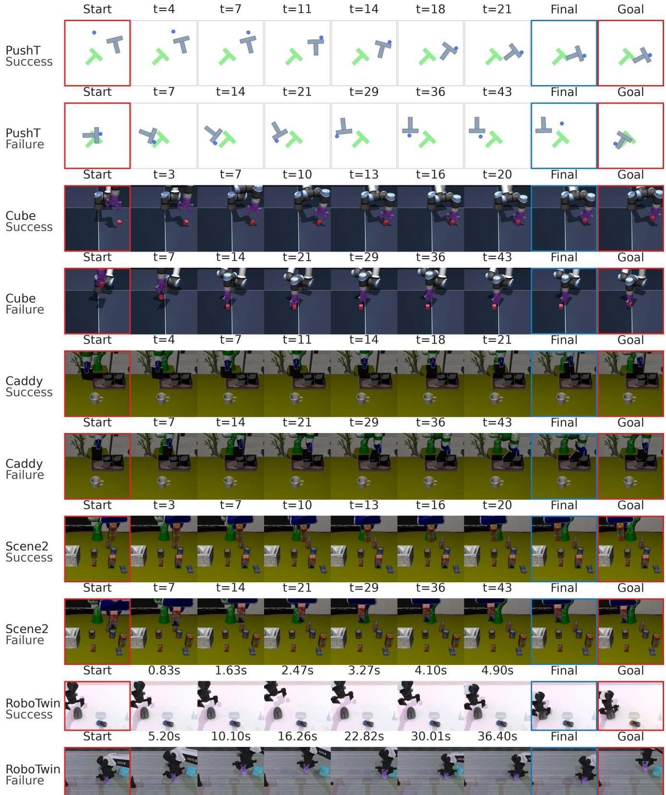  
Figure S1. Recorded execution sequences. Each row spans Start to Final and ends with its query’s Goal. Red outlines identify Start/Goal; blue identifies Final. Intermediate labels give frame index t (seconds for RoboTwin). Separate rows show successful and failed queries. Caddy and Scene2 frames are rotated 180◦ for display.