# SALA: Semantically Aligned Latent Actions Enable Dual-Axis Scaling of Embodied Foundation Models

Jiachun Jin1,2,∗, Zetong Zhou1,2,∗, Haonan Wang1, Xiao Yang3, Jun Zhu3, Zhijie Deng2

1Sharpa Robotics, 2SJTU-Sharpa Joint Lab for Embodied AI, SJTU, 3Tsinghua University

∗Equal contribution

## Abstract

Embodied foundation models hinge on diverse robot interaction data, which are costly to collect. Egocentric human videos ofer a complementary source of experience, and latent action models (LAMs) provide a popular means of leveraging these videos for policy supervision. Compared with world-action models (WAMs), LAMs can ofer greater training eficiency and potentially lower inference costs by avoiding explicit pixel prediction during policy learning and execution. However, most existing LAMs learn latent actions solely through video reconstruction, which can cause their representations to cluster by visual appearance rather than by the underlying actions. As a result, they struggle to align human actions with their robot counterparts. To bridge the gap, we introduce SALA, which emphasizes establishing the semantic correspondence for latent actions. Without requiring paired data, we use the language descriptions of unpaired human and robot clips to estimate semantic similarities and supervise cross-embodiment correspondence. Specifically, we translate these similarities into soft neighborhood structures that guide human latent actions toward semantically related robot latents, while robot action reconstruction grounds the latent space in control. The resulting shared latent action space provides a unified supervision signal for training an embodied foundation model on both human and robot videos. Notably, latent action supervision enables scaling along two axes: (1) pre-training on increasing amounts of general human video consistently reduces robot action prediction error on downstream tasks, and (2) post-training on increasing amounts of task-specific human video substantially improves real-world robot task success rates.

Project Website: https://sala-vla.github.io/ Correspondence: zhijied@sjtu.edu.cn

## 1 Introduction

Embodied foundation models, such as vision-language-action (VLA) models, connect visual observations and language instructions to robot actions, ofering a path toward general-purpose robot control (Black et al., 2024; Brohan et al., 2023; Kim et al., 2024). Their generalization depends on diverse interaction experience across tasks, objects, and environments, yet collecting such data through robot teleoperation remains costly. Egocentric human videos provide a complementary source of experience, capturing everyday manipulation without requiring robot hardware or teleoperation (Grauman et al., 2022; Hoque et al., 2026; Punamiya et al., 2026). Using this experience for policy learning, however, requires bridging the human-to-robot embodiment gap: the same operation can involve diferent motions and control mechanisms across humans and robots, and is often performed in scenes that difer from the robot’s workspace.

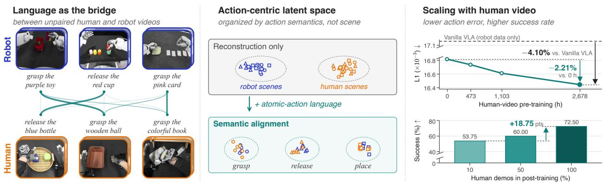  
Figure 1 Overview of SALA. Left: unpaired human and robot videos are related only through language descriptions of their atomic actions. Middle: supervising a latent action tokenizer with these relations organizes latent actions by action semantics rather than by scene. Right: through the aligned latent actions, human videos supervise the same action expert that controls the robot: more human-video pre-training lowers the robot’s action prediction error without additional robot data, and more task-specific human video in post-training raises the real-world success rate.

Latent action models (LAMs) are a popular way to incorporate human videos into robot policy training without explicit action labels (Ye et al., 2024; Chen et al., 2024b; Bu et al., 2025). By encoding visual transitions in a shared latent space, they provide a common prediction target for human and robot experience. Compared with world-action models (WAMs), which predict future video frames together with actions (Wu et al., 2023; Yuan et al., 2026b; Li et al., 2026b), LAMs avoid explicit pixel prediction during policy learning, which can make training more eficient. However, most existing LAMs learn latent actions solely through video reconstruction, which constrains each latent to explain the transition within its own clip but does not relate human and robot executions of the same behavior. Their latents therefore tend to cluster by visual appearance, such as the scene, rather than by the underlying action, so semantically similar human and robot actions need not lie close together. Aligning human actions with their robot counterparts thus requires supervision that connects their meanings across embodiments.

Our insight is that language can provide this supervision. Even when human and robot clips are unpaired, natural-language descriptions of their atomic actions, such as “grasp the cup”, relate a human clip to multiple robot clips with diferent degrees of semantic similarity, as illustrated on the left of figure 1. We propose SALA, which trains a latent action tokenizer by translating these similarities into soft neighborhood structures that guide human latent actions toward semantically related robot latents. Robot latents, grounded in control by action reconstruction, serve as anchors, and the alignment moves only human latents toward them. As the middle of figure 1 shows, the resulting latent actions are organized by action semantics rather than by scene, giving human videos a prediction target that is meaningful for robot control.

Once trained, the tokenizer labels videos from their frames alone, so its latent actions provide a unified supervision signal for training the policy on both human and robot videos, without action labels or atomicaction descriptions. This makes human video a scalable source of supervision along two axes. In pre-training, the policy can absorb large-scale general human videos spanning diverse everyday tasks. In post-training, because human and robot latent actions are aligned, task-specific human videos, i.e., human demonstrations of the target task, supervise the same action expert that controls the robot. Since such demonstrations require no robot, they ofer a practical way to improve a policy on a new task, one that robot-only policies cannot exploit.

We evaluate SALA in simulation and on a real robot. On RoboTwin 2.0 (Chen et al., 2025b), where videos of another robot arm stand in for human videos, SALA achieves a higher average success rate than existing LAMs and WAMs trained on the same videos, with the largest gain in domain-randomized scenes. Analyses of the tokenizer show that language alignment organizes latent actions by atomic action semantics rather than by scene. On a real robot controlled in a 63-DoF action space, including two 22-DoF dexterous hands, human video helps along both axes. Pre-training on more general human video, up to 2,678 hours, consistently reduces the robot’s action prediction error on downstream tasks without additional robot data. With teleoperated demonstrations fixed, post-training on more task-specific human video raises the average real-robot success rate from 53.75% to 72.5%. The right of figure 1 shows both trends.

Our contributions are as follows:

• We use language as relational supervision: atomic-action descriptions align human and robot latent actions from unpaired videos, with the alignment anchored on robot latents grounded in control.

• We turn human videos into latent-action supervision for the same action expert that controls the robot, which enables scaling along two axes: general human video in pre-training and task-specific human video in post-training.

• Experiments in simulation and on a 63-DoF real robot with dexterous hands show that SALA outperforms prior LAMs and WAMs trained on the same cross-embodiment videos in average success rate, and that human video scales along both axes: more general human video in pre-training keeps reducing the robot’s action prediction error, and more task-specific human video in post-training raises real-world success rates.

## 2 Method

Our goal is to use action-free egocentric human videos, which can be collected at scale, to facilitate the training of robot policies. We connect these videos to robot control through latent actions. This connection requires latent actions to establish semantic correspondence across embodiments, which a shared latent space trained only by reconstructing each clip does not guarantee. As outlined in figure 2, SALA therefore learns a latent action tokenizer aligned across embodiments by language supervision from atomic-action descriptions, and uses it to leverage human videos in robot policy training.

## 2.1 Preliminaries: Latent Action Models

LAMs learn compact representations of visual transitions without action labels by coupling inverse and forward dynamics (Zhang et al., 2025a). Given observations $\mathbf { o } _ { t }$ and $\mathbf { o } _ { t + k }$ separated by a horizon k, an inverse-dynamics encoder infers a latent action $\mathbf { z } = \mathcal { E } _ { \boldsymbol { \theta } } ( \mathbf { o } _ { t } , \mathbf { o } _ { t + k } )$ that encodes the transition between the two observations. An information bottleneck produces $\widetilde { \mathbf { z } } = \mathcal { Q } _ { \phi } ( \mathbf { z } )$ , limiting how much information from the future observation reaches the decoder. The forward-dynamics decoder $\mathcal { G } _ { v }$ then reconstructs $\mathbf { o } _ { t + k }$ from the current observation $\mathbf { o } _ { t }$ and the compressed code ez. Training minimizes the reconstruction error in image or feature space over observed pairs.

The inferred codes can serve as prediction targets for policy learning from action-free videos (Ye et al., 2024; Bu et al., 2025). Their usefulness, however, depends on what they encode: accurate reconstruction does not guarantee that the latent captures controllable actions, since it may also retain scene information or changes unrelated to control (Zhang et al., 2025a). For human-to-robot transfer, the representation must additionally connect semantically related behaviors across embodiments, a relation that reconstruction within individual clips does not explicitly constrain. We therefore augment this predictive formulation with robot action supervision and language-guided cross-embodiment alignment.

## 2.2 Grounding Latent Actions in Robot Control

We train the latent action tokenizer on a human dataset $\mathcal { D } _ { H }$ and an independently collected robot dataset $\mathcal { D } _ { R } \colon$

$$
\boldsymbol { \mathcal { D } } _ { H } = \{ ( \boldsymbol { V } _ { i } ^ { H } , \boldsymbol { \ell } _ { i } ^ { H } ) \} _ { i = 1 } ^ { N _ { H } } , \quad \boldsymbol { \mathcal { D } } _ { R } = \{ ( \boldsymbol { V } _ { j } ^ { R } , \boldsymbol { \ell } _ { j } ^ { R } , \mathbf { s } _ { j } , \mathbf { a } _ { j } ) \} _ { j = 1 } ^ { N _ { R } } .\tag{2.1}
$$

Each clip $V = \left( \mathbf { o } _ { t } , \mathbf { o } _ { t + k } \right)$ is represented by its endpoint observations, and s and a are the initial robot state and the subsequent action chunk, available only for robot data. The natural-language description ℓ specifies the atomic actions performed by the embodiment in the clip. As shown in figure $2 ( \mathrm { a } )$ , human and robot clips share the visual encoder ${ \mathcal { E } } _ { \theta }$ , the quantizer $\mathcal { Q } _ { \phi }$ , and the visual decoder $\mathcal { G } _ { v }$ , trained with visual reconstruction losses as in section 2.1.

(a) Language-aligned latent action tokenizer  
(b) Latent-action-supervised policy  
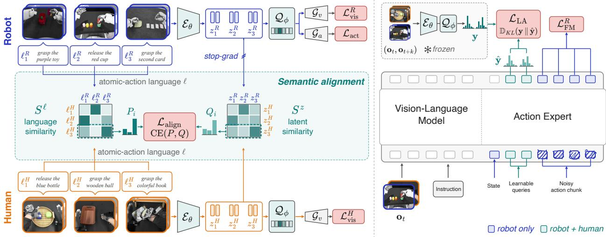  
Figure 2 Method overview. (a) Latent action tokenizer. Robot (blue) and human (orange) clips share the visual encoder $\mathcal { E } _ { \theta }$ , the SoftVQ quantizer $\mathcal { Q } _ { \phi }$ , and the visual decoder $\mathcal { G } _ { v } ;$ only robot clips train the action decoder ${ \mathcal { G } } _ { a }$ . Language similarities $S ^ { \ell }$ between atomic-action descriptions define soft neighborhoods $P ,$ which supervise the latent neighborhoods $Q$ derived from latent similarities $S ^ { z }$ , with gradients stopped through robot latents. Decoder conditioning inputs are omitted for clarity. (b) VLA policy. The frozen tokenizer labels each clip with latent action tokens ${ \mathbf { y } } ,$ each a categorical distribution over the codebook. Latent queries in the action expert predict yˆ through a latent head, supervised by $\mathcal { L } _ { \mathrm { L A } }$ for both human and robot data; robot data additionally train flow matching with $\mathcal { L } _ { \mathrm { F M } } ^ { R }$ . In the action expert, blue inputs (state and noisy actions) are used only for robot data, whereas green latent queries are used for both human and robot data.

Visual reconstruction alone does not ensure that the latent captures controllable actions. Teleoperation data, however, already provide ground-truth robot actions, which we exploit during tokenizer training. A robotonly action decoder ${ \mathcal { G } } _ { a }$ reconstructs the action chunk a from ez and the initial state s, with loss $\mathcal { L } _ { \mathrm { a c t } }$ , which grounds robot latents directly in control (Chen et al., 2026b). Human clips share this space without action labels; the control-grounded robot latents later serve as anchors for cross-embodiment alignment.

## 2.3 Robot-Anchored Semantic Transfer

We align human latent actions toward the robot representations grounded by action reconstruction in section 2.2. These robot representations serve as control anchors, while atomic-action descriptions determine how each human clip should relate to them.

Atomic-action descriptions characterize what a clip does independently of the embodiment performing it. We therefore encode ℓ with a frozen text encoder and use the similarity between language descriptions to measure how semantically related a human clip is to each robot clip. Because human and robot clips are collected independently, a human clip rarely has an exact robot counterpart. It can nonetheless relate to several robot clips to diferent degrees; for example, grasping a cup is closer to grasping a bottle than to placing a cup. We therefore describe each human clip by a soft neighborhood over the robot clips in a batch, given by a softmax over its language similarities, and use it to supervise the clip’s neighborhood in latent space. Figure $2 ( \mathrm { a } )$ illustrates this with $S ^ { \ell }$ and $S ^ { z }$ , the language and latent similarities between the human and robot clips in a batch: the dashed rows give the two neighborhoods of one human clip. Formally, the alignment loss is

$$
\begin{array} { r } { \mathcal { L } _ { \mathrm { a l i g n } } = \mathbb { E } _ { i } \Big [ \mathrm { C E } \underbrace { \big ( \underbrace { \mathrm { s o f t m a x } _ { j } \big ( s _ { i j } ^ { \ell } \big ) } _ { P _ { i } } , \underbrace { \mathrm { s o f t m a x } _ { j } \big ( s _ { i j } ^ { z } \big ) } _ { Q _ { i } } \big ) } _ { P _ { i } } \Big ] , } \end{array}\tag{2.2}
$$

where $s _ { i j } ^ { \ell }$ and $s _ { i j } ^ { z }$ are the entries of $S ^ { \ell }$ and $S ^ { z }$ for human clip i and robot clip j, with $s _ { i j } ^ { z } = \mathrm { s i m } ( \mathbf { z } _ { i } ^ { H } , \mathrm { s g } ( \mathbf { z } _ { j } ^ { R } ) ) ;$ ; the softmax temperatures are omitted for clarity. Here sim denotes cosine similarity averaged over tokens, and the stop-gradient sg makes alignment move human latents toward the control-grounded robot anchors rather than pulling the anchors toward human latents, which lack action supervision. Language thus supervises what visual and action reconstruction leave unconstrained: the semantic correspondence between human and robot latent actions.

The choice of quantizer matters for this alignment. The relations in $P _ { i }$ are graded, so alignment needs to move the pre-quantization latents z continuously, while the policy’s targets are the tokens that $\mathcal { Q } _ { \phi }$ produces from them. A standard hard VQ (van den Oord et al., 2017) fits these graded relations poorly: its commitment loss pulls each z toward the selected codeword, and its token, a one-hot assignment to a single codeword, changes only when z switches to another code. We therefore instantiate $\mathcal { Q } _ { \phi }$ with SoftVQ (Chen et al., 2025a), which represents each token as a categorical distribution over the codebook rather than a one-hot assignment, and forms ez from the codewords weighted by these distributions; we denote the tokens of a clip by y. SoftVQ requires no commitment loss, and its distributions vary smoothly with $\mathbf { z } ,$ so the tokens can express graded diferences between latents. As shown in section 3.4, the alignment loss decreases with SoftVQ but stays near its initial value with hard ${ \mathrm { V Q } } .$

The tokenizer is trained with the three signals described above: visual reconstruction of human and robot clips $( \mathcal { L } _ { \mathrm { v i s } } ^ { H }$ and $\mathcal { L } _ { \mathrm { v i s } } ^ { R } )$ captures visual transitions, action reconstruction $( \mathcal { L } _ { \mathrm { a c t } } )$ grounds robot latents in control, and semantic alignment $\left( \mathcal { L } _ { \mathrm { a l i g n } } \right)$ supervises the correspondence between human and robot latents. With loss weights $\lambda _ { \mathrm { { a c t } } }$ and $\lambda _ { \mathrm { a l i g n } } ,$ the overall objective is

$$
{ \mathcal { L } } _ { \mathrm { t o k } } = { \frac { 1 } { 2 } } \left( { \mathcal { L } } _ { \mathrm { v i s } } ^ { H } + { \mathcal { L } } _ { \mathrm { v i s } } ^ { R } \right) + \lambda _ { \mathrm { a c t } } { \mathcal { L } } _ { \mathrm { a c t } } + \lambda _ { \mathrm { a l i g n } } { \mathcal { L } } _ { \mathrm { a l i g n } } .\tag{2.3}
$$

## 2.4 Latent-Action-Supervised Policy Learning

After training, the tokenizer is frozen and serves as a teacher that labels human and robot clips with latent actions. For a clip $\left( \mathbf { o } _ { t } , \mathbf { o } _ { t + k } \right)$ , the teacher outputs its latent action tokens y, each a categorical distribution over the codebook. We keep these distributions rather than discretizing them into code indices, retaining the graded similarity structure of the latent space. The future observation $\mathbf { o } _ { t + k }$ is used only to compute y; the policy itself observes only the current observation, so neither the teacher nor future frames are needed at deployment.

As shown in figure $2 ( \mathrm { b } )$ , our policy adopts a π -style architecture (Black et al., 2024): a vision-language model (VLM) encodes observations and language, and an action expert generates action chunks by flow matching. We add learnable latent-action queries to the action expert, which predict the token distributions yˆ through a latent head, and let the noisy action tokens attend to these queries, so that latent-action prediction directly conditions action generation. For human videos, which provide neither states nor actions, the action expert processes only the latent queries.

Both human and robot data are supervised by the latent-action loss $\mathcal { L } _ { \mathrm { { L A } } } = \mathbb { D } _ { \mathrm { { K L } } } ( \mathbf { y } \parallel \hat { \mathbf { y } } )$ , the KL divergence between the teacher’s and the predicted categorical distributions over the codebook, averaged over tokens; robot data additionally contribute the flow-matching action loss $\mathcal { L } _ { \mathrm { F M } } ^ { R }$

$$
\mathcal { L } _ { \mathrm { p o l i c y } } = \mathcal { L } _ { \mathrm { F M } } ^ { R } + \lambda _ { \mathrm { L A } } \big ( \mathcal { L } _ { \mathrm { L A } } ^ { R } + \mathcal { L } _ { \mathrm { L A } } ^ { H } \big ) .\tag{2.4}
$$

Human videos thus train the same VLM and action expert that generate robot actions.

We train the policy in stages that follow the availability of data. In pre-training, the policy learns from the action-free videos in $\mathcal { D } _ { H }$ with $\mathcal { L } _ { \mathrm { L A } } ^ { H }$ alone, predicting the latent actions that the language-aligned teacher assigns to them. Since the teacher requires only video frames, this stage needs neither action labels nor atomicaction descriptions, and can therefore scale with the amount of available human video. In mid-training, it is trained on target-robot teleoperation data $\mathcal { D } _ { R }$ with $\mathcal { L } _ { \mathrm { F M } } ^ { R } + \lambda _ { \mathrm { L A } } \mathcal { L } _ { \mathrm { L A } } ^ { R }$ , grounding these latent-action predictions in robot actions. When task-specific data are available, an optional post-training stage uses both task-specific teleoperated and human demonstrations with the full objective in equation (2.4). Human demonstrations of the target task are cheap to collect, since they require no robot, and the aligned latent space lets them supervise the same action expert that controls the robot. Each experiment in section 3 specifies which stages it uses and on which data; architectural details and loss weights are given in section C.

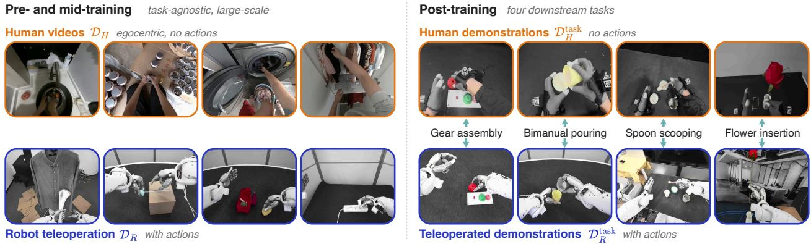  
Figure 3 Real-world data. Left: examples of the large-scale data used in pre- and mid-training, i.e., egocentric human videos $\mathcal { D } _ { H }$ and robot teleoperation data $\mathcal { D } _ { R }$ . Right: the four downstream tasks, each performed by a person, recorded as human demonstrations $\mathcal { D } _ { H } ^ { \mathrm { t a s k } }$ , and by the robot under teleoperation, recorded as teleoperated demonstrations $\mathcal { D } _ { R } ^ { \mathrm { t a s k } }$

## 3 Experiments

Our experiments test the central claim of SALA: language-aligned latent actions turn videos of other embodiments into supervision for robot policies that is both efective and scalable. After summarizing the implementation in section 3.1, we evaluate the two properties in turn. For efectiveness, section 3.2 compares SALA on a standardized simulation benchmark with existing LAMs and WAMs trained on the same cross-embodiment videos. For scalability, section 3.3 asks whether SALA keeps improving the target robot in the real world as more human video is used, both with increasing human-video pre-training budgets and in task-specific post-training. We then ablate the design choices of our tokenizer and analyze whether its latent actions are aligned across embodiments in section 3.4.

## 3.1 Implementation Details

We summarize the main configuration here. The tokenizer encodes each clip, whose two observations are separated by a dataset-specific horizon k, into 8 latent tokens, quantized by SoftVQ with a codebook of 256 codes; visual reconstruction targets frozen DINOv2 (Oquab et al., 2024) features of the future observation, and atomic-action descriptions are embedded by a frozen text encoder, CLIP ViT-B/32 in simulation and Qwen3-Embedding-4B (Zhang et al., 2025b) in the real world. The policy uses Qwen3-VL-4B (Bai et al., 2025) as the VLM and a separately parameterized Qwen3-style transformer with 0.6B parameters as the action expert, which attends jointly with the VLM at every layer. The VLM is initialized from the pretrained Qwen3-VL-4B-Instruct weights and the action expert from scratch, and each subsequent training stage starts from the checkpoint of the previous one. Experiment-specific tokenizer settings, loss weights, and further architectural details are given in section C.

## 3.2 Effectiveness in Simulation

We first compare SALA with existing approaches to cross-embodiment video pre-training on a standardized simulation benchmark. Specifically, we ask whether, given the same videos of a non-target embodiment, SALA achieves higher target-robot success rates than other LAMs and WAMs.

Table 1 Training data. Following section 2.2, $\mathcal { D } _ { H }$ contains only videos of a non-target embodiment, whereas $\mathcal { D } _ { R }$ additionally provides the states and actions of the target robot. Lang.: annotated with atomic-action descriptions, which are used only for tokenizer training; in the real world, only the subset $\mathcal { D } _ { H } ^ { \mathrm { t o k } } \subset \mathcal { D } _ { H }$ is annotated. The per-task demonstrations $\mathcal { D } _ { R } ^ { \mathrm { t a s k } }$ and $\mathcal { D } _ { H } ^ { \mathrm { t a s k } }$ used in real-world post-training are listed in table 3. Human-video pre-training hours denote equivalent training exposure.  
Table 2 Success rates (%) on RoboTwin 2.0. WAMs and LAMs are additionally trained on videos from $\mathcal { D } _ { H }$ and $\mathcal { D } _ { R }$ . PT.: initialized from the oficial checkpoint pre-trained on large-scale robot data.
<table><tr><td>Data Embodiment Actions Lang. Trajectories Hours</td><td></td><td></td><td></td><td></td><td></td></tr><tr><td colspan="6">Simulation (section 3.2)</td></tr><tr><td> $\mathcal { D } _ { H }$ </td><td>ARX-X5</td><td>X</td><td>√</td><td>27,000</td><td>68.0</td></tr><tr><td> $\mathcal { D } _ { R }$ </td><td>Aloha-AgileX</td><td>√</td><td>√</td><td>2,500</td><td>9.2</td></tr><tr><td colspan="6">Real world (section 3.3)</td></tr><tr><td> $\mathcal { D } _ { H }$ </td><td>Human</td><td>X</td><td>partial</td><td>71,582</td><td>2,678</td></tr><tr><td> $\mathcal { D } _ { H } ^ { \mathrm { t o k } }$ </td><td>Human</td><td>X</td><td>√</td><td>27,406</td><td>983</td></tr><tr><td> $\mathcal { D } _ { R }$ </td><td>Sharpa North</td><td>√</td><td>V</td><td>70,859</td><td>888</td></tr></table>

<table><tr><td>Method</td><td>PT. Clean Random Avg.</td><td></td><td></td></tr><tr><td>VLAs</td><td></td><td></td><td>58.7</td></tr><tr><td>π0.5</td><td>√</td><td>70.7</td><td>46.6</td></tr><tr><td>X-VLA</td><td>V 67.9</td><td>20.9</td><td>44.4</td></tr><tr><td>WAMs</td><td></td><td></td><td></td></tr><tr><td>FastWAM</td><td>× 79.4</td><td>3.2</td><td>41.3</td></tr><tr><td>LingBot-VA</td><td>√ 75.8</td><td>38.4</td><td>57.1</td></tr><tr><td>InternVLA-A1.5</td><td>X 67.8</td><td>40.1</td><td>54.0</td></tr><tr><td>OpenWAM</td><td>× 86.8</td><td>3.9</td><td>45.4</td></tr><tr><td>LAMs</td><td></td><td></td><td></td></tr><tr><td>UniVLA</td><td>√ 48.6</td><td>5.6</td><td>27.1</td></tr><tr><td>UniT</td><td>× 47.5</td><td>7.2</td><td>27.4</td></tr><tr><td>RotVLA</td><td>V</td><td>74.4 28.0</td><td>51.2</td></tr><tr><td>SALA</td><td>X</td><td>80.2</td><td>48.6 64.4</td></tr></table>

Setup. We conduct this comparison on RoboTwin 2.0 (Chen et al., 2025b), a bimanual manipulation benchmark that provides expert trajectories for 50 dual-arm tasks across five robot embodiments. We take Aloha-AgileX as the target embodiment and ARX-X5 as the non-target embodiment. As listed in table 1 and illustrated in figure 11, $\mathcal { D } _ { H }$ keeps only the videos of 27,000 ARX-X5 trajectories from both clean and random scenes, whereas $\mathcal { D } _ { R }$ contains only 2,500 complete Aloha-AgileX trajectories from clean scenes. This orderof-magnitude gap mimics the practical regime in which target-robot data are scarce while videos of other embodiments are abundant. Clips in both datasets are further annotated with atomic-action descriptions, which are used only to train our tokenizer; the annotation procedure and examples are given in section D. We evaluate on Aloha-AgileX in both the clean and domain-randomized settings of the benchmark, denoted Clean and Random. In each setting, we run 100 rollouts per task and report the success rate averaged over all 50 tasks.

Training. The tokenizer is trained on $\mathcal { D } _ { H }$ and $\mathcal { D } _ { R }$ with equation (2.3), where only Aloha-AgileX clips contribute action reconstruction. Following section 2.4, the policy is then pre-trained on the ARX-X5 videos to predict latent actions only, and mid-trained on $\mathcal { D } _ { R }$ with both the flow-matching action loss and the latentaction loss. We omit task-specific post-training in this setting. The tokenizer settings of this experiment are listed in table 7.

Baselines. We compare with three types of baselines: (i) VLAs, $i . e . , \pi _ { 0 . 5 }$ (Physical Intelligence et al., 2025) and X-VLA (Zheng et al., 2025), trained on $\mathcal { D } _ { R }$ only; (ii) WAMs, $i . e .$ , FastWAM (Yuan et al., 2026b), LingBot-VA (Li et al., 2026b), InternVLA-A1.5 (Ma et al., 2026), and OpenWAM (Wang et al., 2026), additionally trained with their future-prediction objectives on $\mathcal { D } _ { H }$ and $\mathcal { D } _ { R } ;$ and (iii) LAMs, i.e., UniVLA (Bu et al., 2025), UniT (Chen et al., 2026a), and RotVLA (Li et al., 2026c), additionally trained to predict latent actions on $\mathcal { D } _ { H }$ and $\mathcal { D } _ { R }$

Results. SALA achieves the highest success rate in Random and the highest average in table 2. Although it is initialized only from a general-purpose VLM, it outperforms every baseline initialized from a robotpretrained checkpoint. None of the other LAMs relates the two embodiments through action semantics, so an ARX-X5 latent and an Aloha-AgileX latent need not encode the same action; what their policies learn from $\mathcal { D } _ { H }$ may therefore not transfer to Aloha-AgileX. SALA aligns ARX-X5 latents to Aloha-AgileX latents grounded in control, so pre-training on $\mathcal { D } _ { H }$ supervises the action expert with targets that are meaningful for Aloha-AgileX control. Three of the four WAMs instead predict future videos, a target that also requires modeling scene appearance, whereas InternVLA-A1.5 predicts latent foresight tokens rather than pixels. Consistent with this, FastWAM and OpenWAM match or exceed SALA in Clean but collapse in Random, where domain randomization changes scene appearance. In contrast, section 3.4 shows that language-aligned latent actions are organized by action semantics rather than by scene.

Table 3 Downstream tasks. Teleoperated demonstrations $\mathcal { D } _ { R } ^ { \mathrm { t a s k } }$ and human demonstrations $\mathcal { D } _ { H } ^ { \mathrm { t a s k } }$ collected for each task and used in post-training. Lang.: annotated with atomicaction descriptions. Traj.: trajectories.
<table><tr><td>Task</td><td></td><td>Data Actions Lang. Traj. Hours</td><td></td><td></td><td></td></tr><tr><td>Gear</td><td> $\mathcal { D } _ { R } ^ { \mathrm { t a s k } }$ </td><td>√</td><td>×</td><td>1,466</td><td>9.0</td></tr><tr><td>assembly</td><td> $\mathcal { D } _ { H } ^ { \mathrm { t a s k } }$ </td><td>X</td><td>X</td><td>2,715</td><td>12.0</td></tr><tr><td>Bimanual</td><td> $\mathcal { D } _ { R } ^ { \mathrm { t a s k } }$ </td><td>√</td><td>X</td><td>474</td><td>2.2</td></tr><tr><td>pouring</td><td> $\mathcal { D } _ { H } ^ { \mathrm { t a s k } }$ </td><td>X</td><td>X</td><td>2,466</td><td>13.4</td></tr><tr><td>Flower</td><td> $\mathcal { D } _ { R } ^ { \mathrm { t a s k } }$ </td><td>√</td><td>×</td><td>793</td><td>7.3</td></tr><tr><td>insertion</td><td> $\mathcal { D } _ { H } ^ { \mathrm { t a s k } }$ </td><td>X</td><td>X</td><td>2,117</td><td>10.6</td></tr><tr><td>Spoon</td><td> $\mathcal { D } _ { R } ^ { \mathrm { t a s k } }$ </td><td>√</td><td>X</td><td>491</td><td>4.0</td></tr><tr><td>scooping</td><td> $\mathcal { D } _ { H } ^ { \mathrm { t a s k } }$ </td><td>X</td><td>X</td><td>1,973</td><td>7.9</td></tr></table>

Table 4 Real-world success rates (%). Each method is evaluated with 20 trials per task. All methods are post-trained on the same teleoperated demonstrations $\mathcal { D } _ { R } ^ { \mathrm { t a s k } }$ ; SALA additionally uses the human demonstrations $\mathcal { D } _ { H } ^ { \mathrm { t a s k } }$ and is pre-trained on 2,678 hours of human video $\mathcal { D } _ { H }$ . The vanilla VLA shares the architecture of SALA but removes latent actions, so it learns from teleoperation data only. Task descriptions and success criteria are given in section F, and the demonstrations of each task are listed in table 3.

<table><tr><td>Method</td><td>Gear Assembly</td><td>Bimanual Pouring</td><td>Flower Insertion</td><td>Spoon Scooping</td><td> $\mathrm { A v g . ~ } \uparrow$ </td></tr><tr><td>GR00T N1.7</td><td>45</td><td>50</td><td>30</td><td>40</td><td>41.25</td></tr><tr><td>Vanilla VLA</td><td>40</td><td>25</td><td>20</td><td>25</td><td>27.50</td></tr><tr><td>SALA</td><td>75</td><td>80</td><td>55</td><td>80</td><td>72.50</td></tr></table>

## 3.3 Scalability in the Real World

We next deploy SALA on a real robot to study how it scales with egocentric human videos. We examine two levels: scaling human-video pre-training to 2,678 equivalent hours, and scaling human demonstrations of each downstream task in post-training.

Setup. All real-world experiments are conducted on a Sharpa North wheeled humanoid equipped with two 22-DoF Sharpa Wave dexterous hands, whose 63-dimensional joint-space action covers the arms, hands, torso, and neck; section E details the platform. As summarized in table 1, we use action-free egocentric human videos $\mathcal { D } _ { H }$ for 2,678 equivalent hours of pre-training, alongside 888 hours of robot teleoperation data $\mathcal { D } _ { R }$ . Each downstream task further pairs a limited set of teleoperated demonstrations $\mathcal { D } _ { R } ^ { \mathrm { t a s k } }$ with human demonstrations $\mathcal { D } _ { H } ^ { \mathrm { t a s k } }$ , egocentric videos of a person performing the same task; figure 3 shows the large-scale data on the left and these demonstrations on the right. Teleoperated demonstrations supply the task’s robot actions, but they are costly to collect and hard to scale. Human demonstrations carry no actions, but since they require no robot, they are cheap to collect and easy to scale. As in simulation, atomic-action descriptions are used only for tokenizer training, so we annotate only the data used to train it: $\mathcal { D } _ { R }$ and a subset $\mathcal { D } _ { H } ^ { \mathrm { t o k } } \subset \mathcal { D } _ { H }$ , while pre-training on the full $\mathcal { D } _ { H }$ requires no annotation.

Downstream tasks. We evaluate four downstream manipulation tasks: gear assembly, bimanual pouring, flower insertion, and spoon scooping, the last of which requires tool use. Table 3 summarizes each task and the teleoperated and human demonstrations collected for it, and section F gives further details.

Training. The tokenizer is trained on $\mathcal { D } _ { H } ^ { \mathrm { t o k } }$ and $\mathcal { D } _ { R }$ with equation (2.3). Following the full recipe of section 2.4, the policy is pre-trained on $\mathcal { D } _ { H }$ to predict latent actions $\mathrm { o n l y , }$ and mid-trained on $\mathcal { D } _ { R }$ with both the flow-matching action loss and the latent-action loss. It is then post-trained for each task on $\mathcal { D } _ { R } ^ { \mathrm { t a s k } }$ and $\mathcal { D } _ { H } ^ { \mathrm { t a s k } }$ together, with the human demonstrations supervising latent-action prediction only. The tokenizer settings of this experiment are listed in table 7.

Main results. We compare SALA with two baselines, both post-trained on the same teleoperated demonstrations $\mathcal { D } _ { R } ^ { \mathrm { t a s k } }$ : GR00T N1.7 (NVIDIA et al., 2025) and a vanilla VLA, which shares our architecture but removes latent actions, so it is trained on teleoperation data only and cannot learn from human videos. SALA uses human videos in both pre-training and post-training. As shown in table 4, SALA achieves the highest average success rate of 72.5%, surpassing the baselines on every task. Since the vanilla VLA difers from SALA only in latent actions, the gap between them measures what latent actions and the human videos they enable contribute. We next examine the two stages at which human videos enter, pre-training and post-training, in figure 4.

(a)  
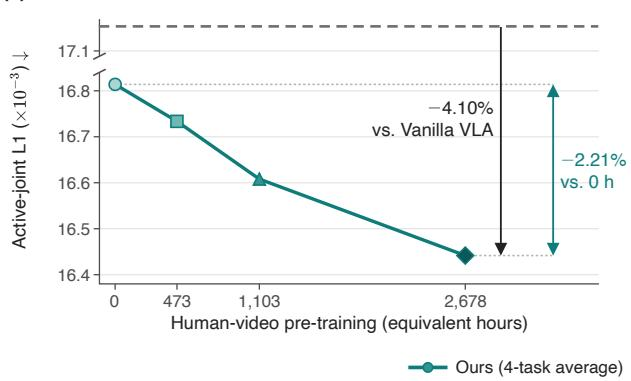

(b)  
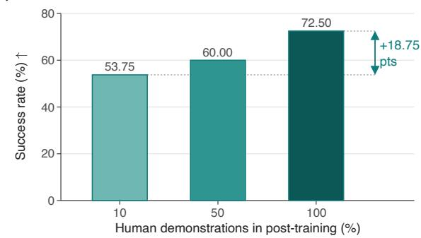  
Figure 4 Scaling with human video. Both panels average over four tasks. (a) Pre-training: validation L1 error of predicted actions on the joints each task uses, versus the pre-training budget in equivalent hours of human video. Gray dashed: vanilla ${ \mathrm { V L A } } ;$ our 0 h variant retains latent-action training. (b) Post-training: success rate versus the fraction of each task’s human demonstrations $\mathcal { D } _ { H } ^ { \mathrm { t a s k } }$ used in post-training, starting from the model pre-trained on 2,678 hours of human video, with the teleoperated demonstrations $\mathcal { D } _ { R } ^ { \mathrm { t a s k } }$ fixed.

Scaling in pre-training. Human videos provide an additional axis for scaling policy training beyond robot demonstrations. We pre-train the policy with budgets equivalent to 0, 473, 1,103, and 2,678 hours of human video, and then mid-train each for one epoch over the teleoperation data $\mathcal { D } _ { R }$ and post-train it on each task for 30,000 iterations. We report the validation L1 error between predicted and ground-truth actions on held-out teleoperated demonstrations of the four tasks, counting only the joints each task uses. We also compare with a vanilla VLA, which shares our architecture but removes latent actions; it is therefore trained on teleoperation data only and cannot learn from human videos, with all other settings unchanged. As shown in figure 4(a), the validation L1 error decreases with every increase in the pre-training budget. This improvement requires no additional robot data, since all models share the same teleoperation data in mid- and post-training.

Latent actions help even without human-video pre-training: our 0 h variant already achieves a lower final validation L1 error than the vanilla VLA. Because the latent actions are grounded in robot control, predicting them shapes the representations from which the action expert generates actions, and they let the human demonstrations of each task supervise the same action expert, which the vanilla VLA cannot exploit. With 2,678 hours of human-video pre-training, the error drops further below both the vanilla VLA and our 0 h variant, with the relative reductions marked in figure 4(a). Aligned latent actions thus let human video improve robot action prediction at both stages, through large-scale pre-training and through task-specific post-training.

Scaling in post-training. At the task level, starting from the model pre-trained on 2,678 hours of human video, we post-train each of the four tasks with 10%, 50%, and 100% of its human demonstrations $\mathcal { D } _ { H } ^ { \mathrm { t a s k } }$ while keeping the teleoperated demonstrations $\mathcal { D } _ { R } ^ { \mathrm { t a s k } }$ fixed. As shown in figure 4(b), the average success rate increases steadily with more human demonstrations, from 53.75% to 72.5%. Since human demonstrations require no robot to record, collecting more of them for a task ofers an inexpensive way to improve the policy on that task, complementary to teleoperation.

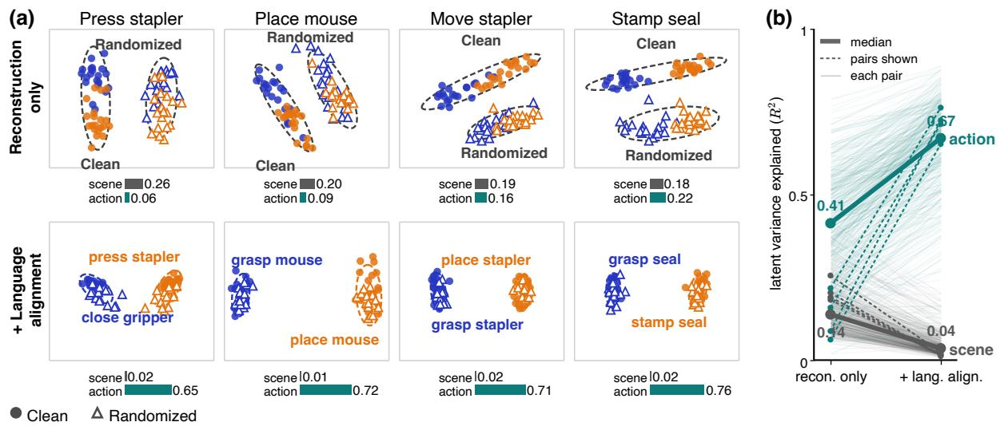  
Figure 5 Latent actions without and with language alignment. (a) For four RoboTwin 2.0 tasks, ARX-X5 latents z of two atomic actions of the right arm, with 20 clips per action and scene type, projected to 2D by PCA fitted to each panel. Color: action; marker: scene type. Bars report the fraction of variance in the full latent space explained by scene and by action. (b) These fractions across all analyzed pairs: thick lines show medians; dashed lines mark the pairs in (a). Alignment shifts the organization from scene toward action.

## 3.4 Ablations and Analysis

We examine the robot-anchored semantic transfer described in section 2.3 in two steps. We first ablate the alignment loss and analyze what it contributes to the latent space, within a single embodiment and across embodiments; we then ablate two designs that determine how alignment acts, the stop-gradient that keeps robot latents as control anchors and the SoftVQ quantizer.

Semantic alignment. This ablation tests whether the correspondence between human and robot latent actions needs explicit supervision or emerges from reconstruction alone. Since reconstruction constrains each latent only through its own clip, $\mathcal { L } _ { \mathrm { a l i g n } }$ is the only term in equation (2.3) that relates the two embodiments; we set $\lambda _ { \mathrm { a l i g n } } = 0$ and keep everything else unchanged. As shown in table 5, removing alignment lowers success rates in both settings, so reconstruction alone does not provide this correspondence. The drop is larger in Random, where scenes vary. Figure 5 examines the ARX-X5 latents, which can be organized by scene as well as by action since the videos are recorded in both clean and randomized scenes. Without alignment, the clips of three of the four tasks in figure 5(a) split by scene, with the two actions mixed in each group; with alignment, they split by atomic action, since clips with semantically similar descriptions receive similar alignment targets regardless of the scene. As shown in figure 5(b), across all analyzed pairs, alignment raises the median fraction of latent variance explained by the action from 0.41 to 0.67 and lowers that explained by the scene from 0.14 to 0.04.

Table 5 Tokenizer ablations on RoboTwin 2.0. Each variant changes one design choice of the full tokenizer, and the policy is trained in the same way. w/o sg: bidirectional alignment. Success rates (%) on Aloha-AgileX.
<table><tr><td>Tokenizer</td><td>Clean</td><td>Random</td></tr><tr><td>SALA (full)</td><td>80.2</td><td>48.6</td></tr><tr><td>Semantic alignment</td><td></td><td></td></tr><tr><td>w/o  $\mathcal { L } _ { \mathrm { a l i g n } }$ </td><td>75.5</td><td>36.8</td></tr><tr><td>Stop-gradient</td><td></td><td></td></tr><tr><td>w/o sg</td><td>73.5</td><td>46.8</td></tr></table>

Cross-embodiment retrieval. Figure 5 concerns clips of a single embodiment; we next test whether alignment also relates clips across embodiments. Given a query clip of a non-target embodiment, we retrieve the target-robot clips whose latent actions are most similar to it, searching over all tasks with the similarity used by the alignment loss. Figure 6 shows human queries from the pre-training videos $\mathcal { D } _ { H } .$ , of tasks absent from the robot data. Human and robot videos difer in viewpoint, embodiment, and background, and the reconstruction-only tokenizer returns robot clips unrelated to the query. SALA instead returns semantically related robot behaviors; for example, a human sweeping the floor retrieves the robot sweeping trash into a dustpan. Section A evaluates retrieval quantitatively on RoboTwin 2.0 and in the real world.

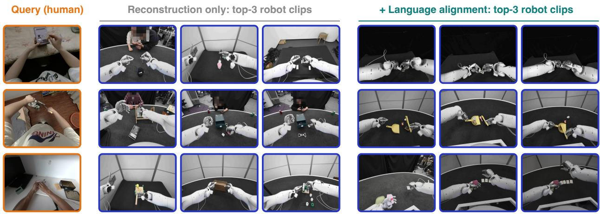  
Figure 6 Cross-embodiment retrieval for human pre-training videos. Each human query (left) and its three nearest robot clips over all tasks, under the reconstruction-only tokenizer (middle) and SALA (right).

Stop-gradient. The stop-gradient makes alignment oneway: robot latents serve as fixed targets, and only human in equation (2.2) makes alignment bidirectional, so robot latents are also pulled toward human latents, which lack action supervision. Robot latents then have to serve two objectives, encoding the robot’s own actions and matching human latents, and the second can compromise the first. As shown in table 5, bidirectional alignment lowers success rates, most notably in the clean setting, indicating that robot latents should remain anchored to control.

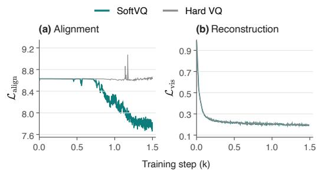  
Figure 7 Tokenizer training with SoftVQ and hard VQ. SoftVQ reduces (a) the alignment loss, whereas hard VQ leaves it nearly unchanged, although both reach comparable (b) visual reconstruction losses. All other settings are identical.

Quantizer. To test the choice of quantizer in section 2.3, we replace SoftVQ with a standard hard VQ. Figure 7 shows that SoftVQ substantially reduces the alignment loss, whereas hard VQ keeps it near the value of a uniform prediction, even though both reach comparable visual reconstruction losses. Since the alignment loss is computed on the pre-quantization latents, hard VQ hinders alignment already before quantization, consistent with the argument in section 2.3.

## 4 Related Work

Vision-language-action models. VLA models build on pre-trained vision-language models to map visual observations and language instructions to robot actions (Brohan et al., 2023; Kim et al., 2024; Black et al., 2024; Physical Intelligence et al., 2025; NVIDIA et al., 2025; Zheng et al., 2025; Yuan et al., 2026a). Their generalization depends on the diversity of robot data, which is costly to collect through teleoperation. Language has also been used to structure action learning in VLAs, through interpretable action primitives (Weng et al., 2026) or language-conditioned action priors learned without visual input (Lin et al., 2026). SALA keeps the VLA design, with a flow-matching action expert, and adds latent-action prediction so that videos without

action labels can supervise the same action expert.

Learning from human videos. Human videos have been used to pre-train visual representations for robot manipulation (Nair et al., 2022). Closer to policy learning, one line of work extracts explicit motion from human videos, such as hand trajectories or poses, and maps it to robot actions (Wang et al., 2023; Kareer et al., 2024; Qiu et al., 2025; Yang et al., 2025; Luo et al., 2025; Fu et al., 2025); this requires hand tracking and a correspondence between human and robot kinematics.

With suficiently diverse pre-training, co-training VLAs on such human data can yield human-to-robot transfer (Kareer et al., 2025; Zheng et al., 2026). Another line predicts future observations as a proxy for actions: generating video plans that are then converted into actions (Du et al., 2023; Ko et al., 2023), predicting subgoal images (Zhao et al., 2025; Yang et al., 2026), or training WAMs that predict videos jointly with actions (Wu et al., 2023; Yuan et al., 2026b; Li et al., 2026b; Zhang et al., 2026b; NVIDIA et al., 2026; Wang et al., 2026). Other work predicts future representations rather than pixels (Su et al., 2026; Miao et al., 2026; Tang et al., 2026; Ma et al., 2026); when co-training on egocentric human videos, feature and 3D-flow targets transfer to robots better than pixel targets (Li et al., 2026a). Video prediction requires modeling scene appearance in addition to motion, and in section 3.2 some WAMs degrade sharply under domain randomization. SALA instead supervises the policy with latent actions, which require neither hand tracking nor pixel-level prediction.

Latent action models. Instead of labeling videos with an inverse dynamics model trained on action-labeled data (Baker et al., 2022), latent action models infer actions from consecutive frames without action labels, by learning latents that predict the next frame (Schmidt and Jiang, 2023; Bruce et al., 2024; Chen et al., 2024a; Liang et al., 2026). They have been used to pre-train policies on actionless videos, including human videos (Ye et al., 2024; Chen et al., 2024b; Bu et al., 2025; Chen et al., 2026b; Li et al., 2026c). Because the latents are learned by reconstructing each clip, they can capture scene changes and distractors rather than the action (Zhang et al., 2025a). Prior work addresses this by conditioning on task instructions (Bu et al., 2025), by structuring the latent space (Li et al., 2026c), by contrastive disentanglement with action-category priors (Dai et al., 2026), or by adversarially suppressing embodiment- and environment-specific factors (Liu et al., 2026). To relate embodiments, other methods align latents with robot actions recorded alongside the videos (Zhang et al., 2026a; Fan et al., 2026), with action labels of human hands (Luo et al., 2026), through paired human-robot demonstrations (Zhu et al., 2026), or through the shared visual consequences of heterogeneous kinematics (Chen et al., 2026a); a related approach contrastively aligns the action spaces of human hands, dexterous hands, and grippers (Bauer et al., 2026). SALA instead uses atomic-action descriptions to relate unpaired human and robot clips by graded semantic similarity, and aligns human latents to robot latents grounded in control, so that human and robot executions of semantically similar actions receive similar latents.

## 5 Conclusion

We presented SALA, which uses language to align human and robot latent actions for policy learning. Naturallanguage descriptions of atomic actions relate unpaired human and robot clips through graded semantic similarity, and SALA turns these relations into soft neighborhood targets that move human latents toward robot latents grounded in control. The resulting latent actions let human videos supervise the same action expert that controls the robot, both in large-scale pre-training and in task-specific post-training. Experiments in simulation and on a 63-DoF real robot show that language alignment organizes latent actions by action semantics rather than by scene, and that human-video pre-training steadily reduces the robot’s action prediction error without additional robot data.

Our study has limitations that point to future work. The tokenizer requires atomic-action descriptions for its training clips, although the policy itself learns from video frames alone. Our scaling analysis measures ofline validation error with one run per setting and covers pre-training budgets of up to 2,678 hours; whether the trend continues at larger scales and how it translates into real-robot success remain open.

## References

Shuai Bai, Yuxuan Cai, Ruizhe Chen, Keqin Chen, Xionghui Chen, Zesen Cheng, Lianghao Deng, Wei Ding, Chang Gao, Chunjiang Ge, Wenbin Ge, Zhifang Guo, Qidong Huang, Jie Huang, Fei Huang, Binyuan Hui, Shutong Jiang, Zhaohai Li, Mingsheng Li, Mei Li, Kaixin Li, Zicheng Lin, Junyang Lin, Xuejing Liu, Jiawei Liu, Chenglong Liu, Yang Liu, Dayiheng Liu, Shixuan Liu, Dunjie Lu, Ruilin Luo, Chenxu Lv, Rui Men, Lingchen Meng, Xuancheng Ren, Xingzhang Ren, Sibo Song, Yuchong Sun, Jun Tang, Jianhong Tu, Jianqiang Wan, Peng Wang, Pengfei Wang, Qiuyue Wang, Yuxuan Wang, Tianbao Xie, Yiheng Xu, Haiyang Xu, Jin Xu, Zhibo Yang, Mingkun Yang, Jianxin Yang, An Yang, Bowen Yu, Fei Zhang, Hang Zhang, Xi Zhang, Bo Zheng, Humen Zhong, Jingren Zhou, Fan Zhou, Jing Zhou, Yuanzhi Zhu, and Ke Zhu. Qwen3-VL technical report. arXiv preprint arXiv:2511.21631, 2025.

Bowen Baker, Ilge Akkaya, Peter Zhokhov, Joost Huizinga, Jie Tang, Adrien Ecofet, Brandon Houghton, Raul Sampedro, and Jef Clune. Video PreTraining (VPT): Learning to Act by Watching Unlabeled Online Videos, June 2022. URL http://arxiv.org/abs/2206.11795. arXiv:2206.11795 [cs.LG].

Erik Bauer, Elvis Nava, and Robert K. Katzschmann. Latent Action Difusion for Cross-Embodiment Manipulation, March 2026. URL http://arxiv.org/abs/2506.14608. arXiv:2506.14608 [cs.RO].

Kevin Black, Noah Brown, Danny Driess, Adnan Esmail, Michael Equi, Chelsea Finn, Niccolo Fusai, Lachy Groom, Karol Hausman, Brian Ichter, et al. π0: A vision-language-action flow model for general robot control. arXiv preprint arXiv:2410.24164, 2024.

Anthony Brohan, Noah Brown, Justice Carbajal, Yevgen Chebotar, Xi Chen, Krzysztof Choromanski, Tianli Ding, Danny Driess, Avinava Dubey, Chelsea Finn, et al. RT-2: Vision-language-action models transfer web knowledge to robotic control. arXiv preprint arXiv:2307.15818, 2023.

Jake Bruce, Michael Dennis, Ashley Edwards, Jack Parker-Holder, Yuge Shi, Edward Hughes, Matthew Lai, Aditi Mavalankar, Richie Steigerwald, Chris Apps, et al. Genie: Generative interactive environments. arXiv preprint arXiv:2402.15391, 2024.

Qingwen Bu, Yanting Yang, Jisong Cai, Shenyuan Gao, Guanghui Ren, Maoqing Yao, Ping Luo, and Hongyang Li. UniVLA: Learning to act anywhere with task-centric latent actions. arXiv preprint arXiv:2505.06111, 2025.

Boyu Chen, Yi Chen, Lu Qiu, Jerry Bai, Yuying Ge, and Yixiao Ge. UniT: Toward a Unified Physical Language for Human-to-Humanoid Policy Learning and World Modeling, 2026a. URL https://arxiv.org/abs/2604.19734.

Hao Chen, Ze Wang, Xiang Li, Ximeng Sun, Fangyi Chen, Jiang Liu, Jindong Wang, Bhiksha Raj, Zicheng Liu, and Emad Barsoum. SoftVQ-VAE: Eficient 1-dimensional continuous tokenizer. In Proceedings of the IEEE/CVF Conference on Computer Vision and Pattern Recognition (CVPR), pages 28358–28370, June 2025a.

Tianxing Chen, Zanxin Chen, Baijun Chen, Zijian Cai, Yibin Liu, Zixuan Li, Qiwei Liang, Xianliang Lin, Yiheng Ge, Zhenyu Gu, Weiliang Deng, Yubin Guo, Tian Nian, Xuanbing Xie, Qiangyu Chen, Kailun Su, Tianling Xu, Guodong Liu, Mengkang Hu, Huan-ang Gao, Kaixuan Wang, Zhixuan Liang, Yusen Qin, Xiaokang Yang, Ping Luo, and Yao Mu. RoboTwin 2.0: A scalable data generator and benchmark with strong domain randomization for robust bimanual robotic manipulation. arXiv preprint arXiv:2506.18088, 2025b.

Xiaoyu Chen, Junliang Guo, Tianyu He, Chuheng Zhang, Pushi Zhang, Derek Cathera Yang, Li Zhao, and Jiang Bian. IGOR: Image-GOal Representations are the Atomic Control Units for Foundation Models in Embodied AI, October 2024a. URL http://arxiv.org/abs/2411.00785. arXiv:2411.00785 [cs.RO].

Xiaoyu Chen, Hangxing Wei, Pushi Zhang, Chuheng Zhang, Kaixin Wang, Yanjiang Guo, Rushuai Yang, Yucen Wang, Xinquan Xiao, Li Zhao, Jianyu Chen, and Jiang Bian. Villa-X: Enhancing latent action modeling in vision-languageaction models. In International Conference on Learning Representations, 2026b. URL https://mlanthology.org/iclr/ 2026/chen2026iclr-villax/.

Yi Chen, Yuying Ge, Weiliang Tang, Yizhuo Li, Yixiao Ge, Mingyu Ding, Ying Shan, and Xihui Liu. Moto: Latent motion token as the bridging language for learning robot manipulation from videos. arXiv preprint arXiv:2412.04445, 2024b.

Weisheng Dai, Kai Lan, Jianyi Zhou, Bo Zhao, Xiu Su, Junwen Tong, Weili Guan, and Shuo Yang. ConLA: Contrastive Latent Action Learning from Human Videos for Robotic Manipulation, January 2026. URL http://arxiv.org/abs/ 2602.00557. arXiv:2602.00557 [cs.RO].

Yilun Du, Mengjiao Yang, Bo Dai, Hanjun Dai, Ofir Nachum, Joshua B. Tenenbaum, Dale Schuurmans, and Pieter Abbeel. Learning Universal Policies via Text-Guided Video Generation, 2023. URL https://arxiv.org/abs/2302. 00111.

Shichao Fan, Kun Wu, Zhengping Che, Xinhua Wang, Di Wu, Fei Liao, Ning Liu, Yixue Zhang, Zhen Zhao, Zhiyuan Xu, Meng Li, Qingjie Liu, Shanghang Zhang, Min Wan, and Jian Tang. XR-1: Towards Versatile Vision-Language-Action Models via Learning Unified Vision-Motion Representations, May 2026. URL http://arxiv.org/abs/2511. 02776. arXiv:2511.02776 [cs.RO].

Yankai Fu, Ning Chen, Junkai Zhao, Shaozhe Shan, Guocai Yao, Pengwei Wang, Zhongyuan Wang, and Shanghang Zhang. METIS: Multi-Source Egocentric Training for Integrated Dexterous Vision-Language-Action Model, November 2025. URL http://arxiv.org/abs/2511.17366. arXiv:2511.17366 [cs.RO].

Kristen Grauman, Andrew Westbury, Eugene Byrne, Zachary Chavis, Antonino Furnari, Rohit Girdhar, Jackson Hamburger, Hao Jiang, Miao Liu, Xingyu Liu, Miguel Martin, Tushar Nagarajan, Ilija Radosavovic, Santhosh Kumar Ramakrishnan, Fiona Ryan, Jayant Sharma, Michael Wray, Mengmeng Xu, Eric Zhongcong Xu, Chen Zhao, Sid dhant Bansal, Dhruv Batra, Vincent Cartillier, Sean Crane, Tien Do, Morrie Doulaty, Akshay Erapalli, Christoph Feichtenhofer, Adriano Fragomeni, Qichen Fu, Abrham Gebreselasie, Cristina González, James Hillis, Xuhua Huang, Yifei Huang, Wenqi Jia, Weslie Khoo, Jáchym Kolář, Satwik Kottur, Anurag Kumar, Federico Landini, Chao Li, Yanghao Li, Zhenqiang Li, Karttikeya Mangalam, Raghava Modhugu, Jonathan Munro, Tullie Murrell, Takumi Nishiyasu, Will Price, Paola Ruiz, Merey Ramazanova, Leda Sari, Kiran Somasundaram, Audrey Southerland, Yusuke Sugano, Ruijie Tao, Minh Vo, Yuchen Wang, Xindi Wu, Takuma Yagi, Ziwei Zhao, Yunyi Zhu, Pablo Arbeláez, David Crandall, Dima Damen, Giovanni Maria Farinella, Christian Fuegen, Bernard Ghanem, Vamsi Krishna Ithapu, C. V. Jawahar, Hanbyul Joo, Kris Kitani, Haizhou Li, Richard Newcombe, Aude Oliva, Hyun Soo Park, James M. Rehg, Yoichi Sato, Jianbo Shi, Mike Zheng Shou, Antonio Torralba, Lorenzo Torresani, Mingfei Yan, and Jitendra Malik. Ego4D: Around the world in 3,000 hours of egocentric video. In Proceedings of the IEEE/CVF Conference on Computer Vision and Pattern Recognition (CVPR), pages 18973–18990, June 2022. doi: 10.1109/CVPR52688.2022.01842. URL https://doi.org/10.1109/CVPR52688.2022.01842.

Ryan Hoque, Peide Huang, David J. Yoon, Mouli Sivapurapu, and Jian Zhang. EgoDex: Learning dexterous manipulation from large-scale egocentric video. In ICLR. proceedings.iclr.cc, 2026.

Simar Kareer, Dhruv Patel, Ryan Punamiya, Pranay Mathur, Shuo Cheng, Chen Wang, Judy Hofman, and Danfei Xu. EgoMimic: Scaling Imitation Learning via Egocentric Video, 2024. URL https://arxiv.org/abs/2410.24221.

Simar Kareer, Karl Pertsch, James Darpinian, Judy Hofman, Danfei Xu, Sergey Levine, Chelsea Finn, and Suraj Nair. Emergence of Human to Robot Transfer in Vision-Language-Action Models, December 2025. URL http: //arxiv.org/abs/2512.22414. arXiv:2512.22414 [cs.RO].

Moo Jin Kim, Karl Pertsch, Siddharth Karamcheti, Ted Xiao, Ashwin Balakrishna, Suraj Nair, Rafael Rafailov, Ethan Foster, Grace Lam, Pannag Sanketi, et al. OpenVLA: An open-source vision-language-action model. arXiv preprint arXiv:2406.09246, 2024.

Po-Chen Ko, Jiayuan Mao, Yilun Du, Shao-Hua Sun, and Joshua B. Tenenbaum. Learning to Act from Actionless Videos through Dense Correspondences, 2023. URL https://arxiv.org/abs/2310.08576.

Baoyu Li, Xinchen Yin, Mengying Lin, Yixin Zhang, and Danfei Xu. EgoWAM: World Action Models Beyond Pixels with In-the-Wild Egocentric Human Data, July 2026a. URL http://arxiv.org/abs/2607.08436. arXiv:2607.08436 [cs.RO].

Lin Li, Qihang Zhang, Yiming Luo, Shuai Yang, Ruilin Wang, Fei Han, Mingrui Yu, Zelin Gao, Nan Xue, Xing Zhu, Yujun Shen, and Yinghao Xu. Causal World Modeling for Robot Control, 2026b. URL https://arxiv.org/abs/2601. 21998.

Qiwei Li, Xicheng Gong, Xinghang Li, Peiyan Li, Quanyun Zhou, Hangjun Ye, Jiahuan Zhou, and Yadong Mu. RotVLA: Rotational Latent Action for Vision-Language-Action Model, 2026c. URL https://arxiv.org/abs/2605. 13403.

Anthony Liang, Pavel Czempin, Matthew M. Hong, Yutai Zhou, Jingzhen Wang, Erdem Biyik, and Stephen Tu. CLAM: Continuous Latent Action Models for Robot Learning from Unlabeled Demonstrations, July 2026. URL http://arxiv.org/abs/2505.04999. arXiv:2505.04999 [cs.RO].

Tao Lin, Yuxin Du, Yiran Mao, Zewei Ye, Yilei Zhong, Bing Cheng, Yiming Wang, Jiting Liu, Yang Tian, Junchi Yan, Feiran Wu, Zenan Meng, Hu Wei, Yuqian Fu, Gen Li, and Bo Zhao. LA4VLA: Learning to Act without Seeing via Language-Action Pretraining, June 2026. URL http://arxiv.org/abs/2606.27295. arXiv:2606.27295 [cs.RO].

Hongjia Liu, Fan Feng, Minghao Fu, Xinyue Wang, Haofei Lu, and Biwei Huang. SCAR: Self-Supervised Continuous Action Representation Learning, May 2026. URL http://arxiv.org/abs/2605.16412. arXiv:2605.16412 [cs.RO].

Hao Luo, Yicheng Feng, Wanpeng Zhang, Sipeng Zheng, Ye Wang, Haoqi Yuan, Jiazheng Liu, Chaoyi Xu, Qin Jin,

and Zongqing Lu. Being-H0: Vision-Language-Action Pretraining from Large-Scale Human Videos, 2025. URL https://arxiv.org/abs/2507.15597.

Hao Luo, Ye Wang, Wanpeng Zhang, Haoqi Yuan, Yicheng Feng, Haiweng Xu, Sipeng Zheng, and Zongqing Lu. Joint-Aligned Latent Action: Towards Scalable VLA Pretraining in the Wild, February 2026. URL http://arxiv.org/ abs/2602.21736. arXiv:2602.21736 [cs.RO].

Haoxiang Ma, Junhao Cai, Xiaoxu Xu, Hao Li, Yuyin Yang, Yang Tian, Jiafei Cao, Hongrui Zhu, Zherui Qiu, Zhaxizhuoma, Yuqiang Yang, Jiaqi Peng, Xueyuan Wei, Yangkun Zhu, Jiahao Jiang, Xing Gao, Hanqing Wang, Feng Yuan, Kailin Li, Xueyue Zhu, Tai Wang, Yan Ding, Jiangmiao Pang, Jia Zeng, Jingjing Zhang, Bowen Zhou, Yao Mu, Chunhua Shen, and Weinan Zhang. InternVLA-A1.5: Unifying Understanding, Latent Foresight, and Action for Compositional Generalization, 2026. URL https://arxiv.org/abs/2607.04988.

Shangchen Miao, Ningya Feng, Jialong Wu, Ye Lin, Xu He, Dong Li, and Mingsheng Long. JEPA-VLA: Video Predictive Embedding is Needed for VLA Models, February 2026. URL http://arxiv.org/abs/2602.11832. arXiv:2602.11832 [cs].

Suraj Nair, Aravind Rajeswaran, Vikash Kumar, Chelsea Finn, and Abhinav Gupta. R3M: A Universal Visual Representation for Robot Manipulation, 2022. URL https://arxiv.org/abs/2203.12601.

NVIDIA, Johan Bjorck, Fernando Castañeda, Nikita Cherniadev, Xingye Da, Runyu Ding, Linxi "Jim" Fan, Yu Fang, Dieter Fox, Fengyuan Hu, Spencer Huang, Joel Jang, Zhenyu Jiang, Jan Kautz, Kaushil Kundalia, Lawrence Lao, Zhiqi Li, Zongyu Lin, Kevin Lin, Guilin Liu, Edith Llontop, Loic Magne, Ajay Mandlekar, Avnish Narayan, Soroush Nasiriany, Scott Reed, You Liang Tan, Guanzhi Wang, Zu Wang, Jing Wang, Qi Wang, Jiannan Xiang, Yuqi Xie, Yinzhen Xu, Zhenjia Xu, Seonghyeon Ye, Zhiding Yu, Ao Zhang, Hao Zhang, Yizhou Zhao, Ruijie Zheng, and Yuke Zhu. GR00T N1: An Open Foundation Model for Generalist Humanoid Robots, 2025. URL https://arxiv.org/abs/2503.14734.

NVIDIA et al. Cosmos 3: Omnimodal World Models for Physical AI, June 2026. URL http://arxiv.org/abs/2606.02800. arXiv:2606.02800 [cs.CV].

Maxime Oquab, Timothée Darcet, Théo Moutakanni, Huy V. Vo, Marc Szafraniec, Vasil Khalidov, Pierre Fernandez, Daniel Haziza, Francisco Massa, Alaaeldin El-Nouby, Mido Assran, Nicolas Ballas, Wojciech Galuba, Russell Howes, Po-Yao Huang, Shang-Wen Li, Ishan Misra, Michael Rabbat, Vasu Sharma, Gabriel Synnaeve, Hu Xu, Hervé Jégou, Julien Mairal, Patrick Labatut, Armand Joulin, and Piotr Bojanowski. DINOv2: Learning robust visual features without supervision. Trans. Mach. Learn. Res., 2024, 2024. URL https://openreview.net/forum?id=a68SUt6zFt.

Physical Intelligence, Kevin Black, Noah Brown, James Darpinian, Karan Dhabalia, Danny Driess, Adnan Esmail, Michael Equi, Chelsea Finn, Niccolo Fusai, Manuel Y. Galliker, Dibya Ghosh, Lachy Groom, Karol Hausman, Brian Ichter, Szymon Jakubczak, Tim Jones, Liyiming Ke, Devin LeBlanc, Sergey Levine, Adrian Li-Bell, Mohith Mothukuri, Suraj Nair, Karl Pertsch, Allen Z. Ren, Lucy Xiaoyang Shi, Laura Smith, Jost Tobias Springenberg, Kyle Stachowicz, James Tanner, Quan Vuong, Homer Walke, Anna Walling, Haohuan Wang, Lili Yu, and Ury Zhilinsky. π0.5: a Vision-Language-Action Model with Open-World Generalization, 2025. URL https://arxiv.org/ abs/2504.16054.

Ryan Punamiya, Simar Kareer, Zeyi Liu, Joshua Citron, Ri-Zhao Qiu, Xiongyi Cai, Alexey Gavryushin, Jiaqi Chen, Davide Liconti, Lawrence Y. Zhu, Patcharapong Aphiwetsa, Baoyu Li, Aniketh Cheluva, Pranav Kuppili, Yangcen Liu, Dhruv Patel, Aidan Gao, Ryan Co, Hye-Young Chung, Renee Zbizika, Jinyun Liu, Xiaomeng Xu, Haoyu Xiong, Geng Chen, Sebastiano Oliani, Wenkai Xuan, Chenyu Yang, Xi Wang, James Fort, Richard A. Newcombe, Josh Gao, Jason Chong, Garrett Matsuda, Aseem Doriwala, Marc Pollefeys, Robert K. Katzschmann, Xiaolong Wang, Shuran Song, Judy Hofman, and Danfei Xu. EgoVerse: An egocentric human dataset for robot learning from around the world. CoRR, abs/2604.07607, 2026. doi: 10.48550/ARXIV.2604.07607. URL https://doi.org/10. 48550/arXiv.2604.07607.

Ri-Zhao Qiu, Shiqi Yang, Xuxin Cheng, Chaitanya Chawla, Jialong Li, Tairan He, Ge Yan, David J. Yoon, Ryan Hoque, Lars Paulsen, Ge Yang, Jian Zhang, Sha Yi, Guanya Shi, and Xiaolong Wang. Humanoid Policy ∼ Human Policy, 2025. URL https://arxiv.org/abs/2503.13441.

Alec Radford, Jong Wook Kim, Chris Hallacy, Aditya Ramesh, Gabriel Goh, Sandhini Agarwal, Girish Sastry, Amanda Askell, Pamela Mishkin, Jack Clark, Gretchen Krueger, and Ilya Sutskever. Learning transferable visual models from natural language supervision. In Proceedings of the 38th International Conference on Machine Learning, volume 139 of Proceedings of Machine Learning Research, pages 8748–8763. PMLR, 2021. URL http://proceedings. mlr.press/v139/radford21a.html.

Dominik Schmidt and Minqi Jiang. Learning to act without actions. arXiv preprint arXiv:2312.10812, 2023.

Yue Su, Sijin Chen, Haixin Shi, Mingyu Liu, Zhengshen Zhang, Ningyuan Huang, Weiheng Zhong, Zhengbang Zhu, Yuxiao Liu, and Xihui Liu. World Guidance: World Modeling in Condition Space for Action Generation, February 2026. URL http://arxiv.org/abs/2602.22010. arXiv:2602.22010 [cs.RO].

Peijun Tang, Shangjin Xie, Baifu Huang, Binyan Sun, Haotian Yang, Kuncheng Luo, Weiqi Jin, Shilin Fang, and Jianan Wang. Towards Predictive, Aligned, and Scalable Robot Learning, July 2026. URL http://arxiv.org/abs/ 2607.11270. arXiv:2607.11270 [cs.RO].

Aaron van den Oord, Oriol Vinyals, and Koray Kavukcuoglu. Neural discrete representation learning. In Neural Information Processing Systems, pages 6306–6315, 2017. URL https://mlanthology.org/neurips/2017/ vandenoord2017neurips-neural/.

Chen Wang, Linxi Fan, Jiankai Sun, Ruohan Zhang, Li Fei-Fei, Danfei Xu, Yuke Zhu, and Anima Anandkumar. MimicPlay: Long-Horizon Imitation Learning by Watching Human Play, 2023. URL https://arxiv.org/abs/2302. 12422.

Yuran Wang, Siqiao Huang, Mingleyang Li, Chenhao Zhang, Jiaqi Liang, Weiyang Jin, Yue Chen, Xuemin Chi, Donghao Zhou, Qize Yu, Yu-Kai Wang, Yuhan Rui, Shenzhe Yao, Zhen Yuan, Zhenhao Shen, Kefei Zhu, Zijie Zhu, Ning Gao, Xiaowei Chi, Guanqi He, Shanghang Zhang, Hao Dong, Lin Shao, and Hang Zhao. OpenWAM: An open, modular exploration towards systematic world-action model pretraining. arXiv preprint arXiv:2609.07398, 2026.

Wuding Weng, Tongshu Wu, Liucheng Chen, Siyu Xie, Zheng Wang, Xing Xu, Jingkuan Song, and Heng Tao Shen. Language-Grounded Decoupled Action Representation for Robotic Manipulation, March 2026. URL http://arxiv. org/abs/2603.12967. arXiv:2603.12967 [cs.RO].

Hongtao Wu, Ya Jing, Chilam Cheang, Guangzeng Chen, Jiafeng Xu, Xinghang Li, Minghuan Liu, Hang Li, and Tao Kong. Unleashing Large-Scale Video Generative Pre-training for Visual Robot Manipulation, 2023. URL https://arxiv.org/abs/2312.13139.

Ruihan Yang, Qinxi Yu, Yecheng Wu, Rui Yan, Borui Li, An-Chieh Cheng, Xueyan Zou, Yunhao Fang, Xuxin Cheng, Ri-Zhao Qiu, Hongxu Yin, Sifei Liu, Song Han, Yao Lu, and Xiaolong Wang. EgoVLA: Learning Vision-Language-Action Models from Egocentric Human Videos, 2025. URL https://arxiv.org/abs/2507.12440.

Yi Yang, Zhihong Liu, Siqi Kou, Yiyang Chen, Yanzhe Hu, Jianbo Zhou, Boyuan Zhao, Zhijie Wei, Xiao Xia, Xueqi Li, Pengfei Liu, and Zhijie Deng. World-Language-Action Model for Unified World Modeling, Language Reasoning, and Action Synthesis, June 2026. URL http://arxiv.org/abs/2606.05979. arXiv:2606.05979 [cs.RO].

Seonghyeon Ye, Joel Jang, Byeongguk Jeon, Sejune Joo, Jianwei Yang, Baolin Peng, Ajay Mandlekar, Reuben Tan, Yu-Wei Chao, Bill Yuchen Lin, et al. Latent action pretraining from videos. arXiv preprint arXiv:2410.11758, 2024.

Haoqi Yuan, Zhixuan Liang, Anzhe Chen, Ye Wang, Haoyang Li, Pei Lin, Yiyang Huang, Zixing Lei, Tong Zhang, Jiazhao Zhang, Jie Zhang, Jingyang Fan, Gengze Zhou, Qihang Peng, Chenxu Lv, Xiaoyue Chen, An Yang, Fei Huang, Junyang Lin, Dayiheng Liu, Jingren Zhou, Chenfei Wu, and Xiong-Hui Chen. Qwen-RobotManip Technical Report: Alignment Unlocks Scale for Robotic Manipulation Foundation Models, June 2026a. URL http://arxiv.org/ abs/2606.17846. arXiv:2606.17846 [cs.RO].

Tianyuan Yuan, Zibin Dong, Yicheng Liu, and Hang Zhao. Fast-WAM: Do World Action Models Need Test-time Future Imagination?, 2026b. URL https://arxiv.org/abs/2603.16666.

Chubin Zhang, Jianan Wang, Zifeng Gao, Yue Su, Tianru Dai, Cai Zhou, Jiwen Lu, and Yansong Tang. CLAP: Contrastive Latent Action Pretraining for Learning Vision-Language-Action Models from Human Videos, 2026a. URL https://arxiv.org/abs/2601.04061.

Chuheng Zhang, Tim Pearce, Pushi Zhang, Kaixin Wang, Xiaoyu Chen, Wei Shen, Li Zhao, and Jiang Bian. What do latent action models actually learn? In D. Belgrave, C. Zhang, H. Lin, R. Pascanu, P. Koniusz, M. Ghassemi, and N. Chen, editors, Advances in Neural Information Processing Systems, volume 38, Main Conference, pages 146676–146697. Curran Associates, Inc., 2025a. doi: 10.52202/085713-4906. URL https://proceedings.neurips.cc/ paper\_files/paper/2025/file/d7b3cef7c31b94a4a533db83d01a8882-Paper-Conference.pdf.

Qihang Zhang, Lin Li, Luyao Zhang, Shuai Yang, Yiming Luo, Shuaiting Li, Ruilin Wang, Junke Wang, Jiahao Shao, Gangwei Xu, Jiaming Zhou, Yishu Shen, Yudong Jin, Fangyi Xu, Shuailei Ma, Jiaqi Liao, Guanxing Lu, Zifan Shi, Yongkun Wen, Yujie Zhao, Weixuan Tang, Xinyang Wang, Chaojian Li, Jiapeng Zhu, Ka Leong Cheng, Nan Xue, Xing Zhu, Yujun Shen, and Yinghao Xu. Native Video-Action Pretraining for Generalizable Robot Control, July 2026b. URL http://arxiv.org/abs/2607.08639. arXiv:2607.08639 [cs.RO].

Yanzhao Zhang, Mingxin Li, Dingkun Long, Xin Zhang, Huan Lin, Baosong Yang, Pengjun Xie, An Yang, Dayiheng

Liu, Junyang Lin, Fei Huang, and Jingren Zhou. Qwen3 Embedding: Advancing text embedding and reranking through foundation models. arXiv preprint arXiv:2506.05176, 2025b.

Qingqing Zhao, Yao Lu, Moo Jin Kim, Zipeng Fu, Zhuoyang Zhang, Yecheng Wu, Zhaoshuo Li, Qianli Ma, Song Han, Chelsea Finn, Ankur Handa, Ming-Yu Liu, Donglai Xiang, Gordon Wetzstein, and Tsung-Yi Lin. CoT-VLA: Visual Chain-of-Thought Reasoning for Vision-Language-Action Models, March 2025. URL http://arxiv.org/abs 2503.22020. arXiv:2503.22020 [cs.CV].

Jinliang Zheng, Jianxiong Li, Zhihao Wang, Dongxiu Liu, Xirui Kang, Yuchun Feng, Yinan Zheng, Jiayin Zou, Yilun Chen, Jia Zeng, Ya-Qin Zhang, Jiangmiao Pang, Jingjing Liu, Tai Wang, and Xianyuan Zhan. X-VLA: Soft-Prompted Transformer as Scalable Cross-Embodiment Vision-Language-Action Model, 2025. URL https://arxiv. org/abs/2510.10274.

Ruijie Zheng, Dantong Niu, Yuqi Xie, Jing Wang, Mengda Xu, Yunfan Jiang, Fernando Castañeda, Fengyuan Hu, You Liang Tan, Letian Fu, Trevor Darrell, Furong Huang, Yuke Zhu, Danfei Xu, and Linxi Fan. EgoScale: Scaling dexterous manipulation with diverse egocentric human data. CoRR, abs/2602.16710, 2026. doi: 10.48550/ARXIV. 2602.16710. URL https://doi.org/10.48550/arXiv.2602.16710.

Xiang Zhu, Puzhen Yuan, Yichen Liu, and Jianyu Chen. HARP-VLA: Human-Robot Aligned Representation Learning for Vision-Language-Action Model, May 2026. URL http://arxiv.org/abs/2605.31234. arXiv:2605.31234 [cs.RO].

## Appendix

## A Cross-Embodiment Retrieval

Protocol. As in section 3.4, each query clip of a non-target embodiment retrieves the most similar targetrobot clip over all tasks, using the similarity of the alignment loss, i.e., the cosine similarity between prequantization latents z averaged over tokens. Besides the reconstruction-only tokenizer and SALA, we report two references: Random, a uniformly sampled robot clip, and Language, which retrieves by the similarity of atomic-action descriptions. On RoboTwin 2.0, ARX-X5 clips from 47 tasks query all Aloha-AgileX clips; we check whether the retrieved clip performs the same atomic action and measure the distance between the end-efector displacements of the two clips. In the real world, human clips query all robot teleoperation clips. For queries from the 56 tasks shared with the robot data, we check whether the retrieved clip comes from the same task and whether both hands perform the same verbs. For these queries and for those from tasks absent from the robot data, we also compute the similarity between the atomic-action descriptions of the query and the retrieved clip, rescaled so that Random scores 0 and Language scores 1.

Table 6 Top-1 cross-embodiment retrieval over all tasks. Language retrieval is omitted on RoboTwin 2.0, where the scripted descriptions of the same atomic action are identical. Language similarity is rescaled so that Random scores 0 and Language scores 1.
<table><tr><td>Metric</td><td></td><td></td><td>Random Recon. only + Lang. align. Language</td><td></td></tr><tr><td colspan="5">RoboTwin 2.0: ARX-X5 → Aloha-AgileX</td></tr><tr><td>Same atomic action (%) ↑</td><td>0.8</td><td>41.3</td><td>78.2</td><td></td></tr><tr><td>End-effector displacement error (cm) ↓</td><td>8.03</td><td>2.89</td><td>2.58</td><td></td></tr><tr><td colspan="5">Real world: human → robot, shared tasks</td></tr><tr><td>Same task (%) ↑</td><td>1.7</td><td>3.8</td><td>34.2</td><td>55.0</td></tr><tr><td></td><td>4.1</td><td>6.2</td><td>17.0</td><td>66.4</td></tr><tr><td>Same verbs of both hands (%) ↑ Language similarity ↑</td><td>0.00</td><td>0.04</td><td>0.32</td><td>1.00</td></tr><tr><td colspan="5">Real world: human → robot, tasks absent from robot data</td></tr><tr><td>Language similarity ↑</td><td>0.00</td><td>0.06</td><td>0.31</td><td>1.00</td></tr></table>

Results. Alignment improves every metric in table 6. On RoboTwin 2.0, the two embodiments share the viewpoint and workspace, so reconstruction alone already retrieves the same atomic action for 41.3% of queries; alignment raises this to 78.2%, with gains in all 47 tasks. In the real world, human and robot videos difer in viewpoint, embodiment, and background, and reconstruction alone is close to random. Alignment raises the same-task rate from 3.8% to 34.2%, and its language similarity on tasks absent from the robot data (0.31) is close to that on shared tasks (0.32). Figure 9 shows annotated examples of such tasks; for instance, a human sweeping the floor with a broom retrieves the robot sweeping trash into a dustpan.

## B Latent-Space Analysis of Semantic Alignment

Figure 5(a) shows that language alignment reorganizes ARX-X5 latents by atomic action rather than by scene type, i.e., clean or randomized. Figure 10 illustrates this change by clustering the latents of three pairs in figure 5(a) into two groups: without alignment, the two clusters are exactly the 40 clean and the 40 randomized clips, whereas with alignment, each cluster contains exactly one atomic action with 20 clips from each scene type.

## (a)

Query (ARX-X5)

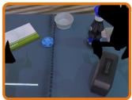  
click alarmclock close the right gripper

Reconstruction only: top-3 Aloha-AgileX clips  
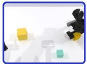  
✗ blocks ranking size grasp the medium block (R)

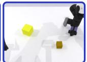

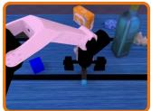

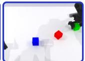  
✗ blocks ranking size grasp the medium block (R)  
beat block hammer grasp the hammer (L)  
✗ blocks ranking rgb grasp the green block (R)

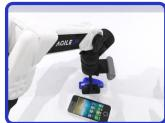

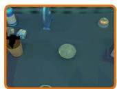  
place empty cup grasp the cup (L)  
✗ place a2b left grasp the 048\_stapler (L)

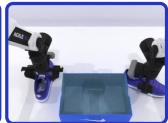

  
✗ place dual shoes grasp both shoes with both grippers  
✗ place container plate grasp the container

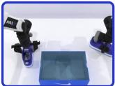  
✗ place dual shoes grasp both shoes with both grippers

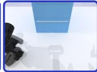  
✗ put object cabinet grasp the 047\_mouse (L)

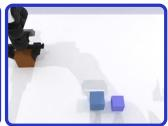  
✗ blocks ranking size grasp the large block (L)

## (b)

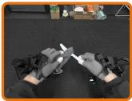

Reconstruction only: top-3 robot clips  
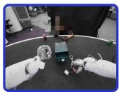  
Query (human)  
✗ organizing the drawer grasp

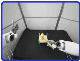  
✗ hammer nails v2 press  
wipe knife wipe

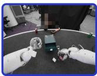  
✗ organizing the drawer grasp  
✓ place empty cup grasp the cup (L)  
✓ click alarmclock close the right gripper

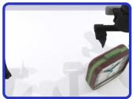

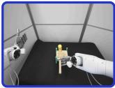  
✗ hammer nails v2 press  
+ Language alignment: top-3 Aloha-AgileX clips

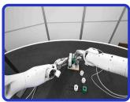

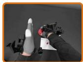  
✓ wipe knife wipe

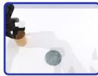  
✓ beat block hammer grasp the hammer (L)

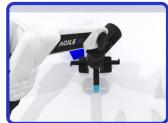  
✗ tictactoe mate

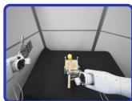

  
✗ hammer nails v2 transport  
✓ click alarmclock close the right gripper

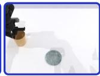

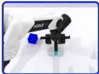  
✓ place empty cup grasp the cup (L)

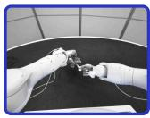  
✓ beat block hammer grasp the hammer (L)

  
✓ place empty cup grasp the cup (L)

  
gear assembly grasp  
✓ click alarmclock close the right gripper

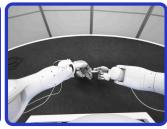  
✓ wipe knife wipe

+ Language alignment: top-3 robot clips  
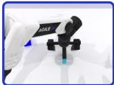  
✓ beat block hammer grasp the hammer (L)

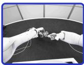  
✓ wipe knife wipe  
✓ gear assembly grasp

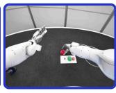  
✗ tictactoe reach  
✓ gear assembly grasp

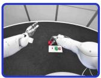

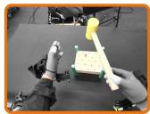  
✗ tictactoe grasp  
✓ gear assembly grasp  
hammer nails v2 transport

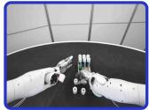  
✗ tictactoe grasp

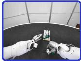

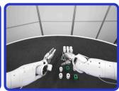

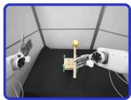  
✓ hammer nails v2 transport

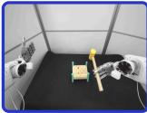  
✓ hammer nails v2 transport

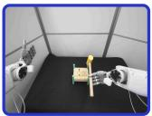  
✓ hammer nails v2 transport

Figure 8 Cross-embodiment retrieval on shared tasks. Each query (left) and its three nearest target-robot clips under the reconstruction-only tokenizer (middle) and SALA (right). (a) RoboTwin 2.0: ARX-X5 queries, Aloha-AgileX clips. (b) Real world: human queries, robot clips. Each clip is labeled with its task (italic) and atomic action; ✓/× mark whether the atomic action (a) or the task and verb (b) match the query. Examples are selected.

## Query (human)

replace toy battery insert: press the aligned yellow battery into the open upper slot

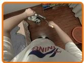  
sweep the floor brush: grip broom handle

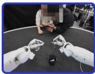

## Reconstruction only: top-3 robot clips

pick place pen transport: carries the grasped black pen upward and leftward to the position directly

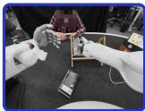

tidy up the books reorient: holds the comic book on the shelf and rotates it to an upright position scoop salt into cup transport: transport the spoon toward th pink cup

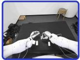

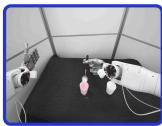

insert battery mate: aligns the long white rectangular object with the smal white rectangular

organizing the drawer grasp: closes its fingers to grasp the pink binder clip on

organizing the   
drawer   
grasp: closes fingers   
around the white power   
adapter resting on the   
daily work   
scoop: fingers dig   
into fasteners in blue   
bin

insert battery grasp: grasps the small white cylindrical object on the black table

tictactoe grasp: closes fingers around the green block and makes sligh adjustments to form a battery charging press: presses the small cylindrical object downward again to adjust its position

store cards mahjong gather: fingertips initially rest on the stacked cards

hammer nails v2 lift: lifts the wooden mallet upward

fold craft boxII grasp: grasps the edge of the left top flap

  
tictactoe mate: mates the green hexagonal block with the purple peg on the wooden base

## + Language alignment: top-3 robot clips

battery charging reach: moves downwards towards the other small battery placed on the black table

battery charging reorient: holds the battery case and adjusts its posture slightly

  
battery charging mate: aligns the small cylindrical object with the slot on the white block and

sweep trash into dustpan reach: reaches toward the handle of the yellow dustpan

sweep trash into   
dustpan   
transport: lifts the   
yellow brush off the   
table surface   
sweep trash into   
dustpan   
wipe: wipes across th   
table surface with the   
yellow brush

pack blueberries transport: transports the small black object rightward to the opening of the plastic pack blueberries lift: lifts the gripped dark berry upward until the berry is completely lifted

pack blueberries lift\_transport: lifts and transports the small black object to the opening of the

dealing the cards place\_release: places the playing card onto the dark table surface and releases its grasp dealing the cards reach: moves towards the stack of pink cards held by the left hand

dealing the cards reach: reaches toward the stack of pink cards held by the left hand

Figure 9 Retrieval for human clips of tasks absent from the robot data. Annotated version of figure 6 with one additional query. Each clip is labeled with its task (italic) and the atomic action of its active hand.

Press stapler

Move stapler

press stapler 20 clean, 20 randomized

clean scenes: 20 close gripper, 20 press stapler

  
close gripper 20 clean, 20 randomized  
randomized scenes: 20 close gripper, 20 press stapler  
Clean Randomized

  
Place mouse

  
Figure 10 Clusters of latent actions. For three pairs of atomic actions in figure 5(a), k-means (k = 2) is applied to the 80 ARX-X5 latents of each tokenizer, 20 per atomic action and scene type. Each half-row shows one cluster: its composition in the header and four of its clips. Without alignment (recon. only), the two clusters are the clean and the randomized clips, each mixing both atomic actions; with alignment, each cluster is one atomic action, covering both scene types. Filled circle: clean scene; open triangle: randomized scene.

## C Implementation Details

Tokenizer. Table 7 lists the tokenizer settings of both experiments. Each observation is resized to 224 × 224 and encoded by a frozen DINOv2-L, using features from its second-to-last layer. The visual encoder, a transformer with 8 layers and 16 heads, maps the endpoint features of a clip to 8 latent tokens. The quantizer is SoftVQ with 256 codes and a softmax temperature of 0.25. The visual decoder, also with 8 layers, predicts the DINOv2 features of the future observation, and the action decoder predicts the action chunk from the quantized latents and the initial robot state with a Huber loss (δ = 0.35). The visual reconstruction loss has weight 1, and the softmax temperature of $Q _ { i }$ in equation (2.2) is 0.2. To provide robot clips as alignment targets for every human clip, each batch draws human and robot clips in equal numbers, and robot clips are gathered across GPUs. We optimize with AdamW (learning rate $1 0 ^ { - 4 } , \beta = ( 0 . 9 , 0 . 9 5 )$ , weight decay 0.01) at a constant learning rate, with gradient clipping at 1.0 and bf16 mixed precision.

Table 7 Tokenizer settings. Horizon k: frame interval between the two endpoint observations of a clip. In the real world, k is 8 frames for one source of human videos, and 16, 8, or 4 frames for the other, chosen by motion speed so that slow motions span longer intervals.
<table><tr><td></td><td>Simulation</td><td>Real world</td></tr><tr><td>Camera views</td><td>1 (head)</td><td>3 (head, two wrists)</td></tr><tr><td>Hidden size</td><td>768</td><td>1024</td></tr><tr><td>Codebook dimension</td><td>32</td><td>64</td></tr><tr><td>Action decoder layers</td><td>8</td><td>4</td></tr><tr><td>Text encoder</td><td>CLIP ViT-B/32 (Radford et al., 2021) Qwen3-Embedding-4B</td><td></td></tr><tr><td>Temperature of  $P _ { i }$ </td><td>0.0253</td><td>0.049</td></tr><tr><td>λact</td><td>10</td><td>5</td></tr><tr><td> $\lambda _ { \mathrm { a l i g n } }$ </td><td>0.001</td><td>0.005</td></tr><tr><td>Horizon k (frames)</td><td>Aloha-AgileX: 8 ARX-X5: 6</td><td>robot: 16 human: 4-16</td></tr></table>

Policy. The VLM is Qwen3-VL-4B, and the action expert is a separately parameterized Qwen3-style transformer with 0.6B parameters (36 layers, hidden size 768) that attends jointly with the VLM at every layer. The latent-action loss weight in equation (2.4) is $\lambda _ { \mathrm { L A } } = 0 . 1$ . Pre-training starts from the Qwen3-VL-4B-Instruct weights with a randomly initialized action expert and 8 latent queries; mid-training starts from the pre-trained checkpoint, and post-training from the mid-trained one, keeping the same architecture throughout.

  
Figure 11 Embodiments in RoboTwin 2.0. Frames of the same task performed by the target embodiment Aloha-AgileX (left), whose complete trajectories form ${ \mathcal { D } } _ { R } ,$ and the non-target embodiment ARX-X5 (right), whose videos form $\mathcal { D } _ { H }$

## D Atomic-Action Annotations on RoboTwin 2.0

RoboTwin 2.0 collects expert trajectories by running a scripted program for each task with a motion planner (Chen et al., 2025b). The program composes the task from manipulation primitives, and the planner executes each primitive as a short sequence of arm motions and gripper commands. This execution divides each trajectory into atomic actions whose boundaries are given by the program. The program also specifies the target object and the executing arm of each atomic action, so we describe each atomic action in language without manual annotation. These atomic actions typically last about one second. Figure 12 shows one episode divided in this way. We annotate the ARX-X5 and Aloha-AgileX trajectories with the same procedure.

  
Figure 12 Atomic-action annotations on RoboTwin 2.0. Frames of one Aloha-AgileX episode of the beat block hammer task at the boundaries between consecutive steps of the task program. The description between two frames is the atomic action performed between them.

## E Real-World Platform

All real-world experiments use a Sharpa North robot1, a wheeled full-body humanoid with two 7-DoF arms, each equipped with a 22-DoF Sharpa Wave dexterous hand2. The Wave is a human-scale, five-finger hand with a vision-based tactile sensor in each fingertip; our policy does not use tactile inputs. The policy observes RGB images from a head-mounted stereo camera and two wrist-mounted fisheye cameras, together with the joint angles of both arms, both hands, and five torso and neck joints. It predicts chunks of 32 joint-angle targets at 60 Hz, expressed relative to the current state and covering 63 actuated DoF, while images are captured at 30 Hz. Figure 13 shows the robot and its main components.

## F Real-World Tasks

For each task, we describe the goal and the success criterion. Figure 14 shows one teleoperated demonstration of each task.

Gear assembly. The robot picks up three loose gears and assembles them onto the corresponding pegs of a base plate. A trial succeeds if all three gears are fully seated on the correct pegs with adjacent teeth engaged and remain in place after the robot releases them.

Bimanual pouring. The robot transfers pills from a source cup into a receiving cup with both hands: one hand holds the receiving cup steady while the other lifts and tilts the source cup. A trial succeeds if all pills are transferred into the receiving cup without visible spillage and both cups are placed upright on the table and released.

Flower insertion. The robot grasps a single flower by its stem, lifts it from a holder, and inserts the stem into a vase. A trial succeeds if the stem is inside the vase and the flower remains supported by the upright vase after the robot releases it.

Spoon scooping. The robot picks up a spoon from its holder, scoops rice from a bowl, and pours a spoonful into a target cup. A trial succeeds if a spoonful of rice is deposited into the target cup without visible spillage outside the containers and the spoon is returned to its holder and released.

  
Figure 13 Real-world platform. The Sharpa North robot comprises (a) a head-mounted stereo camera, (b) two 7-DoF arms, (c) two 22-DoF Sharpa Wave dexterous hands, (d) two wrist-mounted fisheye cameras, (e) a torso, and (f) a wheeled base.

  
Figure 14 Real-world tasks. Frames of one teleoperated demonstration per task, captured by the head camera. The description between two frames is the action performed between them.