# Similarity-Guided Optimization Strategies for Approximate Network Symmetry Detection

David Hartman<sup>∗1,2</sup>, Jaroslav Hlinka<sup>1,3</sup>, Dominik Klepl<sup>1</sup>, Anna Pidnebesna<sup>1,3</sup>, and Petra Vidnerová<sup>1</sup>

<sup>1</sup>Institute of Computer Science of the Czech Academy of Sciences, Prague, Czech Republic <sup>2</sup>Unicorn University, Prague, Czech Republic <sup>3</sup>National Institute of Mental Health, Klecany, Czech Republic

November 13, 2026

## Abstract

Symmetry in complex networks is a structural property with broad implications for network function, dynamics, and robustness. While classical approaches rely on exact automorphisms and thus remain highly sensitive to small perturbations, recent work of Liu has introduced approximate formulations that relax the strict invariance condition and recast symmetry detection as an optimization problem over permutations. We investigate how node-level similarity information can be used to bias the search toward structurally plausible vertex correspondences, with network centralities serving as one interpretable instance. Building on this perspective, we adapt simulated annealing, genetic algorithms, tabu search, particle swarm optimization, diferential evolution and the quadratic symmetry approximator to this problem, add similarity guidance to each, and introduce Bilinear Approximate Symmetry Inference (BASIN), which learns a soft assignment matrix via bilinear embeddings. Using a unified evaluation pipeline, we compare their guided and unguided variants, BASIN and a random baseline on four synthetic graph families, structural brain connectomes, and three empirical networks with known automorphism groups. Node-similarity guidance is decisive where a planted orbit exists that the unguided search misses, and algorithm-dependent elsewhere, on synthetic and empirical networks alike. Overall, tabu search achieves the strongest performance; its guided variant (SGTS) has the lowest median score among the guided variants in all 44 synthetic conditions, while BASIN is the better of the continuous relaxations on rewired lateral graphs. The efect of node-similarity guidance is therefore regime-dependent rather than uniformly positive.

Keywords: approximate network symmetry, permutation space, metaheuristic optimization, tabu search, node centrality, structural connectomes

## 1 Introduction

Traditionally, symmetry in complex networks has been understood in the strict sense of exact automorphisms: structural permutations of nodes that preserve all adjacency relations of the network. Automorphisms provide a precise language for network structure and have been used to study empirical networks, model reduction, and collective dynamics [1–4]. Structural symmetry is also relevant to brain networks, although anatomical and network-level asymmetries must be distinguished [5, 6]. Exact automorphisms, however, can disappear after a small number of edge changes; their absence does not rule out an informative near-symmetry [7, 8].

We study approximate symmetry as a nontrivial permutation of a single graph that approximately preserves its adjacency matrix. This retains the vertex-bijection interpretation of an automorphism while allowing edge disagreement [7]. Finding a useful permutation is dificult because the search space grows factorially. Moreover, unlike matching two diferent graphs, unrestricted self-matching has an exact but uninformative identity solution. The treatment of fixed points is therefore part of the problem specification, not a detail of the optimizer.

Existing approaches include Liu’s simulated annealing (SA), the doubly stochastic relaxation of the quadratic symmetry approximator (QSA), and the basic results about the centrality-guided local search [7–9]. These provide direct points of comparison but do not establish how node-similarity guidance behaves across several discrete and continuous optimizers under a common evaluation protocol. Structural descriptors are natural search cues, but equal descriptors do not imply a symmetry (Section 2). Whether such guidance helps is consequently an empirical question.

We investigate this question by adapting SA, genetic algorithm (GA), tabu search (TS), particle swarm optimization (PSO), diferential evolution (DE) and QSA to nontrivial approximate self-symmetry, and by comparing guided and unguided versions of each. The similarity-guided genetic algorithm (SGGA) combines centrality-informed fitness and mutation; genetic search itself is established in graph correspondence [10]. Similarity-guided tabu search (SGTS) also selects its guidance configuration per instance. In addition, bilinear approximate symmetry inference (BASIN) learns node embeddings, forms a row-stochastic soft assignment from bilinear scores, includes terms for structural disagreement and optional column-sum and fixed-point penalties, and projects the result to a permutation. Its components draw on established continuous and learned correspondence ideas; the contribution here is their combination for nontrivial approximate self -symmetry.

The evaluation covers four synthetic graph families, including two with a planted correspondence, structural brain connectomes, and three empirical networks with computed automorphism groups. Guidance is most useful when it exposes a relevant correspondence missed by unguided search, but can be neutral or detrimental in other regimes. SGTS has the lowest median objective value among the guided variants in the reported synthetic conditions, with unguided TS never significantly worse outside the modular mirror model (MMM), while BASIN is stronger than QSA on most rewired lateral random model (LRM) conditions. These observations are bounded by the tested graphs and tuning protocol; they are not a claim of universal algorithmic superiority or scalability.

## 2 Related Work

## 2.1 Exact symmetry and non-equivalent approximations

The automorphism group describes exact invariance under vertex relabeling. Empiricalnetwork studies have found substantial, often local, automorphism structure, while asymmetry is typical in broad classes of random graphs [1], which is also supported by theoretical results [11]. Automorphisms can also organize network reductions and synchronized dynamics [2, 3]. These observations motivate robust extensions, but approximate symmetry has more than one mathematical meaning. Concentric network symmetry measures regularity across successive neighborhoods [12]; dynamical quasi-symmetry concerns phase relations rather than an approximately adjacency-preserving vertex permutation [13]. Neither is interchangeable with the objective studied here.

Liu formulated a global, permutation-based measure of adjacency disagreement, restricting the search to fixed-point-free permutations to avoid the identity [7]. Pidnebesna et al. retained the self-matching interpretation but introduced a fixed-point penalty and QSA, which relaxes permutations to doubly stochastic matrices and projects a continuous solution back to a discrete assignment [8]. Hartman et al. studied centrality-guided iterative search for the same family of approximate-symmetry questions [9]. These three papers are the closest methodological predecessors. Their diferent fixed-point treatments should be considered when comparing reported symmetry scores and candidate permutations.

## 2.2 Graph matching and continuous assignment

Matching two graphs often optimizes a quadratic objective over permutation matrices and is closely related to the quadratic assignment problem [14, 15]. Replacing permutations by doubly stochastic matrices makes continuous optimization possible, but relaxation and projection need not preserve the discrete optimum. For example, Aflalo et al. established recovery results for particular spectrally characterized graph classes and bounded perturbations, whereas Lyzinski et al. showed important diferences between convex and indefinite relaxations under their random-graph assumptions [16, 17]. Vogelstein et al. used a Frank–Wolfe-type procedure with linear-assignment directions and final projection for graph matching [15]; QSA adapts this relaxation strategy to approximate self-symmetry [8].

These are methodological connections, not equivalent tasks. Ordinary two-graph matching seeks an unknown correspondence between distinct inputs; it does not require excluding the identity of a graph matched to itself. Theoretical guarantees and empirical rankings for two-graph matching therefore do not transfer automatically to the nontrivial self-matching objective. QSA’s fixed-point penalty and BASIN’s own penalty and post-projection selection are specifically relevant to that distinction.

## 2.3 Structural guidance and discrete search

Node-level information can narrow a correspondence search. Recursive neighborhood scores have been used in graph matching [18]; more recently, attribute and structural similarities have been combined in a two-graph matching algorithm [19]. Such work supports using structural evidence to prioritize candidate pairs, but does not show that similarly scored vertices are approximately automorphic. Centrality is constant on an exact orbit, but equal centrality does not imply a shared orbit [20, 21], and under approximate symmetry even the constancy holds only approximately. The more direct evidence for this setting is the reported improvement of centrality-guided local search on selected instances [9].

Genetic search has long been applied to inexact matching between diferent graphs [10], and the quadratic-assignment literature includes permutation-based evolutionary and local-search strategies [14, 22]. Our SGGA applies this search to the self-symmetry objective, with a fixed-point bound and centrality terms in its fitness and mutation. The TS adaptation instead uses a permutation neighborhood and instance-level selection among guidance settings. The PSO and DE adaptations use continuous population search followed by projection to permutations; they are not native permutation algorithms. These distinct mechanisms justify empirical comparison but do not predict their ranking on self-matching. Similarity guidance can be useful when a descriptor separates plausible from implausible mappings; it may contribute little or misdirect search when the descriptor is degenerate or unrelated to the target correspondence. The present experiments test, rather than presume, its value.

## 2.4 Learned soft correspondence and BASIN

Soft assignments are also used in diferentiable matching. Sinkhorn–Knopp normalization alternates row and column scaling toward a doubly stochastic matrix [23], and diferentiable variants have enabled learning of latent permutations [24]. Learned node embeddings and afinity scores have been combined with assignment mechanisms in graph matching between pairs of graphs [25]. These works are relevant precedents for BASIN’s components, not prior solutions to the present self-symmetry problem.

BASIN learns bilinear node scores from the symmetry loss on one graph and applies a row-wise softmax. It regularizes, but does not enforce, column sums of one; thus its soft matrix is generally not doubly stochastic and BASIN does not implement Sinkhorn normalization. A discrete permutation is obtained only after projection, which can change the structural objective. Nor does BASIN inherit recovery guarantees from convex graph-matching relaxations. Its claim here is a distinct parametrization and empirical comparison in permutation-based approximate symmetry detection, rather than novelty of bilinear embeddings or diferentiable assignment in general.

## 3 Definitions

This section introduces the formal concepts and mathematical notation underlying approximate symmetry detection in networks. We begin with the definition of exact graph automorphisms and then introduce the relaxed formulation used throughout this work.

## 3.1 Networks

As a network, we understand a loop-less, undirected, unweighted graph, defined by a set of vertices (nodes) V and edges (links) E, denoted as $G = ( V , E )$ . We denote the number of vertices by $| V | = n$ , and the number of edges by $| E | = m$ . We then define the density of the graph by $\rho ( G ) = m / { \binom { n } { 2 } }$

The graph is represented by its adjacency matrix $A \in \{ 0 , 1 \} ^ { n \times n }$ , where $A _ { i j } = 1$ if $\{ v _ { i } , v _ { j } \} \in E$ and $A _ { i j } = 0$ otherwise. A graph automorphism is a permutation π of nodes that preserves adjacency: $A = P A P ^ { T }$ , where $P$ is the corresponding permutation matrix, i.e. a square binary matrix with exactly one entry of 1 in each row and each column. We denote the set of all permutation matrices by $\mathcal { P } _ { n }$ and an identity matrix as $I _ { n }$ . The set of all such adjacency-preserving matrices forms the automorphism group of the graph [26].

Equivalently, an automorphism can be understood as a bijective mapping from V to V preserving both the presence and absence of all edges. Automorphisms can map (permute) some vertices so that their image is identical to themselves. We will call such vertices fixed vertices of the permutation. Note that for every graph there is always one automorphism called a trivial automorphism, in which all vertices are fixed, i.e., it does not permute any vertices. We will call a graph symmetric if there is at least one non-trivial automorphism, otherwise it is asymmetric.

## 3.2 Problem statement

Exact automorphism-based symmetry is highly sensitive to small structural perturbations: even minor changes in the adjacency structure may eliminate all non-trivial automorphisms. To address this limitation, we adopt the approximate symmetry framework introduced by [7], which measures how closely a permutation preserves the adjacency matrix.

Given a permutation matrix $P ,$ the approximate symmetry error is defined as

$$
\epsilon ( A , P ) = \frac { 1 } { 4 } \| A - P A P ^ { T } \| _ { 1 } .\tag{1}
$$

The factor $\textstyle { \frac { 1 } { 4 } }$ counts each mismatched undirected edge once. Normalizing by the number of ordered vertex pairs gives the size-independent score

$$
\mathcal { S } ( A , P ) = \frac { \left\| A - P A P ^ { \operatorname { T } } \right\| _ { 1 } } { n ( n - 1 ) } = \frac { 4 \epsilon ( A , P ) } { n ( n - 1 ) } ,\tag{2}
$$

which is minimized over $P \in \mathcal P _ { n } \setminus \{ I _ { n } \}$

Very local permutations involving only a small number of vertices may yield artificially low symmetry scores. The original formulation in [7] therefore restricted to permutations with no fixed points, i.e. tr $( P ) = 0$ . In many empirical networks, however, meaningful approximate symmetries may include partially fixed substructures. Thus, to improve the interpretability of the discovered symmetries, while avoiding near-identity solutions, we allow permutations with fixed points but explicitly penalize their influence through a modified normalization of the approximate symmetry score:

$$
\mathcal { S } ^ { \prime } ( A , P ) = \frac { \| A - P A P ^ { T } \| _ { 1 } } { n ( n - 1 ) - F ( P ) \big ( F ( P ) - 1 \big ) } , \qquad P \in \mathcal { P } _ { n } \setminus \{ I _ { n } \}\tag{3}
$$

where $F ( P ) = \operatorname { t r } ( P )$ denotes the number of fixed points of permutation P. This formulation discourages permutation that leave most vertices unchanged while still allowing partially fixed symmetries to be detected.

This self-referential form also explains why of-the-shelf graph matching and quadratic assignment solvers cannot be applied unmodified. Such solvers align two distinct graphs, and with both arguments equal to A the identity permutation attains zero discrepancy and is a global optimum of their objective, so an unconstrained solver returns it. Approximate symmetry is therefore a matching of a network to itself under an explicit non-identity constraint, and the constraint has to be part of the search rather than a post-hoc filter. With it built in, such solvers do apply: QSA and BASIN are continuous relaxations of the kind used in graph matching, and TS is a quadratic assignment solver (Section 4).

## 3.3 Node similarity and Centralities

The optimization problem defined above involves search over the space of all permutations, whose size grows factorially with the number of vertices. As a result, purely random exploration of candidate permutations is ineficient and fails to prioritize structurally meaningful vertex correspondences. In this work, we therefore introduce the concept of node similarity guidance: additional node-level information that biases the optimization toward permutations mapping vertices with comparable structural roles. We use the term node similarity to denote any descriptor that assigns comparable value to vertices that are likely to be interchangeable under approximate symmetries. Centrality measures constitute one interpretable and computationally convenient instance of such descriptors [27].

Centralities quantify diferent aspects of a vertex’s structural role within a network, such as connectivity, influence, or position within communication pathways. Because automorphisms preserve node-rooted structural descriptors, vertices that are symmetric (i.e. can be mapped to each other via automorphism) or nearly symmetric often exhibit similar centrality profiles. Consequently, centralities provide a principled way to construct node-similarity signals that can be incorporated into optimization strategies. The alternative notions of approximate symmetry discussed in Section 2 can correlate only weakly with centralities [12]. This is not at odds with the above: those notions define symmetry by other node properties, whereas here symmetry is defined by the permutation objective and centralities only bias the search towards vertex correspondences that an automorphism would preserve.

In this work, node centralities provide an interpretable implementation of nodesimilarity guidance, but they are not the only option. In particular, our proposed BASIN strategy (Sec. 4.8) replaces centrality descriptors with a learnable similarity mechanism. For the explicit (hand-crafted) versions of strategies, we consider several commonly used centrality measures:

• Degree centrality, capturing local connectivity and forming a basic structural descriptor frequently used in graph characterization [28].

• Eigenvector centrality [29], which generalizes degree by incorporating global network structure and is closely related to spectral properties of the graph.

• Bonacich centrality [29], a parametric extension of eigenvector centrality that accounts for indirect influence through neighboring vertices.

• Betweenness centrality [30], measuring how often a vertex lies on shortest paths between other vertices, with connections to symmetry-related structural properties [20, 21, 31].

• Clustering coeficient, describing the density of local neighborhoods and providing structural information [27, 32].

In this work, centrality measures serve mainly as a clear and interpretable example of node-similarity guidance that can be incorporated into optimization procedures. At the same time, they provide a useful reference point for comparison with more flexible similarity mechanisms, including learnable formulations introduced later. Centralities should therefore be viewed here as one application of the node similarity guidance rather than a restrictive modeling choice.

## 4 Methods

This section describes the optimization strategies evaluated for identifying approximate symmetries in networks. We consider both established reference methods and new strategies proposed in this work. Specifically we compare: (i) a random-search baseline, (ii) SA following [7], (iii) QSA [8], (iv) TS following [22], (v) PSO [33] and (vi) DE [34], (vii) a genetic-algorithm-based search (GA), and (viii) BASIN, a continuous optimization strategy introduced here. Every strategy but BASIN and the baseline is evaluated in an unguided and a similarity-guided variant, prefixed “SG”. The guided variant of SA follows [9]; the guided variants of the other strategies, are introduced here.

All methods optimize the same approximate-symmetry objective but difer in how the permutation space is explored and in how node-similarity information is incorporated. Similarity guidance is introduced explicitly through predefined structural descriptors, that is, centrality measures. BASIN instead implements a data-driven node-similarity mechanism through continuous embeddings. QSA represents a state-of-the-art continuous relaxation approach that does not in its original form explicitly incorporate node-similarity guidance. The following subsections describe each strategy in detail.

## 4.1 Random Search

To contextualize the performance of the tested optimization strategies, we include a simple brute–force random search baseline. This strategy directly samples the permutation space by repeatedly drawing uniformly random permutations and evaluating their approximate symmetry score $S ^ { \prime } ( A , P )$

For a given graph with adjacency matrix A, we generate 10000 independent random permutations $\bar { P ^ { ( 1 ) } , } \bar { P ^ { ( 2 ) } , } \ldots , \bar { P ^ { ( 1 0 0 0 0 ) } }$ , compute $S ^ { \prime } ( A , P ^ { ( k ) } )$ for every sampled permutation, and retain the lowest-scoring one as the solution produced by the method.

## 4.2 Simulated Annealing

[7] address the factorial growth of $\mathcal { P } _ { n }$ with a SA strategy that searches over permutations by iteratively proposing local modifications and accepting them according to a temperature-controlled criterion.

Briefly, at iteration $t ,$ a candidate permutation $P ^ { \prime }$ is generated from the current permutation $P$ and accepted if it improves the objective, i.e. ϵ $\left[ A , P ^ { \prime } \right) \leq \epsilon ( A , P )$ . Otherwise, the move is accepted with probability

$$
\exp \biggl ( - \frac { \epsilon ( A , P ^ { \prime } ) - \epsilon ( A , P ) } { T ( t ) } \biggr )
$$

where $T ( t )$ is the temperature. The temperature follows a logarithmic cooling schedule,

$$
T ( t ) = \frac { c } { \log ( t + d ) } ,
$$

where t denotes the iteration index and $c , d > 0$ are parameters controlling the initial temperature and the rate of cooling. Higher temperatures allow the algorithm to accept worsening moves with non-negligible probability, facilitating exploration of permutation space, while decreasing temperatures progressively bias the search toward locally improving moves. Here ϵ is $S ^ { \prime } ( A , P )$ (Eq. 3), and moves that would raise $F$ above ⌊0.25n⌋ are refused.

Transitions between permutations are realized by swapping the images of two vertices. Specifically, the move is generated by a random transposition that exchanges the images of two vertices $a , b \in V$ under the current permutation $\pi .$ , replacing the pairs $( a , \pi ( a ) )$ and $( b , \pi ( b ) )$ with $( a , \pi ( b ) )$ ) and $( b , \pi ( a ) )$ , where $a , b \in V .$

In our implementation, we retain the $\mathrm { S A }$ framework of $[ 7 ]$ , but replace random transpositions with an informed move proposal that favors swaps between vertices with similar structural roles. This modification is motivated by the fact that graph automorphisms preserve node centralities. Consequently, mapping vertices to images with similar centrality values is expected to reduce edge disagreements and guide the search toward structurally meaningful permutations. Similarity is measured by node centralities, yielding a guided proposal distribution over candidate transpositions, defined next.

Vertex similarity structures We represent the pairwise similarity of vertices under a chosen centrality Γ by an $n \times n$ matrix M whose rows and columns correspond to the vertices. We first define a diference matrix $\Delta$ with entries $d _ { i j } = | \Gamma ( i ) - \Gamma ( j ) |$ , and convert diferences into similarities by setting $m _ { i j } = ( d _ { i j } + \beta ) ^ { - 1 }$ , where $\beta > 0$ is a regularization parameter preventing division by zero and controlling the strength of the bias. Larger $\beta$ values yield a flatter M and thus weaker guidance. Rather than selecting a single centrality, a guided strategy uses either a weighted blend

$$
M = \sum _ { k } w _ { k } { \frac { M _ { k } } { { \overline { { M _ { k } } } } } }\tag{4}
$$

of the matrices $M _ { k }$ built from degree, eigenvector, betweenness and clustering, each rescaled to unit mean, with weights $w _ { k } \geq 0$ , or guides each restart by a single $M _ { k }$ , the four taken in turn; which of the two forms a strategy uses is one of its hyperparameters.

Guided move function Given the current permutation $\pi ,$ we select a vertex a uniformly at random and consider swaps of its image $\pi ( a )$ with the images $\pi ( b )$ of the other vertices $b \in V$ . Let $m _ { i j }$ denote the vertex similarity as defined previously. We associate the current permutation with a global similarity score $\textstyle \sum _ { i } m _ { i \pi ( i ) }$ . Since swapping the images of $a$ and $b$ afects only the terms corresponding to these two vertices, the resulting change in this global similarity score is $\Delta M _ { b } = m _ { a \pi ( b ) } + m _ { b \pi ( a ) } - m _ { a \pi ( a ) } - m _ { b \pi ( b ) }$

These values are transformed into non-negative weights via $\Delta E _ { b } = \operatorname* { m a x } ( \Delta M _ { b } , \phi )$ where $\phi > 0$ is a probability-smoothing parameter. As with the division parameter $\beta _ { ; }$ larger values of $\phi$ flatten the relative diferences between candidates. After normalization, the resulting weights define the probability distribution over candidate vertices $b ,$ from which the swap partner is sampled. The selected transposition is then evaluated using the standard $\mathrm { S A }$ acceptance rule.

Hyperparameters The tunable hyperparameter of SA is the temperature scale c;   
similarity-guided simulated annealing (SGSA) adds $\beta , \phi$ and the weights $w _ { k }$ of Eq. 4.

## 4.3 Quadratic symmetry approximator

This strategy is described in [8]. The central idea of this strategy is to relax the discrete search over permutation matrices into a continuous optimization problem over doubly stochastic matrices. This relaxation is motivated by the close relationship between approximate symmetry detection and the quadratic assignment problem [8]. Under this formulation, the optimization problem can be written as

$$
\operatorname* { m i n } _ { P \in \mathcal { D } _ { n } } - \mathrm { t r } \Big ( A P A ^ { \mathrm { T } } P ^ { \mathrm { T } } - \mathrm { d i a g } ( c ) P \Big ) ,
$$

where the $\mathcal { D } _ { n }$ denotes the Birkhof polytope of $n \times n$ doubly stochastic matrices and the vector c encodes penalties on fixed points.

Since the solution of this optimization lies in the polytope $\mathcal { D } _ { n }$ , the resulting matrix is generally doubly stochastic rather than a valid permutation matrix. A discrete permutation is therefore recovered in a post-processing step by selecting a permutation matrix that is close to the relaxed solution. In practice, this is achieved by solving a linear assignment problem [8].

The continuous part of the optimization is carried out using a first-order algorithm based on the Frank-Wolfe method, in which the linear assignment problem can be eficiently exploited to calculate the search direction, following ideas introduced in [15].

Similarity guidance similarity-guided quadratic symmetry approximator (SGQSA) adds a linear reward to the relaxed objective, $f ( P ) { - } \lambda _ { \mathrm { c } } s \left. M / \overline { { M } } , P \right.$ , with M the similarity matrix defined in Eq. 4 and s the mean absolute gradient at the initial point, which puts the term on the scale of the gradient at every graph size. The objective stays quadratic plus linear, so the Frank–Wolfe line search remains exact, and $\lambda _ { \mathrm { c } } = 0$ recovers QSA.

Hyperparameters The tunable hyperparameters of QSA are the fixed-point penalty c and the convergence tolerance of the Frank–Wolfe iterations; SGQSA adds $\lambda _ { \mathrm { c } } , \beta$ , the form of M and, for a blend, the weights $w _ { k }$

## 4.4 Tabu Search

TS [35] searches the discrete space of permutations through local modifications of the current permutation. At every iteration it moves to the best solution in the neighborhood of the current one, even when it is worse, and forbids the reversal of recent moves for a number of iterations, which keeps the search from falling back into a local minimum it has just left. We follow the robust tabu search of [22] for the quadratic assignment problem.

As in SA, the neighborhood consists of the $\binom { n } { 2 }$ transpositions that exchange the images of two vertices, but TS evaluates all of them rather than sampling one. The change in $\| A - P A P ^ { \mathrm { T } } \| _ { 1 }$ of each transposition is read from a table updated in $O ( n )$ per accepted move, so an iteration costs $O ( n ^ { 2 } )$ . A move exchanging the images of a and b is then logged as tabu for a tenure whose length is drawn uniformly from $[ t _ { \mathrm { l o } } n , \ t _ { \mathrm { h i } } n ]$ iterations. A tabu move is still accepted if it improves on the best solution found so far.

Our formulation departs from [22] in three respects. Both the flow and the distance matrix are $A ,$ so an unconstrained search converges to the identity (Section 3.2); we require tr $( P ) \leq n - 2$ throughout, which is exactly $P \neq I _ { n }$ . Moves are ranked by $S ^ { \prime } ( A , P )$ $\left( \operatorname { E q . 3 } \right)$ rather than by the unnormalized discrepancy $\| A - P A P ^ { T } \| _ { 1 }$ . Its denominator depends only on the number of fixed points $F ( P )$ , which a transposition can change only at the two vertices it exchanges, so $S ^ { \prime } ( A , P )$ of every candidate move follows in $O ( 1 )$ from its tabulated change in discrepancy, and the scan remains $O ( n ^ { 2 } )$ . The long-term frequency memory is omitted.

Similarity-guided moves Similarity guidance changes which transposition is chosen at each iteration, in one of two ways: by restricting the neighborhood to smaller candidate list or by biasing the ranking of moves. With M the similarity matrix of Eq. 4, let $\Delta M _ { u v } =$ $m _ { u \pi ( v ) } + m _ { v \pi ( u ) } - m _ { u \pi ( u ) } - m _ { v \pi ( v ) }$ be the change in global similarity from transposing the images of u and v. The candidate list restricts the scan to the fraction $q \in \mathsf { \Gamma } ( 0 , 1 ]$ of transpositions with the largest $\Delta M _ { u v }$ , recomputed every iteration. The bias keeps the full scan and ranks moves on $S ^ { \prime } ( A , P ^ { \prime } ) - \lambda \hat { \sigma } z _ { u v }$ , with $z _ { u v }$ the standardized $\Delta M _ { u v }$ and $\hat { \sigma }$ the standard deviation of $S ^ { \prime }$ over the admissible moves, so $\lambda$ is a shift in units of that deviation. Whether a tabu move improves on the best solution is judged on the unbiased $S ^ { \prime } ( A , P ^ { \prime } )$ , so the bias cannot release a move from the tabu list. With $q = 1$ and $\lambda = 0$ the search reduces to plain TS.

Similarity-guided tabu search SGTS selects its guidance per instance. Four configurations — plain TS, two bias strengths λ and one candidate fraction $q -$ are the arms of a multi-armed bandit, and one pull is one restart from a fresh random permutation. Restarts share no state, so each arm’s scores are independent draws from a fixed distribution, as UCB1 [36] assumes. After one pull of each arm, restart t goes to the arm maximizing

$$
\bar { r } _ { a } + \kappa \sqrt { \frac { 2 \ln t } { n _ { a } } } ,
$$

with $n _ { a }$ the pulls of arm a so far, $\bar { r } _ { a }$ its mean reward and κ an exploration constant. A restart returning ${ \mathcal { S } } ^ { \prime } = s$ is rewarded $( s _ { \mathrm { m a x } } - s ) / ( s _ { \mathrm { m a x } } - s _ { \mathrm { m i n } } )$ , clipped to [0, 1], with the range taken from the opening round on the same instance; a tied round gives 0.5.

The product of restarts and iterations per restart equals that of unguided TS, so the selector pays for its exploration out of the same budget. Only the allocation of restarts is adaptive; each restart is the TS above with the arm’s $q$ and λ.

Hyperparameters The tunable hyperparameters of TS are the tenure bounds $t _ { \mathrm { l o } }$ and $t _ { \mathrm { h i } } ;$ SGTS adds $\beta _ { i }$ the weights $w _ { k }$ , the two bias strengths λ and the candidate fraction q of its arms, and κ.

## 4.5 Particle swarm optimization

PSO [33] is defined on a real vector space, so applying it here requires a continuous relaxation of ${ \mathcal { P } } _ { n }$ . A candidate is a matrix $X \in [ 0 , 1 ] ^ { n \times n }$ , read as a score for assigning vertex $i$ the image $j ,$ committed to a permutation by solving the linear assignment problem exactly,

$$
P = \arg \operatorname* { m a x } _ { P \in \mathcal { P } _ { n } } \langle P , X \rangle ,
$$

by the Hungarian algorithm [37], and scored by $S ^ { \prime } ( A , P )$ on the feasible set $\mathrm { t r } ( P ) \leq$ $n - 2$ used throughout. Unlike QSA, no constraint ties X to the Birkhof polytope: the rounding, not the parametrization, is what enforces that the answer is a permutation.

The swarm holds k particles, each carrying a position $X _ { i }$ and a velocity $V _ { i }$ of the same shape, both initialized uniformly. At iteration t the velocity is updated in the global-best form,

$$
V _ { i } \gets w ( t ) V _ { i } + c _ { 1 } R _ { 1 } \odot ( X _ { i } ^ { * } - X _ { i } ) + c _ { 2 } R _ { 2 } \odot ( X ^ { * } - X _ { i } ) ,
$$

where $X _ { i } ^ { * }$ is the particle’s own best position, $X ^ { \ast }$ the swarm’s, ⊙ the element-wise product, and $R _ { 1 } , R _ { 2 }$ are matrices of independent $U ( 0 , 1 )$ draws, so every coordinate is perturbed independently. The inertia weight is annealed linearly over the budget, $w ( t ) = w _ { 0 } +$ $( w _ { 1 } - w _ { 0 } ) t / ( t _ { \operatorname* { m a x } } - 1 )$ , following [38]; velocities are clamped to $[ - v _ { \mathrm { m a x } } , v _ { \mathrm { m a x } } ]$ and positions clipped back to [0, 1] after each update. The search stops after a fixed number of iterations without an improvement of the swarm best, counted per iteration rather than per particle.

Similarity guidance similarity-guided particle swarm optimization (SGPSO) adds a fourth velocity term, $c _ { g } R _ { 3 } \odot ( M - X _ { i } )$ , pulling each particle toward assignments between vertices of similar centrality, with M the similarity matrix of Eq. 4 rescaled to [0, 1] so that its pull is commensurate with the other terms. Its diagonal is set to a large diference, so the guidance does not reward mapping a vertex to itself. Setting $c _ { g } = 0$ recovers plain PSO exactly.

Hyperparameters The tunable hyperparameters of PSO are the swarm size $k ,$ the inertia weights $w _ { 0 }$ and $w _ { 1 }$ , the acceleration coeficients $c _ { 1 }$ and $c _ { 2 }$ and the velocity bound $v _ { \mathrm { m a x } } ;$ SGPSO adds $c _ { g } , \beta$ and the weights $w _ { k }$

## 4.6 Diferential evolution

DE [34] searches the same relaxation as PSO (Section 4.5) — the same encoding, the same rounding and the same feasible set — and difers only in how candidates are generated: from diferences between population members rather than by accumulating velocity. The comparison between the two is therefore a comparison of search operators, not of encoding of the problem.

The population holds k matrices. For each target $X _ { i } .$ three further members $r _ { 1 } , r _ { 2 } , r _ { 3 }$ are drawn without replacement and distinct from $i ,$ and a mutant is formed as

$$
U = X _ { r _ { 1 } } + \zeta \left( X _ { r _ { 2 } } - X _ { r _ { 3 } } \right) ,
$$

with scale factor $\zeta ,$ and its entries are clipped to [0, 1]. Binomial crossover then takes each coordinate from $U$ with probability CR and from $X _ { i }$ otherwise, with one coordinate forced to come from $U$ so that the trial is never a copy of the target. The trial replaces the target when it scores at least as well; the weak inequality lets the population drift across plateaus of $S ^ { \prime }$ . This is the DE/rand/1/bin scheme of [34].

Similarity guidance similarity-guided diferential evolution (SGDE) guides the mutant with the same matrix M that guides SGPSO, adding $c _ { g } ( M - X _ { r _ { 1 } } )$ before the clipping to [0, 1]. The term is deterministic, with no random coeficient. As with SGPSO, $c _ { g } = 0$ recovers plain DE exactly.

Hyperparameters The tunable hyperparameters of DE are the population size $k ,$ the scale factor $\zeta$ and the crossover probability CR; SGDE adds $c _ { g } , \beta$ and the weights $w _ { k }$

## 4.7 Genetic Algorithms

To search for approximate symmetries directly in the discrete space of permutations, we adapt a genetic algorithm (GA)-based strategy. GAs, see [39, 40], are populationbased optimization methods that iteratively improve a set of candidate solutions through selection, combination and random variation. In our setting, each solution represents a permutation of the graph vertices, and its quality (fitness) is assessed by both the mismatch in adjacency structure and the similarity between vertices and their images under the permutation, as quantified by centrality measures.

The algorithm maintains parallel populations $( k = 1 0 )$ , each containing $N = 9 0$ individuals (candidate permutations). Populations evolve over discrete steps (“generations") using an elitist update scheme: a subset of the best-performing individuals remains unchanged between generations, while the rest of the population is replaced by “ofspring" candidates.

Fitness evaluation For each individual permutation $P _ { \mathrm { : } }$ , to define its fitness we evaluate three quantities: (i) the approximate symmetry score induced by $P ,$ (ii) the number of fixed points, and (iii) the mismatch of node-level centrality profiles.

The approximate symmetry induced by a permutation P is quantified by the unnormalized mismatch $D ( P ) = \| A - P A P ^ { T } \| _ { 1 }$ , related to the normalized symmetry score of Eq. (2) by ${ \cal { S } } ( A , P ) = { \cal { D } } ( P ) / \big ( n ( n - 1 ) \big )$ . The number of fixed points is given by $\begin{array} { r } { F _ { \mathrm { f p } } ( P ) = \sum _ { i = 1 } ^ { n } P _ { i i } , } \end{array}$ , where n is the number of vertices of the graph. Permutations with more than ⌊0.25n⌋ fixed points are rejected to avoid trivial (near-identity) solutions.

Centrality mismatch is computed by comparing centrality values only for not-fixed vertices:

$$
C ( P ) = \frac { n } { 3 \Big ( n - F _ { \mathrm { f p } } ( P ) \Big ) } \sum _ { \stackrel { i = 1 } { \pi ( i ) \ne i } } ^ { n } \Big ( \Delta \Gamma _ { d e g } ( i , P ) + \Delta \Gamma _ { b e t } ( i , P ) + \Delta \Gamma _ { b o n } ( i , P ) \Big ) ,
$$

where $\Delta \Gamma _ { * } ( i , P )$ denotes the absolute diference between the degree, betweenness and Bonacich centrality value of vertex i and those of its image $\pi ( i )$ under the permutation $P .$

The composite fitness value is then defined as

$$
f ( P ) = { \frac { n - 1 } { 2 n } } D ( P ) + w C ( P ) ,\tag{5}
$$

which is minimized by the algorithm, with w a weight; the unguided GA minimizes $D ( P )$ alone and mutates only by random swaps. In addition to $f ( P )$ , the unnormalised mismatch $D ( P )$ and the number of fixed points $F _ { \mathrm { f p } } ( P )$ are retained for further selection control.

Ofspring generation New individuals are generated by selecting parents and applying recombination and mutation. Parent selection is performed using tournament selection: $k _ { \mathrm { t } }$ individuals are sampled randomly, and the best one is chosen by minimizing $f ( P )$ ; ties are broken by preferring lower $D ( P )$ and then fewer fixed points.

Given the parents, ofspring are produced via crossover with probability $p _ { \mathrm { c o } }$ , using cyclic crossover (probability $0 . 7 )$ or order crossover (probability 0.3). If crossover is not applied, the parents are copied without a change. Mutation is applied independently to each ofspring with probability $p _ { \mathrm { m t } }$ : with probability $p _ { \mathrm { r } }$ a random swap of two vertices is performed, otherwise a centrality-guided swap favoring vertices with similar centrality profiles is used. The mutation rate is adapted as $p _ { \mathrm { m t } } = 1 - \delta _ { p } ,$ where the population diversity $\delta _ { p }$ is defined as the ratio of distinct individuals in the population: two individuals are considered distinct if their $f ( P )$ values difer or, if tied, if their permutation matrices difer. $\mathrm { A s \ a }$ result, when the population collapses to many copies of the same or very similar solution, diversity drops and mutation pressure increases, renewing exploration of the permutation space.

Global control With all populations having progressed to next generation, one step of the algorithm is completed, elite individuals are exchanged across populations, and the global best candidate is identified as one with lowest $D ( P )$ value with ties broken by preferring lower $f ( P )$ and then fewer fixed points $F _ { \mathrm { f p } } ( P )$ . Elitism is implemented by retaining $N _ { \mathrm { e } }$ of best-performing individuals unchanged into subsequent generations. The elite groups are exchanged across all populations, thus allowing globally strong solutions to propagate quickly. If the global best solution does not improve, a patience counter is increased. When patience counter is not multiple of 10, populations are mixed cyclically exchanging $N / 3$ individuals between populations. When patience counter reaches a multiple of 10, a restart is performed in which all populations are reinitialized with only the accumulated elite set preserved (i.e. the $N _ { \mathrm { e } }$ globally best individuals). The search is terminated if patience counter reaches 50, or if a perfect solution is found, i.e. $D ( P ) = 0$

Hyperparameters The tunable hyperparameters of GA are $p _ { \mathrm { c o } }$ , the initial value of $p _ { \mathrm { m t } } , k _ { \mathrm { t } }$ and $N _ { \mathrm { e } } ;$ SGGA adds w and $p _ { \mathrm { r } }$

## 4.8 Bilinear Approximate Symmetry Inference

BASIN is a novel continuous optimization strategy that we propose for detecting approximate graph symmetries by relaxing the discrete permutation search to a diferentiable problem. Like QSA [8], and like continuous formulations of graph matching and of the quadratic assignment problem more generally (e.g. Frank–Wolfe approaches [15]), it replaces the combinatorial search over permutations with optimization over soft assignment matrices, which is subsequently discretized into a permutation. It difers in parametrization: where QSA optimizes a doubly stochastic matrix directly, BASIN parametrizes vertex correspondences through latent embeddings learned as part of the objective, so node similarity is data-driven rather than given by predefined centrality descriptors. The objective combines this bilinear similarity model with regularization terms penalizing deviations from approximate double stochasticity and near-identity solutions with many fixed points.

Model formulation Given an adjacency matrix $A \in \mathbb { R } ^ { n \times n }$ , BASIN introduces two learnable embedding matrices $S , T \in \mathbb { R } ^ { n \times m }$ , where each row corresponds to a vertex embedding. These matrices are initialized at random and constrained to have unit $\ell _ { 2 }$ norm row-wise.

Vertex similarity is modeled as a scaled bilinear matrix

$$
Z = \tau { \cal S } T ^ { \top } ,
$$

where $\tau > 0$ is a scaling (inverse-temperature). This parameter rescales all pairwise scores prior to normalization and thereby controls the concentration of the resulting distributions: smaller values of $\tau$ lead to flatter, more difuse similarities, while larger values produce increasingly peaked scores.

A row-wise softmax is then applied to obtain a soft assignment matrix $\hat { P }$

$$
\hat { P } _ { i j } = \frac { \exp ( Z _ { i j } ) } { \sum _ { k = 1 } ^ { n } \exp ( Z _ { i k } ) } , \qquad i , j = 1 , \ldots , n .
$$

Each row of $\hat { P }$ defines a probability distribution over possible images of vertex $i .$ Note, however, that the row-wise softmax enforces only row stochasticity; in general, $\hat { P }$ is not doubly stochastic, as column sums are unconstrained and may deviate substantially from one. The matrix $\hat { P }$ can therefore be interpreted as a relaxed permutation matrix that is subsequently regularized toward approximate double stochasticity through the objective function.

Objective function BASIN minimizes a composite objective that balances approximate symmetry with several regularization constraints. Specifically, the optimization problem is defined as

$$
\mathcal { L } = \mathcal { L } _ { \mathrm { { s y m } } } + \lambda _ { \mathrm { { f p } } } \mathcal { L } _ { \mathrm { { f p } } } + \lambda _ { \mathrm { { d s } } } \mathcal { L } _ { \mathrm { { d s } } } + \lambda _ { \mathrm { { o r t h o } } } \mathcal { L } _ { \mathrm { { o r t h o } } } ,
$$

where $\mathcal { L } _ { \mathrm { s y m } }$ measures the discrepancy between the adjacency matrix and its softly permuted version $\hat { P } , \mathcal { L } _ { \mathrm { f p } }$ penalizes fixed points, ${ \mathcal { L } } _ { \mathrm { d s } }$ penalizes deviation from double stochasticity of ${ \hat { P } } ,$ and $\mathcal { L } _ { \mathrm { o r t h o } }$ promotes diversity of embedding dimensions. The coeficients λ<sub>·</sub> control the relative contribution of each term. All components of the objective function are diferentiable with respect to the learnable embedding matrices S and T. In practice, some regularization components can be optionally disabled during hyperparameter optimization; when a constraint is inactive, the corresponding weight λ<sub>·</sub> is set to zero. We now define each component in detail.

Symmetry loss The main objective is to minimize the discrepancy between adjacency matrix A and its permuted version. Since $\hat { P }$ is not a true permutation matrix, the transformed adjacency ${ \hat { P } } A { \hat { P } } ^ { \top }$ is a continuous relaxation. We therefore use the fixedpoint-normalized symmetry score of $\mathrm { E q . ~ 3 }$ with the soft fixed-point count $\begin{array} { r } { \hat { F } = \sum _ { i } \hat { P } _ { i i } ^ { 2 } } \end{array}$ $\mathcal { L } _ { \mathrm { s y m } } = \Vert A - \hat { P } A \hat { P } ^ { \top } \Vert _ { F } ^ { 2 } / \operatorname* { m a x } \bigl ( n ( n - 1 ) - \hat { F } ( \hat { F } - 1 ) , 4 n - 6 \bigr )$

Fixed-point penalty To suppress near-identity solutions in which many vertices map to themselves, we penalize such fixed points with a barrier that diverges at the identity:

$$
\mathcal { L } _ { \mathrm { f p } } = \frac { f } { 1 - f } , \qquad f = \frac { 1 } { n } \sum _ { i = 1 } ^ { n } \hat { P } _ { i i } ^ { 2 } ,
$$

Double-stochasticity constraint While rows of $\hat { P }$ sum to one by construction, its columns need not sum to one. Thus we encourage approximate double stochasticity via

$$
\mathcal { L } _ { \mathrm { d s } } = \sum _ { i = 1 } ^ { n } \biggl ( \sum _ { j = 1 } ^ { n } \hat { P } _ { i j } - 1 \biggr ) ^ { 2 } + \sum _ { j = 1 } ^ { n } \biggl ( \sum _ { i = 1 } ^ { n } \hat { P } _ { i j } - 1 \biggr ) ^ { 2 } .
$$

Embedding orthogonality To prevent degenerate solutions, we encourage approximate orthogonality between embedding dimensions by minimizing

$$
\begin{array} { r } { \mathcal { L } _ { \mathrm { o r t h o } } = \| S ^ { \top } S - I \| _ { F } + \| T ^ { \top } T - I \| _ { F } , } \end{array}
$$

where I is an identity matrix.

Optimization and discretization The embedding matrices $S$ and $T$ are iteratively updated using the Adam optimizer, a popular first-order gradient-based optimizer that adaptively rescales step sizes based on running estimates of gradient moments. The optimization performed with learning rate η. After each update, rows of $S$ and $T$ are renormalized to unit norm.

Optimization is run for a maximum of 4000 iterations, with early stopping applied if no improvement in the objective function L is observed for 50 consecutive steps. The globally best soft assignment matrix $\hat { P } ^ { \star }$ observed during the entire optimization run is retained.

To obtain a discrete permutation, $\hat { P } ^ { \star }$ is projected onto the space of permutation matrices in three ways: the Hungarian algorithm, a greedy row-wise maximization, and the Hungarian algorithm applied with the diagonal forbidden. In the greedy projection, rows are processed sequentially and each row is assigned to the column with the largest value among the columns that have not yet been assigned. Once a column is selected, it is excluded from all subsequent assignments. This ensures that each row and each column is selected exactly once and therefore yields a valid permutation matrix. The candidate with the lowest $S ^ { \prime } ( A , P )$ is returned.

Hyperparameters BASIN is controlled by the embedding dimension m, the temperature parameter τ, and learning rate η. The embedding dimension m can be specified either directly as the dimensionality of the vertex embeddings or as a graph-size–dependent ratio, in which case m is set proportionally to the number of vertices. The ratio form is used here. Additional hyperparameters control the inclusion and weighting of regularization terms, including the fixed-point penalty $\lambda _ { \mathrm { f p } }$ , double-stochasticity constraint $\lambda _ { \mathrm { d s } }$ , and the orthogonality penalty $\lambda _ { \mathrm { o r t h o } }$

## 5 Testing pipeline

This section describes a testing pipeline for comparing strategies for calculating approximate symmetry. The basic idea is to utilize the various versions of random models described in Section 5.1 to create datasets, on which are the optimization strategies then tested using the procedure outlined in Section 5.3.

## 5.1 Data

To test the efectiveness of algorithms for detecting approximate symmetry, we employed several widely used models in complex networks that capture various aspects of these networks and exhibit diferent forms of symmetry. To maintain comparability with previous studies, we partially relied on a set of models used in a recently published study [8]. First, let us note that all models have a parameter that can be used to control the density of the graph.

The first model is the Erdős–Rényi (ER) model [41], which represents the most random type of network and is not typically a good model for real networks. However, it often serves as an important reference model; moreover, it is almost surely asymmetric, with the probability of a non-trivial automorphism vanishing as n grows [11].

The model that better represents real complex networks, primarily by showing a scalefree degree distribution, is the Barabási-Albert model (BA) [28]. The BA model also tends to have fewer symmetries than the corresponding real network it models. For this reason, subsequent extensions have been developed to improve symmetry representation [42]. It can therefore be assumed that the realizations of the BA model are relatively asymmetric but may contain non-trivial approximate symmetries.

The third model used is the lateral random model (LRM) [8] inspired by the lateral symmetry of the brain [43]. In its basic configuration, this model contains two parts that are mutually perfectly symmetrical, which is also, with high probability, the only symmetry in the entire system. By adjusting the parameter, this symmetry can be modified to approximate symmetry in a controllable manner—it is possible to set how far this approximate symmetry will be from absolute symmetry. Since the principle of setting this distance is based on rewiring a given number of edges, this parameter is referred to as rewiring. The rewiring level rew $\in \{ 0 , 1 0 , 2 0 , 3 0 \}$ is the percentage of the edges of the unrewired model that are rewired, k = max(1, round(rew m/100)). At the same time, this model includes a parameter that allows for setting the network density. The purpose of this model is to represent a family of random networks inspired by the brain as a real system with a well-defined approximate symmetry (lateral symmetry of the brain hemispheres). Similar symmetries between modules/parts can be expected in other real-world complex systems [2].

The fourth model is the modular mirror model (MMM), which we introduce here. Like the LRM, it consists of two mutually perfectly symmetrical halves, but each half is a stochastic block model [44] of four equal-size modules, whose internal densities increase from one module to the next and which are only sparsely connected to one another. The modules therefore difer in eigenvector and betweenness centrality, while the degrees within a half are made as similar as possible, so that degree alone does not reveal which vertices are mirror images. Each vertex is joined to its mirror image with probability 0.85. The symmetry is made approximate by the parameter pert, the number of doubleedge swaps applied to the graph, each of which replaces two edges $\{ u , v \}$ and $\{ x , y \}$ by {u, y} and {x, v} and so leaves the degree of every vertex unchanged, and the model again includes a parameter that sets the network density. The purpose of this model is a symmetry that maps whole modules onto each other, on which centrality carries information about the symmetry.

Every graph in both sets is connected, enforced by rejection sampling at generation, since isolated vertices are interchangeable at no structural cost.

## 5.2 Real networks

## 5.2.1 Structural connectomes

We also evaluate on 88 structural brain connectomes of healthy adults released with [45], parcellated into the 90 cortical and subcortical regions of the automated anatomical labeling (AAL) atlas [46]. The diagonal is zeroed and the matrices, which are rownormalized, are symmetrized as $( A + A ^ { \mathrm { T } } ) / 2$

The matrices are binarized by two thresholding schemes. The first is proportional thresholding at density $d \in \{ 5 , 1 0 , 1 5 , 4 0 \} \%$ : to keep every graph connected, we first take the edges of the maximum spanning tree and then add the strongest remaining edges until the density d is reached, so all subjects have the same number of edges at a given density. The second is the orthogonal minimum spanning trees (OMST) construction [47] at $k \in \{ 2 , 4 , 7 , 1 5 \}$ trees, which retains $k ( n - 1 )$ edges; at $k = 1$ the graph is a tree.

The homotopic permutation $\pi _ { \mathrm { L R } }$ maps every region to its counterpart in the other hemisphere. It is the hemispheric symmetry of the brain, which in a connectome holds only approximately. Because the AAL ordering interleaves the hemispheres, it has the closed form $\pi _ { \mathrm { L R } } = [ 1 , 0 , 3 , 2 , . . . ]$ . It serves as a reference, not a target: the searches are not informed about it.

## 5.2.2 Benchmark networks with known automorphism groups

Three public networks whose automorphism groups can be computed exactly are taken from the Netzschleuder repository [48]: jazz, a collaboration network of jazz bands [49]; pdz, a protein-interaction network of PDZ domains [50]; and netscience, a co-authorship network of network scientists [51]. Each is reduced to its largest connected component as a simple undirected graph, giving $n = 1 9 8$ $m = 2 7 4 2$ for jazz; n = 161, m = 209 for pdz; and $n = 3 7 9 , m = 9 1 4$ for netscience.

The automorphism group of each network is computed exactly with BLISS [52]; it has $1 2 8 \approx 1 0 ^ { 2 . 1 1 } , 1 0 ^ { 3 4 . 8 5 }$ and $1 0 ^ { 4 1 . 7 8 }$ elements for jazz, pdz and netscience. Much of it consists of exchanges of twins, vertices with the same neighbors, which can be swapped without changing the graph. The permutations that only exchange twins form a subgroup of $1 0 ^ { 2 . 1 1 } , 1 0 ^ { 3 4 . 5 5 }$ and $1 0 ^ { 4 0 . 5 7 }$ elements, the whole group on jazz. The group is then used to evaluate the permutations found by the search algorithms (Section 5.3.2).

On these networks the strategies that carry the cap on tr(P) (Section 5.3.1) run with it relaxed to tr $( P ) \leq n - 2$ , because their automorphisms are local, a single twin swap in jazz having $F / n = 0 . 9 9 0$ . Thus a cap at 0.25n would forbid every automorphism they have. Every strategy is run for 20 restarts on each network.

## 5.3 Pipeline

We use a two-stage pipeline. The first stage performs hyperparameter optimization on a small, independent set of graphs, i.e., the training set. In the second stage, all strategies are evaluated on a much larger testing set of graphs. The two sets are strictly separated to ensure that hyperparameter tuning and final evaluation are performed on diferent graph instances.

## 5.3.1 Hyperparameter optimization

To form the hyperparameter-search set (the training set), we generate graphs from all four generative models of Section 5.1. We vary their parameters as follows:

• ER and Barabási–Albert (BA)

– Size: n ∈ {20, 50, 100}

– Edge density: d ∈ {0.15, 0.40}

• LRM:

– Size: n ∈ {50, 100}

– Edge density: d ∈ {0.15, 0.40}

– Rewiring: rew ∈ {10, 30}

• MMM:

– Size: n = 100

– Edge density: d ∈ {0.15, 0.30}

```css
– Perturbations: pert ∈ {4, 16}
```

Each combination of model × size × density × dificulty defines one graph type. In total, this yields twenty-four graph types. For each type, we sample three independent realizations, giving a training set of 72 graphs.

Hyperparameter search is then performed jointly on this set of 72 graphs. For each hyperparameter configuration suggested by the Tree-Parzen optimizer (a sequential modelbased search method) using default implementation provided by Optuna [53], we run the given symmetry-optimization strategy on all training graphs, compute the resulting $S ^ { \prime } ( A , P )$ value (Eq. 3) for each graph (taking the minimum across four random initializations), and use the average $S ^ { \prime } ( A , P )$ across the 72 graphs as the objective value to minimize.

The trial budget is 500 for BASIN and for SA, QSA, TS and their guided variants and 200 for the costlier GA, PSO, DE and their guided variants (Table S7). Each strategy is tuned once, and its configuration is held fixed for every experiment reported.

Feasibility A permutation is flagged as degenerate when $F > 0 . 2 5 n$ while $D > 0$ Where a strategy allows for a cap on tr(P) — SA, TS and the GA fitness — the cap is set to ⌊0.25n⌋ in both tuning and at evaluation. For the remaining strategies the rule constrains the sampler: each training graph contributes a hinge violation max(0, (F − $0 . 2 5 n ) / n )$ , the trial’s violation is the maximum over graphs, and the objective remains $S ^ { \prime } ( A , P )$ . At evaluation, we do not discard a solution for its fixed-point count.

## 5.3.2 Evaluation on the testing set

After hyperparameters are selected, we evaluate all optimization methods on a separate testing set. This testing set is generated from the same families of graph models as the training set but includes more granular parameter values:

• ER and BA:

– Size: n ∈ {20, 50, 100}

– Edge density: d ∈ {0.15, 0.40}

• LRM:

– Size: n ∈ {50, 100}

– Edge density: d ∈ {0.15, 0.40}

– Rewiring: rew ∈ {0, 10, 20, 30}

• MMM:

– Size: $n \in \{ 5 0 , 1 0 0 \}$

– Edge density: $d \in \{ 0 . 1 5 , 0 . 3 0 \}$

– Perturbations: pert ∈ {0, 4, 8, 16}

This gives forty-four graph types of 100 graphs each, 4400 in total. The test set generators use seeds distinct from the training set so there is no risk of identical graphs appearing in both sets.

For each graph-strategy pair, the symmetry search is repeated five times using independent random initialization. This results in five candidate solutions, each with their associated values of $S ( A , P )$ (Eq. 2) and $S ^ { \prime } ( A , P )$ (Eq. 3). Unless stated otherwise, the best (i.e. lowest) value across five runs is reported as the performance of the strategy for given graph. Throughout the evaluation, we use the fixed-point–normalized symmetry score $S ^ { \prime }$ as the primary metric. This choice reflects the setting considered in this work, where permutations are allowed to contain fixed points but near-identity mappings should be penalized, ensuring that detected symmetries correspond to non-trivial structural rearrangements.

Statistical comparison To evaluate the diferences between the tested optimization methods, we use Nemenyi rank-based tests and visualize the results using critical diference plots [54, 55].

Where one condition per graph family is shown, it is the hardest condition of that graph family: $n = 1 0 0$ , the higher density (d = 40 %, 30 % for the MMM) and, where the graph family has a perturbation axis, its highest level (rew = 30 for the LRM, pert = 16 for the MMM).

Distance to known symmetries On the LRM and the MMM the planted symmetry map σ is known, and each returned permutation π is also compared with it. At zero perturbation, where σ is an exact automorphism, we report the share of restarts returning it. At higher perturbation we report the Cayley distance $d _ { \mathrm { C } } ( \sigma , \pi ) = n - c ( \sigma { \pi } ^ { - 1 } )$ , where c counts the cycles of $\sigma \pi ^ { - 1 } ;$ : the minimum number of transpositions taking one permutation to the other, 0 only when $\pi = \sigma$ . It is normalized by its maximum $n - 1$

On the benchmark networks (Section 5.2.2) the automorphism group is known, and each permutation returned by a search strategy is checked against it. A permutation is exact when it is an automorphism. For one that is not, we measure how close it came as the smallest number of vertices whose image must be changed to turn it into an automorphism. Against the whole group this requires comparing the permutation with every element, which is feasible only on jazz, so we compute it against the twin subgroup, where it has a closed form: it counts the vertices mapped outside their own twin class, plus the vertices outside any twin class that are not fixed. It equals the distance to the full group on jazz and is an upper bound on it elsewhere.

Hardware All experiments ran on a cluster with 16 nodes, each with one 32-core AMD EPYC 9374F processor and 376 GiB of memory, under Rocky Linux 9. BASIN runs on the CPU although it could be run using GPU as well.

## 6 Results

In this section, we evaluate the optimization strategies introduced in Section 4 using the fixed-point–normalized symmetry score $S ^ { \prime } ( A , P ) ~ \mathrm { ( E q . ~ 3 ) }$ as the primary performance metric. Results obtained using the size-normalized score $S ( A , P )$ (Eq. 2) are reported in Appendix B.10 (Figs. S50–S61), and the guidance comparison under $S ( A , P )$ in Appendix A.1 (Figs. S4–S9); the qualitative performance patterns remain consistent across both evaluation metrics. Box figures show $S ^ { \prime } ( A , P )$ for ER at both edge densities, for LRM at 40 % and for MMM at 30 %, one panel per condition; BA and the 15 % density of LRM and MMM are in the Appendix (Figs. S10–S12). Each algorithm is represented by its similarity-guided variant; both variants are compared in Appendix B.7 (Figs. S27– S32).

The random-search baseline is omitted from the figures of this section, as it is consistently worse than every optimization-based strategy and would obscure the diferences among them; the figures with random-search results are reported in Appendix B.9 (Figs. S44–S49).

## 6.1 Impact of node-similarity guidance

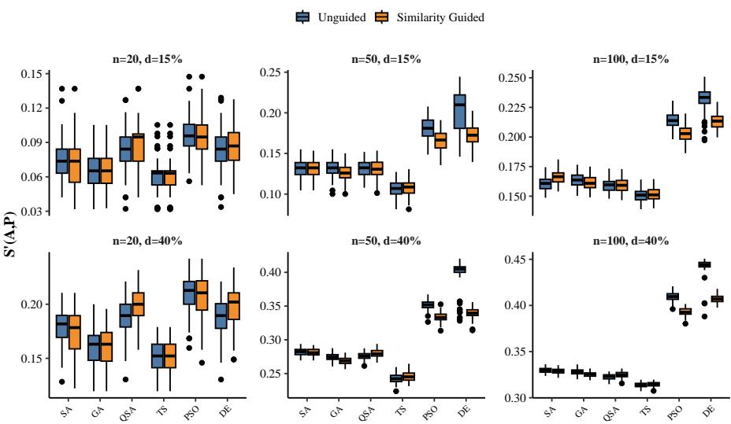  
Figure 1: Node-similarity guidance on ER graphs. Boxes show $S ^ { \prime } ( A , P )$ over the 100 test graphs of each condition, one solution per graph, for the unguided and the similarityguided variant of each algorithm; rows are edge densities d of 15% and 40%, columns graph sizes n. BASIN has no guided variant and is not shown.

Guided and unguided variants are compared in each condition, that is, each combination of size, density and perturbation level, by a Wilcoxon signed-rank test over its 100 graphs, Benjamini–Hochberg corrected within each contrast (Fig. 4; distributions in Figs. 1, 2 and 3, and for BA and the 15 % densities in Appendix Figs. S1–S3).

Guidance is decisive on the MMM. SGGA, SGQSA, SGSA and SGPSO are significantly better in 16 conditions of 16, at a median rank-biserial efect of +0.99 or above in each case, and SGDE in 13 at +0.65; SGTS is better in 7 and worse in 2.

At zero perturbation, where the planted map is an exact automorphism, the guided variants of SA, GA, QSA, TS and PSO return it on at least 0.854 of restarts on the

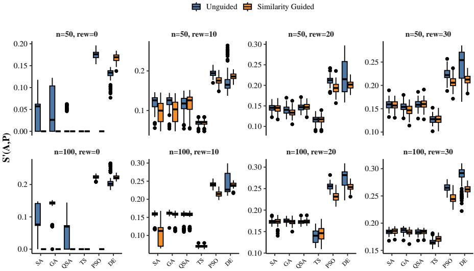  
Figure 2: Node-similarity guidance on LRM graphs at edge density 40 %. Boxes show $S ^ { \prime } ( A , P )$ over the 100 test graphs of each condition, one solution per graph, for the unguided and the similarity-guided variant of each algorithm; one panel per graph size n and share rew of rewired edges. BASIN has no guided variant and is not shown.

MMM, and the plain ones on at most 0.408 (Appendix Table S1 and Fig. S13).

With perturbation the planted map is no longer an automorphism. On the MMM the median Cayley distance to it of each guided variant is at or below that of its unguided counterpart in every condition (Appendix Fig. S15).

Outside the MMM, guidance helps some algorithms and harms others. SGTS is significantly better in no condition of BA, ER or LRM and significantly worse in 4 of 6, 4 of 6 and 7 of 16 respectively, with 8 of the LRM conditions decided entirely by ties. SGDE is significantly worse in 5 of 6 BA conditions and better in none, but better in 4 of 6 ER and 12 of 16 LRM conditions against 2 and 3 worse. SGGA and SGPSO improve on every graph family and lose in no condition of any, SGGA at 4 of 6 on BA, 5 of 6 on ER and 16 of 16 on both LRM and the MMM, SGPSO at 6 of $6 ,$ 5 of $6 ,$ 16 of 16 and 16 of 16. SGQSA is significantly worse in all 6 BA and 4 of 6 ER conditions, better in none, and on the LRM better in 6 and worse in 3. SGSA is better more often than worse on every graph family, in 4, 3 and 10 conditions of BA, ER and LRM against 2, 1 and 4.

## 6.2 Performance comparison across optimization strategies

SGTS has the best mean rank in all four graph families (Table 1; Figs. 5–7). It attains the lowest median in all 44 conditions and is the sole leader in 29 (Appendix Table S6); the other 15 are ties it shares, 8 of them the unperturbed conditions in which six algorithms reach $S ^ { \prime } ( A , P ) = 0$ together. The random baseline is last in every condition.

Behind SGTS the field separates into two groups. SGGA, SGQSA, BASIN and SGSA have medians a few thousandths of $S ^ { \prime } ( A , P )$ apart: at $n = 1 0 0$ and $d = 4 0 \%$ the hardest ER condition separates SGTS at 0.3147 from SGSA at 0.3289, with the other three between them, against 0.4513 for random search. SGPSO and SGDE follow.

At the hardest condition of each graph family (Fig. 8; the LRM rewiring axis in Fig. 9; every condition in Appendix B.8), on BA, ER and LRM, SGTS is significantly better than every other algorithm. On the MMM it shares the group with SGSA and BASIN, whose medians lie between 0.0242 and 0.0246.

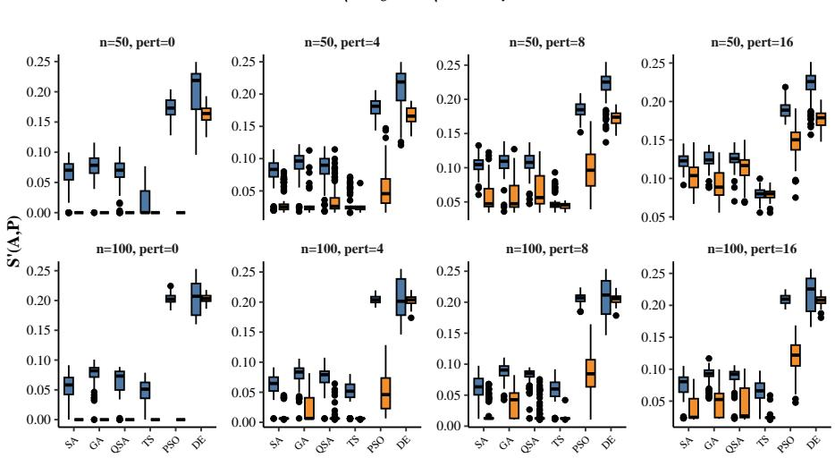  
Figure 3: Node-similarity guidance on MMM graphs at edge density 30 %. Boxes show $S ^ { \prime } ( A , P )$ over the 100 test graphs of each condition, one solution per graph, for the unguided and the similarity-guided variant of each algorithm; one panel per graph size n and number pert of perturbing edge swaps. BASIN has no guided variant and is not shown.

Cayley distance to the planted map on the MMM The planted map on the MMM (Fig. 10; LRM in Appendix Fig. S14) is recovered in every condition at $n = 1 0 0$ by SGTS and BASIN, whose median Cayley distance to it is 0. SGSA and SGGA recover it at $d = 1 5 \ \%$ only, SGQSA at $\mathit { p e r t } \ : = \ : 4 \mathrm { \ o n l y } ,$ and the three lie up to 0.500 from it at $d = 3 0 \ \%$ SGPSO recovers it at $p e r t = 0$ only and lies up to 0.515 from it at $d = 3 0 \ \%$ , and SGDE misses it in every condition by about 0.95, against 0.958 for a random permutation without fixed points.

Table 1: Mean rank per graph family, with the number of conditions led in parentheses. Algorithms are ranked within a condition on its median $S ^ { \prime } ( A , P )$ , ties averaged, rank 1 lowest.
<table><tr><td>Method</td><td>BA ER</td><td>LRM</td><td>MMM</td></tr><tr><td>Random SGSA SGGA</td><td>8.00 (0) 8.00 (0) 3.58 (0) 4.33 (0) 2.50 2.83</td><td>8.00 (0) 3.62 (0) 3 (0) 6.50 (0) 7.00 (0)</td><td>8.00 (0) 3.19 (0) 7.00 (0)</td></tr><tr><td>SGQSA BASIN</td><td>(0) 4.75 (0) 4.08</td><td>(0) 3.38 (0) (0) 4.06 (0)</td><td>2.97 (0) 4.16 (0)</td></tr><tr><td>SGTS</td><td>4.08 (0) 3.00</td><td>(0) 2.91 1 (0)</td><td>3.25 (0)</td></tr><tr><td>SGPSO SGDE</td><td>1.00 (6) 1.00 5.92 (0) 6.25</td><td>(6) 1.66 6 (11) (0) 5.38</td><td>2.06 (6) 5.38 (0)</td></tr></table>

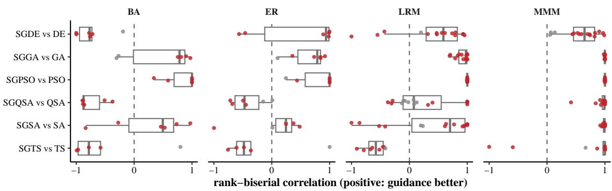  
Figure 4: Guidance ablation. Each point is one condition: the matched-pairs rank-biserial correlation of the paired Wilcoxon signed-rank test of guided against unguided $S ^ { \prime } ( A , P )$ over its 100 graphs, positive where guidance is better. Boxes summarize the conditions of each graph family; colored points are significant after Benjamini–Hochberg correction at 0.05.

## 6.3 Comparison of fixed-point ratios across optimization strategies

At the hardest condition of each graph family (Fig. 11), almost every algorithm returns few fixed points, with a median $F / n$ of at most 0.05. The exceptions are SGTS and SGGA on BA, at medians of 0.17 and 0.15, and SGTS on the LRM at rew = 30, at 0.105. SGGA sits exactly on the threshold $F / n = 0 . 2 5$ on half of the BA graphs, SGTS on at most $7 \ \%$ of the graphs of either graph family. Fig. S25 pools all conditions, and Fig. S26 plots $F / n$ against $S ( A , P )$ on the LRM at $d = 4 0 \ \%$

Over all testing graphs, only algorithms without the cap in their search exceed the threshold. SGSA, SGGA and SGTS, which carry it, never do. Of the algorithms constrained during tuning only (Section 5.3.1), SGPSO exceeds it on a single graph, reaching $F / n = 0 . 4 0$ against the random baseline’s 0.35, while SGDE, SGQSA and BASIN stay at or below 0.25, 0.01 and 0.10 throughout.

## 6.4 Ablation of BASIN components

Every ablation worsens $S ^ { \prime } ( A , P )$ on more graphs than it improves (Appendix Fig. S16). Removing the double-stochasticity penalty ${ \mathcal { L } } _ { \mathrm { d s } }$ worsens it on 66 % of the graphs and improves it on 2 %, significantly in 40 of the 44 conditions and in none the other way. Reducing the embedding dimension to $n / 4$ worsens it on 62 $\%$ against 6 %, significantly in 36 conditions and again in none the other way. Removing the fixed-point penalty ${ \mathcal { L } } _ { \mathrm { f p } }$ worsens it on 60 % against 9 %, significantly in 31 conditions. It improves it in 4 MMM conditions, three of them at $p e r t = 0$ , where it recovers the planted map on graphs the adopted configuration misses, with a lower mismatch D in every improved pair. Without ${ \mathcal { L } } _ { \mathrm { f p } }$ , however, 5.5 % of all solutions exceed $F > 0 . 2 5 n$ , in 20 of the 44 conditions, against none of the adopted configuration’s, whose $F / n$ never exceeds 0.10. Rounding by the Hungarian assignment alone worsens $S ^ { \prime } ( A , P )$ on 6 % of the graphs and improves none, significantly in 12 conditions. At dimension n the loss is smaller, 30 % against 18 %, significant in 15 conditions and reversed in $5 ,$ and no larger fixed dimension

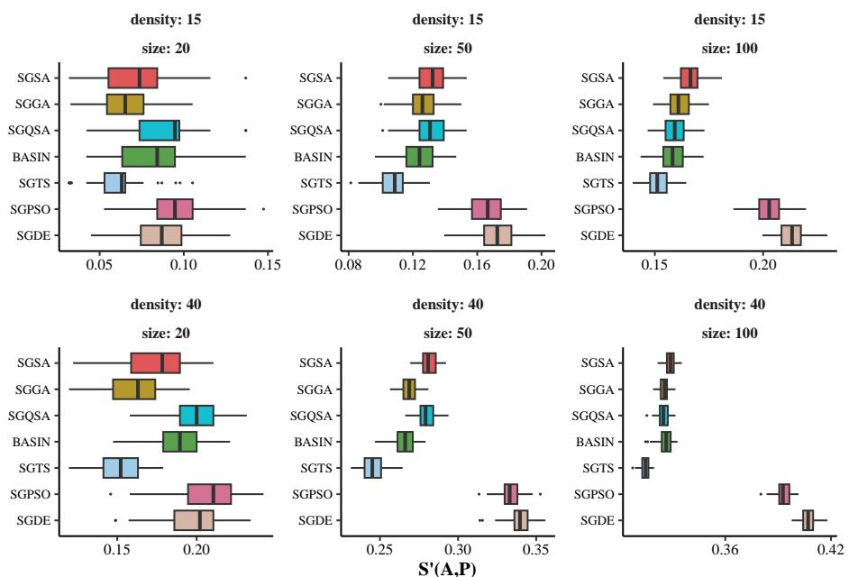  
Figure 5: Performance on ER graphs, one variant per algorithm. Boxes show $S ^ { \prime } ( A , P )$ over the 100 test graphs of each condition, one solution per graph; one panel per graph size n and edge density $d ,$ each with its own horizontal axis.

is significantly better in any condition.

## 6.5 Computational eficiency, stability, and hyperparameters

In addition to solution quality, we assess computational eficiency, stability across repeated runs, and the complexity of hyperparameter selection. Cost is measured on a separate timing corpus of one graph per condition, so that every algorithm is timed on the same instances. The tuned hyperparameter configurations are reported in Appendix E. Stability analysis (Appendix Fig. S64) shows that all optimization-based strategies exhibit comparable variability across independent runs, with no method displaying systematically unstable behavior relative to the others.

Execution time at $n = 1 0 0$ At n = 100 (Fig. 12) the algorithms fall into three cost bands. SGTS, BASIN, SGQSA and SGSA take about half a minute per restart, SGGA two to three times as long, and SGDE and SGPSO more than an order of magnitude longer, against 1.0 s for the random baseline. SGQSA varies most within a size, from 0.03 s to 100 s per restart at $n = 1 0 0$ . Cost grows least with size for SGTS and SGGA, by a factor of about 4 from $n = 2 0$ to $n = 1 0 0$ , and most for SGPSO and SGDE, by 64 and 14, apart from SGQSA, whose median rises from 0.01 s to 26 s.

Scaling to $n = 2 0 0 0$ Figures S62 and S63 extend the measurement to $n = 2 0 0 , 5 0 0$ 1000 and 2000, on a probe of 20 graphs per size. Throughput is measured relative to each algorithm’s own value at $n = 2 0 0$ , as budget units difer between algorithms. SGTS, SGSA and BASIN lose factors of 252, 331 and 622 over that range, between the $O ( n ^ { 2 } )$ and $O ( n ^ { 3 } )$ reference slopes, SGPSO a factor of 993, on the $O ( n ^ { \bar { 3 } } )$ slope, and SGDE a factor of 3598, steeper than it. SGGA did not complete the probe at $n \geq 1 0 0 0$ , and SGQSA converges before exhausting its budget below $n = 2 0 0 0$ , so it is absent from both

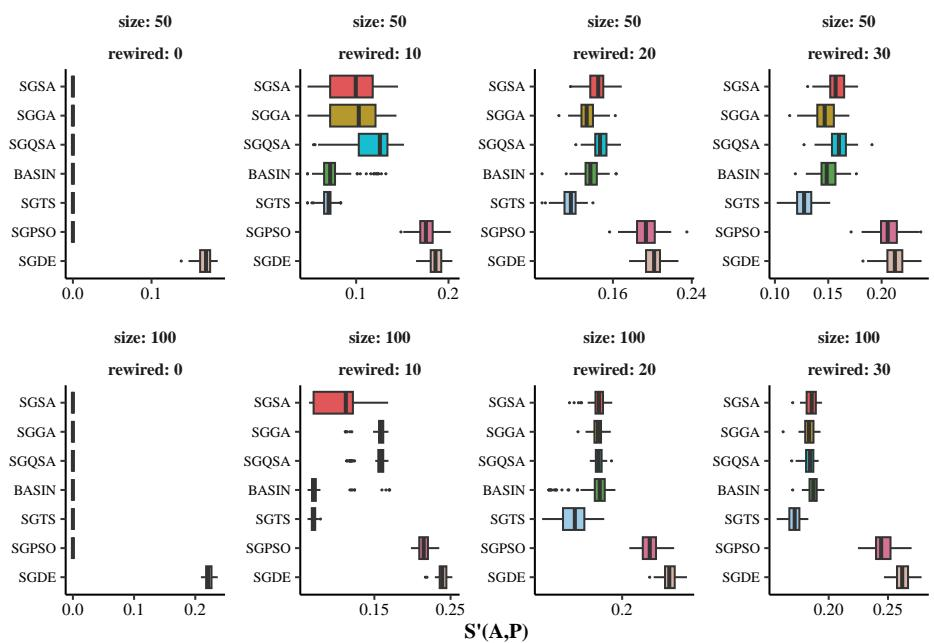  
Figure 6: Performance on LRM graphs at edge density 40 %, one variant per algorithm. Boxes show $S ^ { \prime } ( A , P )$ over the 100 test graphs of each condition, one solution per graph; one panel per graph size n and share rew of rewired edges, each with its own horizontal axis.

figures.

Resident memory separates the algorithms more sharply. SGSA and SGTS stay at or below 732 MB at every size, whereas SGDE and BASIN reach 2.9 GB and 3.4 GB at $n = 2 0 0 0$ , and SGPSO reaches 16.9 GB.

## 6.6 Evaluation on structural brain connectomes

Each method returns one solution per subject, the lowest of 20 restarts rather than five (Fig. 13; Appendix Tables S2 and S3). Whether the hemispheric mapping $\pi _ { L R }$ is recovered depends on density (Fig. 13A). At 5% homologues make up a small share of every algorithm’s permutation, and only SGTS scores comparable $S ^ { \prime } ( A , P )$ with $\pi _ { L R }$ (Fig. 13B), but by permuting most regions within a hemisphere or fixing them instead. At 10% and 15% homologues are the largest share of the SGTS permutations, and SGTS scores on par or below $\pi _ { L R }$ . SGSA, and BASIN and SGQSA at 15%, recover a smaller share and score above $\pi _ { L R }$ . At 40% the homologue share falls for every algorithm that recovers it at 15%, and same-hemisphere pairs and, for the algorithms that carry the 0.25n bound, fixed regions take its place. SGTS, SGSA and SGGA score below $\pi _ { L R } ,$ SGTS furthest, while SGQSA and BASIN score level with it.

Counted subject by subject (Fig. 15, B), SGTS beats $\pi _ { L R }$ on most subjects at every density and on all 88 at 40%, and at 10% ties it exactly on a further quarter. BASIN beats it on few subjects below 40% and on about half at 40%, and the random baseline never does.

Where the returned map is not the hemispheric mirror, it is often near it. Nearness is measured in physical space: every node of the AAL parcellation is a region of the brain with a fixed centre point in a standard anatomical coordinate system, and d denotes the Euclidean distance between these points. For a node i whose image $\sigma ( i )$ is not its homologue $\pi _ { L R } ( i )$ , the proximity prox $( i ) = 1 - d ( \sigma ( i ) , \pi _ { L R } ( i ) ) / d ( i , \pi _ { L R } ( i ) )$ compares how far the image lies from the homologue with how far i itself lies from it. It is 1 when the image is the homologue, 0 when the image is as far from the homologue as i is, and negative when it is further. At 10% and 15% the non-homologous images of SGTS land closer to the homologue than their source regions, and those of SGSA and BASIN, and barely those of SGQSA, do at 15% (Fig. 14). At 5% and 40% every algorithm’s images lie further from it, those of SGQSA at 40% about as far, though all lie closer than the random baseline’s, at a median of −1.2.

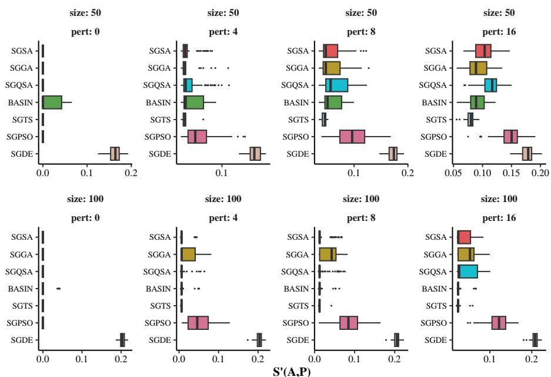  
Figure 7: Performance on MMM graphs at edge density 30 %, one variant per algorithm. Boxes show $S ^ { \prime } ( A , P )$ over the 100 test graphs of each condition, one solution per graph; one panel per graph size n and number pert of perturbing edge swaps, each with its own horizontal axis.

Fixed-point ratio on the connectomes Comparable scores are reached through different fixed-point behavior (Fig. 15A). At 40% every algorithm that carries the 0.25n bound in its search sits on it, and SGTS does so at 5% too, while at 10% and 15%, where it recovers $\pi _ { L R }$ , it fixes no region. BASIN and SGQSA fix almost none at any density.

Guided and unguided variants on the connectomes On the connectomes guidance helps the weaker searches and leaves TS unchanged (Appendix Table S2). SGSA and SGGA score lower than their unguided variants at 10%, 15% and 40%; at 5% only SGGA does, and SGSA scores higher than SA. For SA, guidance also recovers much of the hemispheric map: at 10% and 15% the homologue share of its permutations rises from under a tenth to over half, whereas for GA it stays near zero with or without guidance. The two variants of TS are level in score and in homologue share at every density. For QSA guidance lowers the score at 5% only, is level at 10% and raises it at 15%, but raises the homologue share at 15% and 40%, from 0.18 to 0.52 and from 0 to 0.42; at 40% QSA fixes 86 of the 90 regions and SGQSA none. What guidance changes consistently is agreement between restarts (Appendix Table S4): the guided variant returns more similar permutations across restarts for every algorithm at every density, SGTS restarts agreeing on 0.42 to 0.70 of the regions against 0.08 to 0.23 for TS. The one exception is QSA at 40%, whose restarts agree trivially because it fixes 86 of the 90 regions.

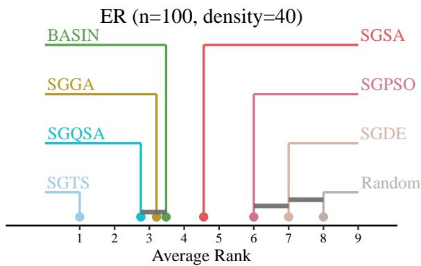

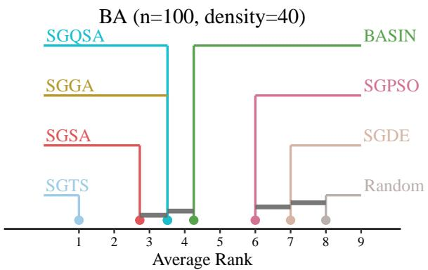

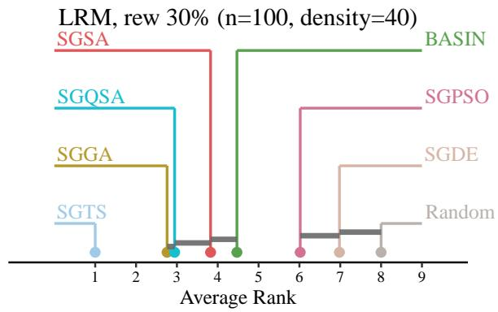

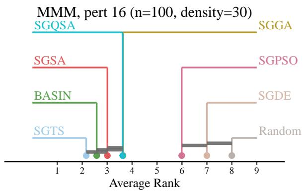  
Figure 8: Critical-diference diagram (Friedman with post-hoc Nemenyi) at each graph family’s hardest condition $( n = 1 0 0 , d = 4 0 \ \%$ , or 30 % for the MMM, LRM $r e w = 3 0$ MMM $p e r t = 1 6 )$ , one panel per graph family. Each algorithm is placed at its mean rank on $S ^ { \prime } ( A , P )$ over the 100 test graphs of the condition, rank 1 lowest; algorithms joined by a bar do not difer at the 5 % level.

## 6.7 Benchmark networks with known automorphism groups

On JAZZ an exact automorphism is reachable, but only by the discrete searches (Table S5). SGTS reaches one most often, on 0.80 of restarts, level with TS. Guidance helps GA, raising its rate from 0.35 to 0.65, but worsens SA, from 0.70 to none. Neither the continuous relaxations nor PSO and DE ever reach one, QSA coming closest.

Distance to the twin subgroup on PDZ and NETSCIENCE On PDZ and NETSCIENCE no configuration reaches an automorphism, so the distance to the twin subgroup (Section 5.3.2) is reported instead. Under it the guided variants land significantly closer on both networks for GA, TS and PSO, whereas SGDE lands further than DE on both; the diference for SA is marginal (Table 2). SGQSA, SGGA and SGTS attain the lowest $S ^ { \prime } ( A , P )$ on both networks (Table S5). The distance to the twin subgroup does not follow $S ^ { \prime } ( A , P )$ : the solutions closest to it are those of SGPSO on both networks, whose $S ^ { \prime } ( A , P )$ is about twice that of SGQSA. SGSA and BASIN end about as far from the twin subgroup as the random baseline.

Because the twin subgroup contains the identity, a solution that maps most nodes to themselves scores as close to ${ \mathrm { i t } } ,$ so only runs with $F \le 0 . 2 5 n$ are compared. This removes

Table 2: Unguided against similarity-guided variants on PDZ and NETSCIENCE, where no configuration reaches an automorphism. Distance to the twin subgroup in vertices, median over the restarts with $F \le 0 . 2 5 n$ of 20 per variant (Restarts, unguided/guided). Two-sided Mann–Whitney test, p uncorrected for the 12 comparisons; the rank-biserial r is negative where the guided variant lands closer.
<table><tr><td>Variants</td><td>Restarts</td><td>Median unguided</td><td>Median guided</td><td>r</td><td>p</td></tr><tr><td colspan="6">PDZ</td></tr><tr><td>SA / SGSA</td><td>20/20</td><td>157.0</td><td>156.0</td><td>-0.02</td><td>0.913</td></tr><tr><td>GA / SGGA</td><td>20/20</td><td>157.5</td><td>130.0</td><td>-0.95</td><td>&lt; 0.001</td></tr><tr><td>QSA / SGQSA</td><td>20/20</td><td>161.0</td><td>161.0</td><td>+0.13</td><td>0.451</td></tr><tr><td>TS / SGTS</td><td>20/20</td><td>156.5</td><td>129.0</td><td>-0.95</td><td>&lt; 0.001</td></tr><tr><td>PSO / SGPSO</td><td>19/20</td><td>137.0</td><td>107.5</td><td>-0.94</td><td>&lt; 0.001</td></tr><tr><td>DE/ SGDE</td><td>20/20</td><td>133.0</td><td>149.0</td><td>+0.93</td><td>&lt; 0.001</td></tr><tr><td colspan="6">NETSCIENCE</td></tr><tr><td>SA / SGSA</td><td>20/20</td><td>377.5</td><td>376.5</td><td>-0.36</td><td>0.049</td></tr><tr><td>GA / SGGA</td><td>20/20</td><td>375.5</td><td>337.5</td><td>-1.00</td><td>&lt; 0.001</td></tr><tr><td>QSA / SGQSA</td><td>20/20</td><td>373.5</td><td>371.5</td><td>-0.09</td><td>0.645</td></tr><tr><td>TS / SGTS</td><td>20/20</td><td>372.5</td><td>357.0</td><td>-0.96</td><td>&lt; 0.001</td></tr><tr><td>PSO / SGPSO</td><td>20/20</td><td>347.0</td><td>304.0</td><td>-1.00</td><td>&lt; 0.001</td></tr><tr><td>DE / SGDE</td><td>19/20</td><td>339.0</td><td>366.5</td><td>+0.97</td><td>&lt; 0.001</td></tr></table>

1 of 20 DE restarts on NETSCIENCE and 1 of 20 plain PSO restarts on PDZ. Every other configuration, BASIN, QSA and SGQSA included, keeps all 20 restarts on both networks (distributions over restarts in Figs. S23 and S24).

## 7 Discussion

The present study revisits approximate symmetry detection from an optimization perspective, focusing on how node-level structural information can be used to bias the search process. By evaluating local search (SA), population-based optimization (GA), and continuous relaxations (BASIN and QSA), together with TS, PSO and DE, within a unified validation framework, the results highlight both the strengths and limitations of node-similarity guidance and what practical trade-ofs emerge between solution quality, robustness, and computational cost.

## 7.1 Impact of node-similarity guidance

Node-similarity guidance does not always help. On the MMM, whose planted orbit the unguided searches miss, guidance improves every algorithm but TS in nearly every condition and, for five of the six, the recovery of the planted map. On BA and ER, which have no planted orbit, guidance still improves GA and PSO in most conditions and SA in about half, but worsens TS and QSA in most conditions and DE on BA. A planted orbit therefore explains where guidance helps every algorithm, not where it helps at all. On the LRM the efect of guidance depends on the algorithm. This behavior reflects the dual role of such guidance: it biases optimization toward structurally plausible correspondences, yet may introduce unwanted bias when the structural signal is weak or noisy. Node similarity should therefore be interpreted as a guiding mechanism rather than a strict constraint.

The benchmark networks show the same dependence. On PDZ and NETSCIENCE, where no configuration reaches an automorphism, the guided variants of GA, TS and

PSO end closer to one on both networks and that of DE further; on JAZZ, where one is reachable, guidance leaves TS at its ceiling, helps GA and worsens SA. On PDZ and NETSCIENCE the maps of lowest $S ^ { \prime } ( A , P )$ are not those closest to the twin subgroup. The twin subgroup is only part of the automorphism group, so a map of low $S ^ { \prime } ( A , P )$ that lies far from it may still lie close to an automorphism outside it, i.e. approximate a diferent symmetry equally well.

These findings align with known limitations of centrality-based heuristics. Structural descriptors assume suficient heterogeneity in node roles, which fails in regular or centrality-uniform graphs [20, 21, 31]. Although automorphic vertices necessarily share centrality values, asymmetric graphs may still exhibit uniform centrality profiles. In complex networks, however, centrality distributions typically remain suficiently diverse to provide informative guidance.

On the connectomes, which carry no planted map, guidance lowers the score of SGSA and SGGA at most densities but leaves that of SGTS unchanged. Only with guidance does SA send most regions to their contralateral homologue, at 10% and 15%. For every algorithm it changes which map is returned, returning nearly the same one at every restart. That helps in cases when a single answer is wanted but hurts when the spread of approximate symmetries is itself the object, as it is when no correct answer is known. On connectomes this spread may carry information of its own. The restarts of an unguided search, and the solutions of diferent algorithms with and without guidance, each sample approximate symmetries of the same brain, and their distribution, which regions are paired consistently and which vary, could describe its hemispheric organization more fully than any single map.

## 7.2 Performance across optimization paradigms

Methods maintaining population diversity (SGGA) or employing diferentiable relaxations (BASIN) achieve stronger performance than every strategy but SGTS, SGGA on BA and ER and BASIN on rewired LRM graphs, where deviations from perfect symmetry create complex optimization landscapes. Transposition search that samples one move at a time, such as SGSA, becomes less efective in such regimes, whereas global exploration or continuous relaxation escape unfavorable search-space regions and local minima more reliably. Similar trends have been reported in earlier work comparing annealing-based and relaxation-based approaches [7, 8].

SGTS shares this transposition neighborhood with SA yet remains first at the highest rewiring level; what difers is that the maintained delta table evaluates a swap in $O ( 1 )$ so the full $O ( n ^ { 2 } )$ neighborhood is scanned at every iteration and the move is chosen on $S ^ { \prime } ( A , P )$ itself, at a cost per restart in the band of SA and BASIN.

BASIN provides a particularly favorable balance between eficiency and solution quality among the continuous relaxations. Unlike explicit centrality-guided strategies, BASIN implements data-driven node-similarity guidance through learnable embeddings shaped directly by the symmetry objective, avoiding reliance on predefined descriptors while maintaining computational stability.

The population-based searches sit less favorably on the same balance of cost and quality. SGGA often achieves strong objective values but at substantially higher computational cost than the other discrete searches (Fig. 12): it is second on BA and ER, and does not complete the scalability probe at $n \geq 1 0 0 0$ . SGPSO and SGDE rank sixth and seventh of eight in every graph family and are among the slowest per restart; a population of $n \times n$ real matrices ofers no advantage when the objective can be evaluated exactly and incrementally on permutations.

## 7.3 Interpreting approximate symmetries

Similar objective values may correspond to qualitatively diferent permutations, especially when fixed points are present. Figure 11 illustrates this variability: for a given symmetry score, the proportion of fixed vertices difers markedly across methods. The fixed-point– normalized score $S ^ { \prime } ( A , P )$ therefore plays an important role in distinguishing informative approximate symmetries from near-identity solutions. Because the normalization does not penalize fixed points strongly enough, only the strategies carrying the bound inside their search stay under it, and on the connectomes at 40% QSA attains the lowest $S ^ { \prime } ( A , P )$ of any algorithm from a map that fixes 86 of the 90 regions. The normalized score is therefore necessary but not suficient, and an explicit feasibility bound is required with it. Explicit penalties or alternative normalization strategies, as explored in [9], may further improve interpretability in settings where partial symmetries are expected.

The fixed-point bound is a modeling choice, not a property of symmetry. On JAZZ it would forbid every correct answer, which is why SA, TS and GA, the strategies that carry the cap, run without it on the benchmark networks. Whether near-identity maps are an artifact or the object of interest must thus be decided for each network.

Stability across restarts Stability analyses (Fig. S64) show broadly comparable variability across independent runs for all optimization-based methods, with no strategy displaying systematically unstable behavior. The observed variability therefore primarily reflects optimization dynamics rather than excessive stochastic sensitivity.

Recovery of the hemispheric mirror On the connectomes the hemispheric mirror is recovered in a narrow density band. At 5% the best maps contain no more homologues than a random permutation; at 10% and 15% SGTS sends most regions to their homologue; at 40% SGTS beats the mirror on every subject while sending almost no region to its homologue, so the anatomical mirror is not the $S ^ { \prime } ( A , P )$ -optimal symmetry of a dense connectome. Where SGTS misses the homologue at 10% and 15% it lands near it, whereas at 5% it lands further from it than the region itself; an exact-recovery rate alone would score both as zero.

## 7.4 Limitations and future directions

Several limitations suggest concrete directions for follow-up work. Explicit node-similarity guidance may be uninformative in graphs with degenerate structural descriptors (e.g. regular graphs), motivating exploration of richer automorphism-invariant descriptors such as spectral embeddings, motif-based representations, or learned graph neural network descriptors.

On the optimization side, BASIN naturally invites some principled extensions including tighter enforcement of doubly-stochastic structure (e.g. Sinkhorn normalization) and coupling discretization with the continuous objective to reduce projection-induced artifacts. More broadly, gradient-based techniques from deep learning, including reinforcement learning for discrete search and graph neural networks for continuous search and learning structural descriptors, ofer promising directions for scaling approximate symmetry detection to larger networks while preserving eficiency and robustness.

The connectome analysis extends the evaluation to an empirical dataset and to the recovered node correspondences, not only objective values. The connectomes are one cohort of 88 subjects in one parcellation, binarized at a fixed edge count, and the outcome depends on the density. Whether the band at 10% to 15% is a property of structural connectivity or of the parcellation cannot be settled from one atlas. Extending the analysis to further network classes and parcellations would strengthen the interpretation of approximate symmetries as meaningful structural patterns. Investigation of how approximate symmetry relates to dynamical properties of real systems, building on connections established for exact automorphisms [3, 4], remains an important open question.

Hyperparameters tuned at $n \leq 1 0 0$ are not re-tuned for the benchmark networks, so comparisons there are within-network at equal budget rather than of each algorithm at its best. The distance to an exact automorphism is computed against the twin subgroup, an upper bound on the distance to the full group that contains the identity, so it must be read together with the fixed-point count. The graph family on which guidance is decisive was constructed to carry a planted orbit; the benchmark networks reduce but do not remove that circularity.

Both $S ^ { \prime } ( A , P )$ and every algorithm here are defined for unweighted graphs. The objective extends to weighted matrices unchanged, but the feasibility bound, the fixedpoint normalization and exact-hit recovery would each have to be restated.

## 8 Conclusion

This work extends the optimization-based framework for approximate network symmetry by making the role of node-level structural information explicit. Building on Liu’s formulation [7], we introduce a gradient-based soft-assignment model (BASIN) that learns a continuous surrogate followed by discretization, adapt a genetic algorithm, tabu search, particle swarm optimization and diferential evolution to the problem, and add nodesimilarity guidance to each of them, including SGTS, which selects its guidance per instance. Together with similarity-guided simulated annealing (SGSA) and the quadratic symmetry approximator (QSA) [8], these methods enable unified comparison across local, global, and continuous optimization paradigms.

Across extensive simulations on ER, BA, LRM and MMM graphs, structural connectomes and networks with known automorphism groups, node-similarity guidance improves solutions where the unguided search misses a planted orbit, and elsewhere its efect depends on the algorithm. TS, guided or not, reaches the lowest scores, and BASIN is the stronger continuous relaxation on rewired lateral graphs. A normalized score alone does not exclude near-identity solutions, so a fixed-point bound is needed with it.

In summary, this article demonstrates that the efectiveness of node-similarity guidance for approximate symmetry detection is regime-dependent across multiple algorithmic paradigms, and introduces BASIN and similarity-guided variants of six optimization strategies, of which tabu search, guided or not, attains the lowest scores among the strategies compared. The improved accuracy and robustness of these methods may prove particularly valuable where approximate symmetries govern system behavior, including the analysis of synchronization patterns in dynamical networks and the characterization of asymmetries in brain connectivity, where even subtle deviations from exact symmetry

can have functional consequences.

## 9 Declarations

Conflicts of interest The authors have no conflicts of interest to declare that are relevant to the content of this article.

Data availability statement The synthetic graphs are generated by the models described in Section 5.1. The generator, the per-graph derived seeds and a manifest of SHA-256 hashes for every file are part of the released code, so both splits reconstruct byte-identically. The 88 structural connectivity matrices are taken from the publicly released dataset of [45]. The three empirical networks with known automorphism groups are taken from the Netzschleuder repository [48], with their primary sources cited in Section 5.2.2. No data were newly acquired from human participants for this study.

Code availability statement All algorithms, hyperparameter searches, analysis scripts and the adopted configuration of every reported method are available on GitHub at https://github.com/dominikklepl/Centrality-guided-Search-of-Graph-Symmetries-. The software environment is pinned by a lock file resolving every dependency to an exact version under Python 3.11–3.13.

Ethics approval and consent to participate This study is a secondary analysis of previously released, anonymized datasets and involved no new data collection. Ethical approval and participant consent for the structural connectivity dataset are documented in [45].

Acknowledgements The authors were supported by the Czech Science Foundation Grant No. 23-07074S and by ERDF-Project No. CZ.02.01.01/00/22\_008/0004643.

## References

[1] Ben D MacArthur, Rubén J Sánchez-García, and James W Anderson. Symmetry in complex networks. Discrete Applied Mathematics, 156(18):3525–3531, 2008. doi: 10.1016/j.dam.2008.04.008.

[2] Rubén J Sánchez-García. Exploiting symmetry in network analysis. Communications Physics, 3(1):87, 2020. doi: 10.1038/s42005-020-0345-z.

[3] Joseph D. Hart, Yuanzhao Zhang, Rajarshi Roy, and Adilson E. Motter. Topological control of synchronization patterns: Trading symmetry for stability. Physical Review Letters, 122:58301–58301, 02 2019. ISSN 0031-9007, 1079-7114, 1092-0145. doi: 10. 1103/physrevlett.122.058301. URL https://doi.org/10.1103/physrevlett.122. 058301.

[4] Abhijit Mondal, Subrata Ghosh, Prosenjit Kundu, Pitambar Khanra, Stefano Boccaletti, Pinaki Pal, and Chittaranjan Hens. Symmetry invariance in nonlinear dynamical complex networks. Chaos Solitons & Fractals, 185:115002–115002,

05 2024. ISSN 0960-0779, 1873-2887. doi: 10.1016/j.chaos.2024.115002. URL https://www.sciencedirect.com/science/article/pii/S096007792400554X.

[5] Siemon C. de Lange, Martijn P. van den Heuvel, and Marcel A. de Reus. The role of symmetry in neural networks and their Laplacian spectra. NeuroImage, 141:357–365, 2016. ISSN 1053-8119. doi: 10.1016/j.neuroimage.2016.07.051.

[6] Xiang-Zhen Kong, Samuel R Mathias, Tulio Guadalupe, ENIGMA Laterality Working Group, David C Glahn, Barbara Franke, Fabrice Crivello, Nathalie Tzourio-Mazoyer, Simon E Fisher, Paul M Thompson, et al. Mapping cortical brain asymmetry in 17,141 healthy individuals worldwide via the enigma consortium. Proceedings of the National Academy of Sciences, 115(22):E5154–E5163, 2018.

[7] Yanchen Liu. Approximate network symmetry. arXiv (Cornell University), 12 2020. doi: 10.48550/arxiv.2012.05129. URL http://arxiv.org/abs/2012.05129.

[8] Anna Pidnebesna, David Hartman, Aneta Pokorná, Matěj Straka, and Jaroslav Hlinka. Computing approximate global symmetry of complex networks with application to brain lateral symmetry. Information Systems Frontiers, 02 2025. ISSN 1387-3326, 1572-9419. doi: 10.1007/s10796-025-10585-3. URL https://doi.org/ 10.1007/s10796-025-10585-3.

[9] David Hartman, Jaroslav Hlinka, Anna Pidnebesna, and František Szczepanik. Local iterative algorithms for approximate symmetry guided by network centralities. In Y. Zhang, M. Hladik, and H. Moosaei, editors, International Conference on Learning and Intelligent Optimization, volume 15745 of Lecture Notes in Computer Science, pages 218–232, Springer, Cham, 2025. doi: 10.1007/978-3-032-09192-5\_15.

[10] Richard Myers and Edwin R. Hancock. Least-commitment graph matching with genetic algorithms. Pattern Recognition, 34(2):375–394, 2001. doi: 10.1016/ S0031-3203(99)00217-4.

[11] Paul Erdos and Alfréd Rényi. Asymmetric graphs. Acta Math. Acad. Sci. Hungar, 14(295-315):3, 1963. doi: 10.1007/BF01895716.

[12] Filipi N. Silva, César H. Comin, Thomas Peron, Francisco A. Rodrigues, Cheng Ye, Richard C. Wilson, Edwin R. Hancock, and Luciano da Fontoura Costa. Concentric network symmetry. Information Sciences, 333:61–80, 11 2015. ISSN 0020-0255, 1872-6291. doi: 10.1016/j.ins.2015.11.014. URL https://www.sciencedirect.com/ science/article/pii/S0020025515008245.

[13] Gemma Rosell-Tarragó and Albert Díaz-Guilera. Quasi-symmetries in complex networks: a dynamical model approach. Journal of Complex Networks, 9, 06 2021. ISSN 2051-1310, 2051-1329. doi: 10.1093/comnet/cnab025. URL https: //doi.org/10.1093/comnet/cnab025.

[14] Eliane Maria Loiola, Nair Maria Maia de Abreu, Paulo Oswaldo Boaventura-Netto, Peter Hahn, and Tania Querido. A survey for the quadratic assignment problem. European Journal of Operational Research, 176(2):657–690, 2007. doi: 10.1016/j. ejor.2005.09.032.

[15] Joshua T. Vogelstein, John M. Conroy, Vince Lyzinski, Louis J. Podrazik, Steven G. Kratzer, Eric T. Harley, Donniell E. Fishkind, R. Jacob Vogelstein, and Carey E. Priebe. Fast approximate quadratic programming for graph matching. PLOS ONE, 10(4):e0121002, April 2015. ISSN 1932-6203. doi: 10.1371/journal.pone.0121002. URL http://dx.doi.org/10.1371/journal.pone.0121002.

[16] Yonathan Aflalo, Alexander Bronstein, and Ron Kimmel. On convex relaxation of graph isomorphism. Proceedings of the National Academy of Sciences of the United States of America, 112(10):2942–2947, 2015. doi: 10.1073/pnas.1401651112.

[17] Vince Lyzinski, Donniell E. Fishkind, Marcelo Fiori, Joshua T. Vogelstein, Carey E. Priebe, and Guillermo Sapiro. Graph matching: Relax at your own risk. IEEE Transactions on Pattern Analysis and Machine Intelligence, 38(1):60–73, 2016. doi: 10.1109/TPAMI.2015.2424894.

[18] Laura A. Zager and George C. Verghese. Graph similarity scoring and matching. Applied Mathematics Letters, 21(1):86–94, 2008. doi: 10.1016/j.aml.2007.01.006.

[19] Raphaël Candelier. Graph matching based on similarities in structure and attributes. Journal of Graph Algorithms and Applications, 29(1):289–320, 2025. doi: 10.7155/ jgaa.v29i1.2979.

[20] Silvia Gago, Jana Coroničová Hurajová, and Tomáš Madaras. On betweennessuniform graphs. Czechoslovak mathematical journal, 63(3):629–642, 2013. doi: 10. 1007/s10587-013-0044-y.

[21] David Hartman, Aneta Pokorná, and Pavel Valtr. On the connectivity and the diameter of betweenness-uniform graphs. Discrete Applied Mathematics, 342:27–37, 2024. doi: 10.1016/j.dam.2023.08.017.

[22] Éric Taillard. Robust taboo search for the quadratic assignment problem. Parallel Computing, 17(4–5):443–455, 1991. doi: 10.1016/S0167-8191(05)80147-4.

[23] Richard Sinkhorn and Paul Knopp. Concerning nonnegative matrices and doubly stochastic matrices. Pacific Journal of Mathematics, 21(2):343–348, 1967. doi: 10. 2140/pjm.1967.21.343.

[24] Gonzalo E. Mena, David Belanger, Scott Linderman, and Jasper Snoek. Learning latent permutations with Gumbel-Sinkhorn networks. In International Conference on Learning Representations, 2018. URL https://openreview.net/forum? id=Byt3oJ-0W.

[25] Runzhong Wang, Junchi Yan, and Xiaokang Yang. Learning combinatorial embedding networks for deep graph matching. In Proceedings of the IEEE/CVF International Conference on Computer Vision, pages 3056–3065, 2019.

[26] Béla Bollobás. Modern graph theory, volume 184. Springer Science & Business Media, NY, December 1998. doi: 10.1007/978-1-4612-0619-4.

[27] Mark Newman. Networks. Oxford University Press, Oxford, 2nd edition, 2018. doi: 10.1093/acprof:oso/9780199206650.001.0001.

[28] Albert-László Barabási and Réka Albert. Emergence of scaling in random networks. science, 286(5439):509–512, 1999. doi: 10.1126/science.286.5439.509.

[29] Phillip Bonacich. Technique for analyzing overlapping memberships. Sociological methodology, 4:176–185, 1972. doi: 10.2307/270732.

[30] Linton C Freeman. A set of measures of centrality based on betweenness. Sociometry, pages 35–41, 1977. doi: 10.2307/3033543.

[31] Babak Ghanbari, David Hartman, Vít Jelínek, Aneta Pokorná, Robert Šámal, and Pavel Valtr. Structure of betweenness uniform graphs with low values of betweenness centrality. arXiv preprint arXiv:2401.00347, 2023. doi: 10.48550/arXiv.2401.00347.

[32] Duncan J Watts and Steven H Strogatz. Collective dynamics of ‘smallworld’networks. nature, 393(6684):440–442, 1998. doi: 10.1038/30918.

[33] James Kennedy and Russell Eberhart. Particle swarm optimization. In Proceedings of ICNN’95 – International Conference on Neural Networks, volume 4, pages 1942– 1948, 1995. doi: 10.1109/ICNN.1995.488968.

[34] Rainer Storn and Kenneth Price. Diferential evolution—a simple and eficient heuristic for global optimization over continuous spaces. Journal of Global Optimization, 11(4):341–359, 1997. doi: 10.1023/A:1008202821328.

[35] Fred Glover. Tabu search—part I. ORSA Journal on Computing, 1(3):190–206, 1989. doi: 10.1287/ijoc.1.3.190.

[36] Peter Auer, Nicolò Cesa-Bianchi, and Paul Fischer. Finite-time analysis of the multiarmed bandit problem. Machine Learning, 47(2–3):235–256, 2002. doi: 10.1023/A: 1013689704352.

[37] Harold W. Kuhn. The Hungarian method for the assignment problem. Naval Research Logistics Quarterly, 2(1–2):83–97, 1955. doi: 10.1002/nav.3800020109.

[38] Yuhui Shi and Russell Eberhart. A modified particle swarm optimizer. In 1998 IEEE International Conference on Evolutionary Computation Proceedings, pages 69–73, 1998. doi: 10.1109/ICEC.1998.699146.

[39] John H. Holland. Adaptation in Natural and Artificial Systems: An Introductory Analysis with Applications to Biology, Control, and Artificial Intelligence. University of Michigan Press, Ann Arbor, MI, 1975.

[40] D.E. Goldberg. Genetic Algorithms in Search, Optimization, and Machine Learning. Addison Wesley series in artificial intelligence. Addison-Wesley, Boston, 1989. ISBN 9780201157673. URL https://books.google.cz/books?id=2IIJAAAACAAJ.

[41] P. Erdős and A. Renyi. On random graphs i. Publ. math. debrecen, 6(290-297):18, 1959. doi: 10.5486/PMD.1959.6.3-4.12.

[42] Yanghua Xiao, Momiao Xiong, Wei Wang, and Hui Wang. Emergence of symmetry in complex networks. Physical Review E, 77(6):066108, 2008. doi: 10.1103/PhysRevE. 77.066108.

[43] Lucia Jajcay, David Tomeček, Jiří Horáček, Filip Španiel, and Jaroslav Hlinka. Brain Functional Connectivity Asymmetry: Left Hemisphere Is More Modular. Symmetry, 14(4):1–11, 2022. ISSN 20738994. doi: 10.3390/sym14040833.

[44] Paul W. Holland, Kathryn Blackmond Laskey, and Samuel Leinhardt. Stochastic blockmodels: First steps. Social Networks, 5(2):109–137, 1983. doi: 10.1016/ 0378-8733(83)90021-7.

[45] Antonín Škoch, Barbora Rehák Bučková, Jan Mareš, Jaroslav Tinteřa, Pavel Sanda, Lucia Jajcay, Jiří Horáček, Filip Španiel, and Jaroslav Hlinka. Human brain structural connectivity matrices—ready for modelling. Scientific Data, 9:486, 2022. doi: 10.1038/s41597-022-01596-9.

[46] N. Tzourio-Mazoyer, B. Landeau, D. Papathanassiou, F. Crivello, O. Etard, N. Delcroix, B. Mazoyer, and M. Joliot. Automated anatomical labeling of activations in SPM using a macroscopic anatomical parcellation of the MNI MRI single-subject brain. NeuroImage, 15(1):273–289, 2002. doi: 10.1006/nimg.2001.0978.

[47] Stavros I. Dimitriadis, Marios Antonakakis, Panagiotis Simos, Jack M. Fletcher, and Andrew C. Papanicolaou. Data-driven topological filtering based on orthogonal minimal spanning trees: application to multigroup magnetoencephalography restingstate connectivity. Brain Connectivity, 7(10):661–670, 2017. doi: 10.1089/brain. 2017.0512.

[48] Tiago P. Peixoto. The Netzschleuder network catalogue and repository. https: //networks.skewed.de, 2020.

[49] Pablo M. Gleiser and Leon Danon. Community structure in jazz. Advances in Complex Systems, 6(4):565–573, 2003. doi: 10.1142/S0219525903001067.

[50] Thijs Beuming, Lucy Skrabanek, Masha Y. Niv, Piali Mukherjee, and Harel Weinstein. PDZBase: a protein–protein interaction database for PDZ-domains. Bioinformatics, 21(6):827–828, 2005. doi: 10.1093/bioinformatics/bti098.

[51] M. E. J. Newman. Finding community structure in networks using the eigenvectors of matrices. Physical Review E, 74:036104, 2006. doi: 10.1103/PhysRevE.74.036104.

[52] Tommi Junttila and Petteri Kaski. Engineering an eficient canonical labeling tool for large and sparse graphs. In Proceedings of the Ninth Workshop on Algorithm Engineering and Experiments (ALENEX), pages 135–149, 2007. doi: 10.1137/1. 9781611972870.13.

[53] Takuya Akiba, Shotaro Sano, Toshihiko Yanase, Takeru Ohta, and Masanori Koyama. Optuna: A next-generation hyperparameter optimization framework. In Proceedings of the 25th ACM SIGKDD International Conference on Knowledge Discovery and Data Mining, Addison Wesley series in artificial intelligence, 2019. doi: 10.1145/3292500.3330701.

[54] Peter Bjorn Nemenyi. Distribution-free multiple comparisons. Princeton University, Princeton, 1963.

[55] Janez Demšar. Statistical comparisons of classifiers over multiple data sets. Journal of Machine learning research, 7(Jan):1–30, 2006.

A  
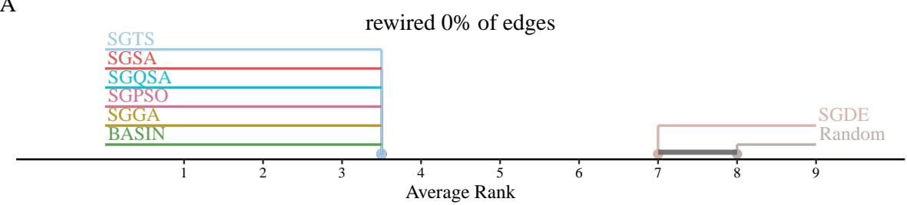

B  
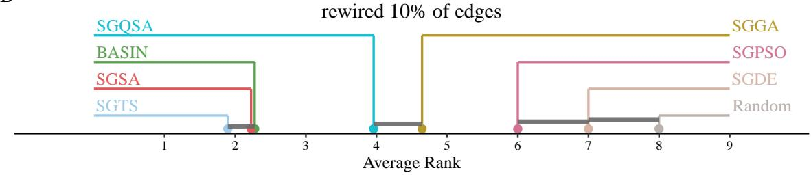

C  
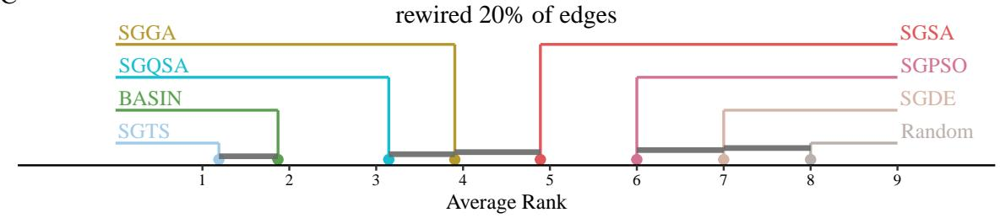  
D

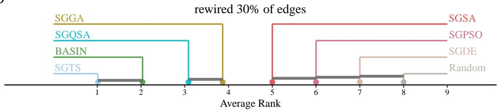  
Figure 9: Critical-diference diagrams (Friedman with post-hoc Nemenyi) on LRM graphs at $n = 1 0 0$ and edge density 15 %, (A)–(D) at $r e w = 0$ , 10, 20 and 30 % of edges rewired, one variant per algorithm and the random-search baseline. Each algorithm is placed at its mean rank on $S ^ { \prime } ( A , P )$ over the 100 test graphs of the condition, rank 1 lowest; algorithms joined by a bar do not difer at the $5 \%$ level.

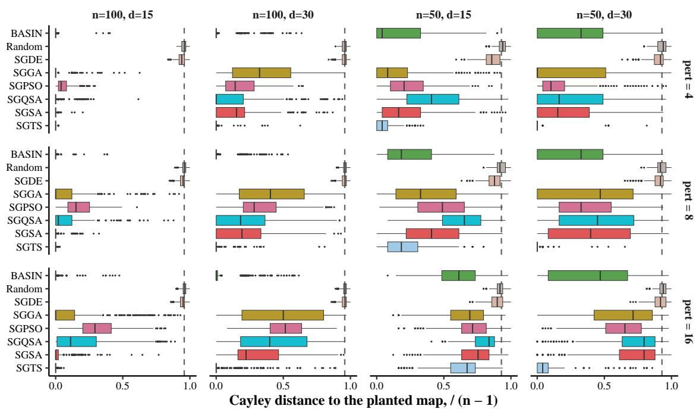  
Figure 10: Cayley distance to the planted map over its maximum $n - 1$ on MMM graphs, one variant per algorithm and the random-search baseline. Boxes span every restart on the 100 test graphs of each condition, 0 being the planted map itself; one panel per graph size n, edge density d and number $p e r t \in \{ 4 , 8 , 1 6 \}$ of perturbing edge swaps. The dashed line is the median distance of a random permutation without fixed points.

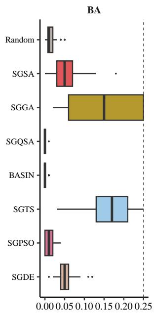

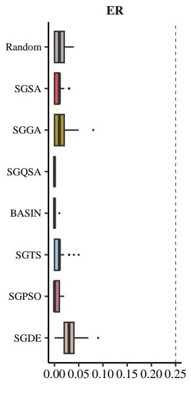

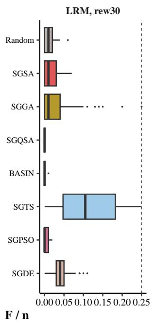

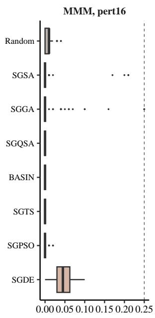  
Figure 11: Fixed-point ratio $F / n$ of each graph’s solution, over the 100 test graphs of the hardest condition of each graph family $( n = 1 0 0 , d = 4 0 \ \%$ , and 30 % for the LRM and MMM respectively, LRM $r e w = 3 0$ , MMM pert = 16). The dashed line is the likely degeneracy threshold 0.25n.

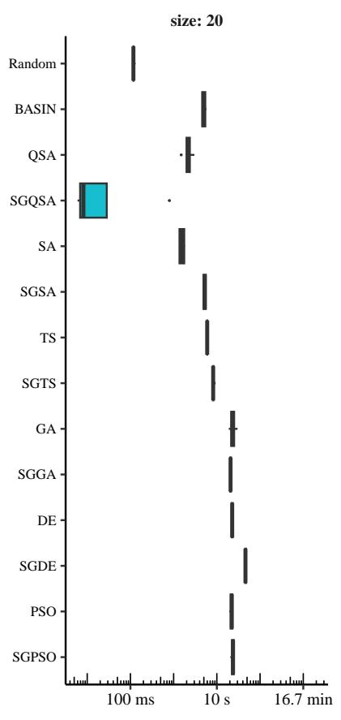

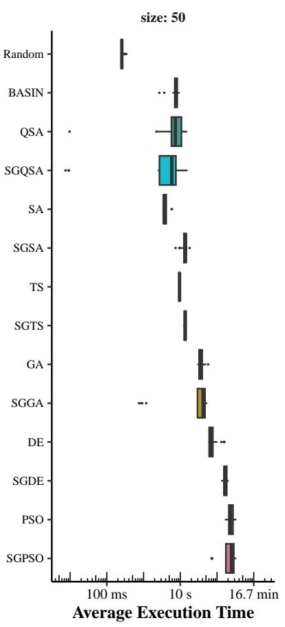

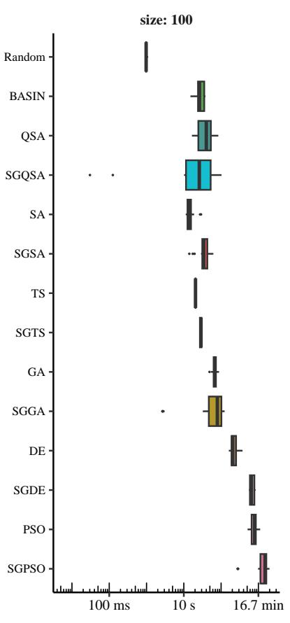  
Figure 12: Execution time of a single restart by graph size, every variant of every algorithm. Each box spans the mean time per restart of the conditions at that size, not individual graphs. The horizontal axis is logarithmic.

A  
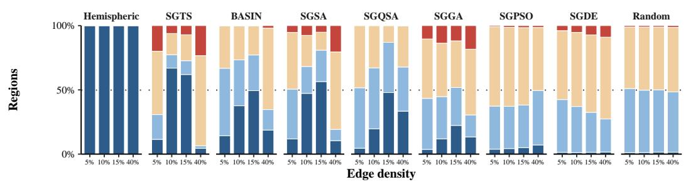  
B

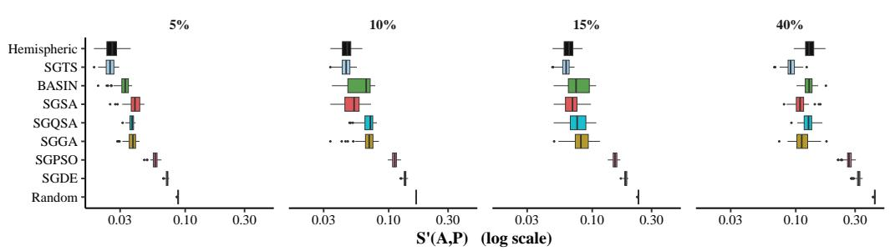  
Figure 13: The 88 structural connectomes at four proportional edge densities. (A) Share of the 90 regions, averaged over subjects, that the solution sends to the contralateral homologue, to another contralateral region, within the same hemisphere, or to themselves; Hemispheric is $\pi _ { L R } ,$ and dotted is the share sent across hemispheres by the random baseline. (B) $S ^ { \prime } ( A , P )$ of each subject’s solution, logarithmic axis.

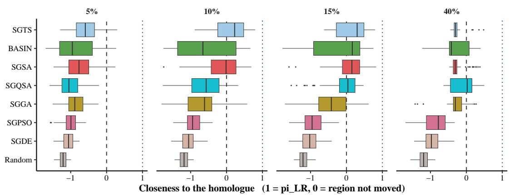  
Figure 14: Where the regions not mapped to their contralateral homologue are sent. Each boxplot is across the 88 subjects, and a subject contributes the average over those regions in its solution. The x-axis compares the physical distance in the brain between a region’s image and its homologue with the distance between the region itself and its homologue: 1 (dotted) is the homologue itself, 0 (dashed) is as far from it as leaving the region in place, and negative values lie further from it than the region already does.

A  
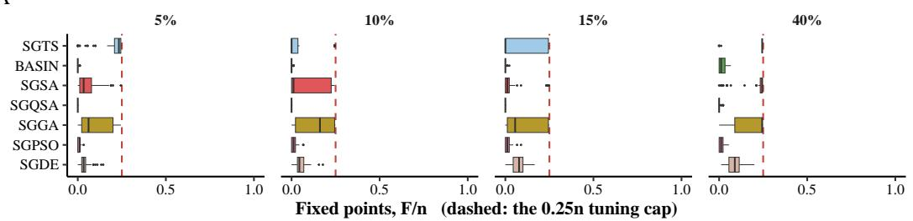  
B

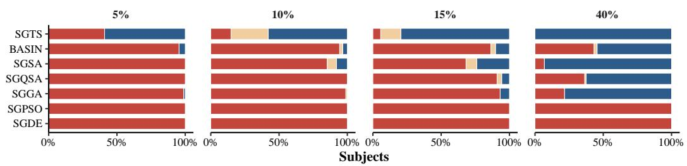  
Figure 15: The 88 structural connectomes at four proportional edge densities, one solution per subject. (A) Fixed-point ratio $F / n$ over subjects; dashed is the 0.25n bound. (B) Share of subjects whose solution scores below (beats), equal to (ties) or above (loses to) $\pi _ { L R }$ on $S ^ { \prime } ( A , P )$

## A Impact of node-similarity guidance: Additional results

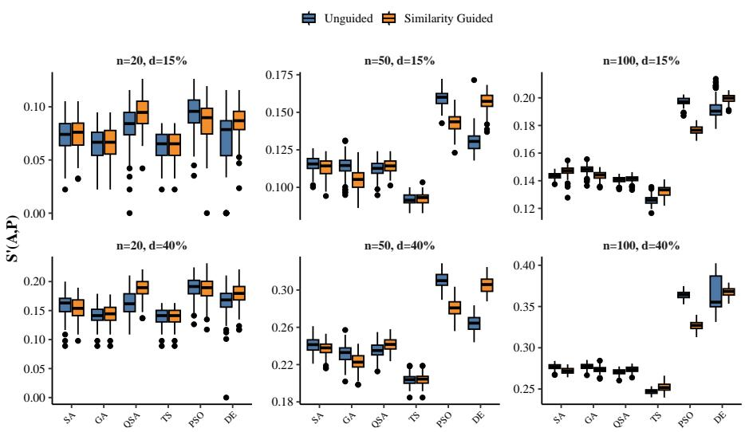  
Figure S1: Node-similarity guidance on BA graphs. Boxes show $S ^ { \prime } ( A , P )$ over the 100 test graphs of each condition, one solution per graph, for the unguided and the similarityguided variant of each algorithm; rows are edge densities d of 15% and 40%, columns graph sizes n. BASIN has no guided variant and is not shown.

## A.1 The guidance comparison under the size-normalized score

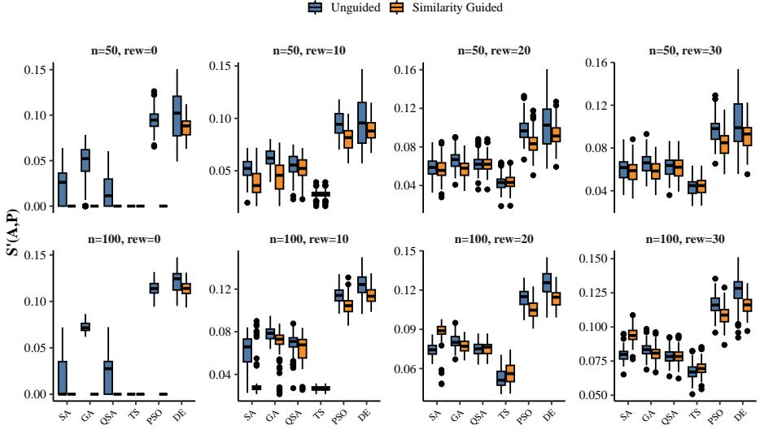  
Figure S2: Node-similarity guidance on LRM graphs at edge density 15 %. Boxes show $S ^ { \prime } ( A , P )$ over the 100 test graphs of each condition, one solution per graph, for the unguided and the similarity-guided variant of each algorithm; one panel per graph size n and share rew of rewired edges. BASIN has no guided variant and is not shown.

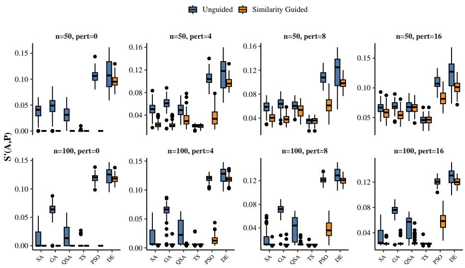  
Figure S3: Node-similarity guidance on MMM graphs at edge density 15 %. Boxes show $S ^ { \prime } ( A , P )$ over the 100 test graphs of each condition, one solution per graph, for the unguided and the similarity-guided variant of each algorithm; one panel per graph size n and number pert of perturbing edge swaps. BASIN has no guided variant and is not shown.

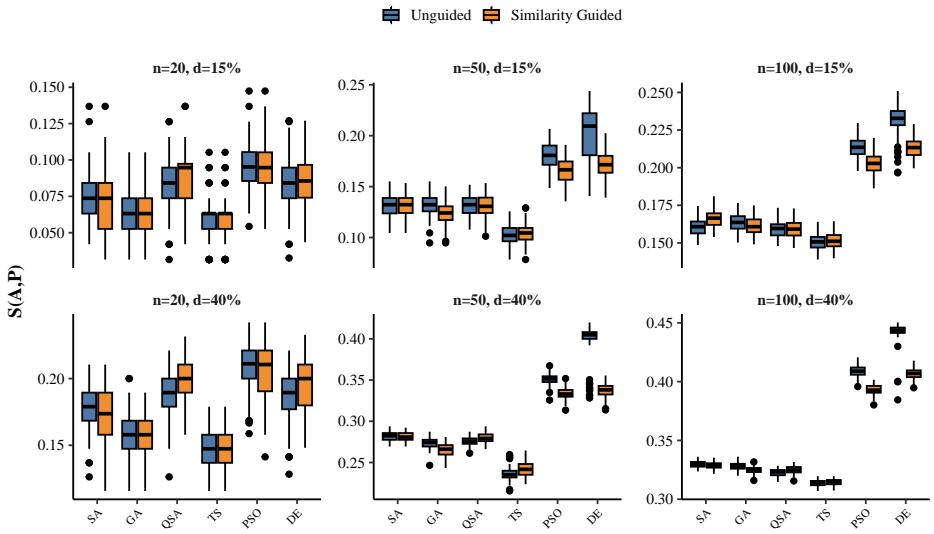  
Figure S4: Node-similarity guidance on ER graphs, under $S ( A , P )$ . Boxes show the size-normalized score $S ( A , P )$ , which does not correct for fixed points over the 100 test graphs of each condition, one solution per graph, for the unguided and the similarityguided variant of each algorithm; rows are densities d of 15% and 40%, columns graph sizes n. BASIN has no guided variant and is not shown.

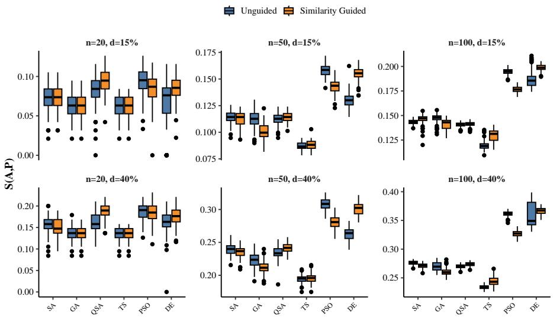  
Figure S5: Node-similarity guidance on BA graphs, under $S ( A , P )$ . Boxes show the size-normalized score $S ( A , P )$ , which does not correct for fixed points over the 100 test graphs of each condition, one solution per graph, for the unguided and the similarityguided variant of each algorithm; rows are densities d of 15% and 40%, columns graph sizes n. BASIN has no guided variant and is not shown.

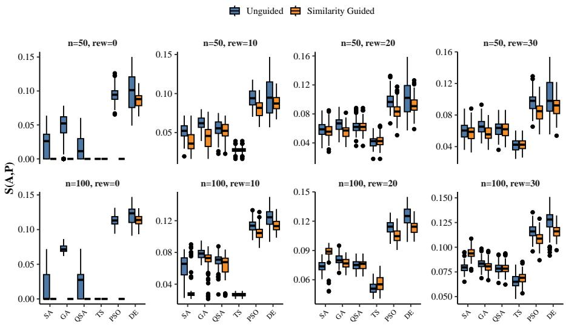  
Figure S6: Node-similarity guidance on LRM graphs at edge density 15 %, under $S ( A , P )$ Boxes show the size-normalized score S(A, P), which does not correct for fixed points over the 100 test graphs of each condition, one solution per graph, for the unguided and the similarity-guided variant of each algorithm; one panel per graph size n and share rew of rewired edges. BASIN has no guided variant and is not shown.

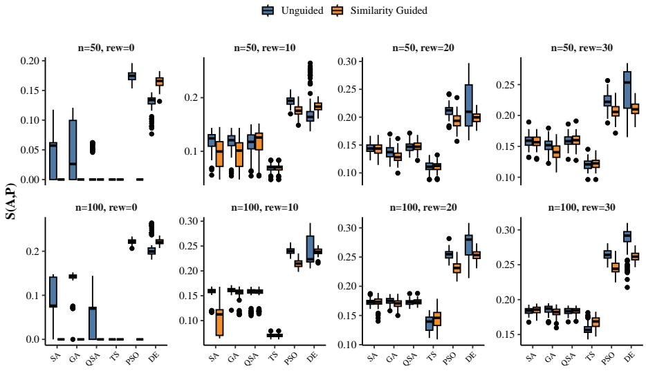  
Figure S7: Node-similarity guidance on LRM graphs at edge density 40 %, under $S ( A , P )$ Boxes show the size-normalized score S(A, P), which does not correct for fixed points over the 100 test graphs of each condition, one solution per graph, for the unguided and the similarity-guided variant of each algorithm; one panel per graph size n and share rew of rewired edges. BASIN has no guided variant and is not shown.

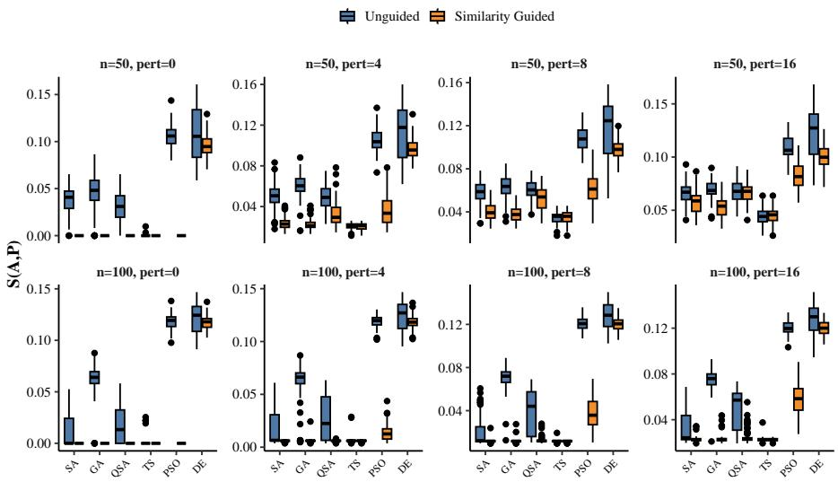  
Figure S8: Node-similarity guidance on MMM graphs at edge density 15 $\% .$ under $S ( A , P )$ . Boxes show the size-normalized score $S ( A , P )$ , which does not correct for fixed points over the 100 test graphs of each condition, one solution per graph, for the unguided and the similarity-guided variant of each algorithm; one panel per graph size n and number pert of perturbing edge swaps. BASIN has no guided variant and is not shown.

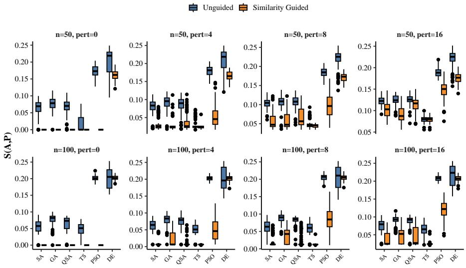  
Figure S9: Node-similarity guidance on MMM graphs at edge density 30 ${ \% } ,$ under $S ( A , P )$ . Boxes show the size-normalized score $S ( A , P )$ , which does not correct for fixed points over the 100 test graphs of each condition, one solution per graph, for the unguided and the similarity-guided variant of each algorithm; one panel per graph size n and number pert of perturbing edge swaps. BASIN has no guided variant and is not shown.

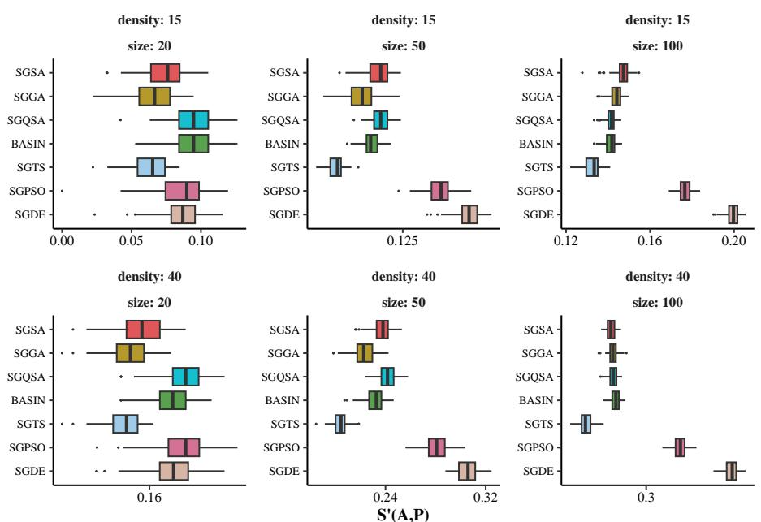  
Figure S10: Performance on BA graphs, one variant per algorithm. Boxes show $S ^ { \prime } ( A , P )$ over the 100 test graphs of each condition, one solution per graph; one panel per graph size n and edge density d, each with its own horizontal axis.

## B Performance comparison: Additional results

## B.1 Recovery of the planted map

Table S1: Recovery of the planted map at zero perturbation (LRM rew0, MMM pert0), where it is an exact automorphism; four conditions of 100 graphs per graph family, against 0.015 for a random permutation without fixed points. Restarts exact and Graphs hit are the shares of restarts and of graphs returning it.

<table><tr><td>Method</td><td>Restarts exact</td><td>Graphs hit</td><td>Nodes correct</td></tr><tr><td>LRM</td><td></td><td></td><td></td></tr><tr><td>SGQSA</td><td>0.999</td><td>0.998</td><td>1.000</td></tr><tr><td>BASIN</td><td>0.983</td><td>0.988</td><td>1.000</td></tr><tr><td>SGTS</td><td>0.981</td><td>0.980</td><td>1.000</td></tr><tr><td>SGGA</td><td>0.980</td><td>0.980</td><td>1.000</td></tr><tr><td>SGPSO</td><td>0.978</td><td>0.978</td><td>1.000</td></tr><tr><td>SGSA</td><td>0.975</td><td>0.978</td><td>1.000</td></tr><tr><td>TS</td><td>0.946</td><td>0.980</td><td>1.000</td></tr><tr><td>QSA</td><td>0.184</td><td>0.545</td><td>0.326</td></tr><tr><td>SA</td><td>0.086</td><td>0.307</td><td>0.110</td></tr><tr><td>GA</td><td>0.041</td><td>0.163</td><td>0.013</td></tr><tr><td>DE</td><td>0.000</td><td>0.000</td><td>0.013</td></tr><tr><td>PSO</td><td>0.000</td><td>0.000</td><td>0.007</td></tr><tr><td>Random</td><td>0.000</td><td>0.000</td><td>0.015</td></tr><tr><td>SGDE</td><td>0.000</td><td>0.000</td><td>0.007</td></tr><tr><td>MMM</td><td></td><td></td><td></td></tr><tr><td>SGQSA</td><td>0.948</td><td>0.945</td><td>1.000</td></tr><tr><td>SGGA</td><td>0.930</td><td>0.930</td><td>1.000</td></tr><tr><td>SGPSO</td><td>0.929</td><td>0.925</td><td>1.000</td></tr><tr><td>SGTS</td><td>0.923</td><td>0.910</td><td>1.000</td></tr><tr><td>SGSA</td><td>0.854</td><td>0.935</td><td>1.000</td></tr><tr><td>BASIN</td><td>0.709</td><td>0.802</td><td>0.860</td></tr><tr><td>TS</td><td>0.408</td><td>0.625</td><td>0.642</td></tr><tr><td>SA</td><td>0.057</td><td>0.200</td><td>0.160</td></tr><tr><td>QSA</td><td>0.035</td><td>0.125</td><td>0.105</td></tr><tr><td>GA</td><td>0.009</td><td>0.043</td><td>0.015</td></tr><tr><td>DE</td><td>0.000</td><td>0.000</td><td>0.015</td></tr><tr><td>PSO</td><td>0.000</td><td>0.000</td><td>0.015</td></tr><tr><td>Random</td><td>0.000</td><td>0.000</td><td>0.015</td></tr><tr><td>SGDE</td><td>0.000</td><td>0.000</td><td>0.013</td></tr></table>

## B.2 BASIN component ablation

## B.3 The orthogonal minimum spanning tree thresholding

Beside the proportional densities, each connectome is also thresholded by orthogonal minimum spanning trees at $k \in \{ 2 , 4 , 7 , 1 5 \}$ , which retain $k ( n - 1 )$ edges. The progression of the proportional densities is reproduced at these edge counts (Fig. S17). OMST $k = 4$ and $k = 7$ behave as the 10% and 15% densities do, at median homologue rates of 0.856 and 0.800 for TS, while OMST $k = 2$ behaves as 5% does, at 0.000.

## B.4 Structural connectomes: additional results

Table S2: Structural connectomes at the configuration tuned under $F \leq 0 . 2 5 n$ , one solution per subject. Median $S ^ { \prime } ( A , P )$ with interquartile range in brackets. Win / tie / loss are shares of subjects against $\pi _ { L R } .$ , exact ties their own category.

<table><tr><td>Method</td><td>Median S' [IQR]</td><td></td><td> $F / n$ </td><td></td><td>Win / tie / loss vs πLR</td></tr><tr><td>5%</td><td></td><td></td><td></td><td></td><td></td></tr><tr><td>Hemispheric</td><td></td><td>0.0260 [0.0235, 0.0281]</td><td>0.000</td><td></td><td></td></tr><tr><td>SA</td><td></td><td>0.0311 [0.0289, 0.0328]</td><td>0.206</td><td></td><td>0.12 / 0.00 / 0.88</td></tr><tr><td>SGSA</td><td></td><td>0.0395 [0.0368, 0.0431]</td><td>0.033</td><td></td><td>0.00 / 0.00 / 1.00</td></tr><tr><td>GA</td><td></td><td>0.0432 [0.0423, 0.0444]</td><td>0.000</td><td></td><td>0.00 / 0.00 / 1.00</td></tr><tr><td>SGGA</td><td></td><td>0.0380 [0.0355, 0.0399]</td><td>0.061</td><td></td><td>0.01 / 0.00 / 0.99</td></tr><tr><td>PSO</td><td></td><td>0.0712 [0.0700, 0.0726]</td><td>0.056</td><td></td><td>0.00 / 0.00 / 1.00</td></tr><tr><td>SGPSO</td><td></td><td>0.0574 [0.0554, 0.0594]</td><td>0.011</td><td></td><td>0.00 / 0.00 / 1.00</td></tr><tr><td>DE</td><td></td><td>0.0744 [0.0649, 0.0801]</td><td>0.111</td><td></td><td>0.00 / 0.00 / 1.00</td></tr><tr><td>SGDE</td><td></td><td>0.0719 [0.0705, 0.0725]</td><td>0.033</td><td></td><td>0.00 / 0.00 / 1.00</td></tr><tr><td>TS</td><td></td><td>0.0244 [0.0223, 0.0257]</td><td>0.244</td><td></td><td>0.69 / 0.05 / 0.26</td></tr><tr><td>SGTS</td><td></td><td>0.0249 [0.0232, 0.0267]</td><td>0.233</td><td></td><td>0.59 / 0.00 / 0.41</td></tr><tr><td>QSA</td><td></td><td>0.0385 [0.0373, 0.0390]</td><td>0.000</td><td></td><td>0.00 / 0.00 / 1.00</td></tr><tr><td>SGQSA</td><td></td><td>0.0375 [0.0360, 0.0385]</td><td>0.000</td><td></td><td>0.00 / 0.00 / 1.00</td></tr><tr><td>BASIN</td><td></td><td>0.0330 [0.0310, 0.0350]</td><td>0.000</td><td></td><td>0.05 / 0.00 / 0.95</td></tr><tr><td>Random</td><td></td><td>0.0879 [0.0874, 0.0879]</td><td>0.011</td><td></td><td>0.00 / 0.00 / 1.00</td></tr><tr><td>10%</td><td></td><td></td><td></td><td></td><td></td></tr><tr><td>Hemispheric</td><td></td><td>0.0464 [0.0424, 0.0496]</td><td>0.000</td><td></td><td></td></tr><tr><td>SA</td><td></td><td>0.0605 [0.0563, 0.0648]</td><td>0.183</td><td></td><td>0.00 / 0.02 / 0.98</td></tr><tr><td>SGSA</td><td></td><td>0.0527 [0.0444, 0.0578]</td><td>0.011</td><td></td><td>0.08 / 0.07 / 0.85</td></tr><tr><td>GA</td><td></td><td>0.0814 [0.0769, 0.0844]</td><td>0.011</td><td></td><td>0.00 / 0.00 / 1.00</td></tr><tr><td>SGGA</td><td></td><td>0.0697 [0.0651, 0.0747]</td><td>0.161</td><td></td><td>0.00 / 0.01 / 0.99</td></tr><tr><td>PSO</td><td></td><td>0.1348 [0.1319, 0.1375]</td><td>0.078</td><td></td><td>0.00 / 0.00 / 1.00</td></tr><tr><td>SGPSO</td><td></td><td>0.1119 [0.1074, 0.1153]</td><td>0.011</td><td></td><td>0.00 / 0.00 / 1.00</td></tr><tr><td>DE</td><td></td><td>0.1216 [0.1166, 0.1298]</td><td>0.167</td><td></td><td>0.00 / 0.00 / 1.00</td></tr><tr><td>SGDE</td><td></td><td>0.1359 [0.1332, 0.1374]</td><td>0.044</td><td></td><td>0.00 / 0.00 / 1.00</td></tr><tr><td>TS</td><td></td><td>0.0455 [0.0419, 0.0489]</td><td>0.000</td><td></td><td>0.51 / 0.36 / 0.12</td></tr><tr><td>Method</td><td>Median  $S ^ { \prime }$  [IQR]</td><td> $F / n$ </td><td>Win</td><td>tie</td><td>/loss vs πLR</td></tr><tr><td>SGTS</td><td>0.0455</td><td>[0.0423, 0.0488]</td><td>0.000</td><td>0.58</td><td>/0.27 0.15</td></tr><tr><td>QSA</td><td>0.0709 [0.0670, 0.0745]</td><td></td><td>0.000</td><td>0.00 / 0.00</td><td>1.00</td></tr><tr><td>SGQSA</td><td>0.0712 [0.0644, 0.0744]</td><td></td><td>0.000</td><td>0.00 0.00</td><td>1.00</td></tr><tr><td>BASIN</td><td>0.0659</td><td>[0.0469, 0.0709]</td><td>0.000</td><td>0.03 0.02</td><td>0.94</td></tr><tr><td>Random</td><td>0.1663 [0.1653, 0.1668]</td><td></td><td>0.011</td><td>0.00 / 0.00 / 1.00</td><td></td></tr><tr><td>15%</td><td></td><td></td><td></td><td></td><td></td></tr><tr><td>Hemispheric</td><td>0.0652 [0.0594, 0.0699]</td><td></td><td>0.000</td><td></td><td></td></tr><tr><td>SA</td><td>0.0782</td><td>[0.0694, 0.0847]</td><td>0.083</td><td></td><td>0.15 / 0.00 / 0.85</td></tr><tr><td>SGSA</td><td>0.0694 [0.0609, 0.0754]</td><td></td><td>0.011</td><td>0.24 / 0.08 /</td><td>/0.68</td></tr><tr><td>GA</td><td>0.0975 [0.0885, 0.1045]</td><td></td><td>0.056</td><td>0.00 / 0.01 /</td><td>/0.99</td></tr><tr><td>SGGA</td><td>0.0811</td><td>[0.0731, 0.0930]</td><td>0.056</td><td>0.07 / 0.00 /</td><td>/0.93</td></tr><tr><td>PSO</td><td>0.1834</td><td>[0.1792, 0.1868]</td><td>0.111</td><td></td><td>0.00 / 0.00 / 1.00</td></tr><tr><td>SGPSO</td><td>0.1523</td><td>[0.1473, 0.1578]</td><td>0.011</td><td></td><td>0.00 / 0.00 / 1.00</td></tr><tr><td>DE</td><td>0.1585</td><td>[0.1539, 0.1665]</td><td>0.178</td><td>0.00 / 0.00</td><td>/ 1.00</td></tr><tr><td>SGDE</td><td>0.1855</td><td>[0.1824, 0.1895]</td><td>0.078</td><td></td><td>0.00 / 0.00 / 1.00</td></tr><tr><td>TS</td><td>0.0615</td><td>[0.0584, 0.0655]</td><td>0.000</td><td>0.84 / 0.11 /</td><td>/0.05</td></tr><tr><td>SGTS</td><td>0.0617</td><td>[0.0579, 0.0652]</td><td>0.000</td><td>0.80 / 0.15 /</td><td>0.06</td></tr><tr><td>QSA</td><td>0.0704</td><td>[0.0544, 0.0817]</td><td>0.022</td><td>0.28 / 0.00</td><td>7 /0.72</td></tr><tr><td>SGQSA</td><td>0.0757</td><td>[0.0667, 0.0889]</td><td>0.000</td><td>0.06 / 0.03 / </td><td>0.91</td></tr><tr><td>BASIN</td><td>0.0742</td><td>[0.0643, 0.0948]</td><td>0.000</td><td>0.10 /0.03</td><td>7 /0.86</td></tr><tr><td>Random</td><td>0.2352</td><td>[0.2342, 0.2365]</td><td>0.011</td><td></td><td>0.00 / 0.00 / 1.00</td></tr><tr><td>40%</td><td></td><td></td><td></td><td></td><td></td></tr><tr><td>Hemispheric</td><td>0.1281 [0.1199, 0.1395]</td><td></td><td>0.000</td><td></td><td></td></tr><tr><td>SA</td><td>0.1166</td><td>[0.1060, 0.1251]</td><td>0.244</td><td></td><td>0.76 / 0.00 / 0.24</td></tr><tr><td>SGSA</td><td>0.1082</td><td>[0.1011, 0.1157]</td><td>0.244</td><td>0.93 / 0.00</td><td>/0.07</td></tr><tr><td>GA</td><td>0.1155</td><td>[0.1073, 0.1255]</td><td>0.244</td><td>0.73 / 0.00</td><td>/0.27</td></tr><tr><td>SGGA</td><td>0.1117</td><td>[0.1021, 0.1246]</td><td>0.244</td><td>0.78 / 0.00</td><td>/0.22</td></tr><tr><td>PSO</td><td>0.3067</td><td>[0.3002, 0.3137]</td><td>0.178</td><td>0.00 / 0.00 /</td><td>/1.00</td></tr><tr><td>SGPSO</td><td>0.2679</td><td>[0.2607, 0.2793]</td><td>0.011</td><td>0.00 / 0.00</td><td>/1.00</td></tr><tr><td>DE</td><td>0.2587</td><td>[0.2475, 0.2728]</td><td>0.200</td><td></td><td>0.00 / 0.00 / 1.00</td></tr><tr><td>SGDE</td><td>0.3205</td><td>[0.3137, 0.3277]</td><td>0.089</td><td>0.00 / 0.00</td><td>1.00</td></tr><tr><td>TS</td><td>0.0901</td><td>[0.0862, 0.0961]</td><td>0.244</td><td></td><td>1.00 / 0.00 / 0.00</td></tr><tr><td>SGTS</td><td>0.0909</td><td>[0.0868, 0.0975]</td><td>0.244</td><td>1.00 / 0.00</td><td>/0.00</td></tr><tr><td>QSA</td><td>0.0239</td><td>[0.0226, 0.0308]</td><td>0.956</td><td>1.00 / 0.00</td><td>0.00</td></tr><tr><td>SGQSA</td><td>0.1266</td><td>[0.1169, 0.1342]</td><td>0.000</td><td>0.62 /0.01</td><td>/0.36</td></tr><tr><td>BASIN</td><td>0.1280</td><td>[0.1192, 0.1352]</td><td>0.011</td><td>0.55 / 0.02</td><td>/0.43</td></tr><tr><td>Random</td><td></td><td>0.4320 [0.4290, 0.4341]</td><td>0.011</td><td></td><td>0.00 / 0.00 / 1.00</td></tr></table>

Table S3: The map returned on the 88 structural connectomes at the configuration tuned under $F \le 0 . 2 5 n$ , one solution per subject. Homologue rate is the share of the 90 regions sent to their homologue, Share $> 0 . 9 ~ / < 0 . 1$ the subjects beyond those rates, Cayley (norm.) the Cayley distance to $\pi _ { L R }$ (Sec. 5.3.2) over its maximum n − 1.
<table><tr><td>Method</td><td>Homologue rate</td><td> $\mathrm { S h a r e } > 0 . 9 \ / < 0 . 1$ </td><td>Cayley (norm.)</td></tr><tr><td>5%</td><td></td><td></td><td></td></tr><tr><td>Hemispheric</td><td>1.000</td><td>1.00 / 0.00</td><td>0.000</td></tr><tr><td>SA</td><td>0.011</td><td>0.00 / 0.91</td><td>0.921</td></tr><tr><td>SGSA</td><td>0.061</td><td>0.00 / 0.57</td><td>0.865</td></tr><tr><td>GA</td><td>0.011</td><td>0.00 / 0.99</td><td>0.944</td></tr><tr><td>SGGA</td><td>0.022</td><td>0.00 / 0.90</td><td>0.899</td></tr><tr><td>PSO</td><td>0.011</td><td>0.00 / 1.00</td><td>0.944</td></tr><tr><td>SGPSO</td><td>0.028</td><td>0.00 / 0.92</td><td>0.933</td></tr><tr><td>DE</td><td>0.011</td><td>0.00 / 1.00</td><td>0.949</td></tr><tr><td>SGDE</td><td>0.011</td><td>0.00 / 0.99</td><td>0.955</td></tr><tr><td>TS</td><td>0.017</td><td>0.02 / 0.65</td><td>0.854</td></tr><tr><td>SGTS</td><td>0.011</td><td>0.00 / 0.73</td><td>0.854</td></tr><tr><td>QSA</td><td>0.028</td><td>0.00 / 0.88</td><td>0.916</td></tr><tr><td>SGQSA</td><td>0.028</td><td>0.00 / 0.82</td><td>0.910</td></tr><tr><td>BASIN</td><td>0.033</td><td>0.00 / 0.61</td><td>0.893</td></tr><tr><td>Random</td><td>0.011</td><td>0.00 / 1.00</td><td>0.955</td></tr><tr><td>10%</td><td></td><td></td><td></td></tr><tr><td>Hemispheric</td><td>1.000</td><td>1.00 / 0.00</td><td>0.000</td></tr><tr><td>SA</td><td>0.033</td><td>0.00 / 0.60</td><td>0.843</td></tr><tr><td>SGSA</td><td>0.583</td><td>0.09 / 0.31</td><td>0.343</td></tr><tr><td>GA</td><td>0.011</td><td>0.00 / 0.95</td><td>0.933</td></tr><tr><td>SGGA</td><td>0.028</td><td>0.01 / 0.70</td><td>0.876</td></tr><tr><td>PSO</td><td>0.006</td><td>0.00 /  1.00</td><td>0.944</td></tr><tr><td>SGPSO</td><td>0.033</td><td>0.00 / 0.86</td><td>0.910</td></tr><tr><td>DE</td><td>0.011</td><td>0.00 /  1.00</td><td>0.933</td></tr><tr><td>SGDE</td><td>0.011</td><td>0.00 / 1.00</td><td>0.955</td></tr><tr><td>TS</td><td>0.844</td><td>0.34 / 0.19</td><td>0.090</td></tr><tr><td>SGTS</td><td>0.833</td><td>0.33 / 0.22</td><td>0.112</td></tr><tr><td>QSA</td><td>0.128</td><td>0.00 / 0.44</td><td>0.781</td></tr><tr><td>SGQSA</td><td>0.178</td><td>0.00 / 0.38</td><td>0.708</td></tr><tr><td>BASIN</td><td>0.106</td><td>0.09 /  0.47</td><td>0.781</td></tr><tr><td>Random</td><td>0.011</td><td>0.00 / 1.00</td><td>0.949</td></tr><tr><td>15%</td><td></td><td></td><td></td></tr><tr><td>Hemispheric</td><td>1.000</td><td>1.00 / 0.00</td><td>0.000</td></tr><tr><td>SA</td><td>0.056</td><td>0.03 / 0.52</td><td>0.798</td></tr><tr><td>SGSA</td><td>0.661</td><td>0.07 / 0.19</td><td>0.270</td></tr><tr><td>GA</td><td>0.022</td><td>0.01  / 0.76</td><td>0.876</td></tr><tr><td>SGGA</td><td>0.022</td><td>0.01 / 0.61</td><td>0.831</td></tr><tr><td>PSO</td><td>0.011</td><td>0.00 / 1.00</td><td>0.944</td></tr><tr><td>SGPSO</td><td>0.022</td><td>0.00 / 0.80</td><td>0.921</td></tr><tr><td>DE</td><td>0.011</td><td>0.00 / 1.00</td><td>0.921</td></tr><tr><td>SGDE</td><td>0.000</td><td>0.00 /  1.00</td><td>0.944</td></tr><tr><td>TS</td><td>0.794</td><td>0.27  / 0.32</td><td>0.140</td></tr><tr><td>SGTS</td><td>0.811</td><td>0.22 / 0.27</td><td>0.129</td></tr><tr><td>QSA</td><td>0.178</td><td>0.01  / 0.49</td><td>0.562</td></tr><tr><td>SGQSA</td><td>0.522</td><td>0.00 / 0.12</td><td>0.365</td></tr><tr><td>BASIN</td><td>0.689</td><td>0.05 / 0.35</td><td>0.225</td></tr><tr><td>Random</td><td>0.011</td><td>0.00 / 1.00</td><td>0.955</td></tr><tr><td>40%</td><td></td><td></td><td></td></tr><tr><td>Hemispheric</td><td>1.000</td><td>1.00 / 0.00</td><td>0.000</td></tr><tr><td>SA</td><td>0.022</td><td>0.00 / 0.77</td><td>0.820</td></tr><tr><td>SGSA</td><td>0.022</td><td>0.00 / 0.83</td><td>0.787</td></tr><tr><td>GA</td><td>0.022</td><td>0.00 / 0.81</td><td>0.809</td></tr><tr><td>SGGA</td><td>0.039</td><td>0.00 / 0.72</td><td>0.787</td></tr><tr><td>PSO</td><td>0.011</td><td>0.00 /  1.00</td><td>0.933</td></tr><tr><td>SGPSO</td><td>0.056</td><td>0.00 / 0.67</td><td>0.876</td></tr><tr><td>DE</td><td>0.011</td><td>0.00 / 1.00</td><td>0.921</td></tr><tr><td>SGDE</td><td>0.011</td><td>0.00 /  1.00</td><td>0.933</td></tr><tr><td>TS</td><td>0.000</td><td>0.00 / 0.98</td><td>0.775</td></tr><tr><td>SGTS</td><td>0.000</td><td>0.00 / 0.94</td><td>0.775</td></tr><tr><td>QSA</td><td>0.000</td><td>0.00 / 0.98</td><td>0.528</td></tr><tr><td>SGQSA</td><td>0.417</td><td>0.00 / 0.32</td><td>0.489</td></tr><tr><td>BASIN</td><td>0.022</td><td>0.00 / 0.65</td><td>0.770</td></tr><tr><td>Random</td><td>0.011</td><td>0.00 / 1.00</td><td>0.955</td></tr></table>

Score distributions: Fig. S18; score relative to $\pi _ { L R }$ along the densities: Fig. S19; score against homologue rate: Fig. S20; agreement with $\pi _ { L R }$ by subject: Fig. S21; critical diferences per density: Fig. S22.

  
Figure S11: Performance on LRM graphs at edge density 15 %, one variant per algorithm. Boxes show $S ^ { \prime } ( A , P )$ over the 100 test graphs of each condition, one solution per graph; one panel per graph size n and share rew of rewired edges, each with its own horizontal axis.

Table S4: Agreement between restarts on the structural connectomes: the share of the 90 nodes that two restarts of a subject send to the same image, averaged over restart pairs and then over the 88 subjects. QSA at 40% fixes 86 of the 90 regions, so its restarts agree trivially.
<table><tr><td></td><td colspan="2">5%</td><td colspan="2">10%</td><td colspan="2">15%</td><td colspan="2">40%</td></tr><tr><td>Algorithms</td><td>unguided</td><td>guided</td><td>unguided</td><td>guided</td><td>unguided</td><td>guided</td><td>unguided</td><td>guided</td></tr><tr><td>SA / SGSA</td><td>0.03</td><td>0.17</td><td>0.04</td><td>0.28</td><td>0.05</td><td>0.25</td><td>0.11</td><td>0.22</td></tr><tr><td>GA / SGGA</td><td>0.01</td><td>0.05</td><td>0.02</td><td>0.05</td><td>0.02</td><td>0.08</td><td>0.08</td><td>0.17</td></tr><tr><td>QSA / SGQSA</td><td>0.02</td><td>0.03</td><td>0.04</td><td>0.07</td><td>0.09</td><td>0.16</td><td>0.49</td><td>0.26</td></tr><tr><td>TS / SGTS</td><td>0.08</td><td>0.42</td><td>0.21</td><td>0.63</td><td>0.21</td><td>0.70</td><td>0.23</td><td>0.69</td></tr></table>

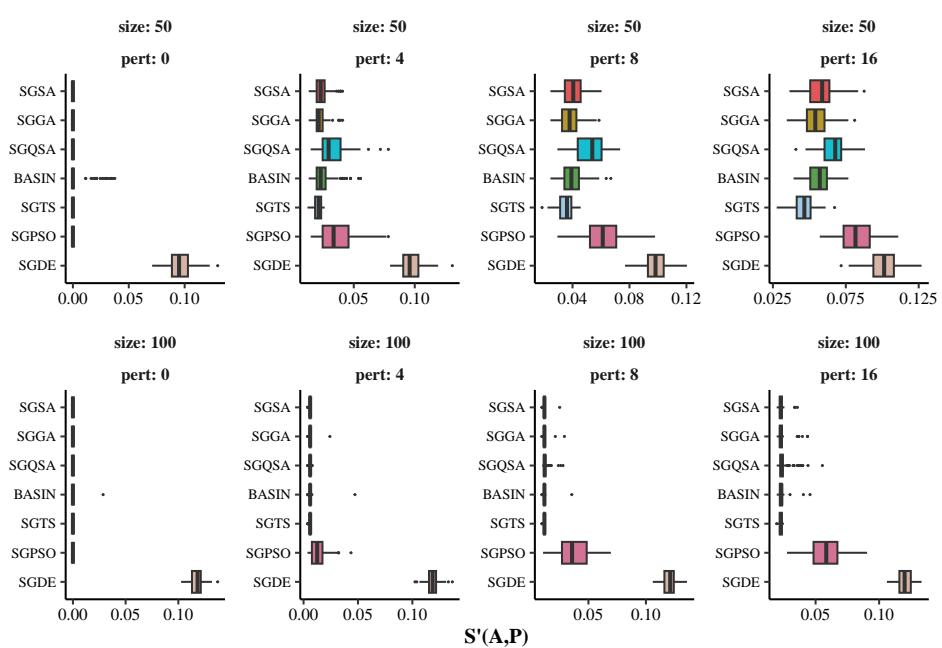  
Figure S12: Performance on MMM graphs at edge density 15 %, one variant per algorithm. Boxes show $S ^ { \prime } ( A , P )$ over the 100 test graphs of each condition, one solution per graph; one panel per graph size n and number pert of perturbing edge swaps, each with its own horizontal axis.

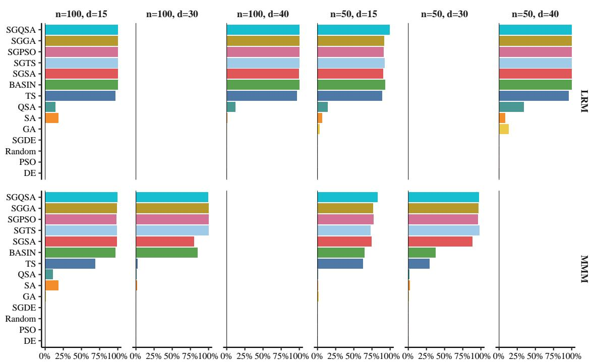  
restarts returning the planted map exactly  
Figure S13: Share of restarts returning the planted map exactly where it is an exact automorphism (LRM rew = 0, MMM $p e r t = 0 )$ , over every restart on the 100 test graphs of each condition; every variant of every algorithm and the random-search baseline. One panel per graph size n, edge density d and graph family.

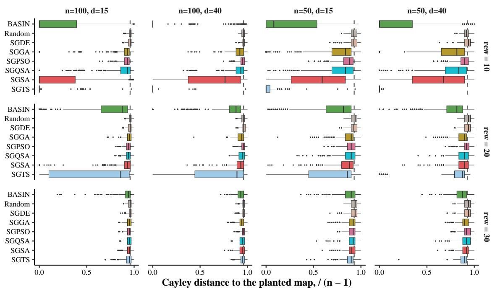  
Figure S14: Cayley distance to the planted map over its maximum n−1 on LRM graphs, one variant per algorithm and the random-search baseline. Boxes span every restart on the 100 test graphs of each condition, 0 being the planted map itself; one panel per graph size n, edge density d and share $r e w \in \{ 1 0 , 2 0 , 3 0 \}$ % of rewired edges. The dashed line is the median distance of a random permutation without fixed points.

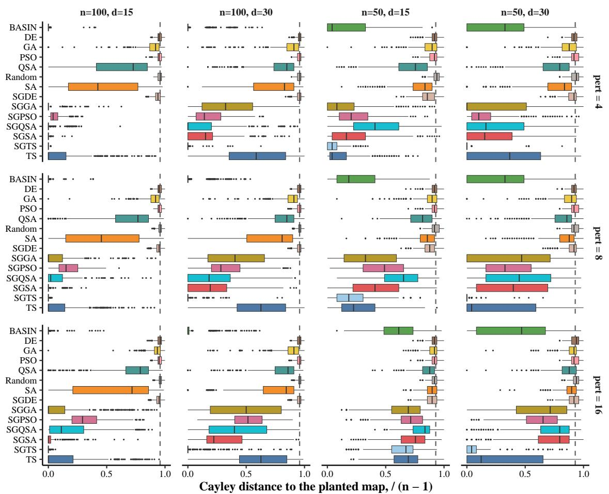  
Figure S15: Cayley distance to the planted map over its maximum $n - 1$ on MMM graphs, every variant of every algorithm and the random-search baseline. Boxes span every restart on the 100 test graphs of each condition, 0 being the planted map itself; one panel per graph size n, edge density d and number $p e r t \in \{ 4 , 8 , 1 6 \}$ of perturbing edge swaps. The dashed line is the median distance of a random permutation without fixed points.

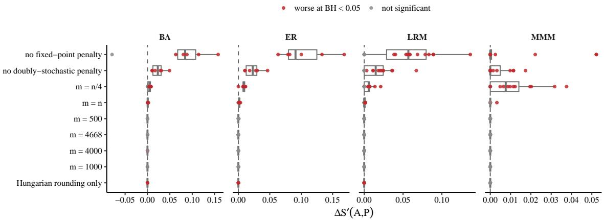  
Figure S16: BASIN component ablation, one row per ablated or varied component and one panel per graph family. Each point is one condition: the median $S ^ { \prime } ( A , P )$ of the ablated configuration minus that of the adopted one over the 100 test graphs, so that right of the dashed zero line the change hurt; boxes summarize the conditions. Red points are worse by a paired Wilcoxon signed-rank test after Benjamini–Hochberg correction at 0.05.

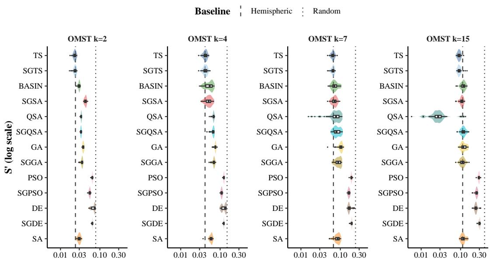  
Figure S17: $S ^ { \prime } ( A , P )$ on the 88 structural connectomes thresholded by orthogonal minimum spanning trees, one panel per $k \in \{ 2 , 4 , 7 , 1 5 \}$ , every variant of every algorithm. Violins and boxes span the subjects, one solution per subject; dashed is the median of $\pi _ { L R }$ and dotted that of the random baseline. Logarithmic axis.

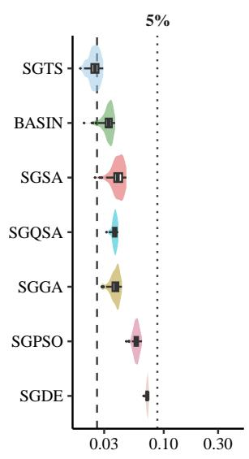

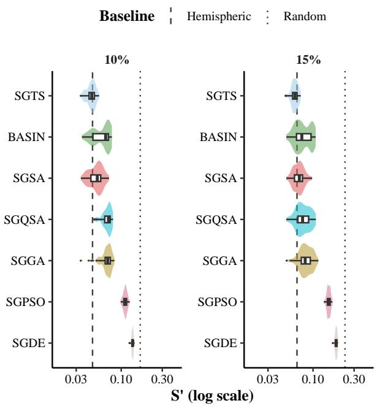

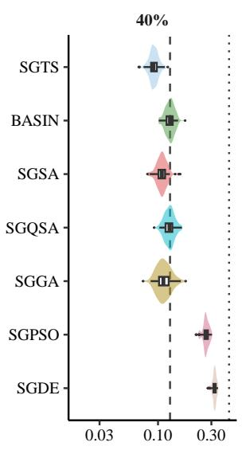  
Figure S18: $S ^ { \prime } ( A , P )$ on the 88 structural connectomes, one panel per proportional edge density, one variant per algorithm. Violins and boxes span the subjects, one solution per subject; dashed is the median of $\pi _ { L R }$ and dotted that of the random baseline. Logarithmic axis.

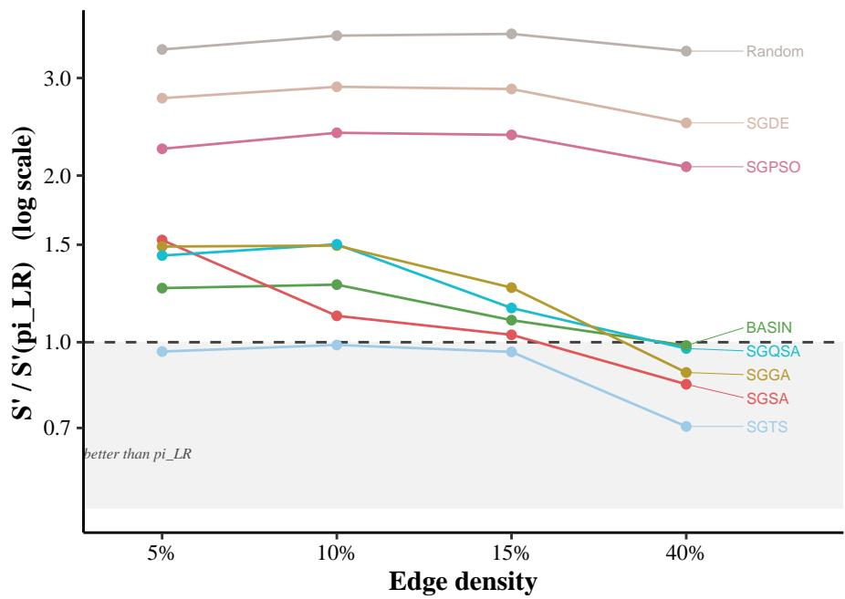  
Figure S19: Median over the 88 structural connectomes of $S ^ { \prime } ( A , P )$ divided by that of $\pi _ { L R }$ on the same subject, against proportional edge density, one variant per algorithm and the random baseline, one solution per subject. Below the dashed line at one (shaded) the solution scores better than $\pi _ { L R } .$ . Logarithmic vertical axis.

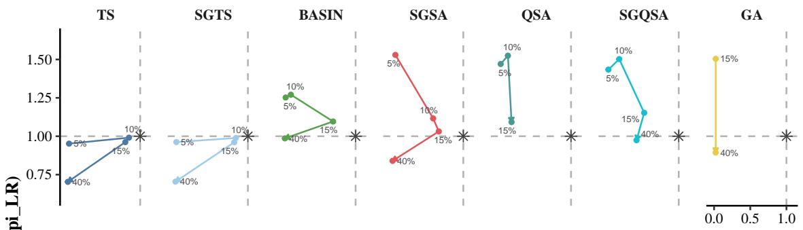

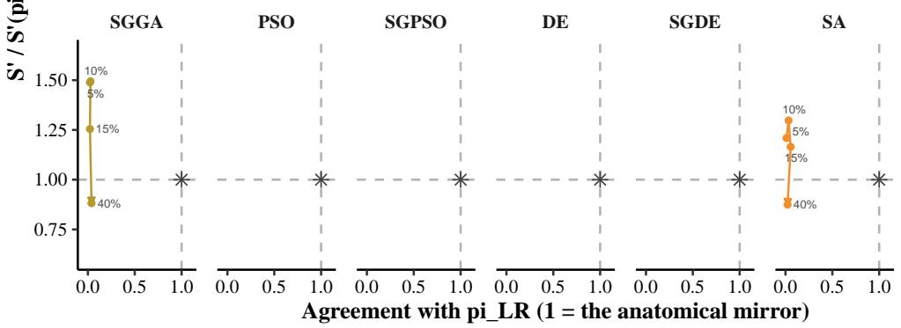  
Figure S20: Score against agreement with $\pi _ { L R }$ on the 88 structural connectomes, one panel per algorithm and variant, one point per proportional edge density (labeled). The vertical axis is the median $S ^ { \prime } ( A , P ) / S ^ { \prime } ( \pi _ { L R } )$ and the horizontal axis the median share of the 90 regions sent to their homologue, over subjects, one solution each; the star is $\pi _ { L R }$ itself.

  
Figure S21: Share of the 90 regions that the solution sends to their contralateral homologue, one point per subject of the 88 structural connectomes, one panel per proportional edge density, every variant of every algorithm. The black bar is the median; dotted is the chance level 1/89 of sending a region to its homologue.

10% density  
A  


B  


C  
15% density  
  
D

40% density  
  
Figure S22: Critical-diference diagrams (Friedman with post-hoc Nemenyi) on the 88 structural connectomes, (A)–(D) at proportional edge densities 5, 10, 15 and 40 %, every variant of every algorithm. Each algorithm is placed at its mean rank on $S ^ { \prime } ( A , P )$ over the 88 subjects, one solution per subject, rank 1 lowest; algorithms joined by a bar do not difer at the 5 % level.

## B.5 Benchmark networks: additional results

Table S5: Benchmark networks, 20 restarts per configuration, fixed points capped at n − 2. Exact rate: share of restarts returning an automorphism. Orbit recovery: mean share of vertices in non-trivial orbits mapped within their own orbit. Twin distance: minimum over restarts of the distance to the twin subgroup in vertices, exact for JAZZ. Other columns are medians over restarts.
<table><tr><td>Method</td><td>Exact rate</td><td>Median S&#x27;</td><td>Median F/n</td><td>Orbit recovery</td><td>Twin distance</td></tr><tr><td>JAZZ</td><td></td><td></td><td></td><td></td><td></td></tr><tr><td>TS</td><td>0.80</td><td>0.00000</td><td>0.929</td><td>0.832</td><td>0</td></tr><tr><td>SGTS</td><td>0.80</td><td>0.00000</td><td>0.929</td><td>0.907</td><td>0</td></tr><tr><td>SA</td><td>0.70</td><td>0.00000</td><td>0.939</td><td>0.679</td><td>0</td></tr><tr><td>SGGA</td><td>0.65</td><td>0.00000</td><td>0.929</td><td>0.896</td><td>0</td></tr><tr><td>GA</td><td>0.35</td><td>0.09670</td><td>0.265</td><td>0.425</td><td>0</td></tr><tr><td>QSA</td><td>0.00</td><td>0.00680</td><td>0.798</td><td>0.750</td><td>16</td></tr><tr><td>SGSA</td><td>0.00</td><td>0.03910</td><td>0.467</td><td>0.714</td><td>60</td></tr><tr><td>SGQSA</td><td>0.00</td><td>0.06959</td><td>0.051</td><td>0.793</td><td>168</td></tr><tr><td>BASIN</td><td>0.00</td><td>0.08656</td><td>0.015</td><td>0.382</td><td>187</td></tr><tr><td>SGPSO</td><td>0.00</td><td>0.14179</td><td>0.008</td><td>0.864</td><td>180</td></tr><tr><td>PSO</td><td>0.00</td><td>0.18401</td><td>0.139</td><td>0.025</td><td>141</td></tr><tr><td>DE</td><td>0.00</td><td>0.20595</td><td>0.101</td><td>0.011</td><td>130</td></tr><tr><td>SGDE</td><td>0.00</td><td>0.20846</td><td>0.033</td><td>0.029</td><td>185</td></tr><tr><td>Random</td><td>0.00</td><td>0.23072</td><td>0.010</td><td>0.007</td><td>193</td></tr><tr><td>PDZ</td><td></td><td></td><td></td><td></td><td></td></tr><tr><td>SGGA</td><td>0.00</td><td>0.00968</td><td>0.075</td><td>0.235</td><td>79</td></tr><tr><td>SGTS</td><td>0.00</td><td>0.00997</td><td>0.056</td><td>0.233</td><td>105</td></tr><tr><td>SGQSA</td><td>0.00</td><td>0.01079</td><td>0.000</td><td>0.029</td><td>157</td></tr><tr><td>QSA</td><td>0.00</td><td>0.01079</td><td>0.000</td><td>0.027</td><td>148</td></tr><tr><td>BASIN</td><td>0.00</td><td>0.01335</td><td>0.000</td><td>0.001</td><td>160</td></tr><tr><td>TS</td><td>0.00</td><td>0.01336</td><td>0.006</td><td>0.048</td><td>142</td></tr><tr><td>GA</td><td>0.00</td><td>0.01638</td><td>0.000</td><td>0.051</td><td>146</td></tr><tr><td>SGPSO</td><td>0.00</td><td>0.01865</td><td>0.025</td><td>0.576</td><td>97</td></tr><tr><td>PSO</td><td>0.00</td><td>0.02426</td><td>0.118</td><td>0.067</td><td>108</td></tr><tr><td>DE</td><td>0.00</td><td>0.02488</td><td>0.137</td><td>0.071</td><td>118</td></tr><tr><td>SGDE</td><td>0.00</td><td>0.02583</td><td>0.043</td><td>0.052</td><td>137</td></tr><tr><td>SGSA</td><td>0.00</td><td>0.02756</td><td>0.006</td><td>0.039</td><td>152</td></tr><tr><td>SA</td><td>0.00</td><td>0.02873</td><td>0.009</td><td>0.035</td><td>148</td></tr><tr><td>Random</td><td>0.00</td><td>0.03043</td><td>0.006</td><td>0.031</td><td>153</td></tr><tr><td>NETSCIENCE</td><td></td><td></td><td></td><td></td><td></td></tr><tr><td>SGTS</td><td>0.00</td><td>0.00899</td><td>0.011</td><td>0.105</td><td>346</td></tr><tr><td>SGQSA</td><td>0.00</td><td>0.00949</td><td>0.000</td><td>0.055</td><td>349</td></tr><tr><td>SGGA</td><td>0.00</td><td>0.00950</td><td>0.032</td><td>0.172</td><td>316</td></tr><tr><td>QSA</td><td>0.00</td><td>0.00981</td><td>0.003</td><td>0.041</td><td>353</td></tr><tr><td>TS</td><td>0.00</td><td>0.01046</td><td>0.003</td><td>0.029</td><td>363</td></tr><tr><td>GA</td><td>0.00</td><td>0.01263</td><td>0.001</td><td>0.016</td><td>365</td></tr><tr><td>SGPSO</td><td>0.00</td><td>0.01953</td><td>0.005</td><td>0.418</td><td>275</td></tr><tr><td>PSO</td><td>0.00</td><td>0.02242</td><td>0.080</td><td>0.012</td><td>321</td></tr><tr><td>DE</td><td>0.00</td><td>0.02292</td><td>0.098</td><td>0.010</td><td>277</td></tr><tr><td>BASIN</td><td>0.00</td><td>0.02329</td><td>0.000</td><td>0.040</td><td>369</td></tr><tr><td>SGDE</td><td>0.00</td><td>0.02378</td><td>0.024</td><td>0.014</td><td>357</td></tr><tr><td>SGSA</td><td>0.00</td><td>0.02443</td><td>0.000</td><td>0.012</td><td>373</td></tr><tr><td>SA</td><td>0.00</td><td>0.02463</td><td>0.003</td><td>0.005</td><td>371</td></tr><tr><td>Random</td><td>0.00</td><td>0.02478</td><td>0.003</td><td>0.005</td><td>375</td></tr></table>

B.6 Fixed points at every condition  
B.7 The comparison without the one-variant reduction

  
S' of the restarts that did NOT find an exact automorphism (log scale)  
Figure S23: $S ^ { \prime } ( A , P )$ on the three benchmark networks, one panel per network, every variant of every algorithm and the random baseline, fixed points uncapped. Each point is one of the 20 restarts that did not return an exact automorphism, the black bar their median; where some did, their count is printed beside the row. Logarithmic axis.

  
Figure S24: Distance from an exact automorphism on the three benchmark networks, one panel per network, every variant of every algorithm and the random baseline, fixed points uncapped: the share of nodes that must be reassigned to reach the twin subgroup, 0 % being an exact automorphism. One point per restart of 20, the black bar their median.

  
Figure S25: Fixed-point ratio $F / n$ of each graph’s solution, pooled over every condition of the testing set, one panel per graph family, one variant per algorithm and the randomsearch baseline. The dashed line is the likely degeneracy threshold 0.25n; the hardest condition of each graph family is in Figure 11.

$$
\begin{array} { l c l c c c c c c c c c c c } { { } } & { { \mathrm { } } } & { { \mathrm { R a n d o m } } } & { { \mathrm { } } } & { { \mathrm { G A } } } & { { \mathrm { } } } & { { \mathrm { \circ } } } & { { \mathrm { S G Q S A } } } & { { \mathrm { } } } & { { \mathrm { S G T S } } } & { { \mathrm { \circ } } } & { { \mathrm { D E } } } \\ { { \mathrm { m e t h o d } } } & { { \mathrm { } } } & { { \mathrm { S A } } } & { { \mathrm { } } } & { { \mathrm { } } } & { { \mathrm { S G G A } } } & { { \mathrm { } } } & { { \mathrm { B A S I N } } } & { { \mathrm { } } } & { { \mathrm { P S O } } } & { { \mathrm { } } } & { { \mathrm { S G D E } } } \\ { { \mathrm { } } } & { { \mathrm { } } } & { { \mathrm { S G S A } } } & { { \mathrm { } } } & { { \mathrm { Q S A } } } & { { \mathrm { } } } & { { \mathrm { } } } & { { \mathrm { T S } } } & { { \mathrm { } } } & { { \mathrm { S G P S O } } } & { { } } \end{array}
$$


Figure S26: Fixed-point ratio $F / n$ against the unnormalized score $S ( A , P )$ , which fixed points lower, on LRM graphs at edge density 40 $\% ;$ one point per graph and algorithm, its solution, every variant of every algorithm and the random-search baseline. One panel per graph size and share of rewired edges.  


  
Figure S27: Performance on ER graphs, every variant of every algorithm, unguided and similarity-guided. Boxes show $S ^ { \prime } ( A , P )$ over the 100 test graphs of each condition, one solution per graph; one panel per graph size $n$ and edge density $d ,$ each with its own horizontal axis.

  
Figure S28: Performance on BA graphs, every variant of every algorithm, unguided and similarity-guided. Boxes show $S ^ { \prime } ( A , P )$ over the 100 test graphs of each condition, one solution per graph; one panel per graph size n and edge density $d ,$ each with its own horizontal axis.

  
Figure S29: Performance on LRM graphs at edge density 15 %, every variant of every algorithm, unguided and similarity-guided. Boxes show $S ^ { \prime } ( A , P )$ over the 100 test graphs of each condition, one solution per graph; one panel per graph size n and share rew of rewired edges, each with its own horizontal axis.


  
Figure S30: Performance on LRM graphs at edge density 40 %, every variant of every algorithm, unguided and similarity-guided. Boxes show $S ^ { \prime } ( A , P )$ over the 100 test graphs of each condition, one solution per graph; one panel per graph size n and share rew of rewired edges, each with its own horizontal axis.  
Figure S31: Performance on MMM graphs at edge density 15 %, every variant of every algorithm, unguided and similarity-guided. Boxes show $S ^ { \prime } ( A , P )$ over the 100 test graphs of each condition, one solution per graph; one panel per graph size n and number pert of perturbing edge swaps, each with its own horizontal axis.


  
Figure S32: Performance on MMM graphs at edge density 30 $\%$ , every variant of every algorithm, unguided and similarity-guided. Boxes show $S ^ { \prime } ( A , P )$ over the 100 test graphs of each condition, one solution per graph; one panel per graph size n and number pert of perturbing edge swaps, each with its own horizontal axis.

## B.8 Critical diference diagrams at every condition

In Figs. S33–S43 each panel is one (size, density) condition; algorithms joined by a horizontal bar are not significantly diferent at the 5 % level.

  
Figure S33: Critical-diference diagrams (Friedman with post-hoc Nemenyi) on ER graphs, one panel per graph size n and edge density $d ,$ one variant per algorithm and the random-search baseline. Each algorithm is placed at its mean rank on $S ^ { \prime } ( A , P )$ over the 100 test graphs of the condition, rank 1 lowest; algorithms joined by a bar do not difer at the 5 % level.


  
Figure S34: Critical-diference diagrams (Friedman with post-hoc Nemenyi) on BA graphs, one panel per graph size n and edge density $d ,$ one variant per algorithm and the random-search baseline. Each algorithm is placed at its mean rank on $S ^ { \prime } ( A , P )$ over the 100 test graphs of the condition, rank 1 lowest; algorithms joined by a bar do not difer at the 5 % level.

  
Figure S35: Critical-diference diagrams (Friedman with post-hoc Nemenyi) on LRM graphs with $r e w = 0 \ \%$ of edges rewired, one panel per graph size n and edge density $d ,$ one variant per algorithm and the random-search baseline. Each algorithm is placed at its mean rank on $S ^ { \prime } ( A , P )$ over the 100 test graphs of the condition, rank 1 lowest; algorithms joined by a bar do not difer at the 5 % level.

  
Figure S36: Critical-diference diagrams (Friedman with post-hoc Nemenyi) on LRM graphs with $r e w = 1 0 \ \%$ of edges rewired, one panel per graph size n and edge density $d ,$ one variant per algorithm and the random-search baseline. Each algorithm is placed at its mean rank on $S ^ { \prime } ( A , P )$ over the 100 test graphs of the condition, rank 1 lowest; algorithms joined by a bar do not difer at the 5 % level.

  
Figure S37: Critical-diference diagrams (Friedman with post-hoc Nemenyi) on LRM graphs with $r e w = 2 0 \%$ of edges rewired, one panel per graph size n and edge density $d ,$ one variant per algorithm and the random-search baseline. Each algorithm is placed at its mean rank on $S ^ { \prime } ( A , P )$ over the 100 test graphs of the condition, rank 1 lowest; algorithms joined by a bar do not difer at the 5 % level.

  
Figure S38: Critical-diference diagrams (Friedman with post-hoc Nemenyi) on LRM graphs with $r e w = 3 0 \ \%$ of edges rewired, one panel per graph size n and edge density $d ,$ one variant per algorithm and the random-search baseline. Each algorithm is placed at its mean rank on $S ^ { \prime } ( A , P )$ over the 100 test graphs of the condition, rank 1 lowest; algorithms joined by a bar do not difer at the 5 % level.

  
Figure S39: Critical-diference diagrams (Friedman with post-hoc Nemenyi) on MMM graphs with $p e r t = 0$ perturbing edge swaps, one panel per graph size n and edge density $d ,$ one variant per algorithm and the random-search baseline. Each algorithm is placed at its mean rank on $S ^ { \prime } ( A , P )$ over the 100 test graphs of the condition, rank 1 lowest; algorithms joined by a bar do not difer at the 5 % level.

## B.9 Results including the random-search baseline

Random search scores above every optimization strategy in every condition (Table S6), which is why the other figures omit it.

  
Figure S40: Critical-diference diagrams (Friedman with post-hoc Nemenyi) on MMM graphs with $p e r t = 4$ perturbing edge swaps, one panel per graph size n and edge density $d ,$ one variant per algorithm and the random-search baseline. Each algorithm is placed at its mean rank on $S ^ { \prime } ( A , P )$ over the 100 test graphs of the condition, rank 1 lowest; algorithms joined by a bar do not difer at the 5 % level.

  
Figure S41: Critical-diference diagrams (Friedman with post-hoc Nemenyi) on MMM graphs with $\mathit { p e r t } = 8$ perturbing edge swaps, one panel per graph size n and edge density $d ,$ one variant per algorithm and the random-search baseline. Each algorithm is placed at its mean rank on $S ^ { \prime } ( A , P )$ over the 100 test graphs of the condition, rank 1 lowest; algorithms joined by a bar do not difer at the 5 % level.

  
Figure S42: Critical-diference diagrams (Friedman with post-hoc Nemenyi) on MMM graphs with $p e r t \ : = \ : 1 6$ perturbing edge swaps, one panel per graph size n and edge density $d ,$ one variant per algorithm and the random-search baseline. Each algorithm is placed at its mean rank on $S ^ { \prime } ( A , P )$ over the 100 test graphs of the condition, rank 1 lowest; algorithms joined by a bar do not difer at the 5 % level.

A  


B  


C  


D  
  
Figure S43: Critical-diference diagrams (Friedman with post-hoc Nemenyi) on MMM graphs at $n = 1 0 0$ and edge density 15 %, (A)–(D) at $p e r t = 0 ,$ 4, 8 and 16 perturbing edge swaps, one variant per algorithm and the random-search baseline. Each algorithm is placed at its mean rank on $S ^ { \prime } ( A , P )$ over the 100 test graphs of the condition, rank 1 lowest; algorithms joined by a bar do not difer at the $5 \ \%$ level.

  
Figure S44: Performance on ER graphs, one variant per algorithm, random-search baseline included. Boxes show $S ^ { \prime } ( A , P )$ over the 100 test graphs of each condition, one solution per graph; one panel per graph size n and edge density d, each with its own horizontal axis.

  
Figure S45: Performance on BA graphs, one variant per algorithm, random-search baseline included. Boxes show $S ^ { \prime } ( A , P )$ over the 100 test graphs of each condition, one solution per graph; one panel per graph size n and edge density $d ,$ each with its own horizontal axis.

  
Figure S46: Performance on LRM graphs at edge density 15 %, one variant per algorithm, random-search baseline included. Boxes show $S ^ { \prime } ( A , P )$ over the 100 test graphs of each condition, one solution per graph; one panel per graph size n and share rew of rewired edges, each with its own horizontal axis.

  
Figure S47: Performance on LRM graphs at edge density $4 0 \% ,$ one variant per algorithm, random-search baseline included. Boxes show $S ^ { \prime } ( A , P )$ over the 100 test graphs of each condition, one solution per graph; one panel per graph size n and share rew of rewired edges, each with its own horizontal axis.


  
Figure S48: Performance on MMM graphs at edge density 15 %, one variant per algorithm, random-search baseline included. Boxes show $S ^ { \prime } ( A , P )$ over the 100 test graphs of each condition, one solution per graph; one panel per graph size n and number pert of perturbing edge swaps, each with its own horizontal axis.


  
Figure S49: Performance on MMM graphs at edge density 30 $\% ,$ one variant per algorithm, random-search baseline included. Boxes show $S ^ { \prime } ( A , P )$ over the 100 test graphs of each condition, one solution per graph; one panel per graph size n and number pert of perturbing edge swaps, each with its own horizontal axis.


## B.10 Results using the size-normalized symmetry score $S ( A , P )$


  
Figure S50: Performance on ER graphs, under $S ( A , P )$ , one variant per algorithm, random-search baseline included. Boxes show the size-normalized score $S ( A , P )$ , which does not correct for fixed points over the 100 test graphs of each condition, one solution per graph; one panel per graph size n and edge density $d ,$ each with its own horizontal axis.


  
Figure S51: Performance on ER graphs, under $S ( A , P )$ , one variant per algorithm. Boxes show the size-normalized score $S ( A , P )$ , which does not correct for fixed points over the 100 test graphs of each condition, one solution per graph; one panel per graph size n and edge density $d ,$ each with its own horizontal axis.

  
Figure S52: Performance on BA graphs, under $S ( A , P )$ , one variant per algorithm, random-search baseline included. Boxes show the size-normalized score $S ( A , P )$ , which does not correct for fixed points over the 100 test graphs of each condition, one solution per graph; one panel per graph size n and edge density $d ,$ each with its own horizontal axis.

  
Figure S53: Performance on BA graphs, under $S ( A , P )$ , one variant per algorithm. Boxes show the size-normalized score $S ( A , P )$ , which does not correct for fixed points over the 100 test graphs of each condition, one solution per graph; one panel per graph size n and edge density d, each with its own horizontal axis.

  
Figure S54: Performance on LRM graphs at edge density 15 ${ \% } ,$ under $S ( A , P )$ , one variant per algorithm, random-search baseline included. Boxes show the size-normalized score $S ( A , P )$ , which does not correct for fixed points over the 100 test graphs of each condition, one solution per graph; one panel per graph size n and share rew of rewired edges, each with its own horizontal axis.

  
Figure S55: Performance on LRM graphs at edge density 15 ${ \% } ,$ under $S ( A , P )$ , one variant per algorithm. Boxes show the size-normalized score $S ( A , P )$ , which does not correct for fixed points over the 100 test graphs of each condition, one solution per graph; one panel per graph size n and share rew of rewired edges, each with its own horizontal axis.

  
Figure S56: Performance on LRM graphs at edge density $4 0 \ \% ,$ under $S ( A , P )$ , one variant per algorithm, random-search baseline included. Boxes show the size-normalized score $S ( A , P )$ , which does not correct for fixed points over the 100 test graphs of each condition, one solution per graph; one panel per graph size n and share rew of rewired edges, each with its own horizontal axis.


  
Figure S57: Performance on LRM graphs at edge density 40 ${ \% } ,$ under $S ( A , P )$ , one variant per algorithm. Boxes show the size-normalized score $S ( A , P )$ , which does not correct for fixed points over the 100 test graphs of each condition, one solution per graph; one panel per graph size n and share rew of rewired edges, each with its own horizontal axis.  
Figure S58: Performance on MMM graphs at edge density 15 $\% .$ , under $S ( A , P )$ , one variant per algorithm, random-search baseline included. Boxes show the size-normalized score $S ( A , P )$ , which does not correct for fixed points over the 100 test graphs of each condition, one solution per graph; one panel per graph size n and number pert of perturbing edge swaps, each with its own horizontal axis.


  
Figure S59: Performance on MMM graphs at edge density $1 5 \ \% ,$ , under $S ( A , P )$ , one variant per algorithm. Boxes show the size-normalized score $S ( A , P )$ , which does not correct for fixed points over the 100 test graphs of each condition, one solution per graph; one panel per graph size n and number pert of perturbing edge swaps, each with its own horizontal axis.


  
Figure S60: Performance on MMM graphs at edge density $3 0 \ \%$ , under $S ( A , P )$ , one variant per algorithm, random-search baseline included. Boxes show the size-normalized score $S ( A , P )$ , which does not correct for fixed points over the 100 test graphs of each condition, one solution per graph; one panel per graph size n and number pert of perturbing edge swaps, each with its own horizontal axis.


  
Figure S61: Performance on MMM graphs at edge density 30 ${ \% } ,$ under $S ( A , P )$ , one variant per algorithm. Boxes show the size-normalized score $S ( A , P )$ , which does not correct for fixed points over the 100 test graphs of each condition, one solution per graph; one panel per graph size n and number pert of perturbing edge swaps, each with its own horizontal axis.

## B.11 Median and interquartile range at every condition

Table S6: Median $S ^ { \prime } ( A , P )$ , with the interquartile range below it in parentheses, over the 100 graphs of each condition; one variant per algorithm. The lowest median of each condition at full precision is in bold; rew applies to the LRM and pert to the MMM.
<table><tr><td>n</td><td colspan="2">d rew/pert Random</td><td>SGSA</td><td></td><td>SGGA SGQSA</td><td></td><td>BASIN</td><td>SGTS</td><td>SGPSO</td><td>SGDE</td></tr><tr><td>BA</td><td></td><td></td><td></td><td></td><td></td><td></td><td>0.0947</td><td>0.0652</td><td>0.0898</td><td>0.0869</td></tr><tr><td>20 15%</td><td></td><td></td><td>0.1957 (0.0137)</td><td>0.0761 (0.0207)</td><td>0.0667 (0.0222)</td><td>0.0947 (0.0211)</td><td>(0.0211)</td><td>(0.0197)</td><td>(0.0241)</td><td>(0.0172)</td></tr><tr><td>2040%</td><td></td><td></td><td>0.3175 (0.0194)</td><td>0.1539 (0.0271)</td><td>0.1444 (0.0222)</td><td>0.1895 (0.0211)</td><td>0.1789 (0.0211)</td><td>0.1413 (0.0199)</td><td>0.1895 (0.0251)</td><td>0.1796 (0.0231)</td></tr><tr><td>50 15%</td><td></td><td></td><td>0.2173 (0.0036)</td><td>0.1143 (0.0084)</td><td>0.1053 (0.0096)</td><td>0.1143 (0.0065)</td><td>0.1094 (0.0053)</td><td>0.0932 (0.0052)</td><td>0.1437 (0.0080)</td><td>0.1573 (0.0073)</td></tr><tr><td>5040%</td><td></td><td></td><td>0.4034 (0.0070)</td><td>0.2380 (0.0091)</td><td>0.2226 (0.0121)</td><td>0.2416 (0.0098)</td><td>0.2327 (0.0098)</td><td>0.2045 (0.0073)</td><td>0.2808 (0.0128)</td><td>0.3059 (0.0130)</td></tr><tr><td>10015%</td><td></td><td></td><td>0.2331 (0.0018)</td><td>0.1473 (0.0036)</td><td>0.1442 (0.0039)</td><td>0.1416 (0.0026)</td><td>0.1418 (0.0036)</td><td>0.1334 (0.0055)</td><td>0.1766 (0.0043)</td><td>0.1998 (0.0041)</td></tr><tr><td>10040%</td><td></td><td></td><td>0.4343 (0.0041)</td><td>0.2720 (0.0054)</td><td>0.2735 (0.0046)</td><td>0.2739 (0.0049)</td><td>0.2760 (0.0054)</td><td>0.2517 (0.0071)</td><td>0.3271 (0.0072)</td><td>0.3683 (0.0076)</td></tr><tr><td>ER</td><td></td><td></td><td>0.0737</td><td></td><td></td><td></td><td></td><td></td><td></td><td></td></tr><tr><td>2015%</td><td></td><td>(0.0316)</td><td>0.1789 (0.0290)</td><td>(0.0217)</td><td>0.0652 (0.0237)</td><td>0.0947</td><td>0.0842 (0.0313)</td><td>0.0632 (0.0123)</td><td>0.0947 (0.0211)</td><td>0.0869 (0.0241)</td></tr><tr><td>2040%</td><td></td><td></td><td>0.3280 (0.0211)</td><td>0.1784 (0.0307)</td><td>0.1630 (0.0265)</td><td>0.2000 (0.0211)</td><td>0.1895 (0.0211)</td><td>0.1522 (0.0217)</td><td>0.2105 (0.0271)</td><td>0.2020 (0.0246)</td></tr><tr><td>50 15%</td><td></td><td></td><td>0.2253 (0.0200)</td><td>0.1322 (0.0147)</td><td>0.1259 (0.0129)</td><td>0.1306 (0.0151)</td><td>0.1241 (0.0163)</td><td>0.1087 (0.0125)</td><td>0.1665 (0.0180)</td><td>0.1725 (0.0170)</td></tr><tr><td>5040%</td><td></td><td></td><td>0.4212 (0.0082) (0.0082)</td><td>0.2808 (0.0075)</td><td>0.2687 (0.0082)</td><td>0.2792</td><td>0.2661 (0.0098)</td><td>0.2451 (0.0105)</td><td>0.3331 (0.0082)</td><td>0.3396 (0.0084)</td></tr><tr><td>10015%</td><td></td><td></td><td>0.2392 (0.0099) (0.0077)</td><td>0.1665 0.1609 (0.0085)</td><td>(0.0084)</td><td>0.1592</td><td>0.1582 (0.0090)</td><td>0.1511 (0.0077)</td><td>0.2028 (0.0092)</td><td>0.2134 (0.0090)</td></tr><tr><td>100 40%</td><td></td><td>(0.0044)</td><td>0.4513 0.3289 (0.0039)</td><td>(0.0035)</td><td>0.3255</td><td>0.3248</td><td>0.3265</td><td>0.3147</td><td>0.3927</td><td>0.4070</td></tr><tr><td>LRM</td><td></td><td></td><td></td><td></td><td>(0.0045)</td><td></td><td>(0.0051)</td><td>(0.0035)</td><td>(0.0058)</td><td>(0.0057)</td></tr><tr><td>50 15%</td><td></td><td>0 (0.0184)</td><td>0.1274 0.0000 (0.0000)</td><td>0.0000 (0.0000)</td><td>(0.0000)</td><td>0.0000</td><td>0.0000 (0.0000)</td><td>0.0000 (0.0000)</td><td>0.0000 (0.0000)</td><td>0.0882 (0.0151)</td></tr><tr><td>50 15%</td><td></td><td>10 (0.0183)</td><td>0.1257 0.0359 (0.0180)</td><td>(0.0226)</td><td>0.0457 (0.0147)</td><td>0.0522</td><td>0.0294 (0.0118)</td><td>0.0278 (0.0033)</td><td>0.0816 (0.0164)</td><td>0.0880 (0.0143)</td></tr><tr><td>50 15%</td><td></td><td>20 (0.0152)</td><td>0.1290 (0.0129)</td><td>0.0556 (0.0124)</td><td>0.0580</td><td>0.0620 (0.0098)</td><td>0.0531 (0.0098)</td><td>0.0431 (0.0092)</td><td>0.0833 (0.0131)</td><td>0.0914 (0.0142)</td></tr><tr><td>5015%</td><td></td><td>30 0.1306 (0.0195)</td><td>0.0588 (0.0137)</td><td>(0.0140)</td><td>0.0584 (0.0147)</td><td>0.0620</td><td>0.0571 (0.0114)</td><td>0.0449 (0.0112)</td><td>0.0849 (0.0163)</td><td>0.0931 (0.0167)</td></tr><tr><td>5040%</td><td></td><td>0 0.2754 (0.0212)</td><td>0.0000 (0.0000)</td><td>0.0000 (0.0000)</td><td>(0.0000)</td><td>0.0000</td><td>0.0000 (0.0000)</td><td>0.0000 (0.0000)</td><td>0.0000 (0.0000)</td><td>0.1693 (0.0127)</td></tr><tr><td>50 40%</td><td></td><td>10 0.2759 (0.0201)</td><td>0.0996 (0.0461)</td><td>0.1029 (0.0491)</td><td>(0.0310)</td><td>0.1257</td><td>0.0718 (0.0118)</td><td>0.0702 (0.0069)</td><td>0.1755 (0.0135)</td><td>0.1859 (0.0114)</td></tr><tr><td>5040%</td><td></td><td>20 0.2777 (0.0215)</td><td>0.1451 (0.0132)</td><td>0.1334 (0.0117)</td><td>(0.0114)</td><td>0.1469</td><td>0.1371</td><td>0.1173 (0.0113)</td><td>0.1935 (0.0180)</td><td>0.2018 (0.0141)</td></tr><tr><td>5040%</td><td></td><td>30 0.2824 (0.0199)</td><td>0.1569 (0.0131)</td><td>0.1467 (0.0155)</td><td>(0.0131)</td><td>0.1600</td><td>(0.0114) 0.1486</td><td>0.1274 (0.0133)</td><td>0.2057 (0.0149)</td><td>0.2124 (0.0140)</td></tr><tr><td>10015%</td><td></td><td>0 0.1307</td><td>0.0000 (0.0000)</td><td>0.0000 (0.0000)</td><td>(0.0000)</td><td>0.0000</td><td>(0.0131) 0.0000</td><td>0.0000 (0.0000)</td><td>0.0000 (0.0000)</td><td>0.1140 (0.0105)</td></tr><tr><td>10015%</td><td></td><td>(0.0108) 10 0.1307</td><td>0.0271 (0.0032)</td><td>0.0730 (0.0085)</td><td>(0.0174)</td><td>0.0677</td><td>(0.0000) 0.0275 (0.0053)</td><td>0.0263 (0.0028)</td><td>0.1044 (0.0102)</td><td>0.1133 (0.0107)</td></tr><tr><td>10015%</td><td></td><td>(0.0109) 20 0.1311</td><td>0.0889 (0.0058)</td><td>0.0770 (0.0073)</td><td>(0.0069)</td><td>0.0764</td><td>0.0679 (0.0152)</td><td>0.0562 (0.0124)</td><td>0.1046 (0.0098)</td><td>0.1146 (0.0092)</td></tr><tr><td>10015%</td><td></td><td>(0.0106) 30 0.1331 (0.0097)</td><td>0.0937 (0.0066)</td><td>0.0808 (0.0064)</td><td></td><td>0.0784 (0.0063)</td><td>0.0762 (0.0065)</td><td>0.0695 (0.0061)</td><td>0.1087 (0.0089)</td><td>0.1162 (0.0085)</td></tr><tr><td>10040%</td><td></td><td>0 0.2980</td><td>0.0000</td><td>0.0000</td><td>0.0000</td><td></td><td>0.0000</td><td>0.0000</td><td>0.0000</td><td>0.2213</td></tr><tr><td>10040%</td><td></td><td>(0.0107) 10 0.2994</td><td>(0.0000) 0.1125</td><td>(0.0000) 0.1581</td><td>(0.0000) 0.1588</td><td></td><td>(0.0000) 0.0699</td><td>(0.0000) 0.0699</td><td>(0.0000) 0.2147</td><td>(0.0088) 0.2390</td></tr><tr><td>n</td><td></td><td></td><td>d rew/pert Random</td><td>SGSA</td><td>SGGA</td><td>SGQSA</td><td>BASIN</td><td>SGTS</td><td>SGPSO</td><td>SGDE</td></tr><tr><td></td><td></td><td></td><td>(0.0117)</td><td>(0.0516)</td><td>(0.0055)</td><td>(0.0065)</td><td>(0.0049)</td><td>(0.0044)</td><td>(0.0114)</td><td>(0.0087)</td></tr><tr><td>100 40%</td><td></td><td>20</td><td>0.2990 (0.0114)</td><td>0.1736 (0.0085)</td><td>0.1725 (0.0075)</td><td>0.1731 (0.0066)</td><td>0.1745 (0.0113)</td><td>0.1463 (0.0242)</td><td>0.2313 (0.0150)</td><td>0.2535 (0.0110)</td></tr><tr><td>100 40%</td><td></td><td></td><td>0.2994 (0.0081)</td><td>0.1857 (0.0078)</td><td>0.1834 (0.0070)</td><td>0.1842 (0.0062)</td><td>0.1871 (0.0061)</td><td>0.1713 (0.0085)</td><td>0.2442 (0.0122)</td><td>0.2620 (0.0093)</td></tr><tr><td>MMM</td><td></td><td></td><td></td><td></td><td></td><td></td><td></td><td></td><td></td><td>0.0950</td></tr><tr><td></td><td>5015%</td><td></td><td>0.1453 (0.0161)</td><td>0.0000 (0.0000)</td><td>0.0000 (0.0000)</td><td>0.0000 (0.0000)</td><td>0.0000 (0.0000)</td><td>0.0000 (0.0000)</td><td>0.0000 (0.0000)</td><td>(0.0143)</td></tr><tr><td></td><td>50 15%</td><td></td><td>0.1420 (0.0137)</td><td>0.0229 (0.0065)</td><td>0.0212 (0.0049)</td><td>0.0294 (0.0147)</td><td>0.0229 (0.0073)</td><td>0.0212 (0.0050)</td><td>0.0335 (0.0212)</td><td>0.0958 (0.0124)</td></tr><tr><td></td><td>50 15%</td><td></td><td>0.1420 (0.0132)</td><td>0.0405 (0.0111)</td><td>0.0380 (0.0101)</td><td>0.0539 (0.0167)</td><td>0.0392 (0.0102)</td><td>0.0361 (0.0079)</td><td>0.0612 (0.0185)</td><td>0.0983 (0.0111)</td></tr><tr><td></td><td>50 15%</td><td>16</td><td>0.1420 (0.0167)</td><td>0.0588 (0.0132)</td><td>0.0541 (0.0121)</td><td>0.0678 (0.0114)</td><td>0.0571 (0.0114)</td><td>0.0466 (0.0095)</td><td>0.0816 (0.0180)</td><td>0.1013 (0.0141)</td></tr><tr><td>5030%</td><td></td><td></td><td>0.2336 (0.0161)</td><td>0.0000</td><td>0.0000</td><td>0.0000</td><td>0.0000</td><td>0.0000</td><td>0.0000</td><td>0.1640 (0.0194)</td></tr><tr><td>5030%</td><td></td><td></td><td>0.2367</td><td>(0.0000) 0.0253</td><td>(0.0000) 0.0245</td><td>(0.0000) 0.0261</td><td>(0.0424) 0.0261</td><td>(0.0000) 0.0245</td><td>(0.0000) 0.0457</td><td>0.1659</td></tr><tr><td>50 30%</td><td></td><td></td><td>(0.0182) 0.2385</td><td>(0.0082) 0.0473</td><td>(0.0049) 0.0473</td><td>(0.0167) 0.0563</td><td>(0.0396) 0.0506</td><td>(0.0049) 0.0457</td><td>(0.0376) 0.0963</td><td>(0.0207) 0.1739</td></tr><tr><td>5030%</td><td></td><td>16</td><td>(0.0140) 0.2392</td><td>(0.0262) 0.1037</td><td>(0.0314) 0.0887</td><td>(0.0408) 0.1167</td><td>(0.0310) 0.0890</td><td>(0.0065) 0.0800</td><td>(0.0461) 0.1502</td><td>(0.0146) 0.1788</td></tr><tr><td>10015%</td><td></td><td>0</td><td>(0.0167) 0.1420</td><td>(0.0262) 0.0000</td><td>(0.0288) 0.0000</td><td>(0.0200) 0.0000</td><td>(0.0233) 0.0000</td><td>(0.0082) 0.0000</td><td>(0.0229) 0.0000</td><td>(0.0155) 0.1182</td></tr><tr><td>10015%</td><td></td><td>4</td><td>(0.0086) 0.1418</td><td>(0.0000) 0.0061</td><td>(0.0000) 0.0061</td><td>(0.0000) 0.0061</td><td>(0.0000) 0.0061</td><td>(0.0000) 0.0061</td><td>(0.0000) 0.0125</td><td>(0.0083) 0.1186</td></tr><tr><td>10015%</td><td></td><td>8</td><td>(0.0071) 0.1440</td><td>(0.0008) 0.0117</td><td>(0.0008) 0.0117</td><td>(0.0008) 0.0119</td><td>(0.0008) 0.0117</td><td>(0.0008) 0.0117</td><td>(0.0097) 0.0358</td><td>(0.0065) 0.1211</td></tr><tr><td>100 15%</td><td></td><td>16</td><td>(0.0096) 0.1418</td><td>(0.0008) 0.0226</td><td>(0.0008) 0.0226</td><td>(0.0012) 0.0232</td><td>(0.0008) 0.0230</td><td>(0.0008) 0.0226</td><td>(0.0215) 0.0584</td><td>(0.0082) 0.1201</td></tr><tr><td>100 30%</td><td></td><td>0</td><td>(0.0078) 0.2503</td><td>(0.0016) 0.0000</td><td>(0.0017) 0.0000</td><td>(0.0020) 0.0000</td><td>(0.0017) 0.0000</td><td>(0.0016) 0.0000</td><td>(0.0188) 0.0000 (0.0000)</td><td>(0.0090) 0.2030 (0.0093)</td></tr><tr><td>10030%</td><td></td><td>4</td><td>(0.0065) 0.2505 (0.0089)</td><td>(0.0000) 0.0065 (0.0004)</td><td>(0.0000) 0.0065 (0.0347)</td><td>(0.0000) 0.0065 (0.0004)</td><td>(0.0000) 0.0065 (0.0004)</td><td>(0.0000) 0.0065 (0.0004)</td><td>0.0461 (0.0509)</td><td>0.2037 (0.0102)</td></tr><tr><td></td><td>10030%</td><td>8</td><td>0.2505</td><td>0.0125</td><td>0.0426</td><td>0.0125</td><td>0.0125</td><td>0.0123</td><td>0.0844</td><td>0.2058</td></tr><tr><td>100 30%</td><td></td><td>16</td><td>(0.0093) 0.2506</td><td>(0.0012) 0.0246</td><td>(0.0409) 0.0525</td><td>(0.0008) 0.0269</td><td>(0.0008) 0.0242</td><td>(0.0009) 0.0242</td><td>(0.0437) 0.1220</td><td>(0.0097) 0.2081</td></tr></table>

## C Scalability

$$
\begin{array} { l l l l l l l } { { \Phi \cdot } } & { { \mathrm { B A S I N } } } & { { \mathbb { - } } } & { { \mathrm { P S O ~ \mathbb { - } ~ { \cal ~ S G D E } ~ { \mathbb { - } } } } } & { { \mathrm { S G P S O ~ \mathbb { - } ~ { \cal ~ S G T S } ~ } } } & { { \mathbb { - } } } & { { \mathrm { { \cal ~ S G T S } ~ } } } \\ { { \mathrm { ~ \mathbb { - } ~ { \cal ~ D E } ~ } } } & { { \mathbb { - } } } & { { \mathrm { { \cal ~ S A } ~ } } } & { { \mathbb { - } } } & { { \mathrm { { \cal ~ S G G A } ~ \mathbb { - } } } } & { { \mathrm { { \cal ~ S G S A } ~ } } } & { { \mathbb { - } } } & { { \mathrm { { \cal ~ T S } ~ } } } \end{array}
$$

  
Figure S62: Throughput against graph size in the scalability probe, 20 graphs per size: the median over graphs of budget units completed per second, relative to each algorithm’s own value at $n = 2 0 0$ , since budget units difer between algorithms. Dashed lines are the $O ( n ^ { 2 } )$ and $O ( n ^ { 3 } )$ slopes from the same start. Logarithmic axes.

$$
\begin{array} { l l l l l l l } { { \Phi \cdot } } & { { \mathrm { B A S I N } } } & { { \mathbb { - } } } & { { \mathrm { P S O ~ \mathbb { - } ~ { \cal ~ S G D E } ~ { \mathbb { - } } } } } & { { \mathrm { S G P S O ~ \mathbb { - } ~ { \cal ~ S G T S } ~ } } } & { { \mathbb { - } } } & { { \mathrm { { \cal ~ S G T S } ~ } } } \\ { { \mathrm { ~ \mathbb { - } ~ { \cal ~ D E } ~ } } } & { { \mathbb { - } } } & { { \mathrm { { \cal ~ S A } ~ } } } & { { \mathbb { - } } } & { { \mathrm { { \cal ~ S G G A } ~ \mathbb { - } } } } & { { \mathrm { { \cal ~ S G S A } ~ } } } & { { \mathbb { - } } } & { { \mathrm { { \cal ~ T S } ~ } } } \end{array}
$$

  
Figure S63: Peak resident memory against graph size in the scalability probe, 20 graphs per size, median over graphs. Logarithmic axes.

## D Stability of strategies


  
Figure S64: Restart-to-restart spread $S ^ { \prime } ( A , P ) _ { \mathrm { m a x } } - \bar { S } ^ { \prime } ( A , P ) _ { \mathrm { m i n } }$ on LRM graphs, every variant of every algorithm and the random-search baseline. Boxes span the test graphs of both sizes, one spread per graph; one panel per edge density and share of rewired edges, each with its own horizontal axis.

## E Adopted hyperparameter configurations

The configuration of every strategy as loaded at evaluation is listed below, and the search that produced it in Table S7. Symbols are those of Section 4; restarts counts the internal restarts within one reported run, and $w _ { \mathrm { d e g } } , w _ { \mathrm { e i g } } , w _ { \mathrm { b t w } } , w _ { \mathrm { c l } }$ are the blend weights of the similarity matrix M.

SA temperature scale 0.001825; $1 0 ^ { 6 }$ steps; patience 40000.

SGSA temperature scale 0.002681; $\beta = 0 . 2 7 7 6 ; \phi = 0 . 0 0 3 4 8 6 ; \ w _ { \mathrm { d e g } } , w _ { \mathrm { e i g } } , w _ { \mathrm { b t w } } , w _ { \mathrm { c l } } =$ 0.707, 0.017, 0.180, 0.425; $1 0 ^ { 6 }$ steps; patience 40000; 4 restarts.

GA $p _ { \mathrm { c o } } = 0 . 1 0 2 ;$ initial p<sub>mt</sub> = 0.398; k<sub>t</sub> = 2; N<sub>e</sub> = 34; population 90 on each of 10 islands.

SGGA w = 8.324; $p _ { \mathrm { c o } } ~ = ~ 0 . 0 5 0 ;$ initial $p _ { \mathrm { m t } } = 0 . 3 1 4 ; ~ p _ { \mathrm { r } } = 0 . 3 4 4 ; ~ k _ { \mathrm { t } } = 2 ; ~ N _ { \mathrm { e } } = 3 5 ;$ population 90 on each of 10 islands.

TS 30000 iterations; $t _ { \mathrm { l o } } = t _ { \mathrm { h i } } = 1 . 2 4 7$

SGTS 7500 iterations per pull, 16 pulls; $t _ { \mathrm { l o } } ~ = ~ 0 . 8 8 8 , ~ t _ { \mathrm { h i } } ~ = ~ 1 . 4 5 8 ; ~ \kappa ~ = ~ 0 . 2 1 3 ; ~ \beta ~ = ~$ 0.005342; $w _ { \mathrm { d e g } } , w _ { \mathrm { e i g } } , w _ { \mathrm { b t w } } , w _ { \mathrm { c l } } ~ = ~ 0 . 8 3 1 , 0 . 6 4 0 , 0 . 5 8 5 , 0 . 1 8 9 ;$ ; arms: unguided, $\lambda \ =$ 0.052, λ = 1, q = 0.088.

QSA fixed-point penalty $c = 1 . 1 0 7 ;$ ; tolerance $1 . 0 \times 1 0 ^ { - 6 }$ ; at most $1 0 ^ { 5 }$ iterations; 4 restarts.

SGQSA $c = 1 3 . 5 3 ; \lambda _ { \mathrm { c } } = 0 . 0 1 4 5 ; \beta = 0 . 0 0 1 1 9 ;$ one centrality per restart, in turn, instead of a blend; tolerance $7 . 1 \times 1 0 ^ { - 7 }$ ; at most $1 0 ^ { 5 }$ iterations; 4 restarts.

BASIN $\eta = 0 . 0 0 1 0 7 7 ; \tau = 4 . 7 6 6 ; m = 1 3 . 2 5 n ; \lambda _ { \mathrm { f p } } = 1 . 2 2 5 ; \lambda _ { \mathrm { d s } } = 0 . 0 6 8 ; \lambda _ { \mathrm { o r t h o } } = 0 ; 4 0 0 0 $ iterations; 4 restarts.

PSO 55 particles; $w _ { 0 } = 0 . 6 4 3 , w _ { 1 } = 0 . 6 1 9 ; c _ { 1 } = 2 . 5 9 8 , c _ { 2 } = 1 . 0 8 1 ; v _ { \mathrm { m a x } } = 0 . 9 0 1 ; 4 0 0 0 0$ iterations; patience 3200; 4 restarts.

SGPSO 60 particles; $w _ { 0 } = 0 . 9 3 9 , w _ { 1 } = 0 . 3 2 3 ; c _ { 1 } = 2 . 9 9 8 , c _ { 2 } = 1 . 2 6 4 ; v _ { \mathrm { m a x } } = 0 . 1 3 3 ;$ $c _ { g } \ = \ 0 . 1 4 6 ; \ \beta \ = \ 0 . 0 0 1 6 7 ; \ w _ { \mathrm { d e g } } , w _ { \mathrm { e i g } } , w _ { \mathrm { b t w } } , w _ { \mathrm { c l } } \ = \ 0 . 8 8 0 , 0 . 7 2 2 , 0 . 4 5 0 , 0 . 3 5 2 ; \ 4 0 0 0 0$ iterations; patience 3200; 4 restarts.

DE population 59; ζ = 0.329; CR = 0.857; 40000 iterations; patience 1600; 4 restarts.

SGDE population 80; ζ = 1.498; CR = 0.068; c<sub>g</sub> = 3.616; β = 0.367; w<sub>deg</sub>, w<sub>eig</sub>, w<sub>btw</sub>, w<sub>cl</sub> = 0.629, 0.248, 0.875, 0.944; 40000 iterations; patience 1600; 4 restarts.

Table S7: Hyperparameter search per strategy. Every search minimizes $S ^ { \prime }$ , one vote per graph, under the feasibility constraint. Complete counts trials that ran to the end; Best $S ^ { \prime }$ is training, not testing.
<table><tr><td>Method</td><td>Trials</td><td>Complete</td><td>Best  $S ^ { \prime }$ </td></tr><tr><td>BASIN</td><td>500</td><td>225</td><td>0.12372</td></tr><tr><td>DE</td><td>264</td><td>73</td><td>0.17721</td></tr><tr><td>GA</td><td>202</td><td>52</td><td>0.14597</td></tr><tr><td>PSO</td><td>201</td><td>164</td><td>0.18487</td></tr><tr><td>QSA</td><td>500</td><td>144</td><td>0.14123</td></tr><tr><td>SA</td><td>500</td><td>88</td><td>0.14163</td></tr><tr><td>SGDE</td><td>202</td><td>101</td><td>0.17565</td></tr><tr><td>SGGA</td><td>200</td><td>41</td><td>0.13265</td></tr><tr><td>SGPSO</td><td>203</td><td>155</td><td>0.17478</td></tr><tr><td>SGQSA</td><td>500</td><td>232</td><td>0.13565</td></tr><tr><td>SGSA</td><td>500</td><td>111</td><td>0.13151</td></tr><tr><td>SGTS</td><td>500</td><td>125</td><td>0.10874</td></tr><tr><td>TS</td><td>500</td><td>104</td><td>0.11670</td></tr></table>