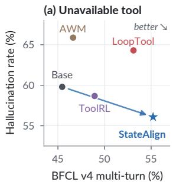
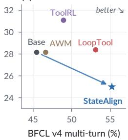
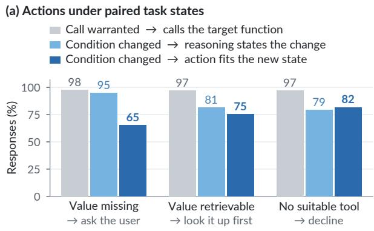
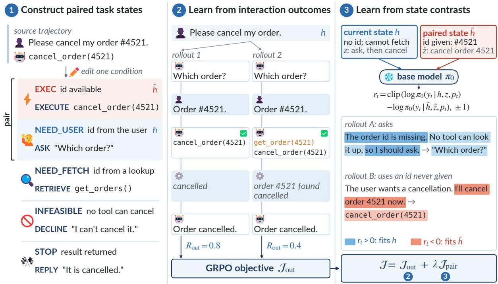
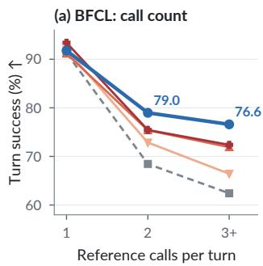
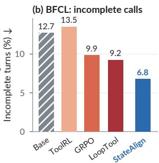
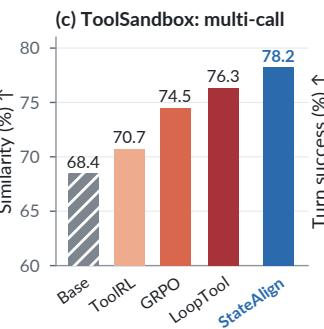
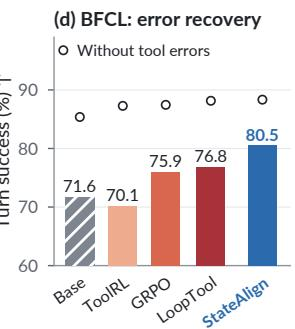
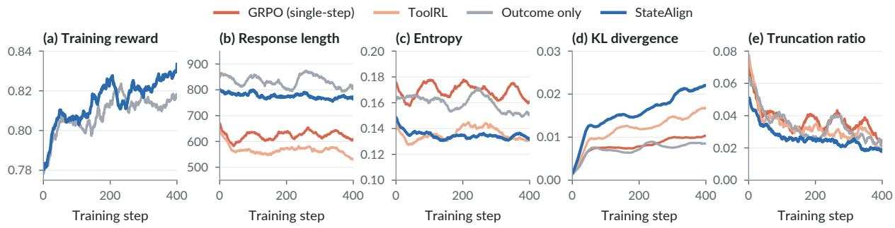

# StateAlign: Internalizing State-Aware Decision-Making for Reliable Multi-Turn Tool Agents via Reinforcement Learning

Zhexi Lu<sup>1</sup>, Subhajit Chaudhury<sup>2</sup>, Tejaswini Pedapati<sup>2</sup>, Keerthiram Murugesan<sup>2</sup>, Lei Yu<sup>1</sup> <sup>1</sup>Rensselaer Polytechnic Institute, <sup>2</sup>IBM Research

§ Code: github.com/ZhexiLu/StateAlign Model: huggingface.co/ZhexiLu/StateAlign-8B

## Abstract

Reinforcement learning has improved the tooluse capabilities of large language models. However, better task performance can coincide with increased tool hallucination. Reliable tool use requires decisions to follow the current task state: available information, tool capabilities, and task progress. Our analysis shows that agents sometimes execute when they should ask for information, retrieve it, or decline an infeasible request, even when reasoning identifies missing information. We introduce StateAlign, combining task-state construction with statecontrastive reinforcement learning. The data cover five task conditions and pair states with different action requirements. Outcome rewards guide task completion; token-level contrasts compare the same generated reasoning and actions under paired states to train outputs that fit the current state. Experiments across five base models from three families show im provements on BFCL v4 multi-turn, ToolSandbox, and When2Call. Ablations show that state construction improves performance and reliability under different reward designs. The complete method further reduces tool hallucina tion across three Qwen3 sizes. On Qwen3-8B, StateAlign improves BFCL v4 multi-turn accuracy from 45.5% to 55.2% and reduces no-tool hallucination on SimpleToolHalluBench from 62.2% under outcome-only training to 56.1%. Behavioral analyses show more consistent decisions, more complete multi-call execution, and stronger recovery after tool errors.

## 1 Introduction

Tool calling allows large language models (LLMs) to interact with external tools and APIs (Schick et al., 2023). These tools enable models to retrieve information, perform calculations, and execute operations requested by users. By incorporating tool results into subsequent reasoning, models can gather information and complete tasks over multiple steps (Yao et al., 2023). At each step, an agent must select an appropriate function, supply its arguments, and use the returned result to determine how to proceed.



(b) Distractor tool  
  
Figure 1: Comparison of tool-use performance and reliability on Qwen3-8B. We plot BFCL v4 multi-turn accuracy against SimpleToolHalluBench hallucination rates with (a) no available tool and (b) only an irrelevant tool. Arrows connect the base model to StateAlign. StateAlign achieves the highest multi-turn accuracy and the lowest hallucination rates among the models shown.

To develop these capabilities, existing work constructs tool-use demonstrations for supervised finetuning (SFT). Datasets such as ToolBench, API-Gen, and ToolACE (Qin et al., 2024; Liu et al., 2024, 2025) pair user requests and tool descriptions with target function calls and their arguments, teaching models which tools to select and how to invoke them. APIGen-MT, ToolACE-MT, and Tool-Mind (Prabhakar et al., 2025; Zeng et al., 2026; Yang et al., 2025b) extend this supervision to multiturn conversations with user messages, tool calls, and tool responses. However, SFT trains the model to imitate reference actions from fixed demonstrations. During interaction, errors in the model’s own calls can lead to histories not covered by these demonstrations, where it may struggle to recover and complete the task.

Reinforcement learning (RL) instead trains models with reward feedback on their own outputs. Recent work improves tool use through reward design (Qian et al., 2025; Zhang et al., 2026b), iterative data refinement (Zhang et al., 2026a), and interactive training with code execution or synthesized tool environments (Feng et al., 2026; Wang et al., 2026a). However, higher task performance does not necessarily mean more reliable tool use. Prior work has documented hallucinations in tool selection and use (Xu et al., 2025), and stronger reasoning can further increase tool hallucination (Yin et al., 2026). As shown in Figure 1, some RL-trained agents achieve higher BFCL v4 multiturn accuracy than the base model but also exhibit higher tool hallucination rates. To understand this problem, we analyze whether agents choose appropriate actions given the information and tools available at each step. Our analysis in Section 2 shows that agents often proceed with execution when they should ask for missing information, retrieve it through a tool, or decline an infeasible request. A model can even identify missing information in its reasoning but still generate a tool call with fabricated arguments. These findings motivate us to train agents to decide whether and how to act based on the current task state.

We introduce StateAlign, a reinforcement learning framework for state-aware, reliable tool use. Starting from tool-use trajectories, we construct task states with different information availability, tool capabilities, and task progress. The model is trained on these states with outcome rewards based on task completion. We further design a token-level state-contrastive reward that compares the same generated reasoning and actions under paired states to encourage outputs consistent with the current task state and reduce tool hallucination. Our contributions are:

• We introduce a task-state construction method that converts tool-use trajectories into training examples covering diverse task conditions, with explicit pairs requiring different actions. Compared with the original training data, the constructed states improve task performance and reliability under different reward designs.

• We propose state-contrastive RL that combines interaction outcome rewards with tokenlevel supervision from paired task states. On the same constructed data, StateAlign reduces tool hallucination across three Qwen3 model sizes compared with training on task outcome rewards alone.



g   
TASK STATE   
Available: setup2FA · contact required   
User: “My User ID is A1B2C3D4.   
Please proceed with setting up 2FA.”   
Phone number not provided   
REASONING · final sentence   
“So the final answer is to ask the user for their phone   
number to proceed with the 2FA setup.”   
TOOL CALL · excerpt   
setup2FA(userId="A1B2C3D4",   
contact="+1234567890" ...)  
Figure 2: Task-state diagnosis on Qwen3-8B. (a) Each group pairs a state in which calling the target function is warranted with one that differs in a single condition; bars give the share of responses. (b) Response excerpts when a required phone number is missing. Blue shading marks the decision to ask; red shading marks the unprovided value in the emitted call.

• Experiments across five base models show improved performance on BFCL v4 multiturn, ToolSandbox, and When2Call. Behavioral analyses show more consistent decisions across task states, more complete multicall execution, and stronger recovery after tool errors.

## 2 Task States and Agent Decisions

Task State. A tool agent receives a context h = (T, H) containing tool definitions T and interaction history H. For a user goal, we define the task state as the task-relevant conditions specified by the tools and evidenced by the history that constrain the next action. These include (i) information availability: what information needed for the task is available, what is missing, and how it can be obtained; (ii) tool capabilities: which operations the tools support; and (iii) task progress: what is complete and what remains. User replies, tool results, and tool-availability changes can update these conditions and require different actions. Prior work models decisions over interaction histories (Zhou et al., 2024) and combines dialogue-state tracking with tool-use training (Acikgoz et al., 2025).

  
Figure 3: Overview of StateAlign on an example task. (1) Editing one condition of a step from a source trajectory yields five task states with different required actions; each state keeps a reference path, and states are paired with EXEC. (2) The policy acts in a constructed state; shaded cards are user messages and tool results, taken from the source trajectory where available. Both rollouts ask for the order ID and then execute; the second also makes an unnecessary call in the same step, which halves its reward. Their outcome rewards give group-relative advantages in the GRPO objective $\mathcal { I } _ { \mathrm { o u t } }$ . (3) The base model $\pi _ { 0 } .$ , kept fixed during training, scores the tokens of two further rollouts under the current state and the paired state, each with its reference path; the clipped difference $r _ { t }$ weights the policy’s token log-likelihoods in $\mathcal { I } _ { \mathrm { p a i r } }$ , defined in Eq. 3.

Decisions across Task States. We compare Qwen3-8B’s responses to paired task states following the protocol in Appendix D. The states differ in one relevant condition: one allows execution, and the other requires clarification, retrieval, or declining an infeasible request. Figure 2a shows that target-function selection reaches 97–98% when execution is appropriate, but choosing the required action under the contrasting conditions is less reliable. In the missing-information condition, 95% of responses identify the missing value in reasoning, but only 65% ask the user for it. Figure 2b shows the model ending its reasoning with a decision to ask for the user’s phone number, then calling the tool with a number absent from the context. The final call contradicts both the available information and the decision expressed in reasoning.

The training problem is therefore to make reasoning and actions follow the conditions of the current task. We construct training states with different action requirements and pair states that differ in a relevant condition. For example, reasoning that assumes a required value is available may fit a state that permits execution but conflict with a state requiring clarification. The same generated content can then be evaluated under both states. StateAlign combines this supervision with feedback on interaction outcomes to train reasoning and actions that fit the current state.

## 3 StateAlign: State-Aware Reinforcement Learning

We illustrate StateAlign in Figure 3. Given context h, the policy $\pi _ { \theta }$ generates reasoning followed by tool calls or a user reply. Interaction outcomes train task completion; token-level state contrasts train reasoning and actions to fit the current conditions.

## 3.1 Constructing Paired Task States

We construct data from ToolMind (Yang et al., 2025b) and LoopTool-23k (Zhang et al., 2026a). Structural checks remove invalid calls and inconsistent histories. We use Qwen3.8-27B to filter calls in ToolMind’s synthetic demonstrations that do not serve the request or contain unsupported arguments. The same model rewrites user messages and synthesizes retrieval steps.

For each selected call, we identify its required tools and information, then modify the tool definitions or history to construct five types of states. EXEC supplies the information and tools for execution. NEED\_USER removes a required user-provided value or retains a clarification turn, requiring the agent to ask before executing. NEED\_FETCH removes a relevant tool result or introduces a lookup for a required identifier, so a tool can obtain the missing information. INFEA-SIBLE removes the required tool and its identified alternatives. STOP includes a result completing the request and requires a reply without further calls.

Each non-EXEC instance is paired with an EXEC counterpart from the same source trajectory when available. Source calls and observations provide execution checks and interaction feedback; unpaired instances receive outcome supervision alone. Resampling by condition yields approximately 30k instances. Appendix A details construction and annotation, with prompts in Appendix F.

## 3.2 Learning from Interaction Outcomes

An appropriate first action must lead to an appropriate follow-up action. Asking for information should enable execution once it arrives; receiving a result should lead to further work or termination according to the remaining task. We train short interactions in which clarification receives stored user information; retrieval receives recorded observations when function names and designated arguments match. The policy acts on the updated history. If a continuation is recorded, successful target execution is followed by tool results and one further policy step, checked against the requirement to continue or stop. For a trajectory τ requiring execution,

$$
R _ { \mathrm { o u t } } ( \tau ) = \left\{ \begin{array} { l l } { \gamma ^ { k - 1 } \alpha ( \tau ) c ( \tau ) , } & { \mathrm { s u c c e s s } , } \\ { 0 , } & { \mathrm { o t h e r w i s e } . } \end{array} \right.\tag{1}
$$

Success requires matching designated functions and arguments. In NEED\_USER and NEED\_FETCH, attempting target execution before obtaining required information ends the trajectory with zero reward. Here, k is the execution step, $\gamma = 0 . 8$ favors timely completion, and $\alpha ( \tau )$ penalizes extra calls. The indicator $c ( \tau )$ requires a successful continuation, or equals one if none is specified. Thus, reward depends on both target execution and acting appropriately after the state changes. INFEASIBLE and STOP use terminal checks for the required non-call response.

Groups sampled from each state define relative advantages for a token-normalized GRPO objective $\mathcal { I } _ { \mathrm { o u t } }$ (Shao et al., 2024), with KL regularization to the base model $\pi _ { 0 } .$ . This objective trains all policy outputs, including continuations. Appendix B gives reward settings.

## 3.3 Learning from State Contrasts

Outcome supervision evaluates actions over an interaction. State contrasts additionally train how generated reasoning and actions fit the current conditions. For paired contexts $( h _ { i } , \tilde { h } _ { i } )$ , reference paths $z _ { i } , \tilde { z } _ { i }$ describe appropriate actions and continuations. We construct them from source calls and responses, adding clarification or retrieval as required. Appendix B provides a scoring example. The base model $\pi _ { 0 } ,$ , fixed during training, scores each policy-generated token $y _ { i , t }$ under both contexts using the same prefix $p _ { i , t } \colon$

$$
\begin{array} { r } { { r } _ { i , t } = \mathrm { c l i p } \big ( \log \pi _ { 0 } ( y _ { i , t } \mid h _ { i } , z _ { i } , p _ { i , t } ) } \\ { - \log \pi _ { 0 } ( y _ { i , t } \mid \tilde { h } _ { i } , \tilde { z } _ { i } , p _ { i , t } ) , - 1 , 1 \big ) . } \end{array}\tag{2}
$$

For example, a missing-value state requires clarification before execution, whereas its counterpart permits immediate execution. Positive scores favor content fitting the current state and path; negative scores favor the counterpart. Content fitting both similarly receives near-zero scores. A response can acknowledge a missing value and later speculate that it is available. These parts can receive opposing preferences that a single outcome score cannot express. The prefix contains preceding policy outputs and returned feedback. Paired contexts and paths are used only for scoring; the policy acts from its tools and history.

The scores weight generated tokens in the statecontrastive objective:

$$
\mathcal { I } _ { \mathrm { p a i r } } ( \theta ) = \frac { 1 } { Z } \sum _ { ( i , t ) \in \mathcal { P } } \operatorname { s g } [ r _ { i , t } ]\tag{3}
$$

Here, $\mathcal { P }$ contains scored reasoning and action positions in paired instances before the appended continuation; $Z$ counts all policy-generated tokens before that step across the batch; sg stops gradients.

We maximize

$$
\mathcal { I } ( \theta ) = \mathcal { I } _ { \mathrm { o u t } } ( \theta ) + \lambda \mathcal { I } _ { \mathrm { p a i r } } ( \theta ) .\tag{4}
$$

In all-failure or equally rewarded all-success groups, outcome advantages vanish, but reasoning and actions can still differ in state compatibility. The pair objective provides supervision beyond these tied outcomes. We prioritize groups with varying rewards and retain a portion of paired successful groups, as detailed in Appendix B. Paired all-failure groups also contribute when retained.

## 4 Experiments

## 4.1 Experimental Setup

Base Models. We train Qwen3-4B/8B/14B (Yang et al., 2025a), Granite-4.2-8B (IBM Research, 2026), and Llama-3.1-8B-Instruct (Dubey et al., 2024) to evaluate StateAlign across model sizes and families.

Baselines. Comparisons include ToolRL (Qian et al., 2025), LoopTool (Zhang et al., 2026a), AWM (Wang et al., 2026a), and the base models. ToolRL uses Qwen3-8B trained on RLLA-4k; LoopTool and AWM use released models. Each retains its own training data. Single-step binary GRPO on our constructed states compares training objectives.

Benchmarks. BFCL v4 (Patil et al., 2025) measures multi-turn tool-use accuracy. ToolSandbox (Lu et al., 2025) measures task progress through trajectory similarity. When2Call (Ross et al., 2025) measures macro accuracy across calling, clarification, and infeasibility. SimpleToolHalluBench (Yin et al., 2026) measures hallucination with no available tool (NTA) or only an irrelevant tool (DT).

Implementation Details. We train with LoRA (Hu et al., 2022) on eight NVIDIA H100 80GB GPUs with λ = 0.1. Qwen3 component comparisons use the step-400 checkpoint. Tables 1 and 2 report evaluation means, with BFCL standard deviations in Table 2. Appendices B and C provide training and evaluation settings.

## 4.2 Main Results

On Qwen3-8B, StateAlign leads the compared methods on BFCL v4, ToolSandbox, and When2Call in Table 1, including all four BFCL categories. Its largest advantage over LoopTool is in Missing Parameters, which requires obtaining information before execution. Higher Missing

Functions and Long Context scores indicate better handling of tool availability and longer histories. Hallucination decreases in both NTA and DT relative to the Qwen3-8B base model and LoopTool.

Across all five base models, StateAlign improves every BFCL category and When2Call accuracy and reduces NTA hallucination. On Qwen3, it exceeds AWM on ToolSandbox at all sizes and BFCL at 4B and 8B. At 14B, BFCL accuracy is 54.8%, close to AWM’s 55.5%, with higher ToolSandbox and When2Call scores and lower hallucination in both settings. No-tool hallucination is 45.0%, compared with 53.9% for AWM-14B.

## 4.3 Ablation Studies

Task-state construction improves training under different reward designs. Table 2A compares binary GRPO and ToolRL rewards on original data and constructed states. Both achieve higher BFCL, ToolSandbox, and When2Call scores, with lower NTA and DT hallucination. Neither comparison uses the pair objective.

On the same constructed data, complete StateAlign reduces NTA and DT hallucination across Qwen3-4B, 8B, and 14B compared with outcome-only training in Table 2B. At 14B, NTA falls from 56.9% to 45.0%, and DT from 25.2% to 22.6%. When2Call accuracy improves at all three sizes, indicating better decisions about calling, clarification, and infeasibility. BFCL accuracy also improves at all three sizes. Appendix E reports training dynamics.

## 5 Analysis

## 5.1 State-Contrast Signals

Successful rollouts can differ in how closely reasoning follows the available information. Figure 4 pairs a request missing an image identifier with one that provides it. In rollout A, recognizing the missing identifier and proposing clarification receive positive mean token scores; speculation that it is already known receives a negative score. Within one response, the signal rewards reasoning that fits the state and penalizes conflicting assumptions.

Both rollouts ask for the identifier and complete execution, but much of rollout B’s reasoning receives near-zero scores. All rollouts in this group share an outcome reward, giving zero relative outcome advantages. State contrasts still provide token-level supervision within this group. Appendix D.1 extends the analysis across all five conditions and describes example selection.

<table><tr><td rowspan="2">Model</td><td colspan="4">BFCL v4 Multi-turn ↑</td><td></td><td>ToolSandbox ↑</td><td>When2Call ↑</td><td colspan="2">SimpleToolHalluBench ↓</td></tr><tr><td>Overall</td><td>Base</td><td>MF</td><td>MP</td><td>LC</td><td>Similarity</td><td>Accuracy</td><td>NTA</td><td>DT</td></tr><tr><td colspan="10">Base models</td></tr><tr><td>Qwen3-4B</td><td>39.8</td><td>46.6</td><td>43.8</td><td>34.6</td><td>34.3</td><td>67.4</td><td>67.9</td><td>49.9</td><td>28.4</td></tr><tr><td>Qwen3-8B</td><td>45.5</td><td>50.3</td><td>49.1</td><td>37.9</td><td>44.6</td><td>73.4</td><td>66.4</td><td>59.8</td><td>28.2</td></tr><tr><td>Qwen3-14B</td><td>47.6</td><td>56.4</td><td>48.3</td><td>37.2</td><td>48.4</td><td>74.6</td><td>70.6</td><td>53.9</td><td>20.7</td></tr><tr><td>Granite-4.2-8B</td><td>49.4</td><td>62.7</td><td>40.0</td><td>43.3</td><td>51.7</td><td>82.1</td><td>75.6</td><td>20.8</td><td>33.3</td></tr><tr><td>Llama-3.1-8B-Instruct</td><td>8.0</td><td>8.3</td><td>8.7</td><td>7.5</td><td>7.7</td><td>35.6</td><td>34.8</td><td>72.6</td><td>98.8</td></tr><tr><td colspan="10">Baselines</td></tr><tr><td>GRPO-8B</td><td>51.9</td><td>58.7</td><td>54.1</td><td>45.4</td><td>49.4</td><td>78.2</td><td>71.7</td><td>55.6</td><td>26.6</td></tr><tr><td>ToolRL-8B</td><td>48.9</td><td>55.1</td><td>51.3</td><td>39.1</td><td>50.3</td><td>72.5</td><td>65.1</td><td>58.7</td><td>31.1</td></tr><tr><td>LoopTool-8B</td><td>53.1</td><td>61.2</td><td>53.7</td><td>43.8</td><td>53.8</td><td>76.9</td><td>68.8</td><td>64.3</td><td>28.4</td></tr><tr><td>AWM-4B</td><td>41.2</td><td>50.0</td><td>43.0</td><td>34.4</td><td>37.3</td><td>68.2</td><td>68.8</td><td>54.7</td><td>28.7</td></tr><tr><td>AWM-8B</td><td>46.6</td><td>53.5</td><td>49.2</td><td>38.1</td><td>45.8</td><td>71.9</td><td>60.9</td><td>65.9</td><td>28.2</td></tr><tr><td>AWM-14B</td><td>55.5</td><td>66.0</td><td>52.3</td><td>48.3</td><td>55.4</td><td>74.2</td><td>70.2</td><td>53.9</td><td>23.8</td></tr><tr><td colspan="10">StateAlign</td></tr><tr><td>Qwen3-4B</td><td> $4 8 . 3 _ { + 8 . 5 } 5 5 5 . 8$ </td><td></td><td>49.0</td><td>43.3</td><td>45.0</td><td> $7 3 . 3 _ { + 5 . 9 }$ </td><td> $7 1 . 4 _ { + 3 . 6 }$ </td><td> ${ \bf 4 4 . 1 _ { - 5 . 7 } }$ </td><td> $2 4 . 3 _ { - 4 . 1 }$ </td></tr><tr><td>Qwen3-8B</td><td> ${ \bf 5 5 . 2 _ { + 9 . 8 } 6 1 . 4 }$ </td><td></td><td>56.1</td><td>48.8</td><td>54.6</td><td> $7 9 . 3 _ { + 5 . 9 }$ </td><td> $7 2 . 4 _ { + 6 . 0 }$ </td><td> $5 6 . 1 _ { - 3 . 7 }$ </td><td> $2 5 . 0 _ { - 3 . 2 }$ </td></tr><tr><td>Qwen3-14B</td><td> $5 4 . 8 \substack { + 7 . 3 }$ </td><td>66.0</td><td>52.5</td><td>45.4</td><td>55.4</td><td> ${ \bf 8 1 . 3 _ { + 6 . 7 } }$ </td><td> $7 4 . 2 \substack { + 3 . 7 }$ </td><td> ${ \bf 4 5 . 0 _ { - 8 . 9 } }$ </td><td> $2 2 . 6 _ { + 1 . 9 }$ </td></tr><tr><td>Granite-4.2-8B</td><td> ${ \pmb 5 3 . 8 } _ { + 4 . 4 }$ </td><td>66.5</td><td>43.1</td><td>46.4</td><td>59.0</td><td> ${ \bf 8 2 . 3 _ { + 0 . 2 } }$ </td><td> $7 8 . 3 _ { + 2 . 8 }$ </td><td> $\mathbf { 1 0 . 5 _ { - 1 0 . 4 } }$ </td><td> $2 6 . 4 _ { - 7 . 0 }$ </td></tr><tr><td>Llama-3.1-8B-Instruct</td><td> ${ \bf 2 6 . 1 _ { + 1 8 . 1 } 3 4 . 3 }$ </td><td></td><td>17.3</td><td>21.7</td><td>31.2</td><td> $\mathbf { 4 4 . 6 _ { + 8 . 9 } }$ </td><td> ${ \bar { 5 } } 9 . 6 _ { + 2 4 . 8 }$ </td><td> $1 5 . 7 _ { - 5 7 . 0 }$ </td><td> ${ \bf 4 2 . 6 _ { - 5 6 . 2 } }$ </td></tr></table>

Table 1: Comparison of StateAlign with base models and tool-use training baselines on task performance and too hallucination across four benchmarks. ToolSandbox similarity reflects how well execution trajectories satisfy task milestones. MF, MP, and LC denote Missing Functions, Missing Parameters, and Long Context. NTA and DT denote the no-tool and distractor-tool settings. All scores are on a 0–100 scale. Gray subscripts indicate score differences from the corresponding base model; bold marks the best result for each base model and size.

<table><tr><td></td><td>BFCL v4</td><td>TS</td><td>W2C</td><td> NTA↓ DT↓</td><td></td></tr><tr><td>(A) State construction GRPO</td><td>Original</td><td> $4 7 . 2 \pm 1 . 8$  73.7</td><td>66.9</td><td>63.3</td><td>37.2 26.6</td></tr><tr><td>ToolRL Original</td><td>Constructed</td><td> ${ \bf 5 1 . 9 \pm 0 . 5 }$   $4 8 . 9 \pm 0 . 6 $ </td><td>78.2 72.5 78.5</td><td>71.7 65.1 71.3</td><td>55.6 58.7 31.1 55.5</td></tr><tr><td></td><td>Constructed (B) Training configuration</td><td> ${ \bf 5 3 . 0 \pm 0 . 6 }$ </td><td></td><td></td><td>29.8</td></tr><tr><td>4B</td><td>Outcome only  $4 6 . 9 \pm 1 . 3$ </td><td>73.6</td><td>69.7</td><td>54.7</td><td>31.8</td></tr><tr><td></td><td>StateAlign</td><td> ${ \bf 4 8 . 3 \pm 1 . 0 }$ </td><td>73.3</td><td>71.4</td><td>44.1 24.3</td></tr><tr><td>8B 14B Outcome only</td><td>Outcome only StateAlign</td><td> $5 3 . 0 \pm 0 . 9$   ${ \bf 5 5 . 2 \pm 1 . 3 }$ </td><td>76.2 79.3</td><td>71.0 72.4</td><td>62.2 30.3 56.1 25.0</td></tr></table>

Table 2: State construction and training ablations. TS: ToolSandbox; W2C: When2Call; NTA, DT: hallucination rates (lower is better). (A) Qwen3-8B trained on original data (ToolMind for GRPO; RLLA-4k for ToolRL) and constructed states. (B) Outcome-only training and complete StateAlign on constructed states. Bold: better of each pair.

## 5.2 From State Conditions to Actions

Table 3A revisits the diagnosis in Section 2. All four models identify the missing value in approximately 95% of reasoning traces. Correct clarification among these responses reaches 83.2% for

StateAlign, compared with 68.8% for the base model and 80.6% for LoopTool. Target-function selection when the value is available remains above 97% for all four. StateAlign improves clarification and retains accurate tool selection when execution is appropriate.

Panel B distinguishes reasoning decisions from subsequent actions. Among traces identifying the missing value, StateAlign proposes execution with an unprovided value or missing argument in 6.4% of cases, compared with 10.5% for ToolRL and 10.2% for LoopTool. When reasoning proposes clarification or another step first, target calls still occur in 4.5% of StateAlign responses, compared with 5.8% for LoopTool. Appendix D.2 covers other states and the irrelevant-history control.

## 5.3 Multi-Step Execution and Recovery

Multi-step tasks require agents to update what remains after each tool result and continue until the request is complete. Figure 5a shows that StateAlign leads turn success on two-call and threeor-more-call BFCL turns. Among its multi-call turns, 6.8% fail after issuing some but fewer calls than required, compared with 9.9% for GRPO and 9.2% for LoopTool in panel b. It also leads Tool-Sandbox multi-call similarity in panel c. These results connect state-aware decisions to more complete execution of the required calls.

<table><tr><td colspan="2">→ reference z: ask for the ID</td><td>Current state h “Could you check the creation date for the image? I need to verify it aligns with our project timeline.&quot;</td></tr><tr><td colspan="2">Paired state </td><td>“Could you check the creation date for the image with ID &#x27;7890&#x27;? I need to verify it aligns with our project timeline.&quot; → reference ž: call Get Image by ID</td></tr><tr><td colspan="2">Score</td><td>rt = clip(logπ₀(yt | h,z, pt) − logπ₀(yt | h, ž, pt), ± 1) ≥ 0.1 current state ≤-0.1 paired state □|mean| &lt; 0.1 Rollout A Okay, the user is asking about the creation date of an image to check if it aligns with their project timeline. Let me see what tools 1</td></tr><tr><td>mean +0.10 highest of 8 reward 0.8</td><td colspan="2">have available.+0.28 The only tool provided is &quot;Get Image by ID,&quot; which requires a uniquelD to retrieve image details.+0.20Wait, the user didn&#x27;t mention an ID yet.+0.38They just asked about the creation date.+0.20Without the unique ID, I can&#x27;t call the function.+0.26So I need to ask them for the image&#x27;s ID first.+0.33 Once I have that, I can use the Get Image by ID function to fetch the details, including the creation date. Then I can provide the date and help verify it against their timeline. Hmm, but maybe the user assumes I already know the ID?-0.34No, the system doesn&#x27;t store that information. So definitely, I need to prompt them for the uniquelD. Let me make sure to respond by requesting the ID so I can proceed. Rollout B</td></tr><tr><td>mean +0.03 lowest of 8 reward 0.8</td><td>have available. Looking at the provided tools, there&#x27;s only one function called &quot;Get Image by ID.&quot; The description says it returns details of a generated image based on the provided ID.-0.13 The parameters require a &quot;uniquelD&quot; as a string.Wait, the user didn&#x27;t mention the image ID yet.+0.34 They just asked about the creation date.+0.10 So I can&#x27;t retrieve the image details without the ID.I need to ask them for the unique ID of the image they&#x27;re referring to. I should respond by requesting the specific ID so I can use the Get Image by ID function to fetch the creation date.Without that, I can&#x27;t proceed.+0.11 Let me make sure to prompt them for the ID clearly.</td><td>Okay, the user is asking to check the creation date of an image to verify it aligns with their project timeline. Let me see what tools I</td></tr></table>

Figure 4: State-contrast scores for two successful rollouts when the image ID is missing; the paired state provides it. Labels show mean token scores within each sentence. Blue indicates scores ≥ 0.1, red indicates scores $\leq - 0 . 1$ and unshaded sentences have scores between these thresholds. Both rollouts ask for the ID; their reasoning differs in state compatibility.

<table><tr><td colspan="4">(A) State-conditioned actions Value missing Value available Paired states</td></tr><tr><td>Model</td><td>Mentions Clarifies</td><td>Target call</td><td>Both correct</td></tr><tr><td>Base</td><td>94.9 68.8</td><td>97.7</td><td>63.5</td></tr><tr><td>ToolRL</td><td>94.6 70.4</td><td>97.9</td><td>65.1</td></tr><tr><td>LoopTool</td><td>95.4 80.6</td><td>98.0</td><td>75.4</td></tr><tr><td>StateAlign</td><td>95.2 83.2</td><td>97.1</td><td>76.9</td></tr><tr><td colspan="4">(B) Decisions when the value is missing Model Plans to execute ↓ Calls after deferring ↓</td></tr><tr><td>Base</td><td colspan="2">9.9</td><td>17.4</td></tr><tr><td>ToolRL</td><td colspan="2">10.5</td><td>16.4</td></tr><tr><td>LoopTool</td><td colspan="2">10.2</td><td>5.8</td></tr><tr><td></td><td colspan="2">6.4</td><td>4.5</td></tr><tr><td>StateAlign</td><td colspan="2"></td><td></td></tr></table>

Table 3: State-conditioned reasoning and actions for Qwen3-8B (%). (A) Mentions: identifies the missing value; Clarifies: correct clarification given that mention; Target call: correct function when the value is available; Both correct: mean product of per-state action accuracies within each pair. (B) Among traces identifying the missing value, Plans to execute measures proposals to call despite it; Calls after deferring measures target calls conditional on reasoning proposing to ask or take another step first. Lower is better for both metrics.

Tool errors identify conditions the agent must address before continuing. Figure 5d shows a larger improvement over LoopTool on errorcontaining turns than on turns without errors. In Table 4, StateAlign makes no call immediately after the first error and ultimately fails in 2.7% of error-containing turns, compared with 5.7% for GRPO and 6.3% for LoopTool. StateAlign also achieves the highest ToolSandbox similarity on error-containing scenarios.

<table><tr><td>Model</td><td>BFCL Reply+fail ↓</td><td>ToolSandbox Similarity ↑</td></tr><tr><td>Base</td><td>11.6</td><td>68.9</td></tr><tr><td>GRPO</td><td>5.7</td><td>71.3</td></tr><tr><td>ToolRL</td><td>11.4</td><td>69.3</td></tr><tr><td>LoopTool</td><td>6.3</td><td>67.7</td></tr><tr><td>StateAlign</td><td>2.7</td><td>73.5</td></tr></table>

Table 4: Behavior and task completion after tool errors on Qwen3-8B. BFCL Reply+fail is the percentage of error-containing turns with no tool call in the next assistant response after the first error and a final failure. ToolSandbox reports similarity for error-containing scenarios. Values use a 0–100 scale; bold marks the best result in each column.

A BFCL example illustrates these updates. After startEngine reports that the doors must be locked, the base model reports the failure and asks whether to lock them. StateAlign locks the doors and retries. When the next error indicates that the brake pedal must be pressed, it performs that action and starts the engine successfully. Each result reveals a requirement for the next action, and the policy continues until the requested operation succeeds. Appendix D.3 provides the recorded sequence and further recovery comparisons.







  
Figure 5: Multi-step execution and recovery on Qwen3-8B. (a) BFCL v4 turn success by reference-call count. (b) Percentage of multi-call turns that fail after issuing at least one call but fewer than the reference requires. Panels a and b use ordinary execution turns reached without an earlier failure. (c) ToolSandbox similarity on multi-call scenarios. (d) BFCL v4 turn success with tool errors (bars) and without tool errors (open circles). Colors identify methods; arrows indicate the preferred direction.

## 6 Related Work

Tool Learning. Synthetic datasets provide demonstrations of API calls, multi-turn interactions, and reasoning traces (Liu et al., 2025; Prabhakar et al., 2025; Yang et al., 2025b). Task construction extends this coverage to ambiguous, changing, and infeasible requests (Wang et al., 2026b). RL methods improve tool use through reward design (Zhang et al., 2026b; Qian et al., 2025), adaptive data refinement (Zhang et al., 2026a), and interactive training environments (Wang et al., 2026a). ARTIST trains interleaved reasoning and tool use (Singh et al., 2025), and MUA-RL incorporates simulated users into policy rollouts (Zhao et al., 2025). Step-level credit assignment (Feng et al., 2025), rewards for information acquisition (Kong et al., 2026), and self-distillation under privileged contexts (Zhao et al., 2026) provide more fine-grained training feedback. SIPO contrasts contexts containing correct and incorrect answers (Yue et al., 2026); CC-OPD compares full instructions with contexts that omit individual constraints (Zheng et al., 2026). RC-GRPO uses reward-conditioned sampling to increase reward diversity within rollout groups (Zhong et al., 2026). StateAlign contrasts task states that each have a valid action requirement, making their differences a source of supervision for how behavior should change.

Reliable Tool Use. Prior work combines reasoning with actions and observations (Yao et al., 2023), incorporates dialogue state tracking into tool-use training (Acikgoz et al., 2025), and separates state interpretation from action generation (Guo et al., 2026). However, stronger reasoning can accompany increased tool hallucination (Yin et al., 2026). TRUST addresses decision reliability through uncertainty-aligned rewards at key interaction turns (Zhou et al., 2026). Proxy statebased evaluation uses inferred environment states to simulate interactions and assess task completion (Chuang et al., 2026). We use paired states with different action requirements as supervision. StateAlign compares the same generated reasoning and actions under both states and their reference paths to train behavior that fits each state.

## 7 Conclusion

We presented StateAlign, combining task-state construction with state-contrastive reinforcement learning. Our diagnosis shows that agents can violate current information and tool conditions even after stating them in reasoning. Constructed states improve task performance and reliability under different reward designs. On the same data, the complete method further reduces tool hallucination compared with outcome-only training across three Qwen3 model sizes. Experiments across five base models show improved tool use, and behavioral analyses show more consistent decisions, more complete multi-call execution, and stronger recovery after tool errors.

## Limitations

StateAlign is trained on five types of constructed task states through short interactions with recorded feedback. Training feedback is limited to the interactions covered by the source trajectories. Extending this setup to longer workflows with changing user goals or tool behavior is a direction for future work. We evaluate five base models ranging from 4B to 14B parameters on text-based tool-use benchmarks. The effectiveness of the approach at larger scales and in multimodal tool environments remains to be studied.

## References

Emre Can Acikgoz, Jeremiah Greer, Akul Datta, Ze Yang, William Zeng, Oussama Elachqar, Emmanouil Koukoumidis, Dilek Hakkani-Tür, and Gokhan Tur. 2025. Can a single model master both multi-turn conversations and tool use? CoALM: A unified conversational agentic language model. In Proceedings of the 63rd Annual Meeting of the Associationfor Computational Linguistics (Volume 1: Long Papers), pages 12370–12390, Vienna, Austria. Association for Computational Linguistics.

Yun-Shiuan Chuang, Chaitanya Kulkarni, Alec M. Chiu, Avinash Thangali, Zijie Pan, Shivani Shekhar, Yirou Ge, Yixi Li, Uma Kona, Linsey Pang, and Prakhar Mehrotra. 2026. Toward scalable verifiable reward: Proxy state-based evaluation for multi-turn toolcalling LLM agents. In Proceedings ofthe 64th Annual Meeting of the Association for Computational Linguistics (Volume 6: Industry Track), pages 1251– 1264, San Diego, California. Association for Computational Linguistics.

Abhimanyu Dubey, Abhinav Jauhri, Abhinav Pandey, Abhishek Kadian, Ahmad Al-Dahle, Aiesha Letman, Akhil Mathur, Alan Schelten, Amy Yang, Angela Fan, Anirudh Goyal, Anthony Hartshorn, Aobo Yang, Archi Mitra, Archie Sravankumar, Artem Korenev, Arthur Hinsvark, Arun Rao, Aston Zhang, and 512 others. 2024. The Llama 3 herd of models. arXiv preprint arXiv:2407.21783.

Jiazhan Feng, Shijue Huang, Xingwei Qu, Ge Zhang, Yujia Qin, Baoquan Zhong, Chengquan Jiang, Jinxin Chi, and Wanjun Zhong. 2026. ReTool: Reinforcement learning for strategic tool use in LLMs. In International Conference on Learning Representations, volume 2026, pages 37909–37926.

Lang Feng, Zhenghai Xue, Tingcong Liu, and Bo An. 2025. Group-in-group policy optimization for LLM agent training. In Advances in Neural Information Processing Systems, volume 38, Main Conference, pages 46375–46408. Curran Associates, Inc.

Rongfeng Guo, Yinxuan Huang, Yusen Wu, Maoqing Zhong, Yunlu Chen, Meng Tang, Teng Long,

and Vincent Tao Hu. 2026. From state to action: OODA-Tool for reliable multi-turn tool use. Preprint, arXiv:2608.24368.

Edward J. Hu, Yelong Shen, Phillip Wallis, Zeyuan Allen-Zhu, Yuanzhi Li, Shean Wang, Lu Wang, and Weizhu Chen. 2022. LoRA: Low-rank adaptation of large language models. In International Conference on Learning Representations.

IBM Research. 2026. Granite 4.2 language models. Accessed: 2026-10-18.

Fanqi Kong, Jiayi Zhang, Mingyi Deng, Chenglin Wu, Yuyu Luo, and Bang Liu. 2026. InfoPO: Informationdriven policy optimization for user-centric agents. In Proceedings of the 43rd International Conference on Machine Learning, volume 306 of Proceedings of Machine Learning Research, pages 60135–60165. PMLR.

Weiwen Liu, Xu Huang, Xingshan Zeng, Xinlong Hao, Shuai Yu, Dexun Li, Shuai Wang, Weinan Gan, Zhengying Liu, Yuanqing Yu, Zezhong Wang, Yuxian Wang, Wu Ning, Yutai Hou, Bin Wang, Chuhan Wu, Xinzhi Wang, Yong Liu, Yasheng Wang, and 8 others. 2025. ToolACE: Winning the points of LLM function calling. In International Conference on Learning Representations, volume 2025, pages 41359–41381.

Zuxin Liu, Thai Hoang, Jianguo Zhang, Ming Zhu, Tian Lan, Shirley Kokane, Juntao Tan, Weiran Yao, Zhiwei Liu, Yihao Feng, Rithesh Murthy, Liangwei Yang, Silvio Savarese, Juan Carlos Niebles, Huan Wang, Shelby Heinecke, and Caiming Xiong. 2024. APIGen: Automated pipeline for generating verifiable and diverse function-calling datasets. In Advances in Neural Information Processing Systems, volume 37, pages 54463–54482. Curran Associates, Inc.

Jiarui Lu, Thomas Holleis, Yizhe Zhang, Bernhard Aumayer, Feng Nan, Haoping Bai, Shuang Ma, Shen Ma, Mengyu Li, Guoli Yin, Zirui Wang, and Ruoming Pang. 2025. ToolSandbox: A stateful, conversational, interactive evaluation benchmark for LLM tool use capabilities. In Findings of the Association for Computational Linguistics: NAACL 2025, pages 1160–1183. Association for Computational Linguistics.

Shishir G Patil, Huanzhi Mao, Fanjia Yan, Charlie Cheng-Jie Ji, Vishnu Suresh, Ion Stoica, and Joseph E. Gonzalez. 2025. The berkeley function calling leaderboard (BFCL): From tool use to agentic evaluation of large language models. In Proceedings of the 42nd International Conference on Machine Learning, volume 267 of Proceedings of Machine Learning Research, pages 48371–48392. PMLR.

Bowen Peng, Jeffrey Quesnelle, Honglu Fan, and Enrico Shippole. 2024. YaRN: Efficient context window extension of large language models. In The Twelfth International Conference on Learning Representations.

Akshara Prabhakar, Zuxin Liu, Ming Zhu, Jianguo Zhang, Tulika Manoj Awalgaonkar, Shiyu Wang, Zhiwei Liu, Haolin Chen, Thai Hoang, Juan Carlos Niebles, Shelby Heinecke, Weiran Yao, Huan Wang, Silvio Savarese, and Caiming Xiong. 2025. APIGen-MT: Agentic pipeline for multi-turn data generation via simulated agent-human interplay. In Advances in Neural Information Processing Systems, volume 38, Main Conference. Curran Associates, Inc.

Cheng Qian, Emre Can Acikgoz, Qi He, Hongru Wang, Xiusi Chen, Dilek Hakkani-Tur, Gokhan Tur, and Heng Ji. 2025. ToolRL: Reward is all tool learning needs. In Advances in Neural Information Processing Systems, volume 38, Main Conference, pages 105523–105553. Curran Associates, Inc.

Yujia Qin, Shihao Liang, Yining Ye, Kunlun Zhu, Lan Yan, Yaxi Lu, Yankai Lin, Xin Cong, Xiangru Tang, Bill Qian, Sihan Zhao, Lauren Hong, Runchu Tian, Ruobing Xie, Jie Zhou, Mark Gerstein, Dahai Li, Zhiyuan Liu, and Maosong Sun. 2024. ToolLLM: Facilitating large language models to master 16000+ real-world APIs. In International Conference on Learning Representations, volume 2024, pages 9695– 9717.

Hayley Ross, Ameya Sunil Mahabaleshwarkar, and Yoshi Suhara. 2025. When2Call: When (not) to call tools. In Proceedings ofthe 2025 Conference ofthe Nations ofthe Americas Chapter ofthe Association for Computational Linguistics: Human Language Technologies (Volume 1: Long Papers), pages 3391– 3409. Association for Computational Linguistics.

Timo Schick, Jane Dwivedi-Yu, Roberto Dessi, Roberta Raileanu, Maria Lomeli, Eric Hambro, Luke Zettlemoyer, Nicola Cancedda, and Thomas Scialom. 2023. Toolformer: Language models can teach themselves to use tools. In Advances in Neural Information Processing Systems, volume 36, pages 68539–68551. Curran Associates, Inc.

Zhihong Shao, Peiyi Wang, Qihao Zhu, Runxin Xu, Junxiao Song, Xiao Bi, Haowei Zhang, Mingchuan Zhang, Y. K. Li, Y. Wu, and Daya Guo. 2024. DeepSeekMath: Pushing the limits of mathematical reasoning in open language models. Preprint, arXiv:2402.03300.

Joykirat Singh, Raghav Magazine, Yash Pandya, and Akshay Nambi. 2025. Agentic reasoning and tool integration for LLMs via reinforcement learning. Preprint, arXiv:2505.01441.

Zhaoyang Wang, Canwen Xu, Boyi Liu, Yite Wang, Siwei Han, Zhewei Yao, Huaxiu Yao, and Yuxiong He. 2026a. Agent world model: Infinity synthetic environments for agentic reinforcement learning. In Proceedings ofthe 43rd International Conference on Machine Learning, volume 306 of Proceedings of Machine Learning Research, pages 131469–131511. PMLR.

Ziyi Wang, Yuxuan Lu, Yimeng Zhang, Pei Chen, Ziwei Dong, Jing Huang, Jiri Gesi, Xianfeng Tang, Chen

Luo, Qun Liu, Yisi Sang, Hanqing Lu, Manling Li, Jin Lai, and Dakuo Wang. 2026b. Trajectory2Task: Training robust tool-calling agents with synthesized yet verifiable data for complex user intents. In Proceedings ofthe 64th Annual Meeting ofthe Associationfor Computational Linguistics (Volume 1: Long Papers), pages 44021–44044, San Diego, California, United States. Association for Computational Linguistics.

Hongshen Xu, Zichen Zhu, Lei Pan, Zihan Wang, Su Zhu, Da Ma, Ruisheng Cao, Lu Chen, and Kai Yu. 2025. Reducing tool hallucination via reliability alignment. In Proceedings ofthe 42nd International Conference on Machine Learning, volume 267 of Proceedings ofMachine Learning Research, pages 69992–70006. PMLR.

An Yang, Anfeng Li, Baosong Yang, Beichen Zhang, Binyuan Hui, Bo Zheng, Bowen Yu, Chang Gao, Chengen Huang, Chenxu Lv, Chujie Zheng, Dayiheng Liu, Fan Zhou, Fei Huang, Feng Hu, Hao Ge, Haoran Wei, Huan Lin, Jialong Tang, and 41 others. 2025a. Qwen3 technical report. arXiv preprint arXiv:2505.09388.

Chen Yang, Ran Le, Yun Xing, Zhenwei An, Zongchao Chen, Wayne Xin Zhao, Yang Song, and Tao Zhang. 2025b. ToolMind technical report: A largescale, reasoning-enhanced tool-use dataset. Preprint, arXiv:2511.15718.

Shunyu Yao, Jeffrey Zhao, Dian Yu, Nan Du, Izhak Shafran, Karthik Narasimhan, and Yuan Cao. 2023. ReAct: Synergizing reasoning and acting in language models. In International Conference on Learning Representations.

Chenlong Yin, Zeyang Sha, Shiwen Cui, Changhua Meng, and Zechao Li. 2026. The reasoning trap: How enhancing LLM reasoning amplifies tool hallucination. In Proceedings of the 64th Annual Meeting of the Association for Computational Linguistics (Volume 1: Long Papers), pages 8310–8328, San Diego, California, United States. Association for Computational Linguistics.

Zhenrui Yue, Huimin Zeng, Yueqi Wang, Yaokun Liu, Fengran Mo, Jinghan Zhang, Mung Yao Jia, Gyuseok Lee, Yang Zhang, Na Wei, and Dong Wang. 2026. SIPO: Unifying reinforcement learning with onpolicy self-distillation. Preprint, arXiv:2609.36742.

Xingshan Zeng, Weiwen Liu, Lingzhi Wang, Liangyou Li, Fei Mi, Yasheng Wang, Lifeng Shang, Xin Jiang, and Qun Liu. 2026. ToolACE-MT: Nonautoregressive generation for agentic multi-turn interaction. In International Conference on Learning Representations.

Kangning Zhang, Wenxiang Jiao, Kounianhua Du, Yong Yu, Yuan Lu, Weiwen Liu, and Weinan Zhang. 2026a. LoopTool: Closing the data–training loop for robust LLM tool calls. In Proceedings of the 64th Annual Meeting ofthe Associationfor Computational

Linguistics (Volume 1: Long Papers), pages 21144– 21164, San Diego, California, United States. Association for Computational Linguistics.

Shaokun Zhang, Yi Dong, Jieyu Zhang, Jan Kautz, Bryan Catanzaro, Andrew Tao, Qingyun Wu, Zhiding Yu, and Guilin Liu. 2026b. Nemotron-Research-Tool-N1: Exploring tool-using language models with reinforced reasoning. In International Conference on Learning Representations (ICLR).

Siyan Zhao, Zhihui Xie, Mengchen Liu, Jing Huang, Guan Pang, Feiyu Chen, and Aditya Grover. 2026. Self-distilled reasoner: On-policy self-distillation for large language models. In Proceedings of the 43rd International Conference on Machine Learning, volume 306 of Proceedings of Machine Learning Research, pages 162433–162448. PMLR.

Weikang Zhao, Xili Wang, Chengdi Ma, Lingbin Kong, Zhaohua Yang, Mingxiang Tuo, Xiaowei Shi, Yitao Zhai, and Xunliang Cai. 2025. MUA-RL: Multiturn user-interacting agent reinforcement learning for agentic tool use. Preprint, arXiv:2508.18669.

Yanzhao Zheng, Yuanqiang Yu, Tianze Xu, Chao Ma, Zhentao Zhang, Jihuai Zhu, Baohua Dong, Hangcheng Zhu, and Ruohui Huang. 2026. Counterfactual constraint-conditioned on-policy distillation for multi-constraint instruction following. Preprint, arXiv:2609.27421.

Haitian Zhong, Jixiu Zhai, Lei Song, Jiang Bian, Qiang Liu, and Tieniu Tan. 2026. RC-GRPO: Reward-conditioned group relative policy optimization for multi-turn tool calling agents. Preprint, arXiv:2602.03025.

Yifei Zhou, Andrea Zanette, Jiayi Pan, Sergey Levine, and Aviral Kumar. 2024. ArCHer: Training language model agents via hierarchical multi-turn RL. In Proceedings ofthe 41st International Conference on Machine Learning, volume 235 of Proceedings ofMachine Learning Research, pages 62178–62209. PMLR.

Yijin Zhou, Linqian Zeng, Xiaoya Lu, Wenyuan Xie, Dongrui Liu, Junchi Yan, and Jing Shao. 2026. Exploring agentic tool-calling decisions via uncertainty-aligned reinforcement learning. Preprint, arXiv:2606.06976. Accepted to EMNLP 2026.

## A Training Data

Data construction. We apply structural checks and Qwen3.8-27B filtering to remove low-quality source examples. The same model rewrites user messages, synthesizes retrieval steps, and checks the resulting states. Missing-value rewrites preserve the request and other supplied information; validation removes cases where the omitted value remains inferable. Retrieval examples require a lookup before execution, and tool-availability checks account for alternative tools that could fulfill the request. Construction uses temperature 1.0, top-p 0.95, and top-k 20. Selected prompts are provided in Appendix F.

Training data. The training pool contains approximately 30k instances covering all five task states, with 55% linked to a paired counterpart. Table 5 reports their distribution alongside existing tool-use datasets.

Dataset comparison. We estimate each external dataset’s distribution from 1,000 reference responses classified by Qwen3.8-27B using the tools, history, and reference response; StateAlign uses its construction labels. Direct execution accounts for approximately 87% of LoopTool-23k and RLLA-4k. When2Call mainly covers clarification and infeasibility, and retrieval and clarification are the largest categories in APIGen-MT-5k. Our data cover all five conditions and provide explicit state pairs.

The constructed collection is checked for question overlap with BFCL multi-turn and When2Call using normalized exact matching and n-gram comparisons. No question matches are detected under these checks.

## B Training Details

Training setup. We implement StateAlign using TRL with LoRA adaptation and vLLM rollout generation. Training uses AdamW on eight NVIDIA H100 80GB GPUs, with the shared hyperparameters in Table 6. The StateAlign checkpoints are step 400 for Qwen3 and step 300 for Granite and Llama. For ToolRL on RLLA-4k, we use step 200.

Reward computation. Target execution is checked against the recorded function names and argument values. In Eq. 1, extra calls set α(τ ) = 0.5; otherwise, α(τ) = 1. The continuation check requires the recorded next execution or termination to succeed. Recorded user replies and tool observations are excluded from the policy loss. Statecontrast scores are clipped to [−1, 1] and apply to reasoning and action tokens before the appended continuation; the continuation receives outcome supervision only.

State-contrast scoring. Both scoring inputs include the same instruction to identify the current goal, required information, and appropriate action. Each input also contains a reference path for its task state. These paths reuse the source calls and responses and specify clarification, retrieval, or non-execution when required; values obtained in later steps are described by their source rather than supplied in advance. Figure 6 shows a recorded pair and the shared policy continuation. The additional instructions and reference paths are used only by the scorer.

<table><tr><td>Dataset</td><td>Size</td><td>EXEC</td><td>NEED_FETCH</td><td>NEED_USER</td><td>INFEASIBLE</td><td>STOP</td><td>Other</td><td>Paired</td></tr><tr><td>ToolACE</td><td>11,300 dialogues</td><td>73.5</td><td>0.8</td><td>6.5</td><td>8.1</td><td>7.2</td><td>3.9</td><td></td></tr><tr><td>Glaive-v2</td><td>112,960 dialogues</td><td>23.5</td><td>0.0</td><td>5.0</td><td>8.6</td><td>24.0</td><td>38.9</td><td></td></tr><tr><td>APIGen-MT-5k</td><td>5,000 dialogues</td><td>19.7</td><td>27.6</td><td>26.5</td><td>0.4</td><td>12.2</td><td>13.6</td><td></td></tr><tr><td>When2Call</td><td>15,000 samples</td><td>0.0</td><td>0.0</td><td>49.6</td><td>50.3</td><td>0.0</td><td>0.1</td><td></td></tr><tr><td>ToolMind (synthetic)</td><td>40,161 dialogues</td><td>54.4</td><td>4.9</td><td>7.1</td><td>1.3</td><td>23.4</td><td>8.9</td><td></td></tr><tr><td>LoopTool-23k</td><td>23,040 samples</td><td>87.1</td><td>1.2</td><td>1.3</td><td>1.1</td><td>9.0</td><td>0.3</td><td></td></tr><tr><td>RLLA-4k</td><td>4,000 samples</td><td>86.9</td><td>0.7</td><td>2.9</td><td>3.2</td><td>3.8</td><td>2.5</td><td></td></tr><tr><td>StateAlign</td><td>30,433 samples</td><td>58.7</td><td>9.9</td><td>13.1</td><td>6.5</td><td>11.8</td><td>0.0</td><td>55%</td></tr></table>

Table 5: Task-state composition of tool-use training datasets (%). Size uses each release’s reporting unit. Other covers reference responses outside the five task-state categories. Paired is the share of training samples linked to a counterpart requiring a different action; — indicates that no such links are provided.
<table><tr><td>Hyperparameter</td><td>Value</td><td>Hyperparameter</td><td>Value</td></tr><tr><td>Learning rate</td><td> $2 \times 1 0 ^ { - 5 }$ </td><td>Trajectories per batch</td><td>320</td></tr><tr><td>KL coefficient</td><td>0.04</td><td>Policy clipping</td><td>0.2</td></tr><tr><td>LoRA rank</td><td>64</td><td>LoRÅ α</td><td>128</td></tr><tr><td>Trajectories per state</td><td>8</td><td>Rollout steps</td><td>4</td></tr><tr><td>Tokens per step</td><td>1,536</td><td>Sampling temperature</td><td>1.0</td></tr><tr><td>State-contrast coefficient</td><td>0.1</td><td>Successful-group share</td><td>20%</td></tr></table>

Table 6: Training hyperparameters for StateAlign. The successful-group share is the fraction of batch groups reserved for paired successful trajectories.

Ablation settings. The component ablations in Table 2B use the same constructed states, 320 trajectories per batch, and checkpoints at step 400 across Qwen3-4B, 8B, and 14B. Each configuration samples eight trajectories per starting state. The StateAlign batch includes the reserved successful groups.

## C Evaluation Settings

Decoding. BFCL and SimpleToolHalluBench use their benchmark-provided decoding defaults. When2Call retains each model’s default generation configuration, and ToolSandbox uses a shared decoding configuration across model families. Table 7 lists the resulting settings for Qwen3-based models. For BFCL, we apply YaRN (Peng et al., 2024) to all Qwen3 models with scaling factor 2 and a 65,536-token serving context; other model families retain their native positional encodings. Each base model and its trained counterpart share the same evaluation settings and tool-call format.

Benchmarks. ToolSandbox uses 728 scenarios without RapidAPI dependencies and deepseek-chat as the user simulator. When2Call uses 300 examples balanced across tool calling, clarification, and infeasibility, and reports macro accuracy. SimpleToolHalluBench uses 296 examples for each of the no-tool and distractor-tool conditions. When2Call and SimpleToolHalluBench use their judge prompts with deepseek-chat.

Reported results. Tables 1 and 2 report means over six BFCL evaluations and three evaluations on each other benchmark. BFCL standard deviations in Table 2 reflect repeated evaluations of the same checkpoint.

## D Additional Analyses

## D.1 State-Contrast Signals

The responses in Figure 4 have the highest and lowest mean reasoning scores among eight rollouts sharing outcome reward 0.8; shading shows sentence means of token scores. We extend this comparison to 50 successful groups from steps 100– 400, with ten groups per condition and eight rollouts per group. Mean first-response scores differ within every group despite identical outcome rewards, providing differentiated supervision when group-relative outcome advantages are zero.

Shared tool definition   
Get Image by ID: Returns the details of a generated image based on the provided ‘id‘.   
Required parameter: uniqueID (string), The unique ID of the generated image.   
Current state h: identifier missing Paired state h<sup>˜</sup>: identifier available   
Could you check the creation date for the image? I need to Could you check the creation date for the image with ID   
verify it aligns with our project timeline. ’7890’? I need to verify it aligns with our project timeline.   
Reference path z Reference path z˜   
1. To do this I need the unique ID. Could you 1. <tool\_call>   
please provide it? {"name": "Get Image by ID", "arguments":   
2. After the user replies: call ‘Get Image by {"uniqueID": "7890"}}   
ID‘ with the value from the reply. </tool\_call>   
Policy-generated prefix p shared by both scoring inputs   
<think> Okay, the user is asking to check the creation date of an image to verify it aligns with   
their project timeline. Let me see what tools I have available.   
Looking at the provided tools, there’s only one function called "Get Image by ID." The description   
says it returns details of a generated image based on the provided ID. The parameters require a   
"uniqueID" as a string.   
Wait, the user didn’t   
Next token scored under both inputs: ␣mention

Figure 6: Excerpts of a recorded state-contrast scoring pair. The tool definition and policy-generated prefix are shared; the user message and reference path differ. The next token is scored under $( h , z , p )$ and (h,<sup>˜</sup> z, p˜ ).
<table><tr><td>Benchmark</td><td>Temperature</td><td>Top-p</td><td>Top-k</td><td>Response token limit</td></tr><tr><td>BFCL v4</td><td>0.001</td><td>1.0</td><td></td><td>4,096</td></tr><tr><td>ToolSandbox</td><td>0.6</td><td>0.95</td><td>20</td><td>16,384</td></tr><tr><td>When2Call</td><td>0.6</td><td>0.95</td><td>20</td><td>Remaining context</td></tr><tr><td>SimpleToolHalluBench</td><td>0.5</td><td>0.95</td><td>20</td><td>2,048</td></tr></table>

Table 7: Evaluation decoding settings for Qwen3-based models. The response limit includes reasoning tokens. A dash indicates no top-k filtering; remaining context denotes the available token budget after the input.

## D.2 State-Conditioned Actions

The additional analyses retain the original Qwen3- 8B outcome-only checkpoint. Table 8 extends the clarification analysis to 300 retrieval pairs from the training pool. Each pair requires a lookup when information is missing and execution when it is available. StateAlign improves retrieval and paired action accuracy over Outcome only, retaining 97.0% target-function accuracy. Removing irrelevant history in a separate 300-pair control preserves action types in 92.6–96.2% of comparisons across Base, ToolRL, LoopTool, and StateAlign.

Section 2 uses 300 pairs per information condition and 276 for tool availability. The clarification pairs used in Section 2 and Table 3 are derived from source trajectories excluded from the training pool. Sampling uses four responses per state, temperature 0.6, top-p 0.95, and a 4,096-token limit. Action checks evaluate response type and targetfunction selection. Figure 2 counts unparsed labels as non-mentions; Mentions in Table 3 averages perpair rates over valid labels. Panel B conditions on recognizing the missing value; Calls after deferring additionally requires an explicit decision to ask or take another step first. Decision judges see only reasoning.

<table><tr><td>Model</td><td>Retrieves</td><td>Executes</td><td>Both correct</td></tr><tr><td>Base</td><td>75.2</td><td>96.9</td><td>73.2</td></tr><tr><td>ToolRL</td><td>74.3</td><td>96.9</td><td>72.2</td></tr><tr><td>LoopTool</td><td>77.5</td><td>97.5</td><td>75.8</td></tr><tr><td>Outcome only</td><td>81.9</td><td>97.8</td><td>80.2</td></tr><tr><td>StateAlign</td><td>88.2</td><td>97.0</td><td>85.8</td></tr></table>

Table 8: State-conditioned action accuracy on Qwen3- 8B retrieval pairs (%). Retrieves measures lookup selection when information must be fetched; Executes measures target-function selection when the required information is available. Both correct averages the product of the two per-state accuracies within each pair. Bold marks the best result in each column.

Annotation validation. Qwen3.8-27B labels are compared with three independent Claude Opus annotations on 200 condition judgments and 80 decisions, using the same codebook and hiding sourcemodel identities and original labels. Agreement with the majority label is 70.4% for condition judgments and 90.0% for decisions, excluding items without a majority. Rare labels are oversampled; population-weighted agreement is 97.2% for condition judgments and 97.5% for decisions. Additional trained-model checks yield 83.3% agreement on 60 condition judgments and 100% on 30 decisions.

<table><tr><td>Model</td><td>Precondition</td><td>Not found</td><td>Other</td><td>Shared</td></tr><tr><td>Base</td><td>80.5</td><td>58.3</td><td>75.8</td><td>74.6</td></tr><tr><td>GRPO</td><td>84.8</td><td>62.2</td><td>77.7</td><td>77.4</td></tr><tr><td>ToolRL</td><td>79.6</td><td>56.1</td><td>76.4</td><td>72.8</td></tr><tr><td>LoopTool</td><td>89.9</td><td>63.5</td><td>69.5</td><td>79.3</td></tr><tr><td>StateAlign</td><td>92.3</td><td>64.0</td><td>79.9</td><td>81.5</td></tr></table>

Table 9: BFCL recovery success on Qwen3-8B (%). The first three columns group turns by the first tool error: an unmet precondition, a missing resource, or another error. Shared restricts the comparison to task positions where every method encounters a tool error. Bold marks the best result in each column.

## D.3 Tool-Error Recovery

Table 9 groups first-error messages by keywords, with precondition matches taking precedence. StateAlign achieves the highest success rate in all three categories. Its advantage also persists at 333 shared case/turn positions where every method encounters an error in at least one evaluation; each policy contributes its own error-containing histories. This comparison supports the recovery result after restricting task positions.

Table 10 extends recovery analysis to Qwen3- 4B/8B/14B. Panel A compares Outcome only with the complete StateAlign configuration on BFCL. Panel B compares base and trained policies on Tool-Sandbox, showing higher similarity after errors at all three sizes.

Analysis settings. BFCL errors have an error field; ToolSandbox error messages begin with a named Error or Exception. Recovery pools official turn verdicts across six BFCL evaluations or similarity scores across three ToolSandbox evaluations. Eligible BFCL turns have no earlier conversation failure; ToolSandbox requires scored, readable trajectories. Reply+fail divides failed turns with no call immediately after the first error by all errorcontaining turns; absent responses are excluded from the numerator. Panels a–c of Figure 5 report mean per-evaluation scores. Panel b counts failing turns with at least one but fewer than the required calls, divided by all eligible multi-call turns.

<table><tr><td colspan="3">(A) BFCL turn success</td></tr><tr><td>Base model</td><td>Outcome only</td><td>StateAlign</td></tr><tr><td>Qwen3-4B</td><td>69.6</td><td>71.5</td></tr><tr><td>Qwen3-8B</td><td>78.4</td><td>80.5</td></tr><tr><td>Qwen3-14B</td><td>79.7</td><td>79.8</td></tr></table>

<table><tr><td colspan="2">(B) ToolSandbox similarity</td><td rowspan="2">StateAlign</td></tr><tr><td>Base model</td><td>Base</td></tr><tr><td>Qwen3-4B</td><td>68.0</td><td>71.9</td></tr><tr><td>Qwen3-8B</td><td>68.9</td><td>73.5</td></tr><tr><td>Qwen3-14B</td><td>71.3</td><td>74.4</td></tr></table>

Table 10: Tool-error recovery across Qwen3 sizes. (A) BFCL turn success, comparing Outcome only with StateAlign. (B) ToolSandbox similarity, comparing Base with StateAlign. Both panels include only errorcontaining interactions. Higher is better on both 0–100 scales; bold marks the better result in each row.

Panel d pools BFCL turns by error presence.

The case in Section 5.3 is BFCL multi\_turn\_base\_93, turn 2, evaluation 1. Its recovery sequence is lockDoors, startEngine, pressBrakePedal, and startEngine, ending with engineState: running.

## E Training Dynamics

Figure 7 shows the first 400 training steps. GRPO uses binary single-step rewards on constructed states; ToolRL uses its reward on RLLA-4k. Outcome only and StateAlign share the constructed states and outcome reward. Compared with Outcome only, StateAlign reaches higher rewards late in training, with lower token entropy and greater KL divergence from the base model. It also generates shorter responses, and its truncation rate declines over training.

## F Selected Prompts

Figures 8–10 present three prompts used with Qwen3.8-27B for source filtering and state construction. Each system prompt is paired with a user message containing the case-specific input described in its caption.

  
Figure 7: Training dynamics on Qwen3-8B. (a) Mean outcome reward for Outcome only and StateAlign on constructed states; (b) mean response length; (c) token entropy; (d) KL divergence to the base model; (e) the proportion of responses reaching the per-step token limit. Curves are 40-step centered moving averages.

```jsonl
Source-data filtering
You check training data for a tool-calling assistant. Each case shows the tools the assistant can
use, the conversation so far, and the assistant’s next step (one or more tool calls). Judge that
next step using only what the case shows, and answer six yes/no questions:
J1 user_voice: Is the last user message written from the user’s side (a request, or information the
user provides), rather than in the assistant’s voice (offering help, announcing an action,
presenting results)?
J2 relevance: Does every call in the next step serve something the user asked for in this
conversation that has not already been done?
J3 support: Is every argument value in the next step one of these: stated in the conversation;
returned by an earlier tool result; a default or allowed value from the tool description; a standard
conversion of such a value (units, formats, dates relative to today); common public knowledge (for
example a company’s ticker or a city’s coordinates)? Answer no if any ID, account or order number,
e-mail, URL, file name or personal detail appears to be made up.
J4 completeness: Does the next step pass every value the user gave for this request to the matching
parameter, unchanged?
J5 better_tool: Is there another tool in the list that clearly fits the user’s request better than
the tool(s) called?
J6 timing: At this point, should the assistant call a tool, rather than first ask the user for
missing information or answer from what is already in the conversation?
Reply with one JSON object and nothing else:
{"J1": "yes|no", "J2": "yes|no", "J3": "yes|no", "J4": "yes|no", "J5": "yes|no", "J6": "yes|no",
"reason": "<one short sentence about every failing answer (J1-J4 or J6 no, J5 yes); empty if none>"}
Example 1
TOOLS:
- get_stock_quote: Current price of a listed stock.
- symbol (string, required): Ticker symbol, e.g. MSFT
CONVERSATION:
USER: What is Tesla trading at right now?
NEXT STEP:
get_stock_quote({"symbol": "TSLA"})
ANSWER: {"J1": "yes", "J2": "yes", "J3": "yes", "J4": "yes", "J5": "no", "J6": "yes", "reason": ""}
Example 2
TOOLS:
get_order_status: Status of a customer order.
order_id (string, required): The order number.
search_products: Search the product catalog.
query (string, required): Search words.
CONVERSATION:
USER: Where is my order? It was supposed to arrive yesterday.
NEXT STEP:
get_order_status({"order_id": "ORD-12345"})
ANSWER: {"J1": "yes", "J2": "yes", "J3": "no", "J4": "yes", "J5": "no", "J6": "no", "reason": "The
order number was never given; the assistant should ask for it."}
```  
Figure 8: System prompt for filtering tool-use demonstrations. The input contains the available tools, conversation, and recorded next calls.

Missing-information construction   
You edit user messages for a tool-calling dataset. You get the last user message of a conversation,   
the tool the assistant is about to call, one of its parameters, and the value the user stated for it.   
Rewrite the message so that the user no longer gives that value, and keep everything else.   
Rules:   
- Remove the value and anything that would let the assistant work it out: the same value written   
differently, an alias, a code, or a name that identifies it. If it appears more than once, remove   
every mention.   
- Keep the request, every other detail (names, numbers, dates, preferences), the tone and roughly   
the length. Keep all other values exactly as written.   
- The result must read naturally, as if the user simply forgot to mention it. Do not add placeholders   
such as [city] or "X", do not ask about the missing value, and do not say that something is missing.   
Reply with one JSON object and nothing else: {"rewritten": "<the rewritten user message>"}   
Example 1   
MESSAGE: Can you check tomorrow’s weather in Lyon for my cycling trip?   
TOOL: get\_forecast | PARAMETER: city (Name of the city) | VALUE: "Lyon"   
ANSWER: {"rewritten": "Can you check tomorrow’s weather for my cycling trip?"}   
Example 2   
MESSAGE: Pull the latest SEC filings for Apple (AAPL), I only need the 10-K from 2023.   
TOOL: get\_sec\_filings | PARAMETER: symbol (Stock ticker) | VALUE: "AAPL"   
ANSWER: {"rewritten": "Pull the latest SEC filings for the company I’m researching, I only need the   
10-K from 2023."}  
Figure 9: System prompt for constructing missing-information states. The input specifies the user message, target function, parameter description, and value to remove.

```jsonl
Retrieval-state construction
You convert examples for training tool-calling assistants. In the example, the user gives an
identifier (an id, code, username, slug, ...) and the assistant passes it to a function. Turn it
into an example where the user describes the entity instead, so the assistant must first look the
identifier up with a tool.
Produce:
1. rewritten: the user’s message rewritten so that the user refers to the same entity by a natural
description (its name, title, owner, date, place, or other attributes a user would know) and no
longer gives the identifier or anything it can be derived from. Keep the request and every other
detail, the tone and roughly the length.
2. lookup_tool: a new read-only function {name, description, parameters (JSON schema with properties
and required)} that searches such entities by those attributes and returns matching records with
their identifiers. Use a name that is not already in the tool list.
3. lookup_call: {name, arguments} - the call the assistant would make; every argument value must be
copied verbatim from the rewritten message.
4. result: the JSON the lookup returns for that call: a list of 2-4 records with plausible fields;
exactly one record matches the description and carries the identifier exactly as given; the others
have different identifiers.
Reply with one JSON object and nothing else: {"rewritten": "...", "lookup_tool": {...}, "lookup_
call": {...}, "result": [...]}
Example
USER MESSAGE: Can you pull the full order details for order ORD-55821?
NEXT CALL: get_order_details({"order_id": "ORD-55821"})
IDENTIFIER: order_id = "ORD-55821"
ANSWER: {"rewritten": "Can you pull the full order details for the blue standing desk I ordered on
March 3rd?", "lookup_tool": {"name": "search_orders", "description": "Search the customer’s orders
by product name and order date; returns order ids with summaries.", "parameters": {"type": "object",
"properties": {"product": {"type": "string", "description": "Product name or keywords"}, "order_
date": {"type": "string", "description": "Order date as written by the customer"}}, "required":
["product"]}}, "lookup_call": {"name": "search_orders", "arguments": {"product": "blue standing
desk", "order_date": "March 3rd"}}, "result": [{"order_id": "ORD-55821", "product": "Blue standing
desk", "order_date": "2024-03-03", "status": "shipped"}, {"order_id": "ORD-55377", "product": "Blue
desk lamp", "order_date": "2024-02-19", "status": "delivered"}]}
```  
Figure 10: System prompt for constructing retrieval states. The input supplies the existing tool names, user message, target call, and identifier with its parameter description.