# Stochastic Kernel Mode Decomposition: Information, Uncertainty, and Conditional Regime Inference

Boumediene Hamzi

Houman Owhadi†

12 November 2026

## Abstract

When does the energy of each recovered mode retain enough information to infer a regime, and how does the answer change with measurement quality? Stochastic Kernel Mode Decomposition (sKMD) fits joint regime laws on signed KMD mode coordinates and uses the reference mode posterior to compute regime probabilities and conditional reconstructions. For centered Gaussian regimes under independently varying known noise variances, fixed coordinate energies are suficient precisely when the classes share every cross-covariance and class-dependent variances occur only at isolated coordinates of that covariance graph. We extend the criterion to nonzero means and show that, with freely varying correlated noise, even two distinct centered regimes require the complete quadratic feature span for a fixed linear log-odds decoder. At fixed quality a three-regime example has no suficient two-energy basis. Its smallest Bayes log-loss gap over bases of condition number at most κ has sharp order $\kappa ^ { - 1 } .$ Further bounds quantify the cost of limited quadratic features, independently learned mode spans and sensor-noise error. Two controlled experiments find small log-loss gains over strong signed classifiers, with sensitivity to calibration and noise monitoring. Learned-mode and recorded-signal studies find benefits mainly under specified synthetic degradations, with simpler controls matching or outperforming integration in several nativequality and transfer settings.

## Contents

1 Introduction 2   
I Theory 5   
2 The sKMD extension of KMD 5   
3 Information retained by mode coordinates and energies 10   
4 Observation quality and the required representation 16   
5 Learning, approximation and adaptive coordinates 27   
II Applications 37   
6 Experimental design and evidence overview 37   
7 Controlled mechanism and finite-sample tests 40   
8 Learned modes and nonstationary signals 47   
9 Recorded signals: representation adequacy and observation quality 67   
10 Additional controlled benchmarks 88   
11 Discussion 95   
12 Conclusion 99   
Appendices 100   
A Protocol and complete results for the 64-panel test 100   
B Three-regime protocol and complete result grid 101   
C Computational record of the comparisons 104   
D Computational reproduction 104

## 1 Introduction

Kernel Mode Decomposition (KMD) separates signals into components described by kernels and relates this recovery problem to Gaussian conditioning, optimal recovery and adaptive estimation of amplitude, phase and waveform [81]. Many uses of a decomposition require a second inference task. A vibration record may indicate a forcing regime; an oscillatory waveform may need reconstruction despite missing samples; and a change in observation quality may alter how much a small recovered mode should count as evidence. These tasks depend on the joint law of the modes, not only on their separate reconstruction energies.

Kernel representations also connect signal analysis with stochastic transitions. Maximum mean discrepancy detects changes in distributions in fast–slow systems [48] and has been studied for EEG seizure detection [47]. Transition-manifold embeddings reduce metastable dynamics [8], and kernel approximations of quasipotentials describe rare transitions in the weak-noise setting [72]. Microlocal, time–frequency–phase kernels give a direct KMD precedent by reconstructing signals around critical transitions in slow–fast models and EEG-related seizure examples [51]. This motivates retaining the observation posterior as well as the reconstructed modes. Related discrepancy constructions compare laws on countable spaces and prefix trees [39, 57] or drive artificial flows for matching prescribed measures [44]. The inferential task here is to assign probabilities to regimes of a measured process.

This paper develops stochastic KMD (sKMD) as a regime-inference extension of KMD. The extension fits joint class laws on signed mode coordinates, retains the KMD reference posterior mean and covariance, and uses a change of prior to obtain regime probabilities and regimeconditioned reconstructions. A regime can describe a class, an excitation law or a state in a specified temporal model. The same interface handles a known observation mask and noise covariance. Every method labeled sKMD in this paper is this construction: fitted regime laws on KMD mode coordinates, combined with the reference posterior (m, V ) through Proposition 2.2.

Building on KMD’s signed modes and probabilistic interpretation, sKMD introduces a fitted joint regime law. Comparing sKMD with separate mode energies tests information discarded by a particular summary of KMD output. Comparing its reconstructions with independentmode or pooled full-covariance KMD tests the value of the regime law. Comparing it with a quality-aware signed classifier tests whether explicit integration adds predictive value beyond retaining the relevant information. These are diferent estimands and receive separate controls.

## 1.1 The research question and contributions

The central question is whether one representation of the modes remains adequate as observation quality changes. A coordinate system that makes energies suficient at one noise level may fail at another. Conversely, changing posterior coordinates can sometimes restore suficiency. This paper studies that distinction and uses it to specify the information that an sKMD implementation should preserve.

1. Representation characterizations under changing quality (Section 4). Theorem 4.1 characterizes, through the covariance graph, when fixed coordinate energies remain suficient for every diagonal noise covariance in an open set. Corollary 4.3 extends the characterization to nonzero means and Corollary 4.2 to correlated noise. Theorem 4.4 shows that correlated noise variation forces the complete quadratic span for any fixed linear-in-features decoder, even for two fixed class covariances. Proposition 4.5 and the stable approximation Proposition 4.6 bound the error of a restricted quadratic feature budget under the actual observed mixture, and Theorem 4.8 gives the local size of quality-induced energy loss.

2. Fixed-quality geometry and a three-regime obstruction (Section 3). Theorem 3.1 gives the fixed-quality energy-suficiency criterion. Theorem 3.2 and Corollary 3.3 show that a specified three-regime law has no suficient nonredundant two-energy basis. Theorems 3.4 and 3.5 give positive information-loss bounds over orthogonal and conditioning-controlled bases. Corollary 3.6 establishes the sharp order of the best gap under a conditioning limit. Section 10.1 estimates gap sizes using exact Bayes energy posteriors.

3. Learning bounds (Section 5). Theorem 5.1 gives a local information expansion with a computable remainder. Lemma 5.2 and Theorem 5.3 bound learned-span leakage for an independently selected finite dictionary library, and Theorem 5.4 gives an explicit condition under which a fitted interaction rule beats an energy oracle. Proposition 5.5 bounds posterior log loss under covariance perturbation.

4. A mode-posterior interface (Section 2). Definition 2.1 and Proposition 2.2 express regime inference and regime-conditioned reconstruction through the KMD posterior mean and covariance, with an exact reduction to the reference KMD model. The Gaussian transfer formula is standard Gaussian conditioning expressed through the KMD posterior; matched latent-Gaussian implementations give the same output and serve as implementation checks.

5. Controlled tests and applications (Part II). Two controlled experiments with 64 independent panels each separate designed binary calibration from finite-sample recovery of partial energy information in a three-regime family; a retrospective calibration analysis compares binary inference with quality-dependent point calibration. Studies with learned carriers, changing dynamics, ECG and bearings evaluate the same mechanisms on learned and recorded data. In those studies integration helped mainly under declared synthetic degradations; at native quality or under operating-condition shift, simpler controls were as good or better.

## 1.2 Relation to existing methods

Joint Gaussian class laws, QDA, common-factor discriminant models and heterogeneous-noise likelihoods are established tools [3, 7, 15]. Using the same dictionary, class parameters and observation model in extreme deconvolution or a latent-Gaussian classifier gives the same probabilities as the Gaussian sKMD calculation. The posterior transfer is therefore not a new probability calculation. The new content is the characterization of which mode features retain the regime posterior as the observation quality varies (Sections 3 and 4) and the bounds on learning them from finite data (Section 5).

At fixed quality, the energy-suficiency criterion follows from the polynomial form of Gaussian log odds. Common principal components, common-orientation discriminant models and simultaneous congruence provide its coordinate geometry [5, 27, 65]. Conditional mutual information and proper-score deficiencies measure what a summary discards [6, 33]. Linear and quadratic suficient features for Gaussian laws are classical, including their use in heteroscedastic Gaussian-process models [68]. Here one fixed class family is held constant while the observation covariance varies over an open set. This uniform constraint produces the covariance-graph characterization and the quadratic-span result. The approximation result then uses the actual quality-indexed class mixture to measure the cost of a limited feature budget.

Kernel models for dynamical systems target several diferent quantities. Balanced reduction uses controllability and observability to choose reduced coordinates for nonlinear systems. Early conference and workshop contributions preceded the journal treatment [10, 12, 13]. Related estimators recover these quantities and invariant measures from stochastically forced systems [11, 14]. Kernel approximations can estimate discrete-time update rules for linear autonomous and controlled systems [37, 38]. Center-manifold approximation and learned Gaussian-process transformations instead seek coordinates that simplify local dynamics [34, 35, 71]. A modal representation in sKMD serves another purpose. It must retain enough information from a noisy record to distinguish its candidate regimes.

That inference target also difers from operator estimation. Kernel spectral methods approximate the Koopman generator and the Schrödinger operator [66]. Approximating principal Koopman eigenfunctions yields coordinates for the evolution of observables [70]. Transport and Feynman–Kac representations yield kernels adapted to these eigenfunction problems in deterministic and stochastic systems, respectively [45, 60, 61]. Algorithmic kernels give another geometry for Koopman and transfer operators [55]. Stability analysis estimates Lyapunov functions directly from noisy observations [28] or constructs them from approximate Koopman eigenfunctions [29, 73]. Kernel methods can also enforce Hamiltonian structure in trajectory learning [63] or approximate the value function in nonlinear optimal control [46]. A distinct use of dynamical models treats the training process itself as a system, studying limits of trained weights or the policies needed to steer training [56, 87]. Here the criterion is preservation of the posterior over regime labels.

## 1.3 Organization

The paper has two parts. Part I (Theory) defines the method in Section 2, which also collects the notation (Table 1). Section 3 treats the information retained by mode coordinates and energies at fixed quality, Section 4 the efect of changing observation quality, and Section 5 learning, approximation and adaptive coordinates, ending with numerical checks of the bounds.

Part II (Applications) begins with the experimental design, the evidence overview and the statement of which analyses are confirmatory (Section 6). Section 7 tests the mechanisms on known modal observations. Section 8 adds learned modes and nonstationary signals, Section 9 recorded ECG and bearing signals, and Section 10 the exact energy-oracle and finite-sample coupled-mode benchmarks. Section 11 discusses both parts and Section 12 concludes. The appendices give the protocols of the two controlled experiments (Appendices A and B), the computational record of all comparisons (Appendix C) and the computational reproduction and verification record (Appendix D).

## Part I

## Theory

## 2 The sKMD extension of KMD

## 2.1 Reference decomposition and a joint regime law

Let a finite-dimensional representation of a KMD dictionary be $H = [ H _ { 1 } \cdot \cdot \cdot H _ { J } ] \in \mathbb { R } ^ { p \times r }$ ， with coeficient blocks $A = ( A _ { 1 } ^ { \top } , \ldots , A _ { J } ^ { \top } ) ^ { \top }$ . The synthesized signal is $\begin{array} { r } { f = H A = \sum _ { j } H _ { j } A _ { j } } \end{array}$ . A reference model with independent blocks has

$$
A \sim \mathcal { N } ( 0 , \Gamma ) , \qquad \Gamma = \mathrm { d i a g } ( \Gamma _ { 1 } , \dots , \Gamma _ { J } ) \succ 0 , \qquad Q _ { j } = H _ { j } \Gamma _ { j } H _ { j } ^ { \top } .
$$

Here $Q _ { j }$ is the component kernel. If a known observation operator $B _ { o }$ acts on the signal, then $L _ { o } \ = \ B _ { o } H$ and $y = L _ { o } A + \epsilon _ { o } .$ with independent Gaussian error of known positive-definite covariance $R _ { o }$ . Standard KMD conditioning gives a reference coeficient posterior ${ \mathcal { N } } ( m , V )$ and mode estimates $H _ { j } m _ { j }$ . The corresponding conditional mode covariances come from the blocks of $V ;$ the observation can couple them even when the reference prior has independent blocks. A pooled reference may also use a full covariance Γ.

Definition 2.1 (Stochastic KMD regime extension). Stochastic KMD (sKMD) is a supervised probabilistic extension of KMD. Fix a KMD coordinate model and its shared observation law (1), with reference coeficient posterior ${ \mathcal { N } } ( m , V )$ . Learn joint coeficient laws A $\mid Y = k$ from labeled training data for regimes $Y \in \{ 0 , \ldots , K - 1 \}$ with priors $\pi _ { k } > 0$ . The Gaussian implementation uses $A \mid Y = k \sim { \mathcal { N } } ( \mu _ { k } , C _ { k } )$ with $C _ { k } \succ 0$ Transferring the reference posterior to these laws gives the regime posterior $\mathbb { P } ( Y = k \mid y , o ) \propto \pi _ { k } p _ { k } ( y \mid o ) / p _ { \mathrm { r e f } } ( y \mid o )$ , with the evidence ratio (2), the conditional mode laws (3), and their mixture over the regime posterior (Proposition 2.2).

Of-diagonal entries of $C _ { k }$ represent dependence between coordinates. They may encode relative modal polarity when a trigger or phase convention aligns records. The physical convention must be available to both fitting and prediction. An arbitrary sign choice that changes from record to record can erase this signal. Class-dependent means and variances can also distinguish regimes; coupling is one source of information, not a necessary feature of every useful regime model.

The fixed-model statements below condition on a supplied dictionary or on independent fitting data used to estimate it. Adaptation on the scored record needs a separate selection model; its limitations are addressed in Section 5. Finite-rank notation describes the implemented examples and does not assert a finite-rank restriction on KMD as a general framework.

## 2.2 Coupled inference from a KMD posterior mean and covariance

A useful extension retains the full reference mode posterior when observation operators or noise vary. Let a prescribed KMD reference model have

$$
A \sim \mathcal { N } ( 0 , \Gamma ) , \qquad y = L _ { o } A + \epsilon _ { o } , \qquad \epsilon _ { o } \sim \mathcal { N } ( 0 , R _ { o } ) , \quad \Gamma \sim 0 , \ R _ { o } \succ 0 .\tag{1}
$$

The metadata o specifies the observed mask/operator and noise covariance; Γ may be diagonal. Its reference posterior is ${ \mathcal { N } } ( m , V )$ , where

$$
\begin{array} { r } { V ^ { - 1 } = \Gamma ^ { - 1 } + L _ { o } ^ { \top } R _ { o } ^ { - 1 } L _ { o } , \qquad V ^ { - 1 } m = L _ { o } ^ { \top } R _ { o } ^ { - 1 } y . } \end{array}
$$

Regime k has a joint mode prior $\mathcal { N } ( \mu _ { k } , C _ { k } ) , C _ { k } \succ 0$ . Assume that o has the same distribution in every regime, or condition on a fixed o. Otherwise its class likelihood must be included explicitly.

Proposition 2.2 (Exact posterior transfer through the KMD mode law). Define

$$
M _ { k } = V ^ { - 1 } + C _ { k } ^ { - 1 } - \Gamma ^ { - 1 } = C _ { k } ^ { - 1 } + L _ { o } ^ { \top } R _ { o } ^ { - 1 } L _ { o } \succ 0 , \qquad b _ { k } = V ^ { - 1 } m + C _ { k } ^ { - 1 } \mu _ { k } .
$$

The class evidence relative to the reference is

$$
\begin{array} { r l } & { \frac { p _ { k } ( y \mid o ) } { p _ { \mathrm { r e f } } ( y \mid o ) } = \frac { | \Gamma | ^ { 1 / 2 } } { | C _ { k } | ^ { 1 / 2 } | V | ^ { 1 / 2 } | M _ { k } | ^ { 1 / 2 } } } \\ &  \phantom { \frac { | \Gamma | ^ { 1 / 2 } } { | p _ { k } ( y \mid o ) } = \frac { 1 } { | C _ { k } | ^ { 1 / 2 } | V | ^ { - 1 } b _ { k } - m ^ { \top } V ^ { - 1 } m - \mu _ { k } ^ { \top } C _ { k } ^ { - 1 } \mu _ { k } ] \Big \} } . } \end{array}\tag{2}
$$

Normalizing these ratios times $\pi _ { k }$ gives the regime posterior, and

$$
\textit { A } | \ y , o , Y = k \sim \mathcal { N } ( M _ { k } ^ { - 1 } b _ { k } , M _ { k } ^ { - 1 } ) .\tag{3}
$$

Thus $( m , V )$ is an exact interface for both regime inference and regime-conditioned reconstruction in this declared model family.

Proof. Bayes’ formula gives the change-of-prior identity

$$
\frac { p _ { k } ( y \mid o ) } { p _ { \mathrm { r e f } } ( y \mid o ) } = \mathbb { E } _ { A \sim \mathcal { N } ( m , V ) } \frac { p _ { k } ( A ) } { p _ { \mathrm { r e f } } ( A ) } .
$$

Collecting the quadratic and linear terms of its Gaussian integral gives $M _ { k } , b _ { k }$ . Completing the square gives the determinant and exponential in (2), and the normalized integrand is the stated conditional Gaussian. □

The reference mean alone is generally insuficient when o varies. At the same $m = 0 ,$ diferent posterior covariances V give diferent determinant evidence for latent variance classes; continuity makes the distinction persist in neighborhoods. The posterior covariance records what a small coeficient estimate means under its actual observation quality. Conversely, with one fixed observation operator and fixed noise, V is constant and m determines $V ^ { - 1 } m ;$ the reference mean already preserves the class information in this model, even if the operator is rank deficient. The heterogeneous experiment can test the benefit of retaining this observation uncertainty; comparisons must also account for covariance estimation and regularization.

The final reconstructed mode law averages the conditional Gaussians over the regime posterior. Its covariance includes both conditional uncertainty and the covariance of the regimespecific means. The construction uses standard Gaussian conditioning, change of prior, and EM for latent Gaussian parameters. Common factor models and extreme deconvolution provide the corresponding generative families and heterogeneous-observation likelihoods [3, 15]. The sKMD extension expresses this inference through the KMD mode posterior, with matched dense likelihoods and simpler mode features as controls.

## 2.3 Reduction to KMD and the role of the controls

If every regime law equals the reference law, $\mu _ { k } = 0$ and $C _ { k } = \Gamma$ , then $M _ { k } = V ^ { - 1 } , b _ { k } = V ^ { - 1 } m$ and every evidence ratio in (2) equals one. The regime posterior is $\pi _ { k } .$ , and the coeficient posterior is exactly ${ \mathcal { N } } ( m , V )$ . Thus sKMD contains the reference KMD calculation as an exact special case.

Removing covariance of-diagonals gives an independent-coordinate regime ablation, but does not generally recover the reference model: the means or diagonal variances can still difer by regime. A single pooled full prior gives a stronger reconstruction control than separate independent mode priors. A signed point classifier retains coeficient signs while replacing the observation integration by a specified point-inference rule. Each experiment states that rule, its calibration and its fitting budget.

Implementation checks. A matched latent-Gaussian calculation in observation space, with the same regime laws, observation model and calibration, gives the same probabilities and conditional means as the posterior transfer. In every study of Part II, the integrated predictions were compared with such a direct dense Gaussian implementation (for the finite-mixture, dictionarymixture and hidden-Markov extensions, with the matched dense mixture or Gaussian HMM). The largest recorded discrepancy is $4 . 6 \times 1 0 ^ { - 7 }$ in log odds (MIT–BIH ECG study); the values for every study are listed in Appendix D. This agreement verifies the implementation of an algebraic identity; it is not evidence that the working model fits the data, and it is not repeated in the individual studies.

## 2.4 Fitting and computation

The mode dictionary may encode known dynamics or be learned. For example, an equilibrium covariance supplies a dynamics-informed Gaussian-process prior for stochastic Navier–Stokes fields [43]. Parametric and nonparametric Kernel Flows adapt kernels by comparing fits across subsamples [22, 42]. Sparse Kernel Flows select among base kernels [52, 94], while kernel sum-of-squares optimization searches for kernel parameters using a surrogate objective [75]. Compression gives another design principle for unsupervised kernels [53]. Work in this direction relates description length to kernel spectra and learning rates [54, 59], or uses program-length weights to construct Gaussian-process covariances [58]. A survey places these constructions among other approximations to universal prediction [41]. These methods address representation design. The class-law fit below conditions on a chosen dictionary.

Let $H \in \mathbb { R } ^ { p \times r }$ contain supplied carriers or a basis fitted using only training observations. The class-law estimator depends on the training observation process. For example, with known zero class means, complete training windows, a common known noise covariance N, and $H ^ { \top } H = I _ { r }$ a moment estimator is

$$
\widetilde { C } _ { k } = \frac { 1 } { n _ { k } } \sum _ { i : Y _ { i } = k } ( \boldsymbol { H } ^ { \top } \boldsymbol { v } _ { i } ) ( \boldsymbol { H } ^ { \top } \boldsymbol { v } _ { i } ) ^ { \top } - \boldsymbol { H } ^ { \top } \boldsymbol { N } \boldsymbol { H } .
$$

With the same known centering and heterogeneous complete observations, replace the final term by the average of $H ^ { \top } N _ { i } H$ over the class. Project eigenvalues onto $\lbrack \tau , \infty )$ to obtain a positive-definite estimate, then optionally shrink of-diagonal entries using development data. Unknown means require fitting them and accounting for their estimation error and the efect of centering on the covariance estimator. Each experiment specifies its fitting rule; the 64-panel study estimates means and uses its declared finite-sample moment rule.

A learned truncated basis can omit signal outside its span; the theory’s loading-error term exposes that misspecification. Missing training entries require an appropriate latent fit, such as established extreme-deconvolution likelihood procedures [15]. The complete-window moment example above is not a general missing-data estimator.

Kernel flow-map estimators accommodate irregular sample times [69], and kernel graph completion uses partial state observations to estimate dynamics [50]. Fitting drift and difusion from one trajectory [21], forecasting with single learned kernels or ensembles [49, 90], and assimilating longitudinal clinical measurements [4] use kernel models to predict state evolution. Related trajectory tasks include initializing reservoirs from short observation histories [31] and inferring the past of a chaotic system using algorithmic information [24]. Given a chosen dictionary and observation law, sKMD uses its fitted class laws to infer regime membership and latent mode coeficients.

## Coupled sKMD procedure.

1. Fit H, the class priors, and joint coeficient laws $( \mu _ { k } , C _ { k } )$ on the fitting units. Select declared regularization parameters using development units. Choose a positive-definite reference covariance Γ.

2. For a new observation with operator $L _ { o }$ and noise $R _ { o } ,$ obtain the reference KMD posterior $( m , V )$ . Retain the full covariance, including of-diagonal entries.

3. Form $M _ { k } , b _ { k }$ and the evidence ratios in (2); normalize with the class priors to obtain $p _ { k }$

4. Return the regime probabilities and the reconstructed coeficient mean $\begin{array} { r } { \bar { a } = \sum _ { k } p _ { k } M _ { k } ^ { - 1 } b _ { k } } \end{array}$ The coeficient covariance is

$$
\sum _ { k } p _ { k } \left[ M _ { k } ^ { - 1 } + ( M _ { k } ^ { - 1 } b _ { k } - \bar { a } ) ( M _ { k } ^ { - 1 } b _ { k } - \bar { a } ) ^ { \top } \right] .
$$

Apply the synthesis map to obtain the signal mean and covariance.

The reference Γ defines the intermediate KMD calculation, but cancels from the exact final class likelihood when the same observation model is used throughout. The implementation evaluates the small positive-definite systems and uses Cholesky log determinants. Once $L _ { o } ^ { \top } R _ { o } ^ { - 1 } L _ { o }$ is formed, the class calculations cost $O ( K r ^ { 3 } )$ per distinct observation configuration and $O ( K r ^ { 2 } )$ for repeated observations with that configuration. Computing the Gram matrix costs $O ( p r ^ { 2 } )$ for diagonal noise and a mask. This replaces an ambient $p \times p$ calculation by mode-dimensional systems when $r \ll p .$ . Dictionary and class-covariance estimation contribute the separate fitting cost.

The exact posterior identities refer to the untempered model. Experiments that calibrate class scores with a development-selected temperature report that predictive variant; such calibration is separate from the change-of-prior identity.

## 2.5 Extensions used in the experiments

A finite Gaussian scale mixture replaces a class law by a weighted sum of Gaussian laws. Applying the same evidence calculation to each component and summing gives a robust integrated classifier and its conditional reconstruction. A declared discrete dictionary distribution can likewise be integrated with normalized evidence. A Markov regime prior supports filtering through a specified transition model. These are established mixture and state-inference operations; their value here is evaluated through matched pooled, point and dictionary controls. The exact Gaussian representation theorems apply to their stated Gaussian families. They do not automatically cover an arbitrary fitted mixture, non-Gaussian law or adaptive dictionary.

## 2.6 Notation

Table 1 collects the symbols used in more than one place. A few letters are reused for local constants inside a single proof or example; the table gives their scope. Natural logarithms are used throughout, so information and NLL are in nats.

Table 1: Notation. “Scope” gives the sections, or the statements, in which a symbol has the stated meaning.
<table><tr><td>Symbol</td><td>Meaning</td><td>Scope</td></tr><tr><td> $Y , K , \pi _ { k }$ </td><td>regime label in  $\{ 0 , \ldots , K - 1 \}$  , number of regimes, regime priors</td><td>throughout</td></tr><tr><td> $A ; C , c$ </td><td>latent mode coefficients; signed mode coordinates (random, observed value)</td><td>§2; §3–5</td></tr><tr><td> $H , L _ { o } , R _ { o }$ </td><td>dictionary (synthesis) matrix, observation operator, §2 and Part II observation-noise covariance</td><td></td></tr><tr><td> $\Gamma ; ( m , V )$ </td><td>reference KMD prior covariance; reference posterior throughout mean and covariance</td><td></td></tr><tr><td> $\mu _ { k } , C _ { k } ; P _ { k }$ </td><td>regime mean and covariance of the mode coefficients; regime precision</td><td>throughout</td></tr><tr><td> $M _ { k } , \boldsymbol { b _ { k } }$ </td><td>regime posterior precision and information vector in the transfer formula</td><td>Proposition 2.2</td></tr><tr><td> $\mathcal { E } ( c ) , E$ </td><td> $( c _ { 1 } ^ { 2 } , \ldots , c _ { r } ^ { 2 } )$  coordinate energies</td><td>§3-5</td></tr><tr><td> $\Delta _ { \mathrm { l o g } } , \Delta _ { \mathrm { B r } }$ </td><td>Bayes log-loss and Brier gaps of a summary</td><td>§3</td></tr><tr><td> $\alpha ; b _ { \alpha }$ </td><td>interaction strength of the three-regime family (5);  ${ \scriptstyle { \frac { 1 } { 2 } } } \log ( 1 - \alpha ^ { 2 } )$ </td><td>throughout; §3</td></tr><tr><td> $\kappa , q ; \varrho$ </td><td>condition-number bound and normalized conditionTheorems 3.4-3.5 number; radius of the integration ball</td><td></td></tr><tr><td> $D , Z$ </td><td>diagonal (or general) observation-noise covariance; noisy coordinates</td><td>§4</td></tr><tr><td> $\lambda _ { - } , \lambda _ { + }$ </td><td>eigenvalue bounds on the observed covariances</td><td>Proposition 4.6</td></tr><tr><td> $b , R , \tau , \beta _ { k }$ </td><td>shared baseline off-diagonal precision, noise shape, noise scale, score coefficients</td><td>Theorem 4.8</td></tr><tr><td> $\mathsf { D } _ { U }$ </td><td>divergence between the laws of a statistic U under</td><td>Lemma 4.7</td></tr><tr><td> $D _ { k } , B _ { k } , \epsilon$ </td><td> $p _ { \epsilon }$  and po diagonal baseline precision, interaction perturbation, its size</td><td>§5</td></tr><tr><td> ${ \bar { b } } , { \bar { \beta } } , \lambda$ </td><td>maxk  $\| B _ { k } \| _ { \mathrm { o p } } , \bar { b } / \lambda$  , mink  $\lambda _ { \operatorname* { m i n } } ( D _ { k } )$ </td><td>Theorem 5.1</td></tr><tr><td> $\Sigma _ { m }$ </td><td>baseline covariance  $\Gamma - V$  of the reference mean m</td><td>§5.2</td></tr><tr><td> $\Pi _ { j } , L _ { j } , L _ { * } , G _ { D }$ </td><td>candidate span projectors, signal leakage, its library optimum, expected leakage bound</td><td>§5.4</td></tr><tr><td> $W ( q , n )$ </td><td>expected Wishart covariance-estimation loss</td><td>Theorem 5.4</td></tr><tr><td> $\rho , s , T ( s )$ </td><td>binary correlation, noise variance, quality temperature</td><td>§7.1</td></tr><tr><td>panel</td><td>one independently generated and independently fitted simulation replicate</td><td>Part II</td></tr></table>

## 3 Information retained by mode coordinates and energies

The sKMD construction retains a signed coordinate law. We now identify the information lost if that law is replaced by separate energies. The results concern the declared coordinate representation; KMD itself can retain the signed reconstructions. We first give the fixed-quality criterion and its multiclass obstruction, then quantify the cost of energy reduction.

## 3.1 What the prescribed KMD energies retain

For two orthonormal carriers collected in H, component kernels $Q _ { i } = \phi _ { i } \phi _ { i } ^ { \top }$ , and isotropic noise kernel $\sigma ^ { 2 } I$ , put $\begin{array} { r } { S = \sum _ { i } Q _ { i } + \sigma ^ { 2 } I } \end{array}$ . Prescribed KMD gives

$$
w _ { i } = Q _ { i } S ^ { - 1 } \boldsymbol { v } = \phi _ { i } c _ { i } , \qquad c _ { i } = \frac { \phi _ { i } ^ { \top } \boldsymbol { v } } { 1 + \sigma ^ { 2 } } , \qquad E _ { i } = \boldsymbol { v } ^ { \top } S ^ { - 1 } Q _ { i } S ^ { - 1 } \boldsymbol { v } = c _ { i } ^ { 2 } .
$$

The signed vector c contains more information than its separate energies. For general linearly independent rank-one carriers the coeficient map is still a nonsingular coordinate map on the informative mode subspace, after whitening the common observation noise. The following characterization is stated directly in those signed coordinates.

Let $Y \in \{ 0 , \ldots , K - 1 \}$ have strictly positive priors, and suppose

$$
C \mid Y = k \sim { \mathcal { N } } ( \mu _ { k } , \Sigma _ { k } ) , \qquad \Sigma _ { k } \succ 0 .
$$

In this section $P _ { k } = \Sigma _ { k } ^ { - 1 }$ denotes a precision matrix. Set $A _ { k } = P _ { k } - P _ { 0 }$ and $d _ { k } = P _ { k } \mu _ { k } - P _ { 0 } \mu _ { 0 }$ The log odds are

$$
\ell _ { k } ( c ) = \log { \frac { \mathbb { P } ( Y = k \mid c ) } { \mathbb { P } ( Y = 0 \mid c ) } } = \beta _ { k } - { \textstyle { \frac { 1 } { 2 } } } c ^ { \top } A _ { k } c + d _ { k } ^ { \top } c .\tag{4}
$$

Write $\mathcal { E } ( c ) = ( c _ { 1 } ^ { 2 } , \ldots , c _ { r } ^ { 2 } )$ ; positive fixed rescalings of these coordinates do not afect suficiency.

Theorem 3.1 (When separate energies preserve the regime posterior). The posterior $\mathbb { P } ( Y = \cdot \mid$ C) is a measurable function of $\mathcal { E } ( C )$ if and only if $d _ { k } = 0$ and $A _ { k }$ is diagonal for every k. For an invertible coordinate map $z = T c ,$ replace these conditions by $T ^ { - \top } d _ { k } = 0$ and diagonality $o f T ^ { - \top } A _ { k } T ^ { - 1 }$ . In the centered case, an orthogonal such map exists if and only if the precision diferences $A _ { k }$ commute pairwise.

Proof. Outside the coordinate hyperplanes, the fibers of E are precisely independent sign changes of the coordinates. All class densities are positive. Posterior suficiency is therefore equivalent to invariance of every log odd under these sign changes, almost everywhere. Their polynomial form makes the invariance an identity everywhere. Flipping coordinate i forces its linear coeficient and all cross-product coeficients involving i to vanish. This gives $d _ { k } = 0$ and $( A _ { k } ) _ { i j } = 0$ for $i \neq j$ . Conversely the remaining polynomial is a function of the squares. Substitution $c = T ^ { - 1 } z$ proves the coordinate version. Finally commuting real symmetric matrices admit a common orthonormal eigenbasis: each matrix preserves the eigenspaces of the others, within which one diagonalizes successively. Diagonal matrices commute, giving necessity as well. □

This is a decision-specific application of simultaneous diagonalization [65]. It concerns precision diferences; a shared of-diagonal part of all precisions cancels from the posterior. Common covariance eigenvectors, as in common-principal-component and common-orientation discriminant models [5, 27], are suficient but stronger than this condition. For two centered classes a single symmetric diference always diagonalizes. A binary example alone cannot establish that every rotated energy basis loses the posterior.

## 3.2 A three-regime obstruction in two modes

Choose $0 < \alpha < 1$ , equal priors, zero means and precisions

$$
P _ { 0 } = I _ { 2 } , \qquad P _ { 1 } = I _ { 2 } + \alpha \left( { 1 0 \atop 0 } - 1 \right) , \qquad P _ { 2 } = I _ { 2 } + \alpha \left( { 0 1 \atop 1 } \right) .\tag{5}
$$

All are positive definite. With $\begin{array} { r } { b _ { \alpha } = \frac { 1 } { 2 } \log ( 1 - \alpha ^ { 2 } ) < 0 . } \end{array}$

$$
\begin{array} { r } { \ell _ { 1 } ( c ) = b _ { \alpha } - \frac { \alpha } { 2 } ( c _ { 1 } ^ { 2 } - c _ { 2 } ^ { 2 } ) , \qquad \ell _ { 2 } ( c ) = b _ { \alpha } - \alpha c _ { 1 } c _ { 2 } . } \end{array}\tag{6}
$$

Theorem 3.2 (No suficient nonredundant real two-energy basis). For (5) and every invertible real $2 \times 2$ matrix $T ,$ the posterior is not measurable with respect to $( ( T C ) _ { 1 } ^ { 2 } , ( T C ) _ { 2 } ^ { 2 } )$

Proof. If a congruence diagonalized both $A _ { 1 } = P _ { 1 } - P _ { 0 }$ and $A _ { 2 } = P _ { 2 } - P _ { 0 }$ , the determinant of their pencil would factor into two real linear forms. However

$$
\operatorname * { d e t } ( t A _ { 1 } + s A _ { 2 } ) = - \alpha ^ { 2 } ( t ^ { 2 } + s ^ { 2 } ) .
$$

A congruence multiplies this expression by a nonzero positive constant. The displayed quadratic has no real linear factor. Thus no such congruence exists, and Theorem 3.1 applies. □

The pencil argument is an elementary use of classical simultaneous-congruence theory. Its consequence here is that the binary rotation construction does not extend to all three regimes through one nonredundant two-coordinate energy map. The restriction also covers two more general nonnegative quadratic summaries of these same coeficient coordinates.

Corollary 3.3 (Two positive quadratic mode energies). For the three-class example, let $Q _ { 1 } , Q _ { 2 } \succeq 0 \ b e \ 2 \times 2$ matrices with $Q _ { 1 } + Q _ { 2 } \succ 0$ . The pair $( C ^ { \top } Q _ { 1 } C , C ^ { \top } Q _ { 2 } C )$ does not preserve the regime posterior.

Proof. Whiten $Q _ { 1 } + Q _ { 2 }$ to the identity and orthogonally diagonalize the first transformed matrix. The second is its complement to the identity and is diagonal as well. Both energies are therefore functions of squared coordinates in an invertible basis, which already lose posterior information by Theorem 3.2. A further function of those coordinates cannot restore it. □

This corollary concerns quadratic forms on the two-dimensional mode coordinates; it makes no claim about additional ambient residual features. An additional total energy is another statistic when it is not determined by the two reported energies; including it can change the conclusion. For the original pair, optimal log loss and Brier risk are strictly worse than those of the full coordinates, by $( 8 ) \AA { - } ( 9 )$ below. No positive constant uniform over all such quadratic forms is asserted. The example embeds in a noisy mode model without singular priors. For orthonormal $H \in \mathbb { R } ^ { p \times 2 }$ , choose $0 < \sigma ^ { 2 } < 1 / ( 1 + \alpha )$ and let

$$
v = H A + \eta , \qquad A \mid Y = k \sim \mathcal { N } ( 0 , P _ { k } ^ { - 1 } - \sigma ^ { 2 } I _ { 2 } ) , \qquad \eta \sim \mathcal { N } ( 0 , \sigma ^ { 2 } I _ { p } ) .\tag{7}
$$

Every latent covariance is positive definite; $H ^ { \top }$ v has covariance $P _ { k } ^ { - 1 }$ . The orthogonal residual is independent class-invariant noise. The shared scale of its KMD coeficients leaves the obstruction unchanged.

## 3.3 An information gap, including a uniform quantitative bound

For a statistic E of $C ,$ write $\eta ( C ) = \mathbb { P } ( Y = \cdot \mid C )$ and $\eta _ { E } ( E ) = \mathbb { P } ( Y = { \boldsymbol { \cdot } } \ | \ E )$ . With natural logarithms, the optimal log-loss diference is the standard conditional-information identity

$$
\Delta _ { \mathrm { l o g } } ( E ) = H ( Y \mid E ) - H ( Y \mid C ) = I ( Y ; C \mid E ) = \mathbb { E } D _ { \mathrm { K L } } ( \eta ( C ) \| \eta _ { E } ( E ) ) .\tag{8}
$$

It is strictly positive exactly when the posterior is not retained. For the multiclass Brier loss $\textstyle \sum _ { k } ( q _ { k } - \mathbf { 1 } _ { Y = k } ) ^ { 2 }$ , the corresponding gap is

$$
\Delta _ { \mathrm { B r } } ( E ) = \mathbb { E } \Vert \eta ( C ) - \eta _ { E } ( E ) \Vert _ { 2 } ^ { 2 } .\tag{9}
$$

These are proper-score statements. Posterior information loss alone does not prove a particular excess classification-error rate.

Theorem 3.4 (Uniform loss over orthogonal two-mode dictionaries). For (5), let $E _ { O } ( c ) =$ $( ( O c ) _ { 1 } ^ { 2 } , ( O c ) _ { 2 } ^ { 2 } )$ with $O \in O ( 2 )$ . For any $\varrho > 0$ put

$$
J ( \varrho ) = 1 - e ^ { - \varrho ^ { 2 } / 2 } \left( 1 + \frac { \varrho ^ { 2 } } { 2 } + \frac { \varrho ^ { 4 } } { 8 } \right) .
$$

Then every orthogonal dictionary satisfies

$$
\Delta _ { \log } ( E _ { O } ) \ \geq \ { \frac { \alpha ^ { 2 } ( 1 - \alpha ^ { 2 } ) } { 1 6 2 } } e ^ { - 2 \alpha \varrho ^ { 2 } } J ( \varrho ) > 0 .\tag{10}
$$

The Brier gap is at least twice the displayed lower bound.

Proof. Set $z = O c$ . Under class zero $z \sim \mathcal { N } ( 0 , I _ { 2 } )$ , and the four signs are uniform given their squared coordinates. The sign-varying part of $\ell _ { k }$ is $- ( O A _ { k } O ^ { \top } ) _ { 1 2 } z _ { 1 } z _ { 2 }$ . Direct rotation of the two matrices in (5) gives

$$
\sum _ { k = 1 } ^ { 2 } ( O A _ { k } O ^ { \top } ) _ { 1 2 } ^ { 2 } = \alpha ^ { 2 } .
$$

Thus the sum of their conditional sign variances is $\alpha ^ { 2 } z _ { 1 } ^ { 2 } z _ { 2 } ^ { 2 }$ , independent of O.

On $\| z \| \leq \varrho ,$ the range of the three log scores is at most $| b _ { \alpha } | + \alpha \varrho ^ { 2 }$ . Every posterior component is therefore at least $m _ { \varrho } = e ^ { - | b _ { \alpha } | - \overline { { { \alpha } } } \varrho ^ { 2 } } / 3$ . The map $q \mapsto ( \log ( q _ { 1 } / q _ { 0 } )$ , log $\left( q _ { 2 } / q _ { 0 } \right) )$ has Lipschitz constant at most $\sqrt { 3 } / m _ { \varrho }$ on this convex probability set: its derivative is $B \deg ( 1 / q )$ where B has rows $e _ { 1 } - e _ { 0 } , e _ { 2 } - e _ { 0 }$ and $\| B \| _ { \mathrm { o p } } = { \sqrt { 3 } }$ . Applying the pairwise variance identity to the four signs gives

$$
\mathrm { V a r } _ { \mathrm { s i g n } } ( \eta ) \geq \frac { m _ { \varrho } ^ { 2 } } { 3 } \mathrm { V a r } _ { \mathrm { s i g n } } ( \ell ) ,
$$

where a vector variance means the sum of coordinate variances.

The mixture density of z is at least one third of the class-zero density $\phi _ { 0 } .$ the standard bivariate normal density, and the ball is energy-measurable. Minimizing over all energy-based predictors therefore yields

$$
\begin{array} { r l } & { \Delta _ { \mathrm { B r } } ( E _ { O } ) \geq \displaystyle \frac { 1 } { 3 } \operatorname* { i n f } _ { f } \mathbb { E } _ { 0 } [ \| \eta ( O ^ { \top } z ) - f ( z _ { 1 } ^ { 2 } , z _ { 2 } ^ { 2 } ) \| _ { 2 } ^ { 2 } \mathbf { 1 } _ { \| z \| \leq \varrho } ] } \\ & { \qquad \quad \geq \displaystyle \frac { \alpha ^ { 2 } m _ { \varrho } ^ { 2 } } { 9 } \mathbb { E } _ { 0 } [ z _ { 1 } ^ { 2 } z _ { 2 } ^ { 2 } \mathbf { 1 } _ { \| z \| \leq \varrho } ] . } \end{array}
$$

Polar integration gives the last expectation as $J ( \varrho )$ : its angular factor is $1 / 8 ,$ and its squared radius has a chi-square law with two degrees of freedom. Since $e ^ { - 2 | b _ { \alpha } | } = 1 - \alpha ^ { 2 }$ , this proves the Brier bound. Pinsker’s inequality, followed by $\| u \| _ { 1 } \geq \| u \| _ { 2 } ,$ gives the stated log-loss bound.

The constant is deliberately conservative. Section 10.1 evaluates the actual oracle properscore gaps; it does not use this lower bound as an estimate of their magnitude. The bound applies uniformly to orthogonal bases. An important limitation arises for arbitrary ill-conditioned maps:

$$
T _ { \epsilon } = \left( \begin{array} { c c } { { 1 } } & { { \epsilon } } \\ { { 1 } } & { { - \epsilon } } \end{array} \right) .\tag{11}
$$

Its two energies reveal $c _ { 1 } c _ { 2 }$ and $c _ { 1 } ^ { 2 } + \epsilon ^ { 2 } c _ { 2 } ^ { 2 }$ . Apart from a common sign, the alternative orbit point is $\left( \epsilon c _ { 2 } , c _ { 1 } / \epsilon \right)$ . For almost every fixed $^ { c , }$ its density under every class tends to zero as $\epsilon \downarrow 0$ The energy posterior then approaches the full posterior. Bounded categorical entropy gives a log-loss gap tending to zero. Thus Theorem 3.2 is an exact statement for each invertible map, and does not imply a uniform positive gap over unbounded condition numbers.

## 3.4 A uniform gap for invertible bases with bounded condition number

The orthogonal bound extends to a specified range of conditioning. This addresses the distinction between an exact obstruction for each invertible basis and a quantitative guarantee over a family of bases. The result uses the same three Gaussian regimes as (5), with $0 < \alpha < 1$ and equal priors. It concerns a fixed representation of each observation, independently of the test vector being classified.

For an invertible real $2 \times 2$ matrix $T _ { i }$ write

$$
\begin{array} { r } { \mathcal { E } _ { T } ( c ) = ( ( T c ) _ { 1 } ^ { 2 } , ( T c ) _ { 2 } ^ { 2 } ) , \qquad \mathrm { c o n d } _ { 2 } ( T ) = \| T \| _ { \mathrm { o p } } \| T ^ { - 1 } \| _ { \mathrm { o p } } . } \end{array}
$$

Let $\Delta _ { \mathrm { l o g } } ( \mathcal { E } _ { T } )$ and $\Delta _ { \mathrm { B r } } ( \mathcal { E } _ { T } )$ be the Bayes log-loss and multiclass Brier gaps defined in $( 8 ) \AA { - } ( 9 )$

Theorem 3.5 (Conditioning-controlled energy loss). For every $\kappa \geq 1$ and every invertible $T$ satisfying cond $1 _ { 2 } ( T ) \le \kappa$ ，

$$
\Delta _ { \log } ( \mathcal { E } _ { T } ) \geq \frac { \alpha ^ { 2 } ( 1 - \alpha ^ { 2 } ) e ^ { - 3 } } { 1 4 4 ( 4 \alpha + 1 ) ^ { 3 } } \left( \frac { 1 } { \kappa } + \frac { 2 } { \kappa ^ { 3 } } + \frac { 1 } { \kappa ^ { 5 } } \right) > 0 .\tag{12}
$$

The Brier gap is at least twice the right-hand side. A sharper version uses $q ,$ the condition number after normalizing the two rows of $T$ to equal Euclidean norm, in place of κ. This normalization has $1 \leq q \leq \mathrm { c o n d _ { 2 } } ( T )$

Proof. We first establish the normalization and then bound the posterior variation on sign orbits. Multiplying either row of T by a positive constant multiplies one reported energy by a known positive constant. The two energy vectors therefore generate the same sigma-field, so both Bayes loss gaps are unchanged. Normalize each row to unit norm, then multiply the whole matrix by a positive constant to obtain a matrix $\widetilde { T }$ with | det $\tilde { \cal T } | = 1$

To check the condition number, let the original row norms be $a , b > 0$ and let $s > 0$ be the absolute sine of their angle. If the original condition number is $\kappa _ { T }$ , its singular values give

$$
\kappa _ { T } + \kappa _ { T } ^ { - 1 } = { \frac { \| T \| _ { F } ^ { 2 } } { | \operatorname* { d e t } T | } } = { \frac { a ^ { 2 } + b ^ { 2 } } { a b s } } \geq { \frac { 2 } { s } } = q + q ^ { - 1 } .
$$

The function $x + x ^ { - 1 }$ increases on $[ 1 , \infty )$ , hence $q \leq \kappa _ { T }$ . The equal row norms and unit absolute determinant imply

$$
\widetilde T \widetilde T ^ { \top } = \left( \begin{array} { l l } { { g } } & { { h } } \\ { { h } } & { { g } } \end{array} \right) , \qquad g ^ { 2 } - h ^ { 2 } = 1 , \qquad g = \frac { q + q ^ { - 1 } } { 2 } .\tag{13}
$$

The eigenvalues of this Gram matrix are q and $q ^ { - 1 } ;$ ; thus $\| \widetilde { T } ^ { - 1 } \| _ { \mathrm { o p } } ^ { 2 } = q .$

Put $z = \widetilde { T } c$ and let $u , v$ be the columns of $\widetilde { T } ^ { - 1 }$ . For the two precision contrasts $A _ { k } = P _ { k } - P _ { 0 }$ in (5), direct multiplication gives

$$
\begin{array} { l } { \displaystyle \sum _ { k = 1 } ^ { 2 } \big [ ( \widetilde T ^ { - \top } A _ { k } \widetilde T ^ { - 1 } ) _ { 1 2 } \big ] ^ { 2 } = \alpha ^ { 2 } \{ ( u _ { 1 } v _ { 1 } - u _ { 2 } v _ { 2 } ) ^ { 2 } + ( u _ { 1 } v _ { 2 } + u _ { 2 } v _ { 1 } ) ^ { 2 } \} } \\ { = \alpha ^ { 2 } \| u \| ^ { 2 } \| v \| ^ { 2 } = \alpha ^ { 2 } g ^ { 2 } . } \end{array}\tag{14}
$$

The last equality follows because the squared column norms of $\widetilde { T } ^ { - 1 }$ are the diagonal entries of $( \widetilde { T } \widetilde { T } ^ { \top } ) ^ { - 1 }$ , both equal to $g .$ . Consequently the sum of the variances of the two log odds over the four uniformly weighted signs of $z$ is $\alpha ^ { 2 } g ^ { 2 } z _ { 1 } ^ { 2 } z _ { 2 } ^ { 2 }$ . These uniform signs will be used with an auxiliary isotropic Gaussian measure; the transformed class-zero law itself can have unequal sign weights.

Let $\phi _ { I }$ denote the standard bivariate Gaussian density. Since the absolute determinant is one, the density $p _ { 0 , z }$ under class zero satisfies on the ball $\| z \| \leq \varrho$

$$
p _ { 0 , z } ( z ) = \frac { 1 } { 2 \pi } \exp \{ - \| \widetilde { T } ^ { - 1 } z \| ^ { 2 } / 2 \} \ge e ^ { - ( q - 1 ) \varrho ^ { 2 } / 2 } \phi _ { I } ( z ) .\tag{15}
$$

Write $\eta ( z ) = \mathbb { P } ( Y = \cdot \mid C = \widetilde { T } ^ { - 1 } z )$ and $\begin{array} { r } { b _ { \alpha } = \frac { 1 } { 2 } \log ( 1 - \alpha ^ { 2 } ) } \end{array}$ . On this ball, $\| c \| ^ { 2 } \leq q \varrho ^ { 2 }$ . The range of the three log scores is therefore at most $| b _ { \alpha } | + \alpha q \varrho ^ { 2 }$ , and every component of $\eta ( z )$ is at least

$$
m _ { q , \varrho } = \frac { \sqrt { 1 - \alpha ^ { 2 } } } { 3 } e ^ { - \alpha q \varrho ^ { 2 } } .
$$

As in the orthogonal-basis proof, the map from posterior probabilities to the two log odds has Lipschitz constant at most $\sqrt { 3 } / m _ { q , \varrho }$ on this convex probability set. The pairwise variance identity and (14) imply

$$
\mathrm { V a r } _ { \mathrm { s i g n } } ( \eta ) \geq \frac { m _ { q , \varrho } ^ { 2 } } { 3 } \alpha ^ { 2 } g ^ { 2 } z _ { 1 } ^ { 2 } z _ { 2 } ^ { 2 } .
$$

The actual mixture density is at least $p _ { 0 , z } / 3$ . Minimize the squared posterior error over all predictors $f ( z _ { 1 } ^ { 2 } , z _ { 2 } ^ { 2 } )$ , restrict to the ball, and then apply (15). Under $\phi _ { I }$ the signs are uniform conditional on the squared coordinates, and the ball is measurable in those coordinates. These facts give

$$
\begin{array} { l l } { \Delta _ { \mathrm { B r } } ( \mathcal { E } _ { T } ) \geq \displaystyle \frac { e ^ { - ( q - 1 ) \varrho ^ { 2 } / 2 } } { 3 } \operatorname* { i n f } _ { f } \int _ { \| z \| \leq \varrho } \| \eta ( z ) - f ( z _ { 1 } ^ { 2 } , z _ { 2 } ^ { 2 } ) \| ^ { 2 } \phi _ { I } ( z ) d z } \\ { \geq \displaystyle \frac { \alpha ^ { 2 } ( 1 - \alpha ^ { 2 } ) g ^ { 2 } } { 8 1 } e ^ { - [ 2 \alpha q + ( q - 1 ) / 2 ] \varrho ^ { 2 } } J ( \varrho ) , } \end{array}
$$

where the same radial integral as in Theorem 3.4 is

$$
J ( \varrho ) = \int _ { \| z \| \leq \varrho } z _ { 1 } ^ { 2 } z _ { 2 } ^ { 2 } \phi _ { I } ( z ) d z = \frac { 1 } { 8 } \int _ { 0 } ^ { \varrho } r ^ { 5 } e ^ { - r ^ { 2 } / 2 } d r \geq e ^ { - \varrho ^ { 2 } / 2 } \frac { \varrho ^ { 6 } } { 4 8 } .
$$

Pinsker’s inequality bounds the log-loss gap below by half this Brier bound. Combining the exponents and setting $\varrho ^ { 2 } = 6 / [ q ( 4 \alpha + 1 ) ]$ therefore yields

$$
\Delta _ { \log } ( \mathcal { E } _ { T } ) \ge \frac { \alpha ^ { 2 } ( 1 - \alpha ^ { 2 } ) e ^ { - 3 } } { 3 6 ( 4 \alpha + 1 ) ^ { 3 } } \frac { g ^ { 2 } } { q ^ { 3 } } = \frac { \alpha ^ { 2 } ( 1 - \alpha ^ { 2 } ) e ^ { - 3 } } { 1 4 4 ( 4 \alpha + 1 ) ^ { 3 } } ( q ^ { - 1 } + 2 q ^ { - 3 } + q ^ { - 5 } ) .
$$

The expression in parentheses decreases for $q \geq 1$ . Since $q \leq \kappa ,$ , this proves the asserted bound. The Brier calculation gives twice the same lower bound directly. □

Corollary 3.6 (Sharp conditioning rate). For the family (5) at fixed $0 < \alpha < 1$

$$
\operatorname* { i n f } _ { \mathrm { c o n d } _ { 2 } ( T ) \le \kappa } \Delta _ { \mathrm { l o g } } ( \mathcal { E } _ { T } ) = \Theta _ { \alpha } ( \kappa ^ { - 1 } ) \qquad ( \kappa  \infty ) .
$$

Proof. Theorem 3.5 gives the lower bound. For the upper bound, use $T _ { \epsilon }$ from (11) with $\epsilon = \kappa ^ { - 1 }$ Write p for the mixture density, $\eta ( c )$ for the class posterior, and $J _ { \epsilon } c = ( \epsilon c _ { 2 } , c _ { 1 } / \epsilon )$ for the alternative point in the energy fiber. Away from the zero-energy boundary, which has probability zero, the energy map has a common absolute Jacobian within each fiber.

Since the centered class laws are even, the energy posterior averages $\eta ( c )$ and $\eta ( J _ { \epsilon } c )$ with weights proportional to $p ( c )$ and $p ( J _ { \epsilon } c )$ , respectively. Each component of this posterior is at least $\eta _ { k } ( c ) p ( c ) / ( p ( c ) + p ( J _ { \epsilon } c ) )$ . Hence

$$
\begin{array} { l } { \displaystyle \Delta _ { \mathrm { l o g } } ( \mathcal { E } _ { T _ { \epsilon } } ) \leq \int p ( c ) \log \left( 1 + \frac { p ( J _ { \epsilon } c ) } { p ( c ) } \right) d c } \\ { \displaystyle \leq \int \sqrt { p ( c ) p ( J _ { \epsilon } c ) } d c \leq \frac { 2 \epsilon } { ( 1 - \alpha ) ( 1 + \epsilon ^ { 2 } ) } . } \end{array}
$$

The second inequality uses log $( 1 + t ) \leq \sqrt { t }$ for $t \geq 0$ . The last integrates the Gaussian envelope $p ( c ) \leq ( 2 \pi ) ^ { - 1 } \exp [ - ( 1 - \alpha ) \| c \| ^ { 2 } / 2 ]$ at the two orbit points. The singular values of $T _ { \epsilon }$ are $\sqrt { 2 }$ and $\sqrt { 2 } \epsilon .$ so this choice lies in the declared conditioning budget. □

The constant in the uniform lower bound is conservative and describes a population properscore gap. It does not estimate the numerical size of a fitted classifier’s improvement or imply a zero–one error gap. Row scaling can be removed before judging the geometry: rescaling a reported energy changes numerical units but leaves its information unchanged. The theorem supplies a quantitative conditioning-restricted extension of the same sign-orbit argument. Redundant energies and observation-dependent basis selection remain diferent representations.

Size of the explicit bounds. The explicit constants in Theorems 3.4 and 3.5 are far below the gaps they bound. Table 2 sets them beside the measured known-law gaps of Section 10.1: at $\alpha =$ 0.8 and $\kappa = 1$ , Theorem 3.5 gives $4 . 3 0 \times 1 0 ^ { - 6 }$ nats, more than three orders of magnitude below the measured gap of the development-selected orthogonal rotation, 0.0262 nats. Theorem 3.4, which covers the orthogonal case, gives the sharper $5 . 2 3 \times 1 0 ^ { - 6 }$ nats when maximized over the radius $( \varrho ^ { * } \approx 1 . 2 3 7 )$ ; the numerically estimated minimum orthogonal population gap, 0.0259 nats, is larger than these two bounds by factors of about 6,000 and 5,000. At $\alpha = 0 . 9 5$ and $\kappa = 1 / 0 . 0 3$ , Theorem 3.5 gives $8 . 2 7 \times 1 0 ^ { - 9 }$ nats, against a quadrature estimate of 0.0152 nats for the population $T _ { 0 . 0 3 }$ gap (measured 0.0156), about $1 . 8 \times 1 0 ^ { 6 }$ times larger. The two theorems are therefore positivity statements with explicit dependence on α and on the condition number. The numerical estimates of gap size use the exact Bayes posteriors of the energy representations.

Table 2: Explicit lower bounds on the energy information gap (NLL, nats) compared with the gaps measured in Table 30 (eight independent panels of known-law test data) and with population gap estimates from numerical quadrature. A dash means that the theorem does not apply.
<table><tr><td>Quantity</td><td> $\alpha = 0 . 8 ,$  orthogonal (κ = 1)</td><td> $\alpha = 0 . 9 5 , T _ { 0 . 0 3 } \ : ( \kappa = 1 / 0 . 0 3 )$ </td></tr><tr><td>Bound of Theorem 3.4</td><td> $5 . 2 3 \times 1 0 ^ { - 6 } \left( \varrho ^ { * } = 1 . 2 3 7 \right)$ </td><td></td></tr><tr><td>Bound of Theorem 3.5</td><td> $4 . 3 0 \times 1 0 ^ { - 6 }$ </td><td> $8 . 2 7 \times 1 0 ^ { - 9 }$ </td></tr><tr><td>Measured gap</td><td>0.0262 (selected rotation)</td><td>0.0156</td></tr><tr><td>Quadrature estimate</td><td>0.0259 (best rotation found)</td><td>0.0152</td></tr></table>

An independently learned change of coordinates. Let D be fitting data independent of the new labeled vector $( Y , C )$ , and let $T ( \mathcal { D } )$ be an invertible two-coordinate map with $\mathrm { c o n d } _ { 2 } ( T ( { \mathcal { D } } ) ) ~ \leq ~ \kappa$ almost surely. Conditional on each fitting-data realization, the theorem applies to the unchanged three-regime law of $( Y , C )$ . The Bayes log-loss gap, with D available to both predictors, therefore obeys the same lower bound almost surely and after averaging over D. This covers learning a conditioning-controlled change of the two specified coordinates. Estimated spans with leakage and coordinates selected from the scored record require their own analysis.

## 3.5 Redundant energies and representation limits

The features $c _ { 1 } ^ { 2 } , c _ { 2 } ^ { 2 }$ , c1c2 recover both log odds in (6). Equivalently, one redundant energy sufices:

$$
\begin{array} { r } { c _ { 1 } c _ { 2 } = \frac 1 2 \{ ( c _ { 1 } + c _ { 2 } ) ^ { 2 } - c _ { 1 } ^ { 2 } - c _ { 2 } ^ { 2 } \} . } \end{array}\tag{16}
$$

Multinomial logistic regression on these quadratic features contains the centered Gaussian posterior family and provides a compact quadratic-discriminant comparator in the mode coordinates. Interaction screening and sparse QDA have substantial existing theory [17, 26, 64].

Equation (16) is postprocessing of fixed signed coeficients. If a new component kernel is inserted in an actual KMD reconstruction, its total kernel S changes and must be recomputed. A genuine redundant-kernel implementation can instead use the three unit directions at angles $0 , \pi / 3 , 2 \pi / 3$ . Their projectors sum to $3 I _ { 2 } / 2 ;$ with isotropic noise the KMD total remains scalar on this subspace, and their three energies span all symmetric quadratic forms. The obstruction therefore concerns a nonredundant energy basis, not every possible KMD dictionary.

More generally, connect coordinates $i , j$ whenever a precision diference has a nonzero $i j$ entry. Energies plus pair products on a spanning forest of this interaction graph retain the centered Gaussian posterior almost surely. Indeed those products determine relative signs within each connected component, and the remaining common sign of a component changes no required quadratic term. Conversely, for measurements consisting of energies and pair products on a graph $F _ { ; }$ every discriminant interaction must lie within an $F \mathrm { . }$ -component: otherwise flipping that component changes a log odd while preserving all measurements. If the discriminant graph has $n _ { \mathrm { c } }$ connected components, $r - n _ { \mathrm { c } }$ pair products sufice and are necessary within this measurement family. Linear terms can be handled by adjoining a fixed coordinate $c _ { 0 } = 1$ and its required edges. This is an information statement; divisions near zero coeficients are not a stable reconstruction algorithm. Relative-sign and phase recovery on graphs, including the need for stable redundant measurements, is established in polarization-based phase retrieval [2].

## 4 Observation quality and the required representation

A mode interaction can become useful because observation quality changes, even when separate mode energies were suficient before that change. Conversely, a quality-dependent posterior transformation can sometimes restore energy suficiency. This section distinguishes these cases exactly. Measurement error in Gaussian graphical models is an established problem [16]; shared precision entries also appear in joint graphical estimation [20]. Uncertainty-aware Gaussian classification is established [7, 15]. We ask which centered Gaussian regime families retain posterior suficiency of fixed coordinate squares through an open family of observation covariances. The proof uses Gaussian likelihood and matrix identities to characterize suficiency under a common representation across qualities.

## 4.1 A complete characterization for independently varying noise levels

Let $Y \in \{ 0 , \ldots , K - 1 \}$ have positive fixed priors, and let

$$
A \mid Y = k \sim \mathcal { N } ( 0 , C _ { k } ) , \quad C _ { k } \succ 0 , \qquad Z = A + \xi _ { D } , \quad \xi _ { D } \sim \mathcal { N } ( 0 , D ) , \quad D = \mathrm { d i a g } ( d _ { 1 } , \dots , d _ { r } ) \succ 0 .\tag{17}
$$

Noise is independent of $( A , Y )$ , its covariance is known, and coordinates are fixed. Suficiency below means $\mathbb { P } ( Y = \cdot \mid Z , D ) = \mathbb { P } ( Y = \cdot \mid Z _ { 1 } ^ { 2 } , \ldots , Z _ { r } ^ { 2 } , D )$ . For deterministic $D ,$ this is the usual posterior suficiency condition; if quality varies between observations, its value remains part of both summaries. No claim here concerns an unobserved mixture over noise levels.

1. Coordinate energies are suficient for every D in some nonempty open subset of $( 0 , \infty ) ^ { r }$

2. Coordinate energies are suficient for every positive diagonal D.

3. All $C _ { k }$ have the same of-diagonal entries, and each nonzero common entry $( C _ { k } ) _ { i j }$ forces both $( C _ { k } ) _ { i i }$ and $( C _ { k } ) _ { j j }$ to be identical across classes.

4. After a common coordinate permutation,

$$
C _ { k } = \mathrm { d i a g } ( v _ { k i } : i \in I ) \oplus C _ { * } ,\tag{18}
$$

where $C _ { * }$ is shared by all classes and I consists of the isolated vertices of the common covariance graph. Thus every component containing an edge has the same class covariance, and class-dependent variances occur only at coordinates independent of all the others.

The graph in this statement is the covariance graph, not the graph of conditional dependencies defined by the precision matrix.

Proof. For fixed D, Theorem 3.1 says that suficiency is equivalent to every contrast $( C _ { k } + D ) ^ { - 1 } -$ $( C _ { 0 } + D ) ^ { - 1 }$ being diagonal. Each of-diagonal entry of this contrast is a rational function of $d _ { 1 } , \ldots , d _ { r }$ , with nonzero denominator on the positive orthant. If it vanishes on a nonempty open set, its polynomial numerator vanishes identically. This proves $( 1 ) \Rightarrow ( 2 )$

Fix classes $k , \ell$ and coordinates $i \neq j$ . Send all other diagonal noise entries to infinity while keeping $d _ { i } , d _ { j }$ fixed. The Schur complement formula shows that the corresponding $2 \times 2$ principal block of the inverse converges to the inverse of the principal covariance block plus $\mathrm { d i a g } ( d _ { i } , d _ { j } )$ Hence, writing $a _ { k } = ( C _ { k } ) _ { i i } , c _ { k } = ( C _ { k } ) _ { j j }$ and $b _ { k } = { \left( C _ { k } \right) } _ { i j }$ ，

$$
{ \frac { b _ { k } } { ( a _ { k } + d _ { i } ) ( c _ { k } + d _ { j } ) - b _ { k } ^ { 2 } } } = { \frac { b _ { \ell } } { ( a _ { \ell } + d _ { i } ) ( c _ { \ell } + d _ { j } ) - b _ { \ell } ^ { 2 } } } \qquad ( d _ { i } , d _ { j } > 0 ) .
$$

Cross-multiplication and comparison of the $d _ { i } d _ { j }$ coeficients give $b _ { k } = b _ { \ell } = b$ . If $b \neq 0$ , comparison of the $d _ { i }$ and $d _ { j }$ coeficients also gives $c _ { k } = c _ { \ell }$ and $a _ { k } = a _ { \ell }$ . This proves $( 2 ) \Rightarrow ( 3 )$ . The graph formulation gives $( 3 ) \Leftrightarrow ( 4 )$ . Finally, the inverse of (18) plus diagonal D has a common block on the complement of I and diagonal class contrasts on I, proving $( 4 ) \Rightarrow ( 2 ) ; ( 2 ) \Rightarrow ( 1 )$ is immediate. For $r = 1$ the shared block may be empty and every centered variance family qualifies. □

The theorem excludes an apparent escape through identical, nonzero precision interactions: such interactions can cancel from the class odds at one quality, but generally cease to cancel when diferent mode noise levels change independently. The next results quantify the local information change.

Corollary 4.2 (Arbitrary correlated observation noise). For $r \geq 2$ , fixed coordinate energies are suficient for every known noise covariance in a nonempty open subset of the full positivedefinite cone if and only if all $C _ { k }$ are identical. The same assertion holds in any fixed invertible coordinate basis.

Proof. The rational-identity argument extends the equality to the entire positive-definite cone. Theorem 4.1, applied to its diagonal subfamily, gives common of-diagonal entries. For a pair $i \neq j$ , choose ${ \cal N } = \eta I + s ( e _ { i } e _ { i } ^ { \top } + e _ { j } e _ { i } ^ { \top } ) \succ 0$ with $| s | < \eta$ and $s \ne - ( C _ { k } ) _ { i j }$ The energies remain suficient under noise $N + D$ for every positive diagonal D. Applying the theorem to the covariances $C _ { k } + N$ forces their diagonal entries at $i , j$ to agree, since their common ofdiagonal entry is now nonzero. All diagonal entries agree by varying the pair, proving $C _ { k } = C _ { 0 }$ The converse is immediate. A fixed invertible basis maps the full noise cone onto itself by congruence. □

## 4.2 A quality-dependent posterior energy can be suficient

A quality-dependent basis is outside Theorem 4.1 and Corollary 4.2. For two centered Gaussian classes, the precision diference at each known quality can be orthogonally diagonalized; squared coordinates in that changing basis are suficient. A reference posterior mean $m = A ( D ) Z$ can likewise mix coordinates and must not be substituted silently for the fixed Z. If both the reference prior and D are diagonal, $A ( D )$ is an invertible diagonal rescaling, so $( m _ { i } ^ { 2 } , D )$ and $( Z _ { i } ^ { 2 } , D )$ are equivalent. For correlated quality this equivalence generally fails.

The following exact counterexample sharpens this limitation. With reference covariance $\Gamma = I _ { r } ,$ define

$$
K _ { D } = ( I + D ) ^ { - 1 } , \qquad m = K _ { D } Z , \qquad V = I - K _ { D } .\tag{19}
$$

Here V is the actual reference posterior covariance. Suppose the baseline class covariance is $C _ { 0 } = I _ { r }$ , and each other class has a single-coordinate update $C _ { k } = I _ { r } + t _ { k } e _ { i _ { k } } e _ { i _ { k } } ^ { \top } , t _ { k } > - 1$ . For every known $D \succ 0$ , including correlated noise,

$$
\frac { p _ { k } ( Z \mid D ) } { p _ { 0 } ( Z \mid D ) } = ( 1 + t _ { k } ( K _ { D } ) _ { i _ { k } i _ { k } } ) ^ { - 1 / 2 } \exp \Biggl \{ \frac { t _ { k } m _ { i _ { k } } ^ { 2 } } { 2 [ 1 + t _ { k } ( K _ { D } ) _ { i _ { k } i _ { k } } ] } \Biggr \} .\tag{20}
$$

The determinant lemma and Sherman–Morrison inverse formula prove this identity directly. Consequently $( m _ { 1 } ^ { 2 } , \ldots , m _ { r } ^ { 2 } , V )$ is suficient for this nontrivial multiclass family under every quality. Confusing $K _ { D }$ with $V$ would give the wrong denominator. Retaining signed posterior means and full covariance supports general regime families, but this example shows that it is not necessary for every family.

## 4.3 Nonzero means and a fixed energy center

The same argument gives a useful extension beyond centered class laws. The center of the reported energies must be fixed and declared in advance.

Corollary 4.3 (Noncentered Gaussian classes). Let $A \mid Y = k \sim \mathcal { N } ( \mu _ { k } , C _ { k } ) , C _ { k } \succ 0$ , with positive priors, and use energies $( Z _ { i } - b _ { i } ) ^ { 2 }$ around one fixed $b \in \mathbb { R } ^ { r }$ . These energies preserve the posterior for every diagonal positive noise covariance in a nonempty open set if and only if:

1. the covariances have the block structure in Theorem $4 . 1 ;$

2. all class means equal a common vector $\mu ;$

3. $\mu _ { i } = b _ { i }$ at every isolated coordinate whose variance difers between at least two classes.

For $r \geq 2$ , suficiency throughout an open subset of the full noise cone holds if and only if all class means and covariances coincide.

Proof. Translate by b and write $\nu _ { k } = \mu _ { k } - b$ . The fixed-quality sign criterion requires diagonal precision contrasts and $( C _ { k } + D ) ^ { - 1 } \nu _ { k } = ( C _ { 0 } + D ) ^ { - 1 } \nu _ { 0 }$ . As in Theorem 4.1, rational identities extend both conditions from a nonempty open set to all positive diagonal D. The quadratic condition gives the covariance block structure. Set $D = t I$ and multiply the linear identity by t. Its limit as $t \to \infty$ gives $\nu _ { k } = \nu _ { 0 } = \nu$ . On the shared covariance block the linear identities then hold automatically. On an isolated coordinate they reduce to

$$
\frac { \nu _ { i } } { v _ { k i } + d _ { i } } = \frac { \nu _ { i } } { v _ { 0 i } + d _ { i } } \qquad ( d _ { i } > 0 ) ,
$$

which holds for all classes exactly when $\nu _ { i } = 0$ or all their variances at that coordinate agree. This also proves suficiency. In the full noise cone, Corollary 4.2 forces common covariances, and any one invertible common precision then forces common means. □

A common nonzero mean is allowed on a class-invariant correlated block. Only an informative variance coordinate must be centered at that mean. Thus arbitrary recentering can change the information in an energy summary. This corollary extends the Gaussian characterization, not its distributional scope: non-Gaussian class laws need a separate analysis.

## 4.4 The quadratic feature budget for a quality-aware linear decoder

The preceding result concerns separate energies. A stronger representation cost follows if a classifier uses any fixed quadratic features and makes its log odds linear in those features, while allowing the coeficients to depend on the known observation quality.

Theorem 4.4 (Noise variation spans every quadratic interaction). Let $C _ { 0 } , C _ { 1 } \succ 0$ be distinct $r \times r$ covariance matrices, and let U be any nonempty open subset of the full positive-definite noise cone. Then

$$
\operatorname { s p a n } \{ ( C _ { 1 } + D ) ^ { - 1 } - ( C _ { 0 } + D ) ^ { - 1 } : D \in \mathcal { U } \} = \operatorname { S y m } _ { r } ,\tag{21}
$$

where $\mathrm { S y m } _ { r }$ is the space of real symmetric matrices. Consequently, suppose the exact binary Gaussian log odds can be written for every $D \in { \mathcal { U } }$ as

$$
\ell _ { D } ( z ) = a ( D ) + \sum _ { h = 1 } ^ { m } w _ { h } ( D ) z ^ { \top } B _ { h } z ,\tag{22}
$$

with fixed symmetric feature matrices $B _ { h }$ . Then these matrices span $\mathrm { S y m } _ { r }$ . In particular at least $r ( r + 1 ) / 2$ linearly independent quadratic features are necessary, and the full set of coordinate squares and pair products is suficient.

Proof. If the span were proper, it would admit a nonzero symmetric annihilator T under the trace inner product. The rational function

$$
\mathrm { t r } \{ T [ ( C _ { 1 } + D ) ^ { - 1 } - ( C _ { 0 } + D ) ^ { - 1 } ] \}
$$

would vanish on $u ,$ hence on the entire positive-definite cone. Fix $A \succ 0$ , set $D = t A ^ { - 1 }$ , and let $t \to \infty$ . The inverse expansion gives, with $\Delta = C _ { 1 } - C _ { 0 } \neq 0$

$$
t ^ { 2 } [ ( C _ { 1 } + t A ^ { - 1 } ) ^ { - 1 } - ( C _ { 0 } + t A ^ { - 1 } ) ^ { - 1 } ] \longrightarrow - A \Delta A .
$$

Thus $\operatorname { t r } ( T A \Delta A ) = 0$ for every $A \succ 0$ . This is a polynomial identity in the symmetric entries of A, so it holds for every symmetric A. In particular, $A = u u ^ { \top }$ gives

$$
( u ^ { \top } T u ) ( u ^ { \top } \Delta u ) = 0 \qquad \mathrm { f o r ~ e v e r y ~ } u \in \mathbb { R } ^ { r } .
$$

The second polynomial is not identically zero. Since real polynomials have no zero divisors, the first vanishes identically, which forces $T = 0$ , a contradiction. This proves (21). In (22), positivity of Gaussian densities makes an almost-everywhere equality a polynomial identity. Comparing its quadratic coeficients puts every precision contrast in $\operatorname { s p a n } \{ B _ { h } \}$ , proving the feature lower bound. The standard quadratic monomials give the converse. □

The lower bound applies even to two fixed, distinct class covariances: varying observation quality alone generates the full linear span of quadratic decision forms. It is a linear-decoder statement, not a lower bound on all suficient statistics. Nonlinear recovery from suitable redundant intensity measurements, or a quality-dependent feature basis, can evade it. For exam ple, binary quality-specific eigenvectors diagonalize each contrast separately, and the posteriorenergy exception in (20) does not use fixed $z ^ { \top } B _ { h } z$ features. The theorem requires no uniform separation between $C _ { 0 }$ and $C _ { 1 }$ and supplies no uniform positive risk gap or stable numerical rank bound; when the class covariances nearly coincide, the quadratic forms may span the space while being dificult to distinguish. The underlying fact that unrestricted QDA uses quadratic monomials is classical. The result specifies that a full observation-quality family can force this feature span even when only one fixed class contrast is present before observation noise is varied.

Proposition 4.5 (A reference metric for a declared quality ensemble). Fix finitely many known qualities $D _ { l }$ with weights w $> 0$ summing to one, and their precision contrasts $B _ { l }$ = $( C _ { 1 } + D _ { l } ) ^ { - 1 } - ( C _ { 0 } + D _ { l } ) ^ { - 1 }$ . Let $S \subseteq \mathrm { S y m } _ { \eta }$ be the linear span of the fixed quadratic feature matrices. Under the common reference $Z \sim { \mathcal { N } } ( 0 , I _ { r } )$ , allowing a free intercept for each quality, the minimum weighted mean squared error in the exact log odds is

$$
\frac { 1 } { 2 } \sum _ { l } w _ { l } \| B _ { l } - \mathrm { P r o j } _ { S } B _ { l } \| _ { F } ^ { 2 } .\tag{23}
$$

Use symmetric vectorization svec that leaves diagonal entries unchanged and multiplies upper $o f f .$ diagonal entries by ${ \sqrt { 2 } } ,$ , so Euclidean and Frobenius norms agree. If

$$
G = \sum _ { l } w _ { l } \operatorname { s v e c } ( B _ { l } ) \operatorname { s v e c } ( B _ { l } ) ^ { \top }
$$

has eigenvalues $\lambda _ { 1 } \geq \cdot \cdot \cdot \geq \lambda _ { r ( r + 1 ) / 2 } \geq 0$ , the best m-dimensional feature space has error

$$
{ \frac { 1 } { 2 } } \sum _ { j > m } \lambda _ { j } ( G ) ,\tag{24}
$$

and is given by the leading eigenvectors reshaped as symmetric matrices.

Proof. For an approximation $\boldsymbol { \tilde { B } _ { l } } \in \mathcal { S } .$ , set ${ F } _ { l } = { B } _ { l } - \widetilde { B } _ { l }$ . Optimizing the intercept centers the quadratic residual, giving $- \textstyle { \frac { 1 } { 2 } } { \bigl ( } Z ^ { \top } F _ { l } Z - \operatorname { t r } F _ { l } { \bigr ) }$ . Its squared expectation is $\begin{array} { r } { \frac { 1 } { 2 } \| F _ { l } \| _ { F } ^ { 2 } } \end{array}$ by the Gaussian fourth moment. Frobenius projection proves (23). Optimizing the feature subspace is the standard weighted principal-subspace approximation [25], whose residual is the eigenvalue tail. □

This operational design diagnostic selects fixed interaction features under a specified common reference distribution. It uses the classical Gaussian fourth moment and principal-subspace optimization to minimize mean squared log-odds approximation error for a fixed quadratic feature space with a quality-dependent linear decoder. The following proposition provides predictive log-loss control under the actual class mixture. A change in the quality ensemble or reference law changes the design criterion. The eigenvalue tail quantifies the interaction budget for a chosen approximation accuracy.

## 4.5 Conditioning bounds under the observed Gaussian mixture

The reference-distribution diagnostic has a quantitative counterpart under the actual centered Gaussian class mixture. It requires bounds on the observed covariances and a declared distribution of observation qualities.

Proposition 4.6 (Stable quadratic approximation and log-loss control). Consider two centered Gaussian classes with positive priors and finitely many known qualities $D _ { l }$ , drawn independently of the class with probabilities wl $> 0$ summing to one. Let $\Sigma _ { k l } = C _ { k } { + } D _ { l }$ satisfy $\lambda _ { - } I \preceq \Sigma _ { k l } \preceq \lambda _ { + } I$ for $0 < \lambda _ { - } \le \lambda _ { + } < \infty$ , and define $B _ { l }$ and $G$ as in Proposition 4.5. Write $d = r ( r + 1 ) / 2$ and $\begin{array} { r } { T _ { m } = \sum _ { j > m } \lambda _ { j } ( G ) } \end{array}$ . Among fixed m-dimensional quadratic feature spaces with freely chosen quality-dependent coeficients and intercepts, let $\mathcal { R } _ { m }$ be the minimum mean squared error in the exact log odds, evaluated under the actual class mixture at each quality. Then

$$
\frac { \lambda _ { - } ^ { 2 } } { 2 } T _ { m } \ \leq \ \mathcal { R } _ { m } \ \leq \ \frac { ( r + 2 ) \lambda _ { + } ^ { 2 } } { 4 } T _ { m } .\tag{25}
$$

Moreover, the feature space given by the leading eigenvectors of G admits a logistic decoder whose excess population NLL is at most

$$
\frac { ( r + 2 ) \lambda _ { + } ^ { 2 } } { 3 2 } T _ { m } .\tag{26}
$$

These are population approximation bounds; the coeficients use the stated class laws rather than finite-sample estimates.

Proof. Fix quality l and a quadratic residual matrix $F = B _ { l } - \widetilde { B } _ { l }$ . The best intercept subtracts its mixture mean, leaving log-odds residual $- \frac 1 2 \{ Z ^ { \top } F Z - \mathbb { E } _ { l } ( Z ^ { \top } F Z ) \}$ . By conditional variance and the Gaussian fourth-moment identity,

$$
\mathrm { V a r } _ { l } ( Z ^ { \top } F Z ) \geq \sum _ { k } \pi _ { k } 2 \| \Sigma _ { k l } ^ { 1 / 2 } F \Sigma _ { k l } ^ { 1 / 2 } \| _ { F } ^ { 2 } \geq 2 \lambda _ { - } ^ { 2 } \| F \| _ { F } ^ { 2 } .
$$

Also $\mathrm { V a r } _ { l } ( Z ^ { \top } F Z ) \leq \mathbb { E } _ { l } [ ( Z ^ { \top } F Z ) ^ { 2 } ]$ , and each Gaussian second moment of this quadratic form is

$$
2 \| \Sigma _ { k l } ^ { 1 / 2 } F \Sigma _ { k l } ^ { 1 / 2 } \| _ { F } ^ { 2 } + ( \operatorname { t r } ( F \Sigma _ { k l } ) ) ^ { 2 } \leq ( r + 2 ) \lambda _ { + } ^ { 2 } \| F \| _ { F } ^ { 2 } .
$$

Multiplication by $1 / 4$ , quality averaging and minimization over coeficients and feature spaces give the lower bound in (25). Frobenius projection onto the leading eigenspace of G gives the upper bound, because its weighted squared matrix residual is $T _ { m }$

For binary log odds ℓ and approximation $\widetilde { \ell } ,$ conditional excess NLL is the Bregman remainder of $A ( t ) = \log ( 1 + e ^ { t } )$ :

$$
\begin{array} { r } { A ( \widetilde { \ell } ) - A ( \ell ) - A ^ { \prime } ( \ell ) ( \widetilde { \ell } - \ell ) \le \frac { 1 } { 8 } ( \widetilde { \ell } - \ell ) ^ { 2 } , } \end{array}
$$

since $0 < A ^ { \prime \prime } ( t ) \le 1 / 4$ . Apply this inequality to the projection decoder with the optimal intercept and average over qualities and the actual mixtures. This proves (26). □

If G is positive definite, the first bound is at least ${ \scriptstyle { \frac { 1 } { 2 } } } \lambda _ { - } ^ { 2 } ( d - m ) \lambda _ { d } ( G )$ for $m < d .$ Thus stability depends on both observation conditioning and coverage of the precision contrasts by the quality ensemble. Bounded covariance condition numbers alone do not bound $\lambda _ { d } ( G )$ away from zero: nearly identical classes or a narrow quality range can make it arbitrarily small. The lower bound concerns squared log-odds error; a predictive log-loss lower bound requires further control of posterior saturation. The upper bound provides an actual-mixture predictive approximation guarantee, with estimation and adaptive selection still to be analyzed separately.

## 4.6 A numerical interaction budget

To separate exact span from approximation accuracy, consider three modes, $C _ { 0 } = I _ { 3 } , C _ { 1 } =$ diag(4, 1, 0.5), and 12 fixed positive-definite qualities $D _ { l }$ with equal weights, generated by a deterministic script (Appendix D). Table 3 lists the 12 qualities and the resulting constants λ− and $\lambda _ { + }$ of Proposition 4.6, so that the bounds below can be recomputed from the paper. The contrast Gram eigenvalues are approximately

$$
( 0 . 2 1 1 9 3 , 0 . 0 1 2 5 8 1 , 0 . 0 0 3 8 8 5 , 0 . 0 0 2 4 7 3 , 0 . 0 0 0 3 1 0 , 0 . 0 0 0 0 4 3 0 ) .
$$

All six are positive, yet two leading quadratic features give population excess NLL about 0.001673 nats for the projection decoder; its numerical standard error is $5 . 4 \times 1 0 ^ { - 6 }$ The conservative bound (26) is 0.03126 nats. With four features, the estimated population excess NLL is 0.00004984 nats and the bound is 0.001642 nats. The actual-mixture MSE is computed exactly from Gaussian fourth moments. NLL is a Monte Carlo average of conditional KL over 100,000 observations at each quality, with known class laws and no fitting. Figure 1 shows both quantities for every feature budget.

## 4.7 Noise can expose discarded information while reducing total information

A scalar noise sweep does not test the open-set requirement. For example, let

$$
P _ { 0 } = \left( \begin{array} { c c } { { a } } & { { b } } \\ { { b } } & { { c } } \end{array} \right) , \qquad P _ { 1 } = \left( \begin{array} { c c } { { c } } & { { b } } \\ { { b } } & { { a \nonumber } } \end{array} \right) , \qquad C _ { k } = P _ { k } ^ { - 1 } , \qquad a c > b ^ { 2 } , \ a , c > 0 .\tag{27}
$$

Table 3: The twelve observation qualities $D _ { l }$ of the numerical interaction budget that follows Proposition $4 . 6 .$ each with weight $w _ { l } = 1 / 1 2$ , and $C _ { 0 } = I _ { 3 } , C _ { 1 } = \mathrm { d i a g } ( 4 , 1 , 0 . 5 )$ . Each $D _ { l } =$ $Q _ { l } \mathrm { d i a g } ( u _ { l } ) Q _ { l } ^ { \top }$ , where $Q _ { l }$ is the orthogonal factor of the QR decomposition of a standard normal $3 \times 3$ matrix and $u _ { l }$ has independent U(0.1, 2) entries (NumPy default\_rng(2026093017), drawn in the order $Q _ { 1 } , u _ { 1 } , Q _ { 2 } , u _ { 2 } , . . . )$ . Entries are rounded to five decimals, which reproduces every printed digit of the spectrum and bounds; the last three columns are the eigenvalues $u _ { l }$ in decreasing order. Over all $\Sigma _ { k l } = C _ { k } + D _ { l } , \lambda _ { - } = \mathrm { m i n } _ { k , l } \lambda _ { \mathrm { m i n } } ( \Sigma _ { k l } ) = 0 . 7 6 8 9$ (attained at $k = 1 , l = 2 )$ and $\lambda _ { + } = \operatorname* { m a x } _ { k , l } \lambda _ { \operatorname* { m a x } } ( \Sigma _ { k l } ) = 5$ .4602 (at k = 1, $l = 1 )$ , so $\lambda _ { + } ^ { 2 } = 2 9 . 8 1 3$ . With $T _ { 2 } = 0 . 0 0 6 7 1 0$ and $T _ { 4 } = 0 . 0 0 0 3 5 2 5$ , the excess-NLL bound $( r + 2 ) \lambda _ { + } ^ { 2 } T _ { m } / 3 2$ of Proposition 4.6 equals 0.03126 for $m = 2$ and 0.001642 for m = 4.
<table><tr><td>l</td><td> $( D _ { l } ) _ { 1 1 }$ </td><td> $( D _ { l } ) _ { 2 2 }$ </td><td> $( D _ { l } ) _ { 3 3 }$ </td><td> $( D _ { l } ) _ { 1 2 }$ </td><td> $( D _ { l } ) _ { 1 3 }$ </td><td> $( D _ { l } ) _ { 2 3 }$ </td><td> $u _ { l , ( 1 ) }$ </td><td> $u _ { l , ( 2 ) }$ </td><td> $u _ { l , ( 3 ) }$ </td></tr><tr><td>1</td><td>1.32201</td><td>1.43000</td><td>0.53633</td><td>0.55883</td><td>-0.39534</td><td>0.00764</td><td>1.98665</td><td>0.98518</td><td>0.31651</td></tr><tr><td>2</td><td>0.35523</td><td>0.41266</td><td>0.27079</td><td>0.01851</td><td>-0.08097</td><td>0.00418</td><td>0.42334</td><td>0.39455</td><td>0.22079</td></tr><tr><td>3</td><td>0.92668</td><td>0.88353</td><td>1.17183</td><td>0.12033</td><td>0.41607</td><td>0.13382</td><td>1.53253</td><td>0.83515</td><td>0.61437</td></tr><tr><td>4</td><td>0.42748</td><td>1.19888</td><td>0.62136</td><td>0.41533</td><td>-0.09907</td><td>-0.03364</td><td>1.38651</td><td>0.63033</td><td>0.23088</td></tr><tr><td>5</td><td>1.14832</td><td>0.75828</td><td>1.65831</td><td>-0.41444</td><td>0.41813</td><td>-0.06662</td><td>1.95537</td><td>1.14161</td><td>0.46794</td></tr><tr><td>6</td><td>0.97385</td><td>0.96233</td><td>0.86144</td><td>0.00072</td><td>0.06427</td><td>0.02665</td><td>1.00636</td><td>0.96329</td><td>0.82797</td></tr><tr><td>7</td><td>1.29871</td><td>1.34955</td><td>1.71119</td><td>0.36045</td><td>0.09590</td><td>-0.10147</td><td>1.73774</td><td>1.68402</td><td>0.93769</td></tr><tr><td>8</td><td>0.88169</td><td>1.42069</td><td>0.34375</td><td>0.21211</td><td>0.22986</td><td>-0.26932</td><td>1.52473</td><td>0.94867</td><td>0.17272</td></tr><tr><td>9</td><td>0.35523</td><td>1.11461</td><td>1.25006</td><td>-0.01514</td><td>-0.08902</td><td>0.07992</td><td>1.29519</td><td>1.07832</td><td>0.34639</td></tr><tr><td>10</td><td>1.23751</td><td>0.51068</td><td>0.98561</td><td>-0.06208</td><td>-0.70324</td><td>-0.21660</td><td>1.83245</td><td>0.66303</td><td>0.23832</td></tr><tr><td>11</td><td>1.21818</td><td>1.44903</td><td>1.44751</td><td>0.01419</td><td>-0.02833</td><td>-0.00002</td><td>1.45223</td><td>1.44861</td><td>1.21389</td></tr><tr><td>12</td><td>0.55303</td><td>0.27895</td><td>0.30744</td><td>-0.10761</td><td>0.08567</td><td>-0.06420</td><td>0.62341</td><td>0.29321</td><td>0.22280</td></tr></table>

Contrast Gram eigenvalues $\lambda _ { j } ( G )$ : 0.211931, 0.012581, 0.003885, 0.002473, 0.0003095, 0.0000430 $\lambda _ { - } = 0 . 7 6 8 9 3 , \lambda _ { + } = 5 . 4 6 0 1 5 ;$ bound $m = 2 \colon 0 . 0 3 1 2 6 ;$ bound $m = 4 ; \ 0 . 0 0 1 6 4 2$

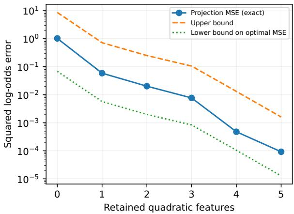

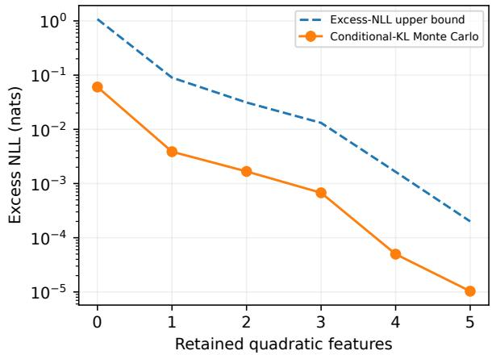  
Figure 1: The precision-contrast spectrum yields a quantitative feature budget. The projection decoder has an exactly evaluated MSE between the theorem’s bounds. Conditional-KL Monte Carlo approximates its population excess NLL; error bars show numerical integration uncertainty. The lower bound concerns the optimal MSE, not predictive NLL. With all six features both errors vanish up to rounding; that endpoint is omitted from logarithmic axes.

The baseline precision interaction b is shared, so separate energies are suficient. After noise $\tau \mathrm { d i a g } ( r _ { 1 } , r _ { 2 } )$ with $r _ { 1 } , r _ { 2 } > 0$ 2

$$
[ ( C _ { k } + \tau \operatorname { d i a g } ( r _ { 1 } , r _ { 2 } ) ) ^ { - 1 } ] _ { 1 2 } = { \frac { b } { 1 + \tau ( a _ { k } r _ { 1 } + c _ { k } r _ { 2 } ) + \tau ^ { 2 } r _ { 1 } r _ { 2 } ( a c - b ^ { 2 } ) } } ,\tag{28}
$$

where $( a _ { 0 } , c _ { 0 } ) = ( a , c )$ and $( a _ { 1 } , c _ { 1 } ) = ( c , a )$ . For isotropic noise, $r _ { 1 } = r _ { 2 }$ , the entries agree at every noise level. For $a \neq c , b \neq 0 , r _ { 1 } \neq r _ { 2 }$ and every finite $\tau > 0$ , they are unequal. Thus the optimal log-loss deficiency

$$
G ( \tau ) = I ( Y ; Z _ { \tau } \mid Z _ { \tau , 1 } ^ { 2 } , Z _ { \tau , 2 } ^ { 2 } )
$$

is zero at $\tau = 0$ and strictly positive thereafter. At the same time, $I ( Y ; Z _ { \tau } )$ is nonincreasing in τ by Gaussian-channel data processing. The noise exposes information lost by the fixed feature map; it does not create new information about the class.

For any positive-definite R and $\tau > 0$ , the Gaussian KL to the noise-only reference $\mathcal { N } ( 0 , \tau R )$ gives the useful limiting bound

$$
0 \leq G ( \tau ) \leq I ( Y ; Z _ { \tau } ) \leq \frac { 1 } { 4 \tau ^ { 2 } } \sum _ { k } \pi _ { k } \| R ^ { - 1 / 2 } C _ { k } R ^ { - 1 / 2 } \| _ { F } ^ { 2 } .\tag{29}
$$

Indeed the mixture information is at most the class-averaged KL to any reference law, and $x - \log ( 1 + x ) \leq x ^ { 2 } / 2$ for $x \geq 0$ bounds the Gaussian KL eigenvalue terms. Hence the positive intermediate-noise deficiency returns to zero as noise tends to infinity.

The local size of the deficiency, here and in Theorem 5.1, rests on the following exact decomposition of a conditional mutual information into four divergences. For a family of joint laws $p _ { \epsilon }$ of $( Y , X )$ and a statistic $U$ of $( Y , X )$ , write $\mathsf { D } _ { U } ( \epsilon ) = D _ { \mathrm { K L } } ( p _ { \epsilon , U } \Vert p _ { 0 , U } )$ for the divergence between the laws of U under $p _ { \epsilon }$ and $p _ { 0 }$ .

Lemma 4.7 (Four-KL identity). Let $\left( p _ { \epsilon } \right)$ be a family of joint laws of $( Y , X )$ , with Y discrete, such that $p _ { \epsilon } \ll p _ { 0 }$ , and let $S = S ( X )$ be a statistic of X. Suppose that under the baseline law

$$
p _ { 0 } ( Y \mid X ) = p _ { 0 } ( Y \mid S ) \qquad a l m o s t \ s u r e l y .\tag{30}
$$

Then, whenever the four divergences below are finite,

$$
I _ { \epsilon } ( Y ; X \mid S ) = \mathsf { D } _ { ( Y , X ) } ( \epsilon ) - \mathsf { D } _ { X } ( \epsilon ) - \mathsf { D } _ { ( Y , S ) } ( \epsilon ) + \mathsf { D } _ { S } ( \epsilon ) .\tag{31}
$$

Proof. Since S is a function of X, $I _ { \epsilon } ( Y ; X \mid S ) = \mathbb { E } _ { p _ { \epsilon } } \log [ p _ { \epsilon } ( Y \mid X ) / p _ { \epsilon } ( Y \mid S ) ]$ . The chain rule for divergences gives $\mathsf { D } _ { ( Y , X ) } - \mathsf { D } _ { X } = \mathbb { E } _ { p _ { \epsilon } } \log [ p _ { \epsilon } ( Y ~ \mid ~ X ) / p _ { 0 } ( Y ~ \mid ~ X ) ]$ and $\mathsf { D } _ { ( Y , S ) } - \mathsf { D } _ { S } =$ $\mathbb { E } _ { p _ { \epsilon } } \log [ p _ { \epsilon } ( Y \mid S ) / p _ { 0 } ( Y \mid S ) ]$ . Subtracting, the right side of (31) equals

$$
I _ { \epsilon } ( Y ; X \mid S ) - \mathbb { E } _ { p _ { \epsilon } } \log \frac { p _ { 0 } ( Y \mid X ) } { p _ { 0 } ( Y \mid S ) } .
$$

The cross term vanishes because its integrand is zero p0-almost surely by (30), hence $p _ { \mathrm { { \epsilon } } ^ { \mathrm { - a l m o s t } } }$ surely. □

In both applications below, X is a coordinate vector, S is its vector of coordinate energies, and (30) holds because, under the baseline law, Y is conditionally independent of the coordinate signs given the energies. The signs need not be uniform.

Theorem 4.8 (Local size of quality-induced energy loss). In two coordinates, suppose all baseline class precisions have the same of-diagonal entry b, with possibly diferent positive-definite diagonal parts. Let $\Sigma _ { k } ( \tau ) = P _ { k } ( 0 ) ^ { - 1 } + \tau R$ for a fixed symmetric $R ,$ and restrict $\tau$ to an interval where all covariances are positive definite. Set

$$
\beta _ { k } = - ( P _ { k } ( 0 ) R P _ { k } ( 0 ) ) _ { 1 2 } , \qquad \eta _ { k } ^ { 0 } ( e ) = \mathbb { P } _ { 0 } ( Y = k \mid Z _ { 1 } ^ { 2 } = e _ { 1 } , Z _ { 2 } ^ { 2 } = e _ { 2 } ) .
$$

Then, as $\tau  0$

$$
G ( \tau ) = \frac { \tau ^ { 2 } } { 2 } A _ { R } + O ( | \tau | ^ { 3 } ) , \qquad A _ { R } = \mathbb { E } _ { 0 } \Big [ E _ { 1 } E _ { 2 } \mathrm { s e c h } ^ { 2 } ( b \sqrt { E _ { 1 } E _ { 2 } } ) \operatorname { V a r } _ { k \sim \eta ^ { 0 } ( E ) } ( \beta _ { k } ) \Big ] .\tag{32}
$$

If the $\beta _ { k }$ are not all equal, then $A _ { R } > 0$ . For diagonal $R = \mathrm { d i a g } ( r _ { 1 } , r _ { 2 } ) , \beta _ { k } = - b ( r _ { 1 } ( P _ { k } ) _ { 1 1 } +$ $r _ { 2 } ( P _ { k } ) _ { 2 2 } )$ . An explicit uniform remainder is given below.

Proof. Under the baseline law, Y and the signs of Z are conditionally independent given $E =$ $( Z _ { 1 } ^ { 2 } , Z _ { 2 } ^ { 2 } )$ ; these signs need not be uniform. Since Z is determined by E and its signs, $p _ { 0 } ( Y \mid$ $Z ) = p _ { 0 } ( Y \mid E )$ , and Lemma 4.7 with $X = Z , S = E$ and $\epsilon = \tau$ gives $G ( \tau ) = \mathsf { D } _ { ( Y , Z ) } ( \tau ) -$ $\mathsf { D } _ { Z } ( \tau ) - \mathsf { D } _ { ( Y , E ) } ( \tau ) + \mathsf { D } _ { E } ( \tau )$ . For any of these four statistics U, the second derivative at zero is the squared $L ^ { 2 } ( p _ { 0 } )$ norm of the conditional score $\mathbb { E } _ { 0 } [ s _ { Y } ( Z ) \mid U ]$ . Write $Q = Z _ { 1 } Z _ { 2 }$ . The Gaussian score has the form $s _ { k } ( z ) = u _ { k } ( E ) - \beta _ { k } Q$ , where $u _ { k }$ depends only on the energies. Conditioning on $E = e ,$ the sign-product probabilities are proportional to $\exp ( - b Q )$ , independently of k. Therefore

$$
\mathbb { E } _ { 0 } [ Q \mid E = e ] = - { \sqrt { e _ { 1 } e _ { 2 } } } \operatorname { t a n h } ( b { \sqrt { e _ { 1 } e _ { 2 } } } ) , \qquad \operatorname { V a r } _ { 0 } ( Q \mid E = e ) = e _ { 1 } e _ { 2 } { \mathrm { s e c h } } ^ { 2 } ( b { \sqrt { e _ { 1 } e _ { 2 } } } ) .
$$

Subtracting the four squared conditional-score norms cancels every energy-only contribution and leaves $\mathbb { E } _ { 0 } [ \mathrm { V a r } _ { 0 } ( Q ~ \vert ~ E ) \mathrm { V a r } _ { \eta ^ { 0 } ( E ) } ( \beta _ { k } ) ]$ . This is $G ^ { \prime \prime } ( 0 )$ . Positive Gaussian densities and positive class priors make every $\eta _ { k } ^ { \mathrm { 0 } } ( \dot { e } )$ positive; the variance is therefore positive for almost every e when two $\beta _ { k }$ difer. The bounds below justify the Taylor expansion and diferentiation under integration. □

An explicit remainder. Put $\begin{array} { r } { \nu = \| R \| _ { \mathrm { o p } } , \Lambda = \operatorname* { m a x } _ { k } \lambda _ { \operatorname* { m a x } } ( P _ { k } ( 0 ) ^ { - 1 } ) } \end{array}$ , and choose $t > 0$ such that $\lambda _ { t } = \operatorname* { m i n } _ { k } \lambda _ { \operatorname* { m i n } } ( P _ { k } ( 0 ) ^ { - 1 } ) - t \nu > 0$ and $t \nu \Lambda / \lambda _ { t } ^ { 2 } < 1$ . For u $\geq 0 .$ , set (the dimension is two)

$$
L _ { 1 } ( u ) = \frac { \nu } { \lambda _ { t } } + \frac { \nu u } { 2 \lambda _ { t } ^ { 2 } } , \quad L _ { 2 } ( u ) = \frac { \nu ^ { 2 } } { \lambda _ { t } ^ { 2 } } + \frac { \nu ^ { 2 } u } { \lambda _ { t } ^ { 3 } } , \quad L _ { 3 } ( u ) = \frac { 2 \nu ^ { 3 } } { \lambda _ { t } ^ { 3 } } + \frac { 3 \nu ^ { 3 } u } { \lambda _ { t } ^ { 4 } } , \quad h ( u ) = t L _ { 1 } ( u ) .
$$

For $W \sim \chi _ { 2 } ^ { 2 }$ , define the finite, explicit constant

$$
M _ { t } = \mathbb { E } \Big [ e ^ { h ( \Lambda W ) } \{ 4 L _ { 1 } ^ { 3 } + 3 L _ { 1 } L _ { 2 } + h ( L _ { 1 } ^ { 3 } + 3 L _ { 1 } L _ { 2 } + L _ { 3 } ) \} ( \Lambda W ) \Big ] .\tag{33}
$$

Then

$$
\begin{array} { r } { | G ( \tau ) - \frac 1 2 \tau ^ { 2 } \mathcal { A } _ { R } | \le \frac 2 3 M _ { t } | \tau | ^ { 3 } \qquad ( | \tau | \le t ) . } \end{array}\tag{34}
$$

To check the bound, if $P = \Sigma _ { k } ( \tau ) ^ { - 1 }$ , the first three derivatives of the log Gaussian density are

$$
\begin{array} { r l } & { - \frac { 1 } { 2 } \operatorname { t r } ( P R ) + \frac { 1 } { 2 } z ^ { \top } P R P z , \quad \frac { 1 } { 2 } \operatorname { t r } ( ( P R ) ^ { 2 } ) - z ^ { \top } P R P R P z , \quad - \operatorname { t r } ( ( P R ) ^ { 3 } ) + 3 z ^ { \top } P R P R P R P z . } \end{array}
$$

Their absolute values are bounded by $L _ { 1 } ( u ) , L _ { 2 } ( u ) , L _ { 3 } ( u )$ respectively. For a density ratio $\rho _ { \tau }$ to baseline, | log $\rho _ { \tau } | \leq h ( u )$ and its first three derivatives are bounded by $\rho _ { \tau } L _ { 1 } , \rho _ { \tau } ( L _ { 1 } ^ { 2 } + L _ { 2 } )$ and $\rho _ { \tau } ( L _ { 1 } ^ { 3 } + 3 L _ { 1 } L _ { 2 } + L _ { 3 } )$ . The same bounds hold after each of the four coarsenings, since each retains $u = \| z \| ^ { 2 }$ and its ratio is a baseline conditional expectation. Diferentiating x log $x - x + 1$ at $x = \rho _ { \tau }$ three times gives the envelope in (33). Under every baseline class, $\| Z \| ^ { 2 }$ is stochastically bounded by ΛW; the displayed integrability condition permits dominated diferentiation. Taylor’s remainder for four KL terms is $4 M _ { t } | \tau | ^ { 3 } / 6$ . The constant can be evaluated using the chi-square exponential moments stated in Section 5. It is conservative; ordinary quadrature of $\boldsymbol { \mathcal { A } } _ { R }$ is a numerical check, not a formal certificate of a positive lower bound. The local KL expansion uses established information-geometric machinery [84]; the coeficient here allows correlated baseline signs and specifies which quality changes expose lost information.

## 4.8 A correlated-noise example with a suficient residual

Independent latent modes do not prevent quality-induced interaction information. Take equal priors,

$$
C _ { 0 } = I _ { 2 } , \qquad C _ { 1 } = \mathrm { d i a g } ( 4 , 1 ) , \qquad R = \left( \begin{array} { l l } { { 1 } } & { { 0 . 8 } } \\ { { 0 . 8 } } & { { 1 } } \end{array} \right) .\tag{35}
$$

Here $Z = A { + } \xi _ { R }$ with $\xi _ { R } \sim \mathcal { N } ( 0 , R )$ independent of $( A , Y )$ ; the noise multiplier is one. The latent energies are suficient, but the noisy physical energies are not. The residual $U = Z _ { 1 } - 0 . 4 Z _ { 2 }$ is independent of $Z _ { 2 }$ in each class, and has variances $v _ { 0 } = 1 . 6 8$ and $v _ { 1 } = 4 . 6 8$ . Thus $U ^ { 2 }$ is suficient, whereas $( Z _ { 1 } ^ { 2 } , Z _ { 2 } ^ { 2 } )$ omits the cross product needed to compute it. With equal priors the full Bayes accuracy is exactly

$$
\begin{array} { r } { \frac 1 2 + \Phi ( c / \sqrt { v _ { 0 } } ) - \Phi ( c / \sqrt { v _ { 1 } } ) , \qquad c ^ { 2 } = \cfrac { \log \left( v _ { 1 } / v _ { 0 } \right) } { 1 / v _ { 0 } - 1 / v _ { 1 } } . } \end{array}\tag{36}
$$

Here physical energies also incur strictly greater zero–one loss: take $\sqrt { e _ { 1 } } = c$ and $0 < 0 . 4 \sqrt { e _ { 2 } } < c$ $\mathrm { A t }$ these energies and on an open neighborhood, the two sign products give $\left| Z _ { 1 } - 0 . 4 Z _ { 2 } \right|$ on opposite sides of $c .$ Both signs have positive density, so the full optimal decisions disagree within the energy fiber. This specific argument is needed; strict log-loss deficiency alone would not imply strict classification error in every example.

Numerical verification and scope. The accompanying observation-quality verification script checks randomized covariance structures under diagonal and correlated noise, the two exact suficient-transform controls, and the local expansion. It uses specified Gaussian class laws, fixed coordinates, and an analytic four-sign energy posterior to verify the structural theorem and quantify its numerical size. Table 4 and Figure 2 report the results: the local coeficient $\boldsymbol { \mathcal { A } } _ { R }$ of Theorem 4.8 for the swapped-precision example, and the accuracy and log-loss deficiency of physical energies in the correlated-noise example.

Table 4: Known-law quality checks. Accuracy uncertainty is Monte Carlo integration error, not training variability. The full accuracy is analytic; the energy gap is in nats.
<table><tr><td>Quantity</td><td>Value</td></tr><tr><td>Local coefficient  $\boldsymbol { \mathcal { A } } _ { R }$  (600-point quadrature per axis)</td><td>0.360836</td></tr><tr><td>Coefficient difference, 400 vs. 600 points per axis</td><td>3.8e-09</td></tr><tr><td>Independent-latent example: full Bayes accuracy</td><td>0.621314</td></tr><tr><td>Independent-latent example: physical-energy accuracy</td><td>0.610228</td></tr><tr><td>Conservative Monte Carlo SE of energy accuracy</td><td>6.8e-05</td></tr><tr><td>Physical-energy log-loss deficiency</td><td>0.007520</td></tr><tr><td>Conservative Monte Carlo SE of deficiency Sufficient residual-energy posterior error (maximum)</td><td>1.8e-05 1.4e-14</td></tr></table>

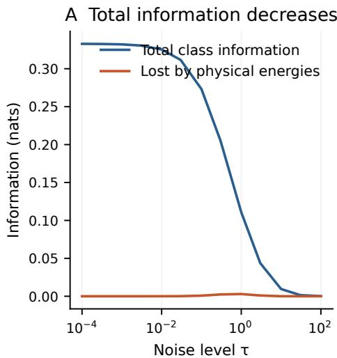

B Local loss is quadratic  
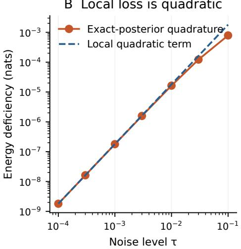

C Independent latent modes, correlated observation noise  
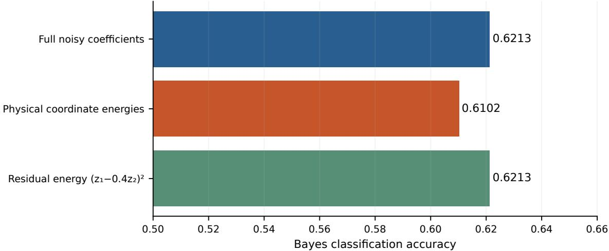  
Figure 2: Known observation quality changes the information retained by fixed physical energies. The swapped-precision example (27) uses $( a , c , b ) = ( 0 . 4 , 2 , 0 . 7 )$ and $R = \mathrm { d i a g } ( 1 , 4 )$ Upper panels show total class information and energy deficiency, and the local quadratic approximation; ordinary Gaussian quadrature is used. The lower panel compares suficient and lossy summaries in the independent-latent-mode example (35). The mixing transformation is quality dependent, so its equality with the full posterior is consistent with the fixed-coordinate theorem. Numerical uncertainty and convergence checks are recorded with the results; none is a fitted-model confidence interval.

## 5 Learning, approximation and adaptive coordinates

This section quantifies the sign information discarded by KMD energies and identifies conditions under which it can be estimated from finite data. The analysis combines classical local KL expansions, Gaussian quadratic concentration, and Wishart identities. It builds on Gaussian mutual-information feature selection and its prediction interpretation [6, 74], information expansions [84], general lossless-transform and excess-risk theory [33], and Gaussian divergenceoriented projections [18]. We specialize these tools and the established compression–risk identity to KMD sign information, its attenuation by an observation posterior, and an explicit error budget for selecting a mode span before fitting regime covariances.

## 5.1 A local formula with a uniform, computable remainder

Fix positive class priors $\pi _ { k } .$ . In signed mode coordinates suppose

$$
C \mid Y = k \sim { \mathcal { N } } ( 0 , P _ { k } ( \epsilon ) ^ { - 1 } ) , \qquad P _ { k } ( \epsilon ) = D _ { k } + \epsilon B _ { k } ,\tag{37}
$$

where $D _ { k }$ is positive diagonal and $B _ { k }$ is symmetric with zero diagonal. Write $\mathcal { E } = ( C _ { 1 } ^ { 2 } , \ldots , C _ { r } ^ { 2 } )$ and let $\eta _ { k } ^ { 0 } ( e ) = \mathbb { P } _ { 0 } ( Y = k \mid \mathcal { E } = e )$ . Define

$$
\mathcal { A } = \mathbb { E } _ { 0 } \left[ \sum _ { i < j } \mathcal { E } _ { i } \mathcal { E } _ { j } \operatorname { V a r } _ { k \sim \eta ^ { 0 } ( \mathcal { E } ) } ( ( B _ { k } ) _ { i j } ) \right] .\tag{38}
$$

The expectation includes the baseline Gaussian mixture. A large precision interaction shared by every class contributes zero; interactions count only where the energy posterior still leaves class uncertainty.

The following constants give an explicit remainder for the expansion. Let $\lambda \quad =$ mink $\lambda _ { \operatorname* { m i n } } ( D _ { k } ) ~ > ~ 0 , ~ \bar { b } ~ = ~ \operatorname* { m a x } _ { k } \| B _ { k } \| _ { \mathrm { o p } }$ , and choose $t ~ > ~ 0$ with $t { \bar { b } } \ < \ \lambda$ . Set $\bar { \beta } ~ = ~ \bar { b } / \lambda$ and

$$
a _ { 2 } = \frac { r \bar { \beta } ^ { 2 } } { 2 ( 1 - t \bar { \beta } ) ^ { 2 } } , \qquad a _ { 3 } = \frac { r \bar { \beta } ^ { 3 } } { ( 1 - t \bar { \beta } ) ^ { 3 } } , \qquad h ( u ) = \frac { t \bar { b } } { 2 } u + \frac { t ^ { 2 } a _ { 2 } } { 2 } , \qquad L ( u ) = \frac { \bar { b } } { 2 } u + t a _ { 2 } .
$$

For $Z \sim \chi _ { r } ^ { 2 } .$ , put

$$
\mathcal { M } _ { t } = \mathbb { E } \left[ e ^ { h ( Z / \lambda ) } \left\{ 4 L ( Z / \lambda ) ^ { 3 } + 3 a _ { 2 } L ( Z / \lambda ) + h ( Z / \lambda ) \big [ L ( Z / \lambda ) ^ { 3 } + 3 a _ { 2 } L ( Z / \lambda ) + a _ { 3 } \big ] \right\} \right] .\tag{39}
$$

This finite expectation is a polynomial times a chi-square exponential moment. In particular $\mathbb { E } [ Z ^ { j } e ^ { s Z } ] = 2 ^ { j } ( r / 2 ) _ { j } ( 1 - 2 s ) ^ { - r / 2 - j }$ for $2 s < 1$ , so no unknown distributional constant is hidden in it.

Theorem 5.1 (Size of the energy information loss). For every $| \epsilon | \leq t ,$

$$
\left| I _ { \epsilon } ( Y ; C \mid \mathcal { E } ) - \frac { \epsilon ^ { 2 } } { 2 } \mathcal { A } \right| \leq \frac { 2 } { 3 } \mathcal { M } _ { t } | \epsilon | ^ { 3 } .\tag{40}
$$

Consequently the right side subtracted from $\epsilon ^ { 2 } { \mathcal { A } } / 2$ is a certified lower bound, truncated at zero. This is a fixed-coordinate result; optimizing a basis changes both $D _ { k }$ and $B _ { k }$ and is a separate problem.

Proof. Let $p _ { \epsilon }$ be the joint law of $( Y , C )$ and $p _ { 0 }$ its baseline. Under $p _ { 0 }$ every class law has independent coordinates, so conditional on $\mathcal { E }$ the signs of C are uniform and independent of $Y$ Hence $p _ { 0 } ( Y \mid C ) = p _ { 0 } ( Y \mid \mathcal { E } )$ , and Lemma 4.7 with $X = C$ and $S = \mathcal { E }$ gives

$$
I _ { \epsilon } ( Y ; C \mid \mathcal { E } ) = \mathsf { D } _ { ( Y , C ) } ( \epsilon ) - \mathsf { D } _ { C } ( \epsilon ) - \mathsf { D } _ { ( Y , \mathcal { E } ) } ( \epsilon ) + \mathsf { D } _ { \mathcal { E } } ( \epsilon ) ;
$$

the cross term of the chain rule vanishes exactly because of this equality of baseline posteriors. The joint score at zero is $\begin{array} { r } { s _ { k } ( c ) = - c ^ { \top } B _ { k } c / 2 = - \sum _ { i < j } ( B _ { k } ) _ { i j } c _ { i } c _ { j } \colon } \end{array}$ the determinant derivative vanishes because $D _ { k }$ is diagonal and $B _ { k }$ has zero diagonal. For any of the four pushforwards $U , \mathsf { D } _ { U } ( 0 ) = \mathsf { D } _ { I 7 } ^ { \prime } ( 0 ) = 0$ and $\mathsf { D } _ { U } ^ { \prime \prime } ( 0 ) = \mathbb { E } _ { 0 } [ ( \mathbb { E } _ { 0 } [ s _ { Y } ( C ) \mid U ] ) ^ { 2 } ]$ . The scores conditional on $( Y , { \mathcal { E } } )$ and on $\mathcal { E }$ vanish. Given $\mathcal { E } _ { : }$ , distinct sign products $\mathrm { s i g n } ( C _ { i } C _ { j } )$ are orthogonal. Substituting the remaining two scores in (31) yields $I _ { 0 } ^ { \prime \prime } = \mathcal { A }$

The Taylor remainder can be bounded before integration. The joint density ratio is $r _ { \epsilon } ( k , c ) =$ exp $\{ \theta _ { k } ( \epsilon ) - \epsilon c ^ { \top } B _ { k } c / 2 \}$ , where $\begin{array} { r } { \theta _ { k } = \frac { 1 } { 2 } } \end{array}$ log det $( I + \epsilon D _ { k } ^ { - 1 / 2 } B _ { k } D _ { k } ^ { - 1 / 2 } )$ $\begin{array} { r } { \mathrm { O n } \ [ - t , t ] , \ | \theta _ { k } ^ { \prime \prime } | \leq a _ { 2 } , \ | \theta _ { k } ^ { \prime \prime \prime } | \leq } \end{array}$ a3, $| \theta _ { k } ^ { \prime } | \le t a _ { 2 }$ , and $| \theta _ { k } | \le t ^ { 2 } a _ { 2 } / 2$ . Each of the four statistics retains $u = \| c \| ^ { 2 } ;$ ; taking conditional expectations under $p _ { 0 }$ therefore preserves the following ratio bounds:

$$
\begin{array} { r } { | \log r _ { \epsilon , U } | \le h ( u ) , \quad | r _ { \epsilon , U } ^ { \prime } | \le r _ { \epsilon , U } L ( u ) , \quad | r _ { \epsilon , U } ^ { \prime \prime } | \le r _ { \epsilon , U } ( L ( u ) ^ { 2 } + a _ { 2 } ) , } \end{array}
$$

$$
| r _ { \epsilon , U } ^ { \prime \prime \prime } | \le r _ { \epsilon , U } ( L ( u ) ^ { 3 } + 3 L ( u ) a _ { 2 } + a _ { 3 } ) .
$$

For $\varphi ( x ) = x$ log $x - x + 1$ , diferentiation of $\varphi ( r _ { \epsilon , U } )$ three times bounds its absolute value by the integrand in (39), with u replacing $Z / \lambda$ . Under every baseline class, $\| C \| ^ { 2 }$ is stochastically bounded by $Z / \lambda$ . The envelope is increasing and integrable since $t { \bar { b } } < \lambda$ . Thus $| \mathsf { D } _ { U } ^ { \prime \prime \prime } | \leq \mathcal { M } _ { t } ;$ dominated diferentiation is justified by the same envelope. There are four terms in (31), giving remainder $4 \mathcal { M } _ { t } | \epsilon | ^ { 3 } / 6$ □

The remainder is conservative. Its positivity certificate may require a much smaller coupling than the range where the leading term predicts the numerical gain accurately. The verification reports both facts; it does not replace the bound by an empirically fitted remainder. Nor does a positive log-loss gain imply an accuracy gain or justify selecting every nonzero interaction from finite data. In the numerical checks, $\mathcal { A }$ is evaluated by ordinary Gaussian quadrature. A positive floating-point evaluation of the lower-bound formula is not itself a rigorous numerical certificate without controlling that quadrature and rounding error.

An exact approximate-suficiency upper bound. For any positive-definite ${ \tilde { P } } _ { k } = R +$ $D _ { k } ^ { \prime }$ with common symmetric R and class-dependent diagonal $D _ { k } ^ { \prime }$ , the corresponding Gaussian posterior is energy-measurable. With true $P _ { k } \succ 0$ , therefore,

$$
I ( Y ; C \mid \mathcal { E } ) \leq \frac { 1 } { 2 } \sum _ { k } \pi _ { k } \left[ \mathrm { t r } ( \widetilde { P } _ { k } P _ { k } ^ { - 1 } ) - r - \log \operatorname* { d e t } ( \widetilde { P } _ { k } P _ { k } ^ { - 1 } ) \right] .\tag{41}
$$

Indeed the best energy rule is no worse than this particular rule, whose posterior KL is bounded by the joint Gaussian KL. This elementary bound allows a common of-diagonal precision component; setting every class precision diagonal would unnecessarily penalize information that cancels from the decision.

## 5.2 How observation uncertainty attenuates useful interactions

Let $A \mid k \sim \mathcal { N } ( 0 , ( D + \epsilon B _ { k } ) ^ { - 1 } )$ with common positive diagonal D and $B _ { k }$ symmetric with zero diagonal as in (37), and observe $\boldsymbol { y } = L \boldsymbol { A } + \boldsymbol { \xi } , \boldsymbol { \xi } \sim \mathcal { N } ( \boldsymbol { 0 } , \boldsymbol { R } ) , \boldsymbol { R } \succ \boldsymbol { 0 }$ . The observation map is fixed independently of $y .$ Put $\Gamma = D ^ { - 1 }$ , and let (m, V) be the posterior under the common reference prior $\mathcal { N } ( 0 , \Gamma )$ . Then m has baseline covariance $\Sigma _ { m } = \Gamma - V$ . The class score at $\epsilon = 0$ is

$$
\begin{array} { r } { s _ { k } ( y ) = - \frac { 1 } { 2 } \operatorname { t r } [ B _ { k } ( m m ^ { \top } + V - \Gamma ) ] = - \frac { 1 } { 2 } \operatorname { t r } [ B _ { k } ( m m ^ { \top } - \Sigma _ { m } ) ] . } \end{array}\tag{42}
$$

This follows by diferentiating the latent density under its Gaussian observation integral. If $\begin{array} { r } { \overline { { B } } = \sum _ { k } \pi _ { k } B _ { k } } \end{array}$ , a Gaussian fourth moment gives

$$
I _ { \epsilon } ( Y ; y ) = \frac { \epsilon ^ { 2 } } { 4 } \sum _ { k } \pi _ { k } \mathrm { t r } [ \Sigma _ { m } ( B _ { k } - \overline { { B } } ) \Sigma _ { m } ( B _ { k } - \overline { { B } } ) ] + O ( | \epsilon | ^ { 3 } ) .\tag{43}
$$

When $\Sigma _ { m }$ is diagonal, deleting its zero-variance coordinates if necessary, the energy loss has the simpler expansion

$$
I _ { \epsilon } ( Y ; y \mid ( m _ { 1 } ^ { 2 } , \ldots , m _ { r } ^ { 2 } ) ) = \frac { \epsilon ^ { 2 } } { 2 } \sum _ { i < j } ( \Sigma _ { m } ) _ { i i } ( \Sigma _ { m } ) _ { j j } \mathrm { V a r } _ { k \sim \pi } ( ( B _ { k } ) _ { i j } ) + O ( | \epsilon | ^ { 3 } ) .\tag{44}
$$

To verify the second expression, m is suficient for this fixed observation family and its baseline signs are uniform conditional on its squares; because $\Sigma _ { m }$ is diagonal and $B _ { k }$ has zero diagonal, $\mathrm { t r } ( B _ { k } \Sigma _ { m } ) = 0 ,$ so $\begin{array} { r } { s _ { k } = - \sum _ { i < j } ( B _ { k } ) _ { i j } m _ { i } m _ { j } } \end{array}$ and $\mathbb { E } [ s _ { k } \ | \ m _ { 1 } ^ { 2 } , \ldots , m _ { r } ^ { 2 } ] \ = \ 0$ . The variance of $\begin{array} { r } { \sum _ { i < j } ( B _ { k } ) _ { i j } m _ { i } m _ { j } } \end{array}$ is the displayed sum. Thus poorly observed modes, for which $( \Sigma _ { m } ) _ { i i }$ is small, contribute little even when their latent precision interaction is large. With general correlated $V$ , the trace formula remains valid, but the separate-edge formula does not.

The $O ( | \epsilon | ^ { 3 } )$ statements here are ordinary local expansions for positive-definite Gaussian covariance paths on a fixed finite observation space, not the numerical constant in (39). Smooth matrix inverses and a compact positive-definite neighborhood give an integrable polynomial– Gaussian envelope for three derivatives, justifying Taylor’s theorem. The explicit uniform remainder in Theorem 5.1 applies to its linear precision path. Neither statement treats a carrier selected from the same test signal as a fixed observation operator.

## 5.3 Information lost by an imperfect learned mode span

Whiten a known common noise shape and write

$$
X = H A + \xi , \qquad \xi \sim \mathcal { N } ( 0 , \tau I _ { p } ) , \qquad S = H \operatorname { C o v } ( A ) H ^ { \top } .\tag{45}
$$

The noise is independent of $( Y , A )$ , and $Y  A  X$ is a Markov chain. The latent law need not be Gaussian in the following lemma. Let Π be an orthogonal projector fixed independently of the new observation, and let $Z = U ^ { \top } X$ , with orthonormal columns of U spanning Π.

Lemma 5.2 (Prediction cost of signal leakage). If Cov(A) is finite, then

$$
I ( Y ; X \mid Z ) \leq { \frac { 1 } { 2 } } \log \operatorname* { d e t } \left[ I _ { p } + \tau ^ { - 1 } ( I _ { p } - \Pi ) S ( I _ { p } - \Pi ) \right] \leq { \frac { \operatorname { t r } ( ( I _ { p } - \Pi ) S ) } { 2 \tau } } .\tag{46}
$$

Proof. Complete U to an orthogonal basis and denote the residual coordinates by $X _ { \perp }$ . Conditional data processing gives $I ( Y ; X _ { \perp } \mid Z ) \le I ( A ; X _ { \perp } \mid Z )$ . The two orthogonal noise components are independent. Conditional on $Z = z$ , the entropy bound by a Gaussian with the same covariance gives

$$
\begin{array} { r } { I ( A ; X _ { \perp } \mid Z = z ) \le \frac { 1 } { 2 } \log \operatorname* { d e t } [ I + \tau ^ { - 1 } U _ { \perp } ^ { \top } H \operatorname { C o v } ( A \mid Z = z ) H ^ { \top } U _ { \perp } ] . } \end{array}
$$

Concavity of log determinant, the total covariance identity, and E $\operatorname { C o v } ( A \mid Z ) \preceq \operatorname { C o v } ( A )$ prove the first inequality. The second uses log $( 1 + x ) \leq x$ □

This measures prediction error through leaked signal variance, rather than requiring each named carrier to be recovered. A sign, permutation, or basis rotation within the same span has zero leakage. Small physical frequency errors and an unresolved weak mode have diferent consequences through S.

## 5.4 A sampled KMD candidate selector with an of-grid guarantee

The selection objective should match the inference problem. For Koopman approximation, kernel EDMD learns kernels for a dictionary of observables [9]. For slow-coordinate recovery, adaptive kernelized difusion maps use a time-lagged objective to distinguish slow dynamics from a misleading static spectrum [1]. The selector below estimates the signal span from independent records. The analysis separates the predictive cost of span leakage from the error of fitting the regime laws.

Consider a finite library of J rank-q mode spans with projectors $\Pi _ { 1 } , \ldots , \Pi _ { J }$ . The library is either specified before data are read, or generated by an upstream KMD routine on a separate data split. On $n _ { D }$ fresh independent centered Gaussian records, select

$$
\widehat { j } \in \arg \operatorname* { m a x } _ { j } \frac { 1 } { n _ { D } } \sum _ { i = 1 } ^ { n _ { D } } X _ { i } ^ { \top } \Pi _ { j } X _ { i } .\tag{47}
$$

The class composition of these records is fixed at the target priors (equal counts sufice for equal priors); their covariances may difer by class. The selection rule uses no class labels. Assume $\| \operatorname { C o v } ( X _ { i } ) \| _ { \mathrm { o p } } \leq M$ , rank $( S ) = q$ , and the smallest nonzero eigenvalue of S is at least $\lambda _ { s } > 0$ Define the signal leakage and its library optimum by

$$
L _ { j } = \operatorname { t r } ( ( I - \Pi _ { j } ) S ) , \qquad L _ { * } = \operatorname * { m i n } _ { j } L _ { j } .
$$

The selector uses controlled or stratified records with class composition fixed at the target priors and labels withheld during selection. Collection can use regime labels or controlled generation to achieve this composition; the $n _ { D }$ records count toward the sampling budget. An analysis of ordinary IID draws from an unlabeled Gaussian mixture would additionally account for random class-count fluctuations.

Theorem 5.3 (Independent energy selection controls mode leakage). Condition on an independently generated library. With probability at least $1 - \delta , f o r \boldsymbol { x } = \log ( J / \delta )$ ，

$$
\sqrt { L _ { \widehat { j } } } \leq \sqrt { L _ { * } } + 2 M \sqrt { \frac { 2 } { \lambda _ { s } } } \left( \sqrt { \frac { x } { n _ { D } } } + \frac { x } { n _ { D } } \right) .\tag{48}
$$

Writing ℓ = log J, define

$$
G _ { D } = { \frac { 1 6 M ^ { 2 } } { \lambda _ { s } } } \left[ { \frac { \ell + 1 } { n _ { D } } } + { \frac { \ell ^ { 2 } + 2 \ell + 2 } { n _ { D } ^ { 2 } } } \right] .\tag{49}
$$

Then E $L _ { \widehat { j } } \leq ( \sqrt { L _ { * } } + \sqrt { G _ { D } } ) ^ { 2 }$

Proof. Let $\Pi _ { 0 }$ project onto the rank-q range of S. Since $S \succeq \lambda _ { s } \Pi _ { 0 } , \Vert \Pi _ { j } - \Pi _ { 0 } \Vert _ { F } ^ { 2 } \leq 2 L _ { j } / \lambda _ { s }$ . Fix a population-optimal library index $j _ { * }$ . For $\Delta \Pi _ { j } = \Pi _ { j } - \Pi _ { j * }$ , the triangle inequality gives

$$
\| \Delta \Pi _ { j } \| _ { F } \le \sqrt { 2 / \lambda _ { s } } ( \sqrt { L _ { j } } + \sqrt { L _ { * } } ) , \qquad \| \Delta \Pi _ { j } \| _ { \mathrm { o p } } \le \| \Delta \Pi _ { j } \| _ { F } .
$$

The population score diference is $L _ { * } - L _ { j } { \mathrm { : } }$ the common noise contributes the same $q \tau$ to both projectors. Gaussian quadratic concentration gives, simultaneously for every j, upper deviation at most

$$
2 M \| \Delta \Pi _ { j } \| _ { F } \sqrt { x / n _ { D } } + 2 M \| \Delta \Pi _ { j } \| _ { \mathrm { o p } } x / n _ { D } .
$$

This inequality follows directly by diagonalizing each centered Gaussian quadratic form: its log moment generating function is at most $t ^ { 2 } \| \boldsymbol { \Sigma } _ { i } ^ { 1 / 2 } \bar { \boldsymbol { \Delta } } \Pi _ { j } \boldsymbol { \Sigma } _ { i } ^ { 1 / 2 } \| _ { F } ^ { 2 } / ( 1 - 2 | t | \| \boldsymbol { \Sigma } _ { i } ^ { 1 / 2 } \bar { \boldsymbol { \Delta } } \Pi _ { j } \boldsymbol { \Sigma } _ { i } ^ { 1 / 2 } \| _ { \mathrm { o p } } )$ . Chernof optimization and a union bound prove the display; these are the standard Gaussian quadratic ingredients of [67]. For the selected index the empirical diference is nonnegative, hence $L _ { \widehat { j } } - L _ { * }$ is no larger than the deviation bound. Factor $L _ { \widehat { j } } - L _ { * } = ( \sqrt { L _ { \widehat { j } } } - \sqrt { L _ { * } } ) ( \sqrt { L _ { \widehat { j } } } + \sqrt { L _ { * } } )$ and cancel the nonnegative second factor; the zero case is immediate. This proves (48).

For the expectation, set $x = \log J + t$ and integrate the resulting $e ^ { - t }$ tail for $( \sqrt { L _ { \widehat { j } } } - \sqrt { L _ { * } } ) _ { + }$ Using $( { \sqrt { a } } + a ) ^ { 2 } \leq 2 ( a + a ^ { 2 } )$ , and $\mathbb { E } T = 1 , \mathbb { E } T ^ { 2 } = 2$ for $T \sim \mathrm { E x p } ( 1 )$ , its second moment is at most $G _ { D }$ . Cauchy–Schwarz completes the result. □

A sharper constant for a specified observation design. The universal M bound can be replaced by the actual quadratic variances. For $\Delta \Pi _ { j } = \Pi _ { j } - \Pi _ { j }$ and class observation covariances $\Sigma _ { k }$ , put

$$
F _ { j } ^ { 2 } = \sum _ { k } \pi _ { k } \mathrm { t r } ( \Sigma _ { k } \Delta \Pi _ { j } \Sigma _ { k } \Delta \Pi _ { j } ) , \qquad O _ { j } = \operatorname* { m a x } _ { k } \| \Sigma _ { k } ^ { 1 / 2 } \Delta \Pi _ { j } \Sigma _ { k } ^ { 1 / 2 } \| _ { \mathrm { o p } } ,
$$

$$
a _ { F } = \operatorname* { m a x } _ { j : \Delta \Pi _ { j } \neq 0 } \frac { 2 F _ { j } } { \sqrt { L _ { j } } + \sqrt { L _ { * } } } , \qquad a _ { O } = \operatorname* { m a x } _ { j : \Delta \Pi _ { j } \neq 0 } \frac { 2 O _ { j } } { \sqrt { L _ { j } } + \sqrt { L _ { * } } } .
$$

The maximum over an empty set is zero. The same proof gives $\sqrt { L _ { \widehat { j } } } \leq \sqrt { L _ { * } } + a _ { F } \sqrt { x / n _ { D } } +$ $a _ { O } x / n _ { D }$ . Integrating its tail and applying Cauchy–Schwarz yields the alternative

$$
G _ { D } ^ { \mathrm { d e s i g n } } = \left[ a _ { F } \sqrt { \frac { \ell + 1 } { n _ { D } } } + \frac { a _ { O } \sqrt { \ell ^ { 2 } + 2 \ell + 2 } } { n _ { D } } \right] ^ { 2 } .\tag{50}
$$

Either bound, or their minimum, can be used below. These population design constants can be evaluated exactly for a specified simulation. Estimated versions require simultaneous upper confidence bounds to provide a certificate. The variance expression is particularly useful when nearby candidate spans exchange a small signal direction with a noisy residual direction.

The fixed-rank restriction is substantive: otherwise the noise energy $q \tau$ favors larger dictionaries. Independently generated libraries can include candidate ridges from several KMD bandwidths or refinements; the same records cannot both generate arbitrary candidates and justify this finite-library union bound. The selector above is a global projection-energy rerank ing of candidate mode spans. It is not a theorem for every upstream local ridge-tracking rule.

A concrete frequency-grid approximation term. For sampled times $| t _ { i } | \leq T$ , use real chirp columns $p ^ { - 1 / 2 } \cos ( 2 \pi ( f t _ { i } + a t _ { i } ^ { 2 } / 2 ) )$ or the corresponding sine. A frequency error $\Delta f$ and chirp-rate error $\Delta a$ change each column by at most $d _ { \phi } = 2 \pi ( T | \Delta f | + T ^ { 2 } | \Delta a | / 2 )$ in Euclidean norm. If the library includes the corresponding q-column approximation $H _ { * }$ , then $( I { - } \Pi _ { * } ) H _ { * } = 0$ and

$$
L _ { * } \leq \| \operatorname { C o v } ( A ) \| _ { \mathrm { o p } } \| H - H _ { * } \| _ { F } ^ { 2 } \leq q \| \operatorname { C o v } ( A ) \| _ { \mathrm { o p } } d _ { \phi } ^ { 2 } .\tag{51}
$$

Columns here retain the displayed $p ^ { - 1 / 2 }$ scaling; normalizing them requires including the normalization constants. Taking both sine and cosine columns makes a constant phase change a within-pair rotation. Close or weak modes can make $\lambda _ { s }$ small and correctly weaken the selection bound.

## 5.5 A finite-sample benefit condition for the complete procedure

Now assume the latent law is centered Gaussian within each class, with known priors and known zero means. After selecting the span, use a third independent split with $n _ { k } > q + 1$ observations of each class to fit the uncentered covariance of $Z = U _ { \widehat { j } } ^ { \top } X$ . Let $\widehat { \eta }$ be the resulting Gaussian regime posterior. Define

$$
W ( q , n ) = \frac { 1 } { 2 } \left[ \frac { n q } { n - q - 1 } - q + \sum _ { i = 1 } ^ { q } \psi \Bigl ( \frac { n + 1 - i } { 2 } \Bigr ) + q \log ( 2 / n ) \right] ,\tag{52}
$$

where $\psi$ is the digamma function.

Theorem 5.4 (A learned interaction rule can beat an energy oracle). Condition on a fixed or independently generated candidate library. Under the preceding independent-split assumptions,

the expected population log loss, averaged over dictionary-selection and covariance-fitting data, satisfies

$$
\mathbb { E } \mathcal { R } ( \widehat { \eta } ) - H ( Y \mid X ) \leq \frac { ( \sqrt { L _ { * } } + \sqrt { G _ { D } } ) ^ { 2 } } { 2 \tau } + \sum _ { k } \pi _ { k } W ( q , n _ { k } ) .\tag{53}
$$

If the right side is smaller than the true energy-oracle deficiency $\Delta _ { E } = I ( Y ; X \mid \mathcal { E } _ { 0 } ( X ) )$ for a specified energy map ${ \mathcal { E } } _ { 0 }$ , the learned rule has strictly smaller expected population log loss than even the Bayes rule using those energies. A lower bound from Theorem 5.1 may replace $\Delta _ { E }$ when its assumptions hold. Alternatively $\Delta _ { E }$ can be computed for a specified simulation law; numerical quadrature then supplies numerical evidence, not a universal analytic lower bound.

Proof. Condition on the selected span. The Bayes loss in its coordinates exceeds $H ( Y \mid X )$ by $I ( Y ; X \mid Z )$ , bounded by Lemma 5.2. Each projected class is Gaussian with some positivedefinite covariance $B _ { k }$ , regardless of whether the span is exact. The KL chain rule bounds fitted posterior loss over the projected Bayes loss by $\begin{array} { r } { \sum _ { k } \pi _ { k } D _ { \mathrm { K L } } ( \mathcal { N } ( 0 , B _ { k } ) \| \mathcal { N } ( 0 , \widehat { B } _ { k } ) ) } \end{array}$ . For $n \widehat { B } \sim$ Wishar $\mathrm { t } _ { q } ( B , n )$

$$
\mathbb { E } \operatorname { t r } ( { \hat { B } } ^ { - 1 } B ) = { \frac { n q } { n - q - 1 } } , \quad \mathbb { E } \log \operatorname* { d e t } { \hat { B } } - \log \operatorname* { d e t } B = \sum _ { i = 1 } ^ { q } \psi { \big ( } ( n + 1 - i ) / 2 { \big ) } + q \log ( 2 / n ) .
$$

These standard Wishart expectations [80] give exactly (52). Averaging the leakage bound using Theorem 5.3 proves (53). Finally the energy Bayes risk is $H ( Y \mid X ) + \Delta _ { E }$ □

Here $W ( q , n ) = q ( q + 1 ) / ( 4 n ) + O ( n ^ { - 2 } )$ for fixed $q .$ The bound includes dictionary-selection observations explicitly; it is not a claim that $n _ { k }$ labels are the entire development budget. It is an expectation over training, not a promise for every fitted model. It does not require unique physical labels for the modes, but requires independent training stages, Gaussian class laws for the covariance step, and common observation noise. Small $L _ { * }$ and large $n _ { D }$ cannot compensate for $n _ { k } \le q + 1$ , where the unregularized expected inverse-covariance loss is infinite.

Estimated noise scale and changed observation quality. With unchanged full observations, fitting their projected covariance directly already includes the noise. Subtracting and re-adding the same estimated noise variance cancels exactly if no eigenvalue clipping intervenes. For a change from training variance $\tau _ { 0 }$ to test variance $\tau _ { 1 }$ , use $\widehat { B } _ { k , 1 } = \widehat { B } _ { k , 0 } + ( \widehat { \tau } _ { 1 } - \widehat { \tau } _ { 0 } ) I$ . If independent calibration supplies $N _ { a }$ whitened noise-only scalar observations at variance $\tau _ { a } .$ , then, simultaneously for $a = 0 , 1$ with probability at least $1 - \delta _ { N }$

$$
| \widehat { \tau } _ { a } - \tau _ { a } | \leq e _ { a } = 2 \tau _ { a } \left( \sqrt { x _ { N } / N _ { a } } + x _ { N } / N _ { a } \right) , \qquad x _ { N } = \log ( 4 / \delta _ { N } ) .
$$

The bound is a direct chi-square concentration consequence. Conditional on the learned span, let $\varepsilon _ { S } = 2 u + u ^ { 2 }$ with $u = ( \sqrt { q } + \sqrt { 2 \log ( 2 K / \delta _ { C } ) } ) / \sqrt { \operatorname* { m i n } _ { k } { n _ { k } } }$ . If $\| B _ { k , 0 } \| _ { \mathrm { o p } } \leq b _ { 0 }$ and $\lambda _ { \operatorname* { m i n } } ( B _ { k , 1 } ) \geq$ $b _ { 1 } > 0$ , then simultaneous relative covariance error is at most

$$
\gamma = \frac { b _ { 0 } \varepsilon _ { S } + e _ { 0 } + e _ { 1 } + e _ { \mathrm { r e g } } } { b _ { 1 } } .\tag{54}
$$

Here $e _ { \mathrm { r e g } }$ bounds any additional operator perturbation introduced by clipping or regularization; it is zero for the stated unclipped fit. For $\gamma < 1$ , the projected fitted posterior excess is at most $q \gamma ^ { 2 } / [ 4 ( 1 - \gamma ) ^ { 2 } ]$ on that event. Combine this with the high-probability leakage bound, using test noise $\tau _ { 1 }$ , to obtain a noise-calibrated version of the benefit condition. Its simultaneous event has probability at least $1 - \delta _ { D } - \delta _ { C } - \delta _ { N }$ when $\delta _ { D }$ is used for dictionary selection. Unknown unrestricted noise shape, dependent calibration residuals, and heterogeneous masks that alter the learned span require further analysis; they are not covered by this scalar-scale result.

## 5.6 A conditional robustness bound in the mode dimension

The learned-span bounds above control the leakage of a selected span. The following proposition complements them with a conditional bound on the posterior loss caused by errors in the fitted noise, loadings and latent covariances. Suppose centered true and fitted class models are $\Sigma _ { k } = N + H C _ { k } H ^ { \top }$ and $\widehat { \Sigma } _ { k } = \widehat { N } + \widehat { H } \widehat { C } _ { k } \widehat { H } ^ { \intercal }$ , with common positive-definite noise within each model, positive-semidefinite latent covariances, the same known class priors in both models, and loading ranks at most r. Let U be an orthonormal basis for

$$
\operatorname { c o l } ( N ^ { - 1 } H ) + \operatorname { c o l } ( { \widehat { N } } ^ { - 1 } { \widehat { H } } ) , \qquad d = \dim U \leq 2 r .
$$

Both posteriors depend only on $U ^ { \top } v .$ by the Gaussian likelihood ratio and the Woodbury identity. Put $B _ { k } = U ^ { \top } \Sigma _ { k } U$ and $\widehat { B } _ { k } = U ^ { \top } \widehat { \Sigma } _ { k } U$

Proposition 5.5 (Posterior log-loss under covariance perturbation). $I f \parallel B _ { k } ^ { - 1 / 2 } ( \widehat { B } _ { k } \ -$ $B _ { k } ) B _ { k } ^ { - 1 / 2 } \| _ { \mathrm { o p } } \leq \varepsilon _ { k } < 1$ , the fitted posterior has excess population log loss for a fresh observation at most

$$
\sum _ { k } \pi _ { k } \frac { d \varepsilon _ { k } ^ { 2 } } { 4 ( 1 - \varepsilon _ { k } ) ^ { 2 } } .\tag{55}
$$

$I f \lambda _ { \operatorname* { m i n } } ( N ) \geq \nu , \| H \| _ { \mathrm { o p } } \leq M , \| C _ { k } \| _ { \mathrm { o p } } \leq M _ { C }$ , and operator errors in noise, loadings and latent covariance are $e _ { N } , e _ { H } , e _ { C , k }$ , respectively, a suficient choice is

$$
\varepsilon _ { k } = \frac { e _ { N } + M _ { C } ( 2 M e _ { H } + e _ { H } ^ { 2 } ) + ( M + e _ { H } ) ^ { 2 } e _ { C , k } } { \nu } < 1 .\tag{56}
$$

Proof. The chain rule for joint KL bounds expected posterior KL by the average classconditional KL in the suficient union coordinates. If a relative covariance eigenvalue is $1 + \lambda$ its Gaussian KL contribution is $\{ ( 1 + \lambda ) ^ { - 1 } - 1 + \log ( 1 + \lambda ) \} / 2$ . The derivative of the braced expression is $\lambda / ( 1 + \lambda ) ^ { 2 }$ . Integration bounds the contribution by $\lambda ^ { 2 } / [ 4 ( 1 - \varepsilon _ { k } ) ^ { 2 } ]$ . Summing at most d terms proves (55). Expanding the two low-rank covariance factors, applying the operator norm triangle inequality, and compressing with U gives (56). □

Corollary 5.6 (Relative sensor-noise error). In Proposition 5.5, suppose the centered class laws and loadings agree. Set $E _ { N } = \widehat { N } - N$ and assume $\delta _ { \mathrm { o b s } } = \| N ^ { - 1 / 2 } E _ { N } N ^ { - 1 / 2 } \| _ { \mathrm { o p } } < 1$ . With $F _ { k } = B _ { k } ^ { - 1 / 2 } U ^ { \top } E _ { N } U B _ { k } ^ { - 1 / 2 }$ , the assumed Gaussian posterior has excess population log loss at most

$$
\frac { \sum _ { k } \pi _ { k } \| F _ { k } \| _ { F } ^ { 2 } } { 4 ( 1 - \delta _ { \mathrm { o b s } } ) ^ { 2 } } \leq \frac { d \delta _ { \mathrm { o b s } } ^ { 2 } } { 4 ( 1 - \delta _ { \mathrm { o b s } } ) ^ { 2 } } , \qquad d \leq 2 r .\tag{57}
$$

Proof. The relative error assumption gives $- \delta _ { \mathrm { o b s } } N \preceq E _ { N } \preceq \delta _ { \mathrm { o b s } } N$ . Compress this inequality by U and use $B _ { k } \succeq U ^ { \top } N U$ . Thus the eigenvalues of $F _ { k }$ lie in $[ - \delta _ { \mathrm { o b s } } , \delta _ { \mathrm { o b s } } ]$ . Summing their squares in the scalar Gaussian KL bound of the preceding proof gives (57). □

These bounds condition on the stated estimation errors. In the clean case of known suficient coordinates, known zero means, and n independent Gaussian training vectors per class, the usual Gaussian singular-value bounds [89] give relative covariance error at most $\varepsilon = 2 u + u ^ { 2 }$ simultaneously, where

$$
u = \frac { \sqrt { r } + \sqrt { 2 \log ( 2 K / \delta ) } } { \sqrt { n } } .
$$

With probability at least $1 - \delta$ , provided $\varepsilon < 1$ , fitting the uncentered empirical covariances has excess log loss at most $r \varepsilon ^ { 2 } / [ 4 ( 1 - \varepsilon ) ^ { 2 } ]$ . If this is below (10), the fitted interaction-preserving model beats every orthogonal energy-only oracle in population log loss on that training event. The guarantee depends on the mode dimension, while its conservative constants can require impractically large n. Correlated windows, learned coordinates and heterogeneous-observation EM are outside this IID covariance argument; they are evaluated separately.

## 5.7 Selection from the scored record

Substituting a record-dependent dictionary $H ( x )$ into a fixed-dictionary Gaussian density generally fails to account for its selection event. If a discrete selection rule $J ( x )$ is used, the correct density conditional on $J = j$ has a class-dependent normalizer:

$$
p _ { k } ( x \mid J = j ) = { \frac { p _ { k } ( x ) \mathbf { 1 } _ { \{ J ( x ) = j \} } } { \mathbb { P } _ { k } ( J ( X ) = j ) } } .
$$

The corresponding class prior is

$$
\pi _ { k } ( j ) = { \frac { \pi _ { k } \mathbb { P } _ { k } ( J ( X ) = j ) } { \sum _ { h } \pi _ { h } \mathbb { P } _ { h } ( J ( X ) = j ) } } .
$$

For deterministic $J ( X )$ these factors cancel the truncation denominators, so $\mathbb { P } ( Y \mid X , J ) =$ $\mathbb { P } ( Y \mid X )$ . Here $p _ { k }$ must be a coherent full-record density. A selected-dictionary working score is generally neither that density nor its correctly normalized conditional density; treating it as either requires a coherent generative model. Retaining the original priors with truncated likelihoods instead specifies a diferent class-sampling convention. Integrating a declared latent dictionary index is also diferent from conditioning on deterministic selection. The finite-library bound analyzes independent selection data. Extending this analysis to same-record carrier adaptation is a further research direction.

The conditioning-controlled representation bound and the fitted-risk comparison quantify diferent sources of error. $\mathrm { A t } ~ \alpha = 0 . 8$ and $\kappa = 1$ , Theorem 3.5 gives the uniform energy lower bound $4 . 3 0 \times 1 0 ^ { - 6 }$ nats; the sharper orthogonal-basis bound of Theorem 3.4, optimized over the radius $\varrho \ \left( \varrho ^ { * } \approx 1 . 2 3 7 \right)$ , gives $5 . 2 3 \times 1 0 ^ { - 6 }$ nats (Table 2). Both are far below the Wishart estimation term $W ( 2 , 3 0 0 ) \ : = \ : 0 . 0 0 5 0 8 9$ , even before span leakage. The finite-sample benefit illustrated in Section 5.8 therefore uses one specified energy oracle, rather than a uniform fitted advantage over every allowed energy basis.

## 5.8 Numerical verification across conditions

The accompanying adaptive-theory verification script checks the expansion against Gaussian quadrature, the exact expected Wishart loss against independent covariance draws, and a finite chirp-library selector with separate selection, covariance-fitting, and test samples. The companion result file records all sample budgets, of-grid errors and noise-scale perturbations. Candidate selection is learned from observations; latent truth is used only for evaluation and for evaluating the theorem’s known simulation constants.

Table 5: Independent learned chirp-library check. Each condition uses 300 new fitting records per class and eight independent panels with 6,000 test records each. The bound uses population design constants; the energy-oracle gap is numerically 0.041575 nats. Empirical gains are paired mean NLL reductions against that energy oracle, with standard errors across panels.
<table><tr><td>Library condition</td><td>nD</td><td> $L _ { * }$ </td><td>Excess bound</td><td>Observed gain</td></tr><tr><td>On grid</td><td>3,000</td><td>0.0000</td><td>0.0199</td><td> $0 . 0 3 7 2 \pm 0 . 0 0 0 7$ </td></tr><tr><td>Off grid</td><td>12,000</td><td>0.0097</td><td>0.0286</td><td> $0 . 0 4 0 1 \pm 0 . 0 0 1 1$ </td></tr><tr><td>Outside library</td><td>3,000</td><td>3.1653</td><td>3.2457</td><td> $- 0 . 1 8 7 3 \pm 0 . 0 0 2 5$ </td></tr></table>

The 48-sample chirp experiment uses nine predetermined two-dimensional candidate spans, common noise variance 0.5, and the three precisions in (5) with $\alpha = 0 . 8$ . Each setting has eight independent panels. Rank two and zero class means are specified in advance; they are not estimated. Selection records are generated with exactly equal class counts, with their labels withheld from the selector. In the on-grid case the design-specific expected excess bound is

0.01992 nats with 3,000 such selection records and 300 covariance-fitting records per class. For frequencies ofset by 0.015 cycles per observation interval from the grid, the bound is 0.02861 with 12,000 selection records. Both are below the specified energy oracle’s numerical deficiency of 0.041575 nats. Quadrature orders 100 and 140 difer by $8 . 9 \times 1 0 ^ { - 8 }$ ; this is a numerical convergence check, not an interval-arithmetic proof of that deficiency. The much looser universal bound only becomes informative on grid at 60,000 selection records. When the true frequencies fall outside the candidate library, the bound makes no positive prediction and the fitted rule loses to the energy oracle (Table 5 and Figure 3).

The observed gains are ordered against the leakage: the of-grid gain (0.0401) exceeds the on-grid gain (0.0372), although positive leakage L = 0.0097 would predict the opposite. The two condition means difer by 0.0029 nats (standard error 0.0013 over the two independent sets of eight panels), with eight panels per condition; the of-grid condition also uses four times as many selection records. The diference comes from test-sample variation in the energy-oracle deficiency against which the gains are measured: its population value 0.041575 is the same in both conditions, but its eight-panel means are 0.0394 on grid and 0.0432 of grid. The directly measured excess of the fitted rule over the true-span Bayes rule is ordered as leakage predicts: 0.0022 on grid and 0.0030 of grid.

With a fixed span and complete observations, the classifier is zero-mean QDA on signed coordinates. The experiment checks the error budget for the specified projection-energy selector and compares the fit with its energy oracle.

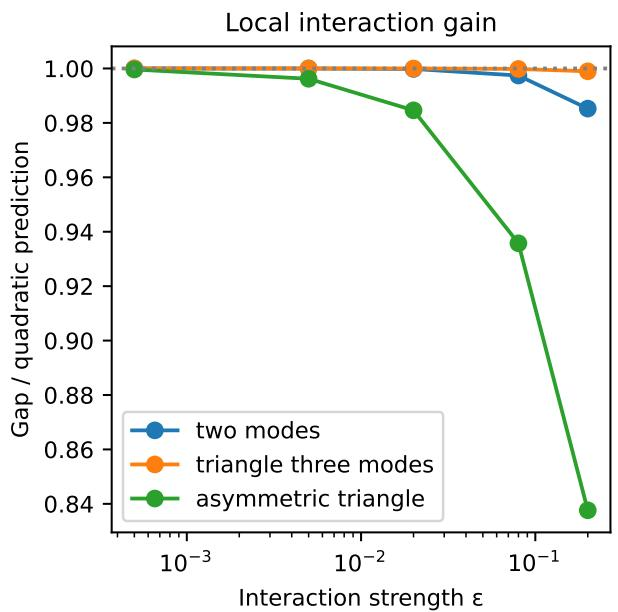

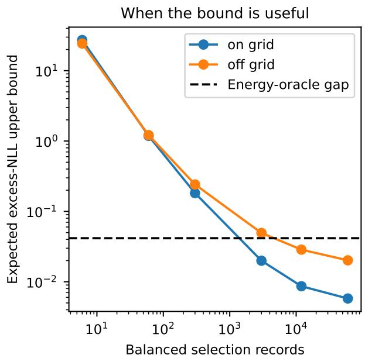

An inadequate library can lose  
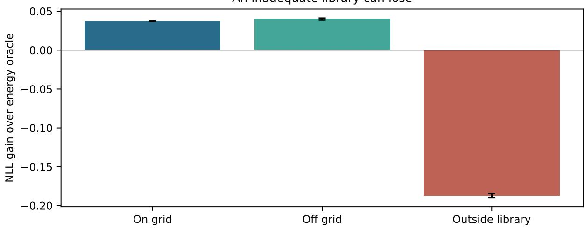  
Figure 3: Checks of the quantitative theory. Upper left: the actual energy gap divided by the weak-coupling prediction, including a three-mode example with a nonzero cubic correction. Upper right: the design-specific expected error budget compared with the fixed energy-oracle gap. Lower: observed paired log-loss gains for the three conditions in Table $5 ;$ bars show one standard error across eight independent panels. The lower panels include the outside-library setting.

## Part II Applications

## 6 Experimental design and evidence overview

We use complementary levels of validation to study representation, estimation, inference, and transfer. An exactly specified Gaussian experiment checks the information-loss and estimation calculations. A nonlinear oscillator experiment tests extracted modes and a fitted working regime law. Triggered ringdowns, chirped and fading responses, and explicitly timeinhomogeneous switching test distinct mechanisms beyond critical transitions. These examples complement microlocal KMD for slow–fast critical transitions [51]. An external bearing study assesses transfer to independent physical units and a change in operating conditions. The prescribed-mode experiment isolates the coupling mechanism under its stated assumptions. Each study addresses its own target and sampling protocol.

Training-only and per-record adaptation. When a dictionary is learned from independent fitting records and frozen, the Gaussian posterior transfer is an exact calculation conditional on the fitted dictionary and the assumed observation model. Its error relative to the true data law includes dictionary and parameter errors. By contrast, if a dictionary H(y) is selected from the same record y being scored, substituting H(y) into a Gaussian density does not generally give a normalized density for y. Its conditional covariance also excludes frequency, phase and modelselection uncertainty. We call such outputs working scores and evaluate their developmentcalibrated probabilities on independent records. Exact Gaussian integration conditional on a selected kernel does not establish exact Bayesian inference for the adaptive pipeline.

Coordinates and physical phases. Mode ordering and the sine–cosine convention must be fixed by an extraction rule available at prediction time. A common coordinate sign change is a reparameterization if the corresponding fitted class laws change with it. Randomizing a physical relative phase changes the data law and can destroy the very interaction used for classification. Simulation ground truth is reserved for evaluating reconstruction; it cannot align test modes or construct the classifier inputs. Tests of time shifts and phase variation therefore have a scientific role beyond checking a numerical implementation.

Comparators and information budgets. Separate energies, signed modes, and interaction features are distinct representations. Each statistical comparison specifies the same observation footprint and available noise metadata. Strong controls include shrinkage QDA, quadratic logistic regression, a calibrated direct sparse-QDA control, and dynamical or spectral summaries appropriate to the task. The sparse-QDA control reimplements the precision-contrast and linearindex objectives [64]; reference-class contrasts and development-only temperature/intercept calibration supply its declared multiclass wrapper. The unpenalized implementation is checked against ordinary Gaussian QDA, and diagonal penalized cases against closed forms. The dense-Gaussian implementation checks of the integrated predictions are described once, in Section 2.3.

Replication units and proper scores. The fitting and development labels both count toward the available sample budget. Throughout Part II, a panel is one independently generated and independently fitted simulation replicate, including its own fitting, development and test data; panels are the replication units of every simulation study. In the recorded-data studies the replication units are patients (ECG) and physical bearings. Individual events, trajectories and windows remain the prediction units within a panel or a physical unit. Several windows or corrupted views of a unit do not create additional independent units. Preprocessing, feature selection, regularization, and probability calibration use fitting or development data only. Test predictions are retained for every specified unit, including dificult decompositions. Negative log likelihood is the primary probability score, accompanied by Brier score and classification metrics. Reconstruction against a simulated latent signal measures a diferent target from restoration toward an originally recorded, noisy waveform. Uncertainty intervals use the stated independent unit, and their interpretation accounts for the small number of physical bearings.

Comparison targets. An energy-classifier contrast measures the efect of its specified representation and estimator. Signed-mode and spectral controls assess richer representations. Probability loss, reconstruction error, and estimation or computational cost provide separate comparison targets. The finite-library theory uses its stated sampling and identifiability conditions; the nonlinear and external studies evaluate fitted working models.

Efect size and decision tolerance. A mean NLL diference ∆ corresponds to a ratio $\exp ( - \Delta )$ of geometric mean true-class probabilities, providing a score-scale interpretation. A symmetric ε-nat tolerance permits score ratios between $e ^ { - \varepsilon }$ and $e ^ { \varepsilon }$ . Application-specific decision costs provide a basis for choosing such a tolerance. The binary protocol’s 0.02-nat TOST calculations are reported as sensitivity analyses; the three-regime primary comparison estimates the NLL diference and its uncertainty.

Confirmatory and exploratory analyses. Only three analyses in this paper are confirmatory, in the sense that the endpoint, comparator family and multiplicity adjustment were fixed before the corresponding test data were evaluated and a claim is made from the result: the two-contrast primary family of the binary controlled experiment (Table 7), the single primary endpoint of the three-regime experiment (Section 7.4), and the two-comparison primary classification family of the INCART ECG study (Section 9.3). Every other interval and test in Part II, including all entries of Table 6 other than these three, is exploratory or descriptive, whether or not its comparison was declared in a protocol. The MIT–BIH and absolute-frequency bearing studies declared their test families and success criteria in advance; both failed, and their cohorts then served as development data, so we list them as exploratory. Retrospective analyses, such as the quality-aware calibration of Section 7.3 and the centered three-regime control, are exploratory by construction.

Interval reporting with few units. For studies with at most 12 independent units (the ringdown, oscillator, nonstationary, dictionary-mixture, switching, energy-oracle and coupledmode studies), the paired t interval across units is the reporting interval. Percentile bootstrap intervals over so few units are known to undercover and can take only a small number of distinct values (Section 6.1); they are given only as a sensitivity analysis. Where the saved summaries of a study contained only bootstrap intervals (the oscillator, diagonal-quality ringdown, energyoracle and coupled-mode studies), the paired t intervals were computed for this revision from the saved per-panel results (Appendix D).

## 6.1 Outcomes and their statistical interpretation

Table 6 summarizes the experiments of Sections 7–9. NLL comparisons use the strongest relevant signed control or clearly name a representation-restricted comparator. Improvements in reconstruction are reported separately. The last two columns state whether the analysis is confirmatory in the sense of Section 6 and whether a prespecified practical criterion (typically a 0.02-nat NLL improvement or a 5% MSE reduction) was met.

Table 6: Outcomes against informative controls. NLL is in nats, lower is better. Values summarize outcomes in the stated evaluation conditions; Sections 7–9 give the conditions and comparisons. Status: Conf. = confirmatory, Expl. = exploratory or descriptive (Section 6). The MIT–BIH and absolute-frequency bearing families were declared in advance but failed and became development data; they are listed as exploratory. Criterion: whether the prespecified practical criterion was met (“none” if the paper states no such criterion for that study).
<table><tr><td>Study / units</td><td>Result against stated control</td><td>Evaluation conditions</td><td>Status</td><td>Criterion met</td></tr><tr><td>Binary signed modes  / 64 panels (§7.2)</td><td>Integrated NLL 0.5826, selected signed 0.5846, same-law point 0.6511.</td><td>The point contrast reflects the point rule&#x27;s temperature grid; quality-aware calibration removes 97.7% of it (§7.3).</td><td>Conf. (primary family)</td><td>Illustrative margin only</td></tr><tr><td>Three-regime continuous quality / 64 panels (§7.4)</td><td>Integrated NLL 1.03371, selected signed 1.03617, centered signed sensitivity 1.03487.</td><td>NLL improves by 0.00246 over the selected signed control and by 0.00116 over the retrospective centered control; biased monitoring favors the centered control.</td><td>Conf. (primary endpoint); centered:</td><td>None declared</td></tr><tr><td>Adaptive oscillators / 8 panels (§8.1)</td><td>Energy-interaction logistic means 0.615/0.724, versus sKMD 0.636/0.749.</td><td>Source contrast inconclusive: +0.0210, t [−0.0334, 0.0755]; shift contrast unresolved: +0.0242, t [—0.0079, 0.0563] (bootstrap</td><td>Expl.</td><td>None stated</td></tr><tr><td>Triggered ringdown / 6 panels (§8.2)</td><td>Source sKMD 1.021 versus signed OAS 0.831. Noise-shift NLL contrast inconclusive.</td><td>[0.00010, 0.0489]). One 179-nat event; trigger/dynamics shift also fails Noisy MSE improves 5.4% over pooled KMD.</td><td>Expl.</td><td>No</td></tr><tr><td>Chirps and fading / 12 panels each (§8.3)</td><td>Fading noise-shift gain over OAS is 0.031; its interval does not certify 0.02 nats. Chirp contrast inconclusive.</td><td>Fading MSE improves 26% over independent-mode KMD, 2.2% over pooled KMD.</td><td>Expl.</td><td>No (fading NLL point estimate only)</td></tr><tr><td>Switching / 12 panels (§8.5)</td><td>Noise-shift NLL gain over point OAS is 0.264; changed hazards reverse the comparison.</td><td>MSE gain is 9.5% over pooled KMD, 2.0% over point-weighted conditional means.</td><td>Expl.</td><td>Yes for noise-shift NLL and MSE vs pooled; no elsewhere</td></tr><tr><td>Carrier averaging / 12 panels per family (§8.4)</td><td>In-library MSE improves 24.0/21.3% over coupled MAP selection.</td><td>Same-library pooled mixtures recover most of it: extra coupling gain 1.52% (chirp, resolved) / 1.08% (fading, unresolved); independent-mode mixture better</td><td>Expl.</td><td>No</td></tr><tr><td>Global MIT-BIH / 44 patients (§9.1)</td><td>Gaussian-shift sKMD 0.338 point QDA 0.298, waveform PCA/RBF 0.280.</td><td>for fading. No coupled gain survives the declared Holm family; PCA reconstruction is better.</td><td>Expl.</td><td>No</td></tr><tr><td>Robust INCART / 31 patients (§9.3)</td><td>Added-noise NLL 0.0394 versus point 0.0965 and PCA43 0.0631. One-sided zero-margin Holm p = 0.0423: suggestive.</td><td>Neither 0.02-nat margin passes. Point two-sided t interval and both fold-level intervals cross zero; Global7 wins three conditions; reconstruction worse than pooled</td><td>Conf. (primary family)</td><td>No</td></tr><tr><td>Absolute- frequency bearings / 15 bearings (§9.4)</td><td>At unseen speed all 12 learned heads exceed uniform NLL 1.099; sKMD gives 10.346.</td><td>Unseen-speed transfer with absolute-frequency coordinates</td><td>Expl.</td><td>No</td></tr><tr><td>Order- coordinate bearings / 14</td><td>Severe simulated telemetry: integrated 0.831, point 1.026, quality forest 1.065.</td><td>Milder telemetry favors point inference; native integration selects zero; one healthy unit.</td><td>Expl.</td><td>No</td></tr></table>

Observation quality in recorded-data tests. The main favorable ECG comparison adds Gaussian noise and missing samples to recordings; its noise monitor is supplied by that experiment. Bearing telemetry likewise changes a declared observation operator. These tests assess classification and reconstruction under supplied corruption laws. Reconstruction is evaluated against recorded reference waveforms, which include physiological and sensor variation.

Small panels, cross-fitting and multiplicity. The six-panel bootstrap has only ${ \binom { 1 1 } { 6 } } = 4 6 2$ possible count vectors (and potentially fewer distinct statistic values). Increasing the number of Monte Carlo bootstrap draws does not create more independent panels. The corresponding intervals are descriptive. The controlled studies use independently fitted panels. ECG patient intervals also condition on overlapping training cross-fits; 31 patients are not 31 independently trained models.

The comparison inventory enumerates every focal-method comparison in a declared set of result summaries, with its source, condition, metric and statistical unit. Appendix C reports the counts by study. Holm adjustments control error only within their declared local families and give no study-wide guarantee. Claims rest only on the three confirmatory families listed in Section $6 ;$ all other intervals in Table 6 are exploratory.

## 7 Controlled mechanism and finite-sample tests

These controlled studies connect population information with finite-sample inference under specified observation laws. The binary construction gives an exact energy-information calculation and a scalar quality correction. A separate three-regime experiment retains partial energy information and introduces a noise-dependent quadratic term outside the afine span of the noiseless log-odds contrasts.

## 7.1 When a quality-dependent calibration replaces integration

An integration comparison depends on the permitted calibration of its point control. Two Gaussian examples make that dependence explicit. The identities below concern known population laws; separately estimated means and covariances need not preserve their exact symmetry.

Proposition 7.1 (Scalar calibration in the binary correlation family). Let $C _ { \pm } = \left( { \begin{array} { c } { 1 \pm \rho } \\ { \pm \rho } \end{array} } 1 \right)$ $0 < \rho < 1$ . Assume $A \mid Y = \pm \sim N ( 0 , C _ { \pm } )$ with equal priors and $Z = A + \varepsilon _ { \mathrm { { } } }$ , where $\varepsilon \sim N ( 0 , s I _ { 2 } )$ is independent of $( A , Y )$ and $s \geq 0$ is known. Write $\ell _ { s } ( z ) = \log [ p _ { + } ( z \mid s ) / p _ { - } ( z \mid s ) ]$ . Then

$$
\ell _ { s } ( z ) = { \frac { 2 \rho z _ { 1 } z _ { 2 } } { ( 1 + s ) ^ { 2 } - \rho ^ { 2 } } } = { \frac { \ell _ { 0 } ( z ) } { T ( s ) } } , \qquad T ( s ) = { \frac { ( 1 + s ) ^ { 2 } - \rho ^ { 2 } } { 1 - \rho ^ { 2 } } } .
$$

Thus quality-dependent temperature scaling of the noiseless likelihood log odds exactly reproduces Gaussian integration in this family. For unequal priors the likelihood log odds are scaled and the prior log odds are added unchanged.

Proof. The observed covariances have common determinant $( 1 + s ) ^ { 2 } - \rho ^ { 2 }$ . Their inverses have diagonal entries $( 1 + s ) / [ ( 1 + s ) ^ { 2 } - \rho ^ { 2 } ]$ and opposite of-diagonal entries $\mp \rho / [ ( 1 + s ) ^ { 2 } - \rho ^ { 2 } ]$ Subtracting the Gaussian log densities cancels determinant and diagonal terms, giving the displayed cross-product coeficient. Dividing by its value at $s \ : = \ : 0$ proves the temperature identity. □

For $\rho = 0 . 6 5$ and $s = \sigma ^ { 2 }$ , the source qualities $\sigma = 0 . 0 5 , 0 . 3 , 0 . 8 , 1 . 6$ require temperatures approximately $1 . 0 0 9 , 1 . 3 2 6 , 3 . 9 2 6 , 2 1 . 2 1 4$ ; at $\sigma = 3$ the temperature is 172.429. A single global temperature cannot implement this dependence. In particular, the binary protocol’s grid, which ends at 4, also restricts its range. The comparison with that point rule measures both restric tions. A fitted quality-aware control is needed to determine their empirical cost.

Proposition 7.2 (A radial statistic beyond afine logit calibration). Let $P _ { 0 } = I _ { 2 } , P _ { k } = I _ { 2 } + \alpha Q _ { k }$ for k = 1, 2, where $0 < \alpha < 1 , Q _ { 1 } = \mathrm { d i a g } ( 1 , - 1 )$ and $ { Q _ { 2 } } ~ = ~ (  { { ^ 0 \ 1 _ { 0 } } } )$ . Assume $A \mid Y = k \sim$ $N ( 0 , P _ { k } ^ { - 1 } )$ with equal priors and $Z = A + \varepsilon ,$ , where $\varepsilon \sim N ( 0 , s I _ { 2 } )$ is independent of $( A , Y )$ and $s \geq 0$ is known. Define

$$
D _ { s } = ( 1 + s ) ^ { 2 } - \alpha ^ { 2 } s ^ { 2 } , \quad a _ { s } = - \frac { s \alpha ^ { 2 } } { ( 1 + s ) D _ { s } } , \quad b _ { s } = \frac { \alpha } { D _ { s } } , \quad \beta _ { s } = \frac { 1 } { 2 } \log \frac { ( 1 - \alpha ^ { 2 } ) ( 1 + s ) ^ { 2 } } { D _ { s } } .
$$

The class-versus-zero log odds are

$$
\begin{array} { r } { \ell _ { k } ( z ; s ) = \beta _ { s } - \frac 1 2 \{ a _ { s } \| z \| ^ { 2 } + b _ { s } z ^ { \top } Q _ { k } z \} , \qquad k = 1 , 2 . } \end{array}
$$

For every $s > 0$ , these log odds cannot be afine functions of the two noiseless log odds with coeficients depending only on s.

Proof. Since $Q _ { k } ^ { 2 } = I _ { 2 }$ , direct inversion gives

$$
( P _ { k } ^ { - 1 } + s I _ { 2 } ) ^ { - 1 } = \frac { 1 + s ( 1 - \alpha ^ { 2 } ) } { D _ { s } } I _ { 2 } + \frac { \alpha } { D _ { s } } Q _ { k } .
$$

Subtracting $( 1 + s ) ^ { - 1 } I _ { 2 }$ yields $a _ { s } I _ { 2 } + b _ { s } Q _ { k }$ . The observed determinants are $D _ { s } / ( 1 - \alpha ^ { 2 } )$ for $k = 1 , 2$ and $( 1 + s ) ^ { 2 }$ for class zero, yielding $\beta _ { s } . { \mathrm { ~ A t ~ } } s = 0$ , the quadratic parts of both logits are traceless. Every afine combination retains that property, whereas the noisy contrasts have trace $2 a _ { s } \neq 0$ . Equality of these Gaussian posterior functions would imply equality of the quadratic polynomials, which is impossible. □

This obstruction includes scalar temperature and separate class temperatures with qualityonly ofsets. It is specifically an afine-decoder statement: if $u = z ^ { \top } Q _ { 1 } z$ and $v = z ^ { \top } Q _ { 2 } z .$ then $\| z \| ^ { 2 } = \sqrt { u ^ { 2 } + v ^ { 2 } }$ . A nonlinear decoder of the two noiseless logits can therefore recover the radial statistic. A full signed quadratic feature head also retains it directly. Unlike the binary reflection example, separate coordinate energies carry partial class information through the diferent marginal variances. The finite-sample experiment below consequently compares estimated procedures against useful energy references and strong signed controls.

## 7.2 Binary mechanism example: signed information and calibration

A fixed-carrier experiment separates two questions: what is lost by replacing signed coeficients with energies, and what is gained by integrating measurement uncertainty relative to a strong signed classifier. The study follows a specified protocol (Appendix A). Each of 64 independent panels contains 1200 fitting events, 800 development events and 2400 events per test condition. The statistical unit is the panel.

The two equal-prior coeficient laws are

$$
C \mid K = k \sim \mathcal { N } \Bigg ( 0 , \left[ ( - 1 ) ^ { k } \rho \begin{array} { c c } { ( - 1 ) ^ { k } \rho } \\ { 1 } \end{array} \right] \Bigg ) , \qquad \rho = 0 . 6 5 , \qquad Z = C + \varepsilon , \quad \varepsilon \mid \sigma \sim \mathcal { N } ( 0 , \sigma ^ { 2 } I _ { 2 } ) .
$$

Appendix A specifies all fitting rules and stress conditions. The dictionary consists of two prescribed orthonormalized damped cosine atoms. Quality σ is known to every method and independently takes values 0.05, 0.3, 0.8, 1.6 in fitting, development and the primary test. These synthetic modal observations use the supplied noise levels. The signed and energy interaction classifiers have equal feature dimensions and tuning budgets. Development NLL selects a signed comparator from quality-aware interaction logistic, OAS-QDA and same-law point inference; the first is selected in all 64 panels.

Table 7: Primary NLL diferences: integrated Gaussian minus control. The first two rows are the prespecified primary family, with two-sided Holm adjustment; intervals use 64 paired panel means. The same-law point rule calibrates one global temperature on a grid ending at 4, whereas the exact correction at $\sigma = 1 . 6$ is 21.214 (Proposition 7.1), so its contrast largely reflects that grid restriction. The last row, from the retrospective analysis in Section 7.3 (Table 8), is not part of the Holm family.
<table><tr><td>Control</td><td>Difference</td><td>Paired t 95% interval</td><td>Holm p</td></tr><tr><td>Selected signed</td><td>-0.00200</td><td>[-0.00301, -0.00099]</td><td>0.000184</td></tr><tr><td>Same-law point, bounded grid</td><td>-0.06847</td><td>[-0.07159, -0.06535]</td><td>1.2910-48</td></tr><tr><td>Retrospective, exploratory:</td><td></td><td></td><td></td></tr><tr><td>Smooth quality-temperature point</td><td>-0.00155</td><td>[-0.00214, -0.00095]</td><td></td></tr></table>

Integration and a strong signed head. Primary mean NLLs are 0.58260 for Gaussian integration, 0.58460 for the selected signed head and 0.65107 for same-law point inference. The integrated-minus-selected diference is statistically resolved, with a 90% interval of $[ - 0 . 0 0 2 8 4 , - 0 . 0 0 1 1 6 ]$ nats. A 0.00200-nat reduction corresponds to a factor $e ^ { 0 . 0 0 2 0 0 } = 1 . 0 0 2 0 0$ in geometric mean true-class probability. The protocol’s illustrative ±0.02-nat margin gives TOST Holm $p = 1 . 4 6 1 0 ^ { - 4 3 }$ , but no decision cost justifies that margin here. It therefore supplies a sensitivity calculation, not evidence of practical interchangeability. The integration-only contrast exceeds 0.02 nats (one-sided practical-margin Holm $p ~ = ~ 6 . 9 4 1 0 ^ { - 4 0 } )$ , against the specific globally calibrated point rule described in the protocol. Point inference shares the selected Gaussian law and receives its own development calibration. This contrast was prespecified and is reported as such, but it largely measures the point rule’s temperature grid rather than the value of integration: the grid ends at 4, Proposition 7.1 requires 21.214 at $\sigma = 1 . 6$ , and the quality-aware calibration of Section 7.3 removes 97.7% of the contrast (last row of Table 7). Accuracy is almost unchanged: 65.23% versus 65.25%. The gain primarily concerns probability calibration across quality levels.

Signed information and the randomized-sign control. The direct matched-budget signed-minus-energy logistic diference is −0.10906 nats, with a secondary pointwise t interval [−0.11107, −0.10706]. Independently randomizing the second mode sign in every fitting, development and test event makes the two observation laws identical; the corresponding diference is −0.00006, [−0.00037, 0.00025]. In the positive arm, reflection of coordinate two exchanges the classes while preserving both energies, so the population energy posterior is exactly uniform. The signed-versus-energy result illustrates the reflection symmetry in finite samples. The null arm checks the generator and the fitted procedure’s behavior when the signed signal is also absent. It concerns the prescribed energy representation; rotating the dictionary can preserve the interaction for these two classes.

Figure 4 compares the stress conditions. At out-of-range σ = 3, integrated NLL 0.69122 is close to uniform log 2, and accuracy is only 51.98%: conservative probabilities do not recover useful discrimination. Under covariance-preserving Student-5 latent impulses, the robust integrated scale mixture improves NLL from 0.60603 to 0.59735; observation errors remain Gaussian. Primary coeficient MSE improves 1.08% over the pooled full prior and 0.11% over selected-signed-weighted conditional means. The experiment shows how calibration and representation choices afect fitted risk. Section 7.1 and the following analysis separate the efects of global and quality-dependent calibration.

Two additional controlled studies separate population information from fitting error. Section 10 gives exact energy-oracle comparisons for the three-regime obstruction and the complete supplied/learned-carrier fitting grid. They use diferent class laws and replication units from the 64-panel experiment, and are not pooled with it.

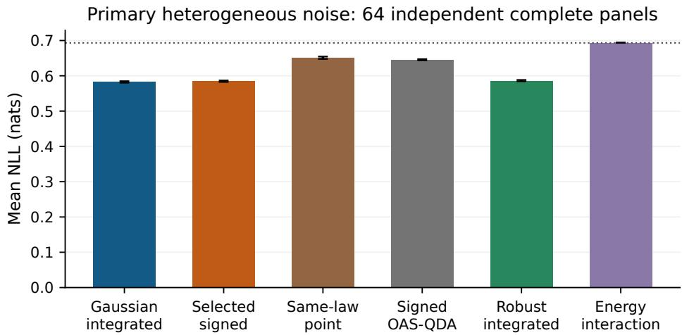  
Conditions retained; shaded band is the illustrative ±0.02 margin

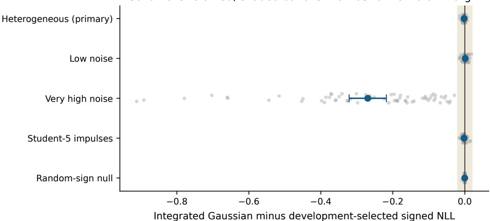  
Negative favors integration; dots are panels, bars are paired t 95% intervals  
Figure 4: Controlled modal observations. Top: primary NLL means and panel t 95% intervals; the dotted line is uniform prediction. Bottom: Gaussian integration minus the developmentselected signed control across every condition. Dots are panel diferences; bars are paired t intervals. Only the heterogeneous-noise comparison belongs to the primary family. The shaded band is the illustrative ±0.02-nat margin.

## 7.3 Quality-aware temperature calibration

The population identity motivates a retrospective calibration analysis of the binary study. The fitted Gaussian laws and test observations are fixed, and calibration parameters are estimated using development observations only. This analysis assesses sensitivity to the permitted calibration family.

Table 8: Retrospective quality-aware calibration on the 64 source-quality panels. All added calibrators use development observations only and use the same fitted Gaussian law. Negative diferences favor integration; intervals use 64 paired panel means. The known-law Bayes NLL of the design $( \rho = 0 . 6 5$ , equiprobable $\sigma \in \{ 0 . 0 5 , 0 . 3 , 0 . 8 , 1 . 6 \} )$ ) calibrates the size of the remaining diferences.
<table><tr><td>Method</td><td>Mean NLL</td><td>Integrated minus method (95% CI)</td><td></td></tr><tr><td>Point, bounded grid</td><td>0.65107</td><td></td><td>-0.06847 [-0.07159, -0.06535]</td></tr><tr><td>Global temperature</td><td>0.64579</td><td></td><td>-0.06319 [-0.06496, -0.06142]</td></tr><tr><td>Four quality temperatures</td><td>0.58486</td><td></td><td>-0.00227 [-0.00295, -0.00158]</td></tr><tr><td>Smooth quality temperature</td><td>0.58414</td><td></td><td>-0.00155 [-0.00214, -0.00095]</td></tr><tr><td>Selected signed control</td><td>0.58460</td><td></td><td>-0.00200 [-0.00301, -0.00099]</td></tr><tr><td>Integrated Gaussian</td><td>0.58260</td><td></td><td></td></tr><tr><td>Known-law Bayes oracle (population)</td><td>0.57842</td><td></td><td></td></tr></table>

Let $\delta _ { i }$ be the untempered point log odds and $v _ { i } = \sigma _ { i } ^ { 2 }$ . We minimize development binary log loss

$$
{ \frac { 1 } { n _ { \mathrm { d e v } } } } \sum _ { i } \{ \log ( 1 + e ^ { \beta ( v _ { i } ) \delta _ { i } } ) - y _ { i } \beta ( v _ { i } ) \delta _ { i } \}
$$

with stable numerical evaluation. Three declared families are fitted: a constant $\beta \geq 0 ;$ four separate nonnegative inverse temperatures, one per observed source quality; and

$$
\beta ( v ) = \frac { a } { 1 + b v + c v ^ { 2 } } , \qquad a , b , c \geq 0 .
$$

The smooth family is informed by the isotropic observation model and contains the exact population correction, but its parameters are learned from development labels without using the generating correlation. It uses eight declared optimization starts. The constant and four-quality fits are convex one-dimensional problems. The added parameter counts are 1, 4, 3 beyond the shared fitted Gaussian law; these are matched-data and matched-law comparisons, not equalcomplexity models. All three are reported without selecting a winner on test data. Four-quality calibration has no defined output at unseen $\sigma = 3$

On the source mixture, continuous global calibration gives NLL 0.64579, compared with 0.65107 for the bounded global grid. Most of the diference remains. Four quality temperatures give 0.58486, and smooth calibration gives 0.58414. The integrated-minus-smooth diference is −0.001547 nats, with paired pointwise 95% interval [−0.002144, −0.000950]. Thus allowing quality calibration removes about 97.7% of the 0.06847-nat contrast against the bounded-grid point rule (Table 8 and Figure 5).

The remaining integrated-minus-smooth residual is statistically resolved. We conjecture that it reflects finite-sample fitting error and departures of the estimated laws from exact reflection symmetry, but no analysis here tests that attribution. For scale, the known-law Bayes NLL of the design (σ observed by every method) is 0.5784 nats, so the fitted integrated rule (0.5826) is 0.0042 nats above it; on the saved 64 × 2400 primary test events the realized oracle NLL is 0.5789. In population, the integrated method’s distance from the oracle bounds what any calibration or representation change could still gain.

At $\sigma = 3$ , smooth calibration gives NLL 0.69287 versus integrated 0.69122, a diference of −0.001645 with interval $[ - 0 . 0 0 2 8 7 0 , - 0 . 0 0 0 4 1 9 ]$ . It therefore also captures nearly all the conservative probability behavior that the quality-interaction logistic head misses outside its fitting support. The near-chance discrimination in this condition persists. Figure 5 also shows the calibration contrasts in the random-sign null and latent-tail stress conditions.

Retrospective calibration sensitivity: 64 paired panel means and 95% intervals  
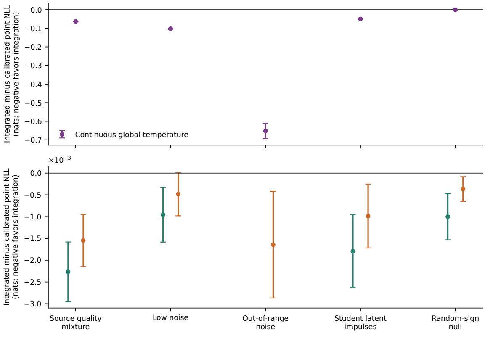  
Four quality temperatures Smooth quality temperature  
Figure 5: All retrospective calibration contrasts on the same binary panels, with separate vertical scales for global and quality-aware calibration. Error bars are pointwise paired t intervals. Smooth model-informed calibration accounts for most of the NLL diference between integration and globally calibrated point inference. Four-quality calibration is omitted at the unseen quality because its rule has no output there.

## 7.4 Three regimes with partial energy information

The binary example makes the energy posterior uniform by symmetry. We next use the threeregime precision family in (5), with $\alpha = 0 . 6 5$ , equal priors and known zero means. Observations are $Z = A { + } \epsilon$ , with $\epsilon \mid \sigma \sim \mathcal { N } ( 0 , \sigma ^ { 2 } I _ { 2 } )$ and independent, continuously varying σ ∼ Unif[0.05, 1.6]. Coordinate energies now retain class information. The noise-dependent radial term in Section 7.1 makes scalar calibration of noiseless logits insuficient, while a full signed quadratic control can retain it.

Independent finite-sample test. The protocol specifies 64 independent panels, fitting budgets of 600 and 2400 events, 1200 development events, and 3000 test events per condition. Every split has balanced classes. Budgets use separate draws; conditions within a budget share a fitted model. The fixed two-carrier experiment supplies modal measurements directly and performs no carrier extraction. The primary endpoint is integrated Gaussian minus development-selected signed NLL at 2400 fitting events and continuous source quality. All other contrasts and stress conditions are secondary. No practical or equivalence margin is asserted.

The integrated estimator fits noise-corrected second moments, selects covariance shrinkage on development observations, and receives a continuous nonnegative inverse temperature. The point control receives the same continuous calibration range. The signed selector chooses between a 17-feature quality-aware quadratic classifier, an 8-feature calibration of point logits and quality, and signed OAS-QDA. The fitted energy polynomial control has the same 17-feature size and tuning grid as the signed quadratic control. Separate known-law signed and energy posteriors measure representation loss; a rotated-energy oracle chooses among 37 orthogonal bases using development NLL. Its true parameters are privileged information, so it is an information reference, not a matched fitted competitor. Appendix B gives the complete fitting rules. Table 9 reports the source-condition NLL of every method at both budgets, and Figure 6 shows the paired diferences in every condition.

Table 9: Continuous-quality three-regime NLL, averaged over 64 independently fitted panels. Energies carry partial information: both energy oracles improve on uniform prediction, log 3 = 1.09861. Only the 2400-event integrated-versus-selected-signed contrast is primary.
<table><tr><td>Method</td><td>600 fit events</td><td>2400 fit events</td></tr><tr><td>Integrated Gaussian</td><td>1.03934</td><td>1.03371</td></tr><tr><td>Development-selected signed</td><td>1.04273</td><td>1.03617</td></tr><tr><td>Centered signed quadratic (sensitivity)</td><td>1.04059</td><td>1.03487</td></tr><tr><td>Point with continuous global calibration</td><td>1.05992</td><td>1.05494</td></tr><tr><td>Quality calibration of point logits</td><td>1.04399</td><td>1.03612</td></tr><tr><td>Fitted energy polynomial</td><td>1.06278</td><td>1.05642</td></tr><tr><td>Known-law signed oracle</td><td>1.03226</td><td>1.03185</td></tr><tr><td>Known-law fixed-energy oracle</td><td>1.05206</td><td>1.05196</td></tr><tr><td>Known-law development-rotated energy oracle</td><td>1.04348</td><td>1.04290</td></tr></table>

Recoverable information and fitted performance. The primary paired diference is −0.002463 nats, with 95% interval [−0.002853, −0.002074] and two-sided $p = 6 . 4 4 \times 1 0 ^ { - 1 9 }$ This corresponds to a geometric mean true-class probability ratio of 1.00247, about a 0.247% increase. The signed selector chooses quality-logit calibration in 41 panels and the full quadratic head in 23. A retrospective symmetry-matched check enforces central symmetry by omitting odd features from the signed head, matching the Gaussian fit’s known-zero-mean assumption. This 11-feature centered control gives NLL 1.03487; the integrated-minus-centered diference is −0.001162, with pointwise interval [−0.001569, −0.000754]. This retrospective sensitivity analysis is separate from the primary comparison; it halves the estimated benefit of integration, and it reverses under the biased monitor below.

At that budget, the known-law signed posterior improves NLL by 0.020115 over fixed energies and 0.011057 over the development-rotated energy oracle. The fitted integrated estimator has a 0.009198 advantage over that selected energy oracle, with secondary pointwise interval [0.008296, 0.010100] for the improvement. This demonstrates that the specified information gap can survive estimation in this experiment.

With 600 fitting events the selected-signed improvement is 0.003397 with pointwise interval [0.002226, 0.004567]; its larger uncertainty reflects less stable estimation.

Stress conditions and reconstruction. At unseen σ = 3, integrated NLL is 1.09578 versus 1.20310 for the selected signed head, but integrated accuracy is only 35.74% against 33.33% chance. This is mainly a calibration advantage under weak remaining information. If the noise monitor reports half the true variance, the integrated-minus-selected diference is −0.000316 with pointwise interval [−0.000986, 0.000355]; the source advantage is unresolved under that misspecification. The centered signed sensitivity control is better than integration there: its NLL is 1.04442, and the integrated-minus-centered diference is +0.000942, with pointwise interval [0.000252, 0.001632].

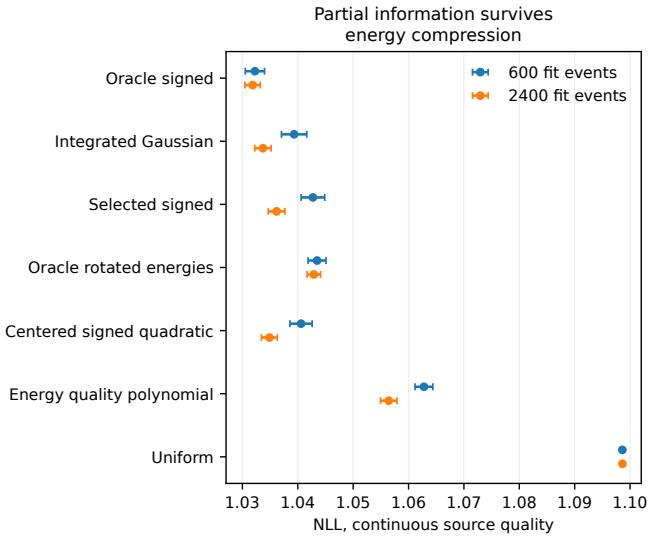

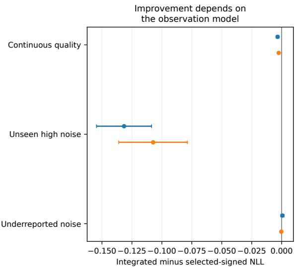  
Figure 6: Three-regime experiment with continuous observation quality. Left: source NLL and panel t intervals at two fitting budgets; energy references retain useful information. Right: integrated minus selected-signed NLL for every condition. Only the larger-budget source comparison is primary. The high-noise condition combines lower NLL with near-chance accuracy; underreported observation noise gives an unresolved integrated-versus-selected contrast.

As a separate population sensitivity check, hold the generating class laws fixed and use the untempered Gaussian posterior. When the supplied sensor variance is half its true value, the mean excess NLL is approximately 0.00943 nats relative to the same posterior supplied with the true variance. This calculation uses 24-point Gauss–Legendre quadrature over source noise SD and a 64-point Gauss–Hermite rule in each observation coordinate within each class. Corollary 5.6 gives the corresponding noise-only bound. The fitted contrast above also depends on the estimated class laws and the calibration of the two heads.

On the primary source condition, coeficient MSE is 0.444668 for regime integration, 0.444852 for the same class-conditional means weighted by the selected signed head, 0.447044 for pooled full-prior KMD and 0.453705 for independent-prior KMD. The relative reductions are approximately 0.041%, 0.531% and 1.99%, respectively. Under the biased monitor, pooled KMD has lower MSE (0.488874 versus 0.491243). The reconstruction gain of regime integration over pooled full-prior KMD is therefore about half a percent at source quality and reverses when the noise monitor is biased.

## 8 Learned modes and nonstationary signals

The controlled coeficient experiments fix the representation. This section adds extraction error, time-varying carriers and regime dynamics. The sequence isolates a progression: energysuficient random-phase signals, triggered signed impulses, changing waveforms, uncertainty about the dictionary, and changing regime persistence. Each study holds its own observation and fitting budget fixed across the named controls.

## 8.1 Random-phase oscillators: when energy paths sufice

Eight independent panels of nonlinear oscillators compare modal interaction representations with amplitude- and energy-based classifiers.

Adaptive KMD front end. We use the released KMD implementation [81] and apply its max\_squeeze\_refine Gaussian energy calculation directly. Two frequency-ordered, separated peaks initialize local frequency searches; smoothed ridges define phases with zero at the observed time origin. Joint local cosine/sine recovery uses the Gaussian weighted least-squares algebra of micloc\_KMD. This bounded automatic subset handles noncrossing sinusoidal modes; the complete implementation additionally supports interactive global peeling. We also run the released complete semimanual algorithm on two prespecified two-mode chirps. Both runs recover two modes automatically. Clean-signal RMSE is $1 . 0 3 \times 1 0 ^ { - 5 }$ without noise and 0.0507 with sensor SD 0.15; the subset gives 0.00750 and 0.0351, respectively.

Nonlinear independent trajectories. Writing $u _ { j } ~ = ~ \log r _ { j }$ , the simulated amplitudecoupled oscillators obey

$$
d u _ { j } = \{ 1 - e ^ { 2 u _ { j } } + \kappa \operatorname { t a n h } ( u _ { 3 - j } ) \} d t + 0 . 6 0 d B _ { j } ,
$$

$$
d \theta _ { j } = 2 \pi f _ { j } ( t ) d t + 0 . 0 3 d W _ { j } , \qquad x ( t ) = \sum _ { j = 1 } ^ { 2 } r _ { j } ( t ) \cos \theta _ { j } ( t ) .
$$

The log-coordinate equation defines the stochastic dynamics; its nonlinear radial drift is the Stuart–Landau radial drift with bounded cross-coupling. The three labels are $\kappa \in \{ - 0 . 9 , 0 , 0 . 9 \}$ All initial phases are independent and uniform. After five seconds of burn-in, each independent trajectory supplies eight seconds at 128 Hz. Source carrier frequencies are near 6 and 14 Hz with slow sinusoidal drift, and independent sensor SD is uniform on [0.15, 0.40]. The prespecified shift changes carriers to approximately 6.7 and 12.8 Hz, doubles frequency-drift and phase-noise amplitudes, and increases sensor SD to [0.40, 0.70]. The fitting, development, source-test and shifted-test sets contain 30, 20, 30 and 30 independent trajectories per class in each of eight panels. Fitting, development and test partitions contain disjoint trajectories. The integration step is 1/512 s. A separate 12-trajectory shared-Brownian refinement to 1/1024 s changes clean signals by RMS $4 . 1 5 \times 1 0 ^ { - 4 }$ and mean recovered amplitudes by $1 . 1 3 \times 1 0 ^ { - 4 }$ . This comparison measures sensitivity to the integration step.

Working uncertainty and comparison methods. The noise scale is estimated from each observed record’s high-frequency power, without simulator truth. For local synthesis matrix $B _ { : }$ Gaussian weights W and estimated noise variance ${ \widehat { \sigma } } ^ { 2 }$ , the coeficient sampling covariance is the sandwich

$$
{ \widehat { \sigma } } ^ { 2 } ( B ^ { \top } W ^ { 2 } B ) ^ { - 1 } B ^ { \top } W ^ { 4 } B ( B ^ { \top } W ^ { 2 } B ) ^ { - 1 } .
$$

This sampling covariance conditions on the estimated carriers and a locally constant coeficient model, with carrier selection treated as fixed. A delta approximation transfers it to positive amplitudes. Class Gaussian amplitude models subtract this estimated measurement variance during fitting and add the test variance in their working likelihood. Covariance shrinkage and a single score temperature are chosen by independent-trajectory development NLL. All controls have explicit, bounded development grids. The direct sparse-QDA wrapper instead uses its declared continuous inverse temperature and class-intercept calibration; this gives that comparator a more flexible calibration model.

The comparison methods include amplitude point QDA; amplitude quadratic logistic; logistic regression on squared-amplitude means, second moments and cross-products; direct sparse QDA [64] on the same five amplitude moments; and forests on pooled energies, marginal energy summaries, or all 40 local energies. A further control uses envelope correlation and demodulated residual-phase consistency. The signed quadrature QDA control retains a fixed observed time origin; random phases make its Gaussian summary inefective. The complete local energy trajectory determines the positive amplitudes through square roots, so both representations retain the same amplitude information in this experiment.

Table 10: Adaptive nonlinear oscillator classification, averaged over eight independent panels. All methods use the same extracted modes; smaller NLL and Brier are better. Full accuracy, macro-AP, panel variation and paired intervals are in the numerical package.
<table><tr><td>Method</td><td>Source NLL Shift NLL</td><td>Source Brier</td><td></td><td>Shift Brier</td></tr><tr><td>Coupled sKMD</td><td>0.636</td><td>0.749</td><td>0.394</td><td>0.461</td></tr><tr><td>Amplitude point QDA</td><td>0.636</td><td>0.763</td><td>0.394</td><td>0.465</td></tr><tr><td>Signed quadrature QDA</td><td>1.108</td><td>1.111</td><td>0.672</td><td>0.674</td></tr><tr><td>Amplitude quadratic logistic</td><td>0.645</td><td>0.749</td><td>0.393</td><td>0.456</td></tr><tr><td>Energy interaction logistic</td><td>0.615</td><td>0.724</td><td>0.376</td><td>0.445</td></tr><tr><td>Pooled KMD energies + RF</td><td>0.948</td><td>1.008</td><td>0.566</td><td>0.605</td></tr><tr><td>Marginal energy summaries + RF</td><td>0.968</td><td>1.021</td><td>0.574</td><td>0.608</td></tr><tr><td>Full energy sequence + RF</td><td>1.000</td><td>1.006</td><td>0.595</td><td>0.603</td></tr><tr><td>Envelope/phase summaries + logistic</td><td>0.769</td><td>0.915</td><td>0.460</td><td>0.525</td></tr><tr><td>Calibrated direct sparse QDA</td><td>0.677</td><td>0.820</td><td>0.416</td><td>0.482</td></tr></table>

Classification and reconstruction outcomes. No test trajectory has a missing detected peak; mean carrier errors are 0.038 Hz in source tests and 0.066 Hz under the shift. Table 10 and Figure 7 show that coupled sKMD improves on the energy forests, while the more explicit energy-interaction logistic control has lower mean NLL in both conditions; with eight panels neither paired contrast is resolved. In the source condition, the paired NLL diference (sKMD minus energy-interaction logistic) is +0.0210 with paired t interval [−0.0334, 0.0755] (7 df; bootstrap sensitivity interval [−0.0228, 0.0599]), so the source contrast is inconclusive. Under the shift, it is +0.0242; its paired t interval [−0.0079, 0.0563] includes zero, so the shift contrast is also unresolved, although the saved pointwise 95% panel-bootstrap sensitivity interval [0.00010, 0.0489] just excludes zero. For point amplitude QDA and amplitude quadratic logistic, the paired NLL intervals against sKMD include zero in both conditions. Against calibrated direct sparse QDA the source NLL diference is −0.0414 with paired t interval [−0.0799, −0.0029] (bootstrap [−0.0735, −0.0137]), which still favors sKMD; its shift interval includes zero. These comparisons use pointwise, unadjusted intervals, and all are exploratory.

Reconstruction MSE provides a complementary comparison. Adaptive micro-local recovery gives MSE 0.01995 on source tests and 0.03160 under the shift. The independent prior gives 0.02024 and 0.03255; the coupled class mixture gives 0.02031 and 0.03260. The coupled prior gives slightly higher reconstruction MSE here. Its covariance approximation conditions on estimated carriers and locally constant coeficients, and the class prior can introduce bias.

All frequency searches, failures and outcomes are retained, and hyperparameters use development data only.

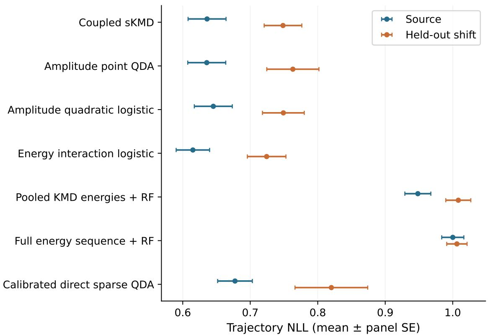

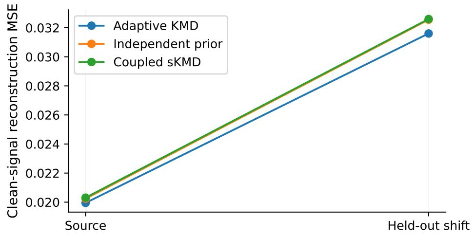  
Figure 7: Adaptive nonlinear oscillator classification and reconstruction. Classification error bars are panel standard errors; paired confidence intervals are reported in the text.

## 8.2 Triggered ringdowns: a signed modal mechanism

In the random-phase experiment in Section 8.1, positive envelopes are recoverable from their full energy trajectories. Here an external trigger fixes a phase reference, so the relative signs of modal impulses encode the direction of the excitation. We evaluate this mechanism using a prespecified protocol and independent panels.

Damped weakly nonlinear normal modes. Two coordinates satisfy

$$
\ddot { q } _ { j } + 2 \gamma _ { j } \dot { q } _ { j } + \omega _ { j } ^ { 2 } ( q _ { j } + 0 . 0 0 0 2 q _ { j } ^ { 3 } ) = 0 , \qquad \omega = 2 \pi ( 6 , 1 4 ) , \quad \gamma = ( 0 . 2 2 , 0 . 3 5 ) .
$$

A single sensor observes $q _ { 1 } + q _ { 2 }$ . The modal impulses are $a = F _ { k } g , g \sim N ( 0 , I )$ , with $F _ { k } F _ { k } ^ { \top } =$ $P _ { k } ^ { - 1 }$ and

$$
P _ { 0 } = I , \qquad P _ { 1 } = I + 0 . 9 \mathrm { d i a g } ( 1 , - 1 ) , \qquad P _ { 2 } = I + 0 . 9 \left( { 0 atop 1 } ^ { 0 } \ { 1 \atop 0 } \right) .
$$

Thus the labels describe isotropic, axis-oriented and oblique excitation ensembles of the same instrument. For observed-trigger ofset $\delta , q _ { j } ( 0 ) = a _ { j } \sin ( \omega _ { j } \delta )$ and $\dot { q } _ { j } ( 0 ) = a _ { j } \omega _ { j } \cos ( \omega _ { j } \delta )$ . Source ofsets are uniform on [−0.5, 0.5] ms. The physical mechanism uses stable modes and an externally aligned trigger. RK4 uses step 1/1024 s for four seconds, observed at 128 Hz. A separate 12-event halving check changes the clean signal by RMS $5 . 9 2 \times 1 0 ^ { - 5 }$

Learn the dictionary before classification. Each of six panels uses 30 separate calibration events to learn frequency trajectories and damping through the adaptive KMD front end described above. Median frequency trajectories and median log-amplitude decay fits define a damped sine/cosine pair for each mode. This bank is complete, has sensor SD 0.25, and contains exactly ten events from each excitation ensemble with their labels withheld from the learner. The calibration bank therefore uses controlled balanced collection. These 30 events are part of the total training budget. Across panels, median frequencies range over 6.004–6.007 and 14.003– 14.011 Hz; learned damping ranges over 0.215–0.223 and $0 . 3 4 2 { - } 0 . 3 5 0 ~ \mathrm { s ^ { - 1 } }$ . No test signal, label or true modal trajectory enters this fit. All 180 calibration events return two detected peaks. The resulting learned kernels are fixed for independent fitting, development and test events. Dictionary calibration is thus independent of the signal whose likelihood is evaluated.

Each panel then uses 40 fitting and 25 development events per class, and 60 test events per class in each of three conditions. Source sensor SD is uniform on [0.3, 1.3], and the event’s observation-retention probability is uniform on [0.25, 1]. A complete 64-sample pretrigger baseline estimates sensor noise; the generating variance is unavailable to every fitted method. The first test condition repeats this distribution. The second increases noise to [0.8, 2.0] and reduces retention to [0.15, 0.40]. The third additionally changes damping to (0.32, 0.50), frequencies to (6.04, 13.96) Hz, and trigger ofsets to [−10, 10] ms. All development events use source conditions.

Conditional integration and its exact comparator. For learned synthesis matrix H and observed samples yO, the four signed quadratures and their working noise covariance are

$$
z = ( H _ { O } ^ { \top } H o ) ^ { - 1 } H _ { O } ^ { \top } y o , \qquad V = \widehat \sigma ^ { 2 } ( H _ { O } ^ { \top } H o ) ^ { - 1 } .
$$

Symmetric impulse ensembles justify zero class means. The class covariance estimate subtracts fitting measurement variance, projects eigenvalues to at least 0.001, and selects a diagonalshrinkage weight on development data. Coupled scores integrate the observation variance: log $N ( z ; 0 , C _ { k } + V )$ . A common development-selected temperature calibrates each classifier, except that the direct sparse-QDA wrapper uses its declared continuous inverse temperature and class-intercept calibration. Weak nonlinear dynamics and estimated noise make the fitted model a working Gaussian approximation.

Table 11: Triggered ringdown NLL in six independent panels. All test conditions are prespecified.
<table><tr><td>Method</td><td>Source</td><td>Noise/missingness shift</td><td>Trigger/dynamics shift</td></tr><tr><td>Coupled sKMD / matched Gaussian</td><td>0.812</td><td>0.785</td><td>0.935</td></tr><tr><td>Diagonal class covariance + noise</td><td>0.869</td><td>0.865</td><td>0.889</td></tr><tr><td>Signed OAS-QDA</td><td>0.797</td><td>0.809</td><td>0.962</td></tr><tr><td>Zero-mean point QDA</td><td>0.882</td><td>1.334</td><td>3.166</td></tr><tr><td>Signed quadratic logistic</td><td>0.832</td><td>1.262</td><td>2.923</td></tr><tr><td>Calibrated direct sparse QDA</td><td>0.854</td><td>1.356</td><td>3.146</td></tr><tr><td>KMD energies + RF</td><td>0.924</td><td>1.020</td><td>1.000</td></tr><tr><td>Full energy paths + RF</td><td>0.838</td><td>0.873</td><td>0.876</td></tr><tr><td>Energy interaction logistic</td><td>0.865</td><td>1.848</td><td>1.898</td></tr></table>

Table 12: Clean-signal reconstruction MSE for the same held-out ringdowns. The changed trigger and dynamics reverse the advantage over independent KMD.
<table><tr><td>Reconstruction</td><td>Source</td><td>Noise/missingness shift</td><td>Trigger/dynamics shift</td></tr><tr><td>Independent KMD</td><td>0.01721</td><td>0.05748</td><td>0.15253</td></tr><tr><td>Pooled full covariance</td><td>0.01594</td><td>0.04931</td><td>0.20717</td></tr><tr><td>Coupled class mixture</td><td>0.01524</td><td>0.04601</td><td>0.19851</td></tr><tr><td>Unregularized least squares</td><td>0.01904</td><td>0.07572</td><td>0.13713</td></tr></table>

The independent KMD reference uses the diagonal of the pooled fitted covariance. A stronger reconstruction control uses the full pooled covariance, while the coupled reconstruction averages class-conditional posterior means using the development-calibrated class probabilities, giving a calibrated mixture estimator. The diagonal class-covariance ablation removes all quadrature of-diagonals, including both within-mode and cross-mode terms. The classification controls include empirical-mean OAS-QDA, zero-mean point QDA, signed quadratic logistic, the calibrated direct sparse-QDA implementation [64], and energy methods. Both the energy forest and energy-interaction logistic receive noise and missingness quality features. A stronger forest receives the full 16-point squared reconstruction of each mode. All controls use the same learned dictionary and observed data; none receives true impulses. Complete per-mode energies retain within-mode structure but discard a whole mode’s sign in the ideal separated model. Finite noisy recovery can also mix modes; empirical error gaps therefore combine sign information with recovery efects.

Where coupling helps. Tables 11 and 12 and Figure 8 report all methods and conditions. In source tests, coupled sKMD has NLL 0.812, versus 0.924 for pooled KMD energies, 0.838 for full energy paths, and 0.797 for signed OAS-QDA. The sKMD–OAS paired interval includes zero, leaving their source-condition NLL diference unresolved at this precision. Under increased noise and missingness, the corresponding NLLs are 0.785, 1.020, 0.873 and 0.809. The paired diference from OAS-QDA is −0.0245 and the diference from the full-energy-path forest is −0.0881. Their paired t intervals over the six panels (5 df) are [−0.0424, −0.0066] and [−0.1450, −0.0312], both excluding zero; the saved summary gives pointwise 95% panelbootstrap sensitivity intervals [−0.0363, −0.0114] and [−0.1258, −0.0463]. In this condition retaining each event’s observation covariance improves NLL, but the independent validation below does not resolve the OAS-QDA comparison.

Reconstruction MSE decreases from 0.05748 with independent KMD to 0.04601 with the coupled mixture in that condition, a 20.0% reduction. Against the stronger pooled full covariance, the reduction from 0.04931 is 6.7%; the paired MSE diference is −0.00330 (paired t interval [−0.00432, −0.00228]; bootstrap sensitivity interval [−0.00402, −0.00259]). Source improvements are smaller but have the same sign.

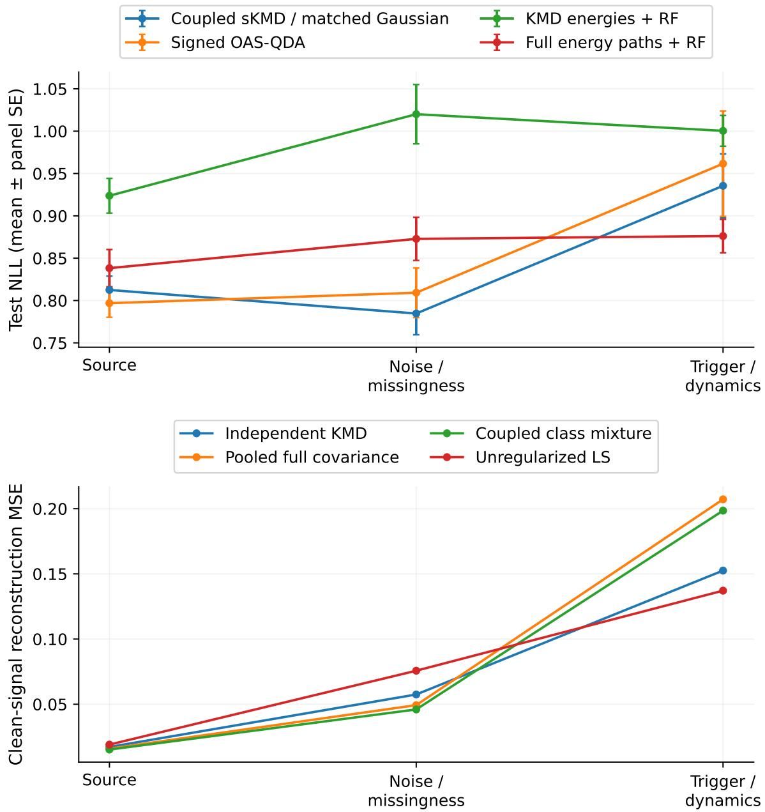  
Figure 8: A learned, externally triggered mode reference permits a useful coupled prior under changing observation noise. Changing the trigger and dynamics increases reconstruction error. Classification bars are panel standard errors.

Trigger and dynamics shift. The third condition changes the phase reference and dynamics simultaneously. Coupled reconstruction MSE rises to 0.1985, above independent KMD’s 0.1525 and unregularized least squares’ 0.1371. The full-energy-path forest also has lower mean NLL, 0.876 versus 0.935, although that paired interval includes zero.

All intervals in this study are pointwise and unadjusted for multiplicity; six panels limit their resolution.

Table 13: Six-panel validation with full observation covariance supplied to generic controls. Test events are independent of those in Table 11, with the same prespecified observation conditions.
<table><tr><td>Method</td><td>Source</td><td>Noise/missingness shift</td><td>Trigger/dynamics shift</td></tr><tr><td>Coupled sKMD / matched Gaussian</td><td>1.021</td><td>0.808</td><td>1.138</td></tr><tr><td>Signed OAS-QDA</td><td>0.831</td><td>0.826</td><td>0.962</td></tr><tr><td>Full-V signed quadratic logistic</td><td>0.926</td><td>2.110</td><td>3.492</td></tr><tr><td>Full-V signed RBF-SVM</td><td>1.051</td><td>1.178</td><td>1.192</td></tr><tr><td>Full-V energy interaction logistic</td><td>0.946</td><td>1.940</td><td>1.917</td></tr><tr><td>Full-V energy paths + RF</td><td>0.879</td><td>0.858</td><td>0.896</td></tr></table>

## 8.2.1 Full observation-covariance controls

The generic heads in the diagonal-quality experiment receive only the four diagonal entries of V, sensor noise and retained fraction, while the integrated model uses all ten unique covariance entries. Two analyses examine this information diference. An exploratory sensitivity analysis, specified after those outcomes were available, refits generic heads on the same six panels with the complete upper triangle of V. A six-panel validation, specified before its outcomes, uses independent calibration, fitting, development and test seeds. Both analyses use the same physical model, sample budgets and three test conditions.

The full-quality signed quadratic logistic head receives all signed coeficients, squares, pairwise products and full observation-covariance information. A signed RBF-SVM receives the coeficients and the same quality variables; its nine fixed hyperparameter settings give it a larger search than the three-setting logistic or forest controls. Full-energy-path forest and energy-interaction logistic controls also receive all ten covariance entries. Development data alone select parameters and temperatures. The integrated model and OAS-QDA use the fitting procedures specified above. The sensitivity and validation analyses use separate panels and intervals.

Source log loss and tail behavior. Table 13 and Figure 9 report the full-covariance validation. On source events, coupled NLL is 1.021, versus 0.831 for OAS-QDA, although accuracies are close (0.638 and 0.635). One class-1 event in the sixth panel has clean-signal peak 9.73 and true-class loss 179.42 nats; that panel’s mean NLL is 1.843. Its recovered second-mode quadratures are approximately (−3.89, −8.07), far from a small perturbation of a trigger-aligned sine coeficient. This event contributes to all reported metrics under the prespecified fitting procedure.

Classification and conditional reconstruction. Under increased noise and missingness, coupled NLL is 0.808, versus 0.858 for the full-covariance energy-path forest. Their paired diference is −0.04995 with paired t interval [−0.10318, 0.00328], which includes zero; the panelbootstrap sensitivity interval [−0.08882, −0.01616] excludes it, so with six panels this classification diference is unresolved. OAS-QDA gives 0.826; its paired interval against sKMD includes zero, leaving that classification diference unresolved as well. Coupled reconstruction MSE is 0.04262, versus 0.05120 for independent KMD and 0.04507 for pooled full covariance: reductions of 16.8% and 5.4%. The paired MSE diferences are −0.00859 and −0.00245, with paired t intervals [−0.01374, −0.00343] and [−0.00441, −0.00049] and bootstrap sensitivity intervals [−0.01200, −0.00518] and [−0.00369, −0.00098], respectively.

Under the trigger/dynamics shift, coupled MSE is 0.2046, versus 0.1623 for independent KMD and 0.1384 for least squares. Its NLL is 1.138, above both OAS-QDA’s 0.962 and the full-energy-path forest’s 0.896. The six-panel exploratory full-covariance sensitivity analysis has noise-shift NLLs 0.785 for coupled sKMD and 0.862 for the energy-path forest; its intervals use the same events as the diagonal-quality comparison.

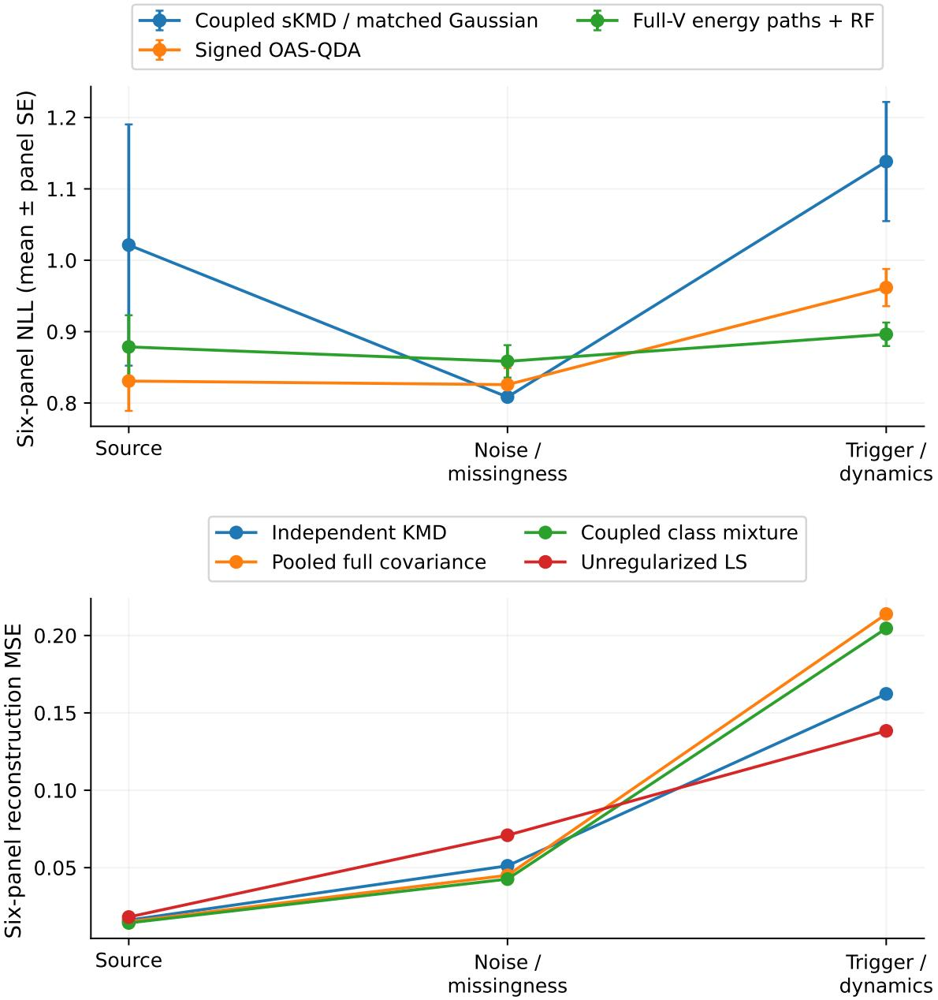  
Figure 9: Full-covariance validation across source, increased noise and missingness, and trigger/dynamics-shift conditions, reporting classification and reconstruction outcomes.

## 8.3 Nonstationary carriers without critical transitions

The next experiments test two nonstationary carrier mechanisms: frequency sweeps during a decaying response, and deep amplitude fades with continuously varying frequency. The eventlevel excitation class stays fixed. Neither example contains a bifurcation or a regime change within an event. Nonstationary Gaussian process decomposition is established prior work, including oscillatory models with changing amplitudes [91]. We compare signed excitation dependence and observation uncertainty with independent or pooled priors, using the same independently learned adaptive KMD dictionary.

Two prespecified signal laws. Every four-second record has 512 samples at 128 Hz, with

$$
x ( t ) = \sum _ { j = 1 } ^ { 2 } a _ { j } e _ { j } ( t ) \sin \phi _ { j } ( t ) .
$$

The three centered Gaussian laws for the signed excitation a are those in Section 8.2, with precision contrast $\alpha = 0 . 9$ . A common externally referenced trigger ofset is uniform on [−0.5, 0.5] ms and adds the corresponding initial-frequency phase ofsets. For the chirped decay,

$$
e _ { j } ( t ) = e ^ { - \gamma _ { j } t } , \qquad \phi _ { j } ( t ) = 2 \pi ( f _ { 0 j } t + r _ { j } t ^ { 2 } / 2 ) ,
$$

where

$$
f _ { 0 } = ( 4 , 1 3 ) , \qquad r = ( 1 , 1 . 2 5 ) , \qquad \gamma = ( 0 . 2 2 , 0 . 3 5 ) .
$$

Frequencies therefore sweep approximately 4–8 and 13–18 Hz. This is an exact linear timevarying oscillator example, not a numerical discretization: with $\omega _ { j } ~ = ~ \phi _ { j } ^ { \prime } ~ > ~ 0$ , each mode satisfies

$$
q _ { j } ^ { \prime \prime } + \left( 2 \gamma _ { j } - \frac { \omega _ { j } ^ { \prime } } { \omega _ { j } } \right) q _ { j } ^ { \prime } + \left( \omega _ { j } ^ { 2 } + \gamma _ { j } ^ { 2 } - \gamma _ { j } \frac { \omega _ { j } ^ { \prime } } { \omega _ { j } } \right) q _ { j } = 0 .
$$

For modulation and fading, frequencies in Hz are

$$
f _ { 1 } ( t ) = 5 + 0 . 6 5 \sin ( 2 \pi 0 . 3 5 t ) , \qquad f _ { 2 } ( t ) = 1 4 + 1 . 2 \sin ( 2 \pi 0 . 2 3 t + 0 . 8 ) ,
$$

with analytic phase integrals starting at zero, and

$$
e _ { 1 } ( t ) = 0 . 0 8 + 0 . 9 2 \cos ^ { 2 } ( \pi 0 . 4 2 t + 0 . 2 ) , \qquad e _ { 2 } ( t ) = 0 . 0 8 + 0 . 9 2 \cos ^ { 2 } ( \pi 0 . 3 1 t + 0 . 9 ) .
$$

These explicit AM–FM signals reach 8% of peak amplitude.

Independent calibration and evaluation. Each family has twelve independent panels. A separate bank of 30 complete calibration events, ten per class with labels withheld and noise standard deviation 0.25, learns the dictionary. This controlled balanced collection counts toward the training budget. Each panel then uses 40 fitting, 25 development, and 60 test events per class and condition, with disjoint random seeds. No test record changes the dictionary. The Gaussian-energy KMD routine described in Section 8.1 selects the carriers from calibration signals in 3–20 Hz. Twenty-four anchors, localization parameter 12, a 40% local search band, and 81 local frequency candidates cover the prespecified sweeps; adjacent search bands have disjoint interiors. Calibration records with median recovered amplitude above 0.5 supply unwrapped local phases and normalized amplitude curves. Their pointwise medians define a fixed four-column cosine/sine dictionary after interpolation. This uses neither generating phase nor generating envelope. Figure 10 shows panel zero.

Source noise standard deviation is uniform on [0.3, 1.3], with independently retained sample fraction uniform on [0.25, 1]. A second condition changes these intervals to [0.8, 2] and [0.15, 0.4]. A third also adds fixed carrier ofsets (+0.20, −0.15) Hz. Every method estimates each event’s noise from 64 independent pretrigger samples; the generating variance is hidden. All hyperparameters and score temperatures use source development events only. The six classification heads and their grids match those used in the full observation-covariance experiment in Section 8.2.1. The signed quadratic, signed RBF, energy-interaction, and energy-path controls receive all ten distinct entries of the four-dimensional observation covariance, plus estimated noise and retained fraction. Signed OAS-QDA is the separate point coeficient comparator. An OAS comparison jointly varies covariance estimation, the zero-mean restriction, and uncertainty handling. The energy-path forest uses 16 squared reconstructed values per mode, providing a finite sampled representation of each energy path.

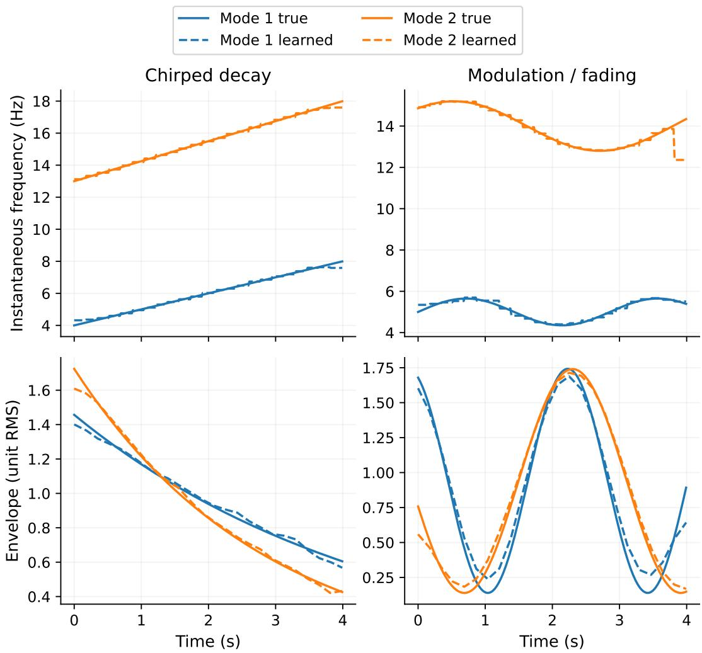  
Figure 10: Independent calibration in fixed panel zero. Solid curves are generating laws, shown only for evaluation; dashed curves are learned from noisy calibration records. Frequencies are derivatives of the learned, interpolated phase. Endpoint error and local ambiguity near fades remain visible.

Classification across observation conditions. Table 14 reports the prespecified classifiers. Under changed observation quality, chirped-decay sKMD has NLL 0.76781 versus 0.77455 for OAS-QDA: the paired diference is −0.00673, with paired t 95% interval [−0.02100, 0.00754] (bootstrap sensitivity interval [−0.01897, 0.00498]). This comparison is inconclusive at the available precision; the interval does not establish equivalence. The fading example is stronger: NLL is 0.77077 versus 0.80173 for OAS-QDA, a diference of −0.03096 nats, with paired t interval [−0.05581, −0.00612] (bootstrap sensitivity interval [−0.05302, −0.01072]). Accuracy is 0.6565 versus 0.6171, macro AP 0.7291 versus 0.7088, and Brier score 0.4541 versus 0.4707. OAS-QDA has the lowest NLL among the nonidentical comparison methods in this fading/noise condition.

The prespecified practical criteria were at least 0.02 nats improvement against the strongest relevant nonidentical classifier, or at least 5% reconstruction MSE reduction against pooled full covariance under changed observation quality. Neither criterion is met. The fading classification point estimate is 0.03096 nats, but the lower confidence limit does not establish an improvement of at least 0.02 nats. The chirped-decay point estimate is below that threshold. An exploratory two-sided paired t-test sensitivity analysis for just the two family-specific OAS/noise comparisons gives fading $p = 0 . 0 1 9 1$ , or 0.0383 after either Holm or Bonferroni adjustment. This adjustment applies to the two family-specific OAS/noise comparisons. All bootstrap intervals use 20,000 paired resamples of independent panels, and the reported intervals remain pointwise.

Table 14: Test NLL across twelve independent panels per family; lower is better. Carrier shift also includes changed noise and missingness. All prespecified classifiers and conditions are reported.  
Chirped decay
<table><tr><td>Method</td><td>Source</td><td>Noise/missingness</td><td>Carrier shift</td></tr><tr><td>Coupled sKMD / matched Gaussian</td><td>0.760</td><td>0.768</td><td>1.218</td></tr><tr><td>Signed OAS-QDA</td><td>0.760</td><td>0.775</td><td>1.221</td></tr><tr><td>Full-V signed quadratic logistic</td><td>0.862</td><td>2.599</td><td>7.042</td></tr><tr><td>Full-V signed RBF-SVM</td><td>1.049</td><td>1.199</td><td>1.212</td></tr><tr><td>Full-V energy interaction logistic</td><td>0.895</td><td>2.898</td><td>3.910</td></tr><tr><td>Full-V energy paths + RF</td><td>0.815</td><td>0.850</td><td>1.057</td></tr><tr><td colspan="4">Modulation and fading</td></tr><tr><td>Method</td><td>Source</td><td>Noise/missingness</td><td>Carrier shift</td></tr><tr><td>Coupled sKMD / matched Gaussian</td><td>0.789</td><td>0.771</td><td>1.243</td></tr><tr><td>Signed OAS-QDA</td><td>0.785</td><td>0.802</td><td>1.528</td></tr><tr><td>Full-V signed quadratic logistic</td><td>0.896</td><td>2.080</td><td>5.440</td></tr><tr><td>Full-V signed RBF-SVM</td><td>1.025</td><td>1.198</td><td>1.201</td></tr><tr><td>Full-V energy interaction logistic</td><td>0.924</td><td>2.311</td><td>3.680</td></tr><tr><td>Full-V energy paths + RF</td><td>0.846</td><td>0.858</td><td>1.007</td></tr></table>

Reconstruction with independent, pooled, and coupled priors. The independent, pooled-full, and coupled estimators share the learned dictionary, observations, and estimated noise; Table 15 reports clean-signal error. Under changed observation quality, coupling reduces MSE by 26.6% and 26.0% relative to independent KMD for chirp and fading. Against pooled full covariance, the reductions are 2.26% and 2.18%, below the prespecified 5% criterion. The absolute diferences are −0.000841, with paired t interval [−0.001467, −0.000215] (bootstrap [−0.001382, −0.000328]), and −0.000865, with paired t interval [−0.001262, −0.000469] (bootstrap [−0.001213, −0.000537]), respectively. These intervals resolve small improvements while retaining reductions below the practical criterion. Reconstruction uses calibrated class weights and untempered class-conditional means, giving a calibrated mixture estimator.

An exploratory diagnostic, specified after the primary outcomes were available, restricts fading error to the 239 of 512 time points where at least one generating envelope is at most 20% of its peak. These truth-defined regions are used for evaluation only. Under changed observation quality the MSEs are 0.01413 (coupled), 0.01437 (pooled-full), 0.01673 (independent), and 0.02357 (least squares). The coupled–pooled diference is −0.000238, with paired t interval [−0.000387, −0.000089]. The improvement within fades is 1.66%. The generating excitation class is constant.

Carrier-shift results. With the fixed frequency ofsets, chirped-decay and fading coupled MSEs rise to 1.22386 and 0.92317, worse than independent KMD (1.14995 and 0.79352) and least squares (1.01315 and 0.61175). The energy-path forest also has lower NLL than sKMD: 1.05716 versus 1.21767 and 1.00652 versus 1.24336. In fading, the NLL disadvantage has paired t interval [0.06772, 0.40595]; for chirp the bootstrap and t intervals disagree about exclusion of zero. An evaluation-only projection onto the learned span has mean residual MSE approximately 0.0042 and 0.0077 under changed noise alone, but 0.9229 and 0.5290 after carrier shift. Figure 11 shows the observation-shift and carrier-shift conditions.

Table 15: Clean-signal MSE for the same learned dictionaries and the independent, pooledfull, and coupled estimators. Incremental reductions under changed observation quality are evaluated against the prespecified 5% reconstruction criterion; carrier-shift results are shown alongside.  
Chirped decay
<table><tr><td>Reconstruction</td><td>Source</td><td>Noise/missingness</td><td>Carrier shift</td></tr><tr><td>Independent KMD</td><td>0.01336</td><td>0.04956</td><td>1.14995</td></tr><tr><td>Pooled full covariance</td><td>0.01078</td><td>0.03720</td><td>1.23667</td></tr><tr><td>Coupled class mixture</td><td>0.01054</td><td>0.03636</td><td>1.22386</td></tr><tr><td>Unregularized LS</td><td>0.01494</td><td>0.06877</td><td>1.01315</td></tr><tr><td colspan="4">Modulation and fading</td></tr><tr><td>Reconstruction</td><td>Source</td><td>Noise/missingness</td><td>Carrier shift</td></tr><tr><td>Independent KMD</td><td>0.01655</td><td>0.05240</td><td>0.79352</td></tr><tr><td>Pooled full covariance</td><td>0.01374</td><td>0.03964</td><td>0.93837</td></tr><tr><td>Coupled class mixture</td><td>0.01364</td><td>0.03878</td><td>0.92317</td></tr><tr><td>Unregularized LS</td><td>0.01824</td><td>0.07400</td><td>0.61175</td></tr></table>

Conditioning. There are no calibration peak failures or amplitude-threshold fallbacks. All test masked Gram matrices are positive definite; the minimum retained count is 51 and the largest condition number is 3.76. Local phase identifiability near a fade is a separate issue from this global four-column conditioning. The probabilities condition on the learned dictionary and estimated noise, treating dictionary estimation, phase uncertainty and unmodeled carrier drift as fixed.

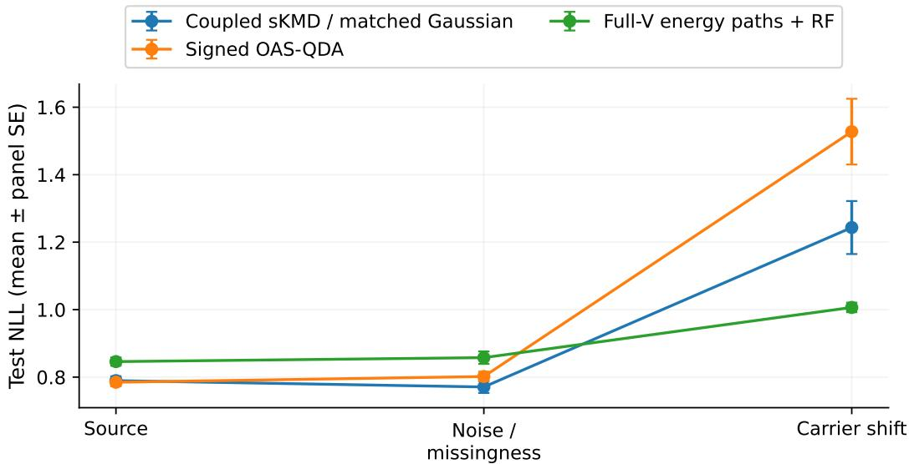

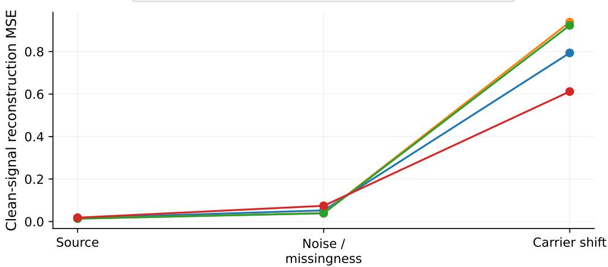  
Figure 11: Twelve-panel modulation/fading study across source, observation-shift and carriershift conditions. Error bars are standard errors across panels; paired intervals are reported in the text.

## 8.4 Accounting for a declared family of carrier changes

The carrier-shift failures in Section 8.3 motivate an explicit extension: retain uncertainty over a finite collection of possible KMD dictionaries. This extension was specified after those failures, then evaluated with new independent seeds under a frozen protocol. Bayesian model averaging supplies the averaging operation within the coupled KMD pipeline, allowing carrier adaptation to be compared with regime coupling.

## 8.4.1 A normalized joint model

Let $H _ { j } \in \mathbb { R } ^ { n \times q } , ~ j = 1 , \dots , J$ , be dictionaries learned or constructed independently of a new observation. Write L for the latent dictionary index, with prior $\begin{array} { r } { w _ { j } > 0 , \sum _ { j } w _ { j } = 1 } \end{array}$ , and Y for the regime, with prior $\pi _ { k }$ . The model is

$$
L \sim w , \quad Y \sim \pi , \quad A \mid Y = k \sim \mathcal { N } ( 0 , C _ { k } ) , \qquad v _ { O } \mid A , L = j = H _ { j , O } A + \epsilon _ { O } , \quad \epsilon _ { O } \sim \mathcal { N } ( 0 , R _ { O } ) .
$$

The independent prior on $( L , Y )$ is a modeling assumption. All dictionaries use the same physical coeficient convention, so that $C _ { k }$ has a common meaning. Changing coordinates separately in each dictionary requires transforming its class covariance as well.

Define the information matrix and vector

$$
J _ { j } = H _ { j , O } ^ { \top } R _ { O } ^ { - 1 } H _ { j , O } , \qquad b _ { j } = H _ { j , O } ^ { \top } R _ { O } ^ { - 1 } \boldsymbol { v } _ { O } , \qquad M _ { j k } = C _ { k } ^ { - 1 } + J _ { j } .
$$

Even when the observed rows are rank deficient, $M _ { j k } \succ 0$ . Completing the square gives

$$
\begin{array} { r } { \ell _ { j k } = - \frac 1 2 \log \operatorname* { d e t } C _ { k } - \frac 1 2 \log \operatorname* { d e t } M _ { j k } + \frac 1 2 b _ { j } ^ { \top } M _ { j k } ^ { - 1 } b _ { j } , } \end{array}\tag{58}
$$

$$
\omega _ { j k } = \frac { w _ { j } \pi _ { k } e ^ { \ell _ { j k } } } { \sum _ { h , l } w _ { h } \pi _ { l } e ^ { \ell _ { h l } } } , \qquad \widehat { s } = \sum _ { j , k } \omega _ { j k } H _ { j } M _ { j k } ^ { - 1 } b _ { j } .\tag{59}
$$

The regime posterior is $\textstyle \sum _ { j } \omega _ { j k }$ . The omitted density factor ex $\mathrm { p } ( - v _ { O } ^ { \top } R _ { O } ^ { - 1 } v _ { O } / 2 ) / ( \operatorname* { d e t } ( 2 \pi R _ { O } ) ) ^ { 1 / 2 }$ is common to every dictionary and regime. Omitting a dictionary-dependent residual or reference likelihood would change these weights. Selecting a dictionary from v and then inserting it into a fixed-dictionary likelihood does not in general yield a normalized model for $v ;$ the finite mixture does. These probabilities are exact for the specified fitted model at temperature one. Plug-in noise estimates, fitted class laws and the library restriction remain sources of model error.

What the controlled comparisons isolate. A pooled full-covariance mixture uses the same $H _ { j } , w _ { j } , R _ { O }$ , but one independently fitted coeficient covariance. A diagonal pooled mixture is an independent-mode KMD control with exactly the same carrier adaptation. Two MAP-dictionary controls select j using either pooled evidence or $\textstyle \sum _ { k } \pi _ { k } e ^ { \ell _ { j k } }$ , then average over regimes in that one dictionary. They separate averaging from the choice of a richer selection model. A further control replaces $\omega _ { j k }$ by the product of its own two marginals while retaining every conditional mean. This directly tests the value of dependence between the regime and dictionary indices. A second factorized control uses the pooled dictionary posterior and the class posterior in its MAP dictionary. Joint MAP selection of $( j , k )$ is also reported. These controls change the inference rule.

## 8.4.2 Continuous-drift experiment

Each of the two nonstationary families receives twelve independent panels. Thirty separate, complete, noisy calibration events supply two learned envelopes and phases. Adding a constant frequency ofset from $\{ - 0 . 3 0 , - 0 . 2 5 , \hdots , 0 . 3 0 \}$ Hz to each phase gives $J = 1 6 9$ dictionaries, each with four sine/cosine coeficients and uniform prior weight. The source fit uses 120 events; development uses 75 source and 75 independently drifting events. Class covariances select shrinkage from {0, 0.2, 0.5, 1} by mean development class NLL. The pooled covariance is fitted directly to all source coeficients after subtracting mean observation covariance, and selects its own shrinkage by development marginal observation density. A fixed-dictionary pooled control tunes that same criterion within its own model. All scoring uses temperature one.

The four held-out conditions contain 180 events each: source quality; changed noise and missingness without drift; changed quality with each record’s two ofsets independently uniform on [−0.25, 0.25] Hz; and ofsets with independent random signs and magnitudes uniform on [0.45, 0.65] Hz. Thus the third condition is continuous and generally of grid, while the fourth is deliberately outside the library. Source sensor standard deviations are uniform on [0.3, 1.3] and observation retention on [0.25, 1]; changed quality uses [0.8, 2] and [0.15, 0.4]. Each event has an independent 64-sample noise calibration. Calibration, fitting, development and testing seeds and outcomes are recorded in the companion protocol. The source fitting masks have full column rank; scoring itself remains valid for an empty or deficient observed span.

Table 16: Finite-dictionary extension across all specified conditions. Each entry averages 12 independently fitted panels. MSE targets the generating signal. Class NLL is in nats. Fixed, MAP and mixture methods share the same source/development resources; mixture and MAP methods share 169 candidate dictionaries.
<table><tr><td>Family</td><td>Method</td><td>Source</td><td>Noise</td><td>In library</td><td>Outside</td></tr><tr><td>Chirp MSE</td><td>Joint mixture</td><td>0.0129</td><td>0.0648</td><td>0.0843</td><td>1.4318</td></tr><tr><td>Chirp MSE</td><td>Pooled mixture</td><td>0.0128</td><td>0.0657</td><td>0.0856</td><td>1.4440</td></tr><tr><td>Chirp MSE</td><td>Independent mixture</td><td>0.0159</td><td>0.0772</td><td>0.0878</td><td>1.3831</td></tr><tr><td>Chirp MSE</td><td>Fixed coupled</td><td>0.0103</td><td>0.0393</td><td>0.8862</td><td>1.4478</td></tr><tr><td>Chirp MSE</td><td>Coupled MAP carrier</td><td>0.0149</td><td>0.0842</td><td>0.1109</td><td>1.4957</td></tr><tr><td>Chirp MSE</td><td>Joint marginals product</td><td>0.0129</td><td>0.0649</td><td>0.0843</td><td>1.4316</td></tr><tr><td>Chirp NLL</td><td>Joint mixture</td><td>0.7720</td><td>0.7653</td><td>0.7573</td><td>1.2101</td></tr><tr><td>Chirp NLL</td><td>Fixed coupled</td><td>0.7929</td><td>0.7796</td><td>1.0640</td><td>1.1886</td></tr><tr><td>Chirp NLL</td><td>Pooled MAP carrier</td><td>0.7748</td><td>0.7785</td><td>0.7688</td><td>1.2091</td></tr><tr><td>Chirp NLL</td><td>Coupled MAP carrier</td><td>0.7749</td><td>0.7768</td><td>0.7683</td><td>1.2484</td></tr><tr><td>Fading MSE</td><td>Joint mixture</td><td>0.0166</td><td>0.0678</td><td>0.1077</td><td>0.9820</td></tr><tr><td>Fading MSE</td><td>Pooled mixture</td><td>0.0168</td><td>0.0689</td><td>0.1089</td><td>0.9863</td></tr><tr><td>Fading MSE</td><td>Independent mixture</td><td>0.0195</td><td>0.0795</td><td>0.0954</td><td>0.9385</td></tr><tr><td>Fading MSE</td><td>Fixed coupled</td><td>0.0144</td><td>0.0442</td><td>0.6621</td><td>1.3271</td></tr><tr><td>Fading MSE</td><td>Coupled MAP carrier</td><td>0.0186</td><td>0.0898</td><td>0.1369</td><td>1.0207</td></tr><tr><td>Fading MSE</td><td>Joint marginals product</td><td>0.0166</td><td>0.0679</td><td>0.1077</td><td>0.9819</td></tr><tr><td>Fading NLL</td><td>Joint mixture</td><td>0.7392</td><td>0.7986</td><td>0.7741</td><td>1.2811</td></tr><tr><td>Fading NLL</td><td>Fixed coupled</td><td>0.7837</td><td>0.8244</td><td>1.4557</td><td>1.1364</td></tr><tr><td>Fading NLL</td><td>Pooled MAP carrier</td><td>0.7494</td><td>0.8356</td><td>0.7884</td><td>1.3418</td></tr><tr><td>Fading NLL</td><td>Coupled MAP carrier</td><td>0.7457</td><td>0.8280</td><td>0.7912</td><td>1.3611</td></tr></table>

Carrier averaging under in-library shifts. Table 16 and Figure 12 report every method and condition. Within the library, joint-mixture MSE is 0.08429 for chirped decay and 0.10768 for fading, compared with fixed coupled MSE 0.88618 and 0.66205. The reductions are about 90.5% and 83.7%. Relative to the coupled MAP-dictionary control, averaging reduces MSE by 24.0% and 21.3%. The corresponding NLL improvements are 0.01105 and 0.01709 nats; paired t intervals for the improvement are [0.00553, 0.01657] and [0.00374, 0.03045]. Both are statistically resolved in the paired four-comparison Holm analysis, but neither establishes the prespecified 0.02-nat practical margin. These results support averaging over plausible carriers when observations leave more than one credible dictionary.

Comparison with adaptive KMD controls. Against the same-library full pooled prior, MSE falls by 1.52% and 1.08%. The paired joint-minus-pooled diferences are −0.001300 with t95 interval [−0.001883, −0.000716] and −0.001175 with interval [−0.005713, 0.003363]. The two-family Holm-adjusted one-sided p values are 0.00047 and 0.290. Neither supports a reduction of at least 5%. The diagonal independent mixture is stronger than the coupled mixture for fading: MSE 0.09537 versus 0.10768. Multiplying the joint model’s own marginals changes MSE by only about $1 . 6 \times 1 0 ^ { - 5 }$ and $3 . 5 \times 1 0 ^ { - 5 }$ in these two conditions. This experiment therefore supports carrier averaging much more strongly than it supports the extra dependence between the carrier and regime indices.

Computational cost and outside-library results. Allowing unnecessary carrier variation increases MSE at source quality and under changed quality without drift, relative to the corresponding fixed coupled model. Outside the library, the joint model gives NLL 1.2101 and 1.2811, both worse than the uniform reference log 3, with large MSE. The independent mixture has lower MSE in both outside-library cases. The joint mixture’s per-record calculation uses JK small $q \times q$ posterior systems rather than K; the library costs computation and can increase estimation error.

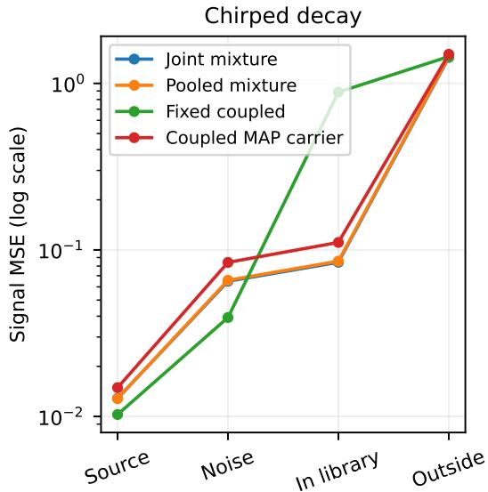

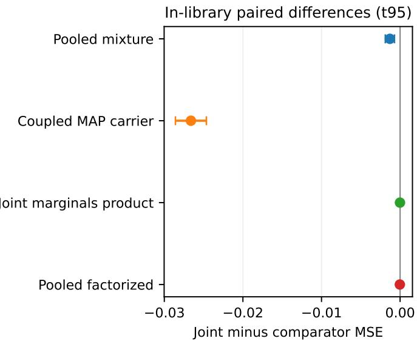  
In-library paired diferences (t95)

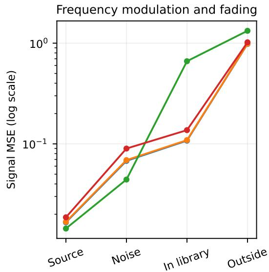

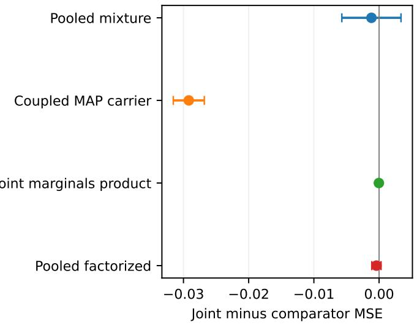  
Figure 12: Finite-dictionary extension on nonstationary data. Left: reconstruction across all four prespecified conditions. Right: paired in-library MSE diferences across twelve independently fitted panels; intervals are pointwise t95. The comparisons include joint averaging, a same-library pooled model, and the independent mixture reported in Table 16, which has lower MSE for fading. The numerical model is a finite Gaussian mixture with learned KMD columns.

The posterior ofset diagnostic includes error in the learned reference carrier.

## 8.5 Nonstationary excitation dependence

The preceding experiments concern independently triggered records. We next ask whether the same interface helps when excitation regimes recur with time-dependent persistence. This is a Gaussian hidden Markov observation model with learned mode carriers, using the classical forward recursion [85] and Gaussian emission integration. Related probabilistic oscillatory decomposition addresses nonstationarity [88]. The purpose here is to test the interaction and uncertainty interface in a nonstationary mechanism with no critical transition, against controls sharing its temporal information

What changes with time. A trajectory comprises 60 externally triggered half-second blocks, sampled at 128 Hz. Two stable physical carriers have frequencies 6 and 14 Hz. In block t, a regime $Y _ { t } \in \{ 0 , 1 , 2 \}$ draws a new centered Gaussian pair of sine coeficients with precision

$$
P _ { 0 } = I , \qquad P _ { 1 } = I + \alpha \mathrm { d i a g } ( 1 , - 1 ) , \qquad P _ { 2 } = I + \alpha \left( { 0 atop 1 } ^ { 0 } \ 1 \right) .
$$

Independent cosine quadratures have standard deviation 0.12. Conditional on the regimes, coeficients in distinct blocks are independent. This is a sequence of aligned excitation records; it does not assert continuous amplitude evolution across block boundaries.

The initial regime is uniform. A transition changes state with probability $h _ { t } .$ , choosing either other state equally. The source hazard is $h _ { t } = 0 . 0 3 , 0 . 1 8 , 0 . 0 3$ in the three successive 20- block phases. This time-inhomogeneous transition law makes the joint process nonstationary. Its symmetry nevertheless preserves a uniform one-time regime marginal; the nonstationarity is in temporal dependence, rather than a changing unconditional mean or variance. Indeed, centered conditionally independent coeficients have zero cross-block second moments. Their higher-order dependence and the conditional modal covariance still change. No autonomous dynamical instability or bifurcation is involved.

Independent collection and learning. Twelve independent panels each have 24 separate four-second calibration records, eight per excitation regime with labels withheld. They have complete observations and sensor SD 0.25. The adaptive KMD front end learns two frequency trajectories from these records; their pooled medians define fixed sine/cosine carriers for subsequent blocks. All 288 calibration records return two detected peaks. Panel frequencies lie in [6.0039, 6.0046] and [13.9877, 13.9979] Hz. Mode count two, frequency band 3–20 Hz, and the external phase reference are supplied assumptions. The calibration bank is part of the acquisition budget.

Each panel has 12 labeled fitting trajectories and six development trajectories. Each test condition has 12 independent trajectories, for 144 test trajectories per condition across panels. Labels estimate the initial regime law and three phase-specific transition matrices, with one pseudocount per entry. Every method receives the same clock, learned transition matrices, and current/past blocks. Prediction is causal at the end of the current half-second block and uses only current and past blocks.

Source sensor SD is uniform on [0.4, 1] and the retention probability is uniform on [0.5, 1]. Every block has an independent 64-sample pretrigger noise record. Its sample SD is available to every method; the generating noise variance is unavailable. The five prespecified conditions are:

1. source observations and hazards, with $\alpha = 0 . 9 ;$

2. observation shift to SD [0.9, 3] and retention [0.15, 0.5];

3. hazard shift to (0.18, 0.03, 0.18), with source observation quality;

4. the observation shift plus frequencies (6.4, 13.6) Hz and phase ofsets (0.4, 1.0) radians, retaining the fitted source dictionary;

5. low interaction, $\alpha = 0 . 0 5$ , with its own fitting/development trajectories and the adverse observation quality.

The last condition uses the same separate carrier calibration bank because the physical frequencies do not depend on α. No shifted test label or noise value is used for fitting or development selection.

An interface valid for every observation rank. Unrestricted Bernoulli masks can leave fewer than four samples, making an OLS coeficient inverse undefined. The reference posterior in Section 2.2 remains well defined for those observations, so the same interface includes every mask and block. For learned observed carrier matrix $H _ { O }$ , define

$$
J = { \widehat { \sigma } } ^ { - 2 } H _ { O } ^ { \top } H _ { O } , \qquad b = { \widehat { \sigma } } ^ { - 2 } H _ { O } ^ { \top } y o , \qquad V = ( I + J ) ^ { - 1 } , \quad m = V b .
$$

These are the posterior covariance and mean under reference prior $N ( 0 , I )$ . For a fitted class covariance $C _ { k } \succ 0$ , the class-dependent part of the raw log evidence and its conditional coeficient mean are

$$
\begin{array} { r } { \ell _ { k } = - \frac 1 2 \log \operatorname* { d e t } C _ { k } - \frac 1 2 \log \operatorname* { d e t } ( C _ { k } ^ { - 1 } + J ) + \frac 1 2 b ^ { \top } ( C _ { k } ^ { - 1 } + J ) ^ { - 1 } b , } \end{array}\tag{60}
$$

$$
\widehat { a } _ { k } = ( C _ { k } ^ { - 1 } + J ) ^ { - 1 } b .\tag{61}
$$

They remain well defined with no observations: $m = 0 , V = I$ , equal raw evidence, and zero conditional means. The final tests retain 17 rank-deficient blocks. Source fitting blocks have full rank, checked in the saved data; their OLS moments minus estimated noise covariance fit $C _ { k } .$ followed by the declared shrinkage and eigenvalue floor. Rank-deficient test blocks are handled directly by the information-form posterior.

The forward recursion is

$$
p _ { t } ( k ) \propto \exp ( \ell _ { t , k } / T ) \sum _ { j } \widehat { A } _ { t } ( j , k ) p _ { t - 1 } ( j ) .
$$

Shrinkage and temperature T use development trajectory NLL. At T = 1 this is the ordinary plug-in Gaussian HMM filter; development calibration changes the emission weights. Reconstruction averages the untempered conditional means in (61) using these probabilities. It is a calibrated mixture estimate. The resulting probabilities condition on estimated noise and learned carriers, with their estimation error outside the fitted model.

Controls and estimands. Signed OAS-QDA acts on reference posterior means m. A quadratic logistic head additionally receives every product and square, the ten unique entries of V, estimated noise and retention. A forest receives complete 16-point squared physical-mode reconstructions and the same quality variables. A further forest uses squared coordinates after a training-only pooled-PCA rotation, their quadratic interactions, and the same quality variables. All use the same causal recursion. Discriminative class probabilities are divided by fitting class priors before use as emission scores, avoiding counting those priors twice. These approximate discriminative score filters use calibrated classifier scores as emissions. The energy comparison uses the specified physical and pooled-PCA coordinates.

Reconstruction controls include diagonal and full pooled priors, minimum-norm least squares, the coupled emission model without temporal recursion, and a stronger control that weights the same conditional means using point-OAS state probabilities. The last isolates regime weighting from conditional coeficient estimation. Zero class means, covariance shrinkage, and observation uncertainty vary jointly in the comparison with OAS.

Observation-shift results. Tables 17 and 18 report every method and condition, and Figure 13 shows one trajectory and the paired diferences. Under increased noise and missingness, coupled MSE is 0.37761, versus 0.41706 for full pooled KMD: a 9.46% reduction. The paired diference is −0.03945, with paired t interval [−0.04546, −0.03344] (panel-bootstrap sensitivity interval $\left[ - 0 . 0 4 4 3 0 , - 0 . 0 3 4 2 0 \right] \rangle$ ). To assess the predeclared practical threshold directly, we also form each panel’s coupled MSE minus 0.95 times its pooled MSE. Its mean is −0.01860, with paired t interval [−0.02451, −0.01269] (bootstrap [−0.02325, −0.01323]). Both upper endpoints are below zero, supporting at least 5% improvement in the ratio of population mean MSEs under these inference approximations. Against point-probability weighting, MSE is 0.38518 and the incremental reduction is 1.97%, below that threshold; its paired t interval for the absolute diference is [−0.01191, −0.00324]. The 9.46% improvement uses the full pooled comparator; the point-probability comparison isolates regime weighting.

Table 17: Causal state NLL in the nonstationary dependence experiment. Each entry averages 12 independent panels of 12 test trajectories. All classifiers share the learned temporal information.
<table><tr><td>Method</td><td>Source</td><td>Noise</td><td>Hazard</td><td>Phase</td><td>Low</td></tr><tr><td>Coupled filter</td><td>0.435</td><td>0.497</td><td>0.621</td><td>0.769</td><td>1.146</td></tr><tr><td>Static coupled</td><td>0.789</td><td>0.871</td><td>0.796</td><td>0.988</td><td>1.145</td></tr><tr><td>Point OAS filter</td><td>0.427</td><td>0.760</td><td>0.603</td><td>2.205</td><td>1.205</td></tr><tr><td>Signed quadratic</td><td>0.445</td><td>5.415</td><td>0.631</td><td>6.639</td><td>4.107</td></tr><tr><td>Physical energies</td><td>0.500</td><td>0.606</td><td>0.675</td><td>0.897</td><td>1.275</td></tr><tr><td>Rotated energies</td><td>0.780</td><td>0.944</td><td>0.904</td><td>1.081</td><td>1.344</td></tr><tr><td>Clock only</td><td>1.155</td><td>1.163</td><td>1.165</td><td>1.143</td><td>1.145</td></tr></table>

Table 18: Clean-signal reconstruction MSE over all samples, including missing positions. “Point weights” uses the same conditional coeficient means with point-OAS regime probabilities. The table includes the phase/dictionary and low-interaction conditions.
<table><tr><td>Method</td><td>Source</td><td>Noise</td><td>Hazard</td><td>Phase</td><td>Low</td></tr><tr><td>Coupled filter</td><td>0.0315</td><td>0.3776</td><td>0.0319</td><td>1.8294</td><td>0.3084</td></tr><tr><td>Static coupled</td><td>0.0315</td><td>0.3954</td><td>0.0318</td><td>1.8480</td><td>0.3084</td></tr><tr><td>Point weights</td><td>0.0315</td><td>0.3852</td><td>0.0319</td><td>1.8397</td><td>0.3084</td></tr><tr><td>Full pooled KMD</td><td>0.0316</td><td>0.4171</td><td>0.0319</td><td>1.8707</td><td>0.3084</td></tr><tr><td>Diagonal KMD</td><td>0.0317</td><td>0.4292</td><td>0.0320</td><td>1.9022</td><td>0.3083</td></tr><tr><td>Minimum-norm LS</td><td>0.0468</td><td>5.7407</td><td>0.0472</td><td>1.9263</td><td>11.0711</td></tr></table>

Coupled NLL is 0.49654, versus point-OAS 0.76031 and physical-energy 0.60616. Their paired t intervals for coupled-minus-control NLL are [−0.41609, −0.11146] and [−0.14103, −0.07821], respectively; the mean improvements exceed the prespecified 0.02-nat practical threshold. The full-quality quadratic head extrapolates poorly under this observation shift, reaching NLL 5.415.

Source, hazard, interaction, and phase conditions. Source reconstruction improves 0.25% over the full pooled prior and its paired intervals include zero. Under changed hazards, point OAS has lower NLL, 0.60255 versus 0.62075, with coupled-minus-point paired t interval [0.00714, 0.02925]. The ranking of the two filters therefore depends on the observation and hazard conditions.

Low interaction gives essentially identical coupled and full pooled MSE, 0.308402. Coupled NLL 1.146 is close to the learned clock-only rule’s 1.145 and exceeds the constant uniform reference log 3. With α = 0.05 no fitted head has lower NLL than the clock-only rule at the reported precision, and the point-OAS, energy and signed quadratic heads are worse than it; the observations add essentially no regime information beyond the clock in this condition.

Phase/dictionary mismatch raises coupled MSE to 1.8294; its 2.21% reduction from the full pooled control is below the practical threshold. Moreover, temporal persistence creates delay. In the first five blocks following actual changes, observation-shift NLL is 0.937 for the filter versus 0.895 for static inference; under changed hazards it is 0.985 versus 0.806. Whole-trajectory log-loss gains thus coexist with increased log loss immediately after changes.

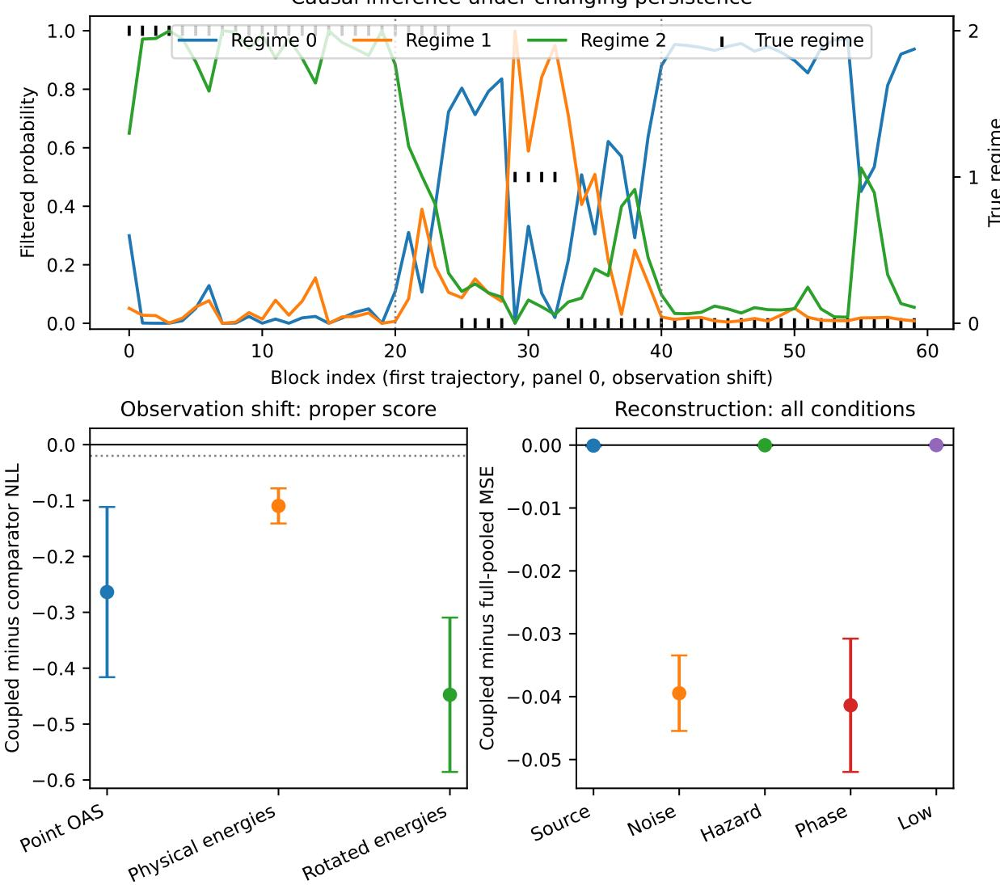  
Figure 13: Nonstationary regime filtering with time-varying persistence. The first trajectory from panel 0 in the observation-shift condition is displayed. Lower panels show paired t intervals across 12 panels; the dotted score line marks −0.02 nats. The phase-condition MSE diference remains favorable relative to the pooled prior while its absolute reconstruction error is large.

Uncertainty. NLL and MSE are averaged within whole trajectories and then within panels. The 20,000-resample bootstrap and paired t intervals use 12 independent panels, not individual blocks. Both are pointwise, without multiplicity adjustment and rely on panel-level resampling and paired-mean approximations.

## 9 Recorded signals: representation adequacy and observation quality

Recorded ECG and bearing data evaluate the extension across choices of mode dictionary, regime law and observation quality. The ECG studies compare global and localized waveform spans, robust laws and supplied rhythm features. The bearing studies compare absolutefrequency and physically normalized order coordinates, then isolate a declared transmissionnoise problem. Reference reconstruction, native diagnosis and controlled corruption are distinct targets throughout.

## 9.1 Global-carrier ECG baseline

Event alignment supplies a common time reference for the seven-coordinate oscillatory dictionary. We evaluate this baseline on the MIT–BIH Arrhythmia Database [78]. The same cohort provides development data for the localized representation and class law in Section 9.2. The study uses the oficial version 1.0.0 waveforms and expert annotations, with separate raw artifact recordings from the MIT–BIH Noise Stress Test Database [79]. PhysioNet provides the public resources [30, 83]. Dataset descriptions, downloads and attribution are at https://physionet. org/content/mitdb/1.0.0/ and https://physionet.org/content/nstdb/1.0.0/. The target is the literal annotation symbol N versus V (normal versus premature ventricular contraction). This deliberately narrow annotated-beat classification task is not the broader AAMI N/V grouping, automatic beat detection, or clinical diagnosis. Supplied annotation times localize the beats even after corruption.

Patient-disjoint protocol. The database contains 48 records from 47 subjects, sampled at 360 Hz. We merge records 201 and 202 as one patient, select MLII by the header channel name (including the reversed order in record 114), and exclude 102 and 104 because they lack MLII. Each window has 216 samples, from 0.25 s before to 0.35 s after its annotation. Eligibility checks only the target symbols, bounds, finiteness, and availability of a preceding RR interval. A fixed, class-value-independent ordering caps the target cohort at 200 beats per patient. Patient 232 has no eligible target beats and is retained in the predetermined allocation without replacement. The resulting cohort has 7,866 beats from 44 contributing patients: 6,821 N and 1,045 V. Fifteen patients have no V beats; seven have only V beats. All contribute proper losses and reconstruction error.

Five predetermined outer folds test each patient once. Within each fold the nominal patient budgets are nine test, five separate dictionary calibration, eight development, and 23 fitting; empty patient 232 reduces one role’s actual count. No patient occupies two roles within a fold. Calibration uses at most 15 eligible beats per patient: 60 or 75 beats per fold. Target eligibility uses annotation labels; N/V values are hidden from dictionary learning after eligibility is determined. All folds have both classes in fitting and development. Full patient identifiers and role counts are supplied with the protocol.

The source observations add independent white noise with SD uniform on [0.01, 0.03] mV. An independent 64-sample noise-only instrument calibration estimates the added-noise variance. This resource is supplied equally to all methods and never uses the same beat’s reference residual. Pre-existing noise in the database waveform remains unknown. The reconstruction target is the recorded reference, not latent clean ECG.

Learned carriers, mean efects, and strong controls. The adaptive KMD frontend of Section 8.1 extracts three modes from calibration observations after subtraction of the calibration mean waveform. Frequency bounds are 3–45 Hz, localization parameter 12, 24 anchors, and 41 local candidates in a 25% search band. Median unwrapped phases and normalized amplitude trajectories yield three fixed sine/cosine pairs; a constant column gives seven random coeficients. The calibration mean is a fixed ofset. A same-budget alternative uses the same calibration mean and seven centered principal components. Both dictionaries are fixed before test-beat evaluation. Returned KMD ridges define learned basis functions.

Class coeficient models now have distinct nonzero means. Complete source fitting observations estimate means and covariance moments, with subtraction of estimated coeficient-noise covariance, of-diagonal shrinkage in {0, 0.2, 0.5, 0.8, 1}, and eigenvalue floor $1 0 ^ { - 5 }$ . Full-class, diagonal-class, and shared-covariance Gaussian models separate dependence from mean morphology. The centered Gaussian sign-loss theorem does not directly describe these ECG laws. On retained samples O, every modal head uses the same dictionary H, template x¯, and obser-

vation statistics

$$
J = H _ { O } ^ { \top } H o / { \widehat { \sigma } } ^ { 2 } , \qquad b = H _ { O } ^ { \top } ( y o - { \bar { x } } _ { O } ) / { \widehat { \sigma } } ^ { 2 } , \qquad m = ( I + J ) ^ { - 1 } b , \quad V = ( I + J ) ^ { - 1 } .
$$

Generic modal classifiers receive all 28 distinct entries of V, estimated noise, and retained fraction. The controls include point QDA, signed quadratic logistic regression, signed RBF SVM, an energy-path forest, waveform forest, and waveform-PCA/RBF with propagated observation covariance. The energy forest receives 16 squared reconstructed values per mode and the squared constant component, so it retains more than total modal energy. A normalized morphology and RR/RBF control additionally receives the preceding RR interval and its ratio to the median of up to five intervals ending with that interval. This explicitly adds rhythm information from the supplied annotations; no future interval is used. Morphology and RR features are established ECG controls [23]; here they are implemented for the literal N/V target described above. The prevalence-only predictor measures the efect of class imbalance.

Generic heads also train on two independently corrupted versions of each observed fitting beat: Gaussian SD ranges [0.1, 0.3] and [0.3, 0.5] mV, with retention ranges [0.4, 0.9] and [0.25, 0.6]. Base and added estimated noise variances are summed. Source Gaussian priors fit source observations; all hyperparameter and temperature choices minimize patient-macro loss on the same source-plus-augmented development bank. Class priors, normalizers, PCA, and fitting weights use fitting data only, with equal total weight per patient. Forests use 100 trees and depth choices 4, 8, or unrestricted; logistic and RBF heads use $C \in \{ 0 . 1 , 1 , 1 0 \}$ . Temperatures are {0.5, 0.7, 1, 1.5, 2, 3}.

Observation conditions and patient-level comparisons. Each test beat has three separately predicted corruption repetitions in every condition. The primary Gaussian sensor shift adds SD [0.1, 0.3] mV and retains a fraction in [0.4, 0.9]. The other conditions are source quality, baseline wander (BW), muscle artifact (MA), and electrode motion (EM). Raw artifact clips come from the final 15 minutes of the first channel of the three named noise records; indepen dent calibration clips come from the first five minutes. Their imposed RMS scale is uniform on [0.1, 0.3] mV, with the same missingness range. No artifact enters fitting or development. A scalar noise variance for temporally correlated artifacts is a working approximation, not their exact covariance. These tests concern held-out clips from three records, not population-level artifact generalization.

We first average losses over each patient’s beats and repetitions, then weight patients equally. Pooled AP and AUROC are secondary, with a diferent weighting. Paired 20,000-resample patient bootstrap and paired t intervals are descriptive and conditional on the five fitted models: overlapping training sets do not give independent model replications or refitting uncertainty. Before testing, the primary analysis specified Holm adjustment across all 11 nonidentical classification controls and, separately, seven reconstruction controls. Practical-margin tests use NLLc − NLLj + 0.02 and MSEc − 0.95MSEj.

Classification under added observation noise. Tables 19 and 20 and Figure 14 report every classifier and condition. Under the primary sensor shift, coupled NLL is 0.33754, versus 0.29797 for point QDA, 0.28036 for waveform-PCA/RBF, and 0.13090 for morphology plus RR. Against the energy-path forest (0.40809), the favorable diference −0.07054 has paired t interval [−0.23940, 0.09831] and bootstrap interval [−0.23795, 0.08526]. Against diagonalclass integration the mean gain is 0.02129 nats, but the diference interval [−0.04473, 0.00216] includes zero and the adjusted one-sided p-value is 0.370. No coupled classification gain against any comparator survives the declared Holm family; even the prevalence comparison has adjusted $p = 0 . 0 9 5$ . None establishes the 0.02-nat practical margin. The morphology/RR advantage is large, but its extra rhythm inputs prevent attributing all of it to the classifier. The waveformonly and same-modal-information point-QDA controls also have better means. Under electrode motion, the coupled loss rises to 0.47441, exceeding even shared-covariance integration (0.41031).

Table 19: ECG classifiers across the specified conditions: patient-macro NLL in nats, lower is better. BW, MA and EM are distinct real-artifact tests. Morphology + RR explicitly uses additional rhythm information. The controls follow the implementations and information budgets specified here.
<table><tr><td>Method</td><td>Source</td><td>Gaussian</td><td>BW</td><td>MA</td><td>EM</td></tr><tr><td>Coupled sKMD</td><td>0.3302</td><td>0.3375</td><td>0.3651</td><td>0.3748</td><td>0.4744</td></tr><tr><td>Diagonal class</td><td>0.3564</td><td>0.3588</td><td>0.3862</td><td>0.3921</td><td>0.4673</td></tr><tr><td>Shared class</td><td>0.3673</td><td>0.3985</td><td>0.3965</td><td>0.4217</td><td>0.4103</td></tr><tr><td>PCA7 integrated</td><td>0.3500</td><td>0.3388</td><td>0.3759</td><td>0.3804</td><td>0.4545</td></tr><tr><td>Point QDA</td><td>0.2799</td><td>0.2980</td><td>0.2870</td><td>0.2957</td><td>0.3266</td></tr><tr><td>Signed quadratic</td><td>0.3064</td><td>0.3164</td><td>0.3099</td><td>0.3261</td><td>0.3609</td></tr><tr><td>Signed RBF</td><td>0.3283</td><td>0.3311</td><td>0.3243</td><td>0.3399</td><td>0.3654</td></tr><tr><td>Energy-path RF</td><td>0.3821</td><td>0.4081</td><td>0.3854</td><td>0.4141</td><td>0.4575</td></tr><tr><td>Waveform RF</td><td>0.6496</td><td>0.4904</td><td>0.6191</td><td>0.5562</td><td>0.5296</td></tr><tr><td>Waveform PCA/RBF</td><td>0.2825</td><td>0.2804</td><td>0.2911</td><td>0.3017</td><td>0.3284</td></tr><tr><td>Morphology + RR</td><td>0.1426</td><td>0.1309</td><td>0.1408</td><td>0.1476</td><td>0.1781</td></tr><tr><td>Prevalence</td><td>0.5665</td><td>0.5665</td><td>0.5665</td><td>0.5665</td><td>0.5665</td></tr></table>

Table 20: Primary Gaussian-shift quality metrics. Brier score sums the two class squared errors; accuracy and Brier use equal patient weight. AP and AUROC pool all beat repetitions and are descriptive secondary metrics.
<table><tr><td>Method</td><td>Brier</td><td>Accuracy</td><td>AP</td><td>AUROC</td></tr><tr><td>Coupled sKMD</td><td>0.1860</td><td>0.8853</td><td>0.7673</td><td>0.9311</td></tr><tr><td>Diagonal class</td><td>0.1998</td><td>0.8726</td><td>0.7341</td><td>0.9174</td></tr><tr><td>Shared class</td><td>0.2389</td><td>0.8524</td><td>0.5531</td><td>0.7964</td></tr><tr><td>PCA7 integrated</td><td>0.1892</td><td>0.8822</td><td>0.7764</td><td>0.9168</td></tr><tr><td>Point QDA</td><td>0.1668</td><td>0.8908</td><td>0.7758</td><td>0.9280</td></tr><tr><td>Signed quadratic</td><td>0.1781</td><td>0.8925</td><td>0.7838</td><td>0.9099</td></tr><tr><td>Signed RBF</td><td>0.1899</td><td>0.8854</td><td>0.7375</td><td>0.8926</td></tr><tr><td>Energy-path RF</td><td>0.2132</td><td>0.8780</td><td>0.6383</td><td>0.8325</td></tr><tr><td>Waveform RF</td><td>0.1944</td><td>0.8790</td><td>0.6848</td><td>0.8683</td></tr><tr><td>Waveform PCA/RBF</td><td>0.1667</td><td>0.8851</td><td>0.7077</td><td>0.9217</td></tr><tr><td>Morphology + RR</td><td>0.0719</td><td>0.9549</td><td>0.9663</td><td>0.9935</td></tr><tr><td>Prevalence</td><td>0.3709</td><td>0.7751</td><td>0.1175</td><td>0.4297</td></tr></table>

Reference-waveform reconstruction. Table 21 reports reconstruction error in every condition. All KMD reconstruction controls share the same learned span and estimated observation model. The pooled-full prior uses moments of the fitted class mixture, including between-class mean variation; it is a shared-estimate ablation rather than an independently tuned pooled estimator. Point-weighted reconstruction uses the coupled conditional means with point-QDA probabilities. All calibrated mixtures use tempered class weights with untempered conditional means, and are not asserted to be exact untempered Bayes means. Primary coupled reference MSE is 0.106866 mV2, versus 0.107111 for independent KMD, 0.106934 for pooled full covariance, and 0.106855 for point-weighted reconstruction. The first two relative reductions are only 0.229% and 0.063%; no comparison establishes the specified 5% margin. The diagonal, independent, and least-squares zero-margin comparisons are statistically detectable after adjustment, but too small to support a practical gain. PCA7 integration is much better at 0.026136 mV2 despite the same coeficient dimension and calibration budget.

Table 21: Patient-macro error against the recorded ECG reference $\mathrm { ( m V ^ { 2 } ) }$ . Four-decimal rounding makes several KMD controls appear equal; complete precision and paired intervals are saved. Existing recording noise is part of the target, so these are not errors against latent clean ECG.
<table><tr><td>Method</td><td>Source</td><td>Gaussian</td><td>BW</td><td>MA</td><td>EM</td></tr><tr><td>Coupled sKMD</td><td>0.1032</td><td>0.1069</td><td>0.1422</td><td>0.1345</td><td>0.1293</td></tr><tr><td>Diagonal class</td><td>0.1032</td><td>0.1070</td><td>0.1422</td><td>0.1346</td><td>0.1294</td></tr><tr><td>Shared class</td><td>0.1032</td><td>0.1069</td><td>0.1422</td><td>0.1346</td><td>0.1293</td></tr><tr><td>PCA7 integrated</td><td>0.0232</td><td>0.0261</td><td>0.0650</td><td>0.0576</td><td>0.0580</td></tr><tr><td>Point-weighted mixture</td><td>0.1032</td><td>0.1069</td><td>0.1422</td><td>0.1345</td><td>0.1293</td></tr><tr><td>Pooled full</td><td>0.1032</td><td>0.1069</td><td>0.1422</td><td>0.1346</td><td>0.1294</td></tr><tr><td>Independent KMD</td><td>0.1032</td><td>0.1071</td><td>0.1423</td><td>0.1348</td><td>0.1294</td></tr><tr><td>Least squares</td><td>0.1032</td><td>0.1079</td><td>0.1424</td><td>0.1349</td><td>0.1298</td></tr></table>

An exploratory projection diagnostic, conducted after scoring, measures representation error. The best least-squares approximation of each held-out recorded reference within its fold’s fixed afine span has patient-macro MSE 0.103206 for KMD and 0.023155 for PCA7. The source reconstruction errors, 0.103221 and 0.023169, are already close to those floors. Covariance integration cannot recover waveform components outside the selected span. This diagnostic uses references only to assess approximation error; it changes no prediction. Two calibration extractions reported insuficient separated peaks and were retained. Across all test masks at least 64 samples remain, the smallest Gram eigenvalue is 13.84, and the largest condition number is 6.01: poor morphology approximation is not a rank-deficiency efect.

MIT–BIH supplies development data for the localized robust procedure; INCART supplies the independent evaluation cohort.

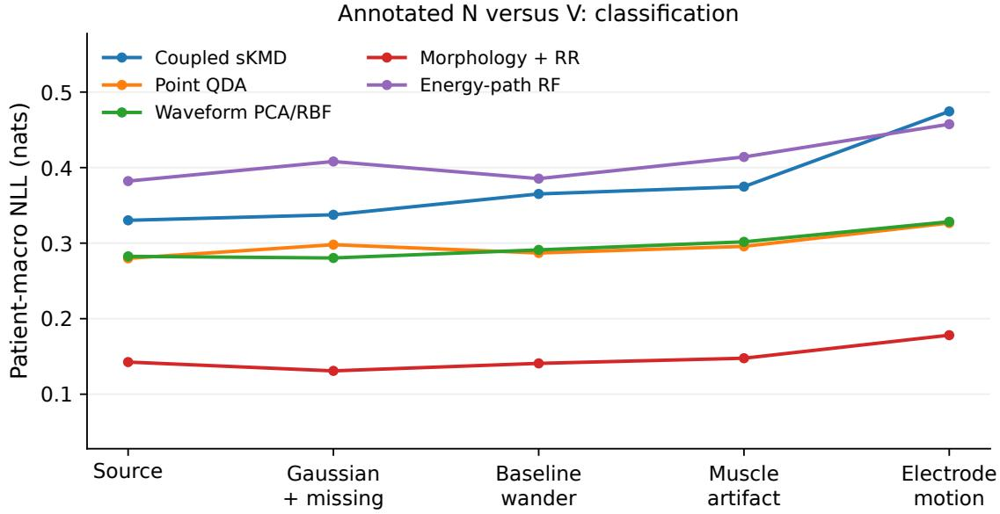

Dictionary approximation dominates reconstruction  
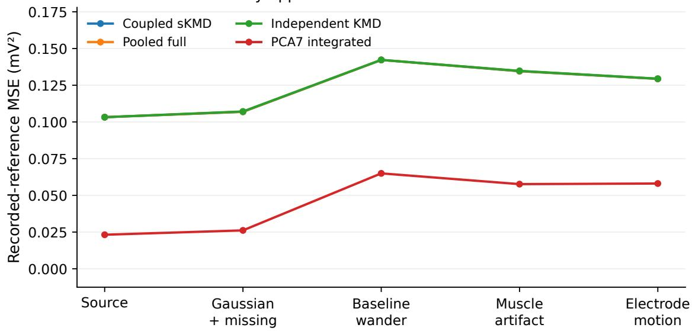  
Figure 14: All five prespecified ECG conditions. Lines show patient-macro means; paired uncertainty is reported in the text and saved results. The three KMD reconstruction curves in the lower panel nearly coincide.

## 9.2 Localized kernels and robust regime laws

We combine localized carrier packets with finite scale-mixture regime laws to model waveform morphology and between-subject heterogeneity. MIT-BIH patients and Paderborn bearings supply development data; procedures are fixed before evaluation on separate physical units. The global-carrier and absolute-frequency methods provide baseline comparisons.

## 9.2.1 A waveform span built from localized KMD kernels

Let $h _ { j , c } , h _ { j , s } \in \mathbb { R } ^ { p } , \ j = 1 , 2 , 3$ , be the three independently calibrated KMD carrier pairs. A constant and these six vectors give a seven-dimensional span. This is restrictive for an ECG beat: diferent parts of a beat can have diferent morphology even when the carrier frequencies are appropriate. Using the development data, we construct coeficients of smooth local wave

packets,

$$
B = [ \mathbf { 1 } , \{ w _ { \ell } \odot h _ { j , c } , w _ { \ell } \odot h _ { j , s } \} _ { j = 1 , \dots , 3 ; \ell = 1 , \dots , L } ] , \qquad w _ { \ell } ( t ) = \mathrm { e x p } \left[ - { \frac { ( t - c _ { \ell } ) ^ { 2 } } { 2 b ^ { 2 } } } \right] .\tag{62}
$$

The ECG implementation uses $p = 2 1 6 , L = 7 .$ , equally spaced centers across the beat window, and $b = 0 . 7$ times the center spacing; thus $q \ = \ 4 3$ The local amplitudes can vary across the beat. The construction remains a finite collection of prescribed kernels, $K _ { j } \ = \ B _ { j } B _ { j } ^ { \intercal }$ within the KMD framework. KMD permits general waveforms. Related wave-shape methods address nonstationary morphology directly [19, 77, 86]. This construction addresses waveform approximation before assessing the added value of the stochastic mode law.

Stable coordinates preserve the kernel. The overlapping wave packets can make the columns of $B$ ill-conditioned. Assume B has full column rank, checked numerically in the implementation. For its thin singular value decomposition $B = U S V ^ { \top }$ , use

$$
H = \sqrt { p } U , \qquad \Gamma = S ^ { 2 } / p , \qquad H \Gamma H ^ { \top } = B B ^ { \top } , \qquad x = H a = B \big ( \sqrt { p } V S ^ { - 1 } a \big ) .\tag{63}
$$

This transformation diagonalizes the prescribed kernel; it does not fit principal components to evaluation waveforms. The kernel eigenvalues Γ must be retained when implementing the original independent KMD reconstruction. Setting them all to one would change that baseline. The fitted class law can instead be expressed directly in the normalized H coordinates. To report physical carrier-group energies, map the coeficients back through $\sqrt { p } V S ^ { - 1 }$ and the original column groups. Squaring arbitrary singular-vector coeficients would test a diferent energy representation.

Approximation error and a matched resource control. For any estimate constrained to the afine span $\bar { x } + \mathrm { c o l } ( H )$ , the squared distance of a reference beat to that afine span is a lower bound on its reconstruction error. We measure this projection error separately from prediction risk. A data-PCA span of the same dimension, learned from the same calibration patients, provides a strong control for whether the particular KMD carrier structure helps. Both pipelines receive the same recorded channels, event locations, observation masks and noise estimates. Increasing the rank can reduce bias while raising estimation variance; the rank is fixed before independent-cohort predictions.

## 9.2.2 Finite scale mixtures with observed rhythm features

Gaussian scale mixtures are an established robust modeling device [82]. We specify the finite law used in the experiment so that its conditioning and moment conventions are reproducible.

For class $k ,$ let $A \in \mathbb { R } ^ { q }$ be the waveform coeficients and let $R \in \mathbb { R } ^ { d }$ collect the supplied past-RR features. These features use past event times, not future intervals or diagnostic labels. We model their joint law by the finite mixture

$$
{ \binom { A } { R } } \ { \Big | } \ k , s \sim { \mathcal { N } } ( \mu _ { k } , s C _ { k } ) , \qquad \operatorname* { P r } ( s = s _ { \ell } \mid k ) = \omega _ { \ell } , \qquad \sum _ { \ell } \omega _ { \ell } = \sum _ { \ell } \omega _ { \ell } s _ { \ell } = 1 .\tag{64}
$$

The fixed twelve scales start from ${ 2 ^ { - 3 } , \dots , 2 ^ { 8 } }$ . Their masses are the inverse-gamma probabilities between geometric midpoint boundaries with shape and scale 2.5, and the scales are divided by their weighted mean. Thus the mixture has covariance exactly $C _ { k }$ . This is a finite Gaussian mixture with heavier tails over the observed range, rather than an exact Student distribution. The scale law is fixed on development data. Learning the class moments, covariance shrinkage and calibration temperature uses only the specified fitting and development roles.

Partition $\mu _ { k }$ and $C _ { k }$ into waveform and rhythm blocks. Conditional on an observed r and a scale s, Gaussian conditioning gives

$$
\mu _ { A | r , k } = \mu _ { A , k } + C _ { A R , k } C _ { R R , k } ^ { - 1 } ( r - \mu _ { R , k } ) ,\tag{65}
$$

$$
C _ { A | r , k , s } = s \big ( C _ { A A , k } - C _ { A R , k } C _ { R R , k } ^ { - 1 } C _ { R A , k } \big ) .\tag{66}
$$

The conditional mean does not depend on the scale, but the rhythm likelihood does. In particular, the observed RR values update both class weights and scale weights. Omitting this factor would not compute the joint model in (64).

Let $Y _ { o } = M ( H A + \bar { x } ) + \varepsilon _ { o } ,$ where M selects the observed samples, the template x¯ is independently calibrated, and $\varepsilon _ { o } \sim \mathcal { N } ( 0 , Q _ { o } )$ has the supplied working covariance. Write $H _ { o } =$ MH and $y _ { o } = Y _ { o } - M { \bar { x } }$ . The complete component evidence is

$$
e _ { k \ell } = \pi _ { k } \omega _ { \ell } \mathcal { N } ( r ; \mu _ { R , k } , s _ { \ell } C _ { R R , k } ) \mathcal { N } \Big ( y _ { o } ; H _ { o } \mu _ { A | r , k } , Q _ { o } + H _ { o } C _ { A | r , k , s _ { \ell } } H _ { o } ^ { \top } \Big ) .\tag{67}
$$

Summing $e _ { k \ell }$ over scales gives the class evidence; summing component conditional means with normalized $e _ { k \ell }$ gives the posterior mean at calibration temperature one. The implementation uses the equivalent information form with $J = H _ { o } ^ { \top } Q _ { o } ^ { - 1 } H _ { o }$ and $b = H _ { o } ^ { \top } Q _ { o } ^ { - 1 } y _ { o }$ . This form permits fewer observed samples than coeficients and includes the zero-observation case. The positive prior covariance supplies the missing information; no inverse of a singular sample Gram matrix is required for prediction.

Calibration and the interpretation of reconstruction. If validation selects a temperature $T \neq 1$ , class probabilities are proportional to $( \sum _ { \ell } e _ { k \ell } ) ^ { 1 / T }$ . Within each class, the scale weights and conditional coeficient means remain those of the untempered model. The resulting reconstruction is a mixture of exact class-conditional posterior means using calibrated class probabilities. It need not equal the posterior mean under the original generative model. The recorded-data tables use this explicitly specified estimator.

Matched ablations. The same localized kernels are supplied to independent-kernel KMD, pooled-law reconstruction and class-dependent sKMD. The same robust scale law and rhythm features are supplied to the matched point-estimate classifier and to the equal-rank PCA model. These matched comparisons isolate observation integration from the efects of the robust law, rhythm features and representation dimension. The independent-cohort experiment reports each comparison.

The diagonal class-covariance ablation is defined in the normalized H coordinates. It removes their of-diagonal covariance entries, including linear waveform–RR covariance, but a shared random scale still induces statistical dependence. Because the singular vectors mix raw carrier groups, this ablation also does not impose independence of those original groups. The Gaussian suficiency theorems apply to their specified fixed-coordinate Gaussian families; this experiment uses a finite non-Gaussian mixture.

## 9.3 Independent evaluation of localized robust ECG models

## 9.3.1 Development data and an independent cohort

The global seven-dimensional carrier dictionary and single-Gaussian class model provide the MIT–BIH development baselines. Those patients supply method-development data, separate from the INCART evaluation. Two development comparisons motivate the specification in Section 9.2. First, localized carrier packets reduce the mean of the five development-fold projection errors from 0.1025 to 0.00221 mV2 at dimension 43; the same-rank calibration PCA floor is smaller, 0.000822 mV2. Second, within the expanded span, the localized Gaussian classifier has source NLL 1.4613 in one of two inspected pilot folds. A fixed finite scale-mixture prior reduces that fold’s source NLL to 0.0583 without RR features. These measured development outcomes motivate both choices. Both pilots use the MIT–BIH development cohort.

The independent evaluation corpus is the St Petersburg INCART database: 75 recordings grouped into 32 original Holter subjects, sampled at 257 Hz with twelve leads [30, 83, 92]. Before producing any INCART prediction, we select the first 180 seconds of every recording, choose lead II by its header name, and group records by the oficial patient identifier. Header gains convert ADC values to mV; the signals are resampled to 360 Hz before adding experimental noise. Models are fitted locally within INCART using the development-selected procedure; MIT–BIH model parameters are not transferred.

The target remains literal annotation symbols N and V. The supplied times are multilead QRS locations whose positions were not manually corrected; they are not precise lead-II R peaks. Fixed 216-sample windows and a class-value-independent cap of 200 eligible beats per patient yield 6,196 beats, comprising 5,548 N and 648 V, from 31 contributing patients. Patient 8 has no eligible target beats and retains its predetermined allocation. No patient, condition or recording prefix is replaced after inspecting performance. These are classifications of annotated beats and recoveries of recorded reference windows, not automatic beat detection, clinical diagnosis or recovery of latent clean ECG.

## 9.3.2 Patient roles, information and decision criteria

Four outer folds each hold out eight nominal patients. Within each fold, 16 nominal remaining patients fit the models, four select hyperparameters, and four supply the separate dictionary calibration bank. The latter contributes 15 eligible beats per patient, hiding N/V values after eligibility. The same 60 recorded beats, with no additional experimental corruption, supply the three-mode adaptive KMD carrier estimator and the 43-dimensional PCA comparison. Seven smooth windows per carrier pair produce the fixed 43-dimensional localized KMD span. Test signals never adapt either dictionary. All fitting/development roles have both classes; every eligible test patient remains in the loss averages.

All full classifiers receive the same two past-RR features: the previous interval and its ratio to the median of up to five available intervals including that interval. Their logarithms are standardized using only fitting-patient weighted statistics. RR-only robust QDA and RBF controls check how much classification can be achieved without morphology. Signed modal heads receive every unique entry of their full coeficient covariance, plus the estimated noise scale and retained fraction. Energy-path controls recover the original KMD kernel-group curves before squaring, as required by (63). Waveform and normalized-morphology controls have their own fitting-only PCA features and observation-quality inputs.

The diagonal ablation sets of-diagonal entries to zero in the normalized H/RR covariance, conditional on the scale. The shared latent scale still induces higher-order dependence and RRdependent scale weights. Moreover, SVD coordinates mix the original carrier groups, so this is a zero-cross-covariance control in the stated coordinates, not a complete raw-mode independence ablation. The original prescribed-kernel KMD reconstruction is a separate comparator.

The integrated models fit source observations with added white-noise SD uniformly distributed over [0.01, 0.03] mV. Point and generic heads also train on two independently degraded copies of each observed fitting beat. Development uses the same source and augmentation schedule for all heads. Every noise estimate uses an independent 64-sample noise-only monitor; no prediction receives the uncorrupted reference of its own beat. Source recording noise remains unknown. The class shrinkage and temperature grids, finite scale law, generic-head budgets and seeds are specified in the accompanying protocol before evaluation on INCART.

The primary condition adds white-noise SD in [0.1, 0.3] mV and retains independently between 40% and 90% of samples. Source, baseline wander, muscle artifact and electrode motion are prespecified secondary conditions. Artifact test clips and noise-monitor clips use disjoint time portions of the three raw Noise Stress Test Database records. They are deliberately misspecified by the scalar white-noise likelihood. Three corruption repetitions are predicted separately; losses are averaged within each patient before equal-patient aggregation.

Table 22: INCART patient-macro NLL (nats), all specified classifiers and conditions. Every full classifier receives the same past-RR resource. Lower is better; no condition selects or tunes a model.
<table><tr><td>Method</td><td>Source</td><td>Gaussian</td><td>Wander</td><td>Muscle</td><td>Electrode</td></tr><tr><td>Localized robust sKMD</td><td>0.071</td><td>0.039</td><td>0.068</td><td>0.083</td><td>0.071</td></tr><tr><td>Robust point + RR</td><td>0.111</td><td>0.096</td><td>0.112</td><td>0.106</td><td>0.118</td></tr><tr><td>Robust PCA43</td><td>0.102</td><td>0.063</td><td>0.098</td><td>0.103</td><td>0.150</td></tr><tr><td>Gaussian point + RR</td><td>0.119</td><td>0.121</td><td>0.128</td><td>0.124</td><td>0.137</td></tr><tr><td>Signed quadratic logistic</td><td>0.281</td><td>0.279</td><td>0.279</td><td>0.281</td><td>0.286</td></tr><tr><td>Signed RBF</td><td>0.123</td><td>0.121</td><td>0.122</td><td>0.122</td><td>0.124</td></tr><tr><td>Original KMD energy path</td><td>0.128</td><td>0.145</td><td>0.132</td><td>0.152</td><td>0.131</td></tr><tr><td>Waveform PCA16/RBF</td><td>0.134</td><td>0.129</td><td>0.134</td><td>0.137</td><td>0.143</td></tr><tr><td>Normalized morphology/RBF</td><td>0.136</td><td>0.117</td><td>0.129</td><td>0.128</td><td>0.154</td></tr><tr><td>Waveform forest</td><td>0.215</td><td>0.190</td><td>0.204</td><td>0.201</td><td>0.195</td></tr><tr><td>RR-only robust QDA</td><td>0.139</td><td>0.139</td><td>0.139</td><td>0.139</td><td>0.139</td></tr><tr><td>RR-only RBF</td><td>0.306</td><td>0.306</td><td>0.306</td><td>0.306</td><td>0.306</td></tr><tr><td>Localized Gaussian</td><td>0.200</td><td>0.211</td><td>0.316</td><td>0.326</td><td>0.322</td></tr><tr><td>Shared covariance</td><td>0.130</td><td>0.104</td><td>0.128</td><td>0.130</td><td>0.132</td></tr><tr><td>Diagonal joint covariance</td><td>0.111</td><td>0.089</td><td>0.112</td><td>0.111</td><td>0.117</td></tr><tr><td>Robust global KMD7</td><td>0.041</td><td>0.051</td><td>0.049</td><td>0.051</td><td>0.095</td></tr><tr><td>Prevalence</td><td>0.358</td><td>0.358</td><td>0.358</td><td>0.358</td><td>0.358</td></tr></table>

The two primary classification comparisons are against robust point QDA with RR and integrated robust PCA43 with RR. Separate Holm corrections cover the zero-margin and 0.02- nat practical-margin tests. The three primary reconstruction comparisons are against an independently fitted pooled full prior, original prescribed-kernel KMD, and the same conditional means weighted by robust point-QDA probabilities. Their 5% practical criterion tests MSEc − 0.95MSEj directly. Pooled priors select shrinkage using recorded development MSE; original KMD fits a scalar kernel amplitude by source marginal likelihood and receives a fitted pooled RR conditional mean. These are strong, specified reconstruction controls. All-control Holm diagnostics are also supplied. Paired bootstrap and t intervals are descriptive conditional patient analyses of overlapping cross-fits; they do not include independent model-refitting uncertainty.

## 9.3.3 Independent-cohort outcomes

Tables 22 and 23 report every method and condition, Figure 15 shows the strongest controls across conditions, and Figure 16 shows the patient-paired primary diferences. Localized robust sKMD has the lowest mean NLL among the 17 specified classifiers in the primary Gaussian sensor shift: 0.03937, compared with 0.09649 for robust point QDA and 0.06313 for robust PCA43. The paired diferences are −0.05712 and −0.02377 nats. Both prespecified one-sided, zero-margin paired-t comparisons have Holm-adjusted p = 0.04235 within the two-comparison primary family. These results are suggestive, not conclusive, evidence of a conditional classification benefit for the localized robust model under added noise: both tests are one-sided and pass at level 0.05 by a small margin, the two-sided interval for the point comparison includes zero, and the paired t test treats the 31 patients as independent although all predictions come from four fitted models with overlapping training sets. A fold-level analysis over the four refits resolves neither contrast. Localized robust sKMD has lower mean primary NLL than robust point QDA in 4 of 4 folds (fold diferences −0.134 to −0.020 nats; t interval over folds, 3 df, [−0.140, 0.028])

Table 23: INCART recorded-reference MSE, in $1 0 ^ { - 3 } \mathrm { m V ^ { 2 } } .$ . Projection floors are evaluation diagnostics, not feasible predictors. The independent pooled priors use no class labels; their shrinkage is selected on development reference recovery.
<table><tr><td>Method</td><td>Source</td><td>Gaussian</td><td>Wander</td><td>Muscle</td><td>Electrode</td></tr><tr><td>Localized robust sKMD</td><td>3.977</td><td>10.579</td><td>53.723</td><td>46.569</td><td>50.256</td></tr><tr><td>Point-weighted conditional means</td><td>3.977</td><td>10.625</td><td>53.232</td><td>46.229</td><td>49.938</td></tr><tr><td>Independent pooled full prior</td><td>3.972</td><td>9.151</td><td>49.565</td><td>44.414</td><td>47.202</td></tr><tr><td>Independent pooled diagonal prior</td><td>3.980</td><td>13.527</td><td>55.279</td><td>48.469</td><td>51.529</td></tr><tr><td>Original kernel KMD</td><td>4.012</td><td>89.432</td><td>66.383</td><td>61.321</td><td>60.933</td></tr><tr><td>Robust PCA43</td><td>2.663</td><td>8.119</td><td>46.596</td><td>41.999</td><td>44.423</td></tr><tr><td>Localized Gaussian</td><td>3.980</td><td>11.093</td><td>48.518</td><td>43.592</td><td>47.057</td></tr><tr><td>Shared covariance</td><td>3.975</td><td>10.266</td><td>52.034</td><td>45.403</td><td>47.764</td></tr><tr><td>Diagonal joint covariance</td><td>3.980</td><td>13.176</td><td>55.301</td><td>48.608</td><td>51.374</td></tr><tr><td>Robust global KMD7</td><td>92.848</td><td>96.666</td><td>131.598</td><td>124.237</td><td>122.929</td></tr><tr><td>Minimum-norm least squares</td><td>3.982</td><td>702.960</td><td>82.157</td><td>165.647</td><td>91.142</td></tr><tr><td>Localized-span floor</td><td>3.895</td><td>3.895</td><td>3.895</td><td>3.895</td><td>3.895</td></tr><tr><td>PCA43-span floor</td><td>2.584</td><td>2.584</td><td>2.584</td><td>2.584</td><td>2.584</td></tr><tr><td>Global KMD7-span floor</td><td>92.834</td><td>92.834</td><td>92.834</td><td>92.834</td><td>92.834</td></tr></table>

and than PCA43 in 3 of $4 \ ( - 0 . 0 4 5 \ \mathrm { t o } + 0 . 0 0 2 ; \ [ - 0 . 0 6 1 , 0 . 0 1 5 ] )$ , so neither fold-level interval excludes zero. Leaving out the patients of any one fold raises the larger Holm-adjusted one-sided p of the two-comparison family to between 0.059 and 0.102. This dependence on the four refits is a further reason to treat the classification evidence as suggestive.

The point-QDA diference has two-sided paired-t interval [−0.12014, 0.00589], which includes zero; its bootstrap sensitivity interval is [−0.12615, −0.01443]. For PCA43 the corresponding intervals are [−0.04665, −0.00088] and [−0.04793, −0.00547]. Thus the point comparison is sensitive to interval construction. Neither 0.02-nat practical-margin test succeeds: adjusted p = 0.23835 against robust point QDA and p = 0.36962 against PCA43. Adjustment over all 16 controls does include nonsignificant contrasts. These descriptive diagnostics are conditional on the cross-fits and patient population described above.

The proper-loss improvement is accompanied by patient-macro Brier scores 0.01637, 0.04401 and 0.02796, and accuracies 0.99000, 0.97225 and 0.98301, for coupled, robust point and PCA43 respectively. Brier here is the sum of squared errors over the two class probabilities. The primary model has lower patient NLL than robust point QDA for 24 of 31 patients and than PCA43 for 23 of 31. Outcomes remain heterogeneous: robust point QDA has NLL 1.00036 on patient 31, while the coupled model’s largest primary-condition patient loss is 0.40157 on patient 2. At threshold 0.5, pooled V sensitivity is lower for coupled than robust point QDA, 0.9141 versus 0.9414, while N specificity is higher, 0.9989 versus 0.9758. Better NLL therefore does not imply a better value of every diagnostic endpoint.

Global and localized representations. Adding a robust law and matched RR information also makes the global seven-dimensional representation efective for classification. Its primary NLL is 0.05088, and its source NLL is better than localized sKMD, 0.04138 versus 0.07119. It also wins baseline wander and muscle artifact in mean NLL. Localization is consequently not shown to be necessary for classification. Patient 30 has coupled source NLL 1.02594. The finite-mixture model reduces aggregate loss relative to the localized Gaussian model, but does not eliminate subject-specific misspecification. RR-only robust QDA has primary NLL 0.13936; waveform information adds useful predictive information for the annotated-beat classification target.

Recorded-reference reconstruction. Primary recorded-reference MSE is $\mathrm { 0 . 0 1 0 5 7 9 m V ^ { 2 } }$ for the coupled model, 0.009151 for the independently fitted pooled full prior, and 0.008119 for PCA43. Both strong controls are better: the coupled reconstruction error is about 16% larger than the pooled prior’s and 30% larger than PCA43’s. The original prescribed-kernel KMD mean MSE is 0.089432, so the coupled estimate has an 88.2% smaller point mean, but patient variation is substantial: the zero-margin primary reconstruction Holm diagnostic is $p = 0 . 1 0 0 6 1$ and the 5% margin diagnostic is $p = 0 . 1 5 4 3 6$ . Point-weighted conditional means have MSE 0.010625; the coupled reduction is 0.43%, and its zero-margin adjusted $p = 0 . 0 5 7 8 1$ . No primary reconstruction comparison meets its Holm criterion, so the primary reconstruction diferences are not statistically established.

The localized afine-span floor is $\mathrm { 0 . 0 0 3 8 9 5 m V ^ { 2 } }$ , compared with 0.092834 for global KMD7 and 0.002584 for PCA43. Thus localization removes much of the diagnosed approximation error, while PCA still supplies a better reconstruction span on these data. All five calibration peakselection failures are included in the analysis. Raw packet-basis condition numbers range from $5 . 6 9 \times 1 0 ^ { 4 }$ to $1 . 6 0 \times 1 0 ^ { 5 }$ ; the normalized dictionary preserves its kernel to $2 . 4 \times 1 0 ^ { - 1 4 }$ . Some masked Gram matrices are poorly conditioned, reaching $4 . 6 4 \times 1 0 ^ { 8 }$ . The information-form posterior avoids inverting these Gram matrices. The large least-squares errors are reported as outcomes of unregularized recovery; the primary comparisons use the specified reconstruction controls.

Exploratory same-law integration comparison. The same-law plug-in comparison was specified after two folds had completed and evaluated after all specified folds finished. It is exploratory and is excluded from the confirmatory family. Keeping each coupled model’s means, covariances, scale weights, class priors and temperature fixed, evaluate the point density at the saved reference coeficient mean and RR instead of integrating the observation uncertainty. Primary NLL becomes 0.19181 versus 0.03937 for integration; the descriptive paired-t interval for the diference is [−0.24437, −0.06051]. This isolates the benefit of the observation integration for that fitted law and its integration-selected temperature. The independently fitted point control remains in the primary comparison family; the same-law analysis is exploratory. The informative means and RR features also distinguish this application from the paper’s centered, covariance-only information-separation example.

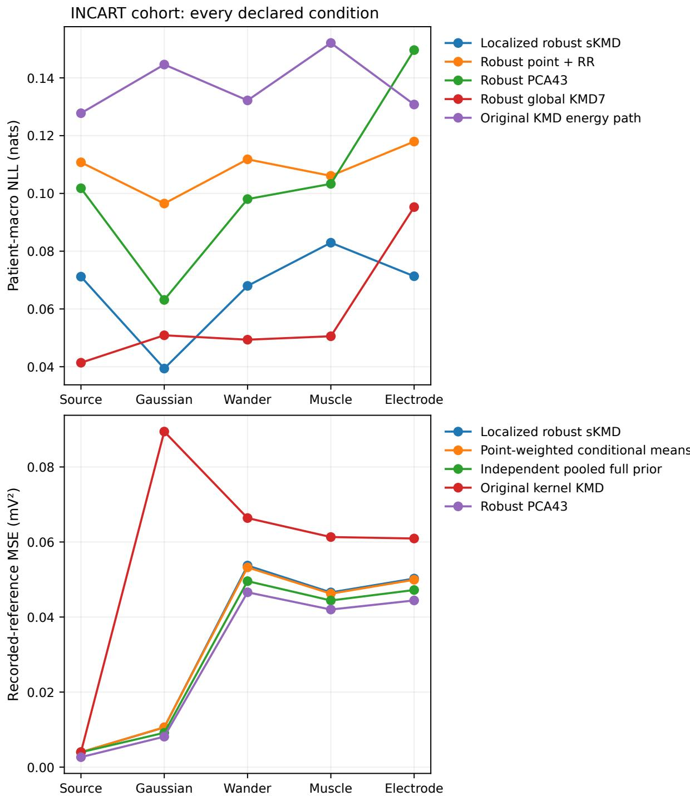  
Figure 15: Selected strong controls across every declared INCART condition. The complete method set is reported in Tables 22 and 23. Recorded-reference recovery and class probability estimation are separate targets.

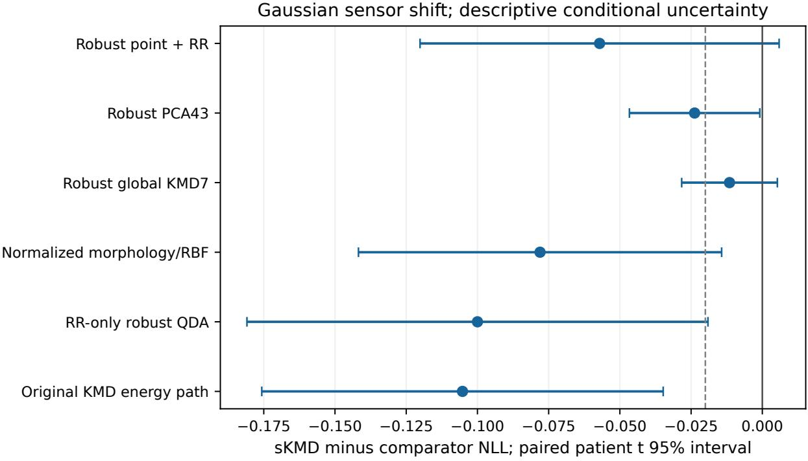  
Figure 16: Patient-paired NLL diferences in the primary Gaussian sensor shift. Negative values favor localized robust sKMD. The dashed line is −0.02 nats. Intervals are pointwise; the text supplies the prespecified Holm-adjusted primary and all-control tests.

## 9.4 Absolute-frequency bearing baseline under operating-condition shift

We evaluate the adaptive frontend on Paderborn bearing recordings, with both physical bearings and an operating condition held out. This recorded-data task extends the controlled modeinteraction comparisons to a separate observation setting.

## 9.4.1 Data, independent units, and protocol

The oficial Paderborn bearing dataset is documented in [76]. We use all fifteen physical bearings listed in that description’s Table 10: five healthy bearings (K001–K005), five with real outerring damage (KA04, KA15, KA16, KA22, KA30), and five with real inner-ring damage (KI04, KI14, KI16, KI18, KI21). The complete predefined cohort avoids choosing bearings according to the present results. Mixed and artificial damage are outside this study. Recordings 1 and 2 supply four fixed, nonoverlapping half-second windows each, giving 90 original recordings and 360 windows. The data are attributed to the KAt-DataCenter, Paderborn University, and distributed under its CC BY-NC 4.0 license.

Five fixed folds each hold out one bearing per class, use another bearing per class for development, and fit on the remaining three per class. Every recording and window of a bearing has the same role within a fold. Fitting and development use two conditions at 1500 rpm: nominal torque, N15\_M07\_F10, and reduced torque, N15\_M01\_F10. The 900-rpm condition, N09\_M07\_F10, is never used for fitting, calibration, or hyperparameter selection. Each bearing is tested once per condition. Thus there are fifteen physical test units per condition, not 120 independent windows. The fitted training sets overlap across folds.

The protocol, candidate sets and practical threshold were frozen before feature extraction. The channel-indexed monotone X vectors contain 255997–278039 vibration samples and span approximately four units. Interpreting those axes as time gives mean rates of 63999.2–69509.5 samples per second. Before any classifier test metric was computed or inspected, a dated amendment to the frozen protocol changed extraction from the originally frozen nominal-index convention to interpolation of this linked axis onto a uniform 64-kHz grid within the declared windows. All methods receive the same interpolated observations. The linked axes have blank unit metadata, so this is an axis interpretation rather than an independently certified correction of physical timing. The original specification and nominal-index feature cache remain archived. An exploratory sensitivity analysis, specified after the primary outcomes were available, evaluates the nominal-index convention with the unchanged fitting and selection rules on the same units (Section 9.4.4); it is not independent confirmation.

## 9.4.2 Adaptive representations and matched controls

Each window is filtered between 1 and 20 kHz, converted to its Hilbert envelope, and resampled to 1024 Hz. The adaptive frontend extracts two envelope modes over 10–400 Hz using the released KMD frequency-energy calculation and a fixed automatic ridge rule. All 360 windows return two modes.

The signed representation contains four central-anchor quadratures, two log median ridge frequencies, log envelope mean, and log raw RMS. The quadrature covariance is scaled by a robust envelope-noise estimate computed only from fitting-source windows. The remaining descriptors are treated as observed covariates. Gaussian models estimate class means. The coupled model subtracts mean feature-noise covariance before positive-definite projection, selects covariance shrinkage on development units, and integrates the conditional feature covariance at prediction. Its point-prior ablation uses exactly the same selected class prior and omits this integration. Both receive the common development calibration.

The uncertainty calculation is conditional on estimated ridges. It omits uncertainty from adaptive selection and the nonlinear envelope transform; the noise estimate may also contain unresolved signal. The resulting errors-in-features likelihood is consequently a working model.

Controls include signed shrinkage QDA, OAS covariance, calibrated direct sparse QDA, quadratic logistic regression, signed-feature and energy-feature forests, a diagonal uncertainty model, and spectral SVM/forest classifiers. The forests using mode features also receive covariance-quality summaries. The spectral controls use 32 raw-spectrum and 32 envelopespectrum log-power bins plus five amplitude/shape summaries from the same half-second observation. Tunable families use four declared candidates, the same fitting and development units, and the same temperature/intercept calibration family. Candidate selection uses mean development bearing–condition NLL. The direct sparse-QDA comparator credits the published binary estimator and declares its multiclass wrapper; optimizer residuals are saved.

## 9.4.3 Held-out operating-condition results

Window log scores are averaged within bearing and condition before normalization. Table 24 reports all fitted methods. Accuracy and Brier scores, confusion matrices, candidate scores, every window prediction, and every bearing prediction are retained in the machine-readable results.

Table 24: Recorded-data results on fifteen grouped physical bearings per condition. Low speed is the unseen operating condition. The last row is a policy selecting one control separately in each fold using source-development NLL; it is not the control with lowest realized test loss. A uniform three-class probability vector has NLL log 3 = 1.099, below every learned method at the unseen speed.
<table><tr><td></td><td colspan="2">Bearing NLL ↓</td><td colspan="2">Held-out</td></tr><tr><td>Method</td><td>Nominal</td><td>Low torque</td><td>Low speed</td><td>accuracy</td></tr><tr><td>Coupled sKMD</td><td>1.548</td><td>1.700</td><td>10.346</td><td>5/15</td></tr><tr><td>Same-prior point</td><td>1.392</td><td>1.542</td><td>8.465</td><td>5/15</td></tr><tr><td>Diagonal uncertainty</td><td>2.520</td><td>2.417</td><td>7.850</td><td>5/15</td></tr><tr><td>Signed shrinkage QDA</td><td>1.443</td><td>1.509</td><td>9.181</td><td>6/15</td></tr><tr><td>Signed OAS</td><td>2.251</td><td>2.218</td><td>5.709</td><td>3/15</td></tr><tr><td>Direct sparse QDA</td><td>2.151</td><td>1.908</td><td>10.449</td><td>6/15</td></tr><tr><td>Energy/quality forest</td><td>1.841</td><td>2.201</td><td>3.244</td><td>5/15</td></tr><tr><td>Signed/quality forest</td><td>2.576</td><td>2.784</td><td>10.213</td><td>5/15</td></tr><tr><td>Quadratic logistic</td><td>0.960</td><td>3.442</td><td>6.000</td><td>5/15</td></tr><tr><td>Spectral SVM</td><td>2.417</td><td>2.111</td><td>2.638</td><td>5/15</td></tr><tr><td>Spectral forest</td><td>4.863</td><td>5.290</td><td>10.145</td><td>6/15</td></tr><tr><td>Source-development control</td><td>3.598</td><td>3.695</td><td>16.064</td><td>7/15</td></tr></table>

The prespecified external-success criterion requires at least 0.02 nats improvement over the source-development-selected control and a positive lower descriptive paired interval. The observed diference, control minus sKMD, is 5.718 nats, but its stratified bearing-bootstrap 95% interval is [−6.192, 21.834]. The criterion is not met. The bootstrap resamples five bearings within each class, so each stratum has only 9 = 126 distinct resamples $( 1 2 6 ^ { 3 } \approx 2 . 0 \times 1 0 ^ { 6 }$ joint resamples over the three classes, sampled by 10,000 draws); as for the six-panel studies, more Monte Carlo draws do not add information. The fixed spectral SVM and energy/quality forest have substantially lower held-out loss than sKMD. The source-development selection policy chose sparse QDA in three folds and one forest in each remaining fold; its large held-out loss reflects poor transfer of this selection policy.

Integrating the conditional covariance also fails to improve the same-prior point ablation: point minus sKMD loss is −1.880 nats, with descriptive interval [−5.324, 0.011]. NLL was computed directly with log-sum-exp; all log probabilities are finite and none of the aggregated probabilities underflow to zero. The worst sKMD bearing contributes 116.197 nats, showing severe overconfidence under the speed change rather than a numerical overflow.

The three development bearings per fold provide little independent calibration information, and class-conditional feature distributions change with speed. The bootstrap resamples the five bearings in each class, conditional on the overlapping fitted models, so its interval is descriptive and does not account for training-set uncertainty. The same fifteen bearings provide development data for the order-normalized model; separate physical bearings provide independent evaluation. No clean latent vibration reference is available for this baseline, so its outcomes concern classification rather than clean-signal reconstruction or coverage.

## 9.4.4 Exploratory sensitivity to the sampling axis

The nominal 64 kHz sampling rate is given by the dataset documentation. The archived vibration channel also points through XIndex to a monotone X vector. Across the 90 recordings, that vector has blank Name and Unit metadata and Raster=HostService. Its endpoint-derived rates range from 63999.219 to 69509.507 per presumed second; six records difer from 64000 by more than 1%. Consequently, the amended interpolation treats this linked axis as time; it is not an independently certified correction of the physical clock. The originally frozen nominal-index convention is a necessary sensitivity check against that interpretation.

We evaluated the preserved 360 nominal-index feature windows with the identical grouped splits, fitting functions, candidate grids, calibration family and source-development comparatorselection rule. This exploratory check was specified after the primary outcomes were available. It reuses the same physical bearings and is not independent confirmation. No test result changes a setting, and neither convention is selected by its performance. Table 25 reports both heldspeed outcomes. Every method’s accuracy, Brier score, other operating conditions and selected settings are retained in the numerical package.

Table 25: Held-speed bearing-mean NLL under the two sampling conventions. Smaller is better. The control policy is selected on source development bearings separately under each convention using the same selection rule.
<table><tr><td>Method</td><td>Linked-axis interpolation</td><td>Nominal indexing</td></tr><tr><td>Coupled sKMD</td><td>10.346</td><td>11.722</td></tr><tr><td>Same-prior point</td><td>8.465</td><td>9.591</td></tr><tr><td>Diagonal uncertainty</td><td>7.850</td><td>8.888</td></tr><tr><td>Signed shrinkage QDA</td><td>9.181</td><td>10.511</td></tr><tr><td>Signed OAS QDA</td><td>5.709</td><td>5.836</td></tr><tr><td>Calibrated direct sparse QDA</td><td>10.449</td><td>13.228</td></tr><tr><td>Energy and quality forest</td><td>3.244</td><td>3.064</td></tr><tr><td>Signed and quality forest</td><td>10.213</td><td>7.792</td></tr><tr><td>Quadratic logistic</td><td>6.000</td><td>12.607</td></tr><tr><td>Spectral SVM</td><td>2.638</td><td>2.065</td></tr><tr><td>Spectral forest</td><td>10.145</td><td>11.608</td></tr><tr><td>Development-selected control</td><td>16.064</td><td>11.983</td></tr><tr><td>Uniform reference</td><td>1.099</td><td>1.099</td></tr></table>

The nominal-index control-minus-sKMD NLL diference is 0.2602, with bearing-bootstrap descriptive 95% interval [−15.2636, 13.7195]. The prespecified improvement criterion is not met under either convention. The nominal same-prior point diference is −2.1312 $( [ - 5 . 9 3 9 0 , - 0 . 0 4 8 7 ] )$ , favoring the point control. Every learned held-speed method remains worse than the uniform NLL log 3. Exact losses and rankings depend on preprocessing; the negative external finding holds under both conventions.

## 9.5 Order-normalized bearing models and observation quality

The fifteen physical bearings in the absolute-frequency Paderborn experiment, including their 900 rpm observations, supply development data. Independent evaluation uses a separate cohort to distinguish native discrimination from a conditional benefit of uncertainty integration under known observation degradation.

## 9.5.1 Order coordinates and development experiments

The absolute log ridge frequencies shift by approximately −0.49 between 1500 and 900 rpm, close to log(900/1500) = −0.511. The files also contain measured shaft speed. We therefore form the vibration envelope first, map time to shaft revolutions using that channel, and retain six revolutions. The angular footprint lasts approximately 0.24 s at 1500 rpm and 0.40 s at 900 rpm; all compared methods receive that same footprint. Dense angular interpolation followed by antialiased polyphase reduction prevents high-order envelope content from aliasing into the selected order band. This follows established envelope/order processing [32, 76]. Nominal 64 kHz vibration indexing is the declared convention; the uncertainty about the linked HostService time axis remains a limitation.

Three development pilots compare representations and calibration. First, a model using order coordinates, phase-invariant features, and calibration using four KMD modal amplitudes and orders reduces the source-trained 900 rpm NLL from approximately 10.35 to 1.086, but the matched order-spectrum forest is better (0.967). Second, fixed Fourier-order kernels and bearing-specific mixture components avoid inconsistent ridge identities and allow heterogeneous class populations. Their sixteen broad order bands nevertheless discard narrow spectral structure, and a residual-power proxy does not provide calibrated sensor-noise uncertainty. The coupled mixture remains worse than the full spectrum forest. The plug-in power-variance rule in that pilot is explicitly conservative: substituting observed energy for latent energy adds $4 r \sigma ^ { 4 }$ in expectation to the Gaussian energy-variance formula. It is not an exact deconvolution experiment.

The third pilot retains all 64 order-spectrum bins and uses actual repeated recordings. Let $u _ { 1 } , u _ { 2 }$ be the two recording-level mean power vectors. Before the logarithm, the covariance estimator of their average is

$$
{ \widehat { R } } _ { \mathrm { r e c o r d } } = { \frac { 1 } { 4 } } ( u _ { 1 } - u _ { 2 } ) ( u _ { 1 } - u _ { 2 } ) ^ { \top } .\tag{68}
$$

It is unbiased if the two recording means are independent and identically distributed with finite covariance. A delta-method Jacobian transfers it to log-power coordinates. There are only two records: the estimate has rank one, and its Gaussian interpretation and covariance subtraction remain working approximations. A nonnegative integration multiplier includes $\lambda =$ 0. Covariance regularization and probability calibration are selected from out-of-fold predictions on physical bearings. A Student model supplies an established heavy-tail control [82]. No pilot shows a consistent native-quality integration advantage.

## 9.5.2 Independent cohort and acquisition protocol

The independent cohort contains all fourteen bearings excluded from development with an unambiguous healthy, outer-race, or inner-race target: K006; KA01, KA03, KA05, KA06, KA07, KA08, KA09; and KI01, KI03, KI05, KI07, KI08, KI17. Mixed-location KB23, KB24, and KB27 do not belong to this three-class target. The cohort contains one healthy bearing, seven artificial outer defects, five artificial inner defects, and one real inner defect. It therefore cannot establish performance in a balanced population of naturally damaged or newly healthy bearings. Reported classification macro NLL gives each class equal weight; micro NLL gives each observed physical bearing equal weight. Both are shown.

We use the two specified recordings at each of the three specified operating conditions. One oficial file, N15\_M01\_F10\_KA08\_2.mat, is corrupt: its zero-filled tail begins within vibration data at approximately 2.983 s, before the last required window. A second download reproduces exactly the same archive and file hashes. Before any evaluation prediction, the file is replaced by the next chronological complete recording, number 3, based solely on data integrity. The provenance record includes the corrupt file; every other window is fixed, and all fourteen bearings are included. All 84 selected complete records pass parsing, channel, finite-value, and requiredfootprint checks.

Each native decision uses the eight windows in one bearing-condition group. The fifteen development bearings provide five physical-unit folds for candidate and calibration selection; final parameters are fitted only to those development units. Window-spectrum forests provide strong controls, with window log scores averaged at the same bearing-condition target. Forest fitting uses window spectra.

Table 26: Independent-cohort native bearing results: macro NLL gives equal weight to the three classes. Every column averages conditions within the one-healthy/seven-outer/six-inner cohort. The uncertainty selector chooses $\lambda = 0$ using development data.
<table><tr><td>Method</td><td>Macro NLL</td><td>Micro NLL</td><td>Macro accuracy</td></tr><tr><td>Replicate selector  $( \lambda = 0 )$ </td><td>0.655</td><td>0.889</td><td>0.759</td></tr><tr><td>Same-prior point</td><td>0.655</td><td>0.889</td><td>0.759</td></tr><tr><td>Point QDA</td><td>0.831</td><td>1.084</td><td>0.638</td></tr><tr><td>Student</td><td>1.040</td><td>1.412</td><td>0.622</td></tr><tr><td>Mean-spectrum forest</td><td>0.970</td><td>1.031</td><td>0.698</td></tr><tr><td>Window-spectrum forest</td><td>0.613</td><td>0.812</td><td>0.728</td></tr><tr><td>Window-spectrum + quality</td><td>0.619</td><td>0.823</td><td>0.712</td></tr></table>

The native classifier’s development-data selector chooses $\lambda = 0 ,$ so its predictions exactly match its same-prior point ablation (Table 26). The window-spectrum forest has lower macro NLL (0.613 versus 0.655). The development-selected model therefore uses the point prior at native quality; these results show no native uncertainty-integration gain. On the twelve artificial defects alone, native NLL is 0.984 for the selector and 0.879 for the window forest; their accuracies are 61.1% and 55.6%, respectively. The single healthy and single real-inner cases are reported separately in the supplied stratum tables, without treating either as a population sample.

## 9.5.3 Linear telemetry experiment

To test observation-quality dependence directly, the upstream six-revolution envelope is normalized and projected onto a fixed real Fourier bank $H \in \mathbb { R } ^ { 1 9 2 \times 1 2 9 }$ . Its columns are DC and 64 sine/cosine pairs, with order spacing $1 / 6$ and cutof 10.667. The reconstructed target is explicitly the resulting band-limited envelope $H a ,$ not the original full vibration record. No unit-specific fault-harmonic coverage is guaranteed. Transmission observes

$$
y = H _ { O } a + \epsilon , \qquad \epsilon \sim N ( 0 , \sigma ^ { 2 } I ) ,\tag{69}
$$

with uniformly selected sample locations O. Moderate quality retains 96 of 192 samples with $\sigma = 0 . 2 5 ;$ ; severe quality retains 48 with $\sigma = 0 . 5$ . Every method receives the same mask, samples, and known noise variance. These are engineered degradations after envelope preprocessing and projection, not estimates of the native sensor noise.

A class prior mixes Gaussian components attached to training-bearing prototypes. Each component has a DC mean and phase-invariant diagonal covariance: the sine and cosine variances of a frequency pair are equal. Four shrinkage choices toward the class-average variance are selected on development physical-bearing folds. Gaussian component evidence and conditional means under (69) are exact for the fitted model. The Gaussian priors themselves are working approximations to real envelopes. The component laws use diagonal latent covariance; this experiment assesses observation integration under that specification.

The classification head averages per-window marginalized log likelihoods and then applies a development-data temperature and uniform-probability calibration. It is a calibrated composite predictor, not the exact eight-window joint Bayes posterior. Reconstruction combines its calibrated class weights with component-conditional means. Three independent corruption draws are evaluated as three separate eight-window prediction runs; losses are averaged afterward. The draws never provide three observations of one latent window to a single classifier. Windows and draws are not independent physical test units.

Controls include pooled Gaussian KMD, independently selected point-prior classification, the identical-prior point ablation, and a forest given the complete reference-posterior mean and covariance, modal powers, mask, and noise level. Point and forest probabilities also weight the same conditional means. Two stronger reconstruction controls use an unlabeled mixture over training bearings, with variance shrinkage toward the all-bearing average selected by development out-of-fold reconstruction error. The local version uses one window; the group version has the same eight-window information as the classifier and marginalizes a common prototype. These controls separate class-label information from the benefit of a richer prior.

Table 27: Independent-cohort telemetry classification, macro NLL. Moderate quality retains 96/192 samples with noise SD 0.25; severe quality retains 48 with SD 0.5. Each of three corruption draws is evaluated separately.
<table><tr><td>Method</td><td>Moderate</td><td>Severe</td><td>Mean</td></tr><tr><td>Integrated sKMD</td><td>0.797</td><td>0.831</td><td>0.814</td></tr><tr><td>Point prior</td><td>0.774</td><td>1.026</td><td>0.900</td></tr><tr><td>Full-posterior forest</td><td>1.043</td><td>1.065</td><td>1.054</td></tr></table>

Table 28: Independent-cohort telemetry reconstruction of the declared band-limited envelope. MSE averages windows and draws within each physical bearing, then gives the 14 bearings equal weight. The unlabeled group mixture is the strongest reconstruction control.
<table><tr><td>Method</td><td>Moderate</td><td>Severe</td><td>Mean</td></tr><tr><td>Integrated sKMD</td><td>0.04212</td><td>0.08403</td><td>0.06307</td></tr><tr><td>Point prior</td><td>0.04293</td><td>0.08971</td><td>0.06632</td></tr><tr><td>Full-posterior forest</td><td>0.04861</td><td>0.09323</td><td>0.07092</td></tr><tr><td>Pooled Gaussian KMD</td><td>0.04946</td><td>0.09754</td><td>0.07350</td></tr><tr><td>Unlabeled local mixture</td><td>0.04272</td><td>0.08434</td><td>0.06353</td></tr><tr><td>Unlabeled group mixture</td><td>0.04215</td><td>0.08094</td><td>0.06154</td></tr></table>

Under severe transmission degradation, integrated classification improves macro NLL from 1.026 for the point-prior head to 0.831 (Table 27). Over all fourteen physical bearings, including the single healthy unit, the mean paired micro-NLL diference (integrated minus point prior) is −0.184 nats, with descriptive paired t interval [−0.272, −0.096]; this is the primary descriptive interval. The thirteen-bearing summary, which excludes the single healthy unit, was not prespecified: the frozen confirmation protocol (numerics/science/docs/paderborn\_repair\_ confirmation\_v32.frozen.md, line 9) only notes what an interval on the thirteen damaged units would and would not cover, and the fourteen-, thirteen- and twelve-bearing scopes were computed side by side after scoring. As a sensitivity analysis, the thirteen damaged bearings give −0.180 [−0.275, −0.085]. The analogous comparison with the full-posterior forest has an interval crossing zero; there is no statistically established superiority over every comparator.

At moderate quality, the point head has lower macro NLL (0.774 versus 0.797). The qualityaveraged paired diference is also uncertain. These results support a conditional benefit under the severe known degradation, not universal improvement at native or moderate quality.

Integrated reconstruction reduces cohort-mean MSE from 0.07350 for pooled Gaussian KMD to 0.06307 (Table 28). However, the unlabeled group mixture is better at 0.06154. Its advantage persists in the paired-unit sensitivity analysis. The integrated head’s severe-quality MSE is about 6.3% below point-weighted reconstruction, but the interval for the prespecified 5% improvement threshold crosses zero. The strongest reconstruction control has lower MSE. Fig ure 17 displays the quality-dependent classification efect and the reconstruction comparisons.

Each point averages conditions and independent corruption draws  
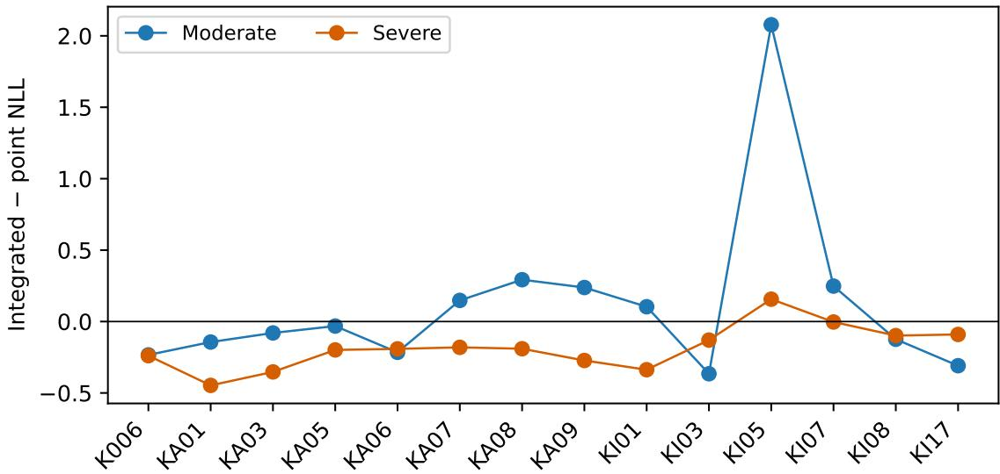  
A richer unlabeled mixture outperforms supervised class weighting

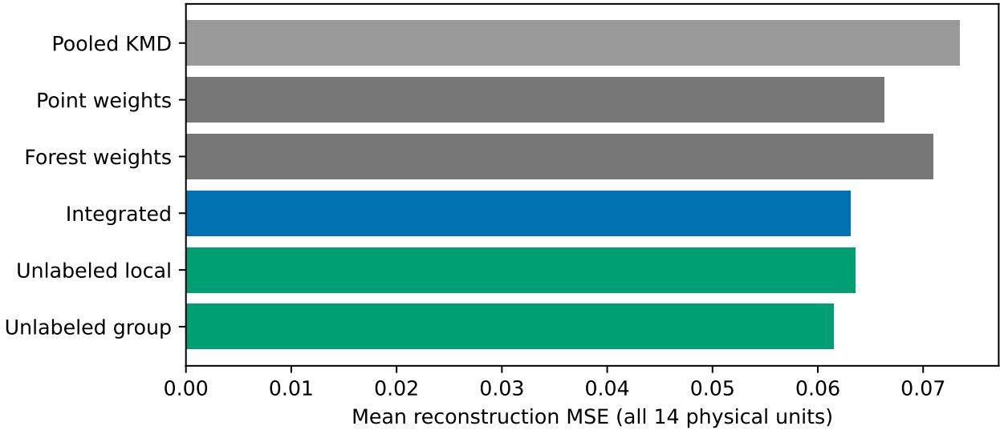  
Figure 17: Independent-cohort bearing results with all physical units retained. Top: integrated minus point-prior NLL, separately for each known transmission quality; lower values favor integration. Each point averages conditions and separately evaluated corruption draws within one bearing. Bottom: cohort reconstruction MSE. The unlabeled group mixture outperforms class-weighted integration. The test cohort includes one healthy and one real-damaged bearing.

## 10 Additional controlled benchmarks

These benchmarks distinguish the information content of a prescribed summary from the performance of a classifier fitted with finite data. The complete grids report oracle, fitted-classifier and reconstruction performance separately.

## 10.1 Exact energy-oracle comparisons for three Gaussian regimes

A comparison with a fitted energy classifier can confound representation loss with estimation error. We therefore evaluate the best possible class posterior available from each declared energy representation when the coeficient laws are known. This tests the multiclass obstruction directly. Let $C \in \mathbb { R } ^ { 2 }$ have three equally likely zero-mean Gaussian laws with precision matrices

$$
\begin{array} { r } { P _ { 0 } = I , \qquad P _ { 1 } = I + \alpha \left( \begin{array} { l l } { 1 } & { 0 } \\ { 0 } & { - 1 } \end{array} \right) , \qquad P _ { 2 } = I + \alpha \left( \begin{array} { l l } { 0 } & { 1 } \\ { 1 } & { 0 } \end{array} \right) , \quad \alpha \in \{ 0 . 5 , 0 . 8 , 0 . 9 5 \} . } \end{array}\tag{70}
$$

All covariances $P _ { k } ^ { - 1 }$ are positive definite. This experiment observes the coeficient vector directly; it isolates information in its summary and introduces no reconstruction, parameterestimation or observation-noise error.

The exact posterior from two energies. For an invertible real basis B, observe $E =$ $( ( B C ) _ { 1 } ^ { 2 } , ( B C ) _ { 2 } ^ { 2 } )$ . Put $J _ { k } = B ^ { - \top } P _ { k } B ^ { - 1 }$ , with entries $J _ { k , 1 1 } = a _ { k } , J _ { k , 1 2 } = b _ { k }$ and $J _ { k , 2 2 } = d _ { k }$ Summing the Gaussian density over the four sign preimages gives the class log score, up to terms common to all classes,

$$
\begin{array} { r } { \ell _ { k } ^ { E } ( e ) = \frac 1 2 \log \operatorname* { d e t } P _ { k } - \frac 1 2 ( a _ { k } e _ { 1 } + d _ { k } e _ { 2 } ) + \log \cosh ( b _ { k } \sqrt { e _ { 1 } e _ { 2 } } ) . } \end{array}\tag{71}
$$

The factor | det $| B | ^ { - 1 }$ and the square-map Jacobian cancel when normalizing over classes. The formula applies away from zero coordinates, which have probability zero. We evaluate log cosh $t = \mathrm { l o g a d d e x p } ( t , - t ) - \mathrm { l o g 2 }$ to avoid overflow. Thus each reported energy score is its exact Bayes posterior, including the discarded-sign mixture. The class scores are evaluated analytically from the Gaussian laws.

Independent development and test samples. For every α, eight independent panels each generate 6000 balanced development coeficients and 15000 balanced test coeficients from separate seeds. The full-coeficient oracle uses the known Gaussian likelihoods. The fixed-energy oracle takes $B = I$ . A second energy oracle chooses one orthogonal rotation by minimum development NLL on a fixed 361-angle grid in $[ 0 , \pi / 2 )$ ; its test set is used once after that choice. The rotation is selected by development NLL on this grid; accuracy is evaluated separately.

A redundant control adds the third energy $E _ { 3 } = ( ( C _ { 1 } + C _ { 2 } ) / \sqrt { 2 } ) ^ { 2 }$ to $E _ { 1 } = C _ { 1 } ^ { 2 } , E _ { 2 } = C _ { 2 } ^ { 2 }$ . It recovers $C _ { 1 } C _ { 2 } = E _ { 3 } - ( E _ { 1 } + E _ { 2 } ) / 2$ , and hence every Gaussian discriminant in (70). These are additional summaries of the fixed coeficient vector. Changing a KMD kernel dictionary also changes its reconstruction operator, whereas this control postprocesses fixed coordinates.

Finally, the fixed nonorthogonal bases $T _ { \epsilon }$ of (11),

$$
T _ { \epsilon } = \left( \begin{array} { c c } { { 1 } } & { { \epsilon } } \\ { { 1 } } & { { - \epsilon } } \end{array} \right) , \qquad \epsilon \in \{ 1 , 0 . 3 , 0 . 1 , 0 . 0 3 \} ,
$$

have condition number $1 / \epsilon$ . They probe the distinction between a positive information gap for each fixed invertible basis and a gap uniform over a conditioning-controlled family. Each basis is evaluated under every specified test condition.

Table 29: Known-law Bayes comparisons, mean ± SD over eight independent panels at each α. Accuracy is larger-is-better; naturallog NLL and multiclass Brier $\begin{array} { r } { \sum _ { k } ( p _ { k } - \mathbf { 1 } _ { \{ Y = k \} } ) ^ { 2 } } \end{array}$ are smaller-isbetter. Three energies are redundant postprocessing of the same coeficients.
<table><tr><td>α</td><td>Representation</td><td>Accuracy</td><td>NLL</td><td>Brier</td></tr><tr><td></td><td>0.50 Full coefficients</td><td> $0 . 4 4 5 7 \pm 0 . 0 0 2 5$ </td><td> $1 . 0 3 2 7 \pm 0 . 0 0 2 4$ </td><td> $0 . 6 2 3 1 \pm 0 . 0 0 1 2$ </td></tr><tr><td></td><td>0.50 Fixed energies</td><td> $0 . 4 1 8 1 \pm 0 . 0 0 1 6$ </td><td> $1 . 0 5 4 5 \pm 0 . 0 0 1 9$ </td><td> $0 . 6 3 7 3 \pm 0 . 0 0 1 1$ </td></tr><tr><td></td><td>0.50 Selected rotation</td><td> $0 . 4 2 8 2 \pm 0 . 0 0 3 9$ </td><td> $1 . 0 4 4 9 \pm 0 . 0 0 2 5$ </td><td> $0 . 6 3 1 1 \pm 0 . 0 0 1 5$ </td></tr><tr><td></td><td>0.50 Three energies</td><td> $0 . 4 4 5 7 \pm 0 . 0 0 2 5$ </td><td> $1 . 0 3 2 7 \pm 0 . 0 0 2 4$ </td><td> $0 . 6 2 3 1 \pm 0 . 0 0 1 2$ </td></tr><tr><td>0.50</td><td> $T _ { 1 }$ </td><td> $0 . 4 1 5 9 \pm 0 . 0 0 1 3$ </td><td> $1 . 0 5 5 7 \pm 0 . 0 0 1 9$ </td><td> $0 . 6 3 8 2 \pm 0 . 0 0 1 2$ </td></tr><tr><td>0.50</td><td> $T _ { 0 . 3 }$ </td><td> $0 . 4 2 5 6 \pm 0 . 0 0 2 8$ </td><td> $1 . 0 4 5 4 \pm 0 . 0 0 2 0$ </td><td> $0 . 6 3 2 0 \pm 0 . 0 0 1 1$ </td></tr><tr><td>0.50</td><td> $T _ { 0 . 1 }$ </td><td> $0 . 4 4 1 5 \pm 0 . 0 0 1 3$ </td><td> $1 . 0 3 6 1 \pm 0 . 0 0 2 1$ </td><td> $0 . 6 2 5 4 \pm 0 . 0 0 1 1$ </td></tr><tr><td>0.50</td><td> $T _ { 0 . 0 3 }$ </td><td> $0 . 4 4 4 5 \pm 0 . 0 0 2 6$ </td><td> $1 . 0 3 3 6 \pm 0 . 0 0 2 3$ </td><td> $0 . 6 2 3 7 \pm 0 . 0 0 1 2$ </td></tr><tr><td></td><td>0.80 Full coefficients</td><td> $0 . 5 7 9 2 \pm 0 . 0 0 4 0$ </td><td> $0 . 8 5 8 0 \pm 0 . 0 0 2 1$ </td><td> $0 . 5 1 3 1 \pm 0 . 0 0 1 5$ </td></tr><tr><td></td><td>0.80 Fixed energies</td><td> $0 . 5 5 0 5 \pm 0 . 0 0 2 9$ </td><td> $0 . 8 9 9 6 \pm 0 . 0 0 2 3$ </td><td> $0 . 5 3 9 1 \pm 0 . 0 0 1 4$ </td></tr><tr><td></td><td>0.80 Selected rotation</td><td> $0 . 5 5 6 4 \pm 0 . 0 0 3 7$ </td><td> $0 . 8 8 4 2 \pm 0 . 0 0 3 4$ </td><td> $0 . 5 3 0 3 \pm 0 . 0 0 2 1$ </td></tr><tr><td>0.80</td><td>) Three energies</td><td> $0 . 5 7 9 2 \pm 0 . 0 0 4 0$ </td><td> $0 . 8 5 8 0 \pm 0 . 0 0 2 1$ </td><td> $0 . 5 1 3 1 \pm 0 . 0 0 1 5$ </td></tr><tr><td>0.80  $T _ { 1 }$ </td><td></td><td> $0 . 5 5 0 6 \pm 0 . 0 0 2 4$ </td><td> $0 . 8 9 9 6 \pm 0 . 0 0 2 4$ </td><td> $0 . 5 3 8 8 \pm 0 . 0 0 1 4$ </td></tr><tr><td>0.80</td><td> $T _ { 0 . 3 }$ </td><td> $0 . 5 1 9 5 \pm 0 . 0 0 4 2$ </td><td> $0 . 9 2 8 9 \pm 0 . 0 0 2 2$ </td><td> $0 . 5 6 0 0 \pm 0 . 0 0 1 6$ </td></tr><tr><td>0.80</td><td> $T _ { 0 . 1 }$ </td><td> $0 . 5 6 5 5 \pm 0 . 0 0 4 1$ </td><td> $0 . 8 7 6 7 \pm 0 . 0 0 2 9$ </td><td> $0 . 5 2 4 9 \pm 0 . 0 0 1 9$ </td></tr><tr><td>0.80</td><td> $T _ { 0 . 0 3 }$ </td><td> $0 . 5 7 5 4 \pm 0 . 0 0 4 0$ </td><td> $0 . 8 6 3 6 \pm 0 . 0 0 2 2$ </td><td> $0 . 5 1 6 6 \pm 0 . 0 0 1 6$ </td></tr><tr><td></td><td>0.95 Full coefficients</td><td> $0 . 7 4 3 3 \pm 0 . 0 0 2 1$ </td><td> $0 . 5 8 7 1 \pm 0 . 0 0 4 0$ </td><td> $0 . 3 4 5 9 \pm 0 . 0 0 2 5$ </td></tr><tr><td></td><td>0.95 Fixed energies</td><td> $0 . 7 2 7 2 \pm 0 . 0 0 2 5$ </td><td> $0 . 6 2 2 8 \pm 0 . 0 0 3 9$ </td><td> $0 . 3 6 7 1 \pm 0 . 0 0 2 4$ </td></tr><tr><td></td><td>0.95 Selected rotation</td><td> $0 . 7 2 6 5 \pm 0 . 0 0 2 7$ </td><td> $0 . 6 1 4 5 \pm 0 . 0 0 4 6$ </td><td> $0 . 3 6 4 3 \pm 0 . 0 0 2 9$ </td></tr><tr><td></td><td>0.95 Three energies</td><td> $0 . 7 4 3 3 \pm 0 . 0 0 2 1$ </td><td> $0 . 5 8 7 1 \pm 0 . 0 0 4 0$ </td><td> $0 . 3 4 5 9 \pm 0 . 0 0 2 5$ </td></tr><tr><td>0.95  $T _ { 1 }$ </td><td></td><td> $0 . 7 2 7 0 \pm 0 . 0 0 3 0$ </td><td> $0 . 6 2 2 8 \pm 0 . 0 0 3 1$ </td><td> $0 . 3 6 7 3 \pm 0 . 0 0 2 4$ </td></tr><tr><td>0.95</td><td> $T _ { 0 . 3 }$ </td><td> $0 . 6 2 1 2 \pm 0 . 0 0 3 1$ </td><td> $0 . 7 8 6 8 \pm 0 . 0 0 3 6$ </td><td> $0 . 4 7 4 8 \pm 0 . 0 0 2 5$ </td></tr><tr><td>0.95</td><td> $T _ { 0 . 1 }$ </td><td> $0 . 7 0 7 8 \pm 0 . 0 0 3 1$ </td><td> $0 . 6 4 2 7 \pm 0 . 0 0 4 2$ </td><td> $0 . 3 8 1 3 \pm 0 . 0 0 2 7$ </td></tr><tr><td>0.95</td><td> $T _ { 0 . 0 3 }$ </td><td> $0 . 7 3 3 4 \pm 0 . 0 0 2 9$ </td><td> $0 . 6 0 2 6 \pm 0 . 0 0 3 7$ </td><td> $0 . 3 5 5 8 \pm 0 . 0 0 2 4$ </td></tr></table>

Tables 29 and 30 report every representation. Full information improves both proper losses over the selected orthogonal-energy representation at all three declared parameters. The mean NLL gaps are 0.01223, 0.02619 and 0.02746, with paired t 95% intervals (eight panels, 7 df) [0.01150, 0.01297], [0.02486, 0.02752] and [0.02586, 0.02907]; the bootstrap sensitivity intervals are [0.01162, 0.01277], [0.02526, 0.02729] and [0.02625, 0.02870]. The corresponding Brier gaps are 0.00803, 0.01726 and 0.01843. Full-coeficient accuracy exceeds selected-rotation accuracy by 0.01753, 0.02280 and 0.01682 (t intervals [0.01589, 0.01917], [0.01991, 0.02569] and [0.01476, 0.01887]). Every one of the 42 accuracy and NLL t intervals in Table 30 lies on the same side of zero as its bootstrap interval (the three-energy rows are zero to numerical precision under both), so no conclusion changes. Accuracy diferences are evaluated empirically alongside the proper-score comparisons.

At $\alpha = 0 . 9 5 ,$ the NLL-selected rotation has slightly lower accuracy than the fixed-energy representation, despite its better NLL. The redundant three-energy posterior matches the full posterior to numerical precision. Together, these comparisons isolate the information loss of the specified nonredundant energy summary.

Table 30: Paired mean gaps over the eight panels. The third and fourth columns give each mean gap with its 95% percentilebootstrap interval from 20000 resamples, reported as a sensitivity summary; the last two columns give the paired t 95% intervals (7 df), the reporting intervals. Accuracy gap is full minus energy; NLL gap is energy minus full, so positive values favor full information. Paired Brier intervals are supplied with the numerical results.
<table><tr><td rowspan=1 colspan=10>α Representation             Accuracy gap                NLL gap     Accuracy, t           ${ \mathrm { N L L } } , t$ </td></tr><tr><td rowspan=1 colspan=3>0.50 Fixed energies    0.0276 [</td><td rowspan=1 colspan=1>0.0262, 0.0293]</td><td rowspan=1 colspan=1>0.0218 [0</td><td rowspan=1 colspan=1>.0204, 0.0231]</td><td rowspan=1 colspan=2>[0.0256, 0.0296]</td><td rowspan=1 colspan=2>[0.0201, 0.0235]</td></tr><tr><td rowspan=1 colspan=3>0.50 Selected rotation0.0175 [0</td><td rowspan=1 colspan=1>.0164, 0.0189]</td><td rowspan=1 colspan=1>0.0122 [0</td><td rowspan=1 colspan=1>.0116, 0.0128]</td><td rowspan=1 colspan=1></td><td rowspan=1 colspan=1>[0.0159, 0.0192]</td><td rowspan=1 colspan=1></td><td rowspan=1 colspan=1>[0.0115,0.0130]</td></tr><tr><td rowspan=1 colspan=3>0.50Three energies   0.0000 [0</td><td rowspan=1 colspan=1>.0000, 0.0000]</td><td rowspan=1 colspan=1>0.0000 [0</td><td rowspan=1 colspan=1>.0000, 0.0000]</td><td rowspan=1 colspan=1></td><td rowspan=1 colspan=1>[0.0000, 0.0000]</td><td rowspan=1 colspan=1></td><td rowspan=1 colspan=1>[0.0000, 0.0000]</td></tr><tr><td rowspan=1 colspan=1>0.50</td><td rowspan=1 colspan=2> $T _ { 1 }$                   0.0298 [</td><td rowspan=1 colspan=1>0.0288, 0.0309]</td><td rowspan=1 colspan=1>0.0230 [0</td><td rowspan=1 colspan=1>.0220, 0.0239]</td><td rowspan=1 colspan=1></td><td rowspan=1 colspan=1>[0.0285, 0.0312]</td><td rowspan=1 colspan=1></td><td rowspan=1 colspan=1>[0.0217,0.0243]</td></tr><tr><td rowspan=1 colspan=1>0.50</td><td rowspan=1 colspan=1> $T _ { 0 . 3 }$ </td><td rowspan=1 colspan=1>0.0202 [</td><td rowspan=1 colspan=1>0.0187, 0.0213]</td><td rowspan=1 colspan=1>0.0127 [</td><td rowspan=1 colspan=1>0.0120, 0.0134]</td><td rowspan=1 colspan=1></td><td rowspan=1 colspan=1>[0.0184, 0.0219]</td><td rowspan=1 colspan=1></td><td rowspan=1 colspan=1>[0.0118,0.0136]</td></tr><tr><td rowspan=1 colspan=1>0.50</td><td rowspan=1 colspan=1> $T _ { 0 . 1 }$ </td><td rowspan=1 colspan=1>0.0042 [</td><td rowspan=1 colspan=1>0.0032, 0.0052]</td><td rowspan=1 colspan=1>0.0034 [</td><td rowspan=1 colspan=1>0.0031, 0.0037]</td><td rowspan=1 colspan=1></td><td rowspan=1 colspan=1>[0.0029, 0.0055]</td><td rowspan=1 colspan=1></td><td rowspan=1 colspan=1>[0.0030, 0.0038]</td></tr><tr><td rowspan=1 colspan=1>0.50</td><td rowspan=1 colspan=1> $T _ { 0 . 0 3 }$ </td><td rowspan=1 colspan=1>0.0012 [0</td><td rowspan=1 colspan=1>.0004, 0.0021]</td><td rowspan=1 colspan=1>0.0009 [0</td><td rowspan=1 colspan=1>.0006, 0.0012]</td><td rowspan=1 colspan=1></td><td rowspan=1 colspan=1>[0.0001, 0.0023]</td><td rowspan=1 colspan=1></td><td rowspan=1 colspan=1>[0.0005, 0.0013]</td></tr><tr><td rowspan=1 colspan=1>0.80 F</td><td rowspan=1 colspan=1>ixed energies</td><td rowspan=1 colspan=1>0.0288 [0</td><td rowspan=1 colspan=1>.0271, 0.0306]</td><td rowspan=1 colspan=1>0.0417 [0</td><td rowspan=1 colspan=1>.0411, 0.0422]</td><td rowspan=1 colspan=1></td><td rowspan=1 colspan=1>[0.0265, 0.0310]</td><td rowspan=1 colspan=1></td><td rowspan=1 colspan=1>[0.0409, 0.0424]</td></tr><tr><td rowspan=1 colspan=1>0.80 Se</td><td rowspan=1 colspan=1>lected rotation</td><td rowspan=1 colspan=1>0.0228 [0</td><td rowspan=1 colspan=1>.0205, 0.0250]</td><td rowspan=1 colspan=1>0.0262 [0</td><td rowspan=1 colspan=1>.0253, 0.0273]</td><td rowspan=1 colspan=1></td><td rowspan=1 colspan=1>[0.0199, 0.0257]</td><td rowspan=1 colspan=1></td><td rowspan=1 colspan=1>[0.0249, 0.0275]</td></tr><tr><td rowspan=1 colspan=1>0.80 T</td><td rowspan=1 colspan=1>hree energies</td><td rowspan=1 colspan=1>0.0000 [</td><td rowspan=1 colspan=1>0.0000, 0.0000]</td><td rowspan=1 colspan=1>0.0000 [0</td><td rowspan=1 colspan=1>.0000, 0.0000]</td><td rowspan=1 colspan=1></td><td rowspan=1 colspan=1>[0.0000, 0.0000]</td><td rowspan=1 colspan=1></td><td rowspan=1 colspan=1>[0.0000, 0.0000]</td></tr><tr><td rowspan=1 colspan=1>0.80</td><td rowspan=1 colspan=1> $T _ { 1 }$ </td><td rowspan=1 colspan=1>0.0287 [</td><td rowspan=1 colspan=1>0.0266, 0.0308]</td><td rowspan=1 colspan=1>0.0416 [</td><td rowspan=1 colspan=1>0.0407, 0.0424]</td><td rowspan=1 colspan=1></td><td rowspan=1 colspan=1>[0.0259,0.0314]</td><td rowspan=1 colspan=1></td><td rowspan=1 colspan=1>[0.0405,0.0427]</td></tr><tr><td rowspan=1 colspan=1>0.80</td><td rowspan=1 colspan=1> $T _ { 0 . 3 }$ </td><td rowspan=1 colspan=1>0.0598 [</td><td rowspan=1 colspan=1>0.0572, 0.0620]</td><td rowspan=1 colspan=1>0.0709 [0</td><td rowspan=1 colspan=1>.0695, 0.0723]</td><td rowspan=1 colspan=1></td><td rowspan=1 colspan=1>[0.0567,0.0629]</td><td rowspan=1 colspan=1></td><td rowspan=1 colspan=1>[0.0691,0.0727]</td></tr><tr><td rowspan=1 colspan=1>0.80</td><td rowspan=1 colspan=1> $T _ { 0 . 1 }$ </td><td rowspan=1 colspan=1>0.0137 [</td><td rowspan=1 colspan=1>0.0128, 0.0145]</td><td rowspan=1 colspan=1>0.0188 [</td><td rowspan=1 colspan=1>0.0177, 0.0196]</td><td rowspan=1 colspan=1></td><td rowspan=1 colspan=1>[0.0126, 0.0148]</td><td rowspan=1 colspan=1></td><td rowspan=1 colspan=1>[0.0175,0.0200]</td></tr><tr><td rowspan=1 colspan=1>0.80</td><td rowspan=1 colspan=1> $T _ { 0 . 0 3 }$ </td><td rowspan=1 colspan=1>0.0039 [</td><td rowspan=1 colspan=1>0.0033, 0.0045]</td><td rowspan=1 colspan=1>0.0056 [0</td><td rowspan=1 colspan=1>.0052, 0.0060]</td><td rowspan=1 colspan=1></td><td rowspan=1 colspan=1>[0.0031, 0.0046]</td><td rowspan=1 colspan=1></td><td rowspan=1 colspan=1>[0.0051,0.0061]</td></tr><tr><td rowspan=1 colspan=1>0.95 F</td><td rowspan=1 colspan=1>ixed energies</td><td rowspan=1 colspan=1>0.0162 [0</td><td rowspan=1 colspan=1>.0153, 0.0171]</td><td rowspan=1 colspan=1>0.0358 [0</td><td rowspan=1 colspan=1>.0345, 0.0369]</td><td rowspan=1 colspan=1></td><td rowspan=1 colspan=1>[0.0150, 0.0173]</td><td rowspan=1 colspan=1></td><td rowspan=1 colspan=1>[0.0342, 0.0373]</td></tr><tr><td rowspan=1 colspan=1>0.95 S</td><td rowspan=1 colspan=1>elected rotation</td><td rowspan=1 colspan=1>0.0168 [0</td><td rowspan=1 colspan=1>.0151, 0.0183]</td><td rowspan=1 colspan=1>0.0275 [0</td><td rowspan=1 colspan=1>.0262, 0.0287]</td><td rowspan=1 colspan=1></td><td rowspan=1 colspan=1>[0.0148, 0.0189]</td><td rowspan=1 colspan=1></td><td rowspan=1 colspan=1>[0.0259, 0.0291]</td></tr><tr><td rowspan=1 colspan=1>0.95Three</td><td rowspan=1 colspan=1>energies</td><td rowspan=1 colspan=1>0.0000 [0</td><td rowspan=1 colspan=1>.0000, 0.0000]</td><td rowspan=1 colspan=1>0.0000 [0</td><td rowspan=1 colspan=1>.0000, 0.0000]</td><td rowspan=1 colspan=1></td><td rowspan=1 colspan=1>[0.0000, 0.0000]</td><td rowspan=1 colspan=1></td><td rowspan=1 colspan=1>[0.0000, 0.0000]</td></tr><tr><td rowspan=1 colspan=1>0.95</td><td rowspan=1 colspan=1> $T _ { 1 }$ </td><td rowspan=1 colspan=1>0.0163 [</td><td rowspan=1 colspan=1>0.0151, 0.0175]</td><td rowspan=1 colspan=1>0.0357 [0</td><td rowspan=1 colspan=1>.0346, 0.0369]</td><td rowspan=1 colspan=1></td><td rowspan=1 colspan=1>[0.0148, 0.0178]</td><td rowspan=1 colspan=1></td><td rowspan=1 colspan=1>[0.0342, 0.0372]</td></tr><tr><td rowspan=1 colspan=1>0.95</td><td rowspan=1 colspan=1> $T _ { 0 . 3 }$ </td><td rowspan=1 colspan=1>0.1222 [</td><td rowspan=1 colspan=1>0.1195, 0.1249]</td><td rowspan=1 colspan=1>0.1997 [0</td><td rowspan=1 colspan=1>.1962, 0.2029]</td><td rowspan=1 colspan=1></td><td rowspan=1 colspan=1>[0.1187,0.1257]</td><td rowspan=1 colspan=1></td><td rowspan=1 colspan=1>[0.1953,0.2041]</td></tr><tr><td rowspan=1 colspan=1>0.95</td><td rowspan=1 colspan=1> $T _ { 0 . 1 }$ </td><td rowspan=1 colspan=1>0.0355 [</td><td rowspan=1 colspan=1>0.0340, 0.0367]</td><td rowspan=1 colspan=1>0.0557 [</td><td rowspan=1 colspan=1>0.0544, 0.0570]</td><td rowspan=1 colspan=1></td><td rowspan=1 colspan=1>[0.0338, 0.0372]</td><td rowspan=1 colspan=1></td><td rowspan=1 colspan=1>[0.0540, 0.0574]</td></tr><tr><td rowspan=1 colspan=1>0.95</td><td rowspan=1 colspan=2> $T _ { 0 . 0 3 }$                0.0100 [</td><td rowspan=1 colspan=1>0.0090, 0.0109]</td><td rowspan=1 colspan=1>0.0156 [0</td><td rowspan=1 colspan=1>.0149, 0.0162]</td><td rowspan=1 colspan=2>[0.0087,0.0112]</td><td rowspan=1 colspan=2>[0.0147,0.0165]</td></tr></table>

Dependence on basis conditioning. For $T _ { \epsilon } ,$ , the two energies determine both $C _ { 1 } C _ { 2 }$ and $C _ { 1 } ^ { 2 } + \epsilon ^ { 2 } C _ { 2 } ^ { 2 }$ . The alternative coeficient preimage, apart from a simultaneous sign change, is $( \epsilon C _ { 2 } , C _ { 1 } / \epsilon )$ . As ϵ decreases, that alternative typically lies in a Gaussian tail. The energy posterior can then approach the full posterior even though every fixed $\epsilon > 0$ remains insuficient. $\mathrm { A t } ~ \epsilon = 0 . 0 3$ , the observed NLL gaps are 0.00088, 0.00563 and 0.01558, smaller than the selected orthogonal gaps. The dependence is not monotone over this finite set of bases: $\epsilon = 0 . 3$ is worse than 1 at the larger α values (Figure 18). These measured gaps are the reference values against which Table 2 compares the explicit lower bounds of Theorems 3.4 and 3.5.

These comparisons establish a measurable information cost of the stated summaries under known Gaussian laws.

## 10.2 Finite-sample coupled-mode benchmark

This benchmark uses the algorithm in Section 2 with supplied or independently fitted carriers. It measures the finite-sample cost of estimating the coupled law and compares it with signed controls, energy summaries and pooled-prior reconstruction.

## 10.2.1 Complete protocol and comparators

Use the three precisions in (5), with all $\alpha \in \{ 0 . 5 , 0 . 8 , 0 . 9 5 \}$ . Two orthonormal carriers on $p = 6 4$ samples are a cosine at three cycles per window and a sine at seven cycles. Latent coeficients have covariance $P _ { k } ^ { - 1 } - 0 . 0 4 I _ { 2 }$ ; independent nominal observation noise has standard deviation

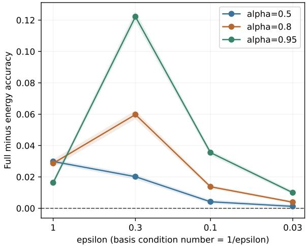

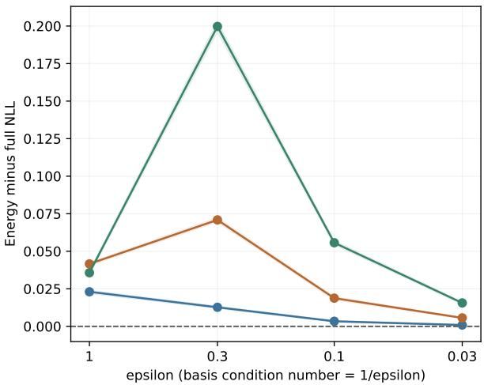  
Figure 18: Estimated energy-oracle gaps under increasingly ill-conditioned bases. Shading gives paired 95% intervals across eight independent panels. The finite sequence need not be monotone. A restriction to orthogonal or conditioning-controlled bases is substantive.

0.2. Equal class priors and zero means are known parts of the construction. Compare the supplied carriers with the first two right singular vectors of the unlabeled fitting windows; this estimates an informative subspace, rather than identifying physical carriers individually; no development or test vector enters that basis fit.

For each α, use $n = 3 0$ and 120 independent fitting windows per class, eight independent panels, 300 separate development windows per class, and 1,000 test windows per class. Three observation conditions are evaluated:

0 complete observations with noise standard deviation 0.2;

1 independently retain each coordinate with probability 0.5, with noise standard deviation 0.2;

2 use the same missingness law and draw each window’s noise standard deviation uniformly on [0.2, 0.8].

Masks and noise levels are known metadata and independent of class. The same complete fitting sample is reused across the three conditions within a panel; panels are independent within each condition. The 144 condition–panel evaluations share fitted models across conditions. The total labeled budget includes both the n fitting observations and the development sample. The covariance eigenvalue floor is 0.02, and of-diagonal shrinkage candidates are 0, 0.1, 0.3, selected by development multiclass negative log likelihood (NLL). Set Γ to the diagonal of the mean fitted class covariance.

Point-feature competitors receive the same reference posterior means and observation-quality metadata $( V _ { 1 1 } , V _ { 2 2 } , V _ { 1 2 } , \sigma _ { o } .$ , observed fraction) where specified. In the two incomplete conditions, their training sample contains five augmented views per original fitting record. Added noise has variance $\sigma _ { o } ^ { 2 } - 0 . 0 4$ , accounting for noise already present; independent masks then remove coordinates. The augmented views remain grouped by their source observation for uncertainty estimation. All methods use the same development and test units. The main controls are:

• signed-point QDA and OAS covariance shrinkage, with empirical means and ridge 0.0035;

• logistic regression on $m _ { 1 } , m _ { 2 } , m _ { 1 } ^ { 2 } , m _ { 2 } ^ { 2 } , m _ { 1 } m _ { 2 }$ and quality metadata, with $C \in \{ 0 . 1 , 1 , 1 0 \}$ ;

• the same regression with $( m _ { 1 } + m _ { 2 } ) ^ { 2 }$ replacing m1m2, still including signed linear terms; this is a redundant quadratic-feature control, not an energy-only classifier;

• a 100-tree forest on energies, normalized energies, and quality metadata, with depths 3, 6, 12;

• gradient boosting on signed coeficients and quality metadata, with 100 iterations and depths 2, 4, 6;

• raw-window OAS in condition 0, and the known-law Gaussian oracle in all conditions.

Each three-candidate family is selected by development NLL. The heterogeneous forest has more information than the two squared coordinates of the theorem; its comparison measures fitted procedure performance. The separate exact oracle experiment supplies the information-loss comparison.

Exploratory ablations. Fixed sensitivity controls, specified after the primary results were available, use the same saved units with no new tuning: zero-mean point QDA using uncentered covariances and the same 0.0035 ridge; a class-diagonal prior retaining fitted marginal mode variances and full observation integration; and a point-prior rule evaluating the same fitted coupled prior at m, omitting integration over V. These analyses use the same independently fitted panels as the primary comparisons. A fourth control uses one pooled full coeficient covariance to reconstruct without regime mixing. It is fitted from the same training observations, without the class-specific shrinkage selection. The zero-mean control removes an unnecessary mean-estimation disadvantage in the unrestricted-mean QDA comparison. The diagonal control removes class coupling. The point-prior control isolates what is lost by treating the reconstructed mean as exact.

## 10.2.2 Probability loss and reconstruction results

Tables 31–32 report the complete grid. NLL is the primary proper score; accuracy and multiclass Brier scores are also saved. With learned modes, sKMD has lower mean NLL than the energyand-quality forest and the quadratic logistic control in all 18 cells (point estimates). With paired t intervals over the eight panels (7 df), the reporting intervals, all 18 learned-mode intervals against the forest and 17 of 18 against quadratic logistic regression exclude zero in sKMD’s favor; the exception is quadratic logistic at $\alpha = 0 . 9 5 , n = 3 0$ , complete observations, with diference −0.0194 and interval $\left[ - 0 . 0 4 4 9 , 0 . 0 0 6 1 \right]$ . In the bootstrap sensitivity analysis (20,000 draws over eight panels, preserving the dependence among augmented views) all 18 intervals exclude zero for both controls. With supplied modes the t counts are 18 against the forest and 16 against quadratic logistic, the same as the bootstrap counts.

The matched zero-mean comparison is closer: sKMD has lower mean NLL than zero-mean point QDA in 14 of 18 learned-mode cells and 13 of 18 supplied-mode cells (point-estimate counts). Paired t intervals exclude zero in sKMD’s favor in only 3 learned-mode and 4 suppliedmode cells (bootstrap sensitivity analysis: 7 and 6). The bootstrap intervals that excluded zero in zero-mean QDA’s favor (4 learned-mode and 2 supplied-mode cells) all include zero under the t interval, so no cell is resolved in that control’s favor. At α = 0.8, n = 120, complete observations, learned-mode sKMD has NLL 0.8646 versus 0.8632 for zero-mean point QDA (paired diference +0.00141, t interval [−0.00021, 0.00303], bootstrap [0.00033, 0.00275]). With one fixed full observation law, signed coeficients already preserve the informative projection. Diferences there concern fitting, shrinkage and noise treatment, not recovered representation information.

At $\alpha = 0 . 9 5 , n = 1 2 0$ , missing coordinates and variable noise, learned-mode sKMD has NLL 0.6840 (Figure 19), compared with 0.6880 for zero-mean point QDA, 0.6957 for quadratic logistic regression, 0.7321 for the point-prior rule and 0.9239 for the energy-and-quality forest. The known-law oracle attains 0.6812.

Tables 33–34 retain the diagonal and point-prior ablations and reconstruction losses. The reference KMD uses one pooled diagonal coeficient prior; sKMD returns the regime-mixture conditional mean. With learned modes at $\alpha = 0 . 9 5 , n = 1 2 0$ , condition 2, mean signal MSE falls from 0.01586 to 0.01385, a 12.69% reduction in the ratio of mean losses. Supplied modes give a 15.63% reduction. In the weak-coupling complete-observation case the improvement is below 0.1% at $n = 3 0 \mathrm { : }$ : the coeficients are already accurately determined by the observations. The reconstruction comparison uses the stated independent-mode KMD prior. The stronger pooled full-covariance KMD control has MSE 0.01586 in this learned-subspace case and 0.01564 with supplied modes; sKMD reduces these mean losses by 12.69% and 12.90%, respectively. The pooled full and diagonal learned-basis fits coincide here because the basis diagonalizes the pooled training second moment. A diferently fitted dictionary remains a distinct comparison.

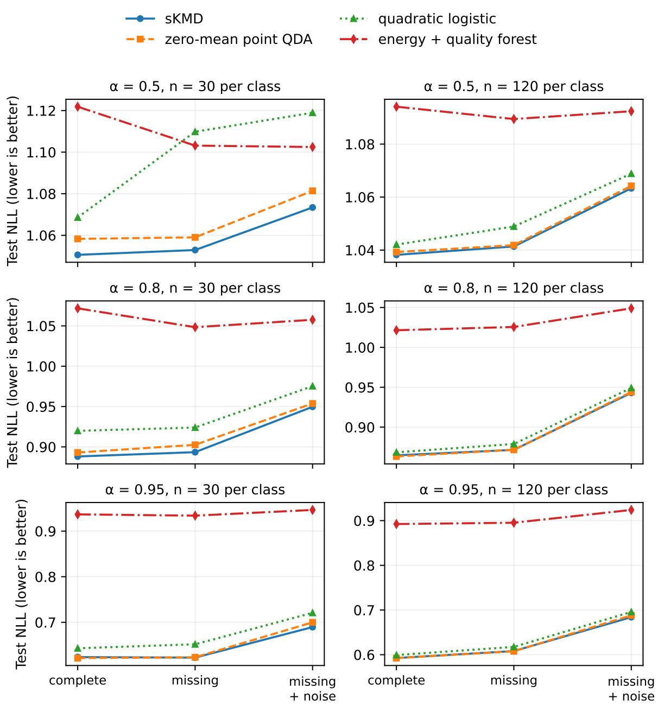  
Figure 19: The complete learned-mode grid. The advantage over separate energy features persists across fitting sizes and observation conditions. Zero-mean point QDA is often close, and occasionally slightly better, when the observation law is fixed. Curves join diferent observation conditions for readability, not a continuous parameter sweep.

Table 31: Test NLL with supplied carriers; lower is better. Conditions 0–2 are defined in the text. QDA/OAS estimate means; ZQ fixes zero means; Quad and Red are signed quadratic logistic controls; RF uses energies and quality; GB uses signed coeficients and quality. Every entry averages eight panels.
<table><tr><td>α</td><td>n 0</td><td></td><td>sKMD</td><td>QDA</td><td>OAS</td><td>ZQ</td><td>Quad</td><td>Red</td><td>RF</td><td>GB</td><td>Oracle</td></tr><tr><td>0.50</td><td>30 0</td><td></td><td>1.057</td><td>1.098</td><td>1.092</td><td>1.061</td><td>1.068</td><td>1.072</td><td>1.114</td><td>1.362</td><td>1.034</td></tr><tr><td>0.50</td><td>30 1</td><td></td><td>1.058</td><td>1.100</td><td>1.092</td><td>1.061</td><td>1.110</td><td>1.108</td><td>1.094</td><td>1.276</td><td>1.033</td></tr><tr><td>0.50</td><td>30 2</td><td></td><td>1.074</td><td>1.113</td><td>1.111</td><td>1.082</td><td>1.117</td><td>1.115</td><td>1.097</td><td>1.233</td><td>1.063</td></tr><tr><td>0.50</td><td>120 0</td><td></td><td>1.038</td><td>1.043</td><td>1.042</td><td>1.040</td><td>1.042</td><td>1.043</td><td>1.076</td><td>1.136</td><td>1.033</td></tr><tr><td>0.50</td><td>120</td><td>1</td><td>1.041</td><td>1.046</td><td>1.045</td><td>1.042</td><td>1.049</td><td>1.049</td><td>1.074</td><td>1.093</td><td>1.035</td></tr><tr><td>0.50</td><td>120</td><td>2</td><td>1.063</td><td>1.067</td><td>1.067</td><td>1.064</td><td>1.069</td><td>1.069</td><td>1.081</td><td>1.102</td><td>1.060</td></tr><tr><td>0.80</td><td>30 0</td><td></td><td>0.887</td><td>0.911</td><td>0.913</td><td>0.895</td><td>0.914</td><td>0.921</td><td>0.973</td><td>1.174</td><td>0.862</td></tr><tr><td>0.80</td><td>30 1</td><td></td><td>0.894</td><td>0.921</td><td>0.908</td><td>0.904</td><td>0.919</td><td>0.924</td><td>0.970</td><td>1.113</td><td>0.871</td></tr><tr><td>0.80</td><td>30 2</td><td></td><td>0.948</td><td>0.965</td><td>0.963</td><td>0.953</td><td>0.973</td><td>0.975</td><td>1.008</td><td>1.090</td><td>0.937</td></tr><tr><td>0.80</td><td>120</td><td>)0</td><td>0.863</td><td>0.866</td><td>0.866</td><td>0.863</td><td>0.869</td><td>0.869</td><td>0.928</td><td>0.952</td><td>0.858</td></tr><tr><td>0.80</td><td>120</td><td>1</td><td>0.871</td><td>0.874</td><td>0.873</td><td>0.871</td><td>0.878</td><td>0.880</td><td>0.942</td><td>0.931</td><td>0.866</td></tr><tr><td>0.80</td><td>120</td><td> 2</td><td>0.942</td><td>0.948</td><td>0.948</td><td>0.944</td><td>0.949</td><td>0.949</td><td>0.992</td><td>0.988</td><td>0.940</td></tr><tr><td>0.95</td><td>30 0</td><td></td><td>0.624</td><td>0.630</td><td>0.686</td><td>0.622</td><td>0.640</td><td>0.649</td><td>0.712</td><td>0.905</td><td>0.596</td></tr><tr><td>0.95</td><td>30 1</td><td></td><td>0.625</td><td>0.636</td><td>0.639</td><td>0.624</td><td>0.651</td><td>0.660</td><td>0.717</td><td>0.888</td><td>0.600</td></tr><tr><td>0.95</td><td>30 2</td><td></td><td>0.688</td><td>0.709</td><td>0.708</td><td>0.701</td><td>0.718</td><td>0.725</td><td>0.777</td><td>0.831</td><td>0.677</td></tr><tr><td>0.95</td><td>120</td><td>0</td><td>0.593</td><td>0.595</td><td>0.606</td><td>0.592</td><td>0.599</td><td>0.599</td><td>0.669</td><td>0.683</td><td>0.587</td></tr><tr><td>0.95</td><td>120</td><td>1</td><td>0.608</td><td>0.611</td><td>0.610</td><td>0.608</td><td>0.617</td><td>0.618</td><td>0.672</td><td>0.664</td><td>0.601</td></tr><tr><td>0.95</td><td>120 2</td><td></td><td>0.684</td><td>0.692</td><td>0.692</td><td>0.689</td><td>0.696</td><td>0.696</td><td>0.747</td><td>0.736</td><td>0.681</td></tr></table>

Table 32: Test NLL with modes learned from fitting observations only. Abbreviations and replication match Table 31. Rounding can hide small diferences; saved scores retain full precision.
<table><tr><td>α</td><td></td><td>n 0</td><td>sKMD</td><td>QDA</td><td>OAS</td><td>ZQ</td><td>Quad</td><td>Red</td><td>RF</td><td>GB</td><td>Oracle</td></tr><tr><td>0.50</td><td>30 0</td><td></td><td>1.051</td><td>1.095</td><td>1.090</td><td>1.058</td><td>1.069</td><td>1.078</td><td>1.122</td><td>1.349</td><td>1.034</td></tr><tr><td>0.50</td><td>301</td><td></td><td>1.053</td><td>1.098</td><td>1.090</td><td>1.059</td><td>1.110</td><td>1.104</td><td>1.103</td><td>1.304</td><td>1.033</td></tr><tr><td>0.50</td><td>30 2</td><td></td><td>1.073</td><td>1.113</td><td>1.110</td><td>1.081</td><td>1.119</td><td>1.117</td><td>1.102</td><td>1.235</td><td>1.063</td></tr><tr><td>0.50</td><td>120</td><td>0</td><td>1.038</td><td>1.043</td><td>1.042</td><td>1.039</td><td>1.042</td><td>1.044</td><td>1.094</td><td>1.141</td><td>1.033</td></tr><tr><td>0.50</td><td>120</td><td>1</td><td>1.041</td><td>1.046</td><td>1.045</td><td>1.042</td><td>1.049</td><td>1.049</td><td>1.089</td><td>1.093</td><td>1.035</td></tr><tr><td>0.50</td><td>120</td><td>2</td><td>1.063</td><td>1.067</td><td>1.067</td><td>1.064</td><td>1.069</td><td>1.069</td><td>1.092</td><td>1.105</td><td>1.060</td></tr><tr><td>0.80</td><td>30 0</td><td></td><td>0.888</td><td>0.910</td><td>0.915</td><td>0.893</td><td>0.920</td><td>0.930</td><td>1.072</td><td>1.169</td><td>0.862</td></tr><tr><td>0.80</td><td>30 1</td><td></td><td>0.893</td><td>0.920</td><td>0.908</td><td>0.903</td><td>0.924</td><td>0.939</td><td>1.048</td><td>1.112</td><td>0.871</td></tr><tr><td>0.80</td><td>30 2</td><td></td><td>0.950</td><td>0.967</td><td>0.965</td><td>0.954</td><td>0.975</td><td>0.984</td><td>1.058</td><td>1.097</td><td>0.937</td></tr><tr><td>0.80</td><td>120</td><td>0</td><td>0.865</td><td>0.866</td><td>0.867</td><td>0.863</td><td>0.868</td><td>0.869</td><td>1.021</td><td>0.959</td><td>0.858</td></tr><tr><td>0.80</td><td>120</td><td>1</td><td>0.872</td><td>0.874</td><td>0.874</td><td>0.872</td><td>0.879</td><td>0.880</td><td>1.026</td><td>0.929</td><td>0.866</td></tr><tr><td>0.80</td><td>120</td><td>2</td><td>0.943</td><td>0.947</td><td>0.948</td><td>0.944</td><td>0.949</td><td>0.950</td><td>1.049</td><td>0.992</td><td>0.940</td></tr><tr><td>0.95</td><td>30 0</td><td></td><td>0.624</td><td>0.630</td><td>0.686</td><td>0.622</td><td>0.643</td><td>0.654</td><td>0.937</td><td>0.844</td><td>0.596</td></tr><tr><td>0.95</td><td>30 1</td><td></td><td>0.623</td><td>0.636</td><td>0.639</td><td>0.623</td><td>0.652</td><td>0.667</td><td>0.934</td><td>0.818</td><td>0.600</td></tr><tr><td>0.95</td><td>30</td><td>2</td><td>0.690</td><td>0.708</td><td>0.710</td><td>0.700</td><td>0.721</td><td>0.728</td><td>0.946</td><td>0.823</td><td>0.677</td></tr><tr><td>0.95</td><td>120</td><td>0</td><td>0.593</td><td>0.595</td><td>0.606</td><td>0.592</td><td>0.599</td><td>0.606</td><td>0.892</td><td>0.690</td><td>0.587</td></tr><tr><td>0.95</td><td>120</td><td>1</td><td>0.608</td><td>0.611</td><td>0.610</td><td>0.608</td><td>0.617</td><td>0.619</td><td>0.895</td><td>0.664</td><td>0.601</td></tr><tr><td>0.95</td><td>120</td><td>2</td><td>0.684</td><td>0.692</td><td>0.692</td><td>0.688</td><td>0.696</td><td>0.696</td><td>0.924</td><td>0.740</td><td>0.681</td></tr></table>

## 10.2.3 Experimental scope

This controlled Gaussian mode-coupling problem connects the representation theorem to fitted inference. It compares KMD regime summaries and independent-mode reconstructions for both supplied and estimated dictionaries. The finite-sample theorem describes covariance estimation in known coordinates; the empirical procedure additionally estimates the basis, regularizes eigenvalues and selects tuning parameters on development data. The benchmark supplies rank two, known noise, zero means and class-independent observation metadata to all applicable methods.

Table 33: Supplied-mode ablations and reconstruction. Diag integrates the class-diagonal prior; Point evaluates the coupled prior at the reference mean. All MSE columns are multiplied by $1 0 ^ { 3 }$ ; Pool uses the pooled full-covariance prior; Gain is the percentage reduction in the ratio of mean MSEs.
<table><tr><td>α</td><td></td><td>n 0</td><td>sKMD NLL</td><td>Diag NLL</td><td>Point NLL</td><td>KMD MSE</td><td>Pool MSE</td><td>sKMD MSE</td><td>Gain</td></tr><tr><td>0.50</td><td></td><td>30 0</td><td>1.0567</td><td>1.0859</td><td>1.0583</td><td>1.208</td><td>1.207</td><td>1.207</td><td>0.07</td></tr><tr><td>0.50</td><td>30 1</td><td></td><td>1.0584</td><td>1.0857</td><td>1.0616</td><td>2.454</td><td>2.450</td><td>2.450</td><td>0.20</td></tr><tr><td>0.50</td><td>30 2</td><td></td><td>1.0742</td><td>1.0889</td><td>1.0802</td><td>10.965</td><td>10.898</td><td>10.885</td><td>0.73</td></tr><tr><td>0.50</td><td>120</td><td>0</td><td>1.0384</td><td>1.0652</td><td>1.0386</td><td>1.206</td><td>1.204</td><td>1.203</td><td>0.21</td></tr><tr><td>0.50</td><td>120</td><td>1</td><td>1.0409</td><td>1.0670</td><td>1.0413</td><td>2.433</td><td>2.429</td><td>2.426</td><td>0.26</td></tr><tr><td>0.50</td><td>120</td><td>2</td><td>1.0634</td><td>1.0787</td><td>1.0655</td><td>11.047</td><td>10.951</td><td>10.924</td><td>1.12</td></tr><tr><td>0.80</td><td>30 0</td><td></td><td>0.8875</td><td>0.9482</td><td>0.8907</td><td>1.219</td><td>1.214</td><td>1.210</td><td>0.73</td></tr><tr><td>0.80</td><td>30</td><td>1</td><td>0.8944</td><td>0.9545</td><td>0.9020</td><td>2.484</td><td>2.469</td><td>2.449</td><td>1.40</td></tr><tr><td>0.80</td><td>30</td><td>2</td><td>0.9478</td><td>0.9955</td><td>0.9752</td><td>12.973</td><td>12.660</td><td>12.292</td><td>5.25</td></tr><tr><td>0.80</td><td>120</td><td>0</td><td>0.8632</td><td>0.9256</td><td>0.8636</td><td>1.230</td><td>1.227</td><td>1.221</td><td>0.79</td></tr><tr><td>0.80</td><td>120</td><td>1</td><td>0.8709</td><td>0.9323</td><td>0.8715</td><td>2.498</td><td>2.486</td><td>2.458</td><td>1.61</td></tr><tr><td>0.80</td><td>120</td><td>2</td><td>0.9423</td><td>0.9871</td><td>0.9546</td><td>13.144</td><td>12.820</td><td>12.462</td><td>5.18</td></tr><tr><td>0.95</td><td>30</td><td>0</td><td>0.6237</td><td>0.7091</td><td>0.6297</td><td>1.251</td><td>1.248</td><td>1.227</td><td>1.91</td></tr><tr><td>0.95</td><td>30</td><td>1</td><td>0.6250</td><td>0.7164</td><td>0.6359</td><td>2.584</td><td>2.572</td><td>2.474</td><td>4.24</td></tr><tr><td>0.95</td><td>30 2</td><td></td><td>0.6883</td><td>0.7661</td><td>0.7888</td><td>16.225</td><td>15.682</td><td>13.586</td><td>16.27</td></tr><tr><td>0.95</td><td>120</td><td>0</td><td>0.5926</td><td>0.6919</td><td>0.5949</td><td>1.233</td><td>1.230</td><td>1.207</td><td>2.10</td></tr><tr><td>0.95</td><td>120</td><td>1</td><td>0.6082</td><td>0.7041</td><td>0.6143</td><td>2.552</td><td>2.537</td><td>2.438</td><td>4.48</td></tr><tr><td>0.95</td><td>120</td><td>2</td><td>0.6839</td><td>0.7677</td><td>0.7449</td><td>16.147</td><td>15.640</td><td>13.623</td><td>15.63</td></tr></table>

Table 34: Learned-mode ablations and reconstruction, using the same conventions as Table 33.
<table><tr><td>α</td><td></td><td>n o</td><td>sKMD NLL</td><td>Diag NLL</td><td>Point NLL</td><td>KMD MSE</td><td>Pool MSE</td><td>sKMD MSE</td><td>Gain</td></tr><tr><td>0.50</td><td></td><td>300</td><td>1.0506</td><td>1.0865</td><td>1.0512</td><td>2.089</td><td>2.089</td><td>2.089</td><td>0.03</td></tr><tr><td>0.50</td><td>30 1</td><td></td><td>1.0529</td><td>1.0902</td><td>1.0541</td><td>3.357</td><td>3.357</td><td>3.356</td><td>0.03</td></tr><tr><td>0.50</td><td>30 2</td><td></td><td>1.0734</td><td>1.0930</td><td>1.0771</td><td>11.656</td><td>11.656</td><td>11.645</td><td>0.09</td></tr><tr><td>0.50</td><td>120</td><td>0</td><td>1.0382</td><td>1.0824</td><td>1.0383</td><td>1.432</td><td>1.432</td><td>1.431</td><td>0.05</td></tr><tr><td>0.50</td><td>120</td><td>1</td><td>1.0414</td><td>1.0840</td><td>1.0418</td><td>2.667</td><td>2.667</td><td>2.664</td><td>0.09</td></tr><tr><td>0.50</td><td>120</td><td>2</td><td>1.0633</td><td>1.0888</td><td>1.0641</td><td>11.163</td><td>11.163</td><td>11.138</td><td>0.22</td></tr><tr><td>0.80</td><td>30 0</td><td></td><td>0.8881</td><td>1.0257</td><td>0.8896</td><td>2.136</td><td>2.136</td><td>2.131</td><td>0.23</td></tr><tr><td>0.80</td><td>30</td><td>1</td><td>0.8935</td><td>1.0261</td><td>0.8971</td><td>3.433</td><td>3.433</td><td>3.410</td><td>0.69</td></tr><tr><td>0.80</td><td>30</td><td>2</td><td>0.9497</td><td>1.0436</td><td>0.9646</td><td>13.525</td><td>13.525</td><td>13.171</td><td>2.62</td></tr><tr><td>0.80</td><td>120</td><td>0</td><td>0.8646</td><td>1.0144</td><td>0.8648</td><td>1.436</td><td>1.436</td><td>1.430</td><td>0.44</td></tr><tr><td>0.80</td><td>120</td><td>1</td><td>0.8715</td><td>1.0186</td><td>0.8717</td><td>2.698</td><td>2.698</td><td>2.670</td><td>1.05</td></tr><tr><td>0.80</td><td>120</td><td>2</td><td>0.9430</td><td>1.0409</td><td>0.9503</td><td>13.014</td><td>13.014</td><td>12.663</td><td>2.70</td></tr><tr><td>0.95</td><td>30</td><td>0</td><td>0.6237</td><td>0.9254</td><td>0.6290</td><td>2.248</td><td>2.248</td><td>2.227</td><td>0.92</td></tr><tr><td>0.95</td><td>30</td><td>1</td><td>0.6226</td><td>0.9288</td><td>0.6340</td><td>3.618</td><td>3.618</td><td>3.517</td><td>2.78</td></tr><tr><td>0.95</td><td>30</td><td>2</td><td>0.6895</td><td>0.9375</td><td>0.7699</td><td>16.724</td><td>16.724</td><td>14.627</td><td>12.54</td></tr><tr><td>0.95</td><td>120</td><td>0</td><td>0.5926</td><td>0.9035</td><td>0.5947</td><td>1.448</td><td>1.448</td><td>1.425</td><td>1.60</td></tr><tr><td>0.95</td><td>120</td><td>1</td><td>0.6082</td><td>0.9082</td><td>0.6119</td><td>2.758</td><td>2.758</td><td>2.658</td><td>3.62</td></tr><tr><td>0.95</td><td>120</td><td>2</td><td>0.6840</td><td>0.9279</td><td>0.7321</td><td>15.860</td><td>15.860</td><td>13.848</td><td>12.69</td></tr></table>

## 11 Discussion

## 11.1 Contribution and connections

The sKMD construction turns a KMD reference posterior into a joint regime-conditioned mode law. It combines a learned relation between modes and regimes with observation uncertainty, and uses the resulting regime posterior for classification and reconstruction. Its exact reduction to KMD identifies the additional information supplied by the regime law.

The main contribution is the representation theory of Part I, which explains how observation quality changes the information needed for inference. At fixed quality, a shared part of the precision matrices can cancel from the decision rule (Theorem 3.1), and a three-regime family has no suficient nonredundant energy basis (Theorem 3.2). Independently varying coordinate noise constrains the cancellation through the covariance graph (Theorem 4.1). For distinct centered covariance laws, fully correlated noise variation requires the complete quadratic span for a fixed linear log-odds decoder (Theorem 4.4). The approximation and learning bounds connect these structural results to feature budgets, representation error and statistical estimation. Their explicit constants are conservative: the conditioning-controlled information bounds are positivity statements several orders of magnitude below the numerical estimates from exact Bayes energy posteriors (Table 2).

The posterior interface itself builds on established Gaussian conditioning, QDA, factor models, mixture inference and temporal filtering [3, 15, 88]. Gaussian conditioning, a matched latent-Gaussian likelihood or an identical Gaussian HMM gives the same answer under the same parameters, so the interface is a reformulation; its value lies in connecting these operations to the representation results. The use of local Fourier packets, envelope/order coordinates and principal-subspace approximation likewise draws on established representations. Their role here is specified by the associated KMD regime law and the matched comparisons.

## 11.2 Interpreting the controlled and adaptive results

The binary study identifies a precise connection between observation uncertainty and calibration. Its energy posterior is uniform by symmetry, and its noisy log odds are an exact qualitydependent rescaling of the noiseless log odds. The prespecified gain over one globally calibrated point rule therefore measures mainly that rule’s restricted temperature grid; quality-aware calibration removes 97.7% of it. We conjecture that the small resolved residual reflects fitting error and departure from exact reflection symmetry in the estimated laws, but this attribution has not been tested. This experiment supplies a mechanism example rather than evidence that explicit integration must outperform every quality-aware signed classifier.

The three-regime study extends the comparison to partial energy information and continuously varying quality. A fitted estimator recovers enough signed information to improve on the development-rotated energy oracle. The primary gain over the selected signed classifier is 0.00246 nats; the retrospective centered signed control, which matches the Gaussian fit’s symmetry, gives a gain of 0.00116 nats. These are statistically resolved probability-score diferences with small efects on geometric mean true-class probability, and the matched comparison reverses when the noise monitor underreports the noise variance. A conservative probability at very high noise also need not yield useful classification accuracy. Task-specific decision costs are needed to assign practical utility to these score diferences; the illustrative 0.02-nat calculations are sensitivity analyses rather than application-derived equivalence claims.

The adaptive and nonstationary studies identify useful reconstruction and calibration settings, including heterogeneous observation quality, learned carriers and temporal regimes. Strong signed and pooled-prior controls identify which part of a gain comes from retained interactions, regime conditioning or dictionary averaging. The increment over a strong signed Gaussian head can be modest even when the contrast with separate energies is substantial; for the adaptive oscillators, an energy-interaction logistic classifier has lower mean NLL than sKMD, although with eight panels neither paired contrast is resolved. In the nonstationary examples, much of the reconstruction improvement over independent-mode KMD is also obtained by a pooled full covariance. Carrier averaging accounts for covered changes in the carrier family, while introducing a computational and estimation budget; for fading, the independent-mode mixture reconstructs better than the coupled mixture.

These comparisons also identify conditions for application design. A trigger or phase convention must align the modal coordinates; changing the trigger and dictionary can reverse a reconstruction gain. The combined trigger/dynamics stress does not identify their separate causal efects. Observation-noise integration assumes a correctly specified carrier law. The finite carrier library does not establish robustness to arbitrary frequency, envelope or mode-count changes. The fixed-class chirp and fading studies concern time-varying carrier laws rather than tracking a changing excitation class. Changed regime hazards and uncertain transition locations require their own temporal comparisons: an improvement averaged over a trajectory need not imply sharper localization at a switch. Supplying noise features to a discriminative head does not itself ensure extrapolation beyond its training-quality range; that outcome does not imply that all discriminative estimators must behave in the same way. In the ringdown study, the reconstruction efect is more stable across independent panels than the classification ranking, and the large tail loss demonstrates the importance of class-law calibration even when average accuracy is maintained.

## 11.3 Representation, estimation and adaptive selection

The information bounds are population statements under their stated class families and decoder restrictions. Their constants may be conservative or much smaller than finite-sample estimation error. Exact insuficiency of a summary therefore need not produce a practically large fitted advantage. The conditioning-controlled bound also permits its lower bound to vanish as the allowed condition number grows; the exact coordinate calculation does not quantify finiteprecision stability of near-singular summaries. Proper-score gaps, zero–one error gaps and stable numerical rank remain distinct quantities.

Hausdorf-based Kernel Flows use geometric error to learn attractors and more general invariant sets [62, 93]. Marked metric–measure selection likewise distinguishes geometric fit from prediction of a designated label [40]. Here log loss measures the cost of omitting modal contrasts relevant to a regime label, even if a representation reconstructs trajectories or invariant sets accurately.

The finite-library result supplies an explicit suficient benefit condition under independent selection, Gaussian class laws and controlled span leakage. Its demonstrated fitted benefit concerns the specified energy oracle and sampling design, rather than every invertible energy basis or every adaptive microlocal extraction procedure. Shared interactions can cancel, energies can already be suficient, heavy noise can attenuate the relevant interaction, and covariance estimation can cost more than the information it recovers. The selected-dictionary perturbation bound is conditional on its estimation errors; it does not guarantee EM convergence or remove dictionary-learning uncertainty. Estimating a general ambient noise covariance can also be costly.

Same-record carrier selection requires a coherent treatment of its selection event. Conditional Gaussian integration with a selected dictionary alone does not integrate frequency, phase or model-selection uncertainty. The finite-grid and upstream-code checks establish numerical agreement at the tested interfaces and resolutions. The fixed-band and global adaptive extraction procedures remain distinct, and continuum convergence requires analysis beyond the tested refinement. These distinctions motivate further analysis of adaptive representations and estimated observation covariances.

## 11.4 Recorded signals and physical validation

The recorded-signal sequence shows the importance of matching the representation and class law to the task. Robust regime laws with past-RR features, combined with observation integration, improve the declared INCART comparison under added noise; localization improves the reconstruction span but was not needed for classification, since the robust global seven-dimensional model is better in three of five conditions. Order coordinates provide a physical normalization for the bearing study, whose severe-telemetry condition benefits from uncertainty integration. The complete comparisons also include native or milder conditions favoring point inference, stronger waveform or pooled-prior controls, and changes in ranking under operating-condition shifts.

The global-carrier ECG and absolute-frequency bearing studies show that accurate likelihood algebra does not ensure an adequate representation or regime law: in MIT–BIH, point QDA and waveform PCA/RBF have lower NLL than sKMD and no comparison survives the declared Holm family, and at the unseen bearing speed every learned method is worse than uniform prediction. Event alignment alone does not establish physiological modes, and a returned bearing ridge is not automatically a physical fault mechanism. A low-dimensional span cannot recover components outside that span; robust integration addresses a specified working noise law rather than proving that the original recording noise follows it. Annotation timing, correlated artifacts and the finite covariance-scale library are further working-model components to assess in recorded signals. The bearing sampling-axis conventions and the small number of development units are additional sources of uncertainty whose separate causal efects were not identified by the absolute-frequency transfer experiment.

The INCART classification gain is suggestive rather than conclusive: it rests on one-sided tests with Holm-adjusted $p = 0 . 0 4 2 3 5$ , conditional on four overlapping cross-fits, and the twosided interval for the point comparison includes zero. Over the four fold refits, neither fold-level t interval excludes zero (point QDA [−0.140, 0.028], PCA43 [−0.061, 0.015]), and leaving out any one fold gives a family Holm p between 0.059 and 0.102. Neither practical margin is met. Recorded-reference reconstruction is worse than both strong controls: mean squared error is 0.010579 mV2 for sKMD, against 0.009151 for the independently fitted pooled full prior and 0.008119 for PCA43. The bearing test cohort contains one healthy and one real-damaged bearing; it does not support a population-level claim about balanced natural damage. These cohort compositions and the patient cross-fitting structure should guide the design of larger physical confirmation studies.

In the recorded-data experiments, observation quality is varied through declared corruption and missingness, with the associated observation model supplied to the inference procedures. The recorded waveforms also contain physiological and sensor variation, so reconstruction toward them is recorded-reference recovery. These experiments do not yet establish a general advantage under naturally varying, independently calibrated sensor noise. That validation requires independent noise measurements predictive of the scored record, externally aligned modes, and confirmation separated by acquisition unit. MEG-SCANS ofers a concrete resource with stimulus-locked recordings from 24 participants and empty-room measurements before and after sessions [36]. Empty-room measurements provide independent noise references; their transfer to in-task conditions remains a question for the proposed study.

## 11.5 Statistical scope and research directions

The independently fitted controlled panels quantify sampling variability under the specified laws. The six-panel application intervals are descriptive, and the ECG patient intervals condition on overlapping training fits. Repeating windows, bootstrap draws or corrupted views does not create additional independent units. Equivalence at level 0.05 requires a specified margin and the corresponding two one-sided tests, or a 90% interval wholly inside that margin. A nonsignificant contrast or numerical agreement alone does not establish it.

The comparison inventory lists the outcomes and their uncertainty units. Its counts include overlapping outputs, so they represent reported comparisons rather than independent discoveries. Local Holm adjustments apply to their specified families; they do not provide a study-wide error guarantee. Only the binary primary family, the three-regime primary endpoint and the INCART primary classification family are confirmatory; the retrospective calibration and sensitivity analyses and all other application intervals are exploratory. Most prespecified practical criteria were not met: apart from the binary experiment’s illustrative margin, the switching study’s observation-shift NLL and MSE are the only cases in which a criterion was

met (Table 6).

Future theoretical work can sharpen the fitted-risk bounds, analyze observation-covariance estimation and same-record selection, and extend the Gaussian suficiency results to additional non-Gaussian families, including finite mixtures. Future applications can combine independently measured quality with task-specific waveform and covariance controls, a primary decision endpoint, and an operational tolerance set before confirmation.

## 12 Conclusion

sKMD expresses supervised regime inference and regime-conditioned reconstruction through the posterior of a KMD mode decomposition. Its posterior transfer is standard Gaussian conditioning; the theory in Part I is the main contribution. It characterizes when fixed mode energies remain suficient as observation quality varies, shows that correlated noise variation forces the full quadratic span for any fixed linear decoder, gives an exact three-regime obstruction with explicit but conservative positivity bounds, and bounds the cost of learning mode spans and regime covariances from finite data.

The applications in Part II show where these mechanisms matter in practice. In controlled experiments the integration gains are statistically resolved but small: 0.00246 nats in the primary three-regime comparison and 0.00116 nats against a symmetry-matched retrospective control, which reverses under a biased noise monitor. In the binary experiment most of the gain over a point rule is recovered by quality-aware calibration. In learned and recorded signals, integration helped under declared synthetic degradations (added ECG noise, with suggestive confirmatory evidence, and severe simulated bearing telemetry), whereas at native quality or under operating-condition shift simpler controls were as good or better. Modal dependence, observation uncertainty, carrier averaging and temporal filtering each contributed in some settings and not in others. Together, the theory and the evidence specify what a regime-inference method on KMD representations must retain, and when the additional modeling is worth its cost.

## Appendices

## A Protocol and complete results for the 64-panel test

The executable protocol specifies the generating laws, fitting rules and random seeds; its location and the seed formulas are recorded in Appendix D. Classes are balanced in each split. Each event is an independent draw; each panel is fitted independently. Conditions share a fitted model, and uncertainty is evaluated across independently fitted panels.

Carriers and observation law. On 48 equally spaced times in $[ 0 , 1 ]$ , form $e ^ { - t } \cos ( 6 \pi t )$ and $e ^ { - 0 . 7 t } \cos ( 1 4 \pi t )$ , orthonormalize their columns, and choose positive first entries. Write the resulting matrix as H. The primary data are the modal measurements $Z = C + \varepsilon$ , not an adaptively estimated carrier representation. Synthesized signals are $H C ;$ coeficient MSE and signal mean-square error difer only by the fixed factor $2 / 4 8$ . Dense checks use the equivalent waveform covariance

$$
\begin{array} { r } { R _ { \sigma } = \sigma ^ { 2 } H H ^ { \top } + 0 . 0 1 ( I - H H ^ { \top } ) } \end{array}
$$

and a class-independent orthogonal noise realization. This controlled measurement model supplies each method with the exact noise variance.

The low-noise condition fixes $\sigma = 0 . 0 5 ;$ very high noise fixes $\sigma = 3$ outside the fitting support. Student impulses multiply each Gaussian coeficient vector by $\sqrt { 3 / U } , U \sim \chi _ { 5 } ^ { 2 }$ , preserving covariance. They change the latent law, not the sensor-error law. In the null arm, an independent random sign multiplies the second coeficient in every role. Its class density is exactly the same equal mixture of the positive- and negative-correlation laws, before and after convolution with isotropic noise. The numerical null check confirms that mixture identity; the generator is verified independently against the same identity.

Fitting and equal information. Gaussian means and covariances are estimated from fitting observations; the average known noise covariance is subtracted from the within-class sample covariance. Eigenvalues are floored at 0.05. Development NLL selects diagonal shrinkage in $\{ 0 , 0 . 1 , 0 . 3 , 0 . 6 \}$ and temperature in {0.5, 0.75, 1, 1.5, 2, 3, 4}. Same-law point inference retains the selected means and covariances, omits $\sigma ^ { 2 } I$ from its test likelihood, and independently chooses temperature. Signed OAS-QDA fits observed coeficients and uses the same temperature grid.

The two logistic controls have 17 features each. Signed base features are $( z _ { 1 } , z _ { 2 } , z _ { 1 } ^ { 2 } , z _ { 2 } ^ { 2 } , z _ { 1 } z _ { 2 } ) \colon$ energy base features are $( e _ { 1 } , e _ { 2 } , e _ { 1 } e _ { 2 } , e _ { 1 } ^ { 2 } , e _ { 2 } ^ { 2 } ) , e _ { i } = z _ { i } ^ { 2 }$ . Each five-vector is multiplied by $1 , r , r ^ { 2 }$ where $r = ( 1 + \sigma ^ { 2 } ) ^ { - 1 }$ ; two additional quality coordinates are $1 - r$ and $( 1 - r ) ^ { 2 }$ . Fitting-only standardization, $C \in \{ 0 . 0 1 , 0 . 1 , 1 , 1 0 \}$ and the same temperature grid complete the common budget. Independent-mode KMD energies are invertible rescalings of $( e _ { 1 } , e _ { 2 } )$ when quality is supplied, so this representation does not discard additional information through normalization. These are fitted discriminative controls, not an exact energy-posterior oracle.

The robust priors are finite Gaussian covariance-scale mixtures. The initial scales $2 ^ { - 3 } , \dots , 2 ^ { 8 }$ receive inverse-gamma shape/scale $5 / 2$ bin probabilities, with geometric bin edges, and are normalized to have weighted mean one. Finite-mixture evidence and conditional means are evaluated exactly. The finite scale law defines the fitted approximation to the continuous Student model under noise. The same-mixture point head omits observation variance but shares the fitted robust law; the independently fitted point-mixture head fits uncorrected observed moments with its own common shrinkage/temperature grid.

Table 35 reports every classifier in every condition.

Table 35: Every classifier’s mean NLL across 64 panels. Heterogeneous noise is primary; all other columns are secondary. “Selected signed” is quality-interaction logistic in every positive panel and is separately selected in the null arm.
<table><tr><td>Method</td><td>Heterogeneous</td><td>Low</td><td>Very high</td><td>Student</td><td>Null</td></tr><tr><td>Integrated Gaussian</td><td>0.5826</td><td>0.5023</td><td>0.6912</td><td>0.6060</td><td>0.6937</td></tr><tr><td>Selected signed</td><td>0.5846</td><td>0.5011</td><td>0.9609</td><td>0.6081</td><td>0.6939</td></tr><tr><td>Same-law point</td><td>0.6511</td><td>0.5833</td><td>1.7004</td><td>0.6642</td><td>0.6954</td></tr><tr><td>Signed OAS-QDA</td><td>0.6454</td><td>0.6034</td><td>1.3576</td><td>0.6557</td><td>0.6936</td></tr><tr><td>Signed quality interaction</td><td>0.5846</td><td>0.5011</td><td>0.9609</td><td>0.6081</td><td>0.6936</td></tr><tr><td>Energy interaction</td><td>0.6937</td><td>0.6937</td><td>0.7847</td><td>0.7236</td><td>0.6937</td></tr><tr><td>Integrated scale mixture</td><td>0.5863</td><td>0.5122</td><td>0.6912</td><td>0.5973</td><td>0.6936</td></tr><tr><td>Same-mixture point</td><td>0.6220</td><td>0.5567</td><td>0.8314</td><td>0.6342</td><td>0.6937</td></tr><tr><td>Fitted point mixture</td><td>0.6237</td><td>0.5612</td><td>0.8824</td><td>0.6367</td><td>0.6934</td></tr><tr><td>Uniform</td><td>0.6931</td><td>0.6931</td><td>0.6931</td><td>0.6931</td><td>0.6931</td></tr></table>

Table 36: Coeficient MSE, averaged over coordinates, events and then independent panels. The reconstruction comparisons are secondary and include all observation conditions.
<table><tr><td>Method</td><td>Heterogeneous</td><td>Low</td><td>Very high</td><td>Student</td><td>Null</td></tr><tr><td>Integrated Gaussian</td><td>0.29613</td><td>0.00249</td><td>0.90226</td><td>0.29229</td><td>0.29878</td></tr><tr><td>Integrated scale mixture</td><td>0.29996</td><td>0.00250</td><td>0.90502</td><td>0.28300</td><td>0.30056</td></tr><tr><td>Point-weighted Gaussian</td><td>0.29893</td><td>0.00250</td><td>0.92177</td><td>0.29533</td><td>0.29870</td></tr><tr><td>Selected-signed weights</td><td>0.29645</td><td>0.00249</td><td>0.91520</td><td>0.29297</td><td>0.29875</td></tr><tr><td>Pooled full KMD</td><td>0.29937</td><td>0.00250</td><td>0.90249</td><td>0.30071</td><td>0.29879</td></tr><tr><td>Independent-mode KMD</td><td>0.29916</td><td>0.00250</td><td>0.90207</td><td>0.30049</td><td>0.29867</td></tr></table>

Reconstruction and scope. Gaussian and robust integration use temperature-calibrated class weights with untempered class-conditional means. They are therefore calibrated mixture estimators, not necessarily the posterior mean of the original untempered generative model. The two point-weighted controls reuse the same Gaussian conditional means and change only their class weights. The pooled full prior aggregates selected class covariances and between-mean variation; it is not an independently tuned pooled fit. Independent-mode KMD retains only its diagonal. The target here is simulated latent coeficients, unlike the recorded-reference targets in the external studies. Table 36 reports every reconstruction in every condition.

Statistical interpretation and verification. Two primary NLL diferences use paired t intervals and two-sided Holm adjustment across the two endpoints. Separate Holm families test the illustrative 0.02-nat improvement and equivalence margins; equivalence uses TOST and 90% intervals. The 0.02-nat margin is an illustrative sensitivity threshold. The prespecified signed-versus-energy contrast and every stress/control/reconstruction comparison are secondary. Threshold calculations are interpreted for the specified NLL contrasts; MSE is reported on its own scale. Tail losses are not clipped. Panel means, rather than individual events or correlated conditions, determine uncertainty.

## B Three-regime protocol and complete result grid

The executable protocol specifies the generating laws, fitting rules and seeds; its location and the seed formulas are recorded in Appendix D. The three-regime design develops the representation question studied in the binary example using independently generated test observations and model fits. Class labels are balanced and shufled within every split. The 64 panels, rather than individual events or shared conditions, are the replication units for each reported contrast.

Moment fit and controls. Known-zero-mean second moments use $n _ { k } ^ { - 1 } \sum _ { i } z _ { i } z _ { i } ^ { \top }$ minus the class average supplied variance times $I _ { 2 }$ . Eigenvalues are floored at 0.05, and of-diagonal shrinkage is selected from $\{ 0 , 0 . 1 , 0 . 3 , 0 . 6 \}$ . Continuous inverse temperature $\beta \in [ 0 , 1 0 0 ]$ , including zero, minimizes development NLL. All point and discriminative controls receive the same continuous calibration range; the point rule therefore has no fixed upper temperature cap. Gaussian conditional means themselves are untempered.

Let $r = ( 1 + \sigma ^ { 2 } ) ^ { - 1 }$ and $q = 1 - r$ . Signed base features are $( z _ { 1 } , z _ { 2 } , z _ { 1 } ^ { 2 } , z _ { 2 } ^ { 2 } , z _ { 1 } z _ { 2 } )$ ; energy base features are $( e _ { 1 } , e _ { 2 } , e _ { 1 } e _ { 2 } , e _ { 1 } ^ { 2 } , e _ { 2 } ^ { 2 } )$ with $e _ { i } = z _ { i } ^ { 2 }$ . Multiplying by $1 , r , r ^ { 2 }$ and appending $q , q ^ { 2 }$ gives 17 features in each case. For the quality-logit calibrator, the base vector contains the two class-versus-zero logits of the selected untempered point Gaussian law; the same expansion gives 8 features. Multinomial logistic regression uses fitting-only standardization, regularization $C \in$ $\{ 0 . 0 1 , 0 . 1 , 1 , 1 0 \}$ , and development-selected continuous temperature. All test predictions use fixed fitted parameters. The signed selector uses development NLL among that logit calibrator, signed quality-quadratic logistic and signed OAS-QDA.

Known-law energy likelihoods sum the Gaussian likelihood over the four coordinate-sign choices; their common Jacobian cancels from class odds. The rotated-energy oracle searches the 37 angles $\theta _ { j } = j \pi / 7 4 , j = 0 , \ldots , 3 6$ , using development NLL. Its reported performance is on independent test observations. Oracles receive the true noise covariance even in the biasedmonitor stress condition, whereas fitted methods receive the stated miscalibrated monitor. They are explicit privileged-information references in that condition.

Centered signed sensitivity. The fitted Gaussian uses central symmetry by fixing its means to zero. A retrospective signed control also enforces that symmetry: its base is $( z _ { 1 } ^ { 2 } , z _ { 2 } ^ { 2 } , z _ { 1 } z _ { 2 } )$ expanded by $1 , r , r ^ { 2 }$ and $q , q ^ { 2 }$ to 11 features. It uses the same fitting standardization, regularization and continuous calibration rules. This exploratory head was specified after the primary results and is evaluated separately from the primary selector and endpoint.

Complete conditions and units. The primary test samples continuous source quality independently of class. The high-noise condition fixes $\sigma = 3$ . The monitor-bias condition draws the same source noise but supplies only half its true variance to every fitted method. No parameters are retuned in either stress condition. The single primary NLL contrast uses a paired t interval and two-sided t test with 63 degrees of freedom. Other intervals are pointwise secondary descriptions of the specified contrasts. For $\mathrm { N L L } , \exp ( - \Delta )$ is the ratio of geometric mean trueclass probabilities; this interpretation does not apply to squared reconstruction error. Tables 37 and 38 report every method in every condition.

Table 37: Every three-regime classifier and condition. Lower NLL is better. The high-noise and biased-monitor columns are secondary. Oracle parameters are known; fitted methods use the stated fitting budget.
<table><tr><td>Fit events</td><td>Method</td><td>Continuous</td><td>High noise</td><td>Biased monitor</td></tr><tr><td>600</td><td>Integrated Gaussian</td><td>1.03934</td><td>1.09599</td><td>1.04935</td></tr><tr><td>600</td><td>Selected signed</td><td>1.04273</td><td>1.22756</td><td>1.04872</td></tr><tr><td>600</td><td>Continuous global point</td><td>1.05992</td><td>1.58551</td><td>1.05998</td></tr><tr><td>600</td><td>Quality-logit calibration</td><td>1.04399</td><td>1.22794</td><td>1.05049</td></tr><tr><td>600</td><td>Signed quality quadratic</td><td>1.04368</td><td>1.21308</td><td>1.04820</td></tr><tr><td>600</td><td>Energy quality polynomial</td><td>1.06278</td><td>1.46583</td><td>1.06759</td></tr><tr><td>600</td><td>Signed OAS-QDA</td><td>1.05862</td><td>1.56495</td><td>1.05849</td></tr><tr><td>600</td><td>Oracle signed</td><td>1.03226</td><td>1.09570</td><td>1.03147</td></tr><tr><td>600</td><td>Oracle fixed energies</td><td>1.05206</td><td>1.09687</td><td>1.05147</td></tr><tr><td>600</td><td>Oracle rotated energies</td><td>1.04348</td><td>1.09625</td><td>1.04252</td></tr><tr><td>600</td><td>Uniform</td><td>1.09861</td><td>1.09861</td><td>1.09861</td></tr><tr><td>600</td><td>Centered signed quadratic</td><td>1.04059</td><td>1.25268</td><td>1.04637</td></tr><tr><td>2400</td><td>Integrated Gaussian</td><td>1.03371</td><td>1.09578</td><td>1.04537</td></tr><tr><td>2400</td><td>Selected signed</td><td>1.03617</td><td>1.20310</td><td>1.04568</td></tr><tr><td>2400</td><td>Continuous global point</td><td>1.05494</td><td>1.61454</td><td>1.05535</td></tr><tr><td>2400</td><td>Quality-logit calibration</td><td>1.03612</td><td>1.18777</td><td>1.04630</td></tr><tr><td>2400</td><td>Signed quality quadratic</td><td>1.03637</td><td>1.20773</td><td>1.04477</td></tr><tr><td>2400</td><td>Energy quality polynomial</td><td>1.05642</td><td>1.44939</td><td>1.06526</td></tr><tr><td>2400</td><td>Signed OAS-QDA</td><td>1.05354</td><td>1.59880</td><td>1.05352</td></tr><tr><td>2400</td><td>Oracle signed</td><td>1.03185</td><td>1.09573</td><td>1.03273</td></tr><tr><td>2400</td><td>Oracle fixed energies</td><td>1.05196</td><td>1.09680</td><td>1.05178</td></tr><tr><td>2400</td><td>Oracle rotated energies</td><td>1.04290</td><td>1.09629</td><td>1.04332</td></tr><tr><td>2400</td><td>Uniform</td><td>1.09861</td><td>1.09861</td><td>1.09861</td></tr><tr><td>2400</td><td>Centered signed quadratic</td><td>1.03487</td><td>1.21709</td><td>1.04442</td></tr></table>

Table 38: Every three-regime reconstruction condition, measured by coeficient MSE. The selected-signed reconstruction shares the integrated method’s Gaussian conditional means and changes only the class weights.
<table><tr><td>Fit events</td><td>Reconstruction</td><td>Continuous</td><td>High noise</td><td>Biased monitor</td></tr><tr><td>600</td><td>Integrated regime</td><td>0.44660</td><td>1.26067</td><td>0.48992</td></tr><tr><td>600</td><td>Selected-signed weights</td><td>0.44675</td><td>1.27209</td><td>0.48918</td></tr><tr><td>600</td><td>Pooled full KMD</td><td>0.44867</td><td>1.26087</td><td>0.48874</td></tr><tr><td>600</td><td>Independent KMD</td><td>0.45448</td><td>1.27021</td><td>0.49598</td></tr><tr><td>2400</td><td>Integrated regime</td><td>0.44467</td><td>1.25527</td><td>0.49124</td></tr><tr><td>2400</td><td>Selected-signed weights</td><td>0.44485</td><td>1.26189</td><td>0.49071</td></tr><tr><td>2400</td><td>Pooled full KMD</td><td>0.44704</td><td>1.25556</td><td>0.48887</td></tr><tr><td>2400</td><td>Independent KMD</td><td>0.45370</td><td>1.26505</td><td>0.49644</td></tr></table>

## C Computational record of the comparisons

The script comparison\_inventory.py of the numerical package (Appendix D) enumerates a declared set of delivered summaries using one focal method–comparator–condition–metric tuple per entry. Each row records its input checksum, JSON location, statistical unit and numerical value.

<table><tr><td>Object</td><td>Count</td></tr><tr><td>Summary artifacts</td><td>12</td></tr><tr><td>Artifact-condition entries</td><td>48</td></tr><tr><td>Method-condition-metric estimates</td><td>1655</td></tr><tr><td>Focal-comparator-condition-metric contrasts</td><td>1445</td></tr><tr><td>Stored uncertainty/threshold records</td><td>844</td></tr></table>

These counts describe overlapping summaries with shared models and observations; uncertainty is evaluated using the independent units specified for each study. They exclude theoryonly checks, early-warning and raw-window studies outside this article, and the separately reported two controlled experiments and retrospective calibration comparison. The sources are the oscillator, two ringdown, two nonstationary, switching, two dictionary-mixture, MIT–BIH, INCART, absolute-frequency bearing and combined bearing-confirmation summaries. A stored threshold record may repeat a contrast for a diferent practical margin.

Multiplicity adjustments use the comparison families specified for each experiment. The controlled panels follow their specified protocols, and the calibration comparison is a retrospective analysis of the binary-study observations.

Additional controlled comparisons. The retrospective binary calibration comparison includes 14 available method–condition NLL estimates and 14 integration-versus-calibrator contrasts: five conditions for each of two calibrators and four for the quality-bin rule, which has no extrapolation output. They reuse existing test records. The three-regime study reports 6 budget–condition cells, 222 fitted/oracle metric estimates and 60 stored paired contrasts (42 NLL and 18 reconstruction). Its centered signed sensitivity adds 18 metric estimates and 6 NLL contrasts. Only one three-regime contrast is the primary endpoint. The counts distinguish stored outputs from the comparison families used for statistical inference.

## D Computational reproduction

The 12 November numerical update contains the conditioning and sensor-noise checks in theory/run\_theory\_checks.py and their outputs in theory/theory\_results.json.

Package layout. The LaTeX source bundle contains main.tex, references.bib, native PDF figures and table fragments. Build from the source directory with latexmk -pdf -interaction=nonstopmode -halt-on-error main.tex. The separate numerical companion to the 8 November 2026 release contains the engine, raw data with their licenses, saved results, reproduce.py and REPRODUCTION.json. The generator of every figure is listed in numerics/FIGURE\_SOURCES.md. Paths below are relative to the companion’s numerics/ directory. Run the commands from that directory as described in its README.

The engine and the focused-study folders include protocols that define generating laws, fitting rules, independent units, seeds and evaluation conditions. Verification programs check representation inequalities, Gaussian identities and energy likelihoods; generators and reports cover the controlled and recorded-signal studies. Focused-study wrappers run in empty temporary directories and compare summaries with the saved records. Validation records distinguish checks rerun for this version from inherited records and from studies that were not rerun. Regenerated reports do not automatically revise this article.

Rerun of 8 November 2026. On 8 November 2026 the complete numerical companion was re-executed from the delivered sources and raw data: all 31 registered recipe families, including the MIT–BIH, INCART and Paderborn application studies with fresh extraction of the bearing features from the raw recordings, the optional refit\_bearings profile, and the regeneration of the omitted prediction and model caches. Before regeneration, all 3,650 delivered files matched their SHA-256 manifest and the raw data matched the supplied checksums; the INCART signal files are documented 180-second prefixes and match their download manifest. The rerun used $\mathrm { C P y }$ thon 3.12.15 with exactly the pinned package versions on Linux aarch64 with OpenBLAS; the archived results were produced on macOS. Every family ran to completion. Quantities computed by sKMD agreed with the archived values: within $2 \times 1 0 ^ { - 1 4 }$ relative in the application summaries, except MIT–BIH ECG $( 3 \times 1 0 ^ { - 1 2 } )$ and INCART $( 9 \times 1 0 ^ { - 7 } )$ , and within $4 \times 1 0 ^ { - 6 }$ relative in the focused and development studies. Random-forest, RBF-SVC and logistic comparators are not bit-reproducible across platforms: 34 displayed comparator values in ten generated tables changed, the largest by 0.013 nats in the INCART energy-path random forest, and across 1,445 focal contrasts no ordering of sKMD against a comparator changed. The strict equality replays of the three frozen focused studies failed only through such comparator diferences and diferences at the $1 0 ^ { - 7 }$ relative level or below. Of the 43 engine verification commands, 40 passed; the three failures came from a bitwise-equality check (discrepancy $1 . 8 \times 1 0 ^ { - 1 5 } )$ and a $1 0 ^ { - 7 }$ tolerance (observed $1 . 1 4 \times 1 0 ^ { - 7 } )$ . Refitting the bearing development stage from the raw recordings reproduced every frozen model selection. The tables of this article report the archived (original-platform) values; the per-file comparison records and the full rerun report are in RERUN\_2026-11-08/ of the numerics/ directory. The analyses added for the 8 November release (the binary known-law oracle, the bound-versus-gap values of Table 2, the feature-budget qualities of Table 3, the paired t intervals for studies with at most twelve units, the INCART fold-level analysis and the fourteen-bearing interval) are reproducible from analyses/ in numerics/, one command each, as listed in its README. Reproduction with fixed seeds is computational reproduction, not independent empirical confirmation.

## D.1 Verification record by study

The following records were moved from the body of the article. They state what was checked for each study and, where applicable, the discrepancy between the integrated predictions and a direct dense Gaussian (or matched mixture or HMM) implementation, as summarized in Section 2.3.

Numerical interaction budget (Section 4). The 12 qualities of Table 3 are generated by quality\_feature\_budget.py with seed 2026093017; its result file records the qualities, the eigenvalue bounds $\lambda _ { - }$ and $\lambda _ { + }$ , the contrast Gram eigenvalues and every bound in Figure 1.

Binary controlled study (Section 7.2, Appendix A). The executable protocol is controlled\_study/PROTOCOL.json; its source-checksum manifest accompanies the code. The seed for positive-panel fitting is $9 3 0 6 4 0 0 0 0 + 1 0 0 0 j , \ j \ = \ 0 , \ldots , 6 3 ;$ development adds 1, tests add 10, 11, 12, 13. The separately fitted randomized-sign arm adds 100 to fitting/development/primary-test seeds. All 320 archives contain finite arrays (9600 arrays checked); recorded metrics are independently recomputed. The waveform Gaussian identity has maximum absolute log-odds discrepancy $2 . 5 9 ~ \times ~ 1 0 ^ { - 1 3 }$ and calibrated reconstruction discrepancy $4 . 3 0 ~ \times ~ 1 0 ^ { - 1 4 }$ Saved models, development losses, selected controls and every test score are available. Summaries are regenerated with controlled\_study/code/analyze\_controlled\_modes.py, the declared direct feature comparison and tables with controlled\_study/code/report\_controlled\_modes.py, and the native PDF figure with controlled\_study/code/plot\_controlled\_modes.py. Full reruns use the supplied sources and seeds in a directory with empty result and figure folders.

Retrospective calibration (Section 7.3). The calibration sources, protocol and input hashes are provided in calibration\_audit/. All 320 score archives recompute exactly. The population temperature identity agrees with independently evaluated Gaussian log odds to $2 . 7 \times 1 0 ^ { - 1 5 }$ , and reconstructed point odds agree with the saved fits to $2 . 9 \times 1 0 ^ { - 1 4 }$

Three-regime study (Section 7.4, Appendix B). The executable protocol and sourcechecksum manifest are supplied in three\_regime\_study/. Panel j and budget index $b \in \{ 0 , 1 \}$ use fitting seed 1001640000 + 1000j + 100b, development adds 1, and the three test conditions add 10, 11, 12. The 384 test archives contain 7680 finite arrays; all saved metrics recompute exactly. Independent density and sign-enumeration checks verify class odds, energy posteriors and conditional means. The complete model fits, development choices and per-panel scores are supplied, as are the centered-control protocol, fits and all 384 sets of its predictions. Run three\_regime\_study/code/run\_study.py run only in a fresh result directory with the supplied sources, followed by analyze; three\_regime\_study/code/centered\_control.py regenerates the retrospective centered head; three\_regime\_study/code/report\_study.py writes complete tables and the native PDF figure. The separate verification script checks source hashes and saved predictions.

Adaptive oscillators (Section 8.1). The single-mode algebra of the automatic KMD subset agrees with the released micloc\_KMD routine to $3 . 4 \times 1 0 ^ { - 1 6 }$ ; the repository commit, upstream source and diagnostic outputs accompany the code. The companion protocol and scripts specify data generation, numerical refinement and table production. The simulation script with –verify checks every saved array for finiteness and recomputes every reported metric. All 16 test archives pass, with metric discrepancy zero.

Triggered ringdowns (Sections 8.2 and 8.2.1). Conditional on H and the plugged-in noise scale, direct dense checks of raw log odds and class-conditional means agree with the coupled calculation within $2 . 1 \times 1 0 ^ { - 1 3 }$ in log odds. The companion protocol and scripts generate all six independent panels, the tables, figure and timestep check; the –verify mode checks all 648 saved arrays, recomputes all metrics and repeats the dense Gaussian checks. Every array is finite and every metric reproduces with zero discrepancy. The full-covariance protocol and simulation script specify the independent validation; –sensitivity runs the exploratory sensi tivity analysis. Both preserve all scores, seeds and execution hashes. Their 36 archives contain 1,044 finite arrays, with exact metric recomputation and dense raw-likelihood discrepancy below $3 . 5 \times 1 0 ^ { - 1 3 }$ . The companion dynamics runner provides full rebuild and verification, with –verify-only checking the saved empirical result collections.

Nonstationary carriers (Section 8.3). All 72 test archives and 2,088 arrays are finite; saved metrics recompute exactly. Direct dense Gaussian likelihood contrasts agree with the coeficient calculation to below 10−11, checked on one event per class in every panel and condition, with matching class-conditional means. The companion protocol specifies the two studies. Independent seeds, complete metrics, paired intervals, conditioning and span diagnostics, and source hashes are retained in the companion results. Simulation and artifact scripts rebuild the studies, figures and saved-array diagnostics; a separate sensitivity script provides the exploratory multiplicity and fade-region checks.

Dictionary mixture (Section 8.4). All ninety-six archives accompany the numerical package. Two independent implementations compare observation-space Gaussian densities with (58), including unequal dictionary scales, rank-zero and deficient masks. They also verify dictionary permutation, split weights on duplicate dictionaries, congruent coeficient changes and the single-dictionary limit. Maximum discrepancies are below $1 0 ^ { - 1 2 }$ in these algebra checks. Every saved metric is recomputed from the retained predictions.

Switching (Section 8.5). The companion protocol specifies the information-form interface and Bernoulli mask law, including rank-deficient observations. The simulation script generates all 60 archives; its artifact script renders the tables and figure. The source verifier finds 2,940 finite arrays and zero metric discrepancy. An independent 221-event dense-model validation includes every rank-deficient test block and complete-observation examples, with log-odds error below $1 . 2 \times 1 0 ^ { - 1 2 }$ . Separate boundary checks cover ranks zero, one, two and four; the noobservation filter reduces to the learned clock prior.

MIT–BIH ECG (Section 9.1). Independent dense Gaussian checks agree with the working integrated log odds within $4 . 6 \times 1 0 ^ { - 7 }$ and conditional means within $5 . 2 \times 1 0 ^ { - 1 1 }$ . The ECG reproduction entry point generates the study and independently recomputes saved metrics in its verification mode. The protocol, source snapshots, oficial MIT–BIH file-hash checks, environment, all 25 test archives, fitted dictionaries, per-patient losses and full-precision comparisons are in the numerical package.

Localized robust ECG model (Section 9.2). Independent ambient-space calculations evaluate the joint density of $( Y _ { o } , R )$ , rather than reusing the reduced implementation. Thirtytwo cases cover Gaussian and twelve-scale priors, rhythm dimension zero and two, full and deficient observation rank, no waveform observations, and temperatures one and two. The maximum class-log-odds discrepancy is $5 . 2 \times 1 0 ^ { - 1 4 }$ , and the maximum conditional-mean discrepancy is $3 . 1 \times 1 0 ^ { - 1 4 }$ . The kernel and coordinate identities in (63) agree to $2 . 4 \times 1 0 ^ { - 1 4 }$

INCART ECG (Section 9.3). Independent verification checks 20 archives and 1,080 finite arrays, reproduces 220 MSE values, and recomputes 2,510 summary, ranking and multiplicityadjusted inference values to $2 . 3 \times 1 0 ^ { - 1 6 }$ Eight ambient-space waveform/RR checks match reduced log odds to $6 . 2 \times 1 0 ^ { - 1 1 }$ and reconstructions to $6 . 8 \times 1 0 ^ { - 1 3 }$ . The protocol and source snapshots specify the complete study; its reproduction entry point rebuilds the results, and its verification mode recomputes metrics from saved predictions. All classifier scores, coeficient estimates, full coeficient-posterior covariances, observation-noise specifications, patient identities, recording indices and corruption repetitions remain available.

Absolute-frequency bearings (Section 9.4). The 90 Paderborn files retain their original names and checksums. The largest class-probability discrepancy between the coupled calculation and an algebraically matched direct Gaussian calculation is $1 . 3 2 \times 1 0 ^ { - 9 }$ . An independent calculation from the saved window scores reproduces all reported scalar metrics within $2 . 2 3 \times 1 0 ^ { - 1 6 }$ . The bearing-data scripts reproduce the specified subset and comparison. The protocol, its dated timestamp amendment, the sampling-axis specification, source checksums, fitted settings, optimization diagnostics, predictions and independent arithmetic checks are supplied with the code. Verification checks the 90 recording-file hashes, grouping, finite scores and saved metrics. The saved results record each linked-axis step distribution and metadata, and the sensitivity script reproduces both sampling conventions.

Order-normalized bearings (Section 9.5). The protocol, all candidate scores, fitted model bundle, source hashes and raw-file provenance are supplied with the code. Independent dense and precision-form checks verify that the telemetry model’s component evidence and conditional means equal those of a conventional noisy Gaussian mixture. The reproduction entry points prepare the independent cohort, fit the native and telemetry models, and regenerate the complete numerical summaries and figures.

Energy oracle (Section 10.1). The protocol and generator reproduce all 24 panels; a separate verification mode checks the saved outputs. All 144000 development and 360000 test coeficient vectors, class labels, 361 development losses per panel, selected angles and test log posteriors are saved. Four-sign enumeration agrees with (71) to maximum log-posterior error $3 . 4 \times 1 0 ^ { - 1 2 }$ ; redundant-energy reconstruction agrees with the full posterior to $5 . 7 \times 1 0 ^ { - 1 4 }$

Coupled-mode benchmark (Section 10.2). The generators reproduce the primary benchmark, exploratory controls and summary tables. The saved per-window predictions, masks, coeficient targets and reconstructions support independent verification of the reported losses. Protocols, candidate choices, paired intervals and complete per-method scores accompany the source. A direct Gaussian likelihood with identical coupled parameters verifies equality with posterior transfer.

## D.2 Data, software and assistance

Data and software availability. The numerical package contains the Python generators, pinned requirements, experimental protocols, numerical summaries, selected frozen predictions and inputs for the documented ofline reproduction routes. The INCART data consist of the specified three-minute waveform prefixes and complete headers and annotations. Dataset sources, attribution, checksums and third-party licenses are documented in science/PACKAGE\_ DATA\_LICENSES.md and the dataset manifests. Regenerable prediction and model caches are listed separately and can be rebuilt with reproduce.py.

AI assistance. OpenAI Codex assisted with source auditing, computational verification and submission-file preparation. Anthropic’s Claude assisted with the 8 November 2026 revision (review-driven editing, restructuring into two parts, and reproduction checks) under the authors’ direction. Codex assisted with the editorial and typesetting changes for the 9 November 2026 edition and the literature revision of 10 November 2026. The article uses the archived numerical values.

## References

[1] Othmane Aboussaad, Adam Miraoui, Boumediene Hamzi, and Houman Owhadi. Adaptive kernel selection for kernelized difusion maps. Physica A: Statistical Mechanics and its Applications, 700:131853, 2026. doi: 10.1016/j.physa.2026.131853. URL https://doi. org/10.1016/j.physa.2026.131853.

[2] Boris Alexeev, Afonso S. Bandeira, Matthew Fickus, and Dustin G. Mixon. Phase retrieval with polarization. SIAM Journal on Imaging Sciences, 7(1):35–66, 2014. doi: 10.1137/ 12089939X. URL https://arxiv.org/abs/1210.7752.

[3] Jangsun Baek, Geofrey J. McLachlan, and Lloyd K. Flack. Mixtures of factor analyzers with common factor loadings: Applications to the clustering and visualization of highdimensional data. IEEE Transactions on Pattern Analysis and Machine Intelligence, 32 (7):1298–1309, 2010. doi: 10.1109/TPAMI.2009.149.

[4] Pau Batlle, Matthieu Darcy, Matthew Levine, Boumediene Hamzi, Houman Owhadi, Mehrad Bastani, Yi Zhang, Khaled Sarsour, Francisco Talamas, and CPAD Database. Benchmarking Gaussian processes for prediction and data assimilation of Alzheimer’s disease progression. Journal of Alzheimer’s Disease, 109(3):1137–1141, 2026. doi: 10.1177/13872877251404082. URL https://doi.org/10.1177/13872877251404082.

[5] Halima Bensmail and Gilles Celeux. Regularized Gaussian discriminant analysis through eigenvalue decomposition. Journal of the American Statistical Association, 91(436):1743– 1748, 1996. doi: 10.1080/01621459.1996.10476746.

[6] Mario Beraha, Alberto Maria Metelli, Matteo Papini, Andrea Tirinzoni, and Marcello Restelli. Feature selection via mutual information: New theoretical insights. In International Joint Conference on Neural Networks, pages 1–9. IEEE, 2019. doi: 10.1109/IJCNN. 2019.8852410. URL https://arxiv.org/abs/1907.07384.

[7] Samuel Bilson, Miles McCrory, and Anna Pustogvar. An uncertainty-aware Bayesian framework for machine learning classification models: A case study in land cover classification, 2026. URL https://arxiv.org/abs/2503.21510v3. Version 3, revised 26 May 2026; first version posted 27 March 2025.

[8] Andreas Bittracher, Stefan Klus, Boumediene Hamzi, Péter Koltai, and Christof Schütte. Dimensionality reduction of complex metastable systems via kernel embeddings of transition manifolds. Journal of Nonlinear Science, 31:3, 2021. doi: 10.1007/s00332-020-09668-z.

[9] Erik Lien Bolager, Boumediene Hamzi, Houman Owhadi, Ioannis G. Kevrekidis, and Felix Dietrich. Dictionary learning for kernel EDMD. Chaos: An Interdisciplinary Journal of Nonlinear Science, 36(10):103123, 2026. doi: 10.1063/5.0341144. URL https://doi.org/ 10.1063/5.0341144.

[10] Jake Bouvrie and Boumediene Hamzi. Balanced reduction of nonlinear control systems in reproducing kernel Hilbert space. In Proceedings of the 48th Annual Allerton Conference on Communication, Control, and Computing, pages 294–301. IEEE, 2010. doi: 10.1109/ ALLERTON.2010.5706920.

[11] Jake Bouvrie and Boumediene Hamzi. Empirical estimators for stochastically forced nonlinear systems: Observability, controllability and the invariant measure. In Proceedings of the 2012 American Control Conference, pages 4142–4148. IEEE, 2012. doi: 10.1109/ACC.2012.6315175.

[12] Jake Bouvrie and Boumediene Hamzi. Kernel methods for the model reduction of nonlinear control systems. Fourth International Workshop on Model Reduction in Reacting Flows, San Francisco, 2013. URL https://www.researchgate.net/publication/280038886\_ Kernel\_Methods\_for\_the\_Model\_Reduction\_of\_Nonlinear\_Control\_Systems. Workshop contribution.

[13] Jake Bouvrie and Boumediene Hamzi. Kernel methods for the approximation of nonlinear systems. SIAM Journal on Control and Optimization, 55(4):2460–2492, 2017. doi: 10. 1137/14096815X.

[14] Jake Bouvrie and Boumediene Hamzi. Kernel methods for the approximation of some key quantities of nonlinear systems. Journal of Computational Dynamics, 4:1–19, 2017. doi: 10.3934/jcd.2017001.

[15] Jo Bovy, David W. Hogg, and Sam T. Roweis. Extreme deconvolution: Inferring complete distribution functions from noisy, heterogeneous and incomplete observations. The Annals

of Applied Statistics, 5(2B):1657–1677, 2011. doi: 10.1214/10-AOAS439. URL https: //arxiv.org/abs/0905.2979.

[16] Michael Byrd, Linh Nghiem, and Monnie McGee. Bayesian regularization of Gaussian graphical models with measurement error. Computational Statistics & Data Analysis, 156:107085, 2021. doi: 10.1016/j.csda.2020.107085. URL https://arxiv.org/abs/1907. 02241.

[17] T. Tony Cai and Linjun Zhang. A convex optimization approach to high-dimensional sparse quadratic discriminant analysis. The Annals of Statistics, 49(3):1537–1568, 2021. doi: 10.1214/20-AOS2012. URL https://arxiv.org/abs/1912.02872.

[18] Biao Chen and Joshua Kortje. Divergence maximizing linear projection for supervised dimension reduction. IEEE Transactions on Information Theory, 71(3):2104–2115, 2025. doi: 10.1109/TIT.2025.3528340. URL https://doi.org/10.1109/TIT.2025.3528340.

[19] Marcelo A. Colominas and Hau-Tieng Wu. Time-varying spiky wave-shape functions for non-stationary signal decomposition, 2026. URL https://arxiv.org/abs/2608.26285v1. Version 1, 26 August 2026.

[20] Patrick Danaher, Pei Wang, and Daniela M. Witten. The joint graphical lasso for inverse covariance estimation across multiple classes. Journal of the Royal Statistical Society: Series B (Statistical Methodology), 76(2):373–397, 2014. doi: 10.1111/rssb.12033. URL https://pmc.ncbi.nlm.nih.gov/articles/PMC4012833/.

[21] Matthieu Darcy, Boumediene Hamzi, Giulia Livieri, Houman Owhadi, and Peyman Tavallali. One-shot learning of stochastic diferential equations with data adapted kernels. Physica D: Nonlinear Phenomena, 444:133583, 2023. doi: 10.1016/j.physd.2022.133583. URL https://doi.org/10.1016/j.physd.2022.133583.

[22] Matthieu Darcy, Boumediene Hamzi, Jouni Susiluoto, Amy Braverman, and Houman Owhadi. Learning dynamical systems from data: A simple cross-validation perspective, part II: Nonparametric kernel flows. Physica D: Nonlinear Phenomena, 476:134641, 2025. doi: 10.1016/j.physd.2025.134641. URL https://doi.org/10.1016/j.physd. 2025.134641.

[23] Philip de Chazal, Maria O’Dwyer, and Richard B. Reilly. Automatic classification of heartbeats using ECG morphology and heartbeat interval features. IEEE Transactions on Biomedical Engineering, 51(7):1196–1206, 2004. doi: 10.1109/TBME.2004.827359.

[24] Kamal Dingle, Boumediene Hamzi, Marcus Hutter, and Houman Owhadi. Retrodicting chaotic systems: An algorithmic information theory approach. Entropy, 28(11):1208, 2026. doi: 10.3390/e28111208. URL https://doi.org/10.3390/e28111208.

[25] Carl Eckart and Gale Young. The approximation of one matrix by another of lower rank. Psychometrika, 1(3):211–218, 1936. doi: 10.1007/BF02288367. URL https://doi.org/ 10.1007/BF02288367.

[26] Yingying Fan, Yinfei Kong, Daoji Li, and Zemin Zheng. Innovated interaction screening for high-dimensional nonlinear classification. The Annals of Statistics, 43(3):1243–1272, 2015. doi: 10.1214/14-AOS1308. URL https://arxiv.org/abs/1501.01029.

[27] Bernhard N. Flury. Common principal components in K groups. Journal of the American Statistical Association, 79(388):892–898, 1984. doi: 10.1080/01621459.1984.10477108.

[28] Peter Giesl, Boumediene Hamzi, Martin Rasmussen, and Kevin Webster. Approximation of Lyapunov functions from noisy data. Journal of Computational Dynamics, 7(1):57–81, 2020. doi: 10.3934/jcd.2020003.

[29] Peter Giesl, Sigurður F. Hafstein, Boumediene Hamzi, Jonghyeon Lee, Houman Owhadi, Gabriele Santin, and Umesh Vaidya. Kernel methods for the construction of certified Lyapunov functions via approximate Koopman eigenfunctions. Journal of Computational Physics, 568:115362, 2027. doi: 10.1016/j.jcp.2026.115362. URL https://doi.org/10. 1016/j.jcp.2026.115362. Published online in 2026.

[30] Ary L. Goldberger, Luis A. N. Amaral, Leon Glass, Jefrey M. Hausdorf, Plamen Ch. Ivanov, Roger G. Mark, Joseph E. Mietus, George B. Moody, Chung-Kang Peng, and H. Eugene Stanley. PhysioBank, PhysioToolkit, and PhysioNet: Components of a new research resource for complex physiologic signals. Circulation, 101(23):e215–e220, 2000. doi: 10.1161/01.CIR.101.23.e215.

[31] Lyudmila Grigoryeva, Boumediene Hamzi, Felix P. Kemeth, Yannis Kevrekidis, G. Manjunath, Juan-Pablo Ortega, and Matthys J. Steynberg. Data-driven cold starting of good reservoirs. Physica D: Nonlinear Phenomena, 469:134325, 2024. doi: 10.1016/j.physd.2024. 134325. URL https://doi.org/10.1016/j.physd.2024.134325.

[32] Yu Guo, Ting-Wei Liu, Jing Na, and Rong-Fong Fung. Envelope order tracking for fault detection in rolling element bearings. Journal of Sound and Vibration, 331(25):5644–5654, 2012. doi: 10.1016/j.jsv.2012.07.026. URL https://www.sciencedirect.com/science/ article/abs/pii/S0022460X12005524.

[33] László Györfi, Tamás Linder, and Harro Walk. Lossless transformations and excess risk bounds in statistical inference. Entropy, 25(10):1394, 2023. doi: 10.3390/e25101394.

[34] Bernard Haasdonk, Boumediene Hamzi, Gabriele Santin, and Dominik Wittwar. Greedy kernel methods for center manifold approximation. In Spencer J. Sherwin, David Moxey, Joaquim Peiró, Peter E. Vincent, and Christoph Schwab, editors, Spectral and High Order Methods for Partial Diferential Equations ICOSAHOM 2018, volume 134 of Lecture Notes in Computational Science and Engineering, pages 95–106. Springer, Cham, 2020. doi: 10.1007/978-3-030-39647-3\_6.

[35] Bernard Haasdonk, Boumediene Hamzi, Gabriele Santin, and Dominik Wittwar. Kernel methods for center manifold approximation and a weak data-based version of the Center Manifold Theorem. Physica D: Nonlinear Phenomena, 427:133007, 2021. doi: 10.1016/j. physd.2021.133007.

[36] Till Habersetzer, Svea Steuer, Andreas Radelof, and Bernd T. Meyer. MEG-SCANS: A comprehensive magnetoencephalography speech dataset with stories, chirps and noisy sentences. Scientific Data, 12:1938, 2025. doi: 10.1038/s41597-025-06397-4. URL https: //www.nature.com/articles/s41597-025-06397-4.

[37] Boumediene Hamzi and Fritz Colonius. Kernel methods for discrete-time linear equations. In Computational Science – ICCS 2019, volume 11539 of Lecture Notes in Computer Science, pages 178–191. Springer, 2019. doi: 10.1007/978-3-030-22747-0\_14. URL https://doi.org/10.1007/978-3-030-22747-0\_14.

[38] Boumediene Hamzi and Fritz Colonius. Kernel methods for the approximation of discretetime linear autonomous and control systems. SN Applied Sciences, 1(7):674, 2019. doi: 10.1007/s42452-019-0701-3.

[39] Boumediene Hamzi and Marcus Hutter. Algorithmic optimal transport: Predictive kernels, Gaussian laws, and description-length bounds, 2026. URL https://www.researchgate. net/publication/414897259. Author-posted preprint.

[40] Boumediene Hamzi and Marcus Hutter. Category-native Solomonof approximation: From algorithmic geometry to kernels, operators, and induction. Entropy, 28(9):1005, 2026. doi: 10.3390/e28091005. URL https://doi.org/10.3390/e28091005.

[41] Boumediene Hamzi and Marcus Hutter. Computable approaches to Solomonof induction: A survey from universal prediction to kernels, operators, and category-native projections, 2026. URL https://doi.org/10.13140/RG.2.2.25116.24960. Author-posted survey preprint.

[42] Boumediene Hamzi and Houman Owhadi. Learning dynamical systems from data: A simple cross-validation perspective, part I: Parametric kernel flows. Physica D: Nonlinear Phenomena, 421:132817, 2021. doi: 10.1016/j.physd.2020.132817. URL https://doi. org/10.1016/j.physd.2020.132817.

[43] Boumediene Hamzi and Houman Owhadi. A dynamics-informed Gaussian process framework for 2D stochastic Navier–Stokes via quasi-Gaussianity. arXiv:2511.21281, 2025. URL https://arxiv.org/abs/2511.21281. Preprint.

[44] Boumediene Hamzi and Houman Owhadi. KSD–MMD transport with kernel learning for difeomorphic measure matching. Communications in Nonlinear Science and Numerical Simulation, 163:110652, 2026. doi: 10.1016/j.cnsns.2026.110652. URL https://doi.org/ 10.1016/j.cnsns.2026.110652.

[45] Boumediene Hamzi and Umesh Vaidya. Computation of Koopman eigenfunctions for stochastic systems via Feynman–Kac formula. IEEE Control Systems Letters, 10:2023– 2028, 2026. doi: 10.1109/LCSYS.2026.3710305. URL https://doi.org/10.1109/LCSYS. 2026.3710305.

[46] Boumediene Hamzi and Umesh Vaidya. Kernel-based LMI approaches to solving the Hamilton–Jacobi–Bellman equation and nonlinear optimal control. Physica D: Nonlinear Phenomena, 497:135380, 2026. doi: 10.1016/j.physd.2026.135380. URL https: //doi.org/10.1016/j.physd.2026.135380.

[47] Boumediene Hamzi, Turky N. Alotaiby, Saleh Alshebeili, and Arwa Alanqary. Kernel methods and the maximum mean discrepancy for seizure detection. In 2018 1st International Conference on Computer Applications & Information Security (ICCAIS), pages 1–6. IEEE, 2018. doi: 10.1109/CAIS.2018.8441977. URL https://doi.org/10.1109/CAIS. 2018.8441977.

[48] Boumediene Hamzi, Christian Kuehn, and Sameh Mohamed. A note on kernel methods for multiscale systems with critical transitions. Mathematical Methods in the Applied Sciences, 42(3):907–917, 2019. doi: 10.1002/mma.5394.

[49] Boumediene Hamzi, Romit Maulik, and Houman Owhadi. Simple, low-cost and accurate data-driven geophysical forecasting with learned kernels. Proceedings of the Royal Society A: Mathematical, Physical and Engineering Sciences, 477(2252):20210326, 2021. doi: 10. 1098/rspa.2021.0326. URL https://doi.org/10.1098/rspa.2021.0326.

[50] Boumediene Hamzi, Houman Owhadi, and Yannis Kevrekidis. Learning dynamical systems from data: A simple cross-validation perspective, part IV: Case with partial observations. Physica D: Nonlinear Phenomena, 454:133853, 2023. doi: 10.1016/j.physd.2023.133853. URL https://doi.org/10.1016/j.physd.2023.133853.

[51] Boumediene Hamzi, Houman Owhadi, and Léo Paillet. A note on microlocal kernel design for some slow–fast stochastic diferential equations with critical transitions and application to EEG signals. Physica A: Statistical Mechanics and its Applications, 616:128583, 2023. doi: 10.1016/j.physa.2023.128583.

[52] Boumediene Hamzi, Marcus Hutter, and Houman Owhadi. Bridging algorithmic information theory and machine learning: A new approach to kernel learning. Physica D: Nonlinear Phenomena, 464:134153, 2024. doi: 10.1016/j.physd.2024.134153. URL https://doi.org/10.1016/j.physd.2024.134153.

[53] Boumediene Hamzi, Marcus Hutter, and Houman Owhadi. Bridging algorithmic information theory and machine learning: Clustering, density estimation, Kolmogorov complexity-based kernels, and kernel learning in unsupervised learning. Physica D: Nonlinear Phenomena, 476:134669, 2025. doi: 10.1016/j.physd.2025.134669. URL https: //doi.org/10.1016/j.physd.2025.134669.

[54] Boumediene Hamzi, Marcus Hutter, and Houman Owhadi. Learning theory from the viewpoint of algorithmic information theory: Kolmogorov complexity meets kernel methods. SSRN 5477437, 2025. URL https://doi.org/10.2139/ssrn.5477437. Preprint.

[55] Boumediene Hamzi, Kamal Dingle, Marcus Hutter, and Umesh Vaidya. Koopman and transfer operators on Kolmogorov RKHSs and Solomonof Gaussian Hilbert spaces, 2026. URL https://www.researchgate.net/publication/414897201. Author-posted manuscript.

[56] Boumediene Hamzi, Marcus Hutter, Ioannis G. Kevrekidis, and Houman Owhadi. Learning stabilization entropy: A control-theoretic framework for quantifying training complexity. SSRN 6792409, 2026. URL https://doi.org/10.2139/ssrn.6792409. Preprint.

[57] Boumediene Hamzi, Marcus Hutter, and Houman Owhadi. Bridging machine learning and algorithmic information theory, part VII: Algorithmic information kernels and kernel discrepancies on countable spaces. Entropy, 28(10):1084, 2026. doi: 10.3390/e28101084. URL https://doi.org/10.3390/e28101084.

[58] Boumediene Hamzi, Marcus Hutter, Houman Owhadi, and Andrew Wilson. Bridging algorithmic information theory and machine learning, part IV: Solomonof Gaussian Hilbert spaces, Solomonof Gaussian processes, and Solomonof Gaussian fields. Physica D: Nonlinear Phenomena, page 135371, 2026. doi: 10.1016/j.physd.2026.135371. URL https://doi.org/10.1016/j.physd.2026.135371. Published online 14 August 2026.

[59] Boumediene Hamzi, Marcus Hutter, Houman Owhadi, and Andrew Wilson. Bridging algorithmic information theory and machine learning, part V: Learning theory in Solomonof Gaussian Hilbert spaces. SSRN 6792413, 2026. URL https://doi.org/10.2139/ssrn. 6792413. Preprint.

[60] Boumediene Hamzi, Houman Owhadi, and Umesh Vaidya. Kernel methods for some transport equations with application to learning kernels for the approximation of Koopman eigenfunctions: A unified approach via variational methods, Green’s functions and the method of characteristics. Physica D: Nonlinear Phenomena, 496:135315, 2026. doi: 10.1016/j.physd.2026.135315. URL https://doi.org/10.1016/j.physd.2026.135315.

[61] Boumediene Hamzi, Houman Owhadi, and Umesh Vaidya. Kernel methods for stochastic dynamical systems with application to Koopman eigenfunctions: Feynman–Kac representations and RKHS approximation, 2026. URL https://arxiv.org/abs/2603.01077. arXiv:2603.01077.

[62] Juee Jahagirdar, Boumediene Hamzi, Houman Owhadi, and Yannis Kevrekidis. Hausdorf metric-based kernel flows for learning invariant sets in dynamical systems. Physica D: Nonlinear Phenomena, 495:135287, 2026. doi: 10.1016/j.physd.2026.135287. URL https: //doi.org/10.1016/j.physd.2026.135287.

[63] Yasamin Jalalian, Mostafa Samir, Boumediene Hamzi, Peyman Tavallali, and Houman Owhadi. Data-eficient kernel methods for learning Hamiltonian systems, 2025. URL https://arxiv.org/abs/2509.17154. arXiv:2509.17154.

[64] Binyan Jiang, Xiangyu Wang, and Chenlei Leng. A direct approach for sparse quadratic discriminant analysis. Journal of Machine Learning Research, 19(31):1–37, 2018. URL https://www.jmlr.org/papers/v19/17-285.html.

[65] Rujun Jiang and Duan Li. Simultaneous diagonalization of matrices and its applications in quadratically constrained quadratic programming. SIAM Journal on Optimization, 26(3): 1649–1668, 2016. doi: 10.1137/15M1023920. URL https://arxiv.org/abs/1507.05703.

[66] Stefan Klus, Feliks Nüske, and Boumediene Hamzi. Kernel-based approximation of the Koopman generator and Schrödinger operator. Entropy, 22(7):722, 2020. doi: 10.3390/ e22070722.

[67] Béatrice Laurent and Pascal Massart. Adaptive estimation of a quadratic functional by model selection. The Annals of Statistics, 28(5):1302–1338, 2000. doi: 10.1214/aos/ 1015957395.

[68] Quoc V. Le, Alex J. Smola, and Stéphane Canu. Heteroscedastic gaussian process regression. In Proceedings of the 22nd International Conference on Machine Learning, pages 489–496. ACM, 2005. doi: 10.1145/1102351.1102413. URL https://ai.stanford.edu/ \~quocle/LeSmoCan05.pdf.

[69] Jonghyeon Lee, Edward De Brouwer, Boumediene Hamzi, and Houman Owhadi. Learning dynamical systems from data: A simple cross-validation perspective, part III: Irregularlysampled time series. Physica D: Nonlinear Phenomena, 443:133546, 2023. doi: 10.1016/j. physd.2022.133546. URL https://doi.org/10.1016/j.physd.2022.133546.

[70] Jonghyeon Lee, Boumediene Hamzi, Boya Hou, Houman Owhadi, Gabriele Santin, and Umesh Vaidya. Kernel methods for the approximation of the eigenfunctions of the Koopman operator. Physica D: Nonlinear Phenomena, 476:134662, 2025. doi: 10.1016/j.physd.2025. 134662. URL https://doi.org/10.1016/j.physd.2025.134662.

[71] Jonghyeon Lee, Boumediene Hamzi, Yannis Kevrekidis, and Houman Owhadi. Gaussian processes simplify diferential equations. Physica D: Nonlinear Phenomena, 483: 134988, 2025. doi: 10.1016/j.physd.2025.134988. URL https://doi.org/10.1016/j. physd.2025.134988.

[72] Jonghyeon Lee, Boumediene Hamzi, Yang Li, Houman Owhadi, Umesh Vaidya, and Naiming Xie. Kernel methods for the computation of quasi-potentials in stochastic dynamical systems. SSRN 5317127, 2025. URL https://doi.org/10.2139/ssrn.5317127. Preprint.

[73] Jonghyeon Lee, Boumediene Hamzi, Houman Owhadi, and Umesh Vaidya. A note on kernel methods for the construction of Lyapunov functions using Koopman eigenfunctions. IFAC-PapersOnLine, 59(19):43–48, 2025. doi: 10.1016/j.ifacol.2025.11.008. URL https: //doi.org/10.1016/j.ifacol.2025.11.008.

[74] Leonidas Lefakis and François Fleuret. Jointly informative feature selection made tractable by Gaussian modeling. Journal of Machine Learning Research, 17(182):1–39, 2016. URL https://www.jmlr.org/papers/v17/15-026.html.

[75] Daniel Lengyel, Boumediene Hamzi, Houman Owhadi, and Panos Parpas. Kernel sum of squares for data adapted kernel learning of dynamical systems from data: A global optimization approach. Physica D: Nonlinear Phenomena, 478:134693, 2025. doi: 10. 1016/j.physd.2025.134693. URL https://doi.org/10.1016/j.physd.2025.134693.

[76] Christian Lessmeier, James Kuria Kimotho, Detmar Zimmer, and Walter Sextro. Condition monitoring of bearing damage in electromechanical drive systems by using motor current signals of electric motors: A benchmark data set for data-driven classification. In PHM Society European Conference, volume 3, 2016. doi: 10.36001/phme.2016.v3i1.1577.

[77] Yu-Ting Lin, John Malik, and Hau-Tieng Wu. Wave-shape oscillatory model for nonstationary periodic time series analysis. Foundations of Data Science, 3(2):99–131, 2021. doi: 10.3934/fods.2021009. URL https://www.aimsciences.org/article/doi/ 10.3934/fods.2021009.

[78] George B. Moody and Roger G. Mark. The impact of the MIT-BIH arrhythmia database. IEEE Engineering in Medicine and Biology Magazine, 20(3):45–50, 2001. doi: 10.1109/51. 932724. URL https://physionet.org/content/mitdb/1.0.0/.

[79] George B. Moody, W. E. Muldrow, and Roger G. Mark. A noise stress test for arrhythmia detectors. In Computers in Cardiology, pages 381–384, 1984. URL https://physionet. org/content/nstdb/1.0.0/.

[80] Robb J. Muirhead. Aspects of Multivariate Statistical Theory. Wiley, 1982. doi: 10.1002/ 9780470316559.

[81] Houman Owhadi, Clint Scovel, and Gene Ryan Yoo. Kernel Mode Decomposition and the Programming of Kernels, volume 8 of Surveys and Tutorials in the Applied Mathematical Sciences. Springer, 2021. doi: 10.1007/978-3-030-82171-5. Preprint version: arXiv:1907.08592v2, 2020.

[82] D. Peel and G. J. McLachlan. Robust mixture modelling using the t distribution. Statistics and Computing, 10(4):339–348, 2000. doi: 10.1023/A:1008981510081. URL https:// people.smp.uq.edu.au/GeoffMcLachlan/pm\_sc00.pdf.

[83] Tom Pollard, Benjamin E. Moody, Li-wei H. Lehman, Brian J. Gow, Chrystinne Fernandes, Chen Xie, Alistair Johnson, Roger G. Mark, and Thomas Heldt. PhysioNet as a global platform for biomedical research. Nature Health, 1(8):792–795, 2026. doi: 10.1038/s44360-026-00096-z.

[84] Viacheslav V. Prelov and Sergio Verdú. Second-order asymptotics of mutual information. IEEE Transactions on Information Theory, 50(8):1567–1580, 2004. doi: 10.1109/TIT.2004. 831784.

[85] Lawrence R. Rabiner. A tutorial on hidden markov models and selected applications in speech recognition. Proceedings of the IEEE, 77(2):257–286, 1989. doi: 10.1109/5.18626.

[86] Joaquin Ruiz, Gastón Schlotthauer, Leandro Vignolo, and Marcelo A. Colominas. Fully adaptive time-varying wave-shape model: Applications in biomedical signal processing. Signal Processing, 214:109258, 2024. doi: 10.1016/j.sigpro.2023.109258. URL https:// arxiv.org/abs/2309.15211.

[87] Alexandre Smirnov, Boumediene Hamzi, and Houman Owhadi. Mean-field limits of trained weights in deep learning: A dynamical systems perspective. Dolomites Research Notes on Approximation, 15(3):125–145, 2022. doi: 10.14658/PUPJ-DRNA-2022-3-12. URL https://doi.org/10.14658/PUPJ-DRNA-2022-3-12.

[88] Andrew H. Song, Demba Ba, and Emery N. Brown. PLSO: A generative framework for decomposing nonstationary time-series into piecewise stationary oscillatory components. In Proceedings of the Thirty-Seventh Conference on Uncertainty in Artificial Intelligence, volume 161 of Proceedings of Machine Learning Research, pages 1371–1381. PMLR, 2021. URL https://proceedings.mlr.press/v161/song21a.html.

[89] Roman Vershynin. High-Dimensional Probability: An Introduction with Applications in Data Science, volume 47 of Cambridge Series in Statistical and Probabilistic Mathematics. Cambridge University Press, 1 edition, 2018. doi: 10.1017/9781108231596. URL https: //www.math.uci.edu/\~rvershyn/papers/HDP-book/HDP-book.html.

[90] Baolei Wei, Lu Yang, Boumediene Hamzi, Houman Owhadi, and Naiming Xie. Ensemble kernel ridge regression for dynamical systems: Bagging, weighting, and uncertainty quantification, 2026. URL https://doi.org/10.13140/RG.2.2.18336.55041. Author-posted preprint.

[91] William Wilkinson, Michael Andersen, Joshua D. Reiss, Dan Stowell, and Arno Solin. End-to-end probabilistic inference for nonstationary audio analysis. In Proceedings of the 36th International Conference on Machine Learning, volume 97 of Proceedings of Machine Learning Research, pages 6776–6785. PMLR, 2019. URL https://proceedings. mlr.press/v97/wilkinson19a.html.

[92] Evgeny Yakushenko. St petersburg INCART 12-lead arrhythmia database, 2008. URL https://physionet.org/content/incartdb/1.0.0/. Original release: 75 records grouped into 32 Holter sources; Open Data Commons Attribution License v1.0.

[93] Lu Yang, Boumediene Hamzi, Yannis Kevrekidis, Houman Owhadi, Xiuwen Sun, and Naiming Xie. Hausdorf metric based training of kernels to learn attractors with application to 133 chaotic dynamical systems. Physica D: Nonlinear Phenomena, 466:134192, 2024. doi: 10.1016/j.physd.2024.134192. URL https://doi.org/10.1016/j.physd.2024.134192.

[94] Lu Yang, Xiuwen Sun, Boumediene Hamzi, Houman Owhadi, and Naiming Xie. Learning dynamical systems from data: A simple cross-validation perspective, part V: Sparse Kernel Flows for 132 chaotic dynamical systems. Physica D: Nonlinear Phenomena, 460: 134070, 2024. doi: 10.1016/j.physd.2024.134070. URL https://doi.org/10.1016/j. physd.2024.134070.