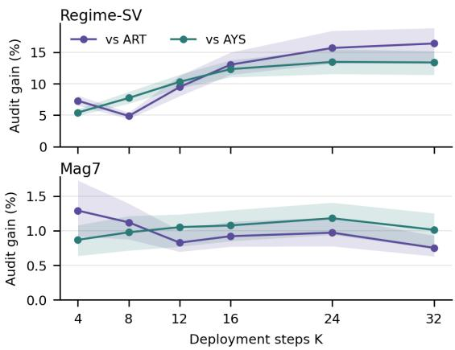
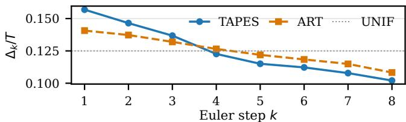
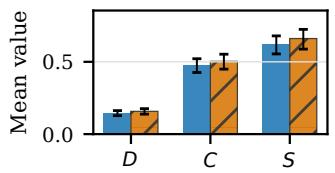
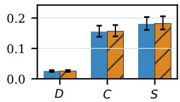
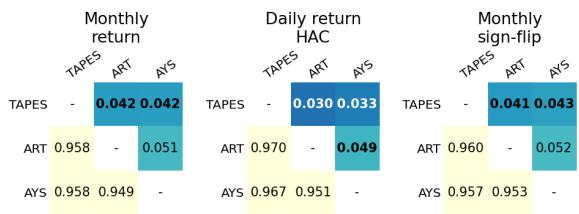

# TAPES: Terminal Adjoint-Propagated Error Scheduling for Financial Difusion Samplers

Yilie Huang

Department of Applied Mathematics

The Hong Kong Polytechnic University

Kowloon, Hong Kong

yilie.huang@polyu.edu.hk

## Abstract

Financial difusion samplers are often reused with a small number of function evaluations (NFE) inside scenario and risk pipelines, where numerical time-grid error can distort terminal quantities such as covariances, tails, and drawdown proxies. We study offline grid construction for a frozen probability-flow ODE: the score network, conditioning, Euler solver, report normalization, and de ployment NFE remain fixed. TAPES (Terminal Adjoint-Propagated Error Scheduling) estimates signed local defects by Richardson comparisons, transports them through the remaining discrete flow and a terminal-report adjoint, and optimizes the squared norm of their sum before a capped direct refinement. We show that this transported signed sum is the first-order terminal-report error and quantify, under an aligned-defect model, the ineficiency of diagonal criteria. Across six budgets on a regime-switching simulation and chronologically held-out Mag7 contexts, TAPES gives the lowest design- and audit-report errors in all 24 dataset–budget–report rows within the reported five-pipeline panel. Cross-budget mean relative audit-error reductions are about 10–11% on Regime-SV and about 1% on Mag7, with Bonferroni intervals excluding zero; all displayed winners persist under a doubled-resolution reference, and a small Regime-SV Heun probe preserves the TAPES-first audit ordering. TAPES changes only the ofline schedule and retains the prescribed deployment NFE; claims concern numerical fidelity to frozen generators.

## CCS Concepts

• Computing methodologies → Modeling and simulation; • Applied computing → Economics.

## Keywords

financial difusion models, low-NFE sampling, timestep scheduling, goal-oriented error estimation, continuous-time mean–variance allocation

## ACM Reference Format:

Yilie Huang. 2026. TAPES: Terminal Adjoint-Propagated Error Scheduling for Financial Difusion Samplers. In 7th ACM International Conference on AI in Finance (ICAIF ’26), November 14–17, 2026, Milan, AA, Italy. ACM, New York, NY, USA, 9 pages. https://doi.org/10.1145/3858063.3858762

## 1 Introduction

Difusion models turn sampling into a sequence of denoising or probability-flow steps [14, 34]. Financial scenario generators include adversarial path models [25, 41], tabular difusion [33], and multivariate time-series difusion [31, 45]. Tail-aware scenario methods target portfolio losses and tail measures [8, 9]. We study a frozen difusion sampler in such a scenario pipeline. Two features distinguish this setting from image generation. First, the object consumed downstream is not the raw path but a small set of terminal reports: covariances, volatility persistence, tail quantiles, drawdown proxies [2, 7]. Second, the sampler often runs inside a larger Monte Carlo loop, so each scenario must be cheap [11]; we study deployment budgets of 4–32 Euler calls. At such budgets discretization error is material, and it is not spent evenly: two local errors of similar Euclidean size at diferent denoising times can have very diferent efects on a terminal report. A grid that misallocates its few steps silently biases every report the workflow consumes.

We therefore separate model error from numerical schedule error. The trained score network, optional conditioning, solver family, report normalizers, paired noises, and deployment budget are fixed; only the grid along the frozen probability-flow trajectory changes. A high-NFE path from the same generator is the paired numerical target—it is not asserted to be the market law. This yields a controlled estimand: how accurately can � Euler calls reproduce the terminal reports of the frozen generator?

TAPES treats grid construction as a goal-oriented numerical problem in the dual-weighted-residual tradition [1, 10]. Adjointbased ODE error analysis and timestep control already account for propagated local errors [3, 29, 37]; later work also treats cancellation [4]. Related goal-oriented local-error adaptation covers integral quantities of interest [28]. A Richardson comparison estimates the signed defect created by each solver interval [13]; a backward adjoint transports the defects through the remaining discrete flow and the terminal report; the objective squares the sum of transported defects, retaining cross-step reinforcement and cancellation that additive local-error criteria discard. A short, capped direct refinement of paired report error on development items then refines each candidate, and one positive global grid per budget is frozen for evaluation. All probes, adjoints, and refinements are ofline construction costs; deployment uses exactly � Euler calls.

as control of a reparameterized sampling clock using a leadingorder Euler-error objective [19, 20]. Adaptive time-stepping optimizes an error-bound objective over discretization points [6]; AYS derives solver-, model-, and dataset-specific schedules from stochastic-calculus objectives [32]; hierarchical schedule optimization combines initialization search with midpoint refinement [46]; DDSS and LD3 optimize sampler or grid parameters through samplequality or teacher-matching objectives [36, 40]. Other grid criteria optimize solver approximation error [43], score-derived transport work [42], trajectory-based dynamic-programming costs [5], or entropic time [35]; instance-aware discretization conditions the grid on the input [44]. These are related construction approaches, not evaluated rows in the common frozen-Euler financial panel. The matched ablations below concern TAPES’s own construction stages. TAPES difers in what the objective measures: normalized terminal financial reports, reached through a transported-Richardson proposal that keeps signed cross-step structure, followed by capped direct refinement. At fixed solver and NFE, we compare with ART, AYS, EDM, and UNIF under a common frozen financial time-series sampler; Section 2.4 gives the exact implementations.

Continuous-time reinforcement learning (RL) connects stochastic control to data-driven decision making [38, 39]. Financial applications include mean–variance portfolio selection [16, 18] and asset–liability management [15]. Related linear–quadratic control studies analyze exploration and regret [17, 22]. The allocator in Section 4.5 follows the mean–variance line. TAPES constructs its grid by ofline numerical optimization; RL enters only through that downstream allocator. Related ofline control of a frozen difusion backbone has also been studied for image-inpainting guidance [21].

Contributions. We make four contributions:

(1) Report-aware grid construction. We optimize a positive grid by transporting signed Richardson defects through a terminal-report adjoint, squaring their sum, and applying capped direct refinement (Section 2).

(2) Report-error theory. We show that the transported signed sum is the first-order term in terminal report error. An aligned-defect model then gives closed-form optimal grids and an ineficiency factor $\rho \geq 1$ for adjoint-weighted diagonal criteria (Section 3).

(3) Frozen-sampler validation. We test six budgets in two data regimes, with joint uncertainty across budgets, doubledresolution reference checks, matched construction controls, and a transported-sum audit (Section 4).

(4) Downstream sensitivity. We trace a 21-day numerical bridge and report an exploratory, post-selected allocation comparison under one Mag7 protocol (Section 4.5).

## 2 Frozen Sampler and Report-Aware Grid Construction

## 2.1 Frozen Sampler and Time-Changed Clock

Let $Y = ( y _ { 1 } , \dots , y _ { L } ) \in \mathbb { R } ^ { L \times m }$ be a future return window, vectorized as $Y \in \mathbb { R } ^ { d }$ , and let � denote optional conditioning (lagged returns, volatility summaries, identifiers). TAPES applies to an unconditional score model for windows $Y \sim p _ { \mathrm { d a t a } }$ or a conditional model $s _ { \phi } ( x , \psi , \xi ) \approx \nabla _ { x } \log p _ { \psi } ( x \mid \xi )$ ; the Regime-SV experiment uses the former, Mag7 the latter. Either induces a frozen probability-flow ODE

$$
\frac { \mathrm { d } X _ { \psi } } { \mathrm { d } \psi } = F _ { \phi } ( X _ { \psi } , \psi , \xi ) , \qquad \psi \in [ 0 , T ] ,\tag{1}
$$

with $\psi = 0$ the noise endpoint and $\psi = T$ the generated window; TAPES never updates $\phi .$

We parameterize the schedule as a time change. The difusion clock $\psi$ is the trained flow’s time; the computational clock $u \in \left[ 0 , 1 \right]$ carries uniform solver efort with points $u _ { k } = k / K .$ . A monotone $\tau : [ 0 , 1 ] \to [ 0 , T ]$ maps computation time to difusion time; with $Z _ { u } = X _ { \tau ( u ) }$

$$
\frac { \mathrm { d } Z _ { u } } { \mathrm { d } u } = \theta _ { K } ( u ) F _ { \phi } ( Z _ { u } , \tau ( u ) , \xi ) , \qquad \frac { \mathrm { d } \tau } { \mathrm { d } u } = \theta _ { K } ( u ) > 0 ,\tag{2}
$$

$\tau ( 0 ) = 0 , \tau ( 1 ) = T .$ A uniform grid in � induces difusion-time intervals $\begin{array} { r } { \Delta _ { k } = \int _ { k / K } ^ { ( k + 1 ) / K } \theta _ { K } ( u ) } \end{array}$ d�: small $\theta _ { K }$ concentrates resolution, and positivity keeps the deployed grid strictly increasing.

Definition 1 (Admissible clock and deployed grid). An ad-missible �-step clock is a positive integrable $\theta _ { K } ( \cdot )$ with total mass $T ;$ its deployed grid is $\psi _ { k } = \tau ( k / K )$ . Equivalently, a deployed schedule is a vector $\Delta = \left( \Delta _ { 0 } , \ldots , \Delta _ { K - 1 } \right)$ in the open simplex $\mathcal { D } _ { K } ( T ) = \{ \Delta _ { k } >$ $0 , \ \sum _ { k } \Delta _ { k } = T \}$ , realized by the piecewise-linear clock with speed $K \Delta _ { k }$ on cell �.

The implementation parameterizes the discrete clock by a floored softmax over logits,

$$
\Delta _ { k } = T \left[ \left( 1 - \alpha _ { \mathrm { f l o o r } } \right) \frac { \exp { b _ { k } } } { \sum _ { j } \exp { b _ { j } } } + \frac { \alpha _ { \mathrm { f l o o r } } } { K } \right] ,\tag{3}
$$

which keeps the terminal-time constraint inside the parameterization; all selected TAPES grids use $\alpha _ { \mathrm { f l o o r } } = 1 0 ^ { - 4 }$ , and baseline libraries retain their implemented floors. We optimize one contextindependent clock per budget; development contexts only estimate and select the objective. When � is fixed, we abbreviate $\theta _ { K }$ by $\theta$ below.

## 2.2 Financial Reports and Paired Estimand

Let $R _ { \mathrm { d e s i g n } }$ and $R _ { \mathrm { a u d i t } }$ be normalized terminal report maps. The design vector contains per-asset means and variances, of-diagonal covariances, lag-one autocovariances of squared returns, and smooth peak-to-trough proxies of cumulative standardized returns (logsum-exp temperature 25); its dimension is 30 for the five-asset Regime-SV window and 49 for the seven-asset Mag7 window. Separately, the audit vector contains, per asset, a lag-one squaredreturn autocorrelation, a leverage term, return autocorrelations at lags 1, 2, and 4, skewness, kurtosis, 5% return-tail quantile and below-quantile mean, and a temperature-100 drawdown proxy; its dimensions are 50 and $^ { 7 0 , }$ respectively. These features are computed for each eight-observation window of training-standardized returns. The 5% quantile uses linear interpolation; absent tied minima, the below-quantile mean equals the window minimum. Both are short-window lower-tail proxies, with the return rather than loss sign convention. Each raw vector Φ is normalized as $R ( x , \xi ) =$ dia $\tilde { \sqrt { s _ { \Phi } } } + 1 0 ^ { - 6 } ) ^ { - 1 } \{ \Phi ( x , \xi ) - \mu _ { \Phi } \}$ , where $\widetilde { s } _ { \Phi , j } = s _ { \Phi , j } \mathrm { i f } s _ { \Phi , j } \geq 1 0 ^ { - 6 }$ and 1 otherwise; feature moments are fitted on training windows and frozen.

Given a low-NFE grid Δ and a high-NFE reference generated from the same initial noise and context,

$$
E _ { \mathrm { d e s i g n } } ( \Delta ) = \mathbb { E } \left. R _ { \mathrm { d e s i g n } } ( x _ { K } ^ { \Delta } , \xi ) - R _ { \mathrm { d e s i g n } } ( x ^ { \mathrm { r e f } } , \xi ) \right. _ { 2 } ^ { 2 } ,\tag{4}
$$

$$
\begin{array} { r } { E _ { \mathrm { a u d i t } } ( \Delta ) = \mathbb { E } \left. R _ { \mathrm { a u d i t } } ( x _ { K } ^ { \Delta } , \xi ) - R _ { \mathrm { a u d i t } } ( x ^ { \mathrm { r e f } } , \xi ) \right. _ { 2 } ^ { 2 } . } \end{array}\tag{5}
$$

All methods share context, initial noise, and reference path within each paired item. The design map supplies the terminal adjoint; the audit-family map is also used by fixed-grid tuning, AYS, and the final refinement/selection stage of TAPES on development items. Evaluation items are strictly held out (fresh noise for Regime-SV, chronologically later contexts for Mag7), but the audit coordinate family is not feature-held-out for every method; “audit” labels the report family, not an untouched diagnostic. The direct development objective for a report map � would minimize $\mathbb { E } _ { \mathrm { d e v } } \| R ( x _ { K } ^ { \Delta } , \xi ) - \bar { R } ( x ^ { \mathrm { r e f } } , \xi ) \| _ { 2 } ^ { 2 }$ over ${ \mathcal { D } } _ { K } ( T )$ ; TAPES approaches it with a perturbation-based proposal followed by a small, capped number of direct-refinement iterations.

## 2.3 Discrete Terminal-Adjoint Schedule Objective

For a fixed deployed grid Δ, write $x _ { k } = x _ { k } ^ { \Delta }$ and $x _ { k + 1 } = G _ { k } ( x _ { k } )$ , with $G _ { k } ( x ) = x + \Delta _ { k } F _ { \phi } ( x , \psi _ { k } , \xi )$ for Euler. With $\varphi _ { k } ^ { \mathrm { e x } }$ the exact flow over interval �, the signed local defect is

$$
e _ { k } = \varphi _ { k } ^ { \mathrm { e x } } ( x _ { k } ) - G _ { k } ( x _ { k } ) .\tag{6}
$$

For $R : \mathbb { R } ^ { d }  \mathbb { R } ^ { p }$ let $B _ { k } \ = \ D _ { x } G _ { k } ( x _ { k } ) , A _ { K } \ = \ J _ { x } R ( x _ { K } , \xi )$ , and $A _ { k } = A _ { k + 1 } B _ { k } ;$ then $A _ { k + 1 } e _ { k }$ is the first-order contribution of $\scriptstyle { e _ { k } }$ to the terminal report. The implementation evaluates $A _ { K }$ by central diferences $( \mathrm { s t e p } 1 0 ^ { - 5 } )$ and propagates through vector–Jacobian products of the full frozen Euler maps, including the score-based drift [12]. TAPES estimates $e _ { k }$ by Richardson comparison, sets $w _ { k } = A _ { k + 1 } \widehat { e _ { k } }$ and minimizes

$$
\mathcal { L } _ { \mathrm { T A P E S } } = \mathbb { E } \left\| \sum _ { k = 0 } ^ { K - 1 } w _ { k } \right\| _ { \Lambda } ^ { 2 } + \beta _ { \mathrm { d i a g } } \mathbb { E } \sum _ { k } \| w _ { k } \| _ { \Lambda } ^ { 2 } + \rho _ { \mathrm { e u c } } \mathbb { E } \sum _ { k } \| \widehat { e } _ { k } \| _ { 2 } ^ { 2 } ,\tag{7}
$$

with $\Lambda = I$ after normalization. The leading term keeps signed cross-time structure; the small diagonal and Euclidean stabilizers guard against cancellation specific to a finite panel (either weight may be zero).

## 2.4 Implemented Construction and Baselines

ART [19] is implemented here over the same positive-clock family by minimizing the rescaled Euclidean Richardson-defect objective $\begin{array} { r } { \mathbb { E } _ { \mathrm { d e v } } \sum _ { k } \| \widehat { e } _ { k } ^ { ( n ) } \| _ { 2 } ^ { 2 } \{ \Delta _ { k } / ( \Delta _ { k } ^ { ( n ) } + 1 0 ^ { - 1 2 } ) \} ^ { 2 ( r + 1 ) } } \end{array}$ at outer iterate � $( r = 1$ for Euler): no adjoint, no cross-time term, no report refinement, and selection by the defect objective itself (eight candidates per � for Regime-SV, 18 for Mag7). UNIF is the exact uniform clock. AYS evaluates UNIF, a development-tuned one-parameter VP grid, and a development-tuned Karras VP grid, tuning $\lambda _ { \operatorname* { m a x } } \in \{ 1 , 2 , 3 , 4 , 6 \}$ (and $\rho _ { \mathrm { K a r } } \in \{ 3 , 5 , 7 \}$ for the Karras family) on 32 audit-family devel opment items, best-of-three selected on four of those items, each grid fitted once into the shared clock representation with the optimizer cap set to zero. EDM is the selected Karras VP grid. All methods use the common frozen Euler sampler; Table 1 compares their end-to-end implementations at common deployment NFE, while development data and ofline compute follow each stated procedure. The AYS row is the output of its development-only selection rule, and EDM reports its Karras-family candidate separately.

## 2.5 Two-Stage TAPES Optimizer

At outer iterate �, a rollout gives $\widehat { e } _ { k } ^ { ( n ) }$ and $w _ { k } ^ { ( n ) }$ . The proposal stage freezes these coeficients under the local-order model

$$
\widehat { e } _ { k } ( \Delta _ { k } ) \approx \gamma _ { k } ^ { ( n ) } \widehat { e } _ { k } ^ { ( n ) } , \qquad \gamma _ { k } ^ { ( n ) } = \Big ( \frac { \Delta _ { k } } { \Delta _ { k } ^ { ( n ) } + 1 0 ^ { - 1 2 } } \Big ) ^ { r + 1 } ,\tag{8}
$$

and minimizes the induced quadratic surrogate of (7) over ${ \mathcal { D } } _ { K } ( T )$ safeguarded by the floor, damping, and a move limit. The evaluated pipeline uses 64 development paths; starts from four fitted base clocks—one obtained from the ART objective, plus UNIF, the oneparameter ${ \mathrm { V P } } ,$ and EDM—; takes one proposal update per candidate; applies a short L-BFGS-B refinement of direct paired audit-family error (capped at eight iterations for Regime-SV, four for $M { \mathrm { a g 7 } } ) ;$ and selects the candidate with the lowest development error. Candidate libraries contain three (Regime-SV) or two $\mathrm { ( M a g 7 ) }$ tuples varying the cosine basis size (6 or 8), floor $( 1 0 ^ { - 4 } ~ \mathrm { o r } ~ 1 0 ^ { - 3 } )$ , stabilizer weights $( \beta _ { \mathrm { d i a g } } \le 1 0 ^ { - 2 } , \rho _ { \mathrm { e u c } } \le 1 0 ^ { - 3 } )$ , damping, and move limit, with proposal caps of $3 5 \mathrm { - } 5 0$ inner iterations; the selected tuple varies with �. Construction is ofline; deployment uses � model calls. Recorded per-budget construction wall times span 3.2–13.8 minutes (Regime-SV) and 1.9–7.0 minutes (Mag7) on a laptop-class accelerator, including all candidate grids and baseline tuning; this one-time cost can be amortized when a frozen grid is reused across many generation calls. The method is relevant when low-NFE discretization error is appreciable and a high-NFE numerical target is afordable; it cannot repair generator misspecification.

## 3 Perturbation Theory for TAPES

The analysis makes the clock reparameterization explicit and shows why terminal report error is not an additive local-error density.

Proposition 1 (Integrated-grid Euler defect). Let $0 = \psi _ { 0 } <$ $\cdots < \psi _ { K } = T$ be a positive deployed grid and let $F _ { \phi }$ be $C ^ { 2 }$ with bounded derivatives near the step. With $Q _ { \phi } = \partial _ { \psi } F _ { \phi } + \dot { \nabla } _ { x } F _ { \phi } F _ { \phi }$

$$
\varphi _ { k } ^ { \mathrm { e x } } ( x ) - G _ { k } ( x ) = \frac { \Delta _ { k } ^ { 2 } } { 2 } Q _ { \phi } ( x , \psi _ { k } , \xi ) + O ( \Delta _ { k } ^ { 3 } ) ,\tag{9}
$$

and if the grid is induced by $\ a C ^ { 3 }$ time map with speed $0 < \theta _ { \mathrm { { m i n } } } \leq \theta \leq$ $\theta _ { \mathrm { { m a x } } } .$ , then with $\begin{array} { r } { h = 1 / K , \varphi _ { k } ^ { \mathrm { e x } } ( x ) - G _ { k } ( x ) = \frac { h ^ { 2 } } { 2 } \theta ( u _ { k } ) ^ { 2 } Q _ { \phi } ( x , \tau ( u _ { k } ) , \xi ) + } \end{array}$ $O ( h ^ { 3 } )$

Proof. Expanding the exact flow in difusion time from $( x , \psi _ { k } )$

$$
\varphi _ { k } ^ { \mathrm { e x } } ( x ) = x + \Delta _ { k } F _ { \phi } ( x , \psi _ { k } , \xi ) + \frac { \Delta _ { k } ^ { 2 } } { 2 } \frac { \mathrm { d } } { \mathrm { d } \psi } F _ { \phi } \big ( X _ { \psi } , \psi , \xi \big ) \Big | _ { \psi _ { k } } + O ( \Delta _ { k } ^ { 3 } ) ,
$$

and the total derivative along the flow is exactly $Q _ { \phi } = \partial _ { \psi } F _ { \phi } +$ $\nabla _ { x } F _ { \phi } F _ { \phi } ;$ ; subtracting $G _ { k } ( x ) = x + \Delta _ { k } F _ { \phi } ( x , \psi _ { k } , \xi )$ gives (9). For the ℎ-form, a $C ^ { 3 }$ time map has $\Delta _ { k } = \tau ( u _ { k } + h ) - \tau ( u _ { k } ) = h \theta ( u _ { k } ) +$ $\textstyle { \frac { h ^ { 2 } } { 2 } } { \dot { \theta } } ( u _ { k } ) + O ( h ^ { 3 } )$ , so $\Delta _ { k } ^ { 2 } = h ^ { 2 } \theta ( u _ { k } ) ^ { 2 } + O ( h ^ { 3 } )$ ; substituting into (9) and using boundedness of $Q _ { \phi }$ absorbs the diference into $O ( h ^ { 3 } )$ Equivalently, in the �-clock the exact reparameterized trajectory satisfies $\begin{array} { r } { Z _ { u _ { k } + h } = Z _ { u _ { k } } + h \theta ( u _ { k } ) F _ { \phi } + \frac { h ^ { 2 } } { 2 } \{ \dot { \theta } ( u _ { k } ) F _ { \phi } + \theta ( u _ { k } ) ^ { 2 } Q _ { \phi } \} \ + } \end{array}$ $O ( h ^ { 3 } )$ , while the deployed integrated increment expands as $\Delta _ { k } F _ { \phi } =$ $\begin{array} { r } { h \theta ( u _ { k } ) F _ { \phi } + \frac { h ^ { 2 } } { 2 } \dot { \theta } ( u _ { k } ) F _ { \phi } + O ( h ^ { 3 } ) } \end{array}$ : the clock-acceleration terms $\begin{array} { r l r } {  { \frac { h ^ { 2 } } { 2 } \dot { \theta } F _ { \phi } } } \end{array}$ coincide and cancel in the defect, leaving only the ${ \frac { h ^ { 2 } } { 2 } } \theta ^ { 2 } Q _ { \phi }$ term. □

Remark 1. Ifone instead applies left-endpoint Euler directly to the reparameterized $u { - } O D E$ with the approximation $\Delta _ { k } \approx h \theta ( u _ { k } )$ the increment omits $\begin{array} { r } { \frac { h ^ { 2 } } { 2 } \dot { \theta } ( u _ { k } ) F _ { \phi } } \end{array}$ and the local defect acquires that additional clock-acceleration term. TAPES deploys the integrated-grid step, so its defect is governed by $Q _ { \phi }$ alone.

Proposition 2 (Richardson sign and order). Let $r \geq 1$ and suppose a smooth one-step method has signed defect $d = c \Delta ^ { r + 1 } +$ $O ( \Delta ^ { r + 2 } )$ under (6). $W i t h \ x _ { k + 1 } ^ { \mathrm { o n e } }$ one full step and $x _ { k + 1 } ^ { \mathrm { { t w o } } }$ two halfsteps from the same state,

$$
\widehat { e } _ { k } = \frac { x _ { k + 1 } ^ { \mathrm { t w o } } - x _ { k + 1 } ^ { \mathrm { o n e } } } { 1 - 2 ^ { - r } } = e _ { k } + O ( \Delta _ { k } ^ { r + 2 } ) .\tag{10}
$$

Proof. The full step has defect $e _ { k } = c _ { k } \Delta _ { k } ^ { r + 1 } + { \cal O } ( \Delta _ { k } ^ { r + 2 } )$ with $c _ { k } = $ $c ( \psi _ { k } , x _ { k } )$ . For the two half steps, the first contributes $c _ { k } ( \Delta _ { k } / 2 ) ^ { r + 1 } +$ $O ( \Delta _ { k } ^ { r + 2 } )$ . The second starts from a state $O ( \Delta _ { k } )$ -close to $x _ { k }$ at time $\psi _ { k } + \Delta _ { k } / 2$ , so by the $C ^ { 1 }$ dependence of� its coeficient is $c _ { k } + O ( \Delta _ { k } )$ and it contributes $c _ { k } ( \Delta _ { k } / \bar { 2 } ) ^ { r + 1 } + O ( \Delta _ { k } ^ { r + 2 } )$ ; transporting the first-half defect through the second half step multiplies it by $I + O ( \Delta _ { k } )$ , a further $O ( \Delta _ { k } ^ { r + 2 } )$ change. Hence the two-step endpoint carries total defect $2 { \cdot } 2 ^ { - ( \stackrel { . . . } { r + 1 } ) } c _ { k } \Delta _ { k } ^ { r + 1 } { + } O ( \Delta _ { k } ^ { r + 2 } ) = 2 ^ { - r } e _ { k } { + } O ( \Delta _ { k } ^ { r + 2 } )$ . Both endpoints approximate the same exact endpoint $\varphi _ { k } ^ { \mathrm { e x } } ( x _ { k } )$ , so $x _ { k + 1 } ^ { \mathrm { t w o } } - x _ { k + 1 } ^ { \mathrm { o n e } } =$ $\{ \varphi _ { k } ^ { \mathrm { e x } } ( x _ { k } ) - x _ { k + 1 } ^ { \mathrm { o n e } } \} - \{ \varphi _ { k } ^ { \mathrm { e x } } ( x _ { k } ) - x _ { k + 1 } ^ { \mathrm { t w o } } \} \ = \ ( 1 - 2 ^ { - r } ) e _ { k } ^ { \mathrm { ~ " ~ } } + { \cal O } ( \ddot { \Delta } _ { k } ^ { r \dot { + } 2 } ) ;$ dividing by $1 ^ { - 2 ^ { - r } }$ gives (10). □

Assumption 1 (Regularity tube). Fix �. On a tube containing the relevant trajectories, the step maps $G _ { k }$ , exact local flows $\varphi _ { k } ^ { \mathrm { e x } }$ , and the diferentiable design report� $a r e C ^ { 2 }$ with derivatives and transition products uniformly bounded over the paired-item sampling law. Let $\epsilon _ { k } \ = \ \| \varphi _ { k } ^ { \mathrm { e x } } - G _ { k } \| _ { C ^ { 1 } }$ on the tube and $\begin{array} { r } { \epsilon _ { \mathrm { d e f } } \ = \ \sum _ { k } \epsilon _ { k } } \end{array}$ , small enough that perturbations stay in the tube; smooth Euler steps give $\epsilon _ { k } \ =$ $O ( \Delta _ { k } ^ { 2 } )$ . Constants may depend on �. The implemented drift clips score coordinates and clamps the model-time argument at endpoint cutofs, so it is piecewise smooth; the assumption is local to branches away from these kinks, and the empirical comparisons below do not rely on it.

Theorem 1 (Terminal report error expansion). $L e t x _ { K } ^ { \mathrm { e x } }$ be the endpoint obtained by replacing each deployed step by the exactflow over the same intervalfrom the same initial state. Under Assumption 1,

$$
R ( x _ { K } ^ { \mathrm { e x } } , \xi ) - R ( x _ { K } , \xi ) = \sum _ { k = 0 } ^ { K - 1 } A _ { k + 1 } e _ { k } + \mathcal { R } , \qquad \| \mathcal { R } \| \le C _ { K } \epsilon _ { \mathrm { d e f } } ^ { 2 } .\tag{11}
$$

Proof. Let $\delta _ { k }$ denote the time-�� gap between the exact-flow trajectory and the numerical trajectory, with $\delta _ { 0 } = 0$ . One step gives

$$
\begin{array} { r l } & { \delta _ { k + 1 } = \varphi _ { k } ^ { \mathrm { e x } } \big ( x _ { k } + \delta _ { k } \big ) - G _ { k } \big ( x _ { k } \big ) } \\ & { \qquad = \varphi _ { k } ^ { \mathrm { e x } } \big ( x _ { k } \big ) - G _ { k } \big ( x _ { k } \big ) + D \varphi _ { k } ^ { \mathrm { e x } } \big ( x _ { k } \big ) \delta _ { k } + O ( \| \delta _ { k } \| ^ { 2 } ) } \\ & { \qquad = e _ { k } + B _ { k } \delta _ { k } + O \big ( \epsilon _ { k } \| \delta _ { k } \| + \| \delta _ { k } \| ^ { 2 } \big ) , } \end{array}
$$

using $\| D \varphi _ { k } ^ { \mathrm { e x } } - D G _ { k } \| \leq \epsilon _ { k }$ on the tube. Because the transition prod ucts $\| B _ { j } \cdots B _ { i } \|$ are uniformly bounded, unrolling yields $\| \delta _ { k } \| \leq$ $C \sum _ { j < k } \epsilon _ { j } \ \leq \ C \epsilon _ { \mathrm { d e f } }$ for every $k ,$ , so the accumulated perturbation terms sum to $\textstyle \sum _ { k } O ( \epsilon _ { k } \epsilon _ { \mathrm { d e f } } + \epsilon _ { \mathrm { d e f } } ^ { 2 } ) = O ( \epsilon _ { \mathrm { d e f } } ^ { 2 } )$ (constants depending on the fixed �) and $\begin{array} { r } { \delta _ { K } = \sum _ { k } B _ { K - 1 } \cdot \cdot \cdot \cdot B _ { k + 1 } e _ { k } + O ( \epsilon _ { \mathrm { d e f } } ^ { 2 } ) . . } \end{array}$ final expansion of the $C ^ { 2 }$ report at ��, $R ( x _ { K } + \delta _ { K } , \xi ) - R ( x _ { K } , \xi ) =$ $A _ { K } \delta _ { K } + O ( \lVert \delta _ { K } \rVert ^ { 2 } )$ , together with $A _ { k + 1 } ~ = ~ A _ { K } B _ { K - 1 } \cdot \cdot \cdot B _ { k + 1 }$ and $\| \delta _ { K } \| = O ( \epsilon _ { \mathrm { d e f } } )$ , proves (11). □

Theorem 2 (First-order loss consistency). Under the conditions ofTheorem 1 and $\Lambda = \Lambda ^ { \top } \succ$ 0 bounded, for small $\epsilon _ { \mathrm { d e f } }$

$$
\begin{array} { r } { \left| \left\| R ( \boldsymbol { x } _ { K } ^ { \mathrm { e x } } , \boldsymbol { \xi } ) - R ( \boldsymbol { x } _ { K } , \boldsymbol { \xi } ) \right\| _ { \Lambda } ^ { 2 } - \left\| \sum _ { k } A _ { k + 1 } e _ { k } \right\| _ { \Lambda } ^ { 2 } \right| \leq C _ { \Lambda , K } \epsilon _ { \mathrm { d e f } } ^ { 3 } . } \end{array}\tag{12}
$$

Proof. Set $\begin{array} { r } { Z = \sum _ { k } A _ { k + 1 } e _ { k } } \end{array}$ and let $q \ : = \ : \mathcal { R }$ be the remainder of Theorem 1, so that $R ( x _ { K } ^ { \mathrm { { e x } } } , \xi ) - R ( x _ { K } , \xi ) = Z + q$ with $\| Z \| \le$ $\begin{array} { r } { \sum _ { k } \| A _ { k + 1 } \| \ \| e _ { k } \| \ = \ O ( \epsilon _ { \mathrm { d e f } } ) } \end{array}$ by the bounded transition products and $\| q \| \le C _ { K } \epsilon _ { \mathrm { d e f } } ^ { 2 } .$ . Expanding, $\| Z + q \| _ { \Lambda } ^ { 2 } - \| Z \| _ { \Lambda } ^ { 2 } = 2 \bar { \langle { Z , \Lambda q } \rangle } +$ $\| q \| _ { \Lambda } ^ { 2 }$ , where $\left| 2 \left. Z , \Lambda q \right. \right| \leq 2 \left\| \Lambda \right\|$ ∥� ∥ ∥� $| = O ( \epsilon _ { \mathrm { d e f } } ^ { 3 } )$ and $\| q \| _ { \Lambda } ^ { 2 } =$ $O ( \epsilon _ { \mathrm { d e f } } ^ { 4 } ) \ \leq \ O ( \epsilon _ { \mathrm { d e f } } ^ { 3 } )$ for $\epsilon _ { \mathrm { d e f } } \ \leq \ 1$ . The constants are uniform on the tube of Assumption 1, so the bound survives taking expectations. □

The next result connects the exact and implemented sums, writing $\begin{array} { r } { \widehat { Z } = \sum _ { k } A _ { k + 1 } \widehat { e } _ { k } } \end{array}$ and $\begin{array} { r } { Z = \sum _ { k } A _ { k + 1 } e _ { k } } \end{array}$

Proposition 3 (Richardson-substituted first-order term). Consider a refining family of admissible grids whose clock speeds sat $i s f y 0 < \theta _ { \mathrm { m i n } } \le \theta \le \theta _ { \mathrm { m a x } }$ , with transition products, adjoint norms, and local-defect constants uniformly bounded over the family. Then, as $h = 1 / K  0 , \| \widehat { Z } - Z \| = O ( h ^ { r + 1 } )$ while $\| Z \| = O ( h ^ { r } )$ , and consequently, whenever $\| Z \| = \Theta ( h ^ { r } )$

$$
\left| \left\| { \widehat { Z } } \right\| _ { \Lambda } ^ { 2 } - \left\| Z \right\| _ { \Lambda } ^ { 2 } \ \right| = O ( h ^ { 2 r + 1 } ) = \left\| Z \right\| _ { \Lambda } ^ { 2 } O ( h ) .
$$

Proof. By Proposition $2 , \| \widehat { e } _ { k } - e _ { k } \| \le C \Delta _ { k } ^ { r + 2 }$ with � uniform over the family. Since $\Delta _ { k } \leq \theta _ { \operatorname* { m a x } } h$ and $\begin{array} { r } { \sum _ { k } \Delta _ { k } = \overset { \ " { T } } { T } } \end{array}$ , bounded adjoints give $\begin{array} { r } { \| \widehat { Z } - Z \| \le C ^ { \prime } \sum _ { k } \Delta _ { k } ^ { r + 2 } \le C ^ { \prime } ( \theta _ { \operatorname* { m a x } } h ) ^ { r + 1 } \sum _ { k } \Delta _ { k } = O ( h ^ { r + 1 } ) } \end{array}$ , and likewise $\begin{array} { r } { \left. Z \right. \rvert \le C ^ { \prime \prime } \sum _ { k } \Delta _ { k } ^ { \ddot { r } + 1 } = O ( h ^ { r } ) } \end{array}$ . The loss comparison follows from $\begin{array} { r } { \vert \vert \widehat { Z } \vert \vert _ { \Lambda } ^ { 2 } - \vert \vert Z \vert \vert _ { \Lambda } ^ { 2 } \vert \le 2 \vert \vert \Lambda \vert \vert \vert Z \vert \vert \vert \widehat { Z } - Z \vert \vert + \vert \vert \Lambda \vert \vert \vert \widehat { Z } - Z \vert \vert ^ { 2 } } \end{array}$ , whose leading term is $O ( h ^ { r } ) O ( h ^ { r + 1 } ) = O ( h ^ { 2 r + 1 } )$ □

Under stronger cancellation, $\| Z \| = o ( h ^ { r } )$ and the two terms may be comparable. For a finite high-NFE reference, write $x ^ { \star } = x _ { K } ^ { \mathrm { e x } }$ for the exact-flow endpoint and $\eta _ { \mathrm { r e f } } = R ( { x ^ { \star } } , \xi ) - R ( { x ^ { \mathrm { r e f } } } , \xi )$ ; the squared paired loss is $\lVert Z \rVert _ { \Lambda } ^ { 2 } - 2 \left. Z , \Lambda \dot { \eta } _ { \mathrm { r e f } } \right. + \lVert \dot { \eta } _ { \mathrm { r e f } } \rVert _ { \Lambda } ^ { 2 } + O \big ( ( \lVert Z \rVert + \lVert \eta _ { \mathrm { r e f } } \rVert \big ) \dot { \epsilon } _ { \mathrm { d e f } } ^ { 2 } +$ $\epsilon _ { \mathrm { d e f } } ^ { 4 } )$ , so the quadratic term leads when $\lVert Z \rVert = \Theta ( \epsilon _ { \mathrm { d e f } } )$ and $\| \eta _ { \mathrm { r e f } } \| =$ �(� ); otherwise rankings are finite-reference statements, and the doubled-resolution check in Section 4 preserves every displayed winner.

These local results justify the proposal surrogate, not global optimality of the two-stage search. With $z _ { k } = A _ { k + 1 } e _ { k }$

$$
\left\| \sum _ { k } z _ { k } \right\| _ { \Lambda } ^ { 2 } = \underbrace { \sum _ { k } \| z _ { k } \| _ { \Lambda } ^ { 2 } } _ { D } + \underbrace { 2 \sum _ { i < j } \left. z _ { i } , \Lambda z _ { j } \right. } _ { C } .\tag{13}
$$

A diagonal approximation keeps only $D ; { \mathrm { A R T } }$ further drops the adjoint and minimizes state-space defects. The next result quantifies what this discards when transported defects reinforce, the regime $( C > 0 )$ we observe throughout Section 4.

Proposition 4 (Aligned defects: optimal grids and diagonal inefficiency). Fix $r \geq 1 , T > 0 _ { : }$ , and $a _ { k } > 0 .$ . Suppose transported defects follow the frozen-coeficient power model with common direction: $z _ { k } ( \Delta ) = \Delta _ { k } ^ { r + 1 } a _ { k } v , \| v \| _ { \Lambda } = 1 .$ . On $\mathcal { D } _ { K } ( T ) \colon ( \mathrm { i } ) \ \mathcal { L } _ { \mathrm { t e r m } } ( \Delta ) =$ $\begin{array} { r } { \big ( \sum _ { k } a _ { k } \Delta _ { k } ^ { r + 1 } \big ) ^ { 2 } } \end{array}$ is uniquely minimized at $\Delta _ { k } ^ { \star } \ = \ T a _ { k } ^ { - 1 / r } / \sum _ { j } a _ { j } ^ { - 1 / r }$ with first-order report error $\begin{array} { r } { \sum _ { k } a _ { k } \big ( \Delta _ { k } ^ { \star } \big ) ^ { r + 1 } = T ^ { r + 1 } \big ( \sum _ { k } a _ { k } ^ { - 1 / r } \big ) ^ { - r } ; \{ \mathrm { i i } \} } \end{array}$ the diagonal criterion $\begin{array} { r } { \sum _ { k } a _ { k } ^ { 2 } \Delta _ { k } ^ { 2 ( r + 1 ) } } \end{array}$ is uniquely minimized at $\Delta _ { k } ^ { \circ } =$ $\begin{array} { r } { T a _ { k } ^ { - 2 / ( 2 r + 1 ) } / { \sum _ { j } a _ { j } ^ { - 2 / ( 2 r + 1 ) } } } \end{array}$ ; (iii) with $b _ { k } = a _ { k } ^ { - 1 / ( 2 r + 1 ) }$

$$
\rho : = \frac { \sum _ { k } a _ { k } ( \Delta _ { k } ^ { \circ } ) ^ { r + 1 } } { \sum _ { k } a _ { k } ( \Delta _ { k } ^ { \star } ) ^ { r + 1 } } = \frac { \big ( \sum _ { k } b _ { k } \big ) \big ( \sum _ { k } b _ { k } ^ { ( 2 r + 1 ) / r } \big ) ^ { r } } { \big ( \sum _ { k } b _ { k } ^ { 2 } \big ) ^ { r + 1 } } \ \ge \ 1 ,\tag{14}
$$

with equality if all $a _ { k }$ are equal; � is the first-order report-error factor, and $\rho ^ { 2 }$ is the corresponding squared-error inflation.

Proof. Minimizing $\mathcal { L } _ { \mathrm { t e r m } }$ is equivalent to minimizing its positive square root $\begin{array} { r l } { ~ } & { { } \sum _ { k } a _ { k } \Delta _ { k } ^ { r + 1 } } \end{array}$ , which, like the diagonal criterion, is strictly convex on the simplex closure; no boundary point is optimal, since moving mass into an empty cell has zero marginal cost against a strictly positive saving elsewhere. Lagrange stationarity gives $( r + 1 ) a _ { k } \Delta _ { k } ^ { r } = \lambda .$ hence $\Delta _ { k } \propto a _ { k } ^ { - 1 / r }$ , and $2 ( r + 1 ) a _ { k } ^ { 2 } \Delta _ { k } ^ { 2 r + 1 } = \lambda ^ { \prime } ;$ hence $\Delta _ { k } \propto a _ { k } ^ { - 2 / ( 2 r + 1 ) }$ ; substitution gives the stated values and, using $a _ { k } = b _ { k } ^ { - ( 2 r + 1 ) }$

$$
\begin{array} { l } { \displaystyle \sum _ { k } a _ { k } ( \Delta _ { k } ^ { \diamond } ) ^ { r + 1 } = \frac { T ^ { r + 1 } \sum _ { k } b _ { k } } { \big ( \sum _ { k } b _ { k } ^ { 2 } \big ) ^ { r + 1 } } , } \\ { \displaystyle \sum _ { k } a _ { k } ( \Delta _ { k } ^ { \star } ) ^ { r + 1 } = \frac { T ^ { r + 1 } } { \big ( \sum _ { k } b _ { k } ^ { ( 2 r + 1 ) / r } \big ) ^ { r } } , } \end{array}
$$

which yield (14). For the bound, write $b _ { k } ^ { 2 } = b _ { k } ^ { 1 / ( r + 1 ) } \cdot b _ { k } ^ { ( 2 r + 1 ) / ( r + 1 ) }$ and apply Hölder with exponents $( r + 1 , ~ \ddot { ( } r + 1 ) ^ { } / r )$

$$
\sum _ { k } b _ { k } ^ { 2 } \leq \Big ( \sum _ { k } b _ { k } \Big ) ^ { 1 / ( r + 1 ) } \Big ( \sum _ { k } b _ { k } ^ { ( 2 r + 1 ) / r } \Big ) ^ { r / ( r + 1 ) } ;
$$

raising to the $( r { + } 1 )$ -th power gives $\rho \geq 1$ . Equality requires $b _ { k }$ ∝ $b _ { k } ^ { ( 2 r + 1 ) / r } , \mathrm { i } . \mathbf { e } . , b _ { k }$ constant. For $r = 1$ the bound is Cauchy–Schwarz: $( \tilde { \sum } b ^ { 2 } ) ^ { 2 } \leq ( \sum b ) ( \sum b ^ { 3 } )$ □

Corollary 1 (Small-dispersion inefficiency). Let $r = 1$ and write $b _ { k } = \bar { b } ( 1 + x _ { k } )$ with $\begin{array} { r } { \sum _ { k } x _ { k } = 0 , m _ { 2 } = K ^ { - 1 } \sum _ { k } x _ { k } ^ { 2 } . } \end{array}$ , and $m _ { 3 } ~ =$ $\begin{array} { r } { K ^ { - 1 } \sum _ { k } | x _ { k } | ^ { 3 } } \end{array}$ . Then $\rho ~ = ~ \left( \sum _ { k } b _ { k } \right) \left( \sum _ { k } b _ { k } ^ { 3 } \right) / \left( \sum _ { k } b _ { k } ^ { 2 } \right) ^ { 2 } ~ = ~ 1 + m _ { 2 } ~ .$ + $O ( m _ { 3 } + m _ { 2 } ^ { 2 } )$

Proof. For $\begin{array} { r } { j \in \{ 1 , 2 , 3 \} , K ^ { - 1 } \sum _ { k } ( 1 + x _ { k } ) ^ { j } = 1 + \binom { j } { 2 } m _ { 2 } + O ( m _ { 3 } ) } \end{array}$ because $\begin{array} { r } { \sum _ { k } x _ { k } \ = \ 0 ; } \end{array}$ ; the powers of � and $\bar { b }$ cancel in $\rho ,$ so $\rho \ =$ $( 1 + 3 m _ { 2 } ) / ( 1 + m _ { 2 } ) ^ { 2 } + O ( m _ { 3 } ) = 1 + m _ { 2 } + O ( m _ { 3 } + m _ { 2 } ^ { 2 } )$ □

Remark 2. ART additionally replaces the adjoint-weighted $a _ { k } =$ $\| A _ { k + 1 } c _ { k } \|$ by the untransported ∥�� ∥2, compounding the exponent misallocation of(iii) with a weight mismatch whenever transport gains vary over �. Locally around homogeneous coeficients, $\rho - 1$ grows to leading order with the dispersion $o f b _ { k } = a _ { k } ^ { - 1 / 3 }$ (Corollary 1), so the model predicts larger schedule-choice gains where adjoint-weighted defects are more heterogeneous. Estimating $a _ { k } = \| A _ { k + 1 } \widehat { e } _ { k } \| / \Delta _ { k } ^ { 2 }$ on the UNIF grid at $K = 8$ gives post-hoc evaluation-panel estimates $\rho = 1 . 0 2 6$ for Regime-SV and $\rho = 1 . 0 1 0$ for Mag7—squared-error inflations of5.3% and 2.0% from step misallocation alone, qualitatively paralleling the larger Regime-SV gains in Table 1—with mean alignment cosines 0.84 and 0.95 supporting the aligned idealization. Alignment is an idealization ofthe reinforcing regime; the proposition concerns first-order surrogates, not the full pipeline.

## 4 Numerical Evaluation

We ask three questions. Does two-stage TAPES reduce paired report error at fixed deployment NFE? Do paired uncertainty, referenceresolution checks, and matched construction diagnostics support that result? And do report-space gains carry financial meaning (Section 4.5)?

## 4.1 Data and Protocol

All deployments use normalized progress $T = 1 ,$ Euler grids with $K \in \{ 4 , 8 , 1 2 , 1 6 , 2 4 , 3 2 \}$ , and a paired UNIF $K _ { \mathrm { r e f } } = 1 0 2 4$ numerical reference; Richardson probes use one full versus two half steps with $r = 1$ . The same initial noise and, when applicable, context are used for every grid; construction uses development items only. Regime-SV evaluation uses 376 independent noise paths; Mag7 uses 120 chronologically later test contexts.

Regime-SV. With simulation seed 202 we generate 2,600 fiveasset observations from two regimes with $P _ { 0 0 } = P _ { 1 1 } = . 9 7 5$ : variancestandardized Student-� innovations; a seeded rank-three factor covariance shrunk as $0 . 3 5 \Sigma + 0 . 6 5 I$ in the calm regime and $0 . 7 5 1 1 ^ { \top } +$ 0.25� under stress; base volatility 0.011 with stress target 2.8×; log volatility with persistence 0.96, target weight 0.04, absolutereturn feedback 0.08, leverage −0.10, innovation s.d. 0.035. Trainingprefix standardization ends at observation 1819; length-eight windows with stride four and an eight-step embargo yield 452/92/94 train/validation/test windows, and four paired repeats give 376 evaluation noises. The AdamW-trained score model (seed 5428) has two layers, width 192, time embedding 64, batch size 128, 60 epochs, learning rate $3 \times 1 0 ^ { - 4 }$ , VP parameters $\beta _ { \mathrm { m i n } } = . 0 5 , \beta _ { \mathrm { m a x } } = 3 . 0$ , score clipping 8.0.

Mag7. We use complete-case, auto-adjusted Yahoo Finance closes for seven stocks: AAPL, MSFT, NVDA, AMZN, GOOGL, META, and TSLA. Closes queried over May 18, 2012–May 25, 2026 yield 3,522 log returns dated May 21, 2012–May 22, 2026; these are standardized on the training prefix. The conditional model (seed 5431) maps 32 past returns to eight future returns: width 384, three layers, time embedding 64, batch size 128, 120 epochs, learning rate $2 . 5 \times 1 0 ^ { - 4 }$ $\beta _ { \mathrm { m i n } } = . 0 2 , \beta _ { \mathrm { m a x } } = 1 . 7 5 ,$ , score clipping 2.0. Stride-four windows with an eight-step embargo yield 605/118/120 train/validation/test items; the future targets of the 120 test items span June 14, 2024 through May 20, 2026.

Test uncertainty uses 500 paired bootstrap resamples per contrast: iid for Regime-SV and non-circular moving blocks of four consecutive Mag7 contexts [24].

## 4.2 Paired Report Accuracy

Within the reported five-pipeline panel, the full TAPES pipeline has the lowest sample mean in all 24 dataset–�–report rows of Table 1. Paired pointwise 95% intervals for TAPES-minus-comparator diferences lie below zero in all 24 comparisons with AYS and 23 of 24 with ART (exception: Mag7 � = 24 design), including all 12 audit rows for both comparators. Figure 1 shows the paired audit comparisons; because budgets and reports share items, the 24-row consistency count is descriptive. For a familywise summary, define $G = 1 0 0 \ \mathrm { m e a n } _ { K } ( 1 - \bar { E } _ { \mathrm { T A P E S , } K } / \bar { E } _ { B , K } )$ and jointly resample the same item indices at every � from the direct $K _ { \mathrm { r e f } } = 2 0 4 8$ reevaluation (100,000 resamples). Table 2 reports percentile intervals at 98.75% marginal coverage, controlling the four-contrast familywise error at 5% by Bonferroni; every interval is above zero.

Table 1: Evaluation-panel means of squared residual norms in normalized report coordinates against a paired UNIF $K _ { \mathrm { r e f } } =$ 1024 reference. Des. and Aud. denote $E _ { \mathrm { d e s i g n } }$ and $E _ { \mathrm { a u d i t } } ;$ lower is better; bold marks the smallest displayed mean. The five schedule implementations are defined in Section 2.4; Mag7 contexts are chronologically held out.
<table><tr><td>K</td><td></td><td>TAPES</td><td>ART</td><td>AYS</td><td>EDM</td><td>UNIF</td></tr><tr><td colspan="7">Regime-SV</td></tr><tr><td>4</td><td>Des.</td><td>2.63630</td><td>2.87576</td><td>2.82134</td><td>2.88594</td><td>3.06231</td></tr><tr><td></td><td>Aud.</td><td>1.37777</td><td>1.48623</td><td>1.45675</td><td>1.48815</td><td>1.57483</td></tr><tr><td>8</td><td>Des.</td><td>0.51195</td><td>0.54412</td><td>0.56910</td><td>0.56974</td><td>0.55464</td></tr><tr><td></td><td>Aud.</td><td>0.28801</td><td>0.30277</td><td>0.31217</td><td>0.31568</td><td>0.31326</td></tr><tr><td>12</td><td>Des.</td><td>0.18980</td><td>0.22337</td><td>0.21742</td><td>0.22781</td><td>0.21742</td></tr><tr><td></td><td>Aud.</td><td>0.11503</td><td>0.12706</td><td>0.12824</td><td>0.13060</td><td>0.12824</td></tr><tr><td>16</td><td>Des.</td><td>0.09614</td><td>0.12196</td><td>0.11583</td><td>0.12319</td><td>0.11583</td></tr><tr><td></td><td>Aud.</td><td>0.06049</td><td>0.06956</td><td>0.06900</td><td>0.07096</td><td>0.06900</td></tr><tr><td>24</td><td>Des.</td><td>0.03626</td><td>0.05183</td><td>0.04800</td><td>0.05098</td><td>0.04800</td></tr><tr><td></td><td>Aud.</td><td>0.02513</td><td>0.02980</td><td>0.02904</td><td>0.03006</td><td>0.02904</td></tr><tr><td>32</td><td>Des.</td><td>0.01964</td><td>0.02832</td><td>0.02585</td><td>0.02762</td><td>0.02585</td></tr><tr><td></td><td>Aud.</td><td>0.01369</td><td>0.01637</td><td>0.01580</td><td>0.01642</td><td>0.01580</td></tr><tr><td colspan="7">Mag7</td></tr><tr><td>4</td><td>Des.</td><td>0.69841</td><td>0.70536</td><td>0.71163</td><td>0.70898</td><td>0.72731</td></tr><tr><td></td><td>Aud.</td><td>0.73308</td><td>0.74267</td><td>0.73950</td><td>0.73954</td><td>0.76817</td></tr><tr><td>8</td><td>Des.</td><td>0.17408</td><td>0.17501</td><td>0.17854</td><td>0.17696</td><td>0.17889</td></tr><tr><td></td><td>Aud.</td><td>0.19180</td><td>0.19398</td><td>0.19370</td><td>0.19365</td><td>0.20127</td></tr><tr><td>12</td><td>Des.</td><td>0.07681</td><td>0.07706</td><td>0.07902</td><td>0.07819</td><td>0.07863</td></tr><tr><td></td><td>Aud.</td><td>0.08629</td><td>0.08701</td><td>0.08720</td><td>0.08705</td><td>0.09043</td></tr><tr><td>16</td><td>Des.</td><td>0.04295</td><td>0.04310</td><td>0.04418</td><td>0.04370</td><td>0.04376</td></tr><tr><td></td><td>Aud.</td><td>0.04862</td><td>0.04907</td><td>0.04915</td><td>0.04908</td><td>0.05097</td></tr><tr><td>24</td><td>Des.</td><td>0.01883</td><td>0.01885</td><td>0.01937</td><td>0.01914</td><td>0.01913</td></tr><tr><td></td><td>Aud.</td><td>0.02148</td><td>0.02169</td><td>0.02173</td><td>0.02170</td><td>0.02252</td></tr><tr><td>32</td><td>Des.</td><td>0.01042</td><td>0.01044</td><td>0.01074</td><td>0.01060</td><td>0.01059</td></tr><tr><td></td><td>Aud.</td><td>0.01198</td><td>0.01207</td><td>0.01210</td><td>0.01208</td><td>0.01254</td></tr></table>

Direct doubled-reference check. Reevaluating every saved grid on newly generated paired UNIF $K _ { \mathrm { r e f } } = 2 0 4 8$ paths (all 376 Regime-SV and 120 Mag7 items) preserves every displayed winner and every non-tied ordering in all 24 rows; 47 of 48 pointwise comparator intervals stay below zero (10,000 resamples; the exception remains Mag7 � = 24 design versus ART), and Mag7 block lengths 2, 4, and 8 each leave all 12 audit contrasts below zero. This stabilizes the finite-reference conclusion.

  
Figure 1: Paired audit-error reductions across deployment budgets; positive values favor TAPES over the ART and AYS baselines. Shading gives pointwise 95% paired-bootstrap intervals on the Table 1 panel (iid for Regime-SV; non-circular blocks of four Mag7 contexts). All 24 audit intervals exclude zero; because budgets reuse items, the intervals are not si- multaneous.

Table 2: Cross-budget relative audit-error reduction at $K _ { \mathrm { r e f } } =$ 2048. Intervals have 98.75% marginal coverage for a four-contrast Bonferroni familywise check.
<table><tr><td>Data</td><td>Baseline</td><td>G (%)</td><td>98.75% interval</td></tr><tr><td>Regime-SV</td><td>ART</td><td>11.04</td><td>[9.88, 12.15]</td></tr><tr><td>Regime-SV</td><td>AYS</td><td>10.37</td><td>[9.58, 11.12]</td></tr><tr><td>Mag7</td><td>ART</td><td>0.975</td><td>[0.753, 1.219]</td></tr><tr><td>Mag7</td><td>AYS</td><td>1.016</td><td>[0.749, 1.233]</td></tr></table>

Beyond Euler: a Heun probe. To probe transfer beyond Euler, we reran the construction pipeline on Regime-SV with Heun deployment (� = 2, NFE = 2�) at $K \in \{ 4 , 8 \}$ : 188 paired evaluation noises, a fresh UNIF $K _ { \mathrm { r e f } } = 1 0 2 4$ Heun reference, 32 development items, and a reduced candidate library. Across the same five reported pipelines, TAPES has the lowest audit mean at both budgets (.01226 versus .01252 for the next-lowest reported pipeline at $K = 4 ;$ .00079 versus .00083 at $K = 8 )$ , with paired 95% audit intervals below zero against the next-lowest reported pipeline and ART. This is a pipeline-level probe, not an exhaustive comparison of internal candidates.

## 4.3 What Each Construction Stage Contributes

Although the generator is frozen, its low-NFE integration grid is not part of the checkpoint. For each �, full TAPES constructs that numerical control ofline: it fits four base clocks to the positive cosine representation, takes one Richardson/terminal-adjoint proposal on 64 development items using the design report, applies at most eight Regime-SV or four Mag7 L-BFGS-B iterations to paired audit-report error, and selects the lowest-development-error candidate. That final grid—the TAPES row in Tables 1 and 4—is then frozen; no gen erator training occurs, and deployment still uses exactly � model calls.

Table 3 replays the implemented construction stages without retraining and compares full TAPES with two ablations. Before direct refinement is the exact post-adjoint ancestor of the selected final grid, so it tests whether the last direct-refinement stage helps that selected path. Without adjoint proposal starts from the same fitted base and uses the same clock basis, floor, 64-item panel, paired reference, audit objective, and refinement cap, but skips the adjoint update. The resulting grids are evaluated on the same 376 Regime-SV and 120 chronological Mag7 items as Table 1.

Full TAPES, not either ablation, is the deployed method. In 10,000 shared resamples, full-minus-without-adjoint is negative in 22/24 means (20 intervals below zero, three containing zero); the sole interval above zero is Mag7 � = 4 design (+.003008, 95% CI [+.002351, +.003773]). Full-minus-before-refinement is negative in 20/24 means (17 intervals below, four containing zero, three above). Under the implemented caps, the adjoint proposal therefore helps more consistently, while direct refinement helps most but not every row. Reevaluation at $K _ { \mathrm { r e f } } = 2 0 4 8$ preserves all 48 signs and interval classes. The matched without-adjoint comparison is the closest controlled diagnostic of the proposal, but the full route searches additional proposals and inherited base tuning is uncharged; neither ablation is equal-compute or causal.

## 4.4 Why Terminal Transport Matters: Mechanism

For $z _ { k } = A _ { k + 1 } \widehat { e } _ { k }$ in normalized design-report coordinates, decompose $\begin{array} { r } { S = \| \sum _ { k } z _ { k } \| ^ { 2 } = D + C } \end{array}$ as in (13). Figure 2 shows the deployed $K \ : = \ : 8$ Mag7 clock and the paired decomposition. The selected

Table 3: Matched construction-stage ablations. Cells are mean paired evaluation error of full TAPES minus the named variant; negative favors full TAPES. Des./Aud. denote design/audit errors against paired UNIF $K _ { \mathrm { r e f } } = 1 0 2 4$ references.
<table><tr><td colspan="3"></td><td colspan="3">Without adjoint proposal</td></tr><tr><td>K</td><td>Des.</td><td></td><td>Aud.</td><td>Des.</td><td>Aud.</td></tr><tr><td colspan="6">Regime-SV</td></tr><tr><td>4</td><td>-.003556</td><td>-.001647 +.000140</td><td>-.064874 -.008672</td><td>-.025345</td><td></td></tr><tr><td>8</td><td>+.001815</td><td></td><td>-.006569</td><td>-.034928</td><td>-.003370 -.014052</td></tr><tr><td>12</td><td>-.020906 -.000004</td><td></td><td>-.000001</td><td>-.009513</td><td>-.002687</td></tr><tr><td>16 24</td><td>+.000453</td><td>-.000099</td><td></td><td>-.004510</td><td>-.001061</td></tr><tr><td>32</td><td>-.001243</td><td></td><td>-.000034</td><td>-.002219</td><td>-.000454</td></tr><tr><td colspan="6" rowspan="8"></td><td></td><td></td></tr><tr><td>Mag7 -.000425</td><td>-.001864</td><td>+.000578</td></tr><tr><td>4 8</td><td>-.003105</td><td>+.003008 -.000973 -.004460</td></tr><tr><td></td><td> $- 1 . 0 \times 1 0 ^ { - 8 }$ </td><td> $- 1 . 4 \times 1 0 ^ { - 8 }$  -.000411</td><td>-.001892 -.000376</td></tr><tr><td>12</td><td></td><td>-.000049 -.000116</td><td>-.000018</td></tr><tr><td>16</td><td>-.000015</td><td>-.000044 -.000005</td><td>-.000086</td></tr><tr><td>24 32</td><td>+.000018  $- 4 . 5 \times 1 0 ^ { - 8 }$ </td><td> $- 2 . 8 \times 1 0 ^ { - 8 }$  -.000053</td><td>-.000048</td></tr></table>

(a) Mag7 deployed clock, K= 8  
  
(c) Mag7, K= 8

(b) Regime-SV, K= 8  

  
Figure 2: Final-grid mechanism at � = 8. (a) Deployed increments $\Delta _ { k } / T$ for Mag7; UNIF dotted. (b, c) Evaluation-panel means and pointwise 95% intervals for the diagonal term $D ,$ signed cross term $C ,$ and $S = D + C$ in normalized designreport coordinates. $C > 0$ indicates cross-step reinforcement.

TAPES clock crosses the ART clock, moving faster through early difusion time and allocating more resolution to later intervals, consistent with the report-aware transported-defect objective. Cross terms dominate and are positive— $\bar { - C } / \bar { D } = 3 . 2 7$ (Regime- $\cdot S \mathrm { V } , K = 8 )$ 6.15 (Mag7, � = 8), 27.2 (Mag7, � = 32)—so the observed regime is reinforcement: a diagonal criterion ignores most of the objective. TAPES reduces $D , C ,$ and � relative to ART in all three displayed settings; the paired 95% intervals for the � diference are [−.04607, −.03288] (Regime-SV) and [−.00244, −.00138] (Mag7) at � = 8. A direct theory-to-error audit at $K _ { \mathrm { r e f } } = 2 0 4 8$ supports the first-order sum on the frozen final grids: all 1,488 item–grid inner products between $\begin{array} { r } { \widehat { Z } = \sum _ { k } A _ { k + 1 } \widehat { e } _ { k } } \end{array}$ and the realized report diference are positive, with mean cosines .998/.9997 and median relative residuals .124/.025. These are surrogate-geometry diagnostics on final grids, not attributions to one construction stage.

## 4.5 Exploratory 21-Day Numerical and Allocation Sensitivity

Does report-space fidelity carry through a decision layer? On a separately frozen Mag7 checkpoint under the fixed 21-day-horizon (� = 21) construction protocol, we evaluate whether the numerical ordering extends: across 52 successive 21-trading-day blocks of 1,024 paired paths with a fresh UNIF $K _ { \mathrm { r e f } } = 1 0 2 4$ reference, the � = 21 TAPES grid has the lowest displayed � = 8 design and audit errors (Table 4), and all four moving-block 95% intervals for TAPES minus ART or AYS lie below zero (10,000 resamples; largest upper endpoint −.00314). The panel overlaps one development context and six candidate-scoring contexts, so this is a numerical sensitivity analysis rather than an independent holdout.

The same five grids then drive difusion-model-assisted scenario training of a Black–Scholes/no-factor continuous-time mean– variance (CTMV) policy-gradient allocator using the Markowitz objective [27]. The downstream allocation experiment follows the continuous-time mean–variance reinforcement-learning methodology developed in [16, 18], with identical allocation settings held fixed across sampling grids. At each of 52 consecutive 21-tradingday rebalances (January 3, 2022–April 13, 2026), the frozen conditional generator maps the preceding 32-day context and shared Gaussian noises to � = 1,024 21-day scenarios. Each method’s actor–critic is warm-started across blocks and fine-tuned for 1,000 policy-gradient updates (batch 128) toward �� = 1.02844 (40.0% annualized), after the same fixed tail-stress input transform. Its greedy policy yields fully invested long–short weights (sum one; no exposure bound), held over the next 21 realized days and scored at zero transaction cost. This is scenario-trained RL, not a closed-form sample mean–covariance Markowitz solve. Because the allocation configuration was selected on this same 52-block period, its metrics are conditional, post-selected descriptions, not out-of-sample evidence. Only the grid and hence its scenario panel vary. The final realized block ends May 11, 2026. The � = 21 checkpoint’s training targets end by December 31, 2021, and its return standard ization uses data only through that date, before the first allocation block on January 3, 2022. Table 4 places the resulting allocation metrics beside the bridge errors. Within the displayed five-pipeline panel, the Sharpe and Sortino ordering matches the report-error ordering $( { \mathrm { T A P E S } } > { \mathrm { A R T } } > { \mathrm { A Y S } } > { \mathrm { E D M } } > { \mathrm { U N I F } } )$ . Among the five pipelines, TAPES also achieved the lowest maximum drawdown and the shortest recovery time.

Table 4: � = 21 numerical bridge and exploratory selectedsetting allocation sensitivity at � = 8. Des./Aud.: mean report errors against paired UNIF $K _ { \mathrm { r e f } } = 1 0 2 4$ references (52 successive 21-day blocks × 1,024 paths). Ret. is annualized return in percent; Sort. and Cal. are Sortino and Calmar ratios, realized by the identical scenario-trained CTMV policy-gradient allo cator over the same 52 blocks. Bold marks the best displayed value.
<table><tr><td>Grid</td><td>Des.</td><td>Aud.</td><td>Ret. (%)</td><td>Sharpe</td><td>Sort.</td><td>Cal.</td></tr><tr><td>TAPES</td><td>.24532</td><td>.27465</td><td>44.18</td><td>1.108</td><td>1.651</td><td>1.110</td></tr><tr><td>ART</td><td>.24875</td><td>.27826</td><td>40.83</td><td>1.043</td><td>1.556</td><td>1.026</td></tr><tr><td>AYS</td><td>.24941</td><td>.27911</td><td>39.87</td><td>1.023</td><td>1.530</td><td>1.002</td></tr><tr><td>EDM</td><td>.25323</td><td>.28178</td><td>41.20</td><td>1.019</td><td>1.507</td><td>1.023</td></tr><tr><td>UNIF</td><td>.26096</td><td>.29257</td><td>40.42</td><td>0.986</td><td>1.456</td><td>0.991</td></tr></table>

Conditional on the selected 52-block panel, Figure 3 reports unadjusted one-sided �-values under paired 21-day block returns, daily Newey–West/HAC returns [30], and block sign flips; all six displayed entries comparing TAPES with ART or AYS are below .05. Charging 5–20 bps per unit of one-way turnover preserves the displayed TAPES-first block-return Sharpe ordering. These conditional diagnostics neither undo setting selection nor establish a trading advantage.

## 5 Limitations and Conclusion

Limitations. The evidence covers two data sources, three frozen checkpoints, Euler plus a small Heun probe, and one � = 21 extension. The high-NFE reference is a numerical target from the same generator, not the market law; intervals condition on frozen checkpoints and selected grids. Some methods use audit-family data during development, and their stated procedures do not equalize ofline compute. Broader comparison across alternative solver and schedule stacks, a causal marginal adjoint efect, and replication across training runs remain open. The allocation configuration was selected on the same return period; its diagnostics are exploratory, not out-of-sample evidence. Other assets, periods, targets, costs, and constraints remain untested.

  
Figure 3: Conditional one-sided pairwise �-values on the selected panel under 21-day paired-block, daily Newey– West/HAC, and block sign-flip tests. Entry (�, �) tests row � over column $j ;$ bold denotes $\begin{array} { l l l } { p } & { < } & { . 0 5 . } \end{array}$ . All TAPES entries against ART and AYS are below $. 0 5 ,$ but these unadjusted post-selection results are descriptive.

Conclusion. Within those boundaries the evidence is consistent at every layer. Theory identifies the transported signed sum as the first-order terminal-report error; the aligned model gives an inefficiency factor qualitatively consistent with the larger Regime-SV gains, plus a transport mismatch for the untransported defect criterion. Within the reported five-pipeline panel, TAPES has the lowest mean paired error in all 24 rows at fixed deployment NFE, with all four cross-budget Bonferroni intervals excluding zero and every displayed ordering stable under doubled resolution. A separate � = 21 sensitivity preserves this numerical ordering; one selected-setting allocation exercise illustrates—without confirmatory performance claims—how grid diferences can propagate through a fixed decision pipeline. TAPES changes no trained generator weights, solver, or deployment budget: it reallocates numerical efort where the terminal report is most sensitive.

## Acknowledgments

Yilie Huang acknowledges financial support from the Start-up Fund of The Hong Kong Polytechnic University (Project ID: P0063874).

## References

[1] Roland Becker and Rolf Rannacher. 2001. An Optimal Control Approach to A Posteriori Error Estimation in Finite Element Methods. Acta Numerica 10 (2001), 1–102. doi:10.1017/S0962492901000010

[2] Tim Bollerslev. 1986. Generalized Autoregressive Conditional Heteroskedasticity. Journal ofEconometrics 31, 3 (1986), 307–327.

[3] Yang Cao and Linda Petzold. 2004. A Posteriori Error Estimation and Global Error Control for Ordinary Diferential Equations by the Adjoint Method. SIAM Journal on Scientific Computing 26, 2 (2004), 359–374. doi:10.1137/S1064827503420969

[4] Jehanzeb Hameed Chaudhry, Don Estep, Simon Tavener, Varis Carey, and Jef Sandelin. 2016. A Posteriori Error Analysis of Two-Stage Computation Methods with Application to Eficient Discretization and the Parareal Algorithm. SIAM Journal on Numerical Analysis 54, 5 (2016), 2974–3002. doi:10.1137/16M1079014

[5] Defang Chen, Zhenyu Zhou, Can Wang, and Siwei Lyu. 2025. Geometric Regular ity in Deterministic Sampling Dynamics of Difusion-Based Generative Models. Journal ofStatistical Mechanics: Theory and Experiment 2025, 12 (2025), 124002. doi:10.1088/1742-5468/ae17ac

[6] Yuzhu Chen, Fengxiang He, Shi Fu, Xinmei Tian, and Dacheng Tao. 2024. Adap tive Time-Stepping Schedules for Difusion Models. In Proceedings ofthe Fortieth Conference on Uncertainty in Artificial Intelligence (Proceedings ofMachine Learning Research, Vol. 244). PMLR, 685–697. https://proceedings.mlr.press/v244 chen24c.html

[7] Rama Cont. 2001. Empirical Properties of Asset Returns: Stylized Facts and Statistical Issues. Quantitative Finance 1, 2 (2001), 223–236.

[8] Rama Cont, Mihai Cucuringu, Renyuan Xu, and Chao Zhang. 2025. Tail-GAN: Learning to Simulate Tail Risk Scenarios. Management Science 72, 4 (2025), 2917–2936. doi:10.1287/mnsc.2023.00936

[9] Jamie Fairbrother, Amanda Turner, and Stein W. Wallace. 2018. Scenario Gen eration for Single-Period Portfolio Selection Problems with Tail Risk Measures: Coping with High Dimensions and Integer Variables. INFORMS Journal on Computing 30, 3 (2018), 472–491. doi:10.1287/ijoc.2017.0790

[10] Michael B. Giles and Endre Süli. 2002. Adjoint Methods for PDEs: A Posteriori Error Analysis and Postprocessing by Duality. Acta Numerica 11 (2002), 145–236. doi:10.1017/S096249290200003X

[11] Paul Glasserman. 2003. Monte Carlo Methods in Financial Engineering. Springer.

[12] Andreas Griewank and Andrea Walther. 2008. Evaluating Derivatives: Principles and Techniques of Algorithmic Diferentiation (2 ed.). Other Titles in Applied Mathematics, Vol. 105. Society for Industrial and Applied Mathematics. doi:10. 1137/1.9780898717761

[13] Ernst Hairer, Syvert P. Nørsett, and Gerhard Wanner. 1993. Solving Ordinary Diferential Equations I: NonstifProblems (2 ed.). Springer Series in Computational Mathematics, Vol. 8. Springer Berlin, Heidelberg. doi:10.1007/978-3-540-78862-1

[14] Jonathan Ho, Ajay Jain, and Pieter Abbeel. 2020. Denoising Difusion Probabilistic Models. In Advances in Neural Information Processin S stems, Vol. 33. 6840–6851.

[15] Yilie Huang. 2025. Continuous-Time Reinforcement Learning for Asset–Liability Management. In Proceedings ofthe 6th ACM International Conference on AI in Finance. 360–368. doi:10.1145/3768292.3770337

[16] Yilie Huang, Yanwei Jia, and Xun Yu Zhou. 2022. Achieving Mean–Variance Eficiency by Continuous-Time Reinforcement Learning. In Proceedings ofthe Third ACM International Conference on AI in Finance (New York, NY, USA). Association for Computing Machinery, New York, NY, USA, 377–385. doi:10.1145/3533271. 3561760

[17] Yilie Huang, Yanwei Jia, and Xun Yu Zhou. 2025. Sublinear Regret for a Class of Continuous-Time Linear–Quadratic Reinforcement Learning Problems. SIAM Journal on Control and Optimization 63, 5 (2025), 3452–3474. doi:10.1137/24M1695075

[18] Yilie Huang, Yanwei Jia, and Xun Yu Zhou. 2026. Mean–Variance Portfolio Selection by Continuous-Time Reinforcement Learning: Algorithms, Regret Analysis, and Empirical Study. Management Science (2026). https://arxiv.org/abs/2412. 16175 Accepted for publication; preprint available at arXiv:2412.16175.

[19] Yilie Huang, Wenpin Tang, and Xun Yu Zhou. 2026. Adaptive Reparametrized Time for Score-Based Difusion Sampling. arXiv:2607.02137 [cs.LG] https://arxiv. org/abs/2607.02137

[20] Yilie Huang, Wenpin Tang, and Xun Yu Zhou. 2026. ART for Difusion Sampling: A Reinforcement Learning Approach to Timestep Scheduling. In Advances in Neural Information Processing Systems. To appear.

[21] Yilie Huang and Xun Yu Zhou. 2026. Amortized Guidance for Image Inpainting with Pretrained Difusion Models. In Advances in Neural Information Processing Systems. To appear.

[22] Yilie Huang and Xun Yu Zhou. 2026. Data-Driven Exploration for a Class of Continuous-Time Indefinite Linear–Quadratic Reinforcement Learning Problems. IEEE Transactions on Automatic Control (2026). doi:10.1109/TAC.2026.3734857 Early Access.

[23] Tero Karras, Miika Aittala, Timo Aila, and Samuli Laine. 2022. Elucidating the Design Space of Difusion-Based Generative Models. In Advances in Neural Information Processing Systems, Vol. 35. 26565–26577

[24] Hans R. Künsch. 1989. The Jackknife and the Bootstrap for General Stationary Observations. The Annals ofStatistics 17, 3 (1989), 1217–1241. doi:10.1214/aos/ 1176347265

[25] Shujian Liao, Hao Ni, Marc Sabaté-Vidales, Łukasz Szpruch, Magnus Wiese, and Baoren Xiao. 2024. Sig-Wasserstein GANs for Conditional Time Series Generation. Mathematical Finance 34, 2 (2024), 622–670. doi:10.1111/mafi.12423

[26] Cheng Lu, Yuhao Zhou, Fan Bao, Jianfei Chen, Chongxuan Li, and Jun Zhu. 2022. DPM-Solver: A Fast ODE Solver for Difusion Probabilistic Model Sampling in Around 10 Steps. In Advances in Neural Information Processing Systems, Vol. 35. 5775–5787.

[27] Harry Markowitz. 1952. Portfolio Selection. The Journal of Finance 7, 1 (1952), 77–91.

[28] Peter Meisrimel and Philipp Birken. 2020. Goal Oriented Time Adaptivity Using Local Error Estimates. Algorithms 13, 5 (2020), 113. doi:10.3390/a13050113

[29] Kyoung-Sook Moon, Anders Szepessy, Raúl Tempone, and Georgios E. Zouraris. 2003. A Variational Principle for Adaptive Approximation ofOrdinary Diferential Equations. Numerische Mathematik 96, 1 (2003), 131–152. doi:10.1007/s00211- 003-0467-8

[30] Whitney K. Newey and Kenneth D. West. 1987. A Simple, Positive Semi-Definite, Heteroskedasticity and Autocorrelation Consistent Covariance Matrix. Econometrica 55, 3 (1987), 703–708.

[31] Kashif Rasul, Calvin Seward, Ingmar Schuster, and Roland Vollgraf. 2021. Autoregressive Denoising Difusion Models for Multivariate Probabilistic Time Series Forecasting. In Proceedings ofthe 38th International Conference on Machine Learning (Proceedings ofMachine Learning Research, Vol. 139). PMLR, 8857–8868. https://proceedings.mlr.press/v139/rasul21a.html

[32] Amirmojtaba Sabour, Sanja Fidler, and Karsten Kreis. 2024. Align Your Steps: Optimizing Sampling Schedules in Difusion Models. In Proceedings ofthe 41st International Conference on Machine Learning (Proceedings ofMachine Learning Research, Vol. 235). PMLR, 42947–42975. https://proceedings.mlr.press/v235/ sabour24a.html

[33] Timur Sattarov, Marco Schreyer, and Damian Borth. 2023. FinDif: Difusion Models for Financial Tabular Data Generation. In Proceedings ofthe Fourth ACM International Conference on AI in Finance. 64–72. doi:10.1145/3604237.3626876

[34] Yang Song, Jascha Sohl-Dickstein, Diederik P. Kingma, Abhishek Kumar, Stefano Ermon, and Ben Poole. 2021. Score-Based Generative Modeling through Stochastic Diferential Equations. In International Conference on Learning Representations. https://openreview.net/forum?id=PxTIG12RRHS

[35] Dejan Stancevic, Florian Handke, and Luca Ambrogioni. 2025. Entropic Time Schedulers for Generative Difusion Models. In Advances in Neural Information Processing Systems, Vol. 38. doi:10.52202/085713-1474

[36] Vinh Tong, Trung-Dung Hoang, Anji Liu, Guy Van den Broeck, and Mathias Niepert. 2025. Learning to Discretize Denoising Difusion ODEs. In International Conference on Learnin Representations. https://openreview.net/forum?id= xDrFWUmCne Oral presentation.

[37] Masaki Utumi, Ryuji Takaki, and Toshio Kawai. 1996. Optimal Time Step Control for the Numerical Solution of Ordinary Diferential Equations. SIAM Journal on Numerical Analysis 33, 4 (1996), 1644–1653. doi:10.1137/S003614299426358X

[38] Haoran Wang, Thaleia Zariphopoulou, and Xun Yu Zhou. 2020. Reinforcement Learning in Continuous Time and Space: A Stochastic Control Approach. Journal of Machine Learning Research 21, 198 (2020), 1–34. https://www.jmlr.org/papers/ v21/19-144.html

[39] Haoran Wang and Xun Yu Zhou. 2020. Continuous-Time Mean–Variance Portfolio Selection: A Reinforcement Learning Framework. Mathematical Finance 30, 4 (2020), 1273–1308. doi:10.1111/mafi.12281

[40] Daniel Watson, William Chan, Jonathan Ho, and Mohammad Norouzi. 2022. Learning Fast Samplers for Difusion Models by Diferentiating through Sample Quality. In International Conference on Learning Representations. https: //openreview.net/forum?id=VFBjuF8HEp

[41] Magnus Wiese, Robert Knobloch, Ralf Korn, and Peter Kretschmer. 2020. Quant GANs: Deep Generation of Financial Time Series. Quantitative Finance 20, 9 (2020), 1419–1440. doi:10.1080/14697688.2020.1730426

[42] Christopher Williams, Andrew Campbell, Arnaud Doucet, and Saifuddin Syed. 2024. Score-Optimal Difusion Schedules. In Advances in Neural Information Processing Systems, Vol. 37. doi:10.52202/079017-3428

[43] Shuchen Xue, Zhaoqiang Liu, Fei Chen, Shifeng Zhang, Tianyang Hu, Enze Xie, and Zhenguo Li. 2024. Accelerating Difusion Sampling with Optimized Time Steps. In Proceedings of the IEEE/CVF Conference on Computer Vision and Pattern Recognition. 8292–8301. doi:10.1109/CVPR52733.2024.00792

[44] Liangyu Yuan, Ruoyu Wang, Tong Zhao, Dingwen Fu, Mingkun Lei, Beier Zhu, and Chi Zhang. 2026. Few-Step Difusion Sampling Through Instance-Aware Discretizations. In Proceedings ofthe IEEE/CVF Conference on Computer Vision and Pattern Recognition. 35882–35892. https://openaccess.thecvf.com/content/ CVPR2026/papers/Yuan\_Few-Step\_Difusion\_Sampling\_Through\_Instance-Aware\_Discretizations\_CVPR\_2026\_paper.pdf

[45] Xinyu Yuan and Yan Qiao. 2024. Difusion-TS: Interpretable Difusion for General Time Series Generation. In International Conference on Learning Representations. https://proceedings.iclr.cc/paper\_files/paper/2024/hash/ b5b66077d016c037576cc56a82f97f66-Abstract-Conference.htm

[46] Aihua Zhu, Rui Su, Qinglin Zhao, Li Feng, Meng Shen, and Shibo He. 2026. Hierarchical Schedule Optimization for Fast and Robust Difusion Model Sampling. Proceedings ofthe AAAI Conference on Artificial Intelligence 40, 16 (2026), 13907–13915. doi:10.1609/aaai.v40i16.38400