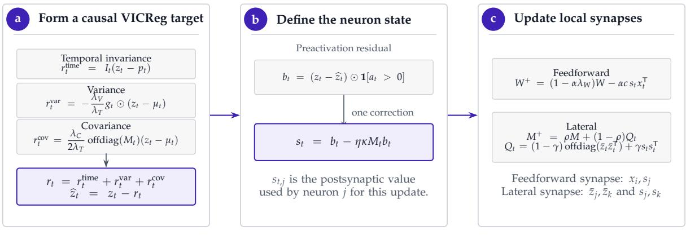
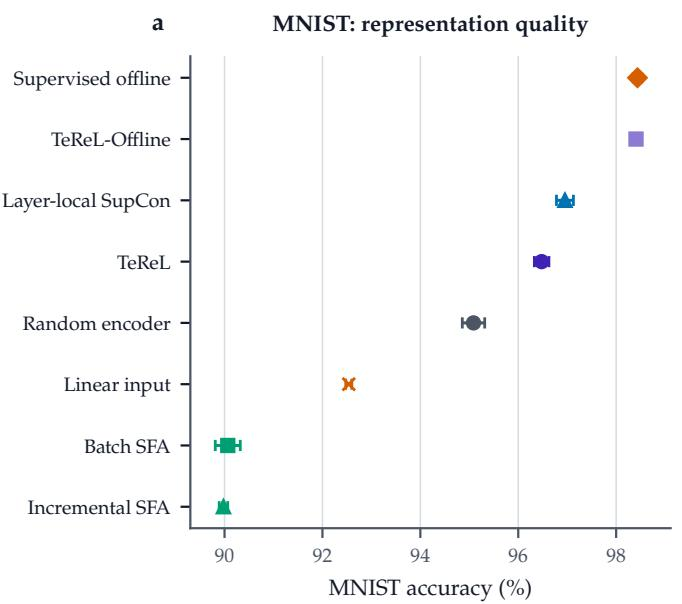
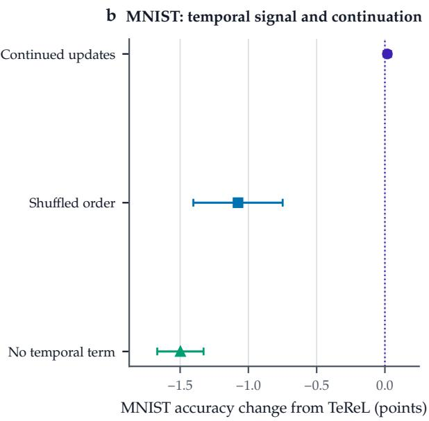
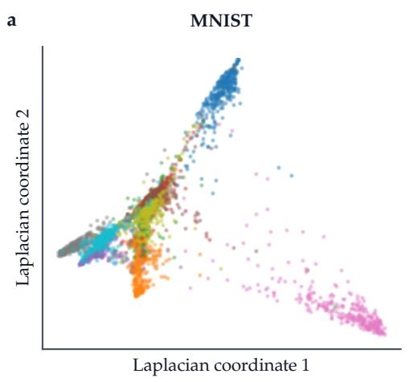
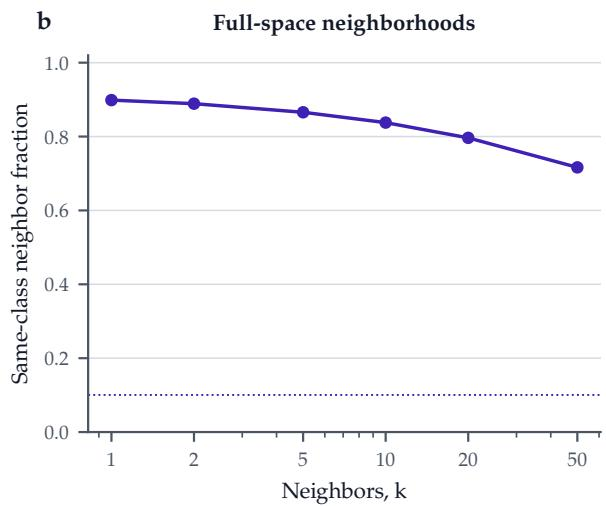
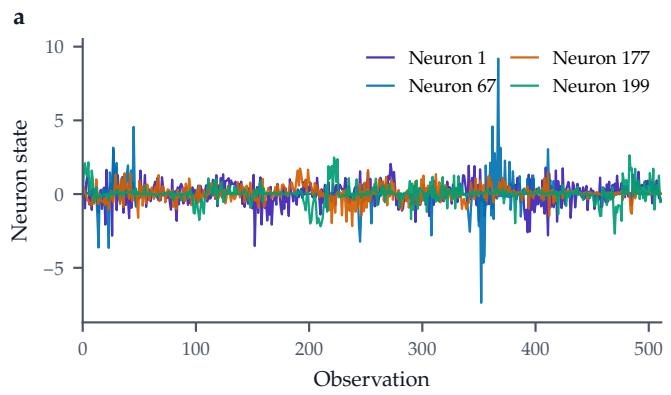
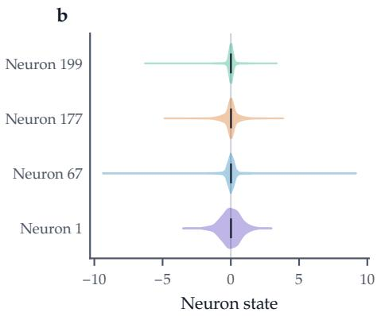

# Temporal Regularized Learning: Self-Supervised Learning Local in Space and Time

Davide Wiest

Department of Computer Science, TU Darmstadt

Darmstadt, Germany

November 2026

Code: https://github.com/Axym-Labs/TeReL

Paper: https://doi.org/10.5281/zenodo.18673107

Correspondence: dw@axym.org

## Abstract

Layer-local self-supervised objectives remove the backward pass between layers, but almost all still compute their loss over a batch of samples and are therefore local in space but not in time. We introduce Temporal Regularized Learning (TEREL), a spatially and temporally local learning rule for self-supervised representation learning from sequential input streams. The key idea is to instantiate a VICReg-style objective with temporally adjacent positives and non-differentiated running population statistics, yielding a per-neuron online loss with bounded state. The objective is a soft form of Slow Feature Analysis, and its gradient is a Hebbian update of the feedforward weights and an anti-Hebbian update of one lateral matrix per layer. The aim of the experiments is to show that the rule works in a small network, not to compete with backpropagation. On a class-chunked MNIST stream, a two-layer fully connected network trained with batch size one outperforms random features (96.48% versus 95.09% linear-probe accuracy) and classical SFA, and a variant that relaxes both locality constraints is comparable to supervised backpropagation. Because training and inference use the same computation, the network can keep learning from unlabeled data during inference without loss of accuracy.

  
One observation at a time detached state no error signal from a later layer  
Figure 1: TEREL in one layer. a, The temporal, variance, and covariance terms form a regularized target. b, Its residual and one pass through the lateral matrix define the neuron state. c, The state drives a Hebbian feedforward and an anti-Hebbian lateral update.

## 1 Introduction

Learning from unlabeled sensory streams is a practical necessity for both biological modeling and energy-efficient machine learning on constrained hardware. Modern self-supervised methods succeed on unlabeled data by aligning representations of related samples (positives) while avoiding collapse using either negative samples or explicit regularizers. Contrastive methods rely on negatives and on large batch sizes to estimate cross-sample statistics [1, 2]. Regularized alternatives avoid explicit negatives and instead combine an invariance term with variance and covariance penalties [3, 4]. VICReg is a regularized method that enforces invariance without negatives and whose regularizers can be computed from local moments, at least in a batched implementation [3].

Standard implementations of these objectives use credit assignment across neurons and layers. That usually requires an extensive memory of the state for backpropagation [5], or iterative settling for predictive coding and equilibrium propagation [6, 7], which conflicts with temporal locality. For this reason, we optimize the objective at each neuron of the network. This paper shows how a VICRegstyle objective can be instantiated as a per-neuron temporal loss by using adjacent observations as positives and treating running population statistics as non-differentiated state. The motivation is practical: locality reduces communication between units, and temporal locality permits streaming implementations with only a small short-term memory per neuron. Both properties are desirable for analog and neuromorphic hardware [8, 9].

By making the invariance temporal, TEREL is a type of Slow Feature Analysis (SFA) procedure: SFA aims to extract slowly changing features from a temporal sequence of faster-changing inputs [10, 11]. This can lead to representations that are invariant to augmentations or capture latent variables. More broadly, many sequential domains contain latent factors that evolve more slowly than their raw observations. In text, the sentiment of a review remains stable across its many words; in finance, stock prices fluctuate faster than the market factors that drive them; in physiology, the underlying state or health condition of a patient evolves slowly relative to heartbeat, respiratory cycles, and momentary noise in sensor traces.

The per-neuron loss gives the learning rule a familiar form. Its gradient at the preactivation of a neuron is a signed state; the feedforward update is the product of presynaptic activity and this state, and pairs of states drive an anti-Hebbian update of one same-layer matrix. Similarity-matching networks use the same form of Hebbian cross-layer and anti-Hebbian lateral learning for linear representations [12, 13]. The key difference is the more complex state used here: the residual of a nonlinear target that balances slowness, variance, and decorrelation.

Contributions This paper makes three contributions. First, it derives TEREL from VICReg through an explicit instantiation choice: population statistics are maintained as non-differentiated state, while adjacent observations supply the positive pairs, and these stop-gradients retain the learning signal of the current observation. Second, it expresses the resulting gradient as a neuron-local rule with Hebbian feedforward and anti-Hebbian lateral updates, and clarifies TEREL as a conceptual bridge between modern regularized self-supervised learning objectives and classical temporal representation learning ideas such as Slow Feature Analysis and trace learning [11, 14]. Third, it evaluates TEREL with batch size one under controlled temporal orderings against random, classical SFA, supervised, and relaxed-locality references, and reports ablations of each loss term.

The experiments test three hypotheses. (H1) Despite its locality constraints, TEREL trained with batch size one learns a useful deep representation. (H2) The temporal order and each of the three loss terms contribute to this representation. (H3) Continuing the same unlabeled updates along an evaluation stream preserves the representation, so that the rule can keep learning online.

## 2 Method

## 2.1 Locality

We call a learning rule spatially local if the update of a weight depends only on quantities available at its pre- and postsynaptic units (and same-layer auxiliary units) and does not require backpropagated error signals from other layers. We call it temporally local (online) if the gradient at time step t depends only on the current observation, the current parameters, and a bounded amount of detached state carried forward in time. The size of this state may depend on the layer width but not on the length of the stream, and no gradient flows through the history that produced it.

## 2.2 Starting point: VICReg

Consider observation t at a layer with input $\boldsymbol { x } _ { t } \in \mathbb { R } ^ { d }$ and width D. The layer computes

$$
a _ { t } = W _ { t } x _ { t } + q _ { t } , \qquad z _ { t } = \phi ( a _ { t } ) ,\tag{1}
$$

where $W _ { t } \in \mathbb { R } ^ { D \times d }$ and $q _ { t } \in \mathbb { R } ^ { D }$ . The output $z _ { t }$ is detached before it becomes the input to the next learned layer. Before this observation, each neuron stores its previous activation $p _ { t } , \mathsf { a }$ running mean $\mu _ { t } ,$ and a running variance $v _ { t } ,$ , and the layer stores a lateral matrix $M _ { t } \in \mathbb { R } ^ { D \times D }$ . Let $I _ { t } \in \{ 0 , 1 \}$ indicate whether $p _ { t }$ belongs to the same sequence, and write $\bar { z } _ { t } = z _ { t } - \mu _ { t }$ and $g _ { t } = [ \tau - v _ { t } ] .$ + for a variance target $\tau > 0$

VICReg decomposes a representation-level objective into three terms (similarity/invariance, variance, covariance) [3]: $\mathcal { L } _ { \mathrm { V I C R e g } } = \lambda _ { I } \mathcal { L } _ { I } + \lambda _ { V } \mathcal { L } _ { V } + \dot { \lambda } _ { C } \mathcal { L } _ { C }$ . We keep these roles but replace the second view by the previous activation ${ { p } _ { t } } ,$ batch moments by the detached running statistics $\mu _ { t } , v _ { t } ,$ , and the differentiated batch covariance by the lagged operator $A _ { t } = { \tt o f f d i a g } ( M _ { t } )$

$$
\ell _ { T } = \frac { I _ { t } } { D } \| z _ { t } - p _ { t } \| _ { 2 } ^ { 2 } , \qquad \ell _ { V } = - \frac { 1 } { D } g _ { t } ^ { \top } \big ( \bar { z } _ { t } \odot \bar { z } _ { t } \big ) , \qquad \ell _ { C } = \frac { 1 } { D } \bar { z } _ { t } ^ { \top } A _ { t } \mathrm { s g } \big ( \bar { z } _ { t } \big ) .\tag{2}
$$

The layer minimizes $\ell = \lambda _ { T } \ell _ { T } + \lambda _ { V } \ell _ { V } + \lambda _ { C } \ell _ { C }$ with $\lambda _ { T } > 0$ . The temporal coherence term makes consecutive activations similar; in discrete time it is the squared first derivative of the activations that SFA minimizes. The variance term increases the coordinates whose stored variance lies below $\tau ,$ and the covariance term applies a lagged same-layer decorrelation signal. TEREL is therefore a causal surrogate of the VICReg decomposition, not a re-expression of its batch objective: $\ell _ { V }$ is a gated instantaneous expansion term, and $A _ { t }$ is a lagged proxy for the covariance gradient.

Proposition 1 (A stop-gradient VICReg instantiation is temporally local). For fixed $p _ { t } , \mu _ { t } , v _ { t } , M _ { t } ,$ , and $I _ { t } ,$ the derivative of ℓ is

$$
\nabla _ { z _ { t } } \ell = \frac { 2 \lambda _ { T } } { D } r _ { t } , \qquad r _ { t } = I _ { t } ( z _ { t } - p _ { t } ) - \frac { \lambda _ { V } } { \lambda _ { T } } g _ { t } \odot \bar { z } _ { t } + \frac { \lambda _ { C } } { 2 \lambda _ { T } } A _ { t } \bar { z } _ { t } ,\tag{3}
$$

and the feedforward gradient is $2 \lambda _ { T } \big ( J _ { \phi , t } ^ { \top } r _ { t } \big ) x _ { t } ^ { \top } / D$ , where $J _ { \phi , t }$ is the Jacobian of $\phi$ at $a _ { t }$ . The update is temporally local, and detachment preserves a learning signal from the current observation whenever $x _ { t } \neq 0$ and $J _ { \phi , t } ^ { \top } r _ { t } \neq 0$

Proof. The stored quantities are constants for differentiation. The temporal, variance, and covariance terms contribute $2 \hat { \lambda } _ { T } I _ { t } \big ( z _ { t } - p _ { t } \big ) / D , - 2 \lambda _ { V } g _ { t } \odot \bar { z } _ { t } / D$ , and $\lambda _ { C } A _ { t } \bar { z } _ { t } / D$ , respectively, which sum to Equation (3). All of them are functions of $z _ { t }$ and of quantities of size $O ( D ^ { 2 } )$ computed before observation $t ,$ so no gradient reaches an earlier observation. The chain rule through Equation (1) gives the outer product $J _ { \phi , t } ^ { \top } \nabla _ { z _ { t } } \ell x _ { t } ^ { \top }$ , which is nonzero when both of its factors are nonzero. □

## 2.3 Regularized target and neuron state

The residual $r _ { t }$ induces an activation target, ${ \widehat { z } } _ { t } = \operatorname { s g } ( z _ { t } - r _ { t } )$ : updates move $z _ { t }$ toward the previous bactivation, away from the running mean where the stored variance is below $\tau ,$ and against correlated activity. The local loss $\lambda _ { T } \big | \big | z _ { t } - \widetilde { z _ { t } } \big | \big | _ { 2 } ^ { 2 } / D$ has the same gradient with respect to $z _ { t }$ as ℓ. This target is bformed within the layer; it is not an external target.

Expressed at the input side of the nonlinearity, the residual becomes $b _ { t } = J _ { \phi , t } ^ { \top } r _ { t }$ . For the ReLU encoders used in the experiments,

$$
b _ { t } = r _ { t } \odot { \bf 1 } [ a _ { t } > 0 ] ,\tag{4}
$$

which requires no automatic-differentiation graph. One pass through the lateral matrix gives the postsynaptic neuron state

$$
s _ { t } = b _ { t } - \eta \kappa M _ { t } b _ { t } ,\tag{5}
$$

with correction step $\eta > 0$ and strength $\kappa \geq 0$ . This is a single matrix–vector product, not an iterative settling procedure.

As in the general case, the weight update can be implemented in a Hebbian style, as the product of the input and an output-related term. With learning rate α and weight decay $\lambda _ { W }$

$$
W _ { t + 1 } = ( 1 - \alpha \lambda _ { W } ) W _ { t } - \alpha \frac { 2 \lambda _ { T } } { D } s _ { t } x _ { t } ^ { \top } ,\tag{6}
$$

which is the gradient step for the detached preactivation target $\widehat { \boldsymbol { a } } _ { t } = \mathbf { s g } ( \boldsymbol { a } _ { t } - \boldsymbol { s } _ { t } )$ . Each feedforward synapse therefore receives a presynaptic scalar $\boldsymbol { x } _ { t , i }$ band a postsynaptic scalar $s _ { t , j } ,$ , and under gradient descent the sign of $s _ { t , j }$ determines potentiation or depression. The bias update uses $s _ { t }$ alone. Without the lateral correction $( \kappa = 0 )$ , Equation (6) is exactly the feedforward gradient of Proposition 1.

## 2.4 Lateral matrix and online memory requirements

The same matrix supplies the covariance signal in Equation (3) and the state correction in Equation (5). After the synaptic update, it follows

$$
M _ { t + 1 } = \rho M _ { t } + ( 1 - \rho ) \left[ \left( 1 - \omega \right) \mathrm { o f f d i a g } ( \bar { z } _ { t } \bar { z } _ { t } ^ { \top } ) + \omega s _ { t } s _ { t } ^ { \top } \right] ,\tag{7}
$$

with $\omega \in [ 0 , 1 ]$ and $\rho \in [ 0 , 1 )$ . With Hebbian-style updates, mean-centered products between pairs of neurons recover covariance over time. If the inhibitory lateral weights are written as $L _ { t } = - M _ { t } ,$ the state component contributes $- ( 1 - \rho ) \omega s _ { t } s _ { t } ^ { \top }$ to $L _ { t } \mathbf { : }$ same-signed neuron states make their mutual connection more inhibitory, which is the anti-Hebbian sign.

The TEREL loss requires three per-neuron state variables: the previous activation, a running mean, and a running variance,

$$
p _ { t + 1 } = z _ { t } , \qquad \mu _ { t + 1 } = \beta \mu _ { t } + ( 1 - \beta ) z _ { t } , \qquad v _ { t + 1 } = \beta v _ { t } + ( 1 - \beta ) ( z _ { t } - \mu _ { t } ) ^ { 2 } .\tag{8}
$$

This state can be stored at the neuron level. The running statistics, the lateral matrix Equation $( 7 )$ and the feedforward weights Equation (6) are all leaky integrators (exponential moving averages); an RC circuit could, in principle, implement such leaky integrators. At a sequence boundary only the validity of $p _ { t }$ is cleared. A layer of width D thus stores 3D dynamic scalars and $D ^ { 2 }$ auxiliary lateral parameters besides its feedforward weights; plain SGD adds no optimizer state. For the 784–512–256 MNIST encoder these are 2,304 dynamic scalars, 327,680 lateral parameters, and 533,248 feedforward parameters.

TEREL does not attempt to approximate global backpropagation across long paths in the network. Because the learning objective is local in space and time, the method also does not accumulate approximation error with depth in the way that methods approximating global gradients do. Each layer completes its forward pass, target, state correction, and updates for observation t in one feedforward schedule.

## 2.5 TEREL-Offline

TEREL-Offline relaxes the temporal and spatial locality constraints within a subsequence of the data stream. A subsequence enters a ReLU multilayer perceptron, the same three-term objective is evaluated at its final layer, and backpropagation differentiates it through all layers and observations of the subsequence. It is optimized with plain SGD and serves as a performance reference for the objective, not as an alternative definition of TEREL.

## 3 Related work

TEREL occupies a point in design space at the intersection of self-supervised and local learning procedures. We summarize the most direct comparisons as follows:

• Contrastive SSL: Compared to methods that rely on negative samples, TEREL requires only temporally adjacent positives and regularizers to avoid collapse [1, 2].

• VICReg and Barlow Twins: TEREL moves the variance and covariance regularization to the neuron level and substitutes temporally adjacent positives for augmented pairs [3, 4].

• Layerwise SSL: Layer-local and blockwise objectives remove the backward path between network modules [15–18], and VICReg losses have been applied at successive layers [19]. TEREL differs by additionally targeting temporal locality and online implementability: it supplies the three signals causally along time and factors them into neuron-local updates.

• Similarity matching: Hebbian/anti-Hebbian networks derived from similarity-matching objectives have the same synaptic form [12, 13]; TEREL replaces their linear postsynaptic factor by the residual of a nonlinear regularized target.

• Forward-Forward: TEREL and Forward-Forward both use local, layerwise objectives to avoid end-to-end backpropagation through deep networks. TEREL uses an invariance objective rather than a goodness signal and does not require constructed positive and negative passes [20].

• Equilibrium propagation and predictive coding: These rely on iterative relaxation, and equilibrium propagation on a free and a nudged phase, whereas TEREL uses a single-pass, per-neuron objective with bounded local state [6, 7, 21].

Vectors and matrices that are computed from parameters or activations but held constant with respect to the parameters being optimized are common in training objectives, such as weight-averaged teacher parameters [22], stop-gradient targets [23, 24], predictions of an earlier model [25], and importance matrices in continual learning [26, 27]. TEREL relies on this design pattern through its running variance and covariance estimates.

Relation to slow feature analysis and trace learning TEREL can be seen as a regularized, modernized trace-learning/SFA-style procedure in which temporal adjacency provides the positive pairs. The MSE between two contiguous samples is exactly the first derivative of activations in discrete time that is squared and minimized in SFA, and the whitening constraint of SFA maps to the variance and covariance regularizers [10]. In the classification experiments, the faster-changing inputs are the individual samples, while the slower feature is the class membership of all samples within a chunk. Incremental SFA adapts the linear construction to streams but retains a whitening stage and linear feature extraction [28]. TEREL is also closely related to Bio-SFA, a biologically plausible SFA algorithm. Bio-SFA works with a hard whitening constraint and uses iterative settling, whereas TEREL penalizes covariance softly and its training is a series of discrete-time passes [29].

Trace learning is a simple, biologically plausible procedure that modifies Hebbian updates by introducing a temporal aspect: instead of a neuron’s activation, it uses an activation trace [11, 30]. Trace learning and TEREL share the operational goal of promoting temporal invariance but do so in different ways. Ignoring shared factors, the temporal term of TEREL induces $\Delta w _ { k j } \propto x _ { k } ( z _ { t - 1 , j } - z _ { t , j } )$

while trace learning uses $\Delta w _ { k j } \propto x _ { k } ( \beta \bar { z } _ { t - 1 , j } + ( 1 - \beta ) z _ { t , j } )$ with $\beta \in ( 0 , 1 )$ . No choice of $\beta$ makes the two updates identical, because matching them would require both $\beta = 1$ and $1 - \beta = - 1$ . The trace rule furthermore requires a weight-dependent decay term to prevent runaway effects [31].

More broadly, TEREL opens a bridge between modern self-supervised learning and classical local learning rules by showing how regularized objectives can be expressed in strictly local, onlinecompatible form. Our ablations show that the variance and decorrelation regularizers are both necessary to avoid collapse or divergence. This suggests that trace-learning and SFA-style rules may likewise benefit from explicit variance control and decorrelation, even if their core temporal objective remains unchanged.

## 4 Experimental protocol

We evaluate TEREL on MNIST [32] with synthetic sequential coherence. TEREL’s objective is strictly representational and uses no supervision. However, the order of the data stream can induce relatively arbitrary pairs of positives. For example, placing data of the same category next to each other mirrors a supervised contrastive setup. We use this order: the stream consists of randomly permuted classhomogeneous chunks of 16 samples, separated by sequence boundaries. The labels determine adjacency but do not enter the target or either update. As noted by Hinton for the supervised Forward-Forward setup, the network should then preferentially learn features that support discrimination between classes [20].

The encoder is a ReLU multilayer perceptron with hidden widths 512 and 256. TEREL is trained with batch size one and plain SGD for two passes over the encoder-training samples. The downstream evaluation trains a linear classifier on the standardized concatenated activations of both layers of the encoder-training samples and evaluates it on held-out data. We reserve a stratified subset of the official training data (10,000 images) for all model selection; the official test split is used only for the final comparison. Reported values are means and sample standard deviations over five initializations, and paired comparisons use 95% Student-t intervals. All trained models, including the linear classifier and the references, use plain SGD; batch size is part of each method. Hyperparameters and raw values appear in Section A.

The references expose distinct relaxations. TEREL-Offline uses the same architecture and objective with subsequences of 128 and end-to-end backpropagation. A layer-local network trained with a supervised contrastive objective [33] (Layer-local SupCon) uses labels, minibatches, and batch normalization at every layer. A supervised offline network is trained end to end with labels and backpropagation. A random ReLU encoder of the same shape, a linear probe on the input, and batch and incremental SFA [10, 28] complete the comparison. The methods differ in their intrinsic data and optimization requirements, so the comparison reports representation quality rather than equal compute.

Four ablations examine TEREL itself: shuffling the stream, and setting the temporal, variance, or covariance coefficient to zero. For the online learning demonstration, the trained encoder continues its unlabeled updates along the evaluation stream, using the same fitted probe as the fixed encoder. Each representation is read before the current observation updates the encoder. The learning rate of these continued updates is a fixed fraction of the training learning rate, chosen on the validation stream.

## 5 Results

The aim of the experiments is to show that TEREL works in relatively small networks under its locality constraints, not to compete with architectures that rely on global credit assignment. As in the Forward-

Forward experiments [20], we therefore use networks without weight sharing. A shared weight would receive the sum of updates from many neurons, so its update would no longer be local to one synapse.

  
Figure 2: Representation quality and paired temporal effects on MNIST. a, Held-out linear-probe accuracy (mean and sample standard deviation). b, Paired accuracy changes relative to TEREL with a fixed encoder, with 95% Student-t intervals.

## 5.1 Representation quality (H1)

TEREL reaches $9 6 . 4 8 \pm 0 . 1 5 \%$ held-out accuracy on MNIST (Figure 2a). The random encoder reaches $9 5 . 0 9 \pm 0 . 2 3 \% ,$ a paired gain of 1.39 percentage points [1.04, 1.74], and the gain over a linear probe on the input is 3.94 points $[ 3 . 7 6 , 4 . 1 2 ]$ . Batch and incremental SFA reach $9 0 . 0 7 \pm 0 . { \overset { \cdot } { 2 } } 6 \%$ and $8 9 . 9 8 \pm 0 . 0 9 \%$ . Layerlocal SupCon reaches 96 $9 5 \pm 0 . 1 7 \% ,$ 0.48 points [0.10, 0.85] above TEREL, with labels and minibatches at every layer. TEREL-Offline reaches $9 8 . 4 1 \pm 0 . 0 4 \%$ , on par with the fully supervised offline network at $9 8 . 4 \dot { 4 } \pm \dot { 0 } . 0 9 \%$ (paired difference 0.03 points $[ - 0 . 1 9 , \bar { 0 } . 1 3 ] )$ ). The objective itself therefore supports supervised-level accuracy when cross-layer and cross-time optimization are available; the gap to TEREL is the cost of the locality constraints.

## 5.2 Temporal order and loss terms (H2)

Removing the temporal order or any single loss term degrades the representation (Figure 2b). Shuffling the stream lowers accuracy by 1.08 paired points [0.75, 1.40], and removing the temporal term lowers it by 1.50 points [1.33, 1.67]. Without the variance term, the representation collapses: the median feature variance falls to about $1 . { \overset { - } { 4 } } \times 1 0 ^ { - 5 }$ and accuracy to $1 5 . 3 6 \pm 0 . \bar { 2 } 7 \%$ . Without the covariance term, training diverges for all five initializations before a representation can be measured. As in VICReg [3], the invariance term alone admits trivial solutions; the variance term prevents a constant representation, and the covariance term keeps the multidimensional code stable.

## 5.3 Online learning demonstration (H3)

Because training and inference use the same per-sample computation, the encoder can keep learning along the evaluation stream. With the training step size, these continued updates are too aggressive for an already trained representation: on the validation stream, the loss grows across the stream and the effective rank drops sharply. Scaling the step by $1 0 ^ { - 3 }$ preserves validation accuracy (96.51% versus 96.48% for the fixed encoder) and effective rank. With this scale fixed, continued updates on the held-out stream reach $9 6 . 5 0 \pm 0 . 1 5 \%$ , compared with $9 6 . 4 8 \pm 0 . 1 5 \%$ for the fixed encoder, a paired change of +0.02 points [−0.01, 0.04], while the feedforward weights keep changing $( \| \Delta W \| _ { 2 } = \mathrm { \bar { 0 } } . 0 4 7 )$

## 5.4 Representations

  
Figure 3: Class structure in the MNIST TEREL representation. a, Laplacian embedding of validation features o both layers; colors denote digits and are used only for visualization. b, Fraction of same-class neighbors in the complete 768-dimensional representation. The dotted line is the chance level.

We probe whether TEREL yields class-structured latent codes suitable for a simple linear readout. The Laplacian embedding in Figure 3a shows class-consistent branches rather than a single collapsed mass. Because a two-dimensional projection can distort neighborhoods, Figure 3b measures the same relation in the complete representation: the nearest neighbor shares the digit for 89.9% of observations, and the fraction remains 79.7% across 20 neighbors and 71.7% across 50, compared with a 10.0% chance level.

  
Figure 4: Signed postsynaptic state. a, State trajectories of four randomly selected second-layer neurons over the same interval of the validation stream. b, Their state distributions over the complete validation stream; black bars mark medians.

Figure 4 shows TEREL’s neuron state $s _ { t } ,$ , the quantity that multiplies presynaptic activity in Equation (6). The selected neurons alternate between positive and negative values, so the state drives both potentiation and depression. Their scales differ substantially: some neurons respond through sparse excursions, whereas another carries a broader signed signal.

## 6 Limitations and future work

The experiments use a constructed, label-ordered stream on MNIST. Natural streams contain several time scales and may require a different balance among the temporal, variance, and covariance terms; establishing TEREL on video or sensor streams is the most important empirical extension. Continued online updates require a smaller step than initial training, and in the present setting they preserve rather than improve the representation; local rules that adapt this step would let training and long-term inference coincide more fully. Finally, a layer of width D uses ${ \dot { D } } ^ { 2 }$ lateral parameters, which may dominate very wide layers. Sparse, low-rank, or structured lateral matrices, as well as convolutional and recurrent architectures, are natural next steps for constrained hardware.

## 7 Conclusion and outlook

We presented Temporal Regularized Learning, an approach that adapts the invariance, variance, and covariance regularizers of VICReg to neuron-level temporal losses. Detached running statistics and a lagged lateral matrix make the rule local in space and time, and its gradient takes the form of Hebbian feedforward and anti-Hebbian lateral updates driven by a signed neuron state. Trained with batch size one, TEREL learns representations that improve on random features and classical SFA, and the same rule keeps learning online after training. TEREL emphasizes locality and streaming compatibility and therefore maps naturally to constrained hardware, while connecting regularized self-supervised learning to classical temporal ideas such as Slow Feature Analysis and trace learning.

## AI Use Statement

An earlier version of TEREL and of this manuscript predates the generative-AI assistance. Generative AI tools were used primarily to update the paper with new experiments, to find bugs, and for scripting. They also assisted with analysis, figure creation, and editing. The author reviewed AIassisted code, experimental outputs, numerical claims, citations, figures, and text against saved artifacts and executable code, and takes responsibility for the final content.

## References

[1] Ting Chen, Simon Kornblith, Mohammad Norouzi, and Geoffrey Hinton. A Simple Framework for Contrastive Learning of Visual Representations. arXiv preprint arXiv:2002.05709, 2020.

[2] Aaron van den Oord, Yazhe Li, and Oriol Vinyals. Representation Learning with Contrastive Predictive Coding. arXiv preprint arXiv:1807.03748, 2018.

[3] Adrien Bardes, Jean Ponce, and Yann LeCun. VICReg: Variance-Invariance-Covariance Regularization for Self-Supervised Learning. In International Conference on Learning Representations, 2022. URL https://openreview.net/forum?id=xm6YD62D1Ub.

[4] Jure Zbontar, Li Jing, Ishan Misra, Yann LeCun, and Stéphane Deny. Barlow Twins: Self-Supervised Learning via Redundancy Reduction. arXiv preprint arXiv:2103.03230, 2021.

[5] David E Rumelhart, Geoffrey E Hinton, and Ronald J Williams. Learning representations by back-propagating errors. nature, 323(6088):533–536, 1986.

[6] Rajesh P. N. Rao and Dana H. Ballard. Predictive Coding in the Visual Cortex: A Functional Interpretation of Some Extra-Classical Receptive-Field Effects. Nature Neuroscience, 2(1):79–87, 1999. doi: 10.1038/4580.

[7] Benjamin Scellier and Yoshua Bengio. Equilibrium propagation: Bridging the gap between energy-based models and backpropagation. Frontiers in computational neuroscience, 11:24, 2017.

[8] Giacomo Indiveri and Shih-Chii Liu. Memory and information processing in neuromorphic systems. Proceedings ofthe IEEE, 103(8):1379–1397, 2015.

[9] Mike Davies, Narayan Srinivasa, Tsung-Han Lin, Gautham Chinya, Yongqiang Cao, Sri Harsha Choday, Georgios Dimou, Prasad Joshi, Nabil Maghazeh, Shirley Miao, and other. Loihi: A neuromorphic manycore processor with on-chip learning. IEEE Micro, 38(1):82–99, 2018.

[10] Laurenz Wiskott and Terrence J Sejnowski. Slow feature analysis: Unsupervised learning of invariances. Neural computation, 14(4):715–770, 2002.

[11] P Földiák. Learning invariance from transformation sequences. Neural computation, 3(2):194–200, 1991.

[12] Cengiz Pehlevan, Tao Hu, and Dmitri B. Chklovskii. A Hebbian/Anti-Hebbian Neural Network for Linear Subspace Learning: A Derivation from Multidimensional Scaling of Streaming Data. Neural Computation, 27(7):1461–1495, 2015. doi: 10.1162/NECO\_a\_00745.

[13] Cengiz Pehlevan, Anirvan M. Sengupta, and Dmitri B. Chklovskii. Why Do Similarity Matching Objectives Lead to Hebbian/Anti-Hebbian Networks? Neural Computation, 30(1):84–124, 2018. doi: 10.1162/neco\_a\_01018.

[14] Erkki Oja. A simplified neuron model as a principal component analyzer. Journal ofmathematical biology, 15(3):267–273, 1982.

[15] Sindy Löwe, Peter O’Connor, and Bastiaan S. Veeling. Putting An End to End-to-End: Gradient-Isolated Learning of Representations. In Advances in Neural Information Processing Systems, volume 32, 2019.

[16] Yuwen Xiong, Mengye Ren, and Raquel Urtasun. LoCo: Local Contrastive Representation Learning. In Advances in Neural Information Processing Systems, volume 33, 2020.

[17] Bernd Illing, Jean Ventura, Guillaume Bellec, and Wulfram Gerstner. Local plasticity rules can learn deep representations using self-supervised contrastive predictions. In Advances in Neural Information Processing Systems, volume 34, 2021.

[18] Shoaib Ahmed Siddiqui, David Krueger, Yann LeCun, and Stéphane Deny. Blockwise Self-Supervised Learning at Scale. Transactions on Machine Learning Research, 2024.

[19] Joy Datta, Rawhatur Rabbi, Puja Saha, Aniqua Nusrat Zereen, M. Abdullah Al-Wadud, and Jia Uddin. Deep Representation Learning Using Layer-Wise VICReg Losses. Scientific Reports, 15: 27049, 2025. doi: 10.1038/s41598-025-08504-2.

[20] Geoffrey E Hinton. The Forward-Forward Algorithm: Some Preliminary Investigations. arXiv preprint arXiv:2212.13345, 2022.

[21] Yann LeCun, Sumit Chopra, Raia Hadsell, Marc’Aurelio Ranzato, and Fu Jie Huang. A tutorial on energy-based learning. Predicting structured data, 1(0), 2006.

[22] Antti Tarvainen and Harri Valpola. Mean Teachers Are Better Role Models: Weight-Averaged Consistency Targets Improve Semi-Supervised Deep Learning Results. In Advances in Neural Information Processing Systems, volume 30, 2017.

[23] Jean-Bastien Grill, Florian Strub, Florent Altché, Corentin Tallec, Pierre H. Richemond, Elena Buchatskaya, Carl Doersch, Bernardo Avila Pires, Zhaohan Daniel Guo, Mohammad Gheshlaghi Azar, Bilal Piot, koray kavukcuoglu, Remi Munos, and Michal Valko. Bootstrap Your Own Latent: A New Approach to Self-Supervised Learning. arXiv preprint arXiv:2006.07733, 2020.

[24] Xinlei Chen and Kaiming He. Exploring Simple Siamese Representation Learning. arXiv preprint arXiv:2011.10566, 2021.

[25] Zhizhong Li and Derek Hoiem. Learning without Forgetting. In European Conference on Computer Vision, 2016.

[26] James Kirkpatrick, Razvan Pascanu, Neil Rabinowitz, Joel Veness, Guillaume Desjardins, Andrei A. Rusu, Kieran Milan, John Quan, Tiago Ramalho, Agnieszka Grabska-Barwinska, Demis Hassabis, Claudia Clopath, Dharshan Kumaran, and Raia Hadsell. Overcoming Catastrophic Forgetting in Neural Networks. Proceedings ofthe National Academy ofSciences, 114(13):3521–3526, 2017.

[27] Davide Wiest. Improved Elastic Weight Consolidation as an Optimization Constraint for Continual Learning. https://axym.org/work/iewc/, 2026.

[28] Varun Raj Kompella, Matthew Luciw, and Jürgen Schmidhuber. Incremental Slow Feature Analysis: Adaptive and Episodic Learning from High-Dimensional Input Streams. Neural Computation, 24(11):2994–3024, 2012. doi: 10.1162/NECO\_a\_00344.

[29] David Lipshutz, Charles Windolf, Siavash Golkar, and Dmitri Chklovskii. A Biologically Plausible Neural Network for Slow Feature Analysis. In Advances in Neural Information Processing Systems, volume 33, pages 14986–14996, 2020.

[30] Simon M Stringer, G Perry, Edmund T Rolls, and JH Proske. Invariant object recognition in the visual system with novel views of 3D objects. Neural Networks, 15(10):1235–1246, 2002.

[31] Peter Földiák. Forming sparse representations by local anti-Hebbian learning. Biological cybernetics, 64(2):165–170, 1990.

[32] Yann LeCun, Léon Bottou, Yoshua Bengio, and Patrick Haffner. Gradient-based learning applied to document recognition. Proceedings of the IEEE, 86(11):2278–2324, 1998.

[33] Prannay Khosla, Piotr Teterwak, Chen Wang, Aaron Sarna, Yonglong Tian, Phillip Isola, Aaron Maschinot, Ce Liu, and Dilip Krishnan. Supervised Contrastive Learning. In Advances in Neural Information Processing Systems, volume 33, pages 18661–18673, 2020.

Table 1: Encoder configurations used in the reported comparison. A sample is one observation presented to the encoder.
<table><tr><td>Method</td><td>Samples</td><td>Batch or subsequence</td><td>Optimizer</td><td>Normalization</td></tr><tr><td>TEREL</td><td>100,000</td><td>1</td><td>SGD</td><td>none</td></tr><tr><td>TEREL-Offline</td><td>1,000,000</td><td>128</td><td>SGD</td><td>none</td></tr><tr><td>Layer-local SupCon</td><td>3,000,000</td><td>256</td><td>SGD</td><td>BatchNorm</td></tr><tr><td>Supervised offline</td><td>500,000</td><td>64</td><td>SGD</td><td>none</td></tr><tr><td>Batch SFA</td><td>50,000</td><td>complete fit</td><td>eigensolver</td><td>whitening</td></tr><tr><td>Incremental SFA</td><td>50,000</td><td>1</td><td>incremental</td><td>whitening</td></tr></table>

## A Evaluation protocol and raw values

Table 1 lists the reported configurations. All hyperparameters are selected on the reserved validation split; the test split is used only for the final comparison.

For TEREL, the selected coefficients are $\lambda _ { T } = 1 , \lambda _ { V } = 3 . 0 0 1 9 8 1 , \lambda _ { C } = 0 . 6 0 6 1 3 3 , \tau = 1 , \beta = 0 . 9 9$ $\rho = 0 . 9 9 5 , \kappa = 0 . 5 7 4 9 5 0 , \eta = 0 . 1$ , and $\omega = 0 . 5 9 1 1 1 0$ . The learning rate is 0.0138703 with weight decay $1 0 ^ { - 6 }$ . TEREL-Offline uses 20 epochs, learning rate 0.4, weight decay $1 0 ^ { - 6 }$ , variance coefficient 2.529924, covariance coefficient 0.0218471, and variance target 0.862789. The supervised offline network uses learning rate 0.3 and Layer-local SupCon learning rate 0.3. The linear probe is trained for 60 epochs with batch size 1024 on features standardized with training statistics; its learning rate is selected per method on the validation split from 0.01, 0.03, 0.1, 0.3, 1 and is 0.3 for TEREL and its ablations.

Table 2: Held-out MNIST accuracy by seed. Values are fractions; a dash denotes diverged training.
<table><tr><td>Method / seed</td><td>1101</td><td>1202</td><td>1303</td><td>1404</td><td>1505</td></tr><tr><td>TEREL</td><td>.9637</td><td>.9647</td><td>.9671</td><td>.9633</td><td>.9651</td></tr><tr><td>TEREL-Offline</td><td>.9847</td><td>.9837</td><td>.9841</td><td>.9836</td><td>.9842</td></tr><tr><td>Random encoder</td><td>.9475</td><td>.9529</td><td>.9495</td><td>.9520</td><td>.9524</td></tr><tr><td>Input linear probe</td><td>.9254</td><td>.9262</td><td>.9257</td><td>.9250</td><td>.9246</td></tr><tr><td>Supervised offline</td><td>.9836</td><td>.9858</td><td>.9840</td><td>.9846</td><td>.9838</td></tr><tr><td>Layer-local SupCon</td><td>.9698</td><td>.9713</td><td>.9677</td><td>.9711</td><td>.9678</td></tr><tr><td>Batch SFA</td><td>.9039</td><td>.9010</td><td>.8981</td><td>.8981</td><td>.9022</td></tr><tr><td>Incremental SFA</td><td>.8984</td><td>.8998</td><td>.9001</td><td>.9008</td><td>.8998</td></tr><tr><td>No temporal term</td><td>.9506</td><td>.9503</td><td>.9503</td><td>.9478</td><td>.9500</td></tr><tr><td>No variance term</td><td>.1530</td><td>.1537</td><td>.1582</td><td>.1515</td><td>.1518</td></tr><tr><td>No covariance term</td><td></td><td></td><td></td><td></td><td></td></tr><tr><td>Shuffled order</td><td>.9559</td><td>.9512</td><td>.9535</td><td>.9539</td><td>.9556</td></tr></table>

## B Locality and operation accounting

For a layer of width D with input width d, the feedforward multiplication costs Dd multiply– accumulates. Forming the target and running statistics is linear in D. The lateral target and state correction each use a $D \times D$ matrix–vector multiplication, and updating the lateral moment uses a rank-one outer product. The persistent quantities are summarized in Table 3; temporary activations are not persistent state.

Table 3: Persistent quantities for one TEREL layer of width D and input width d.
<table><tr><td>Category</td><td>Quantity Size</td><td></td></tr><tr><td>Dynamic neuron state</td><td> $p , \mu , v$ </td><td> $3 D$ </td></tr><tr><td>Auxiliary lateral parameters</td><td> $M$ </td><td> $D ^ { 2 }$ </td></tr><tr><td>Feedforward parameters</td><td> $W , q$ </td><td> $D d + D$ </td></tr><tr><td>Optimizer state</td><td>none</td><td>0</td></tr></table>