NeurIPS 2026 Workshop on Foundation Models for Temporal Systems: From Forecasting to World Modeling

# Time Flies When You Parallelise: Pareto-eficient Time Series Foundation Models with Linear Recurrences

Torben Berndt1,2,\* Lingyi Yang1,3,\* Federico Nardi1 Yi Heng Lim1 AJ Shears1 Benjamin Walker1 1Continuous Intelligence Limited 2Heidelberg Institute for Theoretical Studies 3University of Nottingham \*Equal contribution

ABS TRAC T

Time series foundation models have tional eficiency remains a central architectural challenge. Temporal self-attention incurs quadratic cost in the number of temporal tokens, while nonl ar recurrent state transitions restrict parallel computation along the temporal dimension. We introduce ci-proto, a family of time series foundation models based on Mamba-3, whose linear state recurrences support chunk-wise parallel-in-time computation during training, and inference costs that scale linearly with sequence length. The architecture alternates recurrent temporal processing with cross-variate attention, supporting multivariate probabilistic forecasting with past-only and future-known covariates. Across fev-bench’s 100 forecasting tasks, ci-proto XL sets a new state of the art among time series foundation models. The five ci-proto variants also make up the entire Pareto frontier for mean scaled quantile loss and mean absolute scaled error against both parameter count and median runtime.

a Code GitHub

Models Hugging Face

Website continuousintelligence.co.uk

MASE Arithmetic Mean  
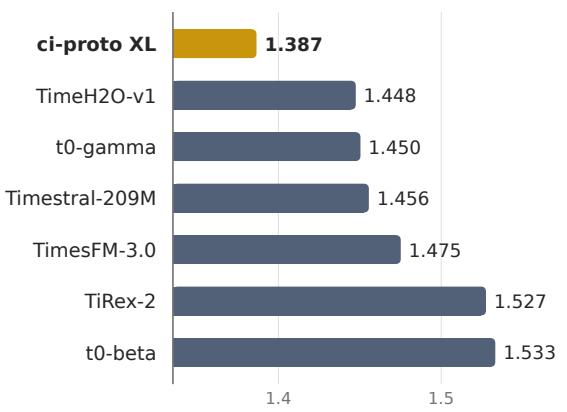

## SQL Arithmetic Mean

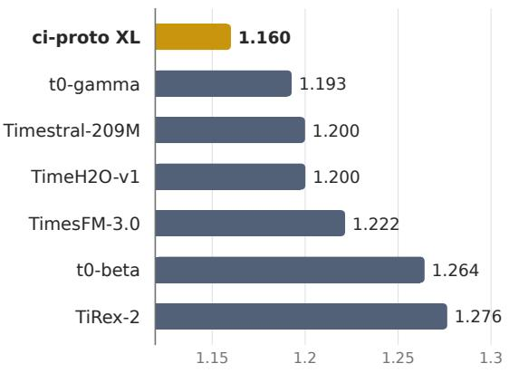  
Figure 1: Arithmetic mean errors of ci-proto on fev-bench. Top seven models on the oficial fev-bench leaderboard [38]. The left panel shows the mean absolute scaled error (MASE) for point forecasting, and the right panel shows the scaled quantile loss (SQL) for probabilistic forecasting. Lower values indicate better performance in both panels.

## 1 Introduction

Large-scale pre-training has shifted machine learning from bespoke, task-specific models to foundation models that transfer across tasks and datasets, driving advances in language [13; 8], vision $\left[ 3 5 ; \ 9 ; \ 3 3 \right]$ , and speech [36]. A similar shift is underway in time series forecasting. Time series foundation models (TSFMs) learn from diverse corpora to forecast unseen datasets without task-specific training. Early models such as TimeGPT [15], TimesFM [12], and Chronos [2] established this paradigm, with subsequent work extending it to multivariate forecasting and the use of covariates [42; 4; 34].

Recent TSFMs have reached the billion-parameter scale, making computational eficiency a key consideration [39; 24]. A central architectural choice is how to model temporal dependencies. Most TSFMs use the Transformer architecture, whose self-attention permits parallel computation across temporal positions but incurs quadratic cost in the number of tokens. Recurrent architectures avoid this quadratic temporal cost, but not all recurrences can be eficiently parallelised. TiRex [5], for example, uses nonlinear sLSTM recurrences, while TiRex-2 [34] combines nonlinear sLSTM and linear mLSTM recurrences. The sLSTM layers require each recurrent state to be computed before the next can be evaluated, introducing a sequential bottleneck during training and context processing [6].

In contrast, linear recurrences have state updates that are linear in the previous hidden state, which allows successive updates to be composed without explicitly evaluating the intermediate hidden states [19]. This enables parallel scan algorithms [28; 19] and hardware-eficient chunk-wise algorithms that combine parallel matrix multiplications within chunks with recurrent propagation between them [43; 11; 26]. Linear recurrent models can therefore support parallel-in-time training and context processing while retaining recurrent inference whose cost scales linearly with sequence length.

However, existing TSFMs with entirely linear recurrent temporal backbones, including Mamba4Cast [7], Flow-State [16], and TempoPFN [32], are limited to processing individual series without cross-variate interaction. We address this gap with ci-proto, a family of TSFMs that alternate Mamba-3 temporal processing [26] with crossvariate attention. Mamba-3 independently processes the temporal sequence of each variate, while attention exchanges information between variates at each temporal position. To the best of our knowledge, ci-proto is the first multivariate TSFM with an entirely linear recurrent temporal backbone. The architecture supports probabilistic forecasting with past-only and future-known covariates, chunk-wise parallel-in-time training, and inference costs that scale linearly with sequence length.

Our choice of Mamba-3 is motivated by both computational eficiency and the expressivity of its recurrent dynamics. Restrictions on state-transition matrices, including diagonal structure and constraints on their eigenvalues, can limit the expressivity and state-tracking capabilities of linear recurrent models $[ 2 9 ; 4 1 ; 1 7 ]$ . Mamba-3 enriches these dynamics through input-dependent $2 \times 2$ rotation matrices, improving state tracking relative to Mamba-2 while retaining hardware-eficient chunk-wise computation [26].

Across the 100 forecasting tasks in fev-bench, ci-proto XL sets a new state of the art among time series foundation models. The five ci-proto variants also make up the entire Pareto frontier for mean scaled quantile loss and mean absolute scaled error against both parameter count and median runtime. These results demonstrate that state-of-the-art multivariate zero-shot forecasting can be achieved without temporal self-attention or nonlinear state recurrences.

## 2 ci-proto

## 2.1 Problem setting

We consider d partially observed variables over a continuous time interval [0, T]. For each variable $i \in$ $\{ 1 , \ldots , d \}$ , we observe a path $X ^ { i } : J _ { i }  \mathbb { R }$ , where $J _ { i } \subseteq [ 0 , T ]$ is a union of observation intervals. The observation sets $J _ { i }$ need not be connected and may difer across variables. Writing $X = ( X ^ { 1 } , \ldots , X ^ { d } )$ , we seek to model the conditional distribution $\mathbb { P } ( Y | X )$ of a complete path $Y : [ 0 , T ]   { \mathbb { R } ^ { d } }$ consistent with the observations, that is, $Y ^ { i } | _ { J _ { i } } = X ^ { i }$ for every i.

We focus on forecasting as a special case of this formulation. Let $0 \leq T ^ { \prime } < T$ denote the forecast origin and $[ T ^ { \prime } , T ]$ the forecast interval. Variables are assigned one of three roles. Targets are variables to be forecast, with observations restricted to the period before the forecast origin, so that $J _ { i } \subseteq [ 0 , T ^ { \prime } )$ . Past-onlycovariates provide additional information observed before the forecast origin, again with $J _ { i } \subseteq [ 0 , T ^ { \prime } )$ . Future-known covariates provide information within the forecast interval, with $J _ { i } \cap [ T ^ { \prime } , T ] \neq \emptyset ;$ ; examples include scheduled promotions and calendar features such as holidays. The forecasting objective is to model the conditional distribution of the targets over $[ T ^ { \prime } , T ]$

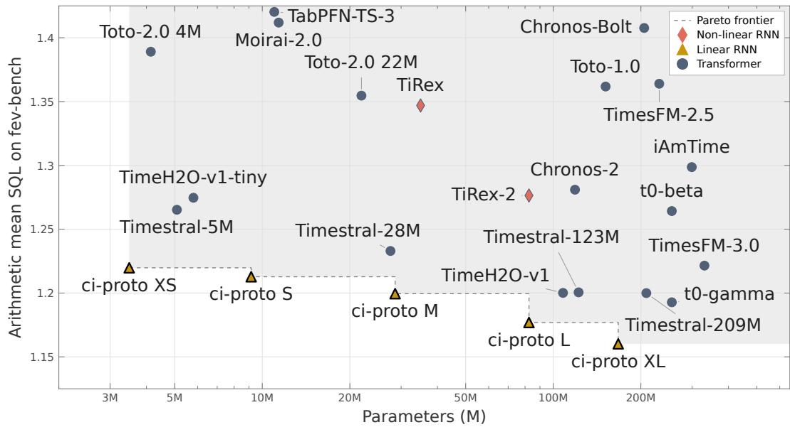  
Figure 2: Mean scaled quantile loss (SQL) on fev-bench versus parameter count. Lower SQL is better. The horizontal axis is in logarithmic scale. The dashed line marks the Pareto frontier formed by the five ci-proto variants.

## 2.2 Architecture

For the architecture considered here, we work with a finite number of regularly spaced samples. We group these samples into L temporal patches and represent the patched inputs as a sequence of hidden representations ${ \cal H } ^ { ( 0 ) } : \{ 1 , \dots , L \}  \mathbb { R } ^ { d \times D }$ , where $d$ is the number of variates, D is the hidden dimension and $H _ { i } ^ { ( 0 ) } ( k )$ represents patch k of variate i. For more details on the patching, see Appendix $\mathsf { A } . 3 .$ . To capture both temporal dependencies and cross-variate relationships, we alternate temporal processing with cross-variate mixing, following [4; 34]. Each block applies a time mixer $\mathcal { T } _ { n }$ , which processes each variate independently along the temporal axis, followed by a variate mixer $\nu _ { n } ,$ , which exchanges information between variates at each temporal position:

$$
H ^ { ( 2 n + 1 ) } = \mathcal { T } _ { n } \big ( H ^ { ( 2 n ) } \big ) , \qquad H ^ { ( 2 n + 2 ) } = \mathcal { V } _ { n } \big ( H ^ { ( 2 n + 1 ) } \big ) .
$$

Variate mixer. The variate mixer applies attention across variates at each patch position:

$$
\left[ \mathcal { V } _ { n } ( H ) \right] ( k ) = \mathsf { G r o u p A t t } \mathsf { n } _ { n } \bigl ( H ( k ) \bigr ) , \qquad k = 1 , \ldots , L .
$$

We use TiRex- $\cdot 2 \cdot \mathsf { s }$ asymmetric group attention [34], building on [4; 10; 14]: past-only and future-known covariates attend to one another, while targets attend to both types of covariates, but not vice versa.

Time mixer. The time mixer applies Mamba-3 [26] independently to each variate’s patch sequence, with parameters shared across variates:

$$
\left[ \mathcal T _ { n } ( H ) \right] _ { i } = \mathsf { M a m b a } \mathsf { a } \mathsf {  { 3 } } _ { n } \bigl ( H _ { i } ( 1 ) , \ldots , H _ { i } ( L ) \bigr ) , \qquad i = 1 , \ldots , d .
$$

The time mixer processes all three variate types causally, with its state evolving along the discrete patch index k. Future-known covariates are additionally processed backwards in time using the same parameters. For information on the chosen hyperparameters, see Appendix A.1.

Forecasting head and loss. For each target variate i and time step in patch $k + 1$ , 9 linear heads predict equally-spaced quantiles $0 . 1 , \ldots , 0 . 9$ from the final-layer representation $H _ { i } ( k )$ . We minimise the pinball loss [25], averaged over quantile levels and observed target values. For more information, see Appendix A.4.

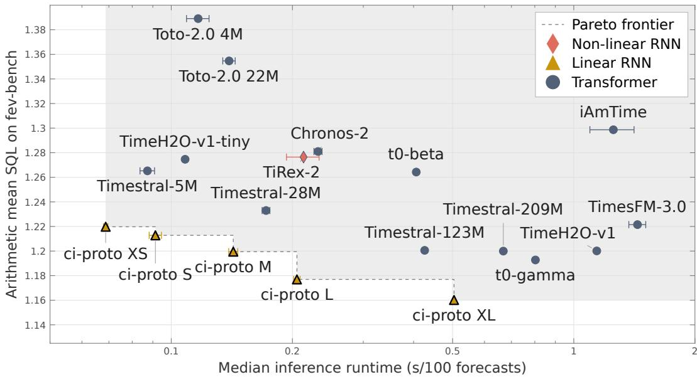  
Figure 3: Mean scaled quantile loss (SQL) on fev-bench versus median runtime per 100 forecasts for selected leaderboard models. We benchmark all models on identical hardware and under the same execution settings, since self-reported leaderboard timings are not directly comparable. We report the mean and standard deviation across five runs. Lower SQL is better. The horizontal axis is in logarithmic scale. The dashed line marks the Pareto frontier formed by the five ci-proto variants.

Training dataset. Following TiRex-2 [34], we construct a pre-training corpus from subsets of the Chronos training data [2] and the GIFT-Eval pre-training dataset [1] (filtered for leakage in fev-bench). We add synthetic sequences generated by Gaussian processes [2; 5] and by generators of multivariate processes with covariate effects. During training, we randomly sample univariate sequences from this corpus and combine them into correlated multivariate sequences using either identity mappings, functional coupling, linear mixing, co-integration, or linear and non-linear structural causal models. Finally, we enrich these examples with binary covariates or calendar features and assign each variate a role as a forecasting target, past-only covariate, or future-known covariate. After pre-training, we post-train on additional publicly available real-world datasets and synthetic data, also filtered for leakage against the evaluation benchmarks, mixed with subsets of the earlier training data. For more detail on the dataset composition, see Appendix B.

## 3 Experiments

## 3.1 Standard forecasting benchmarks

Benchmark and models. We evaluate five ci-proto variants (XS, S, M, L, and XL) on the 100 forecasting tasks in fev-bench [38], covering diverse domains and forecasting settings, including tasks with past-only and future-known covariates. We compare against TabPFN-TS-3 [22; 18], Moirai-2.0 [27], TiRex [5] and TiRex-2 [34], Chronos-2 [4] and Chronos-Bolt [3], TimesFM-2.5 and TimesFM-3 [12; 23], Toto-1.0 [10] and Toto-2.0 [24], the Timestral family (5M, 28M, 123M, and 209M) [31], TimeH2O-v1-tiny and TimeH2O-v1 [20], the $t _ { 0 }$ family (beta and gamma) [30; 40], and iAmTime [37]. Baseline forecasting scores are taken from the oficial leaderboard, while runtimes are measured by us on identical hardware and under the same execution settings.

Test-time adaptation. Inspired by TiRex-2 [34], TimesFM-3 [23], the $t _ { 0 }$ family [30], Timestral [31], and TimeH2O [20], we apply a model-free test-time adaptation around the forward pass. Specifically, strongly trending targets are diferenced before forecasting and integrated back afterwards, crossing quantiles are sorted, and each forecast is averaged with the mapped-back forecast of the negated series. Two constants are fitted on the fev-bench validation split and then frozen for the test evaluation (Appendix B.3).

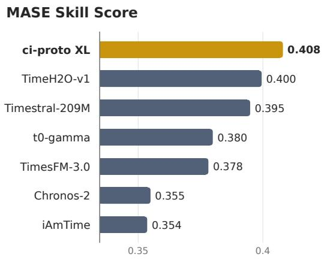

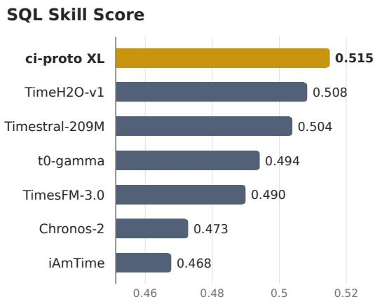  
Figure 4: Skill scores of ci-proto on fev-bench. Skill score relative to the seasonal naive baseline for the top seven models on the oficial fev-bench leaderboard [38]. The left panel shows skill score based on the mean absolute scaled error (MASE) for point forecasting, and the right panel shows it based on the scaled quantile loss (SQL) for probabilistic forecasting. Higher values indicate better performance in both panels.

Metrics and eficiency. We evaluate point and probabilistic forecasting using mean absolute scaled error (MASE) and scaled quantile loss (SQL), respectively [38]. For each metric, we report arithmetic means across series within each task and across tasks, together with a skill score relative to the seasonal naive baseline:

$$
\mathsf { S k i l l S c o r e } _ { m } = 1 - \left( \prod _ { t = 1 } ^ { T } \frac { m _ { t } ^ { \mathsf { m o d e l } } } { m _ { t } ^ { \mathsf { s e a s o n a l } \cdot \mathsf { n a i v e } } } \right) ^ { 1 / T } , \qquad m \in \{ \mathsf { M A S E } , \mathsf { S Q L } \} ,
$$

where $T$ is the number of tasks and mmodel and $m \mathrm { i }$ seasonal naive denote the corresponding errors on task t. We consider these metrics both individually and in relation to parameter count and runtime per 100 forecasts.

Forecasting accuracy and eficiency. Figures 1 and 4 show that our largest model, ci-proto XL, achieves the lowest arithmetic mean errors and the highest skill scores for both MASE and SQL on fev-bench. Figures 2 and 3 further show that the five ci-proto variants form the Pareto frontiers of mean SQL versus parameter count and measured runtime per 100 forecasts. Furthermore, our smallest model, ci-proto XS, achieves lower mean SQL than Timestral-28M and TimesFM-3, while using substantially fewer parameters at a faster run time.

These results extend to point forecasting. Figures 7 and 8 (Appendix D) show that the five ci-proto variants form the Pareto frontiers of mean MASE versus parameter count and median runtime. When performance is measured using MASE and SQL skill scores, all five variants remain on the corresponding Pareto frontiers (Appendix D). See Appendix C for more detail on how to interpret Pareto frontiers and our hardware and runtime specifications.

## 3.2 Long-context forecasting

Linear recurrences let ci-proto read histories far longer than the 16,384-step limit used on fev-bench, at a cost linear in their length. To test how well our model is able to utilise long contexts, we fine-tune ci-proto XL on contexts of up to 1,048,576 steps. The data include synthetic series with future-known binary covariates that affect target behaviour but are activated only rarely within the context (Appendix E). We then forecast one-minute household electricity consumption [21] with a scheduled power outage in the horizon. The only precedent is a single earlier outage, a given number of steps back.

Each model receives the shortest context that includes the earlier outage, with its length rounded up to the nearest power of two and a minimum of 2, 048 steps. The context is capped at the full available history of 2, 048, 000 steps. The baselines are TiRex-2 [34], Chronos-2 [4], t0-gamma [40], TimesFM-3 [23], TimeH2O-v1 [20], and Timestral-209M [31]. Each model is released with a context cap, keeping only the most recent 2,048 (TiRex-2) to 32,768 (Timestral-209M) steps of a longer input. We remove the cap so that each model reads the whole context, we refer to these as uncapped.

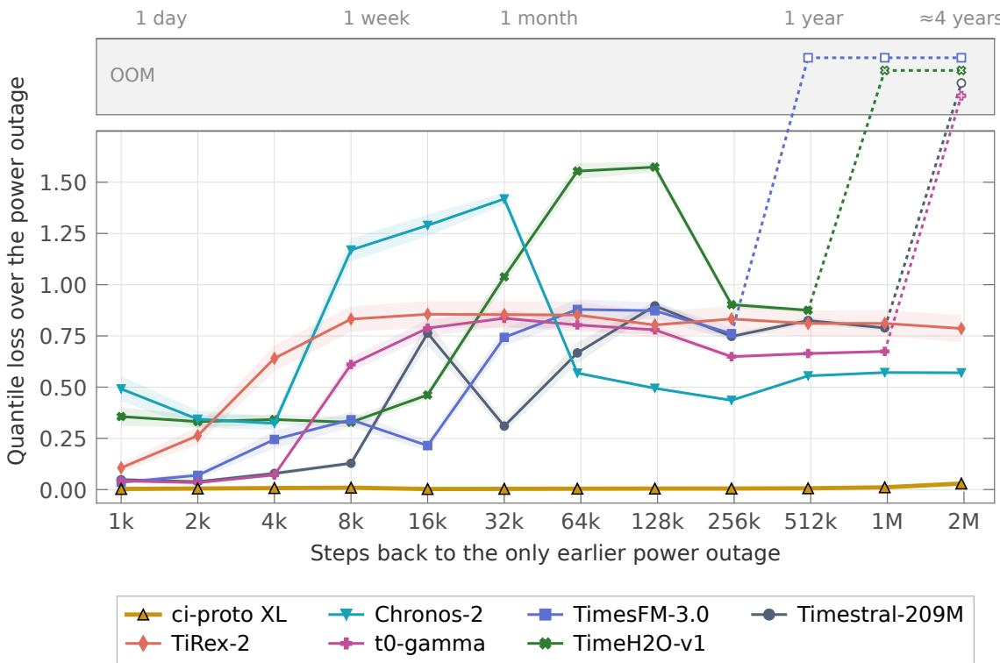  
Figure 5: Quantile loss over a scheduled power outage for uncapped models. The outage has a single earlier occurrence at the given number of steps back as shown on the x-axis, which is logarithmic. Each model receives the smallest of power-of-two context $\cdot _ { 2 ^ { k } \geq 2 , 0 4 8 }$ steps that contains the earlier outage, or all 2,048,000 steps of history if needed. ci-proto XL and the uncapped baselines read the whole context, with all other settings matching each model’s fev-bench submission. The curves show the mean and standard deviation over 40 forecast windows (lower is better). Here each step is one minute, and the top axis gives the steps as units of time.

As Figure 5 shows, ci-proto XL forecasts the outage almost exactly from as far as 2,000,000 steps (3.8 years) back. ci-proto XL’s runtime and memory per forecast grow linearly with the context, to 8 s and 21 GB at 2,048,000 steps on one H100. TiRex-2’s runtime and memory grow linearly too, to 6 s and 5 GB, but it recalls the outage from only a few thousand steps back. Four of the five uncapped Transformers exceed the GPU memory of an 80 GB H100 before two million steps, and the fifth, Chronos-2, takes 42 s (Figure 6). Figure 13 (Appendix E) compares ci-proto with the baselines using their released cap. In general, we see that compared with their uncapped version, the models as released have higher quantile loss when the previous outage took place outside of their context.

## 4 Conclusion

We introduced ci-proto, a family of multivariate time series foundation models combining Mamba-3 temporal processing with cross-variate attention. Its linear state recurrences enable chunk-wise parallel computation, while supporting probabilistic forecasting with past-only and future-known covariates. Across fev-bench’s 100 forecasting tasks, ci-proto XL sets a new state of the art among time series foundation models. The five ci-proto variants make up the entire Pareto frontier for mean scaled quantile loss and mean absolute scaled error against both parameter count and median runtime. Fine-tuned on long contexts, ci-proto is able to leverage information from millions of steps back, recalling a single event from about 4 years earlier in a minute-resolution series, where Transformer and non-linear recurrent baselines cannot. Our findings establish linear recurrent temporal backbones as a state-of-the-art architectural choice for multivariate time series foundation models, combining leading forecasting accuracy with computational eficiency.

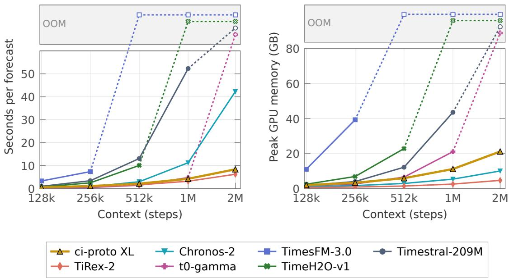  
Figure 6: Time and peak GPU memory per forecast for ci-proto XL and the uncapped baselines. The context axis is logarithmic, while the time and memory axes are linear and start at zero. Values are the median time and largest memory over 40 windows (identical to those used for Figure 5) on one H100 when forecasting one series at a time. All settings other than the removed context caps match the models’ fev-bench submission.

## Acknowledgments

Continuous Intelligence Limited is supported by SPRIN-D, the German Federal Agency for Breakthrough Innovation, through their Next Frontier AI Challenge.

## References

[1] Taha Aksu, Gerald Woo, Juncheng Liu, Xu Liu, Chenghao Liu, Silvio Savarese, Caiming Xiong, and Doyen Sahoo. GIFT-Eval: A benchmark for general time series forecasting model evaluation. In NeurIPS 2024 Workshop on Time Series in the Age of Large Models, 2024. URL https://openreview.net/forum?id= Z2cMOOANFX.

[2] Abdul Fatir Ansari, Lorenzo Stella, Caner Turkmen, Xiyuan Zhang, Pedro Mercado, Huibin Shen, Oleksandr Shchur, Syama Sundar Rangapuram, Sebastian Pineda Arango, Shubham Kapoor, Jasper Zschiegner, Danielle C. Maddix, Hao Wang, Michael W. Mahoney, Kari Torkkola, Andrew Gordon Wilson, Michael Bohlke-Schneider, and Yuyang Wang. Chronos: Learning the language of time series. Transactions on Machine Learning Research, 2024. URL https://openreview.net/forum?id=gerNCVqqtR.

[3] Abdul Fatir Ansari, Caner Turkmen, Oleksandr Shchur, and Lorenzo Stella. Fast and accurate zero-shot forecasting with Chronos-Bolt and AutoGluon. AWS Machine Learning Blog, December 2024. URL https://aws.amazon.com/blogs/machine-learning/ fast-and-accurate-zero-shot-forecasting-with-chronos-bolt-and-autogluon/.

[4] Abdul Fatir Ansari, Oleksandr Shchur, Jaris Küken, Andreas Auer, Boran Han, Pedro Mercado, Syama Sundar Rangapuram, Huibin Shen, Lorenzo Stella, Xiyuan Zhang, Mononito Goswami, Shubham Kapoor, Danielle C. Maddix, Pablo Guerron, Tony Hu, Junming Yin, Nick Erickson, Prateek Mutalik Desai, Hao Wang, Huzefa Rangwala, George Karypis, Yuyang Wang, and Michael Bohlke-Schneider. Chronos-2: From univariate to universal forecasting. arXiv preprint arXiv:2510.15821, 2025. URL https://arxiv.org/abs/2510. 15821.

[5] Andreas Auer, Patrick Podest, Daniel Klotz, Sebastian Böck, Günter Klambauer, and Sepp Hochreiter. TiRex: Zero-shot forecasting across long and short horizons with enhanced in-context learning. In Advances in Neural Information Processing Systems, volume 38, pages 57529–57580, 2025. doi: 10.52202/085713-1929. URL https://proceedings.neurips.cc/paper\_files/paper/2025/hash/ 5356603f9c47399adfd372f77a677057-Abstract-Conference.html.

[6] Maximilian Beck, Korbinian Pöppel, Markus Spanring, Andreas Auer, Oleksandra Prudnikova, Michael Kopp, Günter Klambauer, Johannes Brandstetter, and Sepp Hochreiter. xLSTM: Extended long short-term memory. In Advances in Neural Information Processing Systems, volume 37, pages 107547–107603, 2024. doi: 10.52202/079017-3417. URL https://proceedings.neurips.cc/paper\_files/paper/ 2024/hash/c2ce2f2701c10a2b2f2ea0bfa43cfaa3-Abstract-Conference.html.

[7] Sathya Kamesh Bhethanabhotla, Omar Swelam, Julien Siems, David Salinas, and Frank Hutter. Mamba4Cast: Eficient zero-shot time series forecasting with state space models. In NeurIPS 2024 Workshop on Time Series in the Age of Large Models, 2024. URL https://openreview.net/forum?id= YBOQ5HnzI6.

[8] Tom B. Brown, Benjamin Mann, Nick Ryder, Melanie Subbiah, Jared Kaplan, Prafulla Dhariwal, Arvind Neelakantan, Pranav Shyam, Girish Sastry, Amanda Askell, Sandhini Agarwal, Ariel Herbert-Voss, Gretchen Krueger, Tom Henighan, Rewon Child, Aditya Ramesh, Daniel M. Ziegler, Jefrey Wu, Clemens Winter, Christopher Hesse, Mark Chen, Eric Sigler, Mateusz Litwin, Scott Gray, Benjamin Chess, Jack Clark, Christopher Berner, Sam McCandlish, Alec Radford, Ilya Sutskever, and Dario Amodei. Language models are few-shot learners. In Advances in Neural Information Processing Systems, volume 33, pages 1877–1901, 2020. URL https://proceedings.neurips.cc/paper\_files/paper/2020/hash/ 1457c0d6bfcb4967418bfb8ac142f64a-Abstract.html.

[9] Mathilde Caron, Hugo Touvron, Ishan Misra, Hervé Jégou, Julien Mairal, Piotr Bojanowski, and Armand Joulin. Emerging properties in self-supervised vision transformers. In Proceedings of the IEEE/CVF International Conference on Computer Vision (ICCV), pages 9650–9660, 2021. URL https://openaccess.thecvf.com/content/ICCV2021/html/Caron\_Emerging\_Properties\_in\_ Self-Supervised\_Vision\_Transformers\_ICCV\_2021\_paper.html.

[10] Ben Cohen, Emaad Khwaja, Youssef Doubli, Salahidine Lemaachi, Chris Lettieri, Charles Masson, Hugo Miccinilli, Elise Ramé, Qiqi Ren, Afshin Rostamizadeh, Jean Ogier du Terrail, Anna-Monica Toon, Kan Wang, Stephan Xie, Zongzhe Xu, Viktoriya Zhukova, David Asker, Ameet Talwalkar, and Othmane Abou-Amal. This time is diferent: An observability perspective on time series foundation models. In Advances in Neural Information Processing Systems, volume 38, pages 50907–50951, 2025. doi:

10.52202/085713-1698. URL https://proceedings.neurips.cc/paper\_files/paper/2025/hash/ 48ea942b60e6c52b50ca90e4a40d8ac2-Abstract-Conference.html.

[11] Tri Dao and Albert Gu. Transformers are SSMs: Generalized models and eficient algorithms through structured state space duality. In Proceedings of the 41st International Conference on Machine Learning, volume 235 of Proceedings of Machine Learning Research, pages 10041–10071. PMLR, 2024. URL https://proceedings.mlr.press/v235/dao24a.html.

[12] Abhimanyu Das, Weihao Kong, Rajat Sen, and Yichen Zhou. A decoder-only foundation model for timeseries forecasting. In Proceedings of the 41st International Conference on Machine Learning, volume 235 of Proceedings of Machine Learning Research, pages 10148–10167. PMLR, 2024. URL https:// proceedings.mlr.press/v235/das24c.html.

[13] Jacob Devlin, Ming-Wei Chang, Kenton Lee, and Kristina Toutanova. BERT: Pre-training of deep bidirectional transformers for language understanding. In Proceedings of the 2019 Conference of the North American Chapter of the Association for Computational Linguistics: Human Language Technologies, Volume 1 (Long and Short Papers), pages 4171–4186. Association for Computational Linguistics, 2019. doi: 10.18653/v1/N19-1423. URL https://aclanthology.org/N19-1423/.

[14] Cheng Feng, Long Huang, and Denis Krompass. General Time Transformer: An encoder-only foundation model for zero-shot multivariate time series forecasting. In Proceedings of the 33rd ACM International Conference on Information and Knowledge Management, pages 3757–3761. Association for Computing Machinery, 2024. doi: 10.1145/3627673.3679931. URL https://doi.org/10.1145/3627673.3679931.

[15] Azul Garza, Cristian Challu, and Max Mergenthaler-Canseco. TimeGPT-1. arXiv preprint arXiv:2310.03589, 2023. URL https://arxiv.org/abs/2310.03589.

[16] Lars Graf, Thomas Ortner, Stanisław Woźniak, and Angeliki Pantazi. FlowState: Sampling-rate-equivariant time-series forecasting. In Proceedings of the 43rd International Conference on Machine Learning, volume 306 of Proceedings of Machine Learning Research, pages 36584–36609. PMLR, 2026. URL https: //proceedings.mlr.press/v306/graf26a.html.

[17] Riccardo Grazzi, Julien Siems, Arber Zela, Jörg K. H. Franke, Frank Hutter, and Massimiliano Pontil. Unlocking state-tracking in linear RNNs through negative eigenvalues. In International Conference on Learning Representations, 2025. URL https://arxiv.org/abs/2411.12537.

[18] Léo Grinsztajn, Klemens Flöge, Oscar Key, Felix Birkel, Philipp Jund, Brendan Roof, Mihir Manium, Shi Bin Hoo, Magnus Bühler, Anurag Garg, Dominik Safaric, Jake Robertson, Benjamin Jäger, Simone Alessi, Adrian Hayler, Vladyslav Moroshan, Lennart Purucker, Philipp Singer, Alan Arazi, Julien Siems, Jan Hendrik Metzen, Georg Grab, Nick Erickson, Siyuan Guo, Eliott Kalfon, Simon Bing, David Salinas, Clara Cornu, Lilly Charlotte Wehrhahn, Diana Kriuchkova, Kursat Kaya, Lydia Sidhoum, Marie Salmon, Jerry Chen, Madelon Hulsebos, Yann LeCun, Samuel Müller, Bernhard Schölkopf, Sauraj Gambhir, Noah Hollmann, and Frank Hutter. TabPFN-3: Technical report. arXiv preprint arXiv:2605.13986, 2026. URL https://arxiv.org/abs/2605.13986.

[19] Albert Gu and Tri Dao. Mamba: Linear-time sequence modeling with selective state spaces. In Proceedings of the First Conference on Language Modeling, 2024. URL https://openreview.net/forum?id= tEYskw1VY2.

[20] H2O.ai. TimeH2O-v1. Hugging Face model card, 2026. URL https://huggingface.co/h2oai timeh2o-v1. Model card; accessed 12 November 2026.

[21] Georges Hebrail and Alice Berard. Individual household electric power consumption. UCI Machine Learning Repository, 2006. URL https://archive.ics.uci.edu/dataset/235/individual+household+ electric+power+consumption. Dataset.

[22] Shi Bin Hoo, Samuel Müller, David Salinas, and Frank Hutter. From tables to time: Extending TabPFN-v2 to time series forecasting. Transactions on Machine Learning Research, 2026. URL https://openreview. net/forum?id=KIkQj8VOUY.

[23] Ayush Jain and Rajat Sen. TimesFM-3: A zero-shot foundation model for multivariate forecasting. Google Research Blog, 2026. URL https://research.google/blog/ timesfm-3-a-zero-shot-foundation-model-for-multivariate-forecasting/. Published 31 August 2026; accessed 12 November 2026.

[24] Emaad Khwaja, Chris Lettieri, Gerald Woo, Eden Belouadah, Marc Cenac, Guillaume Jarry, Enguerrand Paquin, Xunyi Zhao, Viktoriya Zhukova, Othmane Abou-Amal, Chenghao Liu, Ameet Talwalkar, and David Asker. Toto 2.0: Time series forecasting enters the scaling era. arXiv preprint arXiv:2605.20119, 2026. URL https://arxiv.org/abs/2605.20119.

[25] Roger Koenker and Gilbert Bassett, Jr. Regression quantiles. Econometrica, 46(1):33–50, 1978. doi: 10. 2307/1913643. URL https://doi.org/10.2307/1913643.

[26] Aakash Lahoti, Kevin Y. Li, Berlin Chen, Caitlin Wang, Aviv Bick, J. Zico Kolter, Tri Dao, and Albert Gu. Mamba-3: Improved sequence modeling using state space principles. In International Conference on Learning Representations, 2026. URL https://proceedings.iclr.cc/paper\_files/paper/2026/ hash/8abd2043b71a074278d5f687947bff9c-Abstract-Conference.html.

[27] Chenghao Liu, Taha Aksu, Juncheng Liu, Xu Liu, Hanshu Yan, Quang Pham, Silvio Savarese, Doyen Sahoo, Caiming Xiong, and Junnan Li. Moirai 2.0: When less is more for time series forecasting. arXiv preprint arXiv:2511.11698, 2025. URL https://arxiv.org/abs/2511.11698.

[28] Eric Martin and Chris Cundy. Parallelizing linear recurrent neural nets over sequence length. In International Conference on Learning Representations, 2018. URL https://openreview.net/forum?id= HyUNwulC-.

[29] William Merrill, Jackson Petty, and Ashish Sabharwal. The illusion of state in state-space models. In Proceedings of the 41st International Conference on Machine Learning, volume 235 of Proceedings of Machine Learning Research, pages 35492–35506. PMLR, 2024. URL https://proceedings.mlr.press/ v235/merrill24a.html.

[30] Lucas Meyer, Claudio Sole, Huikan Xiang, Nicolas Li, Lucas Franceschino, Arnau Quera-Bofarull, Maarten P. Scholl, Joachim Fainberg, and Geofrey Négiar. t : A time-series foundation model for fore casting with context. arXiv preprint arXiv:2609.24559, 2026. URL https://arxiv.org/abs/2609.24559.

[31] Mistral AI. Introducing Timestral. Mistral AI news, 2026. URL https://mistral.ai/news/timestral/. Published 15 October 2026; accessed 12 November 2026.

[32] Vladyslav Moroshan, Julien Siems, Arber Zela, Timur Carstensen, and Frank Hutter. TempoPFN: Synthetic pre-training of linear RNNs for zero-shot time series forecasting. In Advances in Neural Information Processing Systems, 2026. URL https://arxiv.org/abs/2510.25502. Accepted at NeurIPS 2026; to appear.

[33] Maxime Oquab, Timothée Darcet, Théo Moutakanni, Huy V. Vo, Marc Szafraniec, Vasil Khalidov, Pierre Fernandez, Daniel Haziza, Francisco Massa, Alaaeldin El-Nouby, Mahmoud Assran, Nicolas Ballas, Wojciech Galuba, Russell Howes, Po-Yao Huang, Shang-Wen Li, Ishan Misra, Michael Rabbat, Vasu Sharma, Gabriel Synnaeve, Hu Xu, Hervé Jégou, Julien Mairal, Patrick Labatut, Armand Joulin, and Piotr Bojanowski. DINOv2: Learning robust visual features without supervision. Transactions on Machine LearningResearch, 2024. URL https://openreview.net/forum?id=a68SUt6zFt.

[34] Patrick Podest, Marco Pichler, Elias Bürger, Levente Zólyomi, Bernhard Voggenberger, Wilhelm Berghammer, Daniel Klotz, Sebastian Böck, Günter Klambauer, and Sepp Hochreiter. TiRex-2: Generalizing TiRex to multivariate data and streaming. In Advances in Neural Information Processing Systems, 2026. URL https://arxiv.org/abs/2607.01204. Accepted at NeurIPS 2026; to appear.

[35] Alec Radford, Jong Wook Kim, Chris Hallacy, Aditya Ramesh, Gabriel Goh, Sandhini Agarwal, Girish Sastry, Amanda Askell, Pamela Mishkin, Jack Clark, Gretchen Krueger, and Ilya Sutskever. Learning transferable visual models from natural language supervision. In Proceedings ofthe 38th International Conference on Machine Learning, volume 139 of Proceedings of Machine Learning Research, pages 8748–8763. PMLR, 2021. URL https://proceedings.mlr.press/v139/radford21a.html.

[36] Alec Radford, Jong Wook Kim, Tao Xu, Greg Brockman, Christine McLeavey, and Ilya Sutskever. Robust speech recognition via large-scale weak supervision. In Proceedings ofthe 40th International Conference on Machine Learning, volume 202 of Proceedings of Machine Learning Research, pages 28492–28518. PMLR, 2023. URL https://proceedings.mlr.press/v202/radford23a.html.

[37] Anish Saha and Konstantin Shmakov. A foundation model for instruction-conditioned in-context time series tasks. arXiv preprint arXiv:2603.22586, 2026. URL https://arxiv.org/abs/2603.22586.

[38] Oleksandr Shchur, Abdul Fatir Ansari, Caner Turkmen, Lorenzo Stella, Nick Erickson, Pablo Guerron, Michael Bohlke-Schneider, and Yuyang Wang. fev-bench: A realistic benchmark for time series forecasting. InAdvances in Neural Information ProcessingSystems, 2026. URL https://arxiv.org/abs/2509.26468. Evaluations & Datasets Track; accepted at NeurIPS 2026; to appear.

[39] Xiaoming Shi, Shiyu Wang, Yuqi Nie, Dianqi Li, Zhou Ye, Qingsong Wen, and Ming Jin. Time-MoE: Billionscale time series foundation models with mixture of experts. In International Conference on Learning Representations, 2025. URL https://proceedings.iclr.cc/paper\_files/paper/2025/hash/ 558d48c1f08675daa636e09bfe94a89e-Abstract-Conference.html.

[40] The Forecasting Company. Introducing t0-gamma. The Forecasting Company Blog, 2026. URL https:// www.theforecastingcompany.com/blog/t0-gamma/. Published 13 October 2026; accessed 12 November 2026.

[41] Benjamin Walker, Lingyi Yang, Nicola Muça Cirone, Cristopher Salvi, and Terry Lyons. Structured linear CDEs: Maximally expressive and parallel-in-time sequence models. In Advances in Neural Information Processing Systems, volume 38, pages 170358–170396, 2025. doi: 10.52202/085713-5669. URL https://proceedings.neurips.cc/paper\_files/paper/2025/hash/ f89ce18433cbae97838bd4690454e7c3-Abstract-Conference.html.

[42] Gerald Woo, Chenghao Liu, Akshat Kumar, Caiming Xiong, Silvio Savarese, and Doyen Sahoo. Unified training of universal time series forecasting transformers. In Proceedings of the 41st International Conference on Machine Learning, volume 235 of Proceedings of Machine Learning Research, pages 53140– 53164. PMLR, 2024. URL https://proceedings.mlr.press/v235/woo24a.html.

[43] Songlin Yang, Bailin Wang, Yu Zhang, Yikang Shen, and Yoon Kim. Parallelizing linear transformers with the delta rule over sequence length. InAdvances in Neural Information ProcessingSystems, volume 37, pages 115491–115522, 2024. doi: 10.52202/079017-3668. URL https://proceedings.neurips.cc/paper\_ files/paper/2024/hash/d13a3eae72366e61dfdc7eea82eeb685-Abstract-Conference.html.

## A Model configuration and forecasting objective

## A.1 Model configurations

Table 1 reports the configurations of the five ci-proto variants. We count one block as a time mixer followed by a variate mixer, as defined in the main text. The temporal parameters are shared across variates, so increasing the number of input variates does not require a separate set of temporal-model parameters for each variate.

## A.2 Normalisation

We normalise each variate independently using its mean $\mu$ and standard deviation σ over observed inputs:

$$
\tilde { x } _ { t } = \mathsf { a r c s i n h } \left( \frac { x _ { t } - \mu } { \mathsf { m a x } ( \sigma , \epsilon ) } \right) , \qquad \epsilon = 1 0 ^ { - 8 } .
$$

Binary variates are exempt from normalisation in order to retain their {0, 1} encoding.

## A.3 Patching

Context sequences are left-padded with missing values to the nearest power of two and divided into nonoverlapping patches of length $P = 3 2$ . We define an observation mask $m _ { t } = 1 \{ x _ { t }$ observed} and replace missing and padded values by zero after normalisation. Each patch is concatenated with its mask,

$$
\begin{array} { r } { \mathbf { z } _ { \ell } = [ \tilde { \mathbf { x } } _ { \ell } ; \mathbf { m } _ { \ell } ] \in \mathbb { R } ^ { 2 P } , } \end{array}
$$

and embedded using a shared residual MLP:

$$
\begin{array} { r } { \pmb { \mathsf { n } } _ { \ell } = W _ { 2 } \phi ( W _ { 1 } \pmb { z } _ { \ell } + \pmb { \mathsf { b } } _ { 1 } ) + \pmb { \mathsf { b } } _ { 2 } + W _ { r } \pmb { \mathsf { z } } _ { \ell } + \pmb { \mathsf { b } } _ { r } \in \mathbb { R } ^ { D } . } \end{array}
$$

Boolean masks encode target, past-only, and known-future covariate roles. Only known-future covariates receive bidirectional temporal processing. Variate attention is restricted to each sample, excludes variates introduced purely for padding, and prevents covariate queries from attending to target keys.

## A.4 Quantile predictions and training objective

Let $\mathcal { Q } \subset ( 0 , 1 )$ denote the set of 9 predicted quantile levels, and write $\widehat { y } _ { i , t } ^ { ( q ) }$ for the prediction at level $q$ for target variate i and time step t. For each time step in patch $k + 1$ b, these predictions are obtained from linear heads applied to the final-layer representation $H _ { i } ( k )$ .

For residual $u ,$ the pinball loss at quantile level $q$ is

$$
\rho _ { q } ( u ) = \left\{ \begin{array} { l l } { q u , } & { u \geq 0 , } \\ { ( q - 1 ) u , } & { u < 0 . } \end{array} \right.\tag{1}
$$

Writing O for the observed target positions included in the loss, the objective is

$$
\mathcal { L } = \frac { 1 } { \left| \mathcal { O } \right| \left| \mathcal { Q } \right| } \sum _ { ( i , t ) \in \mathcal { O } } \sum _ { q \in \mathcal { Q } } \rho _ { q } \left( y _ { i , t } - \widehat { y } _ { i , t } ^ { ( q ) } \right) .\tag{2}
$$

This is the pinball objective [25] described in the main text. Unobserved target values are excluded from the loss.

Table 1: ci-proto model configurations. Parameter counts are reported in millions.
<table><tr><td>Configuration</td><td>XS</td><td>S</td><td>M</td><td>L</td><td>XL</td></tr><tr><td>Number of blocks</td><td>6</td><td>8</td><td>10</td><td>12</td><td>16</td></tr><tr><td>Hidden dimension D</td><td>128</td><td>192</td><td>320</td><td>512</td><td>640</td></tr><tr><td>Patch length P</td><td>32</td><td>32</td><td>32</td><td>32</td><td>32</td></tr><tr><td>Mamba-3 state dimension</td><td>128</td><td>128</td><td>128</td><td>128</td><td>128</td></tr><tr><td>Mamba-3 head dimension</td><td>64</td><td>64</td><td>64</td><td>64</td><td>64</td></tr><tr><td>Variate-attention heads</td><td>4</td><td>4</td><td>4</td><td>4</td><td>4</td></tr><tr><td>Parameters</td><td>3.49</td><td>9.16</td><td>28.61</td><td>82.51</td><td>167.19</td></tr></table>

The supervision is applied separately to each target value and quantile level, while the representations used to form these predictions incorporate information exchanged through the variate mixers. Cross-variate conditioning therefore enters through the forecasting representation rather than through an additional cross-variate term in the loss.

## B Pre-training and optimisation

## B.1 Construction of pre-training examples

As in TiRex-2 [34], we train on multivariate examples generated from a corpus of source series. The corpus contains parts of the Chronos training data and the GIFT-Eval pre-training dataset, filtered for leakage (in fev-bench). It also contains synthetic series from Gaussian processes and from a generator of multivariate series with covariates.

During training, sampled univariate sequences are combined using identity mappings, functional coupling, linear mixing, co-integration, or linear and nonlinear structural causal models. The resulting examples are enriched with binary covariates or calendar features, and each variate is assigned a role: target, past-only covariate, or future-known covariate.

We follow the benchmark-specific training-data selections of TiRex-2 [34] and additionally check BOOM for exact duplicates of fev-bench’s boomlet series. We hash each benchmark target channel at float32 precision and compare it against the BOOM corpus, identifying overlapping source groups even when their names difer. We exclude all matching groups before training.

## B.2 Post-training pipeline

After pre-training, each ci-proto variant is post-trained on mixtures of real and synthetic data, with the context extended from 2,048 to 8,192 time steps (up to 16,384 for ci-proto XL). Each post-training stage’s length is a fixed fraction of its base’s pre-training steps, about a quarter of them in total, and ci-proto XL uses the stage lengths of ci-proto L. The real data add publicly available datasets from domains such as energy, transport, environmental sensing and economics. The synthetic data comprise generated multivariate series with covariates and long series that fill the extended context. Post-training also replays data from earlier training.

Post-training uses the optimiser, schedule and precision of Table 2, with an efective batch size of 64 sampled groups (32 at the 16,384-step context) and a peak learning rate that decreases across post-training from $2 . 4 \times$ $\bar { 1 } 0 ^ { - 4 } { \sf t o 2 . 5 } \times 1 0 ^ { - 5 }$ . We modify the pinball loss in three ways. First, each group’s loss is weighted by the inverse of its detached value, floored at a quarter of the batch median, so that easy and hard series contribute more evenly. After an initial period of post-training, we also weight the mean losses over the forecast window and over the context equally, and train half of the groups on a shorter forecast prefix, whose length is drawn log-uniformly with a minimum of four steps.

## B.3 Test-time adaptation

Our test-time adaptation builds around the trend-diferencing and quantile-band postprocessor of TiRex-2 [34] and combines it with categorical target encoding, calendar covariates, related-series context, quantile sorting, sign-flip averaging, nonnegative clipping, and integer rounding. These operations do not update the model weights. For each of the components, we reference corresponding operations in the public implementations and benchmark adapters of TiRex-2 [34], TimesFM-3 [23], the $t _ { 0 }$ family [30], Timestral [31], and TimeH2O [20], where applicable.

## Categorical target encoding. Also used by: Timestral and TimeH2O.

We encode categorical covariates using smoothed target means computed over the context steps at which each category is active. Let $z _ { t }$ denote the target value at context step $t ,$ averaged across observed target variables in the multivariate case. We denote by $\mu$ the mean of $z _ { t }$ over the context region and by $\mathcal { T } _ { c }$ the set of context steps at which category c is active. The encoding of category c is then given by

$$
e ( c ) = \frac { \lambda \mu + \sum _ { t \in \mathbb { Z } _ { c } } z _ { t } } { \lambda + | \mathbb { Z } _ { c } | } , \qquad \mathsf { w e s e t } \lambda = 1 .
$$

## Calendar covariates. Also using derived covariates: Chronos-2, TiRex-2, TimesFM-3, and TabPFN-TS-3.

When timestamps and sampling frequency are available, we generate calendar features and append them as known-future covariates.

## Joint forecasting in chunks. Also used by: t -gamma and Chronos-2.

For tasks with independent univariate series, the enabled chunking policy constructs joint forecasting groups. We identify all series that share the same forecast origin, and partition them into chunks of a configured maximum size. All series within each chunk are treated as targets and forecast jointly, allowing their representations to exchange information through the variate mixers.

## Static-group context. Related metadata-based grouping in Chronos-2.

When static metadata are supplied and static grouping is enabled, we construct additional past-only covariates from series sharing selected metadata values. For each selected grouping column, a target receives the mean of the other group members’ standardised histories, excluding its own contribution. Pooling uses only observed historical values from series with the same forecast origin.

## Correlated-neighbour context. ci-proto extension.

For tasks with covariates but no static metadata, each target is forecast jointly with seven series that share the same forecast origin and whose histories best correlate with the target. These other series must have at least 32 overlapping observations on the latest 2,048 distinct historical timestamps. The selected neighbours are aligned to the original target series’ timestamps and added also as target rows for a joint forward pass. Only the original target series’ forecast is retained.

## Trend detection. Also used by: TiRex-2; related linear detrending in TimesFM-3.

For each target row, we take the trailing fraction w of its available context and z-score normalise the values in that window. We fit an ordinary-least-squares line to these standardised values, yielding a slope $\beta _ { z }$ and coeficient of determination $R ^ { 2 }$ . For a context of length $L ,$ , let $n _ { w } = \mathsf { m a x } ( 1 , \mathsf { r o u n d } ( w L ) )$ ) denote the number of time steps in the trailing window. A row is treated as trending if

$$
| \beta _ { z } | n _ { w } \ge \tau \quad \mathsf { a n d \quad } R ^ { 2 } \ge \rho .
$$

The first condition measures the magnitude of the fitted drift in standard-deviation units, while the second requires the linear fit to explain a suficient fraction of the variation.

## Running-total detection. ci-proto extension.

We extend the diferencing criterion to capture cumulative series whose changing rates can cause them to fail the linear-trend test. For each target row, let $x _ { 1 } , \ldots , x _ { n }$ denote its observations, and define $\Delta _ { j } = x _ { j + 1 } - x _ { j }$ A row is flagged as a running total if its observed values are monotonic in either direction and at least half its observed transitions are nonzero:

$$
[ ( \forall j : \Delta _ { j } \geq 0 ) \lor ( \forall j : \Delta _ { j } \leq 0 ) ] \quad \mathrm { a n d } \quad \frac { 1 } { n - 1 } \sum _ { j = 1 } ^ { n - 1 } \mathbf { 1 } \{ \Delta _ { j } \neq 0 \} \geq \frac { 1 } { 2 } .
$$

A target satisfying either this criterion or the linear-trend criterion follows the diferencing and forecast integration procedure below.

## Diferenced targets. Also used by: TiRex-2.

For prediction horizons $H \leq 4 8 ,$ , targets selected by either detection criterion above are replaced by their first diferences, with a zero leading step at the start of each series, before the forward pass. Covariates are not diferenced. The model forecasts increments for the selected targets, which are mapped back to values as follows. Let H be the prediction horizon, $m _ { t }$ the predicted median increment at horizon step $t , o _ { q , t }$ the ofset of quantile q from that median increment, and $y _ { T }$ the last observed target value. We reconstruct the median forecast by cumulatively summing the predicted median increments. The remaining quantiles are obtained by aggregating their ofsets from the median using a scaled root sum of squares:

$$
\hat { y } _ { q , t } = y _ { T } + \sum _ { s = 1 } ^ { t } m _ { s } + \mathfrak { s i g n } \left( \sum _ { s = 1 } ^ { H } o _ { q , s } \right) \sqrt { \kappa _ { d } } t ^ { \gamma _ { d } - 1 / 2 } \sqrt { \sum _ { s = 1 } ^ { t } o _ { q , s } ^ { 2 } } .
$$

For each quantile, we take the sign of its summed ofsets from the median over the full prediction horizon. The scale $\kappa _ { d }$ controls the overall width of the quantile bands, while the exponent $\gamma _ { d }$ determines how their width scales with the forecast horizon. Setting $\gamma _ { d } = 1 / 2$ and $\kappa _ { d } = 1$ would leave the root-sum-of-squares envelope unscaled.

Quantile sorting. Also used by: TimesFM-3 and TimeH2O; available in the current TiRex-2 implementation.

We sort the predictions at each horizon step into ascending order across the model’s full quantile grid. Sorting is performed within each sign-flip branch, before averaging and selecting the benchmark’s quantiles.

Sign-flip augmentation. Also used by: TiRex-2, TimesFM-3, the $t _ { 0 }$ family, and Timestral. Architecturally enforced by TimeH2O.

We average the forecast of the raw input with a forecast obtained by negating its targets and all covariates. The negated branch uses the same detection, diferencing, integration, and sorting procedures. Mapping its predictions back to the original scale negates the predicted values and maps quantile levels $q  1 - q$

More precisely, let $F _ { q , t } ( \mathbf { x } )$ denote the forecast after these operations for input x, where x includes the target and encoded covariate values. The averaged forecast is

$$
\hat { y } _ { q , t } = \frac { 1 } { 2 } \left[ F _ { q , t } ( \pmb { \times } ) - F _ { 1 - q , t } ( - \pmb { \times } ) \right] .
$$

Nonnegative clipping. Also used by: TimesFM-3, t0-gamma, Timestral, and TimeH2O.

After sign-flip averaging and selection of the benchmark’s quantile levels, we enforce nonnegativity for targets whose observed histories contain no negative values. For each target with exclusively nonnegative observations, we replace each forecast quantile by

$$
\hat { y } _ { q , t } \gets \mathsf { m a x } ( 0 , \hat { y } _ { q , t } ) .
$$

We check each target from its original, untransformed history. Targets with negative observations or no finite observations retain their forecasts.

Integer rounding. Also used by: t0-gamma and TimeH2O.

After sign-flip averaging and nonnegative clipping, we round each forecast quantile for targets whose finite historical observations are all integer-valued:

$$
\hat { y } _ { i , q , t } \gets \mathsf { r o u n d } ( \hat { y } _ { i , q , t } ) .
$$

Postprocessing constants. Parameterisation inherited from TiRex-2.

The core postprocessor has five numerical constants: the trend window $w ,$ the trend thresholds τ and $\rho ,$ and the band exponent and scale $\gamma _ { d } , \kappa _ { d }$ of the diferenced-target envelope. We keep the trend constants of TiRex- $^ { - 2 , }$ fit the band constants once on fev-bench validation forecasts of an 82.5M-parameter development model, and use the same fixed settings for every ci-proto model.

## B.4 Optimisation and checkpoint selection

Table 2 records the optimisation and execution settings.

## C Evaluation details and interpretation

## C.1 Interpretation of the Pareto frontiers

For a fixed forecasting metric, let $e ( m )$ denote the aggregate error of model $m$ and let $c ( m )$ denote either its parameter count or its reported median runtime. A model m is Pareto dominated if another evaluated model $\overline { { m ^ { \prime } } }$ satisfies

$$
e ( m ^ { \prime } ) \leq e ( m ) , \qquad c ( m ^ { \prime } ) \leq c ( m ) ,\tag{3}
$$

with at least one of these a strict inequality. In other words, a model is Pareto dominated if another model can strictly improve on one of e or c without sacrificing the other. The Pareto frontier consists of the non-dominated models.

Table 2: Pre-training settings for ci-proto. Size-dependent values follow the order 3.5M, 9.2M, 28.6M, 82.5M, and 167.2M.
<table><tr><td>Setting</td><td>Value</td></tr><tr><td>Optimiser and coefficients</td><td>AdamW; β1cycled between 0.95 and 0.85 by the one-cycle schedule (0.85 at the peak learning rate),  $\beta _ { 2 } = 0 . 9 9 9 , \epsilon =$   $1 0 ^ { - 8 }$ </td></tr><tr><td>Learning rate and schedule</td><td>Cosine one-cycle schedule with 5,000 warm-up steps; peak LR  $1 . 2 \times 1 0 ^ { - 3 }$  (3.5M–28.6M) and  $6 \times 1 0 ^ { - 4 }$  (82.5M, 167.2M); initial  $\mathsf { L R } = \mathsf { p e a k } / 5 0 , \mathsf { f i n a l L R } = \mathsf { i n i t i a l } / 1 0 ^ { 4 }$ </td></tr><tr><td>Effective batch size</td><td>256 sampled time series groups per optimiser step</td></tr><tr><td>Training steps per variant Weight decay and gradient clipping</td><td> $3 3 0 , 0 0 0 ; 4 6 7 , 5 0 0 ; 7 0 0 , 0 0 0 ; 1 , 0 4 5 , 0 0 0 ; 1 , 3 5 8 , 5 0 0$  Weight decay 0.01, excluding Mamba parameters marked for</td></tr><tr><td></td><td>no decay; elementwise gradient clipping to [—1, 1]</td></tr><tr><td>Numerical precision Training hardware</td><td>BF16 mixed precision with FP32 parameters</td></tr><tr><td>Checkpoint-selection criterion</td><td>8 NVIDIA H100 GPUs with 80 GB HBM3 each, for every variant</td></tr><tr><td></td><td>Final checkpoint at the prescribed training budget</td></tr></table>

We construct these frontiers separately for parameter count and runtime, and separately for SQL and MASE. Frontier membership therefore describes a particular two-dimensional comparison among the evaluated models. It does not imply that a model has the lowest error regardless of cost, or that its aggregate advantage holds on every individual forecasting task.

## C.2 Runtime comparisons

We benchmark all selected models, including the baselines and ci-proto variants, locally on the same hardware. Evaluation and timing experiments use a single NVIDIA H100 GPU with 80 GB HBM3 memory on a host with two Intel Xeon Platinum 8480+ CPUs. Inference uses FP32 with no BF16 autocasting. The runtime plots report the median runtime per 100 forecasts measured in this local evaluation setup for every model.

## D MASE and skill score results

Figures 7 and 8 report mean MASE across the 100 tasks in fev-bench [38]. Unlike SQL, which evaluates mul tiple predictive quantiles, MASE assesses the predictive median. Mean MASE decreases consistently from ciproto XS to ci-proto XL and all five variants form the Pareto frontiers versus parameter count and measured runtime. This means that every evaluated baseline is dominated in both comparisons, and ci-proto XL achieves the lowest mean MASE of all models.

Figures 9, 10, 11, and 12 report one minus the SQL and MASE skill scores relative to the seasonal naive baseline, so lower values indicate better performance. All five ci-proto variants remain on the corresponding Pareto frontiers, and ci-proto XL achieves the best skill scores for both metrics.

## E Long-range recall

For Figure 5, we fine-tune ci-proto XL on contexts of up to 524,288 steps. First, we train for four stages of 4,000, 4,000, 2,000 and 2,000 steps, then for 500 steps on 1,048,576-step synthetic series alone, and finally for 1,000 steps on its original training data at a lower learning rate. In the last three of the four initial stages, about a quarter of the training series are synthetic series, in which a future-known flag marks rare events that change the target in a fixed way for each series. The fine-tune lowers the fev-bench SQL skill score by about 1.2 percentage points.

Figure 13 repeats the scheduled power-outage application with each baseline as released. This means that each model reads at most a fixed number of recent steps: 2,048 for TiRex-2, 8,192 for Chronos-2 and t0-gamma, 15,360 for TimesFM-3.0, 16,384 for TimeH2O-v1 and 32,768 for Timestral-209M. ci-proto XL reads the whole context. As released, each baseline recalls the outage only within its cap. Beyond its cap, Timestral-209M’s upper quantiles widen sharply when the flag switches on. Figure 5 in the main body removes the caps.

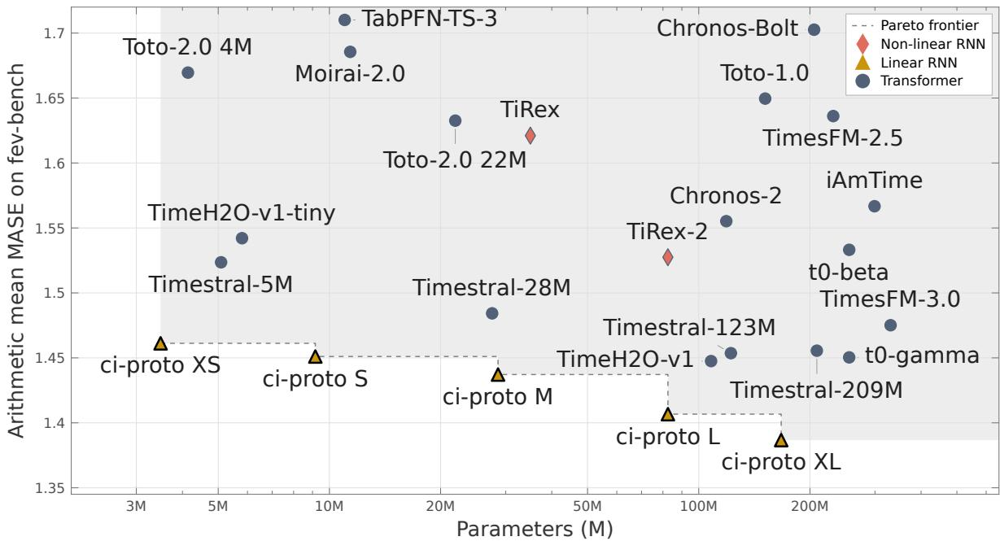  
Figure 7: Mean absolute scaled error (MASE) on fev-bench versus parameter count. Lower MASE is better. The horizontal axis is in logarithmic scale. The dashed line marks the Pareto frontier formed by the five ci-proto variants.

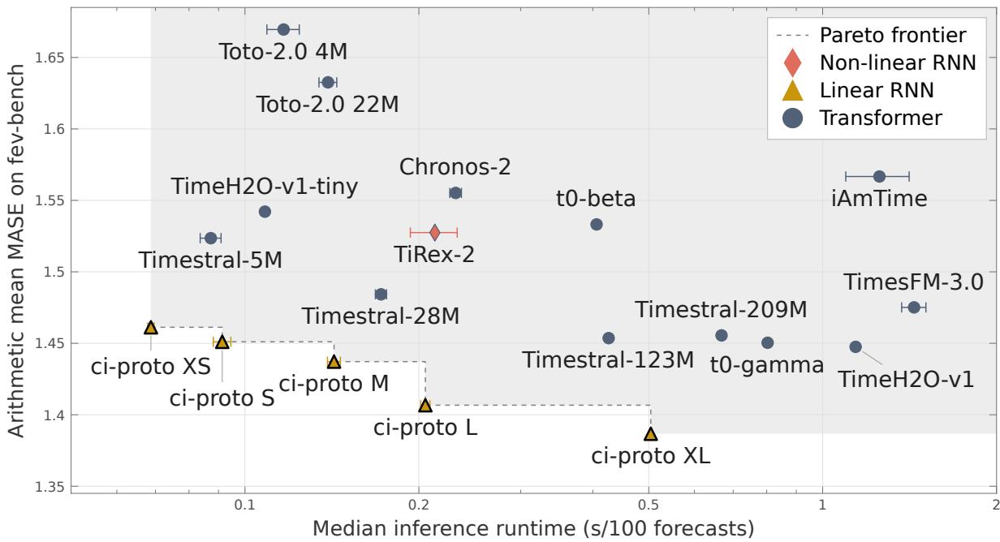  
Figure 8: Mean absolute scaled error (MASE) on fev-bench versus median runtime per 100 forecasts for selected leaderboard models. We benchmark all models on identical hardware and under the same execution settings, since self-reported leaderboard timings are not directly comparable. We report the mean and standard deviation across five runs. Lower MASE is better. The horizontal axis is in logarithmic scale. The dashed line marks the Pareto frontier formed by the five ci-proto variants.

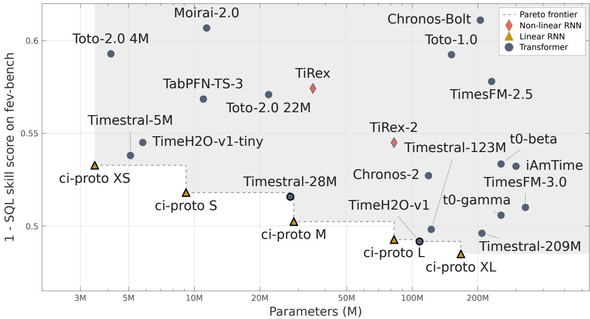  
Figure 9: One minus the skill score for the scaled quantile loss (SQL) on fev-bench versus parameter count. Lower values are better. The horizontal axis is in logarithmic scale. The dashed line marks the Pareto frontier where all five ci-proto variants lie.

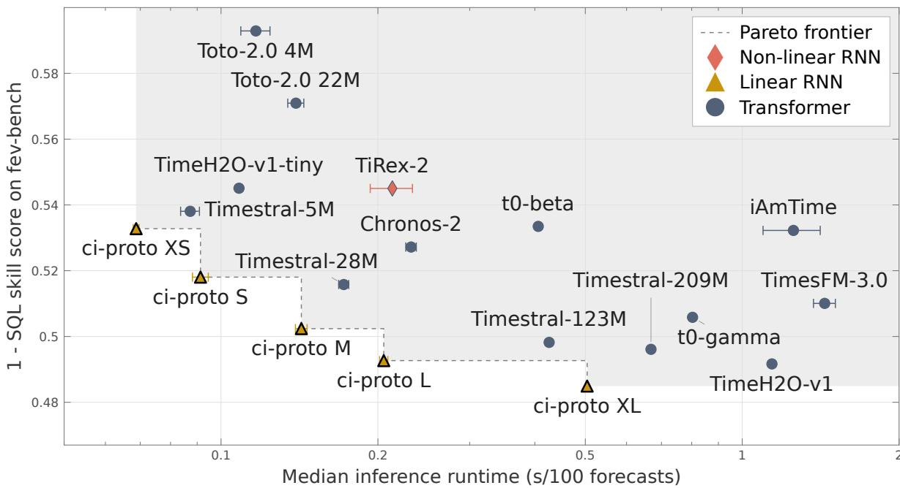  
Figure 10: One minus skill score for the scaled quantile loss (SQL) on fev-bench versus median runtime per 100 forecasts for selected leaderboard models. We benchmark all models on identical hardware and under the same execution settings, since self-reported leaderboard timings are not directly comparable. We report the mean and standard deviation across five runs. Lower values are better. The horizontal axis is in logarithmic scale. The dashed line marks the Pareto frontier formed by the five ci-proto variants.

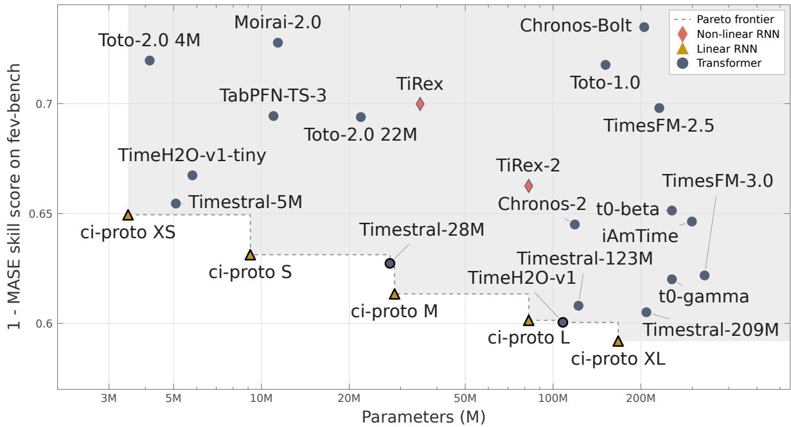  
Figure 11: One minus the skill score for the mean absolute scaled error (MASE) on fev-bench versus parameter count. Lower values are better. The horizontal axis is in logarithmic scale. The dashed line marks the Pareto frontier where all five ci-proto variants lie.

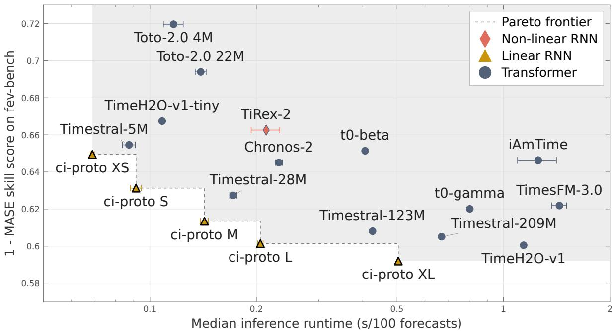  
Figure 12: One minus skill score for mean absolute scaled error (MASE) on fev-bench versus median runtime per 100 forecasts for selected leaderboard models. We benchmark all models on identical hardware and under the same execution settings, since self-reported leaderboard timings are not directly comparable. We report the mean and standard deviation across five runs. Lower values are better. The horizontal axis is in logarithmic scale. The dashed line marks the Pareto frontier formed by the five ci-proto variants.

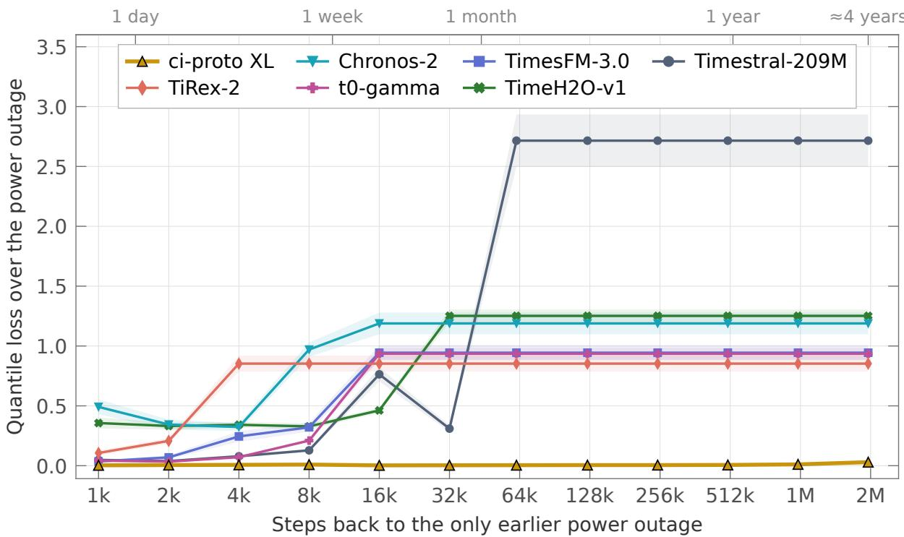  
Figure 13: Quantile loss over a scheduled power outage for models with their released context cap. The outage has a single earlier occurrence at the given number of steps back as shown on the x-axis. Each model receives the smallest of power-of-two context $\overline { { 2 ^ { k } } } \geq 2 , 0 4 8$ steps that contains the earlier outage, or all 2,048,000 steps of history if needed. ci-proto XL and the uncapped baselines read the whole context, with all other settings matching each model’s fev-bench submission. The curves show the mean and standard deviation over 40 forecast windows (lower is better). Here each step is one minute, and the top axis gives the steps as units of time.