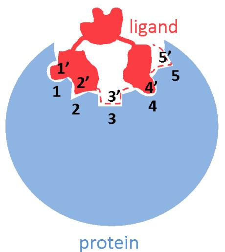
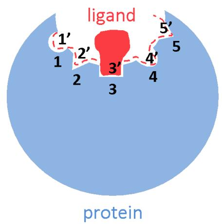
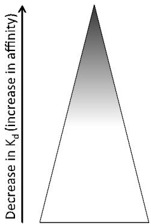
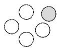
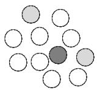
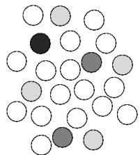
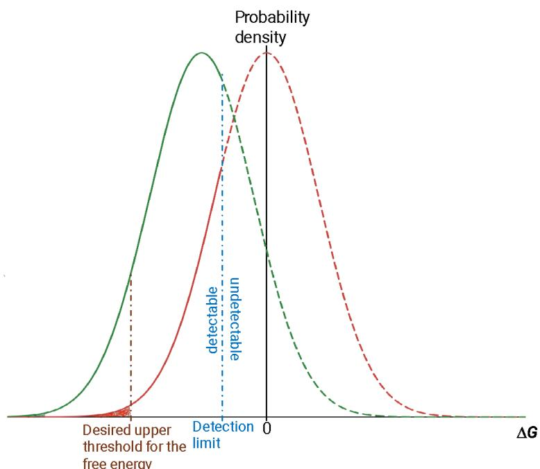
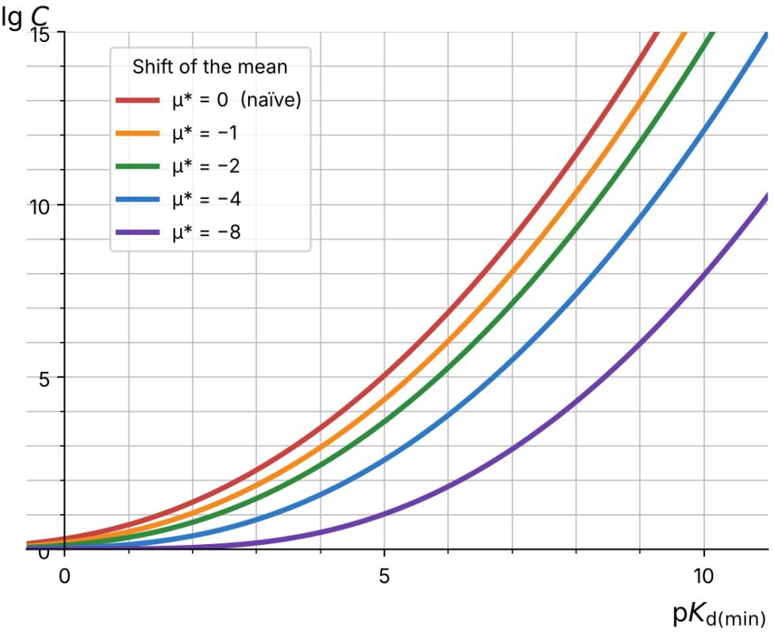

DNA-encoded	libraries	(DELs)	are	commonly	used	to	find	small-molecule	binders	to a	target	protein.	But	the	hard	part	is	no	longer	finding	a	hit.	It	is	building	a	machinelearning	model	good	enough	to	guide	the	medicinal	chemistry	that	follows,	one	that can resolve	the	shift	in	affinity	when	a	chemist	changes	a	single	atom. Such	a	model	needs	two	things	from	its	training	data:	dense	sampling	of	the	small patch	of	chemical	space	around	the	hit,	and	an	adequate	number	of	genuinely	tight binders	within	it.	A	diverse	naïve	DEL	gives	neither.	It	samples	an	enormous	space, so	any	one	neighborhood	is	covered	far	too	thinly,	and	the	tightest	binders	are	rare. A	model	trained	on	that	naïve	DEL	data	must	extrapolate	to	binders	tighter	than	any it	has	seen,	and	that	is	where	models	can	fail. One	way	to	get	training	data	with	both	properties	is	a	second-generation	DEL	built around	the	hit.	We	ask	how	complex	that	library	must	be.	We	treat	binding	as	a	sum of	small,	independent	interactions,	called	“pixels”	on	the	target	and	“antipixels”	on	the ligand.	From	the	spread	of	affinities	measured	in	the	naïve	library,	with	no	structural information	and	nothing	yet	synthesized,	we	estimate	the	complexity	such	a	library must	have	to	supply	that	dense	sampling	and	those	tight	binders. The	 method	 does	 two	 useful	 things.	 It	 turns	 the	 number	 of	 tight	 binders	 a	 model needs	into	the	number	of	compounds	a	library	must	contain.	And	it	estimates	the expected	 yield	 of	 a	 randomly	 designed	 second-generation	 DEL,	 so	 the	 gain	 from designing	 the	 library	 with	 machine	 learning	 or	 active	 learning	 can	 be	 measured against	a	baseline,	without	the	expense	of	a	control	library	as	large	as	the	experiment itself.

# Using	an	‘energy	pixels’	approach	to	estimate	the	size	a	2nd Generation	DEL	must	be	to	train	a	high-resolution	binding	model

Authors:	Boris	P.	Belotserkovskii,	R.	Edward	Watts

Affiliations:	Insitro	Inc,	279	E.Grand	Ave,	South	SanFrancisco,	CA	94070

## ABSTRACT

## 1.	INTRODUCTION

Finding	a	molecule	that	binds	a	chosen	protein	used	to	be	the	hard	part	of	early	drug	discovery.	It	is not	anymore.	DNA-encoded	libraries	have	made	it	routine:	one	builds	a	large	library	of	compounds, each	tagged	with	a	DNA	barcode,	washes	the	library	over the	target,	keeps	what	sticks,	and	reads	the barcodes	of	the	binders	by	sequencing	(6-8;	reviewed	in	9-14).	Because	the	tags	can	be	amplified	and sequenced,	 libraries	 of	 billions	 of	 compounds	 can	 be	 searched	 at	 once.	 The	 same	 recipe	 of	 a	 large, diverse	library	undergoing	selection	is	shared	with	phage	display,	ribosome	display,	mRNA	display, and	aptamer	discovery	methods	(1-5).	The	bottleneck	has	moved	downstream,	to	what	one	does	with the	hits.

What	 one	 wants	 is	 a	 model	 that	 can	 guide	 the	 medicinal	 chemistry	 that	 follows.	 In	 a	 medicinalchemistry	campaign	a	chemist	changes	a	molecule	by	one	or	two	atoms	at	a	time	and,	before	making anything,	asks	whether	the	change	will	help.	Such	a	change	can	shift	the	affinity	a	great	deal	or	hardly at	 all,	 and	 the	 model	 has	 to	 resolve	 which:	 a	 small	 shift	 the	 chemist	 can	 disregard,	 a	 large	 one	 the chemist	needs	to	see	coming.	And	it	has	to	do	so	in	a	small	patch	of	chemical	space,	the	neighborhood of	the	current	best	compound	and	within	the	current	lead	series.

A	model	is	only	as	good	as	the	data	beneath	it,	and	fine	resolution	asks	two	things	of	that	data.	First, the	data	must	sample	the	neighborhood	densely.	To	resolve	small	differences	between	neighbors,	the model	 must	 have	 seen	 many	 neighbors.	 Second,	 the	 data	 must	 include	 an	 adequate	 number	 of genuinely	tight	binders,	because	those	are	the	compounds	the	campaign	is	trying	to	reach,	and	a	model asked	about	them	cannot	be	left	to	guess.

A	naïve	library	gives	neither.	It	spends	a	fixed	number	of	compounds	on	an	enormous	chemical	space, so	any	one	neighborhood	is	covered	far	too	thinly.	And	because	it	is	not	designed	specifically	for	the target,	its	tight	binders	are	rare.	A	model	trained	on	such	data,	then	asked	to	rank	compounds	tighter than	any	it	has	seen,	is	extrapolating,	and	extrapolation	is	where	models	can	fail.

One	way	to	get	data	with	both	properties	is	to	build	a	second	library	focused	on	the	neighborhood	of	a hit.	This	“second-generation”	library	keeps	a	chemical	feature,	or	features,	that	the	first-round	hits share,	 and	 varies	 the	 rest.	 Because	 every	 member	 carries	 a	 feature	 that	 favors	 binding,	 the	 whole library	is	shifted	toward	tighter	binders.	Because	it	varies	only	the	neighborhood	of	the	hit,	it	samples that	neighborhood	densely.	Such	libraries	are	more	work	to	build,	but	they	are	the	kind	of	data	a	highresolution	model	requires.

This	raises	a	plain	question:	how	complex	must	such	a	library	be?	How	many	compounds	does	it	take to	sample	the	neighborhood	densely	enough,	and	to	hold	enough	tight	binders,	to	train	the	model	one has	in	mind?	A	library	that	is	too	small	wastes	the	effort and	still	yields	a	model	that	cannot	resolve what	the	campaign	needs.

There	 is	 no	 easy	 way	 to	 get	 this	 fraction	 from	 first	 principles.	 One	 would	 like	 to	 treat	 all	 possible compounds	as	points	in	a	“chemical	space”	and	ask	what	fraction	of	that	space	binds	the	target,	as	was done	for	antibodies	(15):	a	library	is	likely	to	contain	a	binder	when	its	size,	times	the	binding	fraction, is	about	one.	The	logic	carries	over	to	small	molecules	unchanged.	What	also	carries	over	is	that	there is	no	way	to	compute	the	binding	fraction	in	advance,	so	instead	of	calculating	it	we	measure	it,	reading it	from	the	affinities	of	a	library	already	in	hand.	Chemical	space	is	hard	to	define,	and	the	reactions used	to	make	a	library	fix	what	structures	are	possible	(16,	17);	but	these	are	features	of	any	library built	by	selection,	antibodies	included,	not	obstacles	peculiar	to	small	molecules.

We	take	a	different	route.	Rather	than	reason	from	first	principles,	we	read	the	binding	data	already	in hand,	the	affinities	measured	in	the	naïve	library,	and	use	them	to	estimate	what	a	second-generation library	 made	 from	 the	 same	 chemistry	 will	 do.	 To	 make	 this	 precise	 we	 use	 an	 idea	 we	 call	 the superlibrary:	the	set	of	essentially	all	compounds	a	given	chemistry	could	make.	A	naïve,	generic	(or non-targeted)	library	is	a	small	random	sample	of	it.	From	the	affinities	in	the	sample,	we	recover	the affinity	distribution	of	the	whole,	and	from	that	we	estimate	the	size	a	second-generation	library	must have	to	meet	a	model’s	needs.

The	method	does	two	things	worth	stating	at	the	outset.	It	turns	a	required	number	of	tight	binders into	a	required	number	of	compounds,	so	one	can	size	a	library	to	the	model	it	is	meant	to	train.	And it	gives	the	yield	one	should	expect	from	a	second-generation	library	whose	varied	parts	are	chosen	at random,	a	number	computed	on	paper	with	nothing	synthesized.	That	random	yield	is	a	plain	baseline against	which	to	measure	what	machine	learning	or	active	learning	adds	when	it	designs	the	library instead.	Measuring	that	gain	would	otherwise	require	building	a	random	library	as	a	control,	at	a	cost as	large	as	the	experiment.

## 2.	THE	MODEL

## 2.1.	General	picture

The	basic	energy-pixel	model	is	shown	in	Fig.	1.

A  

B  
  
Fig.	1.	Ligand-target	interactions	in	the	energy-pixel	model.  
Numbers	1	to	5	mark	pixels;	1’	to	5’	mark	antipixels.	Dashed	lines	show	“virtual” antipixels	that	are	absent	from	the	ligand	and	so	contribute	no	interaction	energy.

The	target	(blue)	has	a	binding	pocket	dotted	with	binding	spots,	or	“pixels,”	numbered	1	to	5.	The library	compound,	from	here	on	the	“ligand”	(red),	sits	in	the	pocket	in	the	position	that	makes	their interaction	 as	 favorable	 as	 possible.	 In	 that	 position	 we	 picture	 the	 ligand	 as	 carrying	 “antipixels,” numbered $1 ^ { \prime }$ to $5 ^ { \prime }$ ,	each	facing	the	matching	pixel	on	the	target.

This	does	not	mean	a	ligand	must	carry	a	real	chemical	group	opposite	every	pixel.	In	Fig.	1A,	pixels	3 and	5	have	no	ligand	group	near	them;	we	simply	say	antipixels $3 ^ { \prime }$ and $5 ^ { \prime }$ contribute	no	energy.	For	the ligand	in	Fig.	1B	only	antipixel $3 ^ { \prime }$ interacts	at	all;	the	rest	are	empty.

Each	antipixel	can	take	many	chemical	forms,	each	with	its	own	interaction	energy	against	its	pixel. The	 superlibrary,	 in	 the	 ideal	 case,	 includes	 compounds	 carrying	 essentially	 every	 possible combination	of	antipixels,	and	the	number	of	antipixels	plays	the	part	of	the	number	of	dimensions	of chemical	space.	The	total	binding	free	energy	(ΔG)	between	a	ligand	and	the	target	is	taken	to	be	the sum	of	the	free	energies	of	all	its	pixel-antipixel	pairs.

A	pixel	and	an	antipixel	rarely	match	well,	so	for	any	given	pixel	only	a	small	fraction	of	antipixels	bind it	strongly.	It	follows	that	within	a	superlibrary	the	tighter-binding	ligands	are	the	rarer	ones	(Fig.	2, top;	there	the	fraction	of	binders,	in	gray,	is	drawn	far	larger	than	in	any	real	library).

distribution in the superlibrary

Libraries obtained by random picking from the superlibrary

  
Fig.	2.	A	combinatorial	library	in	the	energy-pixel	model.

Top:	the	binders	within	the	superlibrary.	Darker	color	means	tighter	binding;	the narrowing	width	means	rarer.

A	real,	finished	DEL	of	complexity	� is	treated	as	a	random	sample	of	� compounds	drawn	from	the superlibrary,	whose	complexity	is	far	greater	than	� (Fig.	2,	bottom).

This	applies	to	a	whole	naïve	library	and	to	any	constrained	part	of	it	alike.	A	naïve	library	is	a	random sample	of	the	whole	superlibrary;	a	part	of	it	that	shares	some	constraint	is	a	random	sample	of	the part	 of	 the	 superlibrary	 that	 shares	 that	 constraint.	 The	 compounds	 in	 a	 naïve	 library	 that	 carry	 a phenyl	group,	for	instance,	are	a	random	sample	of	all	phenyl-bearing	compounds	in	the	superlibrary. The	compounds	sharing	a	constraint	may	make	up	a	whole	library	or	only	a	part	of	one;	either	way they	are	drawn	from	the	same	slice	of	the	superlibrary	and	so	share	the	same	affinity	distribution.	This is	what	lets	us	predict	the	behavior	of	a	second-generation	library	from	a	mere	part	of	the	first:	the first-round	hits	that	share	a	feature	are	a	preview	of	the	whole	library	one	would	build	by	fixing	that feature.

And	the	rarer	a	property	is	in	the	superlibrary,	high	affinity	say,	the	larger	a	library	must	be	to	contain a	compound	with	it.	We	now	make	this	quantitative.

Let	 � be	 the	 chance	 that	 a	 ligand	 drawn	 from	 the	 superlibrary	 has	 some	 property,	 for	 example	 a dissociation	constant	in	a	chosen	range.	Then	the	chance	that	a	library	of	complexity	� contains	exactly � such	ligands	follows	the	binomial	distribution:

$$
W ( m , C ) = \frac { C ! } { ( C - m ) ! m ! } \nu ^ { m } ( 1 - \nu ) ^ { C - m } \approx \frac { ( \nu C ) ^ { m } } { m ! } e ^ { - \nu C }\tag{1}
$$

The	right-hand	side	is	the	Poisson	approximation,	which	holds	as	� grows	large	and	� grows	small while	their	product	�� (the	mean	value	of	�)	stays	finite.

The	chances	that	no	such	ligand	is	present,	and	that	at	least	one	is,	are

$$
W ( 0 , C ) = ( 1 - \nu ) ^ { C } \approx e ^ { - \nu C }\tag{2}
$$

and

$$
1 - W ( 0 , C ) = 1 - ( 1 - \nu ) ^ { c } \approx 1 - e ^ { - \nu C }\tag{3}
$$

(One	can	also	read	� as	 the	chance	 that	a	ligand	 falls	within	a	certain	region	of	chemical,	or	shape, space.	Perelson	and	Oster	(15)	treated	all	possible	antibodies	as	filling	a	large	but	finite	region	of	�- dimensional	shape	space,	within	which	the	binders	occupy	a	small	sub-region	of	relative	width	�̂ along each	dimension,	so	that $\boldsymbol \nu = \hat { \varepsilon } ^ { N } \cdot$ )

From	Eqs.	2	and	3,	the	condition	for	a	good	chance,	about	63	percent	or	better,	of	finding	such	a	ligand in	the	library	is

$$
\nu C \gtrsim 1\tag{4}
$$

We	use	this	to	find	the	complexity	a	library	needs	to	contain	a	ligand	tighter	than	some	chosen	affinity, that	is,	one	with	a	dissociation	constant $K _ { d }$ below	a	chosen	value $K _ { d ( m i n ) }$ .	Suppose	 the	 fraction	of superlibrary	ligands	with $K _ { d }$ below $K _ { d ( m i n ) }$ is $\itOmega \left( K _ { \it d ( m i n ) } \right)$ .	Then	a	library	of	complexity	� is	expected to	 contain $\itOmega \big ( K _ { \it d ( m i n ) } \big ) c$ of	 them.	 If	 that	 product	 is	 well	 below	 one,	 such	 ligands	 are	 unlikely	 to	 be present;	if	it	is	well	above	one,	they	are	very	likely	present,	and	there	will	be	many.	The	middle	case, $\varOmega \Bigl ( K _ { d ( m i n ) } \Bigr ) C \approx 1$ ,	marks	the	presence	of	about	one	ligand	tighter	than $K _ { d ( m i n ) }$

Our	aim	is	to	obtain $\itOmega \left( K _ { \it d ( m i n ) } \right)$ from	the	affinity	distribution	of	the	naïve	library,	or	of	a	constrained part	of	it,	and	from	it	estimate	the	complexity	a	second-generation	library	needs.

## 2.2.	General	mathematical	treatment

In	the	model,	pixel-antipixel	pair	� has	interaction	energy $\varDelta G _ { i }$ with	probability $p _ { i } ( \varDelta G _ { i } )$ .	 In	 general, these	probability	functions	differ	from	pair	to	pair.

The	 chance $P ( A G , N )$ that	 the	 whole	 ligand	 has	 total	 binding	 energy $\varDelta G$ is	 the	 convolution	 of	 the $p _ { i } ( \varDelta G _ { i } )$ .	 To	 get	 it,	 one	 multiplies	 the $p _ { i } ( \varDelta G _ { i } )$ for	all	pixels	and	integrates	the	product	over	all	pixel energies,	holding	the	sum	of	the	pixel	energies	equal	to $\varDelta G \mathrm { : }$

$$
P ( \boldsymbol { \varDelta G } , N ) = \int \prod _ { i = 1 } ^ { i = N } p _ { i } ( \boldsymbol { \varDelta G } _ { i } ) d ( \boldsymbol { \varDelta G } _ { i } ) ; u n d e r c o n d i t i o n \sum _ { i = 1 } ^ { i = N } \varDelta G _ { i } = \boldsymbol { \varDelta G }\tag{5}
$$

This	is	the	model	in	its	most	basic	form.	Section	2.3	takes	up	simplifications.

In	 most	 experiments $\varDelta G$ cannot	 be	 measured	 directly.	 What	 can	 be	 measured	 is	 the	 equilibrium dissociation	constant $K _ { d }$ of	the	ligand-target	complex.	It	is	tied	to	the	free	energy	of	binding	by

$$
K _ { d } = K _ { d 0 } e ^ { \frac { \varDelta G } { R T } }
$$

or

(6)

$$
\Delta G = R T l n ~ \frac { K _ { d } } { K _ { d 0 } }\tag{7}
$$

$K _ { d 0 }$ is	 the	 dissociation	 constant	 at	 zero	 interaction	 energy.	 The	 dissociation	 constant	 is	 the concentration	at	which	half	the	ligand	is	bound.	With	no	interaction,	“binding”	is	just	two	molecules sitting	next	to	each	other,	and	half-binding	happens	when	the	molecules	are	about	their	own	size	apart, a	few	nanometers,	which	corresponds	to	a	concentration	of	roughly	1	M.	So	in	most	of	our	estimates we	set $K _ { d 0 } = 1 \mathrm { M }$ ,	though	in	finer	work	it	could	be	fitted.

The	chance	that	a	ligand	has $K _ { d }$ between $K _ { d 1 }$ and $K _ { d 2 }$ is

$$
\Phi ( K _ { d 1 } , K _ { d 2 } ) = \int _ { R T l n \frac { K _ { d 1 } } { K _ { d 0 } } } ^ { R T l n \frac { K _ { d 2 } } { K _ { d 0 } } } P ( \varDelta G , N ) d ( \varDelta G )\tag{8}
$$

Multiplying	this	by	the	library’s	complexity	gives	the	predicted	number	of	ligands	in	that $K _ { d }$ range,	a number	one	can	measure,	and	so	a	way	to	test	the	model.

Of	particular	interest	is	the	chance $\itOmega \big ( K _ { \it d ( m i n ) } \big )$ that	a	ligand	has $K _ { d }$ below	a	chosen $K _ { d ( m i n ) }$ ,	that	is, affinity	above	a	chosen	value:

$$
\varOmega \Bigl ( K _ { d ( m i n ) } \Bigr ) = \int _ { - \infty } ^ { R T l n } \frac { K _ { d ( m i n ) } } { K _ { d 0 } } \ I ( \varDelta G , N ) d \bigl ( \varDelta G \bigr )\tag{9}
$$

## 2.3.	The	case	of	a	Gaussian	distribution	over	binding	energies

The	model	makes	the	ligand’s	binding	energy	a	sum	of	independent	pixel-antipixel	energies,	so	the distribution	of	the	ligand’s	binding	energy	is	the	convolution	of	the	pixel	distributions	(Eq.	5).	By	the central	limit	theorem,	the	convolution	of	enough	distributions	is,	under	broad	conditions,	close	to	a Gaussian:

$$
P ( A G ) = { \frac { 1 } { \sqrt { 2 \pi \sigma ^ { 2 } } } } e ^ { - { \frac { ( A G - \mu ) ^ { 2 } } { 2 \sigma ^ { 2 } } } }\tag{10}
$$

where $\mu$ and $\sigma ^ { 2 }$ are	the	mean	and	variance	of	the	whole	ligand’s	binding	energy.	(Since	Eq.	10	does not	show	the	pixel	number $N ,$ we	write $P ( A G )$ rather	than	�(��, �);	� is	still	present,	as	a	hidden parameter.)

The	Gaussian	has	one	great	convenience:	two	parameters,	a	mean	and	a	variance,	easy	to	fit	to	data.	It also	has	a	limitation.	A	Gaussian	runs	to	infinity	in	both	directions,	so	it	grants	a	non-zero	chance	to any	 binding	energy	at	all,	meaning	 that	with	a	large	enough	library	 one	 could	 find	a	ligand	 of	any affinity	whatever.	In	reality, the	binding	energy	is	capped	by	the	strength	of	the	non-covalent	forces between	atoms,	so	there	is	a	tightest	possible	affinity	beyond	which	no	amount	of	complexity	helps. But	in	a	real	library	the	best	ligands	are	likely	to	sit	well	short	of	that	ceiling,	and	there	the	Gaussian should	serve.	We	take	it	as	a	reasonable	starting	point.

The	mean	of	the	distribution	is	where	the	two	kinds	of	library	part	company.	For	a	naïve	library,	built with	no	target	in	mind,	the	mean	sits	near	zero	energy, $\mu \approx 0$ (red	curve,	Fig.	3).	A	second-generation library	is	built	by	fixing	a	feature	that	the	naïve	hits	share,	and	that	feature	favors	binding,	so	the	whole distribution	moves	toward	tighter	binding,	into	negative	energies, $\mu < 0$ (green	curve,	Fig.	3).	This shift	is	the	point	of	building	the	second-generation	library:	it	is	what	makes	tight	binders	common enough	to	sample	densely.

Every	experimental	method	has	a	floor	of	detection:	below	some	stability	the	complex	cannot	be	seen. So	the	distribution	is	observable	only	for	binding	energies	below	a	certain	value	(blue	dash-dot	line, Fig.	3),	set	by	the	method.	In	Fig.	3	the	observable and	unobservable	parts	are	drawn	solid	and	dashed. The	 shaded	 areas	 under	 the	 curves	 are	 the	 cumulative	 chance	 of	 a	 ligand	 below	 a	 given	 energy threshold;	for	thresholds	of	any	practical	use	these	areas	are	far	smaller	than	drawn,	a	millionth	or	a billionth	of	the	total.

  
Fig.	3.	Distributions	of	binding	energy	in	the	Gaussian	approximation.

Red,	a	naïve	library	(mean	near	zero);	green,	a	second-generation	library	shifted toward	tight	binders.	Solid	and	dashed	portions	are	the	detectable	and	undetectable parts;	the	blue	dash-dot	line	is	the	detection	limit.	See	the	text.

Putting	Eq.	7	into	Eq.	10	gives

$$
P \left( l n ~ \frac { K _ { d } } { K _ { d 0 } } \right) = \frac { 1 } { \sqrt { 2 \pi \sigma ^ { * 2 } } } e ^ { - \frac { \left( l n \frac { K _ { d } } { K _ { d 0 } } - \mu ^ { * } \right) ^ { 2 } } { 2 { \sigma ^ { * } } ^ { 2 } } }\tag{11}
$$

where

$$
\mu ^ { * } = \frac { \mu } { R T }\tag{12}
$$

and

$$
\sigma ^ { * 2 } = \frac { \sigma ^ { 2 } } { ( R T ) ^ { 2 } }\tag{13}
$$

The	chance	that	a	ligand	has	a	dissociation	constant	below $K _ { d ( m i n ) }$ is

$$
\Omega \big ( K _ { d ( m i n ) } \big ) = \int _ { - \infty } ^ { l n \frac { K _ { d ( m i n ) } } { K _ { d 0 } } } P \left( l n \frac { K _ { d } } { K _ { d 0 } } \right) d \left( l n \frac { K _ { d } } { K _ { d 0 } } \right)\tag{14}
$$

Putting	Eq.	11	into	Eq.	14	and	setting

$$
\frac { l n \ \frac { K _ { d } } { K _ { d 0 } } - \mu ^ { * } } { \sqrt { 2 \sigma ^ { * 2 } } } = \tau\tag{15}
$$

gives

$$
\Omega \Bigl ( K _ { d ( m i n ) } \Bigr ) = \frac { 1 } { \sqrt { \pi } } \int _ { - \infty } ^ { \frac { K _ { d ( m i n ) } } { K _ { d 0 } } - \mu ^ { * } } e ^ { - \tau ^ { 2 } } d \tau = \frac { 1 } { 2 } \left( 1 + \mathrm { e r f } \left( \frac { l n \frac { K _ { d ( m i n ) } } { K _ { d 0 } } - \mu ^ { * } } { \sqrt { 2 \sigma ^ { * 2 } } } \right) \right)\tag{16}
$$

where

$$
\operatorname { e r f } ( x ) \equiv { \frac { 2 } { \sqrt { \pi } } } \int _ { 0 } ^ { x } e ^ { - t ^ { 2 } } d t\tag{17}
$$

The	complexity	� a	library	needs	to	hold,	with	fair	probability,	at	least	one	ligand	with	a	dissociation constant	below $K _ { d ( m i n ) }$ follows	from

$$
C \mathcal { \Omega } \big ( K _ { d ( m i n ) } \big ) = 1
$$

or

$$
C = \frac { 1 } { \varOmega \left( K _ { d ( m i n ) } \right) }\tag{18}
$$

(19)

(see	Eq.	4	and	the	text	below	it).	For	the	Gaussian,	Eq.	19	gives

$$
C { \left( K _ { d ( m i n ) } \right) } = \cfrac { 2 } { 1 + \operatorname { e r f } \left( \cfrac { l n \ \frac { K _ { d ( m i n ) } } { K _ { d 0 } } \ - \mu ^ { * } } { \sqrt { 2 { \sigma ^ { * } } ^ { 2 } } } \right) }\tag{20}
$$

In	Fig.	4	we	plot	this	in	double-logarithmic	form	(�� � against $p K _ { d ( m i n ) } \equiv - \mathrm { l g } K _ { d ( m i n ) } .$ ,	with $K _ { d ( m i n ) }$ in	mol/L).	We	set $K _ { d 0 } = 1 \mathrm { N }$ (see	below	Eq.	7).	The	parameter $\mu ^ { * }$ is	the	shift	of	the	distribution	in	units of	RT	(about	0.6	kcal/mol);	its	values	are $0 , - 1 , - 2 , - 4$ ,	and	−8	for	the	red,	orange,	green,	blue,	and violet	curves.	The	value $\mu ^ { * } = 0$ is	a	naïve	library;	a	more	negative $\mu ^ { * }$ is	a	second-generation	library shifted	further	toward	tight	binders.	We	set $\begin{array} { r } { \sigma ^ { * } = \frac { 3 . 8 } { \sqrt { 2 } } , } \end{array}$ ,	chosen	so	that	the	naïve	curve $( \mu ^ { * } = 0 )$ requires a	 complexity	 of $1 0 ^ { 9 }$ to	 reach $K _ { d ( m i n ) } = 1 0 0$ nM,	 close	 to	 what	 some	 experiments	 show.	 (Some libraries,	of	course,	match	a	given	target	better	than	others.)

The	figure	shows	what	the	shift	buys.	A	library	shifted	toward	tight	binders	reaches	a	given	affinity	at far	lower	complexity	than	an	unshifted	one,	or,	read	the	other	way,	holds	far	more	tight	binders	at	a given	complexity.	That	is	why	a	focused	second-generation	library,	and	not	a	larger	naïve	one,	is	the practical	way	to	get	dense	sampling	of	tight	binders.

  
Fig.	4.	Complexity	a	library	needs	to	contain	a	ligand	with	dissociation	constant below $K _ { d ( m i n ) }$ ,	for	several	values	of	the	shift $\mu ^ { * }$  
$\mu ^ { * } = 0 ( \mathrm { r e d } )$ is	a	naïve	library;	the	more	negative	curves	are	second-generation libraries	shifted	toward	tight	binders.	See	the	text.

2.4.	Sizing	a	second-generation	library	to	a	model,	and	measuring	what	its	design	adds

So	far,	we	have	found	the	complexity	needed	for	about	one	ligand	below $K _ { d ( m i n ) }$ .	A	training	set	needs more	than	one.	The	expected	number	of	ligands	with $K _ { d }$ below $K _ { d ( m i n ) }$ in	a	library	of	complexity	� is $C \varOmega \bigl ( K _ { d ( m i n ) } \bigr )$ ,	as	the	counting	above	(Eqs.	3,	4,	8)	already	implies.	To	expect	� of	them,	set	this	equal	to �:

$$
C = \frac { n } { \varOmega \left( K _ { d ( m i n ) } \right) } = n C _ { 1 }\tag{21}
$$

where $C _ { 1 } = 1 / \Omega \big ( K _ { d ( m i n ) } \big )$ is	the	complexity	that	yields	about	one	(Eq.	19).	In	plain	terms,	needing	� tight	binders	multiplies	the	required	complexity	by	�. For	the	Gaussian,	combining	Eq.	21	with	Eq. 20,

$$
C = \frac { 2 n } { 1 + \mathrm { e r f } \left( \displaystyle \frac { l n ~ \frac { K _ { d ( m i n ) } } { K _ { d 0 } } ~ - \mu ^ { * } } { \sqrt { 2 { \sigma ^ { * } } ^ { 2 } } } \right) }\tag{22}
$$

This	is	the	sizing	tool.	To	use	it	for	a	second-generation	library	one	needs $\varOmega$ for	that	library,	which means	its	affinity	distribution,	or	in	the	Gaussian	case	its $\mu ^ { * }$ and $\sigma ^ { * }$ .	Here	the	argument	of	Section	2.1 pays	off.	The	second-generation	library	will	be	a	sample	of	the	constrained	slice	of	the	superlibrary, the	slice	that	shares	the	fixed	feature.	The	naïve	library’s	cluster	of	hits,	the	members	that	already	carry that	 feature,	 is	 itself	 a	 random	 sample	 of	 the	 same	 slice.	 So	 its	 measured	 affinities	 estimate	 the distribution	the	second-generation	library	will	draw	from.	One	fits $\mu ^ { * }$ and $\sigma ^ { * }$ to	those	affinities	and reads	off	the	required	complexity	from	Eq.	22.	The	number	of	members	carrying	a	given	feature	is known	from	the	library	design,	and	so	the	number	of	those	that	did	not	bind	within	the	detection	limit is	also	easily	counted.	The	fraction	binding	within	the	detection	limit	is	therefore	measured	directly, and	only	the	distance	from	the	detection	limit	to	the	desired	threshold	has	to	be	extrapolated,	rather than	the	distance	from	the	center	of	the	distribution.	Nothing	need	be	synthesized	to	do	this.

A	word	on	the	fixed	feature,	to	make	the	shift	concrete.	Suppose	the	tighter	hits	in	the	naïve	library tend	to	carry	a	phenyl	group.	Building	every	member	of	the	second-generation	library	with	a	phenyl fixes	that	feature,	and	because	the	feature	favors	binding,	the	whole	distribution	shifts	toward	tight binders.	If	a	methylated	phenyl	favored	binding	still	more,	and	the	hits	pointed	to	that,	then	fixing	the methylated	phenyl	would	shift	the	distribution	further.	The	measured	affinities	of	the	cluster	of	hits carry	this	information	already,	which	is	why	they,	and	not	a	guess,	set $\mu ^ { * }$ and $\sigma ^ { * }$

The	same	expected	count, $C \varOmega \bigl ( K _ { d ( m i n ) } \bigr )$ ,	is	the	yield	one	should	expect	from	a	second-generation	library whose	varied	parts	are	chosen	at	random,	because	Eq.	21	assumes	exactly	that,	a	random	sample	of the	constrained	slice.	This	gives	a	plain	benchmark.	A	library	designed	by	machine	learning	or	active learning	is	meant	to	do	better	than	random:	to	choose	the	varied	building	blocks	so	as	to	enrich for tight	binders	beyond	a	random	fill.	Its	worth	can	be	read	against	the	random	baseline	in	two	equal ways.

At	a	fixed	library	size,	compare	the	number	of	tight	binders	the	designed	library	actually	yields	with the	expected	random	number $C \varOmega \bigl ( K _ { d ( m i n ) } \bigr )$ .	The	ratio	of	the	two	is	what	the	design	bought.	A	ratio	near one	means	the	design	did	no	better	than	chance.

At	a	fixed	target	affinity,	compare	the	size	the	designed	library	needed	to	supply	� tight	binders	with the	random	size	from	Eq.	22.	A	smaller	size	is	the	saving	the	design	delivered.	To	measure	what	a design	adds,	one	would	normally	build	both	the	designed	library	and	a	random	one,	screen	both,	and compare.	The	random	library	is	a	control,	and	it	costs	as	much	as	the	experiment.	Here	the	control	is replaced	by	a	calculation. One	builds	and	screens	only	the	designed	library	and	measures	it	against	a random	baseline	worked	out	in	advance	from	the	naïve	library’s	own	data.

This	baseline	is	a	cheap	and	honest	yardstick,	and	the	sizing	of	Eq.	22	is	a	way	to	build	a	library	to	the resolution	a	model	needs	rather	than	to	a	guess.	It	rests	on	assumptions,	though,	and	the	next	section is	plain	about	them.

## 2.5.	What	the	estimate	assumes

The	estimate	rests	on	a	few	assumptions,	and	it	is	worth	being	plain	about	them.	One	is	mild:	that	the varied	parts	of	the	second-generation	library	are	a	fair	random	sample	of	the	constrained	slice	of	the superlibrary,	which	is	what	lets	the	naïve	library’s	cluster	of	hits	stand	in	for	the	library	one	has	not yet	built.	When	a	design	departs	from	random	on	purpose,	as	machine	learning	and	active	learning	do, the	random	figure	is	simply	the	baseline	it	aims	to	beat.

The	key	assumption	is	additivity.	The	pixel	model	takes	binding	energy	to	be	a	sum	of	independent pixel	contributions,	and	that	independence	is	the	same	assumption	that	sits,	in	its	simplest	form,	under many	models	built	on	molecular	fingerprints	and	graph neural	networks.	Such	models	can	in	principle learn	non-additive	relationships	between	groups,	but	in	typical	practice,	when	they	work	it	is	largely because	binding	is	close	to	additive,	and	when	they	fail	it	is	often	because	it	is	not.	In	our	estimate	the assumption	enters	at	one	point.	Fixing	a	feature	restricts	the	library	to	the	sub-library	that	carries	it. That	sub-library	has	a	shifted	mean	and	a	narrower	width	than	the	whole	library,	but	its	distribution is	the	same	in	the	naïve	DEL,	the	superlibrary,	and	the	second-generation	DEL.	This	holds	when	a feature	contributes	the	same	amount	whatever	else	is	present,	so	that	fixing	it	adds	a	constant	to	a	sum over	the	still-random	remaining	pixels,	and	the	distribution	slides	toward	tighter	binding	and	narrows. It	fails	when	features	cooperate,	when	the	contribution	of	one	depends	on	what	the	others	are	doing; then	fixing	a	feature	changes	the	shape	of	the	distribution	and	not	just	its	mean,	and	the	cluster	of	hits no	longer	predicts	the	second-generation	library	by	a	simple	shift.	Some	of	this	can	be	absorbed	by treating	a	cooperating	combination	as	a	single	unit,	a	lumped	pixel,	which	restores	additivity	when	the combination	acts	all-or-nothing	and	on	its	own;	it	does	not	help	when	the	coupling	is	graded	or spread across	many	features,	and	a	combination	that	must	be	present	as	a	whole	is	rarer	than	its	parts,	so	the complexity	the	method	returns	rises	accordingly.	(Free	and	Wilson,	in	the	very	paper	that	introduced the	additive	treatment	of	substituent	effects	(18),	found	that	a	more	elaborate	model	added	nothing	to their	series.	Additivity	is	often	enough,	and	the	data	tells	you	when	it	is	not.)

A	separate	hazard	sits	at	the	same	spot,	and	it	applies	even	when	additivity	holds.	We	see	only	the detectable	tail	of	the	distribution:	the	members	that	carry	the	feature	and	also	bind	tightly	enough	to be	measured.	Fitting	the	mean	and	width	of	the	whole distribution	from	that	tail	is	an	extrapolation, and	it	grows	less	trustworthy	the	further	the	desired	affinity	lies	beyond	what	was	actually	measured. Deeper	and	more	accurate	affinity	measurement	is	the	direct	remedy.

Neither	hazard	is	fatal.	When	additivity	holds,	the	estimate	is	more	accurate;	when	it	fails,	less	so.	The additive	pixel	model	is	a	first-order	tool	for	estimating	how	much	data	to	gather,	and	a	richer	model	is what	exploits	 the	places	 the	 first-order	picture	breaks.	(Where	additivity	 fails	only	mildly,	 the	perfeature	contributions	can	in	principle	be	recovered	from	the	same	data	and	the	estimate	corrected;	we do	not	pursue	that	here.)	The	point	to	hold	onto	is	that	the	estimate	is	not	a	guess.	Before	committing the	time	and	money	a	second-generation	library	costs,	one	has	a	clear	figure	for	how	large	it	needs	to be	in	order	to	meet	the	needs	of	a	model	driving	a	medicinal	chemistry	campaign.

## 3.	DISCUSSION

This	model	estimates	the	complexity	a	combinatorial	library	needs	to	supply	what	a	high-resolution binding	model	requires:	dense	sampling	of	the	neighborhood	of	a	hit,	and	an	adequate	number	of	tight binders	within	it.

It	treats	the	interaction	between	a	ligand	and	its	target	as	a	sum	of	small,	independent	interactions “pixels”	on	the	target	and	“antipixels”	on	the	ligand	(Fig.	1),	and	takes	the	total	binding	energy	as	the sum	over	all	pixel-antipixel	pairs.	Adding	up	the	contributions	of	separate	chemical	groups	this	way	is common	in	structure-activity	modeling	(18).	But	in	our	model	an	antipixel	need	not	be	a	particular chemical	group	in	the	ligand.	In	general,	it	is	an	apparent	“unit	of	interaction”	whose	parameters	are found	from	experiment.	And	as	Fig.	1	shows,	the	antipixel	description	of	a	ligand	depends	on	the	shape of	the	target’s	binding	site:	the	same	ligand	may	be	described	differently	against	different	targets.	The model	is	therefore	written	in	the	frame	of	a particular	target,	and	the	same	library	will	in	general	be described	differently	for	different	targets.

The	pixel	approach	earns	its	keep	in	two	ways,	both	aimed	at	the	predictive	model	a	campaign	is	trying to	train.	First,	it	sizes	the	library.	Such	a	model	must	call	very	tight	binders	correctly,	and	it	can	only do	so	if	it	has	been	trained	on	an	adequate	number	of	very	tight	binders.	Those	binders	are	exactly what	a	naïve	library	is	poorest	in,	and	what	a	model	reaching	past	its	training	data	can’t	achieve	by wishful	extrapolation.	It	is	worth	naming	what	shifts	between	the	training	data	and	the	compounds the	model	must	judge.	The	inputs	barely	move	because	the	second-generation	library	is	built	from	the same	chemistry	as	the	first,	the	two	hold	much	the	same	kinds	of	molecule,	so	covariate	drift,	a	shift	in the	inputs,	is	small,	and	we	treat	it	as	negligible.	What	moves,	and	moves	a	great	deal,	is	the	binding affinity	itself,	the	quantity	being	predicted.	That	is	prior	shift,	or	label	drift,	and	here	it	can	be	severe, which	is	precisely	why	a	model	must	have	seen	real	tight	binders	and	should	not	be	trusted	to	invent them.	The	relation $C = n / \varOmega \ ( \mathrm { E q . } 2 1 )$ turns	“an	adequate	number	of	very	tight	binders”	into	a	required library	size,	so	the	pixel	approach	tells	us	how	complex	a	second-generation	library	must	be	to	train	a reliable,	medicinal-chemistry-worthy	model,	not	merely	to	yield	a	single	hit.

Second,	 it	 supplies	 a	 benchmark.	 Because	 the	 expected	 result	 of	 a	 randomly	 designed	 secondgeneration	library	can	be	computed	from	the	naïve	library’s	affinity	distribution	(Section	2.4),	the	gain from	 machine	 learning	 or	 active	 learning	 can	 be	 measured	 against	 a	 calculated	 baseline,	 without building	a	random	control	library.

The	method	is	not	tied	to	DNA-encoded	libraries,	nor	to	binding.	A	DEL	is	only	a	convenient	way	to make	a	large	library	and	read	a	property	from	it;	the	estimate	itself	needs	just	two	things,	a	library	that can	 be	 treated	 as	 a	 random	 sample	 of	 some	 larger	 space	 of	 possible	 compounds,	 and	 a	 property distributed	over	that	space	whose	distribution	can	be	estimated,	and	shifted	predictably,	 from	data already	in	hand.	Read	this	way,	the	same	estimate	that	sizes	a	library	for	a	binding	model	also	sizes one	for	a	model	of	solubility,	permeability,	or	any	other	structure-dependent	quantity	a	campaign	must predict.

Because	 the	 model	 works	 with	 binding	 free	 energies,	 which	 are	 tied	 directly	 to	 equilibrium dissociation	constants,	fixing	its	parameters	calls	for	high-throughput	measurement	of	the	dissociation constants	of	library	members,	and	across	the	tight-binding	range	that	the	model	cares	about.	This	is not	a	small	requirement:	the	same	tight	binders	the	downstream	model	needs	are	the	ones	that	let	this model	be	parameterized	in	the	first	place.	Dissociation	constants	are	not	usually	measured	during	a DEL	selection, but	selection	procedures	we	and	others	have	described	(19-21)	can	be	adapted	to	yield dissociation	 constants at	 the	 scales this	 type	 of	 model	 needs	 in	 order	 to	 be	 tested	 and	 used.

Acknowledgments:	 Gratitude	 is	 due	 to	 Christoph	 Klein and	 Nate	 Stanley for	 their edits	 to	 the manuscript,	and	to	Spurti	Akki,	Tomek	Danel,	Gabriel	Dreiman,	Victor	Galievsky,	Kent	Gorday,	Divya Kanichar,	 Vincent	 Lee,	 Patrick	 J.	 McEnaney,	 Kirill	 Novikov,	 Virja	 Pandya,	 Nathaniel	 Stanley,	 Sophia Tabchouri,	 Joshua	 Turnbull,	 and	 Jason	 Wang for	 their	 experimental	 and	 computational	 efforts.

Conflict	of	interest	statement: BB	and	REW	are	employed	by	or	paid	consultants	of	Insitro	Inc.

## References

1. I.	A.	Wilson,	R.	L.	Stanfield,	50	Years	of	structural	immunology.	J	Biol	Chem 296,	100745	(2021).

2. W.	Jaroszewicz,	J.	Morcinek-Orlowska,	K.	Pierzynowska,	L.	Gaffke,	G. Wegrzyn,	Phage	display	and	other	peptide	display	technologies.	FEMS Microbiol	Rev 46,		(2022).

3. G.	Kamalinia,	B.	J.	Grindel,	T.	T.	Takahashi,	S.	W.	Millward,	R.	W.	Roberts, Directing	evolution	of	novel	ligands	by	mRNA	display.	Chem	Soc	Rev 50, 9055-9103	(2021).

4. C.	Schaffitzel,	J.	Hanes,	L.	Jermutus,	A.	Pluckthun,	Ribosome	display:	an	in vitro	method	for	selection	and	evolution	of	antibodies	from	libraries.	J Immunol	Methods 231,	119-135	(1999).

5. R.	Stoltenburg,	C.	Reinemann,	B.	Strehlitz,	SELEX--a	(r)evolutionary	method to	generate	high-affinity	nucleic	acid	ligands.	Biomol	Eng 24,	381-403	(2007).

6. S.	Brenner,	R.	A.	Lerner,	Encoded	combinatorial	chemistry.	Proc	Natl	Acad	Sci U	S	A 89,	5381-5383	(1992).

7. M.	C.	Needels et	al.,	Generation	and	screening	of	an	oligonucleotide-encoded synthetic	peptide	library.	Proc	Natl	Acad	Sci	U	S	A 90,	10700-10704	(1993).

8. J.	Nielsen,	S.	Brenner,	K.	D.	Janda,	Synthetic	methods	for	the	implementation of	encoded	combinatorial	chemistry.	Journal	of	the	American	Chemical	Society 115,	9812-9813	(1993).

9. A.	A.	Peterson,	D.	R.	Liu,	Small-molecule	discovery	through	DNA-encoded libraries.	Nat	Rev	Drug	Discov 22,	699-722	(2023).

10. M.	Dockerill,	N.	Winssinger,	DNA-Encoded	Libraries:	Towards	Harnessing their	Full	Power	with	Darwinian	Evolution.	Angew	Chem	Int	Ed	Engl 62, e202215542	(2023).

11. L.	Mannocci,	M.	Leimbacher,	M.	Wichert,	J.	Scheuermann,	D.	Neri,	20	years	of DNA-encoded	chemical	libraries.	Chem	Commun	(Camb) 47,	12747-12753 (2011).

12. B.	Shi,	Y.	Zhou,	Y.	Huang,	J.	Zhang,	X.	Li,	Recent	advances	on	the	encoding	and selection	methods	of	DNA-encoded	chemical	library.	Bioorg	Med	Chem	Lett 27,	361-369	(2017).

13. D.	Neri,	R.	A.	Lerner,	DNA-Encoded	Chemical	Libraries:	A	Selection	System Based	on	Endowing	Organic	Compounds	with	Amplifiable	Information.	Annu Rev	Biochem 87,	479-502	(2018).

14. S.	J.	Wrenn,	P.	B.	Harbury,	Chemical	evolution	as	a	tool	for	molecular discovery.	Annu	Rev	Biochem 76,	331-349	(2007).

15. A.	S.	Perelson,	G.	F.	Oster,	Theoretical	studies	of	clonal	selection:	minimal antibody	repertoire	size	and	reliability	of	self-non-self	discrimination.	J	Theor Biol 81,	645-670	(1979).

16. P.	Ma et	al.,	Evolution	of	chemistry	and	selection	technology	for	DNAencoded	library.	Acta	Pharm	Sin	B 14,	492-516	(2024).

17. R.	Pikalyova et	al.,	Exploration	of	the	Chemical	Space	of	DNA-encoded Libraries.	Mol	Inform 41,	e2100289	(2022).

18. S.	M.	Free,	Jr.,	J.	W.	Wilson,	A	Mathematical	Contribution	to	Structure-Activity Studies.	J	Med	Chem 7,	395-399	(1964).

19. R.	E.	Watts,	D.	Kanichar,	P.	J.	McEnaney,	Methods	and	systems	for	processing or	analyzing	oligonucleotide	encoded	molecules	(U.S.	patent	application #220145362	from	Haystack	Sciences	Corporation).		(2020).

20. W.	Mandecki,	Y.	C.	Chen,	N.	Grihalde,	A	mathematical	model	for	biopanning (affinity	selection)	using	peptide	libraries	on	filamentous	phage.	J	Theor	Biol 176,	523-530	(1995).

21. A.	L.	Satz,	DNA	Encoded	Library	Selections	and	Insights	Provided	by Computational	Simulations.	ACS	Chem	Biol 10,	2237-2245	(2015).