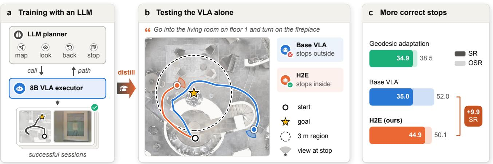
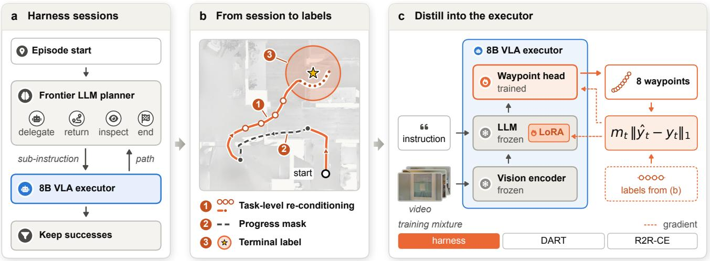
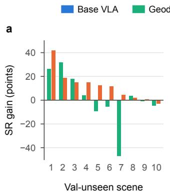
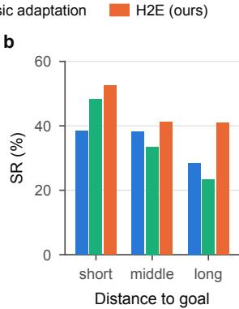
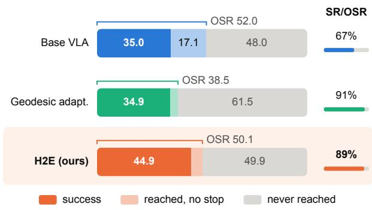
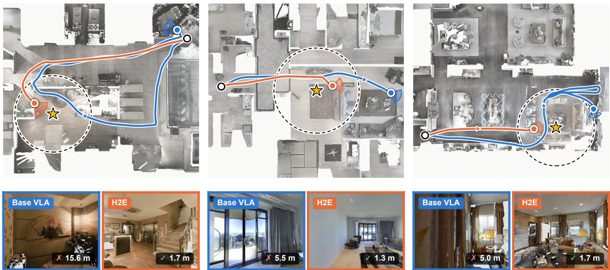

# What Can a VLA Learn from the Agent That Calls It? Task-Level Experience Distillation for Embodied Navigation

Jinze Tao Yuxiao Han Kangkang Dong Yancong Wei Xiaojun Zhu∗ Bokui Chen Houde Liu

Tsinghua Shenzhen International Graduate School, Tsinghua University

tao.jinze@163.com zhu.xj@foxmail.com

  
Figure 1. Training with the agent, testing the VLA alone. (a) On training scenes a frontier LLM planner calls the 8B VLA, and H2E distills the sessions that reach the goal into the VLA. (b) At test time the distilled VLA runs alone. The base VLA walks through the 3 m goal region and stops outside it, while H2E stops inside it. (c) On REVERIE-CE val-unseen, H2E raises the success rate by 9.9 points. Light bars show OSR and solid bars show SR.

## Abstract

Navigation agents use a large language model (LLM) planner to call a vision-language-action (VLA) model. Each episode needs the LLM, adding cost and delay. We distill successful agent experience into the VLA instead ofdistilling the planner. The VLA then navigates alone at test time. Agent sessions are not VLA demonstrations. They include motions driven by planner tools and sub-instructions, along with detours. We present H2E, a task-level experience distillation method that converts these sessions into VLA training data. Every motion becomes a VLA action under the original task instruction, with the resulting poses as targets. H2E masks the loss on steps that move away from the goal. It labels every visited state within 1 m ofthe goal as a stop. We then update the VLA with low-rank adaptation. The VLA learns to

stop at the goal andfind goals the base model never reaches. On all 3189 REVERIE-CE val-unseen episodes, H2E raises the success rate of an 8B VLA from 35.0% to 44.9%.

## 1. Introduction

Goal-directed navigation asks a robot to find a remote object that an instruction describes, such as go to the second-floor hallway and pick up the picture above the table [27]. The robot sees only its own camera views [15, 36]. Strong recent systems split this task in two [18, 51]. A frontier LLM planner looks at the scene and keeps a map of visited places. It hands short goals to a vision-language-action (VLA) model and corrects the VLA when it goes wrong. The planner calls the LLM throughout every episode. On our test episodes this costs a median of 70k tokens per episode, and an episode takes more than twice as long as with the VLA alone.

The sessions of such an agent show the VLA succeeding with help. We ask whether the VLA can learn from these sessions and then work alone. Current agents keep the VLA frozen [51], and distillation from such agents has so far shrunk the planner [9, 21, 41]. We instead train the VLA itself and remove the LLM at test time.

A session is hard to use as training data for the VLA. The planner often moves the robot with its own tools, and it often gives the VLA new sub-instructions. Together these produce 45% of the motion in our sessions. The sessions also contain detours that the planner later fixes, so nearly a quarter of the steps move away from the goal.

We present H2E, a task-level experience distillation method. Figure 2 gives an overview. H2E uses three simple rules. First, it labels every motion in a session as a VLA action under the original task instruction, whoever made the motion. Second, it masks the loss on steps that move away from the goal. Third, it labels every visited state near the goal as a stop. A LoRA update then trains the VLA, which runs without the LLM at test time.

H2E works well on the full REVERIE-CE val-unseen split. It raises the success rate of an 8B VLA from 35.0% to 44.9%, while geodesic adaptation gives no gain. The distilled VLA learns two skills from the agent. It stops in the right place far more often, and it finds goals that the base VLA never reaches. Against the full agent, the distilled VLA reaches a higher success rate with no LLM tokens and about a quarter of the time per episode.

Our contributions are as follows.

• We distill a frontier LLM navigation agent into the VLA that it calls, so that the VLA navigates without the LLM at test time.

• We present H2E. It turns whole agent sessions into VLA training data with task-level labels, progress masking and one stop rule. We also show why an $L _ { 1 }$ loss with this stop rule teaches the VLA to stop.

• We show that H2E clearly beats the base VLA and geodesic adaptation on unseen scenes. We also show that the distilled VLA outperforms the agent at a small fraction of its cost.

## 2. Related Work

VLA models for navigation. Navigation in continuous environments [15] has moved from waypoint predictors to video VLA models that map camera views and an instruction to actions [5, 40, 45, 46, 51]. On REVERIE-CE, 3D-token models trained on millions of samples lead the benchmark [36, 38]. Other work improves stopping with grounding modules or with stop labels on the learner’s own states [13, 23, 31]. These policies learn from geometric experts or offline data. Our VLA learns from the agent that calls it.

LLM agents and their students. LLM agents that call navigation models as tools lead several instruction-following benchmarks [18, 48, 51]. Their improvement loops edit the planner’s context and keep the VLA fixed [51]. Distillation from these agents has targeted the planner. TinyAstral replaces the planner with a 4B student [9], Guava distills agent trajectories into a compact agent [21], and OmniBrain-0 moves the planner into a smaller model [41]. Harness-Zero maps agent traces into the action space of another agent [42]. Other systems adapt the VLA to the planner’s interface [39], train both levels with reinforcement learning [43], co-adapt the two levels [34, 49], or relabel VLA segments with planner sub-instructions [32]. We keep the frontier planner as the teacher, train only the VLA, and remove the LLM at test time.

Learning from agent corrections. In manipulation, TILDE lets a teacher take over at the student’s failure states [25]. Recova trains recovery policies that an agent dispatches [22], and REPAIR distills RL specialists into a VLA [12]. For code and language agents, RE-0 distills verified corrections [47], and OEC and R2S switch to the expert inside student rollouts [17, 50]. Student histories paired with teacher actions work best for such agents [8]. SAGE distills a VLM teacher into an RL policy [3]. We distill whole navigation sessions into the VLA and add no module at test time.

What a student can learn from a privileged teacher. A student of fixed depth cannot represent what a harness computes over many calls [7]. Distillation from a teacher with memory transfers average corrections but not contextspecific ones [33]. A strong privileged teacher can also teach a memoryless student poorly [6, 44], while students that see their own history learn to explore [26]. We show which navigation skills a VLA takes over from an LLM agent under one training budget.

Relabelling demonstrations. HSL relabels agent trajectories with the goal they reached [20]. Phi-Nav writes new instructions for on-policy VLN paths [14], and BudVLN shows that recovery labels can conflict with the original instruction [10]. In object-goal navigation, human and exploration demonstrations transfer better than shortest paths [28, 29], and self-generated paths help goal-directed VLN [19, 37]. HSL and Phi-Nav change the instruction to fit the path. H2E keeps the task instruction, credits the VLA with every motion of the session, and masks steps by their progress toward the goal.

## 3. Method

Figure 2 and Alg. 1 summarize H2E. We first define the task, the VLA and the agent. We then describe the agent’s sessions, turn them into VLA training data, and train the

  
Figure 2. Overview of H2E. (a) On training scenes, a frontier LLM planner with a place graph and its own tools calls the base VLA. We keep the sessions that reach the goal. (b) H2E turns one kept session into labels. ① Every step is labelled with the next 8 poses under the original instruction, whether the VLA or a planner tool moved. ② Steps that move away from the goal are drawn dashed. They leave the loss but stay in the history. ③ Visited states within 1 m of the goal are labelled as stops. (c) The VLA keeps its vision encoder and LLM frozen. It trains LoRA adapters and the waypoint head with the masked $L _ { 1 }$ loss and runs alone at test time.

VLA.

## 3.1. Problem setup

An episode in REVERIE-CE gives a natural-language instruction ℓ that refers to a remote object, a start pose and a goal g near that object. At step t the robot stands at pose $p _ { t }$ receives four RGB views $o _ { t }$ and takes an action. Let $d ( p )$ be the geodesic distance from $p$ to $g .$ An episode succeeds if the robot stops with $d ( p _ { T } ) \leq 3 \pi$ . Each episode allows at most 500 steps.

VLA. The VLA $\pi$ is the 8B NavGPT video VLA [51]. It reads its last 16 observations and the instruction, $h _ { t } =$ $\left( o _ { t - 1 5 : t } , \ell \right)$ , and predicts $K = 8$ waypoints $\hat { y } _ { t } = \pi ( h _ { t } ) \in$ $\mathbb { R } ^ { K \times 3 }$ . Each waypoint holds a planar offset and a heading in the robot frame. The robot executes the first waypoint and then queries the VLA again. The VLA has no stop head. It stops when two outputs in a row are all zero. Moving and stopping thus come from one regression output, so the labels near the goal teach both.

Agent. The agent H pairs a frontier LLM planner with the VLA as a tool [51]. The planner can send an instruction or a sub-instruction to the VLA. It can also move the robot itself or walk back to a place in its place graph. It can look at a panorama or the map, and it can end the episode. The planner thus decides with $h _ { t }$ and with extra information $z _ { t }$ that the VLA never sees, namely the place graph and the whole episode history.

## 3.2. Agent sessions on training scenes

We run H on training episodes from their original start pose. Each session is a record

$$
\tau = \{ ( p _ { t } , o _ { t } , \ell _ { t } , c _ { t } ) \} _ { t = 0 } ^ { T } .\tag{1}
$$

The label $c _ { t } ~ \in ~ \{ \mathrm { e x e c , t o o l } \}$ says whether the VLA or a planner tool moved the robot from $p _ { t } \ \mathrm { t o } p _ { t + 1 }$ , and $\ell _ { t }$ is the instruction the VLA received at that step. We split planner tool motions into environment steps and render the views at the visited poses. We keep only the sessions that reach the goal. This gives 2395 sessions from 57 training scenes.

Table 1 shows who moved the robot in these sessions. The VLA acting on the original instruction produces only 54% of the labelled steps. Planner sub-instructions and planner tools produce most of the rest, and they also produce nearly half of the stop labels. Rescued sessions hold two thirds of all labelled steps, so most of the data shows the agent at work after the first VLA call falls short.

## 3.3. From sessions to VLA training data

H2E turns a session into training samples with three rules. Each sample $x _ { t } ~ = ~ ( o \leq t  , \ell , y _ { t } , m _ { t } )$ holds the history, the instruction, a target and a mask.

① Task-level labels. Let $\Phi _ { K }$ express the next K poses in the robot frame at $p _ { t }$ with the waypoint spacing of the VLA. H2E labels every step as

$$
\begin{array} { r } { \mathcal { R } ( \tau ) = \left\{ \left( o _ { \leq t } , \ell , y _ { t } \right) \right\} _ { t < T } , } \\ { y _ { t } = \Phi _ { K } ( p _ { t } ; p _ { t + 1 : t + K } ) . } \end{array}\tag{2}
$$

Table 1. Who moves the robot in the 2395 kept sessions. In 1538 direct sessions the first VLA call reached the goal, and in 857 rescued sessions the planner helped it. Tail steps are the final moves that end each VLA call. Masked steps leave the loss by Eq. 3.
<table><tr><td rowspan="2"></td><td colspan="2">VLA</td><td colspan="3">Planner</td></tr><tr><td>on l</td><td>on  $\ell _ { t } \neq \ell$ </td><td>tools</td><td>Tail</td><td>All</td></tr><tr><td>Labelled steps</td><td>179,106</td><td>68,143</td><td>81,660</td><td>3,496</td><td>332,405</td></tr><tr><td>direct</td><td>97,764</td><td>2,455</td><td>11,811</td><td>1,651</td><td>113,681</td></tr><tr><td>rescued</td><td>81,342</td><td>65,688</td><td>69,849</td><td>1,845</td><td>218,724</td></tr><tr><td>share (%)</td><td>53.9</td><td>20.5</td><td>24.6</td><td>1.1</td><td>100</td></tr><tr><td>masked (%)</td><td>27.3</td><td>24.1</td><td>14.7</td><td>5.1</td><td>23.3</td></tr><tr><td>Stop labels</td><td>15,337</td><td>3,878</td><td>9,597</td><td>1,369</td><td>30,181</td></tr><tr><td>share (%)</td><td>50.8</td><td>12.8</td><td>31.8</td><td>4.5</td><td>100</td></tr></table>

The label depends neither on $c _ { t }$ nor on $\ell _ { t } .$ . Every motion of the session becomes a VLA action under the instruction that the VLA receives at test time. The target is simply where the session went next.

② Progress masking. Sessions contain detours that the agent later fixes. Step t enters the loss, $m _ { t } = 1$ , if one of $p _ { t } , \ldots , p _ { t + K }$ lies near the goal by Eq. 4 or if

$$
d ( p _ { t + K } ) \leq d ( p _ { t } ) + \delta ,\tag{3}
$$

with $\delta = 0 . 2 5$ m. Turns in place keep d and stay in the loss. Masked steps stay in the history $\scriptstyle O \leq t$ , and only their targets leave the loss. The distance d is used only to build labels, and the VLA never receives it.

③ Stop labels. One rule labels stops for every data source, including the geodesic expert,

$$
y _ { t } = { \mathbf { 0 } } \quad \mathrm { i f } d ( p _ { t } ) \leq r _ { \mathrm { a r r } } ,\tag{4}
$$

with $r _ { \mathrm { a r r } } = 1$ m. A radius tighter than the 3 m success region places the stop targets well inside it. The rule also adds stops at states that the VLA walked through without stopping. This happens when the first VLA call passes within 1 m of the goal and then leaves the goal region.

## 3.4. Training objective

The VLA learns from three sources. $\mathcal { D _ { H } }$ holds the labelled agent steps. D A holds geodesic expert steps with DART noise [16], and $\mathcal { D } _ { \mathrm { R 2 R } }$ holds R2R-CE path-following steps [2, 15]. Both come from the training scenes and use the stop rule of Eq. 4. The VLA minimizes the masked $L _ { 1 }$ loss over the mixture

$$
\mathcal { L } ( \theta ) = \sum _ { s } w _ { s } \mathbb { E } _ { x _ { t } \sim \mathcal { D } _ { s } } \big [ m _ { t } \| \pi _ { \theta } ( o _ { \leq t } , \ell ) - y _ { t } \| _ { 1 } \big ] ,\tag{5}
$$

Algorithm 1 Task-level experience distillation with H2E   
Input: episodes $\varepsilon ,$ agent H, VLA $\pi _ { \boldsymbol { \theta } _ { 0 } } ,$ data DDART, DR2R   
1: $S \gets \{ \tau \sim \mathcal { H } ( e ) : e \in \mathcal { E } ,$ τ succeeds} ▷ Eq. 1   
2: $\mathcal { D } _ { \mathcal { H } }  \emptyset$   
3: for $\tau \in S$ and $( o \leq t , \ell , y _ { t } ) \in \mathcal { R } ( \tau )$ do ▷ Eq. 2   
4: if $d ( p _ { t } ) \leq r _ { \mathrm { a r r } }$ then $y _ { t } \gets \mathbf { 0 }$ ▷ Eq. 4   
5: ${ m } _ { t } \gets$ progress mask ▷ Eq. 3   
6: $\mathcal { D } _ { \mathcal { H } }  \mathcal { D } _ { \mathcal { H } } \cup \{ x _ { t } \}$   
7: D ← mix of $\mathcal { D } _ { \mathcal { H } } , \mathcal { D } _ { \mathrm { D A R T } } , \mathcal { D } _ { \mathrm { R 2 R } }$ at 0.60 : 0.25 : 0.15   
8: $\theta \gets \mathrm { L o R A }$ update of $\theta _ { 0 }$ minimizing Eq. 5 on D   
9: return πθ ▷ runs alone at test time

Here s runs over the three sources with weights $w _ { \mathscr H } = 0 . 6 0 .$ $w _ { \mathrm { D A R T } } = 0 . 2 5$ and wR2R = 0.15. The VLA πθ reads the last 16 observations of $O { \le } t$

We fine-tune the $\mathrm { V L A }$ with LoRA [11]. Each adapted weight matrix $W _ { 0 } \in \mathbb { R } ^ { d \times k }$ of the language model becomes

$$
W = W _ { 0 } + { \frac { \alpha } { r } } B A ,\tag{6}
$$

where $B \in \mathbb { R } ^ { d \times r }$ and $A \in \mathbb { R } ^ { r \times k }$ are trained, with rank $r = 1 6$ and $\alpha = 3 2$ . LoRA adapts the attention and MLP layers. The action head is trained in full, and the vision encoder stays frozen. The parameters θ thus hold A, B and the head.

Why the $L _ { 1 }$ loss teaches stopping. The VLA stops only when its output is zero. The $L _ { 1 }$ loss can drive the output exactly to zero near the goal, as the following fact shows.

Proposition 1. Fix a history h and let y be the target of a training sample with history h and m = 1. Every minimizer of $\mathbb { E } \big [ \| \pi ( h ) - y \| _ { 1 } \ | \ h \big ]$ is a coordinate-wise median of y given h. $\gamma P ( y = 0 \mid \bar { h } ) > 1 / 2$ , the minimizer is unique and equals 0.

Proof. The $L _ { 1 }$ norm is a sum over coordinates, and the expected absolute error of each coordinate is minimized by its median. If $\mathbf { \nabla } \cdot \mathbf { y } = \mathbf { 0 }$ with probability above $1 / 2 ,$ , every coordinate is zero with probability above $1 / 2 ,$ so zero is its only median. □

The stop rule of Eq. 4 gives every visited state within $r _ { \mathrm { a r r } }$ of the goal a stop target. Stop targets thus form the majority there, and the optimal output is an exact stop. A squared loss would instead return the mean target, which is not zero as long as some samples still move.

## 3.5. Deployment

At test time the LoRA VLA replaces the base VLA and runs alone. By Eq. 6, BA can be merged into $W _ { 0 } ,$ so the distilled VLA has the size and step cost of the base VLA. For an episode of $T$ steps, the time of the agent and of the distilled

Table 2. Results on REVERIE-CE val-unseen with all 3189 episodes from 10 unseen scenes. The lower block uses the same 8B VLA, which runs alone at test time. Geodesic adaptation uses the recipe of Tab. 4, and H2E trains for 9000 updates. ∆SR is the gain over the base VLA.
<table><tr><td>Method</td><td>Observation</td><td>Training data</td><td>SR↑</td><td>OSR↑</td><td>SPL↑</td><td>NE↓</td><td>∆SR</td></tr><tr><td>Published</td><td></td><td></td><td></td><td></td><td></td><td></td><td></td></tr><tr><td>InstructNav [24]*</td><td>RGB-D</td><td>zero-shot</td><td>25.2</td><td>31.5</td><td>19.1</td><td>7.44</td><td></td></tr><tr><td>NaVid [45]†</td><td>RGB</td><td>Dynam3D mixture</td><td>26.6</td><td>36.3</td><td>20.8</td><td>6.74</td><td></td></tr><tr><td>g3D-LF [35]†</td><td>RGB-D</td><td>Dynam3D mixture</td><td>34.4</td><td>41.6</td><td>23.8</td><td>6.50</td><td></td></tr><tr><td>Dynam3D</td><td>RGB-D</td><td>4M+ samples</td><td>40.1</td><td>48.9</td><td>28.5</td><td>6.22</td><td></td></tr><tr><td>D3D-VLP</td><td>RGB-D</td><td>10M samples</td><td>47.5</td><td>56.9</td><td>34.7</td><td>5.36</td><td></td></tr><tr><td colspan="2">8B NavGPT VLA, running alone</td><td></td><td></td><td></td><td></td><td></td><td></td></tr><tr><td>Base VLA</td><td>4-view RGB</td><td>一</td><td>35.0</td><td>52.0</td><td>26.5</td><td>8.53</td><td>一</td></tr><tr><td>+ Geodesic adaptation</td><td>4-view RGB</td><td>DART + R2R, 48k samples</td><td>34.9</td><td>38.5</td><td>33.2</td><td>8.93</td><td>0.0</td></tr><tr><td>+ H2E (ours)</td><td>4-view RGB</td><td>2,395 sessions + DART + R2R</td><td>44.9</td><td>50.1</td><td>38.4</td><td>6.90</td><td>+9.9</td></tr></table>

†Retrained on the Dynam3D data. ∗Zero-shot. Published results are taken from [36, 38]. Published methods use one view with depth, and NaVid uses RGB only. Our VLA uses four RGB views and must stop on its own.

VLA is

$$
\begin{array} { r l } { \displaystyle } & { { } \displaystyle t _ { \mathcal { H } } = T c _ { \pi } + \sum _ { k = 1 } ^ { K } c _ { \mathrm { L L M } } ( n _ { k } ) , } \\ { \displaystyle } & { { } \displaystyle t _ { \mathrm { H 2 E } } = T c _ { \pi } , } \end{array}\tag{7}
$$

Here $c _ { \pi }$ is the time of one VLA step, K is the number of planner calls, and $c _ { \mathrm { L L M } } ( n _ { k } )$ is the time of a call with $n _ { k }$ tokens. The agent also pays for $\sum _ { k } n _ { k }$ LLM tokens per episode, while H2E pays for none. H2E can further shorten $T$ because it stops once it reaches the goal. Section 4.3 measures these terms.

## 4. Experiments

## 4.1. Setup

Benchmark. We use REVERIE-CE [27, 36] in Habitat [30] with MP3D scenes [4]. We report results on all 3189 episodes of the official val-unseen split, which covers 10 scenes that no training data touches. For the comparison with the LLM agent we use 100 episodes from 26 further scenes. Table 3 lists the data.

Metrics. We report success rate (SR), oracle success rate (OSR), success weighted by path length (SPL) and navigation error (NE) [1]. For episode i of N, let $S _ { i } = \mathbb { 1 } [ d ( p _ { T } ^ { i } ) \leq$ 3] show success and $R _ { i } = \mathbb { 1 } [ \operatorname* { m i n } _ { t } d ( p _ { t } ^ { i } ) \leq 3 ]$ show that the robot reached the 3 m goal region at some step. Then

Table 3. Data and training settings of H2E.
<table><tr><td>Data</td><td></td></tr><tr><td>Agent sessions Labelled agent steps</td><td>2,395 from 57 scenes 332,405</td></tr><tr><td>Development episodes</td><td>100 from 26 scenes</td></tr><tr><td>Val-unseen episodes</td><td>3,189 from 10 scenes</td></tr><tr><td>Model and labels</td><td></td></tr><tr><td>LoRA rank r and scale α</td><td>16 and 32</td></tr><tr><td>Trained parts</td><td>LoRA and action head</td></tr><tr><td>History frames and waypoints K</td><td>16 and 8</td></tr><tr><td>Mixture weights of Eq. 5</td><td>0.60, 0.25 and 0.15</td></tr><tr><td></td><td></td></tr><tr><td>Margin δ and stop radius  $r _ { \mathrm { a r r } }$ </td><td>0.25 m and 1 m</td></tr><tr><td>Optimization</td><td></td></tr><tr><td>Samples per update</td><td>16</td></tr><tr><td>Learning rate of LoRA and head</td><td> $1 0 ^ { - 4 } \mathrm { a n d } 2 \times 1 0 ^ { - 5 }$ </td></tr><tr><td>Warm-up updates and schedule</td><td>540, then cosine</td></tr><tr><td></td><td></td></tr><tr><td>Gradient clipping</td><td>norm 1</td></tr><tr><td>Updates and training time</td><td>9000 and about 28 h</td></tr></table>

$$
\begin{array} { r l } & { \mathrm { S R } = \displaystyle \frac { 1 } { N } \sum _ { i } S _ { i } , \qquad \mathrm { O S R } = \frac { 1 } { N } \sum _ { i } R _ { i } , } \\ & { \mathrm { S P L } = \displaystyle \frac { 1 } { N } \sum _ { i } S _ { i } \frac { l _ { i } } { \operatorname* { m a x } ( l _ { i } , q _ { i } ) } , } \\ & { \mathrm { N E } = \displaystyle \frac { 1 } { N } \sum _ { i } d ( p _ { T } ^ { i } ) , } \end{array}\tag{8}
$$

Table 4. Same recipe on REVERIE-CE val-unseen. Both adapted VLAs use the same scenes, LoRA recipe and number of updates. H2E adds 504 agent sessions to the same DART and R2R-CE data.
<table><tr><td>Method</td><td>SR↑</td><td>OSR↑</td><td>SPL↑</td><td>NE↓</td><td>∆SR</td></tr><tr><td>Base VLA</td><td>35.0</td><td>52.0</td><td>26.5</td><td>8.53</td><td></td></tr><tr><td>Geodesic adapt.</td><td>34.9</td><td>38.5</td><td>33.2</td><td>8.93</td><td>0.0</td></tr><tr><td>H2E (ours)</td><td>43.2</td><td>46.9</td><td>38.2</td><td>7.01</td><td>+8.2</td></tr></table>

Table 5. LoRA rank. SR on the 861 val-unseen episodes of three scenes. Both ranks use the same 2,395 sessions and 9000 updates.
<table><tr><td>Method</td><td>SR↑</td></tr><tr><td>Base VLA</td><td>30.3</td></tr><tr><td>Geodesic adaptation</td><td>29.5</td></tr><tr><td>H2E, rank 16</td><td>45.6</td></tr><tr><td>H2E, rank 64</td><td>33.2</td></tr></table>

where $l _ { i }$ is the shortest path length and $q _ { i }$ is the length of the path the robot took. An episode ends when the VLA stops, after 500 steps, or at the 2,400 s limit of the official evaluation script.

Baselines. All variants use the same 8B NavGPT VLA. The base VLA is the released model. Geodesic adaptation trains the VLA on geodesic expert labels with DART noise [36, 40] and on R2R-CE path following [2, 15]. It uses the same stop rule and LoRA settings as H2E. H2E adds the agent sessions to the same DART and R2R-CE data.

Implementation details. The planner of the agent is gpt-6- astra. Table 3 also lists the training settings of H2E. Training runs on four NVIDIA L40 GPUs with data parallelism, and we evaluate the final checkpoint.

## 4.2. Main results

Table 2 shows the results on val-unseen. H2E raises the SR of the VLA from 35.0% to 44.9%, a gain of 9.9 points. The gain holds across scenes, with a 95% interval from 3.9 to 16.3 points. Geodesic adaptation gives no gain. H2E also improves SPL by 11.9 points and lowers NE by 1.6 m. Table 4 trains both adapted VLAs with one recipe, the same scenes and the same number of updates. With only 504 sessions, H2E already reaches 43.2% SR, while geodesic adaptation stays at 34.9%. The sessions of the agent thus carry what the VLA needs, and adaptation to REVERIE-CE alone does not. Table 5 compares two LoRA ranks on 861 val-unseen episodes. Rank 16 reaches 45.6% and rank 64 reaches 33.2%, so a small adapter is enough to absorb the sessions. The distilled VLA sees only four RGB views, yet its SR and SPL exceed those of Dynam3D, which uses depth and more than 4M training samples.

  
Figure 3. Where the gain comes from on val-unseen. (a) SR gain over the base VLA in each scene, with scenes sorted by the gain of H2E. (b) SR on thirds of the episodes split by the geodesic distance from the start to the goal, with cuts at 7.7 m and 9.9 m.

Table 6. H2E against the full LLM agent. Unlike Tab. 2, these 100 episodes come from 26 scenes outside the training data, and H2E is distilled from 63 sessions. Time and tokens are medians per episode.
<table><tr><td>Method</td><td>SR↑</td><td>OSR↑</td><td>NE↓</td><td>Time↓</td><td>Tokens↓</td></tr><tr><td>LLM agent with the base VLA</td><td></td><td></td><td></td><td></td><td></td></tr><tr><td>Agent</td><td>53</td><td>70</td><td>5.50</td><td>423 s</td><td>70k</td></tr><tr><td>VLA alone</td><td></td><td></td><td></td><td></td><td></td></tr><tr><td>Base VLA</td><td>38</td><td>59</td><td>8.60</td><td>196s</td><td>0</td></tr><tr><td>Geodesic adapt.</td><td>37</td><td>50</td><td>9.29</td><td>194s</td><td>0</td></tr><tr><td>H2E (ours)</td><td>57</td><td>64</td><td>5.96</td><td>114s</td><td>0</td></tr></table>

Figure 3 shows where the gain comes from. H2E raises SR in 9 of the 10 val-unseen scenes, while geodesic adaptation helps in some scenes and hurts in others. We also split the episodes into thirds by the geodesic distance from the start to the goal. The lead of H2E over geodesic adaptation grows with this distance, from 4.4 points on the short third to 17.5 points on the long third. On the long third, geodesic adaptation falls below the base VLA, while H2E stays well above it.

## 4.3. Comparison with the LLM agent

Table 6 compares a VLA distilled from 63 sessions with the agent that taught it. The agent lifts the base VLA from 38% to 53% SR, but it needs a median of 70k LLM tokens and 423 s per episode. Over the 100 episodes it uses 16.7M tokens in total. The VLA distilled with H2E reaches 57% SR on its own. It turns 57 of its 64 goal-region visits into success, while the agent turns 53 of 70. It uses no LLM tokens and finishes an episode in a median of 114 ${ \bf S } ,$ 3.7 times faster than the agent. It is even faster than the base VLA, because its episodes are shorter. The same holds for the step count

  
Figure 4. Episode outcomes on val-unseen. Each bar splits all 3189 episodes into success, reaching the goal region without stopping inside it, and never reaching the region. The bar on the right gives the share of goal-region visits that end in success.

T of Eq. 7 on val-unseen, where the distilled VLA needs a median of 49 steps per episode and the base VLA needs 66. The distilled VLA thus keeps the skill of the agent without its cost.

## 4.4. What the VLA learns from the agent

We split each outcome into reaching the goal region and stopping inside it, with $S _ { i }$ and $R _ { i }$ from Eq. 8. For a candidate c and a baseline b we measure

$$
C ^ { c } = \frac { \sum _ { i } S _ { i } ^ { c } } { \sum _ { i } R _ { i } ^ { c } } ,\tag{9}
$$

$$
N ( c , b ) = \sum _ { i } R _ { i } ^ { c } ( 1 - R _ { i } ^ { b } ) ,\tag{10}
$$

$$
\Delta _ { \mathrm { s t o p } } = \frac { 1 } { | A | } \sum _ { i \in A } \left( S _ { i } ^ { c } - S _ { i } ^ { b } \right) .\tag{11}
$$

C is the share of goal-region visits that end in success. N counts the episodes that c reaches and b does not. A is the set of episodes that both reach, so $\Delta _ { \mathrm { { s t o p } } }$ compares stopping on the same episodes. Since SR equals OSR times C, the gain in SR splits into a reach term and a stop term,

$$
\begin{array} { r } { \mathrm { S R } ^ { c } - \mathrm { S R } ^ { b } = \underbrace { \left( \mathrm { O S R } ^ { c } - \mathrm { O S R } ^ { b } \right) C ^ { c } } _ { \mathrm { r e a c h t e r m } } } \\ { + \underbrace { \mathrm { O S R } ^ { b } \left( C ^ { c } - C ^ { b } \right) } _ { \mathrm { s t o p t e r m } } . } \end{array}\tag{12}
$$

Table 7 gives both terms for H2E. Against the base VLA, the stop term carries the whole gain. Against geodesic adaptation, the reach term carries it.

The VLA learns to stop at the goal. The base VLA turns only 67% of its goal-region visits into success. In 544 episodes it reaches the region but ends outside it. H2E raises this share to 89% and cuts these misses to 168, as Fig. 4 shows. This is the behavior that Proposition 1 predicts for the stop labels of H2E. On the 1198 episodes that both reach, H2E succeeds 24.5 points more often than the base VLA, with a 95% interval from 17.4 to 32.3 points.

Table 7. Where the SR gain of H2E comes from on val-unseen, split by Eq. 12. All values are in points.
<table><tr><td>Baseline</td><td>∆SR</td><td>Reach term</td><td>Stop term</td></tr><tr><td>Base VLA</td><td>+9.9</td><td>-1.7</td><td>+11.6</td></tr><tr><td>Geodesic adaptation</td><td>+9.9</td><td>+10.4</td><td>-0.4</td></tr></table>

Table 8. Ablation study on the 100 development episodes of Tab. 9, which come from 26 scenes outside the training data. All rows use the recipe of Tab. 4, and each row changes only the agent data. TL means task-level labels and PM means progress masking. C is SR divided by OSR, and ∆SR is the change from H2E.
<table><tr><td>Training data</td><td>TL</td><td>PM</td><td>SR</td><td>OSR</td><td>C</td><td>∆SR</td></tr><tr><td>Base VLA</td><td></td><td></td><td>38</td><td>59</td><td>0.64</td><td>-15</td></tr><tr><td>Geodesic adaptation</td><td></td><td></td><td>36</td><td>43</td><td>0.84</td><td>-17</td></tr><tr><td>H2E</td><td>√</td><td></td><td>53</td><td>57</td><td>0.93</td><td>ref.</td></tr><tr><td>w/o TL</td><td>X</td><td>√</td><td>47</td><td>50</td><td>0.94</td><td>-6</td></tr><tr><td>w/o PM</td><td>√</td><td>x</td><td>47</td><td>53</td><td>0.89</td><td>-6</td></tr><tr><td>Geodesic actions</td><td>√</td><td>√</td><td>46</td><td>57</td><td>0.81</td><td>-7</td></tr><tr><td>Self-imitation</td><td>一</td><td>√</td><td>47</td><td>52</td><td>0.90</td><td>-6</td></tr></table>

The VLA learns to find new goals. H2E reaches the goal region in 401 episodes that the base VLA never reaches, and 355 of them end in success. Geodesic adaptation also learns to stop, but it stops too early and reaches the region in only 38.5% of episodes. H2E reaches it in 50.1%. On the 928 episodes that both adapted VLAs reach, they stop equally well, so the lead of H2E over geodesic adaptation comes from finding the goal.

## 4.5. Ablation study

Table 8 removes one rule of H2E at a time from the model of Tab. 4 and keeps all other training settings. Without task-level labels, the VLA learns only from steps that it made itself, under the instruction it received at that step. Without progress masking, every step enters the loss. Geodesic actions keeps the states and stop labels of the sessions but replaces every motion target with the geodesic expert’s target at the same pose. With $\bar { y } _ { t } ^ { \mathrm { g e o } }$ the target of the geodesic expert at $p _ { t } ,$ these three variants change Eqs. 2 and 3 to

a Walk to the lobby across … the wool covered table  
b Go to the living room and push the chair…  
c Go to the family room and pick up the picture…  
  
Figure 5. Examples of better stopping. Each map shows the paths of the base VLA and H2E from the same start on a top-down render of the scene. The dashed ring marks the 3 m goal region. The images below each map show what each VLA sees when it stops and its final distance to the goal. The base VLA passes the goal and stops outside the region, while H2E stops inside it.

$$
\begin{array} { l l } { { \mathrm { w } / { \mathrm { o } } \mathrm { T L } } } & { { \{ \left( o _ { \leq t } , \ell _ { t } , y _ { t } \right) \mid c _ { t } = \mathrm { e x e c } \} } , } \\ { { \mathrm { w } / { \mathrm { o } } \mathrm { P M } } } & { { m _ { t } = 1 \mathrm { f o r e v e r y } t , } } \\ { { \mathrm { G e o d e s i c a c t i o n s } } } & { { y _ { t } = y _ { t } ^ { \mathrm { g e o } } \mathrm { f o r e v e r y } y _ { t } \neq { \bf 0 } . } } \end{array}\tag{13}
$$

Self-imitation trains the VLA on its own successful runs on the same training episodes.

Every rule of H2E adds to its success rate. Removing task-level labels or progress masking lowers SR from 53% to 47%, and geodesic action targets lower it to 46%. Selfimitation on the same training episodes also falls 6 points short, so success filtering alone does not explain the gain. Both the states the agent visits and its motions help. Its states with geodesic action targets already beat geodesic adaptation by 10 points, and its own motions add 7 more. On the 12 episodes that only the agent reaches, H2E reaches the goal region in 8, self-imitation in 5 and the base VLA in none.

## 4.6. Qualitative results

Figure 5 shows three episodes from scenes outside the training data. In each one the base VLA walks through the goal region and stops outside it. From the same start, H2E stops inside the region near the target object.

## 5. Conclusion

We showed that a VLA can learn from the LLM agent that calls it and then navigate alone. H2E turns whole agent sessions into VLA training data with task-level labels, progress masking and one stop rule. On REVERIE-CE val-unseen it raises the success rate of an 8B VLA from 35.0% to 44.9%, while geodesic adaptation gives no gain. The distilled VLA learns to stop at the goal and to find goals that it used to miss. It outperforms the agent with no LLM tokens and runs 3.7 times faster.

The recipe needs only the sessions that an agent already records and a LoRA update of the VLA. It thus applies to any agent that calls a VLA as a tool.

Limitations. We study one benchmark, one VLA and one LLM agent. The distilled VLA does not yet learn to recover after it goes off track, which needs the map and memory of the agent. Sessions started from the failures of the VLA are a natural next step.

## LLM Usage Statement

The agent in this work uses the LLM gpt-6-astra as its planner. We used Claude Code and Codex to assist with coding and language editing, and we take full responsibility for all content.

## References

[1] Peter Anderson, Angel Chang, Devendra Singh Chaplot, et al. On evaluation of embodied navigation agents. arXiv preprint arXiv:1807.06757, 2018. 5

[2] Peter Anderson, Qi Wu, Damien Teney, et al. Vision-andlanguage navigation: Interpreting visually-grounded navigation instructions in real environments. In CVPR, 2018. 4, 6

[3] Giovanni Bonetta, Matteo Merler, Davide Zago, Rossella Cancelliere, and Bernardo Magnini. Selective agent guidance via entropy: Learning autonomous policies from imperfect VLM teachers. In Findings ofEMNLP, 2026. 2

[4] Angel Chang, Angela Dai, Thomas Funkhouser, et al. Matterport3D: Learning from RGB-D data in indoor environments. In 3DV, 2017. 5

[5] An-Chieh Cheng, Yandong Ji, Zhaojing Yang, et al. NaVILA: Legged robot vision-language-action model for navigation. In RSS, 2025. 2

[6] Sanjiban Choudhury and Paloma Sodhi. Better than your teacher: LLM agents that learn from privileged AI feedback. In ICLR, 2025. 2

[7] Jingchu Gai, Adam Block, and Andrej Risteski. Understanding the benefits of scaffolds through computational separations. arXiv preprint arXiv:2610.27157, 2026. 2

[8] Ya Gao, Zhengtao Zou, and Pekka Marttinen. Beyond onpolicy vs. off-policy: At what level should LLM agent distillation follow the student? arXiv preprint arXiv:2610.31918, 2026. 2

[9] Kehong Gong, Xiaoxu Zheng, Guanli Hou, et al. TinyAstral: Transferring self-evolving harnesses to tiny generalist manipulation agents. arXiv preprint arXiv:2610.41216, 2026. 2

[10] Gang He, Zhenyang Liu, Kepeng Xu, et al. Nipping the drift in the bud: Retrospective rectification for robust visionlanguage navigation. arXiv preprint arXiv:2602.06356, 2026. 2

[11] Edward J. Hu, Yelong Shen, Phillip Wallis, Zeyuan Allen-Zhu, Yuanzhi Li, Shean Wang, Lu Wang, and Weizhu Chen. LoRA: Low-rank adaptation of large language models. In ICLR, 2022. 4

[12] Zhennan Jiang, Tingying Xie, Shilong Ji, et al. Beyond policy patches: Distilling RL specialists into vision-language-action policies. arXiv preprint arXiv:2611.02777, 2026. 2

[13] Ruibin Ju, Ruifeng Cai, Min Xu, et al. X-Fly: Learning to reach and stop in full-chunk aerial vision-language navigation. arXiv preprint arXiv:2610.21450, 2026. 2

[14] Sung June Kim, Sangpil Kim, and Honglak Lee. Path-level hindsight instructions for semantic exploration in visionlanguage navigation. In ECCV, 2026. 2

[15] Jacob Krantz, Erik Wijmans, Arjun Majumdar, Dhruv Batra, and Stefan Lee. Beyond the nav-graph: Vision-and-language navigation in continuous environments. In ECCV, 2020. 1, 2, 4, 6

[16] Michael Laskey, Jonathan Lee, Roy Fox, Anca Dragan, and Ken Goldberg. DART: Noise injection for robust imitation learning. In CoRL, 2017. 4

[17] Niklas Lauffer, Xiang Deng, Srivatsa Kundurthy, Brad Kenstler, and Jeff Da. Imitation learning for multi-turn LM agents via on-policy expert corrections. In ICML, 2026. 2

[18] Zixing Lei, Gengze Zhou, Xiong-Hui Chen, et al. Scaffolding foundation models into physical-world agents pushes the frontier of long-horizon navigation. arXiv preprint arXiv:2608.30396, 2026. 1, 2

[19] Songze Li, Zun Wang, Gengze Zhou, et al. Learning goaloriented vision-and-language navigation with self-improving demonstrations at scale. arXiv preprint arXiv:2509.24910, 2025. 2

[20] Zichao Li, Gang Wu, Zichao Wang, et al. Spinning straw into gold: Relabeling LLM agent trajectories in hindsight for successful demonstrations. In ICLR, 2026. 2

[21] Haowen Liu, Xirui Li, Shaoxiong Yao, et al. Guava: Distilling frontier VLMs into a compact agent through a robotic manipulation harness. arXiv preprint arXiv:2606.18363, 2026. 2

[22] Isabella Liu, An-Chieh Cheng, Johan Bjorck, et al. Recova: Agent-guided failure recovery for autonomous robotic manipulation. arXiv preprint arXiv:2610.01178, 2026. 2

[23] Xinhao Liu, Yunsheng Tian, Yuheng Qiu, et al. StopWatch: Goal grounding for object-goal navigation. arXiv preprint arXiv:2610.23841, 2026. 2

[24] Yuxing Long, Wenzhe Cai, Hongcheng Wang, Guanqi Zhan, and Hao Dong. InstructNav: Zero-shot system for generic instruction navigation in unexplored environment. In CoRL, 2024. 5

[25] Yuxiang Lu, Yantong Liu, Jinghua Hou, et al. TILDE: Teacher-in-the-loop distillation from embodied foundation models. arXiv preprint arXiv:2610.25376, 2026. 2

[26] Sriyash Poddar, Yanda Bao, Jacob Krantz, et al. Asymmetric on-policy distillation learns in-context exploration. arXiv preprint arXiv:2610.30105, 2026. 2

[27] Yuankai Qi, Qi Wu, Peter Anderson, Xin Wang, William Yang Wang, Chunhua Shen, and Anton van den Hengel. REVERIE: Remote embodied visual referring expression in real indoor environments. In CVPR, 2020. 1, 5

[28] Ram Ramrakhya, Eric Undersander, Dhruv Batra, and Abhishek Das. Habitat-Web: Learning embodied object-search strategies from human demonstrations at scale. In CVPR, 2022. 2

[29] Ram Ramrakhya, Dhruv Batra, Erik Wijmans, and Abhishek Das. PIRLNav: Pretraining with imitation and RL finetuning for ObjectNav. In CVPR, 2023. 2

[30] Manolis Savva, Abhishek Kadian, Oleksandr Maksymets, et al. Habitat: A platform for embodied AI research. In ICCV, 2019. 5

[31] Xiangyu Shi, Ruoxi Yang, Wei Tao, et al. From region arrival to instance-level grounding in vision-and-language navigation. arXiv preprint arXiv:2607.03792, 2026. 2

[32] Zineng Tang, Kelsey R. Allen, Sjoerd van Steenkiste, et al. Decoupling planning and control for instructable agents. In COLM, 2026. 2

[33] Cheng-Yin Tu. Externalise the memory: A pre-registered study of where an embodied agent’s experience should live. arXiv preprint arXiv:2610.30478, 2026. 2

[34] Peidong Wang, Ying Chang, Zhiming Ma, et al. AdaRSI: On-demand recursive self-improvement for embodied agents. arXiv preprint arXiv:2610.20474, 2026. 2

[35] Zihan Wang and Gim Hee Lee. g3D-LF: Generalizable 3Dlanguage feature fields for embodied tasks. In CVPR, 2025. 5

[36] Zihan Wang, Seungjun Lee, and Gim Hee Lee. Dynam3D: Dynamic layered 3D tokens empower VLM for vision-andlanguage navigation. In NeurIPS, 2025. 1, 2, 5, 6

[37] Zun Wang, Jialu Li, Yicong Hong, et al. Bootstrapping language-guided navigation learning with self-refining data flywheel. In ICLR, 2025. 2

[38] Zihan Wang, Seungjun Lee, Guangzhao Dai, and Gim Hee Lee. D3D-VLP: Dynamic 3D vision-language-planning model for embodied grounding and navigation. In CVPR, 2026. 2, 5

[39] Meng Wei, Chenyang Wan, Jiaqi Peng, et al. Ground slow, move fast: A dual-system foundation model for generalizable vision-language navigation. In ICLR, 2026. 2

[40] Meng Wei, Chenyang Wan, Xiqian Yu, et al. StreamVLN: Streaming vision-and-language navigation via SlowFast context modeling. In ICRA, 2026. 2, 6

[41] Xiaomi Embodied Intelligence Team. OmniBrain-0: A unified agentic model for embodied intelligence. arXiv preprint arXiv:2610.36013, 2026. 2

[42] Haoran Ye, Yuxing Lu, Haonan Dong, et al. Harness-Zero: Harness distillation via agent-as-harness. arXiv preprint arXiv:2609.24974, 2026. 2

[43] Shuhao Ye, Yufei Wei, Demao Wang, et al. MATCH: Execution-aware hierarchical reinforcement learning for vision-and-language navigation in continuous environment. arXiv preprint arXiv:2610.38248, 2026. 2

[44] Xinlei Yu, Gen Li, Qingyi Si, et al. DOPD: Dual on-policy distillation. arXiv preprint arXiv:2606.30626, 2026. 2

[45] Jiazhao Zhang, Kunyu Wang, Rongtao Xu, et al. NaVid: Video-based VLM plans the next step for vision-and-language navigation. In RSS, 2024. 2, 5

[46] Jiazhao Zhang, Kunyu Wang, Shaoan Wang, et al. Uni-NaVid: A video-based vision-language-action model for unifying embodied navigation tasks. In RSS, 2025. 2

[47] Jiawei Zhang, Xiangrong Zhang, Rui Song, et al. RE-0: Verified recursive improvement of embodied code-as-policy agents through local on-policy distillation. arXiv preprint arXiv:2609.32416, 2026. 2

[48] Jiazhao Zhang, Gengze Zhou, Hale Yin, et al. Qwen-RobotNav technical report: A scalable navigation model designed for an agentic navigation system. arXiv preprint arXiv:2606.18112, 2026. 2

[49] Xilun Zhang, Maggie Wang, Erik Bauer, et al. Co-evolving robot orchestrators and policies through deployment. arXiv preprint arXiv:2610.09228, 2026. 2

[50] Shu Zhao and Tan Yu. Capable teacher, myopic scorer: Reward-free teacher repair for agentic on-policy distillation. arXiv preprint arXiv:2610.28586, 2026. 2

[51] Gengze Zhou, Yicong Hong, Jiazhao Zhang, et al. NavGPT-3: Harnessing context in a hierarchical navigation runtime. arXiv preprint arXiv:2610.10787, 2026. 1, 2, 3

## Appendix

# What Can a VLA Learn from the Agent That Calls It? Task-Level Experience Distillation for Embodied Navigation

Table 9. Outcomes of the models of Tab. 4 on the 100 development episodes. Late means the robot reached the 3 m region and ended outside it. Early means it stopped without reaching it. Both lost counts the Both episodes that the model failed to reach. Rec. counts recoveries after going off track.
<table><tr><td>Model</td><td>SR</td><td>OSR</td><td>C</td><td>Late</td><td>Early</td><td>Cut</td><td>Only-H</td><td>Both lost</td><td>Rec.</td></tr><tr><td>Base VLA</td><td>38</td><td>59</td><td>0.64</td><td>21</td><td>38</td><td>4</td><td>0</td><td>0</td><td>5/39</td></tr><tr><td>Geodesic adaptation</td><td>36</td><td>43</td><td>0.84</td><td>7</td><td>55</td><td>2</td><td>1</td><td>21</td><td>0/45</td></tr><tr><td>H2E</td><td>53</td><td>57</td><td>0.93</td><td>4</td><td>41</td><td>3</td><td>8</td><td>16</td><td>6/40</td></tr><tr><td>Agent with base VLA</td><td>53</td><td>70</td><td>一</td><td>一</td><td>一</td><td>一</td><td>12</td><td>一</td><td>一</td></tr></table>

## A. Statistics

All methods run on the same episodes with the same seed. On val-unseen we report the paired difference in success with a scene bootstrap. We resample the 10 scenes with replacement 10000 times and keep all episodes of each drawn scene. We also report the exact McNemar test. For the main result the McNemar p is below 10−22.

## B. Evaluation protocol

The released Dynam3D code stops the robot after 50 waypoint decisions and scores its final position. Our VLA takes up to 500 low-level steps and must stop on its own within the 2,400 s limit of the official evaluation script. Both protocols use the same 3 m success radius.

## C. Development episodes

The 100 episodes of Tab. 6 come from 26 training-split scenes that the models of these tables never train on. Each episode has its own target object. Table 9 splits the outcomes of the models of Tab. 4 on these episodes. Only-H counts the 12 episodes that only the agent reached, and Both counts the 58 episodes that both the agent and the base VLA reached.

H2E reaches 8 of the 12 goals that only the agent found, and geodesic adaptation reaches 1. The VLA therefore takes over part of the goal finding of the agent and not only its stopping.

## D. Implementation details

Sessions. The first 504 kept sessions make 563 calls to the relative motion tool and 142 calls to the waypoint tool. Of these sessions, 289 contain sub-instruction or planner-tool steps. In 330 sessions the robot ends within 1 m of the goal. In 121 sessions it passes within 1 m and ends 1 to 3 m away, and the states after its last stop label take geodesic targets.

In the other 53 sessions the last targets follow the geodesic to the 1 m boundary.

Ablation data. Without task-level labels, the trainable agent steps drop from 55504 to 39013 and the stop labels drop from 7322 to 4744. Geodesic actions replaces the 48182 motion targets that are not stops. Self-imitation uses the 362 successful runs of the base VLA on the 935 training episodes of the agent.

Optimization. Table 3 lists the settings of H2E. The adapted VLAs of Tab. 4 use the same learning rates and train for 3000 updates, or 48000 samples. We keep a checkpoint every 500 updates and pick one on 30 other training episodes.

Leakage. No training scene appears in val-unseen. The models of Tabs. 4 and 6 do not train on the scenes of the 100 development episodes.